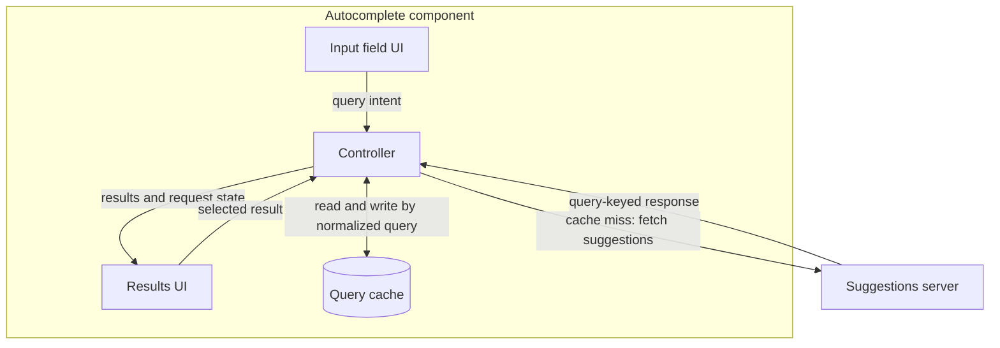
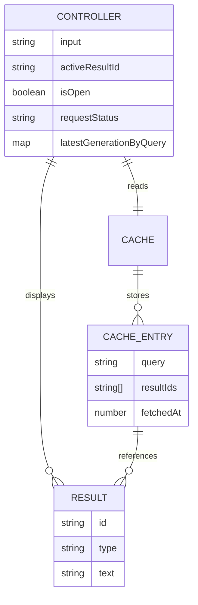
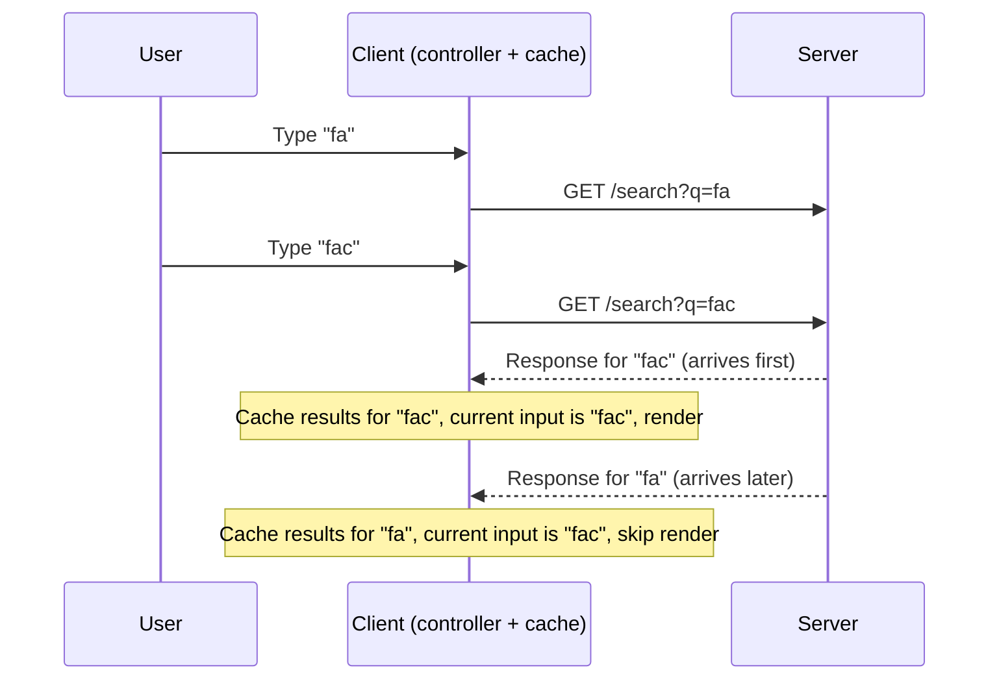
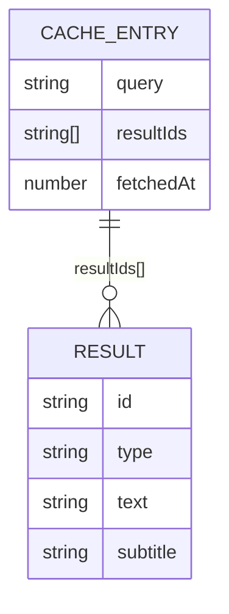
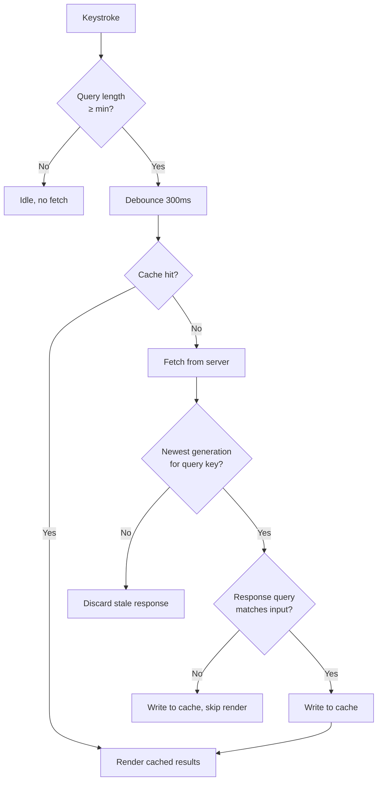
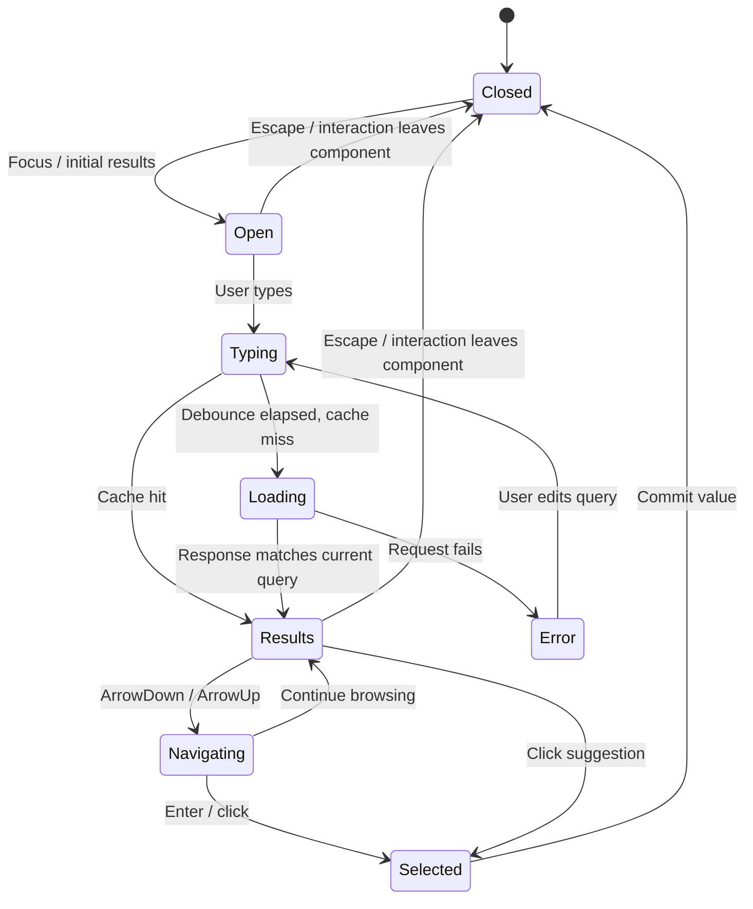

# Autocomplete

**Difficulty:** Medium · **Duration:** ~30 min · **Topics:** Accessibility, UI component

> Source: [autocomplete](https://www.greatfrontend.com/questions/system-design/autocomplete)

Autocomplete combines front end concepts and techniques that also apply to other system design questions, including input handling, asynchronous search, caching, and keyboard navigation.

## Question

Design an autocomplete UI component that allows users to enter a search term into a text box, a list of search results appears in a popup, and the user can select a result.

Some real-life examples where you might have seen this component in action:

- Google's search bar on google.com where you see a list of primarily text-based suggestions.
- Facebook's search input where you see a list of rich results. The results can be friends, celebrities, groups, pages, etc.


A back end API is provided that will return a list of results based on the search query.

### Requirements

- The component should be generic enough to be usable by different websites.
- The input field UI and search results UI should be customizable.

## Solution

### Requirements exploration

These are questions you should be asking your interviewer to dive deeper into the problem and refine the requirements.

#### What kind of results should be supported?

Text, image, and media (image accompanied with text) are the most common types of results, but we cannot anticipate all the different kinds of results that users of the component will want to render.

#### What devices will this component be used on?

All possible devices: laptops, tablets, mobile, etc.

#### Do we need to support fuzzy search?

Not for the initial version. We can explore this if we have time.

#### Check your understanding 1

A team is defining the first version of a reusable autocomplete. Which requirements belong in that version? Select all that apply.

- [ ] Require every provider to return grouped result sections and a continuation cursor, even when all suggestions fit in one response.
  > The response contract may expose optional continuation metadata, but grouping and pagination are not requirements for every first-version result source.
- [x] Keep fuzzy matching out of the initial version unless the product requires it.
  > Fuzzy search adds a separate matching subsystem that is unnecessary for the stated suggestion flow.
- [x] Support text, image, and mixed-media suggestions without assuming one fixed row presentation.
  > Varied result types require a reusable data and rendering contract rather than markup tailored to one suggestion shape.
- [x] Plan for laptop, tablet, and mobile use rather than a desktop-only interaction.
  > The component must leave room for both keyboard and touch-friendly interaction across the stated device range.

---

### Architecture

**Autocomplete component architecture**



- **Input field UI**
  - Handles user input and passes the user input to the controller.
- **Results UI (Popup)**
  - Receives results from the controller and presents them to the user.
  - Handles user selection and informs the controller which input was selected.
- **Cache**
  - Stores the results for previous queries so that the controller can check the cache before sending a request to the server.
- **Controller**
  - The "brain" of the whole component, similar to the Controller in the Model View Controller (MVC) pattern. All the components in the system interact with this component.
  - Passes user input and results between components.
  - Fetches results from the server if the cache is empty for a particular query.

Conceptually, the controller sits at the center: it receives input from the field, consults the cache, falls back to the server on a miss, and pushes results into the popup while also writing responses back into the cache for future keystrokes.

#### Check your understanding 2

How should an autocomplete divide input handling, result rendering, query coordination, and result storage among its views, controller, and cache? Select all that apply.

- [ ] Let the popup update the input element directly after selection instead of reporting the selected result to the controller.
  > Direct DOM synchronization creates a second state path that can disagree with the controller's current query and selection lifecycle.
- [x] Let the cache retain query-keyed result data without directly deciding which query the popup displays.
  > Separating storage from visibility allows historical responses to warm their own entries without replacing the current list.
- [ ] Let each result row fetch its own details and decide whether it still belongs to the current query.
  > Splitting membership across rows creates independent races and prevents the controller from committing one coherent result set.
- [x] Let the popup render the controller's current result set and report which stable result ID the user selects.
  > Presentation can vary while selection and visible-query ownership stay centralized in the controller.
- [x] Let the input render the current text and report edits or focus changes to the controller.
  > The field remains responsible for input interaction without also deciding request or cache eligibility.

#### Check your understanding 3

An autocomplete input, cache, and results popup are separate view components. On a cache miss, which component should coordinate fetching and decide whether a response can replace the visible results?

- [x] The controller normalizes the query, checks the cache, fetches on a miss, commits an eligible response, and exposes results for the current query.
  > One owner can enforce cache and request-identity invariants before either view renders the result.
- [ ] The popup fetches whenever it receives new input text and asks the input to store successful responses for later queries.
  > Coupling fetching to the popup makes presentation responsible for request ordering and prevents a single coherent commit boundary.
- [ ] The cache fetches missing entries and directly replaces the popup whenever any request completes, while the controller tracks only keyboard state.
  > A cache may retain historical responses, but it cannot render every completion because a response can belong to an older query.
- [ ] The input checks the cache and fetches misses, while the popup independently decides whether each response still matches what it should display.
  > The input can initiate work, but splitting response eligibility from request ownership lets the two views disagree about which query is current.

---

### Data model

- Controller
  - Props/options exposed via the component API
  - Current search string
  - Request status and latest generation by normalized query key
- Cache
  - Initial results
  - Cached results
  - Refer to the section below for cache data model design

_These core fields support the basic functionality; caching and other features require additional fields._

At a glance, the controller owns transient UI state (current input, active result ID, open/closed flag) while the cache owns persistent query history, keyed by the normalized query string and referencing result entities.

**Controller and cache internal state**



`requestStatus` can distinguish `idle`, `loading`, `success`, `error`, and `offline`; an empty state is a successful current-query response with zero results.

#### Check your understanding 4

A remote autocomplete can receive responses out of order while keyboard navigation continues. Which values belong in its state model? Select all that apply.

- [x] The active result ID used by keyboard navigation and accessibility attributes.
  > Stable result identity survives list rerenders and connects keyboard state to `aria-activedescendant`.
- [x] The current query and a normalized cache key derived from it.
  > The raw query drives the input, while a normalized key lets equivalent requests share cache entries without replacing user-visible text.
- [ ] Store the currently mounted result elements so their order becomes the canonical result order.
  > Virtualization or rerendering can replace those nodes. Order and identity must come from result data rather than the current DOM window.
- [x] Loading, error, and request identity needed to reject stale responses.
  > Request identity is required to reject stale completions. Loading and error state describe the current request rather than the last response received.
- [ ] Store server-provided highlighted HTML as the canonical label and use it for rendering and matching.
  > Canonical state should retain typed labels and match metadata. Server HTML couples data to presentation and creates an unsafe rendering boundary.

---

### Interface definition (API)

Since this is a front end system design question, we will focus on the API of the component and only briefly touch on the search API that the server should provide.

#### Client

Since we want to make a component that is flexible and easy for other developers to use, we cannot make too many assumptions about how the component will be used and have to supply a fairly large number of options.

##### Basic API

These are the core APIs that affect the functionality of the component.

- **Number of results**: The number of results to show in the list of results.
- **Request adapter**: A function that receives the query, result limit, optional continuation cursor, and `AbortSignal`, then returns typed results with stable IDs. This keeps URL construction, authentication, and response parsing outside the component.
- **Event listeners**: `'input'`, `'focus'`, `'blur'`, `'change'`, and `'select'` are some of the common events that developers might want to respond to (possibly to log user interactions), so adding hooks for these events would be helpful.
- **Customized rendering**: There are a few ways to allow developers to customize the rendering of the various parts of their UI for their use cases:
  - **Theming options object**: This approach is the easiest to use but the least flexible/customizable. The component can accept an object of key/value pairs (e.g. `{ textSize: '12px', textColor: 'red' }`) and use it when rendering.
  - **Classnames**: Allow developers to specify their own CSS class names that the component will add to the various UI sub-components.
  - **Render function/callback**: This is an inversion of control technique commonly used in React where the rendering is completely left to the developer. The component invokes a developer-provided function with some data, and the developer can customize the logic/code to render the UI based on that data. This is the most flexible approach but requires the most effort from the developer.

##### Advanced API

These APIs affect the user experience and performance of the component and should be covered if there's enough time.

- **Minimum query length**: There will likely be too many irrelevant results if the user query is too short, as it is not specific enough. We might only want to trigger the search when a minimum number of characters have been typed in, possibly 3 or more.
- **Debounce duration**: Triggering a back end search API for every keystroke can be quite wasteful, especially when the queries for the first few characters are likely to not be meaningful. Debouncing is a technique that limits the number of times a function gets called. We could debounce the API calls so that the server does not get hit too often. With a debounce duration of 300ms, the back end search API will only be called after there has been no user input for 300ms.
- **API timeout duration**: How long we should wait for a response before determining that the search has timed out so we can display an error.
- **Cache-related**: More details on these options will be covered in the cache section below.
  - Initial results
  - Results source: network only/network and cache/cache only
  - Cache duration

#### Server API

The request adapter should expose a small, consistent contract to the component:

```ts
type Result = {
  id: string;
  text: string;
  value?: string;
  type?: string;
};

type SuggestionsResponse<TItem extends Result = Result> = {
  items: TItem[];
  nextCursor?: string;
};

type GetSuggestions<TItem extends Result = Result> = (options: {
  query: string;
  limit: number;
  cursor?: string;
  signal: AbortSignal;
}) => Promise<SuggestionsResponse<TItem>>;
```

The stable `id` supports rendering and accessibility, while `text` is the visible label. When `value` is omitted, the component commits `text` on selection. Consumers can extend this minimum shape with image or other renderer-specific fields. The adapter translates provider-specific requests, responses, and errors into this contract. A cursor is preferable to a page number when the ranked result set can change between requests.

#### Check your understanding 5

A reusable autocomplete fetches results from a server and lets consumers customize how they render. What should its search API accept and return?

- [x] Accept the query and limit, then return typed results with stable IDs and optional continuation metadata.
  > Stable IDs support selection and deduplication, while an explicit limit and continuation contract bounds both server and client work.
- [ ] Accept the query and limit, but return only display strings and let the client use each result's array index as its identity.
  > Explicit bounds help, but array positions change between responses and cannot identify a selected result or support typed custom renderers reliably.
- [ ] Return pre-rendered list rows so the server owns highlighting and the client only inserts the selected markup.
  > Markup prevents typed reuse across renderers and moves sanitization, selection identity, and interaction semantics into an opaque payload.

#### Check your understanding 6

A shared autocomplete must support text, image, and media results while the component continues to manage selection, keyboard navigation, and accessible labeling. Which customization hooks should it expose? Select all that apply.

- [ ] Require every custom renderer to attach its own pointer and keyboard selection handlers.
  > Custom rows need rendering freedom, but parallel handlers can bypass the component's single selection and focus lifecycle.
- [x] Pass a typed result with a stable ID to a consumer-provided row renderer.
  > Typed data lets consumers vary row presentation while the component keeps stable selection identity.
- [x] Expose input, focus, change, and selection callbacks with structured event data.
  > Semantic callbacks support product behavior and analytics without requiring consumers to inspect internal DOM nodes.
- [x] Expose theme values or class-name hooks for the component's visual parts.
  > Styling hooks customize appearance without transferring keyboard, focus, or request behavior to consumer code.
- [ ] Let the search provider return complete row markup that the popup inserts and uses to discover IDs and labels.
  > Provider markup couples transport to presentation and makes identity, sanitization, and accessible labeling depend on opaque HTML.

#### Check your understanding 7

A reusable autocomplete cancels superseded requests, but different products use different transports and authentication. How should cancellation cross the component API?

- [x] Pass an `AbortSignal` to the request adapter, which retains ownership of URL construction, authentication, and response parsing.
  > The signal gives each adapter a transport-neutral cancellation hook without leaking provider details into the component.
- [ ] Give the adapter direct access to the controller so it can cancel requests and update the cache when responses arrive.
  > Direct cache mutation bypasses the controller's commit checks and entangles provider code with component state.
- [ ] Cancel the previous request and accept every response that still resolves, without comparing its query or generation.
  > Cancellation can arrive too late or be ignored, so response identity remains the correctness guard even when an abort signal is propagated.
- [ ] Require the component to call `fetch()` itself so it can own the `AbortController`, then let the adapter transform only the response body.
  > Owning the transport would couple the component to one request mechanism and prevent adapters from managing provider-specific request details.

---

### Optimizations and deep dive

Autocomplete also needs request ordering, bounded caching, efficient rendering, and keyboard interaction:

- [Network](#network): This section explains how to handle frequent requests, out-of-order responses, retries, cancellation, and degraded connectivity.
- [Cache](#cache): This section covers client-side caching policies, cache keys, invalidation, and how cached suggestions reduce repeated query work.
- [Performance](#performance): This section discusses client-side rendering and input responsiveness techniques for keeping suggestions fast as users type.
- [User experience](#user-experience): This section covers loading states, empty states, keyboard flow, and interaction details that make autocomplete feel predictable.
- [Accessibility](#accessibility): This section explains the ARIA combobox pattern, keyboard navigation, focus handling, and screen-reader expectations for suggestions.

#### Network

Autocomplete fires a request on nearly every keystroke, so the network layer has to tolerate in-flight responses arriving out of order, transient failures, and dropped connectivity.

##### Handling concurrent requests/race conditions

What happens if the user makes changes to the query while there's a pending network request? If there are multiple pending network requests, we will need to be mindful not to display results for a previous search query. We cannot rely on the return order of network responses from the server because an earlier request might complete later than a request fired after it.

> **Never trust response arrival order to decide what to show**
>
> Responses for older keystrokes can easily overtake newer ones on a flaky network. Give each request a monotonically increasing generation, accept a cache write only if it is the newest generation for that query key, and render it only if the key still matches the current input.

The sequence below shows how a later keystroke's response can arrive before an earlier one, and how keying results by the issuing query lets the view safely ignore the stale payload without canceling in-flight work.

**Race condition guard by keying responses to issuing query**



To know which request's response we should display, we could:

1. Attach a timestamp to each request to determine the latest request and only display the results of the latest request (not the latest response!). Discard the responses of irrelevant queries.
2. Save the results in an object/map, keyed by the search query string, and only present the results corresponding to the input value in the search input.

The query key prevents results for `fa` from rendering for `fac`, but it does not distinguish two requests for the same query. Add a monotonically increasing generation so only the newest response for a key may update its cache entry.

Aborting a superseded request with `AbortController` can save client and network work, but it is an optimization rather than the correctness mechanism because cancellation may arrive too late. Keep the identity checks whether or not requests are canceled.

> **Separate cache writes from rendering**
>
> Per-query generations protect the cache from older same-query responses, while the current input decides which cached query is visible. This still lets a response for a historical prefix warm its own cache entry.

Saving the responses for historical keystrokes is useful for cases where users accidentally type an extra character. "f" -> "fo" -> "foo" -> meant to type "t" but mistyped an extra "r" due to fat fingers -> "foot" -> "footr" -> deletes extra "r" -> "foot" (results for "foot" can be displayed immediately since they are already in the cache). If there's debounce, then the request for "foot" might not have fired immediately and there's no response for "foot" to cache, so this mainly benefits autocomplete components without debounce or people who type slower than the debounce duration.

##### Failed requests and retries

Server requests can sometimes fail, possibly due to the user's flaky internet connection. The component can automatically retry firing the query. In case the server is indeed offline and we are concerned about overloading it, we could use an exponential backoff strategy.

##### Offline usage

If we detect that the device has entirely lost its network connection, there's not a whole lot that we can do since our component relies on the server for data. But we could do the following to improve the UX:

- Read purely from the cache. Obviously this is not very useful if the cache is empty.
- Not fire any requests, so as not to waste CPU cycles.
- Indicate somewhere in the component that there's no network connection.

#### Check your understanding 8

A response for `ca` arrives after the response for `cat`. Which client behavior is a sufficient correctness guard against stale results replacing the current list?

- [ ] Render the latest response received and restore the input value associated with that response.
  > Network completion order is unrelated to user intent. Restoring `ca` after the user typed `cat` regresses both input and results.
- [ ] Increase the debounce until requests rarely overlap, then accept every response that completes.
  > Debouncing reduces request frequency but cannot guarantee that slow and fast requests never overlap.
- [ ] Abort the older request when a newer query is issued.
  > Cancellation can save work, but it is not sufficient for correctness because aborting can happen after the response has already settled. Keep the request identity check even when superseded requests are canceled.
- [x] Associate responses with a request or query identity and ignore responses that are no longer current.
  > The identity check protects the commit boundary even when cancellation is unavailable, delayed, or ignored by an intermediate layer.

#### Check your understanding 9

Two requests were issued for `fa`; generation 2 is newer than generation 1. The user has since typed `fac`. Generation 2 for `fa` completes, followed by generation 1. Which response-handling decisions preserve a useful cache without showing stale suggestions? Select all that apply.

- [ ] Store both responses under `fac` so the cache follows the latest text value.
  > A response belongs to the query that issued it. Relabeling `fa` results as `fac` corrupts both cache identity and future rendering.
- [x] Do not render generation 2 while the current input key is `fac`.
  > Cache eligibility is scoped to the issuing query, while visible results must still match the user's current input.
- [ ] Let generation 1 replace the `fa` cache entry because it arrived last.
  > Arrival order does not establish freshness. Accepting the older same-query generation can regress a cache entry that already holds newer data.
- [ ] Discard generation 2 solely because `fa` is no longer the visible query.
  > A noncurrent response must not render, but the newest generation for its own key can still be retained without changing the current list.
- [x] Write generation 2 to the cache entry for `fa`.
  > The response is the newest generation for its own query key, so it can safely warm that historical entry for a later backspace or repeat query.

#### Cache

What is the cache for? Caches are typically used to improve the performance of queries and reduce processing costs by saving the results of previous queries in memory. If/when the user searches for the same term again, instead of hitting the server for the results, we can retrieve the results from memory and instantly show them, effectively removing the need for any network request and latency.

To provide the best experience, Google and Facebook search inputs cache user queries.

##### Prefix lookup with a trie

A trie indexes a collection of strings by sharing their prefixes. To find suggestions for `fac`, follow the edges for `f`, `a`, and `c`, then collect words below that node, such as `face` and `facebook`. Reaching the prefix node takes time proportional to the prefix length; collecting and ranking suggestions requires additional work.

A client-side trie can be useful when the browser already has a bounded, relatively stable collection, such as a list of country names. It avoids scanning the whole collection for each prefix, at the cost of building and storing the index. For a small collection, filtering an array may be sufficient. With a large or frequently changing collection, the suggestions server can own the search index and return a limited, ranked result set.

The query cache here stores responses already returned by that server. A cached response for `fa` may contain only the top results for that query, so filtering it for `fac` can miss valid suggestions. A trie built from those cached results would have the same incomplete coverage. Keep server-backed queries keyed by the full query; use a local trie when the available collection is sufficient to answer the search.

##### Cache structure

The component cache can be designed in several ways, each with tradeoffs worth explaining in a front end system design interview.

The examples below use the adapter's `text` and optional `type` fields. The first two omit repeated IDs to keep the structural comparison short; cached results in the component still follow the stable-ID contract above.

**1. Hash map with search query as key and results as value.** This is the most obvious structure for a cache, mapping the string query to the results. Retrieving the results is super simple and can be done in O(1) time just by looking up whether the cache contains the search term as a key.

```js
const cache = {
  fa: [
    { type: "organization", text: "Facebook" },
    {
      type: "organization",
      text: "FasTrak",
      subtitle: "Government office, San Francisco, CA",
    },
    { type: "text", text: "face" },
  ],
  fac: [
    { type: "organization", text: "Facebook" },
    { type: "text", text: "face" },
    { type: "text", text: "facebook messenger" },
  ],
  face: [
    { type: "organization", text: "Facebook" },
    { type: "text", text: "face" },
    { type: "text", text: "facebook stock" },
  ],
  faces: [
    { type: "television", text: "Faces of COVID", subtitle: "TV program" },
    { type: "musician", text: "Faces", subtitle: "Rock band" },
    { type: "television", text: "Faces of Death", subtitle: "Film series" },
  ],
  // ...
};
```

However, note that there are lots of duplicate results, especially if we don't do any debouncing as the user is typing and we fire one request per keystroke. This results in the page consuming lots of memory for the cache.

**2. List of results.** Alternatively, we could save the results as a flat list and do our own filtering on the front end. There will not be much (if any) duplication of results.

```js
const results = [
  { type: "company", text: "Facebook" },
  {
    type: "organization",
    text: "FasTrak",
    subtitle: "Government office, San Francisco, CA",
  },
  { type: "text", text: "face" },
  { type: "text", text: "facebook messenger" },
  { type: "text", text: "facebook stock" },
  { type: "television", text: "Faces of COVID", subtitle: "TV program" },
  { type: "musician", text: "Faces", subtitle: "Rock band" },
  { type: "television", text: "Faces of Death", subtitle: "Film series" },
];
```

However, this is not ideal in practice because we have to do filtering on the client side. This is bad for performance and might end up blocking the UI thread, and it is especially evident on large data sets and slow devices. The ranking order of the results might also be lost, which is not ideal.

**3. Normalized map of results.** We take inspiration from [normalizr](https://github.com/paularmstrong/normalizr/tree/master/docs) and structure the cache like a database, combining the best traits of the earlier approaches: fast lookup and non-duplicated data. Each result entry is one row in the "database" and is identified by a unique ID. The cache simply refers to each item's ID.

```js
// Store results by ID to easily retrieve the data for a specific ID.
const results = {
  1: { id: 1, type: "organization", text: "Facebook" },
  2: {
    id: 2,
    type: "organization",
    text: "FasTrak",
    subtitle: "Government office, San Francisco, CA",
  },
  3: { id: 3, type: "text", text: "face" },
  4: { id: 4, type: "text", text: "facebook messenger" },
  5: { id: 5, type: "text", text: "facebook stock" },
  6: {
    id: 6,
    type: "television",
    text: "Faces of COVID",
    subtitle: "TV program",
  },
  7: { id: 7, type: "musician", text: "Faces", subtitle: "Rock band" },
  8: {
    id: 8,
    type: "television",
    text: "Faces of Death",
    subtitle: "Film series",
  },
};

const cache = {
  fa: [1, 2, 3],
  fac: [1, 3, 4],
  face: [1, 3, 5],
  faces: [6, 7, 8],
  // ...
};
```

There will be pre-processing that needs to be done before showing the results to the user, to map a list's result IDs to the actual result items, but the processing cost is negligible if there are only a few items to be shown.

The relationship between the query-keyed index and the canonical result store mirrors a normalized database, where each query points to a list of IDs and each ID resolves to a single shared entity.

**Normalized cache entity relationships**



**Which structure to use?**

Which to use depends on the type of application this component is being used in.

- **Short-lived websites**: If the component is being used on a page that is short-lived (e.g. Google search), option 1 would be the best. Even though there is duplicated data, the user is unlikely to use search so often that memory usage becomes an issue. The cache is cleared/reset when the user clicks on a search result anyway.
- **Long-lived websites**: If this autocomplete component is used on a page that is a long-lived single page application (e.g. Facebook website), then option 3 might be viable. However, do also note that caching results for too long might be a bad idea, as stale results take up memory without being useful.

> **Pick the cache shape based on how long the page lives**
>
> The query-to-results hash map is the simplest default and is fine for short-lived surfaces like a Google results page that resets on navigation. Reach for a normalized store keyed by entity ID only for long-lived single-page apps where repeated queries would otherwise duplicate the same entities across many cache entries and pressure memory.

##### Initial results

Have you noticed how on Google search, when you first focus on the input, a list of results is displayed even though you haven't typed anything yet? Showing an initial relevant list of results could be useful in saving users from typing and reducing server costs.

- **Google**: Popular search queries today (current affairs, trending celebrities, latest happenings) and historical searches
- **Facebook**: Historical searches.
- **Stock/crypto/currency exchanges**: Historical searches or trending stocks

The initial results could be an option on the component and added to the cache where the key is an empty string.

In the past, Facebook loaded a user's friends, pages, and groups into the browser cache so that results could be shown instantly via client-side filtering without sending another HTTP request.

_Source: [The Life of a Typeahead Query](https://engineering.fb.com/2010/05/17/web/the-life-of-a-typeahead-query/)_

##### Caching strategy

Caching is a space/time tradeoff where we trade memory space to save on processing time. Having cached results stay around for too long is a bad idea because it consumes memory, and if too much time has passed since the cache entry was written, the results are likely irrelevant/outdated. There's little value in using memory to store irrelevant/outdated results.

When to evict the cache depends on the type of application:

- **General search**: A longer cache duration can be reasonable when results change slowly.
- **Personalized search**: Use a shorter duration when results change frequently or depend on the signed-in user.
- **Stock/currency exchanges**: Exchanges with an autocomplete for stock ticker symbols/currency that show the current price in the results might not want to cache at all because the prices change every minute when the markets are open.

We can add the data source/caching strategy and cache duration as configuration options on the component.

- **Data source**: Whether to read the results from the "network only", "network and cache", "cache only".
- **Cache duration/Time-to-live**: How long to retain each cache entry. This will involve adding timestamps to each entry and evicting stale cache entries every now and then.

Within one component and data-source context, normalize equivalent query strings before using them as keys, expire entries with a TTL, and enforce a small maximum size by evicting the least recently used queries.

#### Check your understanding 10

One autocomplete is used on a short-lived search page; another lives for hours in a dashboard and often returns the same entities across queries. Which cache design best fits both cases?

- [ ] Store a separate immutable result copy for every query in both products and retain all entries until the page closes.
  > Per-query copies are a reasonable simple shape, but an unbounded long-lived cache can accumulate duplicate and stale data.
- [ ] Keep one flat result list in both products and filter it locally for every query so no query-index entries are needed.
  > Client filtering can block the UI and discard server ranking or matching rules, especially when the searchable data is large or remote.
- [x] Use a query-to-results map for the short-lived page, and consider a query-to-ID index plus normalized entities for the long-lived dashboard.
  > The simple map minimizes machinery when duplication is bounded, while normalization can reduce repeated entity data during a long session.
- [ ] Use one normalized entity store for both products so they share the same cache implementation despite their different lifetimes.
  > Normalization saves memory only when meaningful duplication accumulates. A short-lived page may pay complexity without a practical benefit.

#### Check your understanding 11

How should an autocomplete cache reuse repeated queries, limit stale results, and bound memory use? Select all that apply.

- [ ] Cache rendered result fragments together with data so a repeated query can skip list reconciliation.
  > Rendered fragments capture stale focus, handlers, and view context. Cache result data and derive the current view instead.
- [ ] Keep all successful queries until memory pressure is reported by the browser, relying on the server to return immutable results.
  > Result relevance can change and browsers do not provide a reliable eviction signal for application objects. The cache needs explicit age and size policies.
- [x] Normalize equivalent queries before using them as cache keys.
  > Normalization avoids duplicate entries for queries the product treats as equivalent without changing the text shown in the input.
- [x] Expire old entries and evict least-recently-used queries when the cache reaches its limit.
  > TTL limits staleness and LRU bounds memory while retaining results most likely to be reused.

#### Performance

Performance here refers to client-side performance since server-side performance (how fast the query returns) is out of scope.

##### Loading speed

We can't improve how fast the server returns the response, but with client-side caching, we can show results for an exact normalized query match nearly instantly.

##### Debouncing/throttling

By limiting the number of network requests that can be fired, we reduce server load and CPU processing.

> **Default to a 300ms debounce and reach for throttle only when scrolling**
>
> Debounce is the right tool for typing: it fires the request after the user pauses, so fast typists produce one call rather than one per keystroke. Throttle fits continuous signals like scroll or resize where you want a bounded stream of updates. Pick a duration around 300ms so the UI still feels responsive and surface it as a prop so consumers can tune for slower typists or chattier back ends.

The keystroke-to-render pipeline strings together debounce, cache lookup, network fetch, a per-query generation guard, and a current-input check. Only the newest response for a query key may update its cache entry, and only results matching the current input reach the UI.

**Keystroke to render pipeline**



##### Memory usage

Long-lived pages might have autocomplete components that accumulate too many results in the cache and hog memory. Purging the cache and freeing up memory is essential for such pages. The purging can be done when the browser is idle or when the total memory/number of cache entries exceeds a certain threshold.

##### Virtualized lists

If the results contain many items (on the order of hundreds or thousands), rendering that many DOM nodes in the browser would cost lots of memory and slow down the browser. List virtualization is a technique we can use here to help the component retain its performance at scale.

From [https://web.dev](https://web.dev/virtualize-long-lists-react-window):

> List virtualization, or "windowing", is the concept of only rendering what is visible to the user. The number of elements that are rendered at first is a very small subset of the entire list and the "window" of visible content moves when the user continues to scroll. This improves both the rendering and scrolling performance of the list.

The trick here is to only render the nodes that are visible and recycle DOM nodes instead of creating new ones. We can make the results window give the illusion that it contains that many results with fake off-screen elements that add up to the height of the non-visible result elements.

#### Check your understanding 12

Fast typists generate several remote autocomplete queries in a few hundred milliseconds. Which scheduling policy reduces request volume without making the input feel delayed?

- [ ] Send the latest query at a fixed interval throughout the typing burst, as is common for scroll handlers.
  > Throttling bounds the rate but still sends intermediate text. Debounce better represents the user's settled text intent.
- [ ] Delay both the controlled input value and its search until the debounce interval completes.
  > Delaying the field makes visible typing latency depend on the request scheduler even though input rendering is cheap.
- [x] Commit each input value immediately, but start the search only after the configured debounce interval passes without another edit.
  > The field stays synchronized with the user's keystrokes while a burst of edits collapses into one remote request.
- [ ] Start every request immediately and rely on aborting older requests to eliminate server work.
  > Aborts may arrive after work has begun or completed, so cancellation alone does not collapse a burst of requests.

#### Check your understanding 13

An autocomplete must let users browse hundreds of suggestions, and mounting the full result list makes typing feel delayed. Which change most directly protects input responsiveness?

- [ ] Batch the input value and result list into one commit so users never see a query paired with old results.
  > Consistency is useful, but delaying the input makes typing latency depend on result rendering. Show the keystroke immediately and mark results pending.
- [ ] Compute and render the complete result list synchronously, but memoize individual result rows.
  > Row memoization does not remove the query-wide filtering, highlighting, and list reconciliation performed before the next input paint.
- [x] Keep input state updates immediate while mounting only the visible suggestion window plus a small buffer.
  > Windowing bounds list reconciliation work independently of the input, so each keystroke can paint without mounting hundreds of rows.

#### User experience

The following are some good UX practices to apply to the autocomplete component:

##### Autofocus

Add the `autofocus` attribute to your `input` if it's a search page (like Google) and you're very certain that the user has a high intent to use the autocomplete when it is present on the screen.

##### Handle different states

- **Loading**: Show a spinner when there's a background request.
- **Error**: Show an error message with a retry request button.
- **No network**: Show an error message that there's no network available.

##### Handle long strings

Long text in the result items should be handled appropriately, usually via truncating with an ellipsis or wrapping nicely. The text should not overflow and appear outside the component.

##### Mobile-friendliness

- Each result item should be large enough for the user to tap on if used on mobile.
- Dynamic number of results depending on viewport window size, but this is better implemented in userland instead.
- Expose `autocapitalize`, `autocomplete`, `autocorrect`, and `spellcheck` as configurable options. `autocomplete="off"` is only a browser hint, and correction or spellchecking should be disabled only when it conflicts with the product's input domain.

##### Keyboard interaction

- Users should be able to use the component and focus on the autocomplete suggestions using just their keyboard. Read more under the **Accessibility** section.
- Add a global shortcut key to let the user easily focus on the autocomplete input. A common keyboard shortcut is the <kbd>/</kbd> (forward slash) key, which is used by Facebook, X and YouTube.

##### Typos in search

It is easy to make typographical errors, especially on mobile devices. A fuzzy search is a searching technique where results that match the search query closely instead of exactly are also considered. Fuzzy searches help you find relevant results even when the search terms are misspelled.

Fuzzy searches can be used if the filtering is done purely on the client side by computing the edit distance (e.g. [Levenshtein distance](https://en.wikipedia.org/wiki/Levenshtein_distance)) between the search query and the results and selecting the ones with the smallest edit distance. For searches done on the server side, we can send the query as-is and have the fuzzy matching be done on the server.

##### Query results positioning

The list of autocomplete suggestions typically appears below the input. However, if the autocomplete component is at the bottom of the window, then there's insufficient space to fully display the results. The suggestions can be made aware of their positioning on the page and render above the input if there's no space to show them below.

The implementation must use one coordinate space and update the popup while relevant ancestors scroll or resize. Exact portal, collision, and observer mechanics are a potential interview follow-up; a maintained positioning library is a reasonable production choice.

#### Check your understanding 14

A query completes successfully with no matches. What should the component do?

- [x] Keep the query visible, show a clear no-results state, and allow the user to continue editing.
  > The response is terminal and valid, so the UI can distinguish “no matches” from loading or failure while preserving the user's input.
- [ ] Keep showing the previous results with a loading indicator until the user changes the query again.
  > The request has completed. Stale results imply matches that the server did not return and leave the state machine stuck in loading.
- [ ] Clear the query and reopen the default suggestions so the popup never appears empty.
  > Replacing the user's text hides the completed outcome and forces them to reconstruct or retype the query.

#### Check your understanding 15

An autocomplete has cached suggestions for the current query, starts a refresh, then the request times out; later the browser reports that it is offline. Which state decisions represent those transitions accurately? Select all that apply.

- [ ] Keep the loading indicator visible after a failure until the user edits the query.
  > Once the request settles, a perpetual loading state hides the available recovery action and misrepresents the lifecycle.
- [ ] Render the normal no-results state after a timeout so the popup remains visually simple.
  > A timeout provides no evidence that the query has zero matches, so this presentation turns uncertainty into an incorrect result.
- [x] Leave the loading state when the request times out and expose a failed state with a retry action.
  > A settled timeout is no longer pending, and an explicit failure preserves a deliberate recovery path for the same query.
- [x] Represent offline separately, stop issuing requests, and identify any displayed cached suggestions as degraded data.
  > Offline status changes whether network work should be attempted, while the label explains why cached suggestions cannot be refreshed.
- [x] Keep the query and its matching cached suggestions visible while labeling the refresh failure.
  > Retaining user intent and known cached data avoids replacing useful content with an outcome the failed request never established.

#### Check your understanding 16

An autocomplete near the bottom of a scrolling panel cannot fit its full popup below the input. Which positioning policy handles the collision reliably?

- [ ] Use the input's viewport rectangle for the vertical position and its document offset for the horizontal position.
  > Mixing coordinate systems makes the popup drift as the page or an ancestor scrolls.
- [ ] Translate the input upward until its preferred below placement fits, then restore it when the popup closes.
  > Moving the control changes surrounding interaction geometry. The overlay should adapt without displacing its anchor.
- [x] Measure in one coordinate space, flip above when appropriate, constrain the popup, and update it when relevant ancestors scroll or resize.
  > Consistent geometry prevents offset errors, while collision handling and updates keep the popup visible and attached to its input.
- [ ] Keep the popup below the input and add scrolling to the visible fragment, even when most of it falls outside the viewport.
  > Internal scrolling helps after sizing, but it does not make a severely clipped placement preferable to an available side.

#### Accessibility

A combobox built from a plain `<input>` has no inherent semantics, so we lean on ARIA roles and keyboard conventions to make the component usable for screen reader and keyboard-only users.

> **Follow the WAI-ARIA combobox pattern, do not invent your own roles**
>
> Autocomplete is exactly the interaction the combobox pattern was designed for, and screen readers already know how to announce it when the roles, `aria-expanded`, `aria-activedescendant`, and keyboard interactions match the spec. Ad hoc ARIA attributes on a regular input usually end up announcing inconsistently or not at all, which leaves keyboard and screen reader users unable to reach the results popup.

##### Screen readers

- Give the input a visible label when possible, or use `aria-label` when there is no visible label.
- Give the input `role="combobox"`, `aria-autocomplete="list"`, `aria-expanded`, and `aria-controls` pointing to the popup.
- Give the popup `role="listbox"` and each stable-ID suggestion `role="option"`. Native `<ul>` and `<li>` structure does not replace these combobox roles.
- Keep DOM focus on the input and update `aria-activedescendant` and the active option's `aria-selected` state.
- Announce loading, result counts, empty results, and errors through a separate [`aria-live`](https://developer.mozilla.org/en-US/docs/Web/Accessibility/ARIA/ARIA_Live_Regions) status element rather than making the interactive listbox a live region.

##### Keyboard interaction

- When a suggestion is active, Enter selects it; otherwise Enter can submit the surrounding search form.
- Up/down arrows move through the available options. Whether navigation wraps is a product decision.
- Escape to dismiss the results popup if it is visible.
- While an IME composition is active, leave Enter and navigation keys to the input method and process the committed value after `compositionend`.
- Follow the [WAI ARIA Combo Box](https://www.w3.org/WAI/ARIA/apg/patterns/combobox/) practices. Detailed policies for Home/End, Tab, disabled options, and results changing during navigation can be discussed as follow-ups.

These interactions are easier to reason about as an explicit lifecycle: the popup opens on focus or typing, transitions through loading and results states, and closes on selection, Escape, or when focus and pointer interaction leave the autocomplete as a whole. Closing immediately on input blur can unmount a suggestion before its pointer activation completes.

**Combobox lifecycle and keyboard interaction states**



#### Check your understanding 17

A remote autocomplete refreshes its results while the user navigates with arrow keys. How should it manage focus, selection keys, and popup semantics during those updates? Select all that apply.

- [ ] Move DOM focus to the first new result after each response so the refreshed list is announced automatically.
  > An asynchronous response would steal focus from typing and discard the user's current active option without an intentional navigation action.
- [x] Support arrow navigation, Enter selection, and Escape dismissal without requiring a pointer.
  > These keys provide the expected non-pointer path while Escape returns to the unexpanded input state.
- [x] Keep DOM focus on the input and expose the active option with `aria-activedescendant`.
  > Keeping one DOM focus target lets typing continue while the active descendant exposes virtual focus within the listbox.
- [ ] Put every option in the normal Tab order and move DOM focus into the list as soon as results arrive.
  > Autocomplete keeps DOM focus on the input and represents the active option with `aria-activedescendant`. Asynchronous results should not create a row of new Tab stops or steal focus.
- [x] Connect the combobox to a labeled listbox and expose expanded state.
  > The relationship and expanded state tell assistive technology which popup belongs to the input and whether it is available.

#### Check your understanding 18

A screen-reader user types into a remote autocomplete while results load and change. Which announcement choices provide useful status without disrupting input? Select all that apply.

- [ ] Use assertive announcements for the input value and provisional result count after every keystroke.
  > Frequent assertive messages interrupt typing and can speak transient states that are immediately superseded.
- [x] Announce outcomes for the current query when they become useful, rather than narrating every intermediate keystroke.
  > Coalescing announcements around meaningful state changes reduces noise while still communicating the result of the user's action.
- [ ] Mark the interactive listbox as a live region so every row insertion is announced automatically.
  > Combining live-region updates with the listbox interaction model can produce repetitive announcements as options mount or reorder.
- [x] Use a separate polite live-status element for loading, result counts, empty results, and errors.
  > A noninteractive status channel can announce meaningful transitions without changing focus or the listbox's interaction role.

#### Check your understanding 19

An autocomplete receives Enter and arrow-key events while an input method editor is composing a character. How should it respond?

- [x] Leave those keys to the input method during composition, then process the committed value after `compositionend`.
  > Composition keystrokes edit the pending character. Treating them as list commands can select a result before the intended text exists.
- [ ] Suppress search updates throughout composition and wait for the input to blur before processing its committed value.
  > The committed value is available at `compositionend`. Waiting for blur delays valid search and may prevent results while the user remains in the field.
- [ ] Select the active result whenever Enter fires because keyboard selection has priority over text entry.
  > During composition, Enter commonly confirms a character rather than the autocomplete option, so unconditional selection corrupts the input flow.
- [ ] Move the active option on arrow keys but suppress Enter until composition ends.
  > Arrow keys can also participate in candidate selection, so consuming only some composition keys still interferes with the input method.

#### Check your understanding 20

Clicking a suggestion moves focus away from the autocomplete input before the option's activation handler runs. Which lifecycle avoids losing the selection?

- [ ] On pointer down, refocus the input and rebuild the popup before running the option's selection handler.
  > Reconstructing the target introduces another focus transition and can change which option the pending pointer action refers to.
- [ ] Unmount the popup as soon as the input blurs, then let the browser deliver the remaining click events.
  > Removing the option before activation can cancel the click and leave the user's selection uncommitted.
- [ ] Disable pointer events on result rows and require users to return focus to the input before choosing a result.
  > Removing direct pointer activation avoids the race by discarding an expected input method rather than coordinating the lifecycle.
- [x] Treat the input and popup as one interaction boundary and let the option activation complete before closing the popup.
  > Deferring dismissal across an internal pointer interaction keeps the target mounted long enough to commit its value.

### Summary

Autocomplete needs to remain fast and correct across unreliable networks, long sessions, and assistive technology. The main decisions are controller ownership, cache design, and input and popup behavior.

**Centralize traffic through a controller.** The input field UI, the results UI popup, the cache, and the server all talk to a single controller that owns the current input, `activeResultId`, and `isOpen`. Every keystroke follows the same path: consult the cache, fall back to the server on a miss, and write the response back, so race conditions and stale state have one place to be resolved instead of leaking across components.

**Choose the cache shape based on page lifetime.** A query-to-results map is the simplest default for short-lived pages. A long-lived application can use `CACHE_ENTRY` records and shared `resultIds` when measured duplication justifies the extra lookup step. In either shape, request generations prevent older same-query responses from replacing newer cached data.

**Debounce requests, reuse cached results, and follow combobox semantics.** A ~300ms debounce collapses keystrokes into one request, repeat and backspace queries are served from the cache without a round trip, and the combobox follows the WAI-ARIA pattern with `role="combobox"`, `aria-expanded`, and `aria-activedescendant` rather than bespoke roles.

Start by combining a complete query key with request generations; the key controls what may render and the generation controls which response is current.

> **Potential follow-ups**
>
> If the interviewer wants production depth, discuss privacy-aware cache keys and query logging, bounded retry policy, virtualization's `aria-activedescendant` constraints, and safeguards for autofocus or global keyboard shortcuts. These concerns are important, but they do not need full implementation contracts in the core answer.

### Comparing Google, Facebook, and X search component

Here's a comparison of Google, Facebook, and X's search autocomplete components and the HTML attributes used.

| HTML Attribute          | Google       | Facebook            | X                |
| ----------------------- | ------------ | ------------------- | ---------------- |
| HTML Element            | `<textarea>` | `<input>`           | `<input>`        |
| Within `<form>`         | Yes          | No                  | Yes              |
| `type`                  | `"text"`     | `"search"`          | `"text"`         |
| `autocapitalize`        | `"off"`      | Absent              | `"sentence"`     |
| `autocomplete`          | `"off"`      | `"off"`             | `"off"`          |
| `autocorrect`           | `"off"`      | Absent              | `"off"`          |
| `autofocus`             | Present      | Absent              | Present          |
| `placeholder`           | Absent       | `"Search Facebook"` | `"Search"`       |
| `role`                  | `"combobox"` | Absent              | `"combobox"`     |
| `spellcheck`            | `"false"`    | `"false"`           | `"false"`        |
| `aria-activedescendant` | Present      | Absent              | Present          |
| `aria-autocomplete`     | `"both"`     | `"list"`            | `"list"`         |
| `aria-expanded`         | Present      | Present             | Present          |
| `aria-haspopup`         | `"false"`    | Absent              | Absent           |
| `aria-invalid`          | Absent       | `"false"`           | Absent           |
| `aria-label`            | `"Search"`   | `"Search Facebook"` | `"Search query"` |
| `aria-owns`             | Present      | Absent              | Present          |
| `dir`                   | Absent       | `"ltr"`/`"rtl"`     | `"auto"`         |
| `enterkeyhint`          | Absent       | Absent              | `"search"`       |

Note: This table is a non-normative snapshot of production implementations. Attribute usage can change or differ between products, but this component should follow the standardized WAI-ARIA combobox pattern described above.

### References

The references below group autocomplete sources by theme, so it is easier to map each source back to the part of the article it informed.

#### Search and typeahead case studies

These writeups describe how production search teams think about ranking, latency, and incremental retrieval behind a typeahead input.

- [The Life of a Typeahead Query](https://engineering.fb.com/2010/05/17/web/the-life-of-a-typeahead-query/) for an end-to-end look at how Facebook serves typeahead queries at scale.
- [Query Autocomplete from LLMs | Reddit Engineering](https://www.reddit.com/r/RedditEng/comments/1loewqg/query_autocomplete_from_llms/) for a modern case study on using LLMs to generate query suggestions.

#### Accessibility patterns

This subsection covers the accessibility foundations for building an inclusive autocomplete input.

- [Building an accessible autocomplete control](https://adamsilver.io/blog/building-an-accessible-autocomplete-control/) for a walkthrough of the keyboard, screen reader, and markup choices needed for an accessible control.
- [Combobox pattern | W3C ARIA APG](https://www.w3.org/WAI/ARIA/apg/patterns/combobox/) for the authoritative ARIA authoring practices that shape the roles and states used in autocomplete.

#### Combobox implementations

This subsection points to real libraries and primitives that implement the combobox pattern so you can compare API ergonomics.

- [React Select](https://react-select.com) for a popular themed combobox library and its customization surface.

#### Supporting browser APIs and data structures

This subsection collects the lower-level browser APIs and data structures that underpin an autocomplete implementation.

- [AbortController | MDN](https://developer.mozilla.org/en-US/docs/Web/API/AbortController) for canceling stale in-flight fetch requests as the user keeps typing.
- [Trie | Wikipedia](https://en.wikipedia.org/wiki/Trie) for the prefix-tree data structure commonly used for client-side suggestion lookup.

#### Related system design articles

The articles below overlap with autocomplete on popup menus, keyboard behavior, and product search flows.

- [Dropdown menu](https://www.greatfrontend.com/questions/system-design/dropdown-menu) for the menu, keyboard, and positioning patterns that overlap with the autocomplete popup.
- [E-commerce website (Amazon)](https://www.greatfrontend.com/questions/system-design/e-commerce-amazon) for how product search and autocomplete fit into a larger commerce surface.

## Asked at these companies

- Apple
- Amazon
- Anthropic
- Airbnb
- Google
- LinkedIn
- Lyft
- Meta
- Microsoft
- OpenAI
- Twitter
- Uber
- Shopify
- Snowflake
- Robinhood
- Discord
- Netflix
- Pinterest
- Databricks
- TD Bank
- eBay
