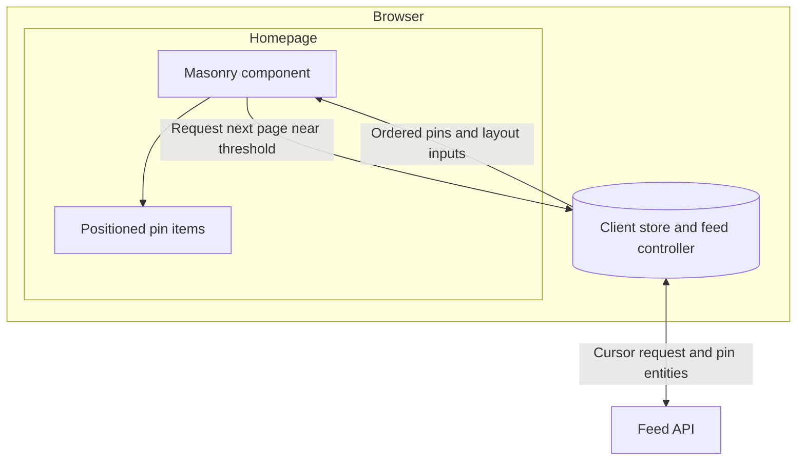
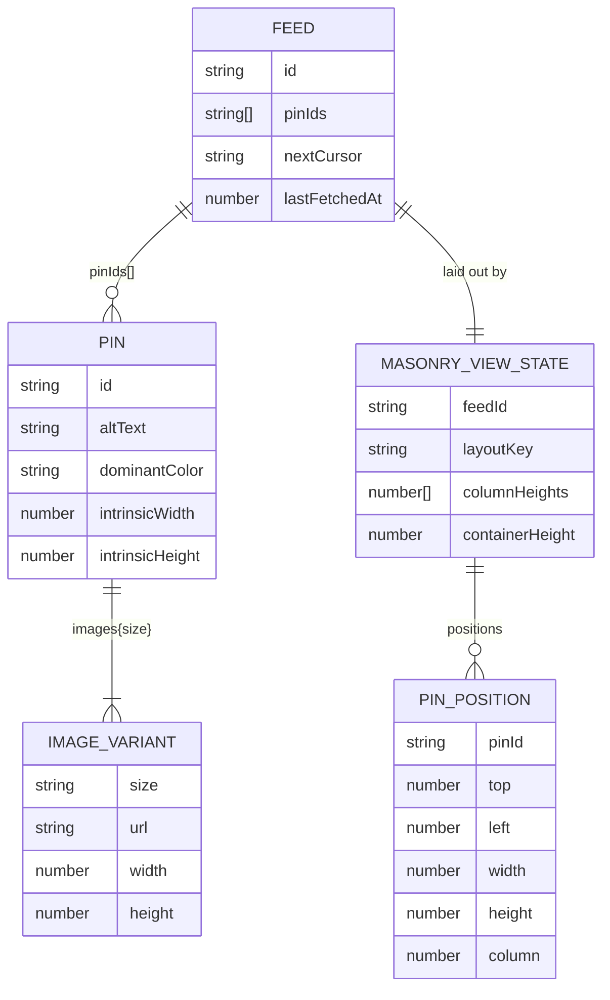
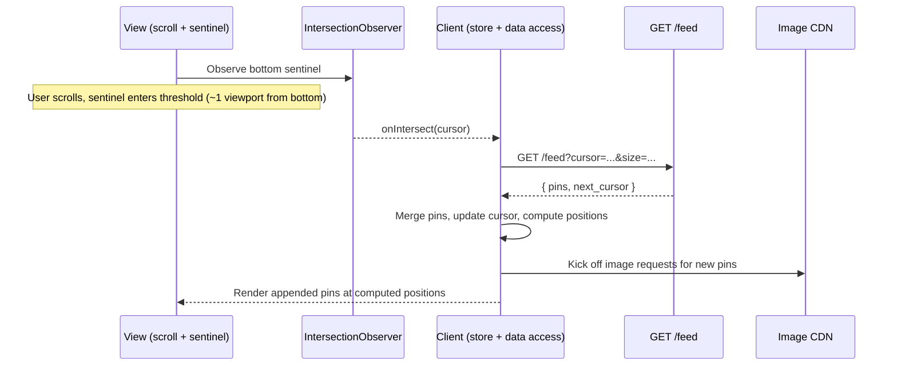
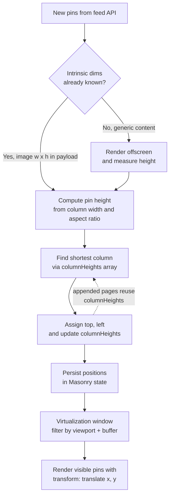
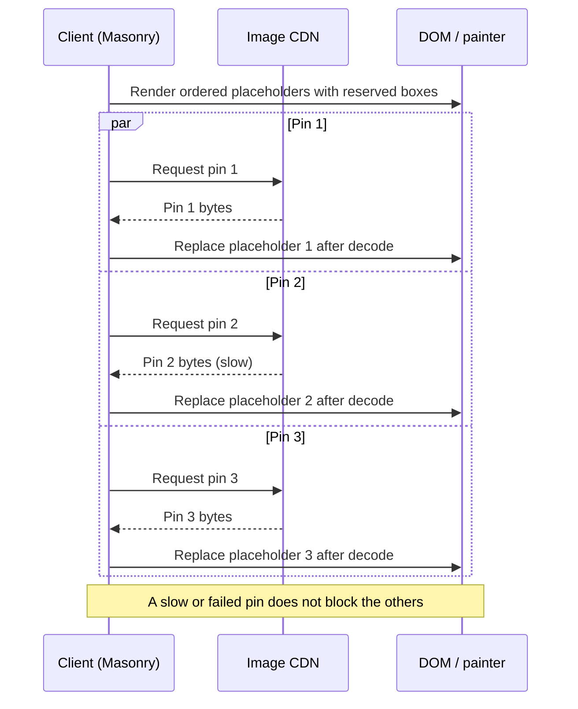

# Pinterest

**Difficulty:** Hard · **Duration:** ~30 min · **Topics:** Accessibility, Networking, Performance

> Source: [pinterest](https://www.greatfrontend.com/questions/system-design/pinterest)

Masonry is a column-based layout. Unlike traditional grids, where elements in the same row have the same height, elements are placed within columns but can have varying heights, so items do not need to align across rows.

Such a layout uses space efficiently as it fills up most of the available screen real estate with its contents and leaves little white space between elements. It is commonly used for presenting user-generated media like images and GIFs. The most famous site with this layout is [Pinterest](https://pinterest.com/).

## Question

Design the [Pinterest homepage](https://pinterest.com/), with a focus on the masonry layout.


Pinterest front end system design questions are commonly asked in two manners:

1. Design the Pinterest homepage, which covers page architecture, masonry layout, data fetching, etc.
2. Design a masonry component, discussing the props, layout approach, etc.

We will focus on the former but also provide enough content and guidance for the latter. In fact, the actual masonry component Pinterest uses on their homepage is built in [React and open sourced](https://gestalt.pinterest.systems/v1/web/masonry)! You can dive into the source code to learn the ins and outs of the component and also use it on your own sites.

> **Read the News Feed and Instagram articles first**
>
> Pinterest is essentially an image feed with a multi-column layout. Hence, it shares many similarities with the [News Feed system design](https://www.greatfrontend.com/questions/system-design/news-feed-facebook) and [Instagram system design](https://www.greatfrontend.com/questions/system-design/photo-sharing-instagram). Please read through those questions before starting on this one. For this question, the discussion will be centered around the masonry layout and less about general feed optimizations.

## Solution

### Requirements exploration

We scope the exercise by clarifying the core feed behavior (masonry, infinite scroll), the ordering of pins, and which adjacent product surfaces fall inside the interview.

#### What are the core features to be supported?

- Masonry layout of feed items (pins).
- More items should be loaded in as the user scrolls down.

#### How should the pins be ordered?

As much as possible, the pins should be placed respecting their position within the feed, i.e., pins that are at the front of the returned results should appear higher on the page.

#### What kind of pins/items are supported?

Focus on just images. Exclude videos and GIFs.

#### What devices will the application be used on?

Primarily desktop, but should be usable on mobile and tablet as well.

#### Check your understanding 1

You are asked to design a front-end Pinterest-like discovery feed. Which requirements should be settled before choosing its architecture? Select all that apply.

- [ ] Allow the layout to reorder loaded pins by height whenever doing so fills the columns more evenly.
  > Masonry may choose a column for the next pin, but silently sorting the ranked results by height changes the product's feed order.
- [x] Confirm that the core product is an image-only masonry feed that loads more pins as the user scrolls.
  > The media type and continuation model define the primary layout, loading, and rendering work without expanding into adjacent product flows.
- [x] Require earlier results to appear higher than later results as much as the masonry layout allows.
  > The placement algorithm may balance columns, but it cannot silently replace recommendation order with a height-based sort.
- [x] Optimize primarily for desktop while keeping the feed usable on mobile and tablet.
  > Device mix determines responsive column counts, page sizing, and media selection.

---

### Glossary

We'll refer to "feed items" as "pins" and use them interchangeably below. A pin contains basic metadata such as the image, subtitle, etc.

### Architecture / high-level design

The architecture depends on the rendering model (SSR for SEO, CSR for feed interactivity) and on how the client fetches and virtualizes the masonry feed.

#### Server-side rendering (SSR) or Client-side rendering (CSR)?

For a website like Pinterest, which is known for its visual content and user interactivity, a hybrid approach might be a good choice. Pinterest has a complex user interface with endless scrolling and dynamic content. Initially, you might use SSR for the landing page and critical content (for SEO and fast initial load), and then switch to CSR for interactivity as users browse pins and boards.

In reality, Pinterest uses a hybrid rendering strategy that involves SSR with hydration. The initial pins' markup and data are included in the initial HTML, but without any positioning data. This will be covered in more detail below.

#### Single-page application (SPA) or Multi-page application (MPA)?

In feed applications, it's a common UX pattern for the full contents of a pin to be opened within a modal, overlaying the feed. When the user closes the modal, they can continue scrolling the feed from where they left off. This UX is present on Facebook and Instagram, as well as Pinterest.

An SPA overlay route is a good product choice because it keeps the feed mounted while a pin opens, but it is not required for scroll restoration: browsers may restore history and the page from bfcache. Preserve a stable pin anchor, cursor, and scroll offset as a fallback, and give the detail view a deep-linkable URL in either architecture.

#### Component responsibilities

**Pinterest feed architecture**



The architecture diagram of a Pinterest feed is relatively simple since we are only focusing on the feed and layout.

- **Server**: Provides HTTP APIs to fetch the feed of pins and also subsequent pages of pins as the user scrolls through the feed.
- **Client store**: Stores data needed across the whole application. For this question, there's a list of pins to be stored.
- **Homepage**: Displays the list of pins.
  - **Masonry component**: UI component that takes in a list of pins and displays them in a masonry layout.

> **We fold the controller into the client store to keep the diagram compact**
>
> Conventionally, we have "controller" and "client store" as separate entities, but since the types of data involved and data fetching required for the feed are fairly limited, we can combine the controller into the client store and make the client store take up data fetching responsibilities. However, in practice, there are many more state values and interactions to handle, and a separation would be beneficial.

#### Check your understanding 2

Which rendering strategy best supports public pin discovery and long interactive sessions?

- [x] Server-render the initial pin content and data, then hydrate feed continuation, detail overlays, and navigation state.
  > Initial discovery content arrives as useful HTML, while hydration adds the long-lived feed behavior needed after entry.
- [ ] Client-render every route but server-render route metadata and social preview tags for public pins.
  > Metadata helps previews but does not put the actual pin content or crawlable navigation in the initial document.
- [ ] Statically generate a generic home feed and refresh its pins only at the next deployment.
  > A shared build-time feed cannot represent current personalized recommendations or their cursor continuation.

#### Check your understanding 3

A discovery feed owns cursor pagination while a reusable Masonry component computes responsive positions. How should they divide fetching, continuation signals, and position storage so Masonry can also lay out other data sources? Select all that apply.

- [x] Have the client store fetch pages, retain the cursor, and merge ordered pin IDs with canonical pin entities.
  > Feed continuation and entity identity remain available even when the current layout or mounted window changes.
- [ ] Let the Masonry component call the feed API whenever its shortest column approaches the viewport bottom.
  > Coupling requests to one layout algorithm makes pagination depend on view coordinates and prevents the component from laying out other data sources.
- [x] Pass ordered pins and layout inputs into Masonry, and let it report when the viewport crosses a continuation threshold.
  > The parent decides what to fetch while Masonry remains responsible only for placement, visibility, and the layout signal.
- [ ] Write each pin's current column, top, and left values onto its canonical entity so every route sees the same placement.
  > Coordinates vary by feed, breakpoint, and algorithm version, so canonical pin data cannot own one universal position.
- [x] Store positions, column heights, and container height in Masonry view state keyed by the feed and layout inputs.
  > Derived geometry can be invalidated or reused without duplicating or mutating server-originated pin records.

#### Check your understanding 4

A user opens a pin detail overlay and then closes it. What should the feed preserve?

- [x] Preserve the feed generation and pages, then restore the invoking pin's relative offset and focus by stable ID.
  > The stable pin plus relative offset survives responsive column changes better than an ambiguous masonry position or raw page coordinate.
- [ ] Refetch the home feed on close so recommendations and save counts are current, then scroll to the top.
  > Fresh data is useful, but replacing the generation destroys the user's discovery trail and makes it difficult to continue from the opened pin.
- [ ] Refetch the feed but restore the previous pixel offset after the new masonry layout completes.
  > A pixel coordinate has no stable meaning when the ordered pins or their column placement changed, so it can restore to unrelated content.

---

### Data model

The homepage feed shows server-originated pin data. Keep canonical pin/media data separate from view-specific masonry coordinates and image request state, which vary by feed, breakpoint, algorithm version, and selected resource URL.

| Entity             | Source        | Belongs to        | Fields                                                                                           |
| ------------------ | ------------- | ----------------- | ------------------------------------------------------------------------------------------------ |
| `Feed`             | Server/client | Homepage          | ordered `pinIds`, `nextCursor`, `lastFetchedAt`                                                  |
| `Pin`              | Server        | Homepage          | `id`, `createdTime`, `altText`, `dominantColor`, intrinsic dimensions, responsive image variants |
| `MasonryViewState` | Client        | Masonry component | `layoutKey`, per-pin positions, `columnHeights`, `containerHeight`                               |

Although the `Feed` and `Pin` entities belong to the homepage, all server-originated data can be stored in the client store and queried by components that need them. E.g., for a pin details page, assuming no additional data is needed, it can read the pin details from the client store and display additional details such as the author, title, and description.

The shape of the client store is not particularly important here, as long as it is easy for components to query. A normalized store like the one in [News Feed system design](https://www.greatfrontend.com/questions/system-design/news-feed-facebook#normalized-store-structure) allows efficient lookup by pin ID. Derived positions belong to masonry view state keyed by the feed and layout inputs.

**Normalized client store entity relationships**



#### Pinterest-specific data

Due to the masonry layout requirements of Pinterest, `Pin`s include additional metadata that enables the layout and an improved user experience, like:

- **Image dimensions (height & width)**: So that we can use the data for calculating layout without having to first load the image.
- **Ordering**: The feed owns canonical order; the masonry view derives placement for its current layout inputs. [More details below.](#ordering-items-within-columns)
- **Responsive image dimensions**: This is a list of image URLs and their corresponding sizes, to facilitate responsive and performant masonry layout. [More details below.](#responsive-images)
- **Image request state**: Key loading/decoded/error state by the chosen resource URL and view lifecycle rather than storing it on the canonical pin. [More details below.](#advanced-paint-scheduling)
- **Dominant color (hex value)**: The dominant color to be used as the background for the placeholder while the image loads. [More details below.](#loading-states)

#### Check your understanding 5

A Pinterest client displays the same pins in feed and detail views and lays them out differently as the viewport changes. How should it represent pin records, feed order, masonry geometry, and image-request state? Select all that apply.

- [x] Canonical pin records keyed by stable ID with media dimensions and source metadata.
  > One pin record can be reused across loaded feed pages and the pin detail view, while dimensions allow layout before media loads.
- [ ] Store a complete mutable pin snapshot in each masonry column so columns can render and update independently.
  > The same pin can then show conflicting metadata or media state across placements because updates do not share one entity identity.
- [x] Feed pages represented as ordered pin IDs plus continuation state.
  > The ordered references preserve recommendation order without duplicating the canonical pin data in every page.
- [ ] Use the pin's current column and row coordinates as its key because they are already unique within the rendered grid.
  > Coordinates change after responsive reflow, insertion, or measurement, causing state and component identity to attach to the wrong pin.
- [x] Positions and column heights keyed by the feed and layout inputs, with image request state keyed by the selected resource URL and view lifecycle.
  > Geometry and request status can change without mutating the canonical pin or confusing one responsive source with another.

---

### Interface definition (API)

For this question, all we need is a single HTTP API for fetching the feed data:

#### Feed API

| Field       | Value                   |
| ----------- | ----------------------- |
| HTTP Method | `GET`                   |
| Path        | `/feed`                 |
| Description | Fetches a list of pins. |

##### Parameters

| Parameter | Type   | Description                                                                            |
| --------- | ------ | -------------------------------------------------------------------------------------- |
| `size`    | number | Number of results per page.                                                            |
| `cursor`  | string | Token returned by the server for fetching the next page. The client does not parse it. |

##### Sample response

```jsonc
{
  "pagination": {
    "size": 20,
    "next_cursor": "=dXNlcjpVMEc5V0ZYTlo",
  },
  "pins": [
    {
      "id": "123", // Pin ID.
      "created_time": "2023-10-01T17:59:58Z",
      "alt_text": "Pixel art turnip",
      "dominant_color": "#ffd4ec",
      "image_url": "https://www.greatcdn.com/img/941b3f3d917f598577b4399b636a5c26.jpg",
      // In practice, the images payload is more complex, see below.
      // More metadata is also included.
    },
    // ... More pins.
  ],
}
```

The server may choose or cap the page size independently of this illustrative request parameter.

Pinterest's request names and payload shapes can change over time. To inspect the current feed payload:

1. Sign in to Pinterest and open the browser's Network panel.
2. Filter the requests to Fetch/XHR and clear the existing entries.
3. Scroll near the end of the loaded feed to request another page.
4. Open the response that contains the next batch of pins and its continuation cursor, then inspect its request parameters and count the returned pins.

##### Pagination approach

For infinite scrolling feeds, there isn't a need to jump to a specific page, hence cursor-based pagination can be used here for reasons similar to [News Feed system design](https://www.greatfrontend.com/questions/system-design/news-feed-facebook#pagination-approaches).

> **Default to cursor-based pagination for the masonry feed**
>
> Offset pagination can duplicate or skip pins whenever items are inserted or removed between requests. Use the cursor returned by the server to fetch the next page, and skip pin IDs already present when merging the response. Associate the request with the active feed generation and ignore its response if that generation changes. If the feed is refreshed or re-ranked, discard the old cursor and start pagination again.

#### Check your understanding 6

Which API contract best supports a changing personalized masonry feed?

- [x] Return pins with stable IDs, dimensions, responsive media sources, and an opaque continuation cursor.
  > The cursor lets the service preserve recommendation continuation, while stable IDs support deduplication and dimensions let the client reserve masonry slots.
- [ ] Send the shortest column's rendered count as the next offset so the service can balance the following page across columns.
  > Column counts are a client layout artifact that changes with viewport and virtualization, not a stable position in the recommendation sequence.
- [ ] Return server-rendered card HTML with absolute coordinates so every client reproduces the service's masonry layout.
  > Server coordinates cannot account for the client's viewport, fonts, or responsive card details and entangle content continuation with one layout.

---

### Optimizations and deep dive

Pinterest's feed is constrained by image loading, masonry layout, paint order, and the number of visible media items. This section covers the main areas where those constraints affect the front-end design:

- [Feed loading](#feed-loading): This section explains pagination, infinite scrolling, and how additional pin data is fetched as users move through the masonry feed.
- [Media loading](#media-loading): This section covers image attributes, formats, sizing, CDN behavior, network scheduling, and paint timing for many visible images.
- [Layout and rendering](#layout-and-rendering): This section discusses masonry layout algorithms, item ordering, responsive columns, and rendering tradeoffs.
- [Advanced: paint scheduling](#advanced-paint-scheduling): This section explains how controlling image paint order can make a dense visual feed feel more stable.
- [Performance](#performance): This section covers list virtualization, layout work, DOM size, and long-session performance for large masonry feeds.
- [Network](#network): This section discusses browser request limits, concurrent media downloads, prioritization, and network pressure from image-heavy pages.
- [User experience](#user-experience): This section covers placeholders, hover actions, previews, and other details that affect browsing flow.
- [Internationalization (i18n)](#internationalization-i18n): This section explains how right-to-left layouts and localized text affect the masonry feed.
- [Accessibility (a11y)](#accessibility-a11y): This section covers alt text, semantic structure, keyboard navigation, and screen-reader behavior for image-first browsing.
- [Other interactions](#other-interactions): This section lists common Pinterest-style interactions that are intentionally outside the main feed-layout scope.

For conventional feeds, a reasonable flow for displaying feed images is as follows:

1. **Load data**: Fetch feed data containing a list of feed items from the server.
2. **Render**: Display the image by adding an `` tag to the DOM.
3. **Image loading + Painting**: The browser downloads the image from the CDN and paints it to the screen.

However for Pinterest, the flow is a bit different due to the following:

- **Multi-column layout**: The multi-column layout makes things more complex than a single-column news feed. Traditional CSS layouts using flex and grid aren't well-suited for producing masonry layouts.
- **Multiple images present on-screen**: Many images are present on the screen at once. It'd be a poor experience for the images to be painted out of order.

Taking these into account, the most important aspects of a Pinterest homepage feed to dive into are:

- Resource loading (feed and media).
- Masonry layout implementation.
- Performance.
- An advanced technique, paint scheduling, will also be discussed.

There are two types of resources to be loaded: feed item (pins) data and each pin's images. For a fast initial load and paint, Pinterest does the following optimizations:

1. The homepage is SSR-ed, meaning the initial HTML returned by the server already contains the near-final markup and includes the pins' `` tags. Because of this, there's no need for the client to make a client-side request to the feed API and fetch pin data over the network. The pin data can be serialized into JSON and injected into the client store.
2. Preload images using `<link rel="preload">`.

#### Feed loading

Beyond the initial page, when the user scrolls to the bottom of the loaded items, the next page of feed items has to be loaded and then displayed. This experience is called infinite scrolling, and there are two ways to trigger the loading:

1. Load the next page when the user has reached the bottom of the list. This is bad because the user has to wait for the next page of items to be loaded, and then for the next page's images to be loaded, before the images are visible.
2. Load the next page when the user is near the bottom of the list, before the user reaches the bottom of the list. By doing this, the next page and its images will likely have already been loaded and can be shown immediately. The user does not have to wait for the images to load and won't see any loading states.

> **Prefetch the next page before the user reaches the bottom**
>
> Triggering the fetch one or two screens early gives both the feed JSON and its images time to finish loading before the user actually scrolls to them, so the feed feels continuous instead of stalling at a spinner every page boundary. Pair this with an Intersection Observer sentinel rather than raw scroll handlers to keep the trigger cheap.

**Infinite scroll prefetch with cursor pagination**



##### Dynamic page size

The exact production page size can change. For large displays, a small fixed page makes the feed API fire more often as the user quickly reaches the end of the current results. A client/server contract can instead choose `size` using the device dimensions:

| Device             | Columns     | Possible `size` value |
| ------------------ | ----------- | --------------------- |
| Large/tall display | 6 and above | 40+                   |
| Laptop             | 4 to 5      | 20 - 40               |
| Tablet             | 3           | 10 - 20               |
| Mobile             | 2           | 10 - 20               |

A plausible heuristic is to fetch around two to three screens' worth of pins each time.

##### Infinite scrolling

The common ways to implement infinite scrolling have been covered in [News Feed system design](https://www.greatfrontend.com/questions/system-design/news-feed-facebook#infinite-scrolling).

#### Check your understanding 7

A pin feed loads additional recommendation pages while filters and recommendations can change. How should it continue loading without duplicate pins, skipped pages, or late responses from an abandoned feed? Select all that apply.

- [x] Request the next page with the opaque cursor returned by the server.
  > The opaque cursor represents the service's recommendation position without depending on how many cards the client currently mounts.
- [ ] Request the next page from the count of cards still mounted after virtualization.
  > Virtualization removes cards independently of recommendation progress, so mounted count can move backward and request duplicate or skipped ranges.
- [x] Merge canonical pin entities and append only unseen feed references.
  > Page overlap becomes harmless when repeated identities update canonical data without adding another feed reference.
- [ ] Cache cursor pages independently and concatenate them for rendering without reconciling overlapping pin IDs.
  > Cache entries can remain immutable while the view model deduplicates. Concatenating them directly produces duplicate cards and conflicting interaction state.
- [x] Ignore responses belonging to an abandoned filter or feed generation.
  > A late response from an old filter must not contaminate the newly selected feed even if the request itself could not be cancelled.

#### Check your understanding 8

A masonry feed should continue smoothly on both a tall desktop display and a narrow mobile viewport. Which loading policies adapt without creating unbounded work? Select all that apply.

- [x] Observe a sentinel one or two screens ahead to request the next cursor page.
  > The feed and its images gain time to arrive without running a raw scroll handler on every movement.
- [ ] Start the next request only after the user reaches the exact bottom of the current container.
  > The user then waits for both feed data and image loading at every page boundary.
- [x] Choose a page size of a few screens from viewport and column count, subject to a server cap.
  > A larger display avoids excessive round trips without forcing small devices to receive the same amount of data and media work.
- [ ] Always keep exactly two cursor pages of responsive pin images ahead of the viewport on every device.
  > Responsive sources limit each image's bytes, but a fixed two-page lookahead still ignores viewport size, connection quality, and the likelihood of continued scrolling.

#### Media loading

Pinterest is image-heavy, so media loading is covered across several angles: the attributes on the `` tag itself, image formats and sizing, CDN and network behavior, and paint scheduling.

##### `` tag attributes

Pinterest uses `` tags with the following attributes:

- `alt`: Text description of the image, used when images fail to load and for screen readers.
- `fetchpriority`: Provides a hint of the relative priority to use when fetching the image. Pinterest uses `fetchpriority="auto"`.
- `loading`: Use `eager` for a measured first-viewport candidate or `lazy` for offscreen media. Omit the attribute when no lazy-loading hint is needed.
- `src`: The image URL.
- `srcset`: Enables multiple image sources, each with different resolutions or sizes.

##### Responsive images

As mentioned above, the `srcset` attribute allows the browser to choose the most appropriate image source to display based on the user's device screen size and resolution. It is a part of responsive web design techniques and helps optimize the loading of images for different screen sizes, which can enhance the user experience and save bandwidth.

In reality, Pinterest's feed API returns images in the following format and not just a single `image_url` string:

```jsonc
{
  "id": "809944314208458040",
  "alt_text": "Year End Sale Font Bundle",
  "images": {
    "170x": {
      "width": 170,
      "height": 113,
      "url": "https://i.pinimg.com/170x/b5/5c/de/b55cde4a2ec2f7827b2deac1312cbd93.jpg",
    },
    "236x": {
      "width": 236,
      "height": 157,
      "url": "https://i.pinimg.com/236x/b5/5c/de/b55cde4a2ec2f7827b2deac1312cbd93.jpg",
    },
    "474x": {
      "width": 474,
      "height": 316,
      "url": "https://i.pinimg.com/474x/b5/5c/de/b55cde4a2ec2f7827b2deac1312cbd93.jpg",
    },
    "736x": {
      "width": 736,
      "height": 491,
      "url": "https://i.pinimg.com/736x/b5/5c/de/b55cde4a2ec2f7827b2deac1312cbd93.jpg",
    },
    "orig": {
      "width": 1160,
      "height": 774,
      "url": "https://i.pinimg.com/originals/b5/5c/de/b55cde4a2ec2f7827b2deac1312cbd93.jpg",
    },
  },
  // Other data fields omitted.
}
```

And results in such an `` element:

```html

```

An alternative approach to achieve responsive images is to use the `<picture>` tag. The differences between `` and `<picture>` are subtle, and in most cases you can use either. The article ["Picture Tags vs Img Tags. Their Uses and Misuses"](https://medium.com/@truszko1/picture-tags-vs-img-tags-their-uses-and-misuses-4b4a7881a8e1) does a decent job covering the differences.

##### Image preloading

The images present in the initial load are preloaded via `<link rel="preload">`. This tells the browser about critical resources that should be loaded as soon as possible, before they are discovered in the HTML. This is especially useful for resources that are not easily discoverable, such as fonts included in stylesheets, background images, or resources loaded from a script. [Read more about this on web.dev](https://web.dev/articles/preload-responsive-images).

```html
<!-- Sample extracted from Pinterest's HTML -->
<link
  rel="preload"
  nonce="7deba0d15af118e95df9c836e67724dc"
  href="https://i.pinimg.com/236x/83/84/3a/83843ab4e2cbdea8b99ead3e1f0654d1.jpg"
  imagesrcset="https://i.pinimg.com/236x/83/84/3a/83843ab4e2cbdea8b99ead3e1f0654d1.jpg 1x, https://i.pinimg.com/474x/83/84/3a/83843ab4e2cbdea8b99ead3e1f0654d1.jpg 2x, https://i.pinimg.com/736x/83/84/3a/83843ab4e2cbdea8b99ead3e1f0654d1.jpg 3x, https://i.pinimg.com/originals/83/84/3a/83843ab4e2cbdea8b99ead3e1f0654d1.jpg 4x"
  as="image"
/>
<link
  rel="preload"
  nonce="7deba0d15af118e95df9c836e67724dc"
  href="https://i.pinimg.com/236x/02/f8/ac/02f8acb5e46eaa42a909f9be862f519b.jpg"
  imagesrcset="https://i.pinimg.com/236x/02/f8/ac/02f8acb5e46eaa42a909f9be862f519b.jpg 1x, https://i.pinimg.com/474x/02/f8/ac/02f8acb5e46eaa42a909f9be862f519b.jpg 2x, https://i.pinimg.com/736x/02/f8/ac/02f8acb5e46eaa42a909f9be862f519b.jpg 3x, https://i.pinimg.com/originals/02/f8/ac/02f8acb5e46eaa42a909f9be862f519b.png 4x"
  as="image"
/>
<!-- Preload 10 images in total -->
```

The number of preloads should be a measured priority budget rather than a fixed rule. Preload only the small set of late-discovered images that are critical to the first viewport so they do not compete with CSS, fonts, or the likely LCP image.

##### Progressive JPEGs

Pin images are served as [Progressive JPEGs](https://www.hostinger.com/tutorials/website/improving-website-performance-using-progressive-jpeg-images), which improve image quality with each scan. The conventional JPEG format (called baseline JPEG) loads images sequentially, rendering them line by line from top to bottom, with each line being pixel-perfect. As a result, it may take some time for the entire image to load completely.

On the other hand, with a progressive JPEG, the entire image initially appears as a single entity, albeit in a blurry and pixelated state. Over time, it progressively sharpens and refines until a clear, fully loaded image emerges.

##### Media formats

Choose formats from the supported browser matrix and measured corpus. Serve AVIF or WebP where they reduce bytes and decode cost, with JPEG fallback through `<picture>` or content negotiation; progressive JPEG remains a deliberate fallback/loading choice rather than a requirement based on obsolete browser constraints.

#### Check your understanding 9

Which media policies improve Pinterest feed speed and stability? Select all that apply.

- [ ] Preload original-resolution media for the current and next feed pages so later scrolling never waits on the network.
  > The speculative originals consume bandwidth and decoded-image memory, delaying the first viewport for assets many users will never reach.
- [x] Let the browser choose among appropriately sized modern image variants.
  > Responsive candidates prevent narrow cards and small screens from paying for media resolution they cannot display.
- [x] Load offscreen media near the viewport and prioritize likely LCP content.
  > Near-viewport loading prepares likely next content without allowing distant media to compete with the visible LCP candidates.
- [ ] Keep the reserved masonry slot empty after a media failure so surrounding card positions do not shift.
  > Stable geometry is useful, but an unexplained hole hides content and recovery. The slot should show a fallback and bounded retry affordance.
- [x] Render the server-provided dominant color inside each reserved pin box until its image decodes.
  > The placeholder makes loading progress visible without changing masonry geometry, and each pin can reveal independently when ready.

#### Check your understanding 10

The initial HTML already contains many pin images, and adding preloads delays CSS and the likely LCP image. Which preload policy should replace the current one?

- [ ] Preload every image represented in the server-rendered feed because all of them are already known before hydration.
  > Discovery in the HTML does not make every image equally urgent, and broad preloading lets offscreen media compete with critical resources.
- [x] Preload only a small measured set of critical, late-discovered first-viewport candidates with responsive source hints.
  > The browser learns about the images that need early priority without spending the preload budget on distant or oversized candidates.
- [ ] Rely only on normal HTML discovery, even for a measured LCP candidate that is otherwise discovered late.
  > Removing every preload avoids contention but gives up useful early discovery where measurement shows a real benefit.
- [ ] Preload the original-resolution source for each first-row pin and let the browser downscale it for the masonry column.
  > Fetching pixels the rendered slot cannot use increases transfer and decode cost on the most critical path.

#### Layout and rendering

With feed and media loading covered, we can discuss how to present this data in a masonry layout and in an order that provides the best user experience.

##### Masonry layout implementation

A masonry layout is notoriously difficult to implement. Achieving the signature "brick wall" or staggered layout of masonry requires precise positioning of items. This can be complex, especially when we want items to fit together neatly and utilize the available space optimally. Traditional CSS layouts using flex and grid aren't well-suited for producing masonry layouts.

There are two popular ways to achieve a masonry layout on the web:

1. Rows of columns
2. Absolute positioning

**Row of columns**: This method involves rendering equal-width columns, then placing items within each column. This approach heavily leverages the browser for positioning.

The pros of this approach are that it is easy to implement as it leverages `display: flex` and the required CSS is not very complex. If the height of any item changes, the positions of the items within that column will be updated automatically.

However, one huge downside is that the DOM order is now column-first. Imagine a keyboard user wants to get to the top pin in the rightmost column. With such a DOM:

```html
<div class="container">
  <div class="column">
    <!-- Focus is currently here -->
    <div class="item">1</div>
    <div class="item">2</div>
    <div class="item">3</div>
    <div class="item">4</div>
  </div>
  <div class="column">
    <div class="item">5</div>
    <div class="item">6</div>
    <div class="item">7</div>
    <div class="item">8</div>
    <div class="item">9</div>
  </div>
  <div class="column">
    <!-- Desired pin requires pressing the "Tab" key 9 times -->
    <div class="item">10</div>
    <div class="item">11</div>
    <div class="item">12</div>
    <div class="item">13</div>
  </div>
</div>
```

The keyboard user has to tab through two columns of pins before finally reaching that item. This is counter-intuitive and frustrating when the desired pin is right at the top. This layout approach results in an inefficient DOM order for keyboard users and is a deal-breaker.

> **Column-first DOM order breaks keyboard and screen reader browsing**
>
> A "row of columns" masonry renders every pin in column one before column two, so <kbd>Tab</kbd> and screen-reader reading order no longer match the visual top-to-bottom, left-to-right order of the feed. That is an accessibility regression on the primary browsing surface, and it cannot be patched with CSS alone. It is the main reason to prefer the absolute-positioning approach described next.

The following example is implemented using the "row of columns" layout, and the numbers within the items indicate the elements' tabbing order.

---

**Absolute positioning**: A better approach is to calculate exactly where the pins should be positioned within a `position: relative` parent container and place them exactly where they should be via `position: absolute; top: Y; left: X`.

The following diagram demonstrates the `top` and `left` CSS style values of the items for a 3-column layout container.

```html
<div class="container">
  <div class="item" style="height: 250px; top: 0px; left: 0px;">1</div>
  <div class="item" style="height: 300px; top: 0px; left: 80px;">2</div>
  <div class="item" style="height: 110px; top: 0px; left: 160px;">3</div>
  <div class="item" style="height: 200px; top: 260px; left: 0px;">4</div>
  <div class="item" style="height: 70px; top: 310px; left: 80px;">5</div>
  <div class="item" style="height: 330px; top: 120px; left: 160px;">6</div>
</div>
```


With absolute positioning, the DOM order of the items does not affect the visual result at all. Hence, we are free to arrange the DOM in the order that the tabbing order should be.

The following example is implemented using the absolute positioning approach, and the numbers within the items indicate the elements' tabbing order. Notice that there's only one layer of children nodes within the container; there's no nesting involved and the markup is very clean.

Absolutely positioned pins are out of normal flow and do not increase the parent height. Every layout pass must explicitly set the container height to the tallest column (including gaps) and update it when pages append, the column count changes, or measured dimensions change.

Another advantage of `absolute` positioning is that list virtualization is easier to implement, [more details below](#list-virtualization).

The downside of this approach is that the client has to write code to calculate where the pins should be, as opposed to the "rows of columns" approach where the browser does it for us. Beyond the initial calculations, calculations will need to be done again for the whole feed if the window resizes past the breakpoints such that the number of columns is different.

Additionally, if any item's height changes, items below it will not be repositioned unless calculations are performed manually for the affected items and their positions are also updated.

By default, the container isn't fluid and has a fixed width for a few predefined breakpoints. Even if the browser resizes slightly, as long as the number of columns remains the same, the calculated positions can still be used.

In practice, Pinterest uses CSS transforms (e.g., `transform: translateY(100px) translateX(100px)`) instead of using `top: 100px` and `left: 100px`, presumably because it is more performant to use CSS transforms. CSS transforms such as `translate`, `scale`, and `rotate` are typically hardware-accelerated by modern web browsers. This means that the browser offloads the rendering of transformed elements to the GPU (Graphics Processing Unit), which can handle these operations more efficiently. Absolute positioning, on the other hand, doesn't always benefit from GPU acceleration to the same extent.

For this mostly static placement workload, treat transforms as an implementation option and benchmark them against `top`/`left` on the target devices; compositing and layer-memory costs can change the result.

The general approach is the same though – the items are still positioned relative to the top-left corner of the pins container.

Pinterest's [open source Masonry React component](https://gestalt.pinterest.systems/v1/web/masonry) [renders the items offscreen to measure the height of the item](https://github.com/pinterest/gestalt/blob/master/packages/gestalt/src/Masonry/README.md#getpositions) before laying it out on the grid. This is because that component is a generic one built for use cases beyond the homepage feed, where items can contain contents (e.g., photo captions) for which the height of the items is not known beforehand. For a Pinterest homepage feed where the entire item is an image, we already know the intrinsic ratio of the image. With a fixed column width, we can calculate the required height of the image/item. Hence, there's no need to render offscreen to measure.

Even though this layout approach's implementation is more complex, it is more flexible and allows for better accessibility as we can control the tab order of elements.

> **Absolute positioning is the right default for a Pinterest-style feed**
>
> Compute each pin's coordinates in JavaScript and place it with `position: absolute` (or a `transform` for GPU-accelerated placement) inside a fixed-width container. This decouples DOM order from visual order so tabbing follows the feed, makes list virtualization straightforward because the container height is known, and sidesteps the layout limitations of flex and grid for staggered grids.

Native masonry/Grid Lanes can be a progressive enhancement where supported, but the JavaScript layout remains the interoperable baseline for this browser matrix and virtualization contract. Validate that any native path preserves the intended reading and focus order.

##### Ordering items within columns

Now that we have established we should use absolute positioning for the items layout, the next thing we need to decide is how to order the items. Remember that pins that appear earlier in the feed should be placed above the pins that appear later.

There are two common ways to order the pins:

1. Round robin
2. Height balancing

**Round robin placement**: In round robin placement, we put the pins in order into each column, wrapping around to the first column after the last, until all pins have been placed. In a three-column layout, pins are placed into these respective columns:

| Column | Pins position (within feed) |
| ------ | --------------------------- |
| 1      | 1st, 4th, 7th, ...          |
| 2      | 2nd, 5th, 8th, ...          |
| 3      | 3rd, 6th, 9th, ...          |

The example below shows some pins that are ordered in a round robin fashion within a 3-column layout using absolute positioning, as well as the round robin algorithm to achieve it.

The benefit of this approach is that the algorithm runs in O(N) and is easy to implement (just modulo by the column size).

However, this approach does not factor in the items' height at all. As a result, some columns might end up taller than others. Taking the above example, the first column contains a few tall items and ends up being substantially taller than the second column. The result might not be visually pleasing.

**Height balancing**: In height balancing placement, the pins are placed within the shortest column at the time of arrangement.

For a three-column layout, we can use an array of size 3 (`columnHeights`) where the value at the index represents the running total height of items in that column. For each pin, by looping through the `columnHeights` array once, we can determine the shortest column. Next, we calculate the pin's position based on the left-most column with the shortest current height and update that column's height for the newly-added pin.

```js
const pins = [
  { height: 160, id: 1 },
  { height: 70, id: 2 },
  { height: 130, id: 3 },
  { height: 160, id: 4 },
  // ...
];

const NUM_COLS = 3;
const GAP = 10;
const COL_WIDTH = 70;

function arrangeHeightBalanced(pins) {
  const columnHeights = Array(NUM_COLS).fill(0);

  // For each pin, augment with position data.
  return pins.map((pin) => {
    // Find the shortest column.
    let shortestCol = 0;
    for (let i = 1; i < NUM_COLS; i++) {
      if (columnHeights[i] < columnHeights[shortestCol]) {
        shortestCol = i;
      }
    }

    // Calculate the `left` value of the current pin.
    const left = shortestCol * COL_WIDTH + Math.max(shortestCol, 0) * GAP;
    // Calculate the `top` value of the current pin.
    const top = GAP + columnHeights[shortestCol];
    // Update the column height.
    columnHeights[shortestCol] = top + pin.height;

    return {
      ...pin,
      left,
      top,
      width: COL_WIDTH,
    };
  });
}
```

The result is a layout in which the columns have generally balanced heights, which is more visually pleasing. Even though the algorithm now runs in O(N * columns), columns is a constant, and at the scale of a realistic page containing hundreds of pins, the difference is negligible.

This `columnHeights` computation should be preserved within the Masonry component as state so that when the next page of pins is loaded and needs to be arranged on the page, the column heights are immediately known; there's no need to tally the height of the columns again or rearrange the pins that are already on-screen.

**Masonry layout pipeline from pin data to rendered DOM**



**Server computations**: The server can render a simple ordered grid/list with intrinsic image boxes as the accessible fallback. The client switches to masonry only after coordinates and an explicit container height are ready, preserving DOM order and measuring the transition for layout shift.

Pinterest grids have a few breakpoint widths for varying numbers of columns, so the total width of the container for each number of columns is already known beforehand. It's technically possible to calculate the pins' positions on the server for all possible breakpoints and send them down to the client. The client just has to pick the pre-calculated values for the current breakpoint.

Assuming each pin is meant to be **200px wide** and have a gap of **20px** between them, the total width of the container for each number of columns is:

| Columns | Container width |
| ------- | --------------- |
| 2       | 420px           |
| 3       | 640px           |
| 4       | 860px           |
| 5       | 1080px          |
| 6       | 1300px          |

For laptops that have a display width of 1200px, there's only enough space for 5 columns, so they can directly use the pre-calculated pin positions for a 5-column layout. For mobile devices (usually under 600px), there's only enough space for 2 columns, so they can use the pre-calculated pin positions for a 2-column layout.

However, this is probably a micro-optimization, and server computations are hard to reuse for subsequent feed loads as the positioning of the next page relies on what is currently displayed on the client. It is also cleaner from an engineering perspective to offload all the positioning computation work to clients.

##### Responsiveness and resizing

By using absolute positioning, we're not leveraging much of the browser's layout capabilities and thus have to reimplement the position calculations on our own. As mentioned above, the position calculations done are only good for the current number of columns; if the number of available columns changes (e.g., due to resizing), the position calculations have to be done again.

We can add a listener to the page for the `'resize'` event and recalculate the pin positions for the window width when the resize event is fired. However, the resize event fires very often, and recalculating so frequently can be expensive, especially if there are many pins on the page. Debouncing or throttling the event handler can reduce the number of times the positions are calculated. In reality, Pinterest uses debouncing and only recalculates the layout when the window stops resizing.

One possible optimization is to calculate the positions for every possible number of columns while the browser is idle.

Another edge case to consider is when the scroll position is very far down the page and the user resizes from 5 columns to 2 columns. Assuming the scroll position stays the same, the user will be seeing pins far higher up than before resizing, and the user probably won't be able to resume from where they left off.

Ideally, the scroll position is adjusted so that the user is still viewing the same pins. We can remember the pins that are being shown before resizing, then calculate an average y-position of the pins post-resizing and set that as the scroll position, which is quite complicated to execute. In Pinterest's case, users are scrolled all the way to the top when the number of columns changes. Resizing is not a common occurrence, so it's probably not worth handling.

##### Pinterest's Masonry component

Pinterest has open sourced its React design system components, including the [Masonry component](https://gestalt.pinterest.systems/v1/web/masonry). A [short write-up](https://github.com/pinterest/gestalt/blob/master/packages/gestalt/src/Masonry/README.md) explains how it works.

Some interesting things about the Masonry component:

- It accepts a list of items and does not do any data fetching. It fires a callback to inform the parent when the user scrolls past a given threshold based on the height of the container, to fetch the next page of items.
- Multiple layout strategies are supported:
  - **Default**: Yields a grid of items with a constant column width. This is the layout discussed above. ([source](https://github.com/pinterest/gestalt/blob/master/packages/gestalt/src/Masonry/defaultLayout.ts))
  - **Uniform row**: Yields a grid of items in rows of uniform height. The height of the row will be the tallest item in the row. This is the same as normal table behavior. ([source](https://github.com/pinterest/gestalt/blob/master/packages/gestalt/src/Masonry/uniformRowLayout.ts))
  - **Full-width**: Yields a grid of items with flexible column widths. The grid will expand or shrink all column widths to fit its container; there are no breakpoints. ([source](https://github.com/pinterest/gestalt/blob/master/packages/gestalt/src/Masonry/fullWidthLayout.ts))
- Virtualization can be enabled/disabled.

Read their [component docs](https://gestalt.pinterest.systems/v1/web/masonry) to see the full list of props and [try out the component here](https://codesandbox.io/s/rhtyq2?file=/index.js).

##### Boundary dimensions for images

Since the columns are fixed and the images try to preserve their original aspect ratios, some weird results can occur.

- **Very tall images**: Very tall images can take up the entire column, making the page look odd when one of the columns takes up the entire page.
- **Very wide images**: Very wide images will have a very small height as they have to maintain the aspect ratio within the column width. As a result, users might only see a thin horizontal line, and the image will appear barely visible. An image that is 1000px wide and 20px tall will only have a height of 2px when put within a 100px-wide column while maintaining the aspect ratio.

Hence, there should be a maximum and minimum height for the images. For such images, they can be positioned using `object-fit: cover` so that the user can still get a glimpse of some parts of the image.

#### Check your understanding 11

The visually top-right pin should not require keyboard users to traverse every item in the left columns first. Which masonry structure preserves feed browsing order?

- [ ] Group pins into equal-width column containers and let flexbox place each column.
  > Column-major DOM order makes keyboard and screen-reader traversal diverge from the visual feed order.
- [ ] Keep column wrappers but assign positive tab indices that follow the current visual rows.
  > Manual tab order becomes fragile after responsive reflow and still leaves screen-reader reading order tied to the DOM.
- [x] Keep feed-ordered pins in one DOM list and position them visually inside a shared container.
  > Absolute placement decouples visual packing from semantic order, so responsive columns do not rewrite keyboard or reading order.
- [ ] Reorder pin nodes by height before rendering so the shortest visual columns are filled first.
  > Packing by size changes the recommendation sequence and makes focus order follow an implementation detail rather than feed order.

#### Check your understanding 12

Which masonry layout input should remain stable before images finish loading?

- [x] Use media dimensions and card metadata to estimate or calculate placement before the asset loads.
  > Dimensions make the card height predictable enough to place it before bytes arrive, improving both first paint and layout stability.
- [ ] Load and measure all images in a hidden container, then reveal the completed masonry page in one stable layout.
  > The layout is stable when revealed, but every slow or failed image blocks useful visible content even though dimensions can reserve its space earlier.
- [ ] Recompute each card's shortest column during every render without retaining its prior assignment.
  > Measurements and rerenders can repeatedly move existing cards, causing visual jumps and breaking navigation context.

#### Check your understanding 13

An absolutely positioned masonry feed appends pages, changes column count, and receives an updated media dimension. How should pin placement and container height respond to these changes so the layout and scroll extent remain correct? Select all that apply.

- [x] Keep per-pin positions and column heights in view state keyed by feed, breakpoint, column width, gaps, and the layout algorithm version.
  > Geometry can be invalidated when an input changes without pretending those coordinates are canonical pin data.
- [ ] Store the latest top, left, and column values on each Pin and reuse them across feeds and devices.
  > The same media can appear under different ordering and responsive inputs, so one position cannot serve every view.
- [x] Set the positioned container height to the tallest column including gaps and update it after appends or relevant dimension changes.
  > Absolutely positioned children do not expand normal flow, so explicit height preserves scroll extent and following content.
- [ ] Remove the container height after placement and let its absolutely positioned children stretch the parent naturally.
  > Out-of-flow children do not contribute to parent height, which collapses the scrollable masonry region.
- [ ] Derive each shortest-column choice during render without retaining prior assignments or running column heights.
  > Unstable recomputation can move existing pins and break scroll, focus, and incremental page placement.

#### Check your understanding 14

New cursor pages should balance column heights without changing the relative order of earlier recommendations. Which placement algorithm fits?

- [ ] Place each pin into the next column by index and ignore the running heights.
  > Feed order is easy to follow, but uneven media heights can leave visibly imbalanced columns.
- [ ] Sort all loaded pins from tallest to shortest before each layout and distribute them evenly.
  > Reordering by dimensions violates the server's recommendation order and moves previously viewed pins after every append.
- [ ] Place each new page, then recompute every loaded pin until the final column heights are globally optimal.
  > Small appends gain marginal balance at the cost of moving historical content and making work grow with the session.
- [x] Process pins in feed order, append each to the leftmost shortest column, and retain the running heights.
  > The algorithm improves balance incrementally while preserving recommendation sequence and leaving earlier placements stable.

#### Check your understanding 15

The server cannot know the final client breakpoint, but the initial pin feed must remain useful and stable before masonry coordinates are ready. How should hydration transition the layout?

- [x] Server-render feed-ordered aspect-ratio boxes, then switch once the client has masonry coordinates and an explicit container height.
  > The fallback is meaningful and reserves geometry, while the client applies the layout for its actual viewport without an unboxed jump.
- [ ] Return the pin data but keep the server markup invisible until hydration computes every coordinate.
  > Hiding useful content delays first paint and throws away the value of server rendering.
- [ ] Precompute and serialize coordinates for every supported column count, including future pages, and let the client select one set.
  > The payload grows, later pages depend on client column state, and viewport-specific details can still invalidate server coordinates.
- [ ] Absolutely position pins as soon as each coordinate is available and allow the container height to settle after all images decode.
  > The container collapses or shifts while coordinates arrive even though intrinsic dimensions already allow a complete reserved layout.

#### Check your understanding 16

A pin's source aspect ratio would make its card either two pixels tall or several screens high. Which display rule keeps the masonry feed usable without corrupting source metadata?

- [x] Apply minimum and maximum display heights with an intentional crop, while retaining the source dimensions on the Pin.
  > The view can keep extreme cards legible and balanced without pretending the cropped display box is the media's intrinsic geometry.
- [ ] Replace the Pin's intrinsic width and height with the cropped card dimensions returned by the first feed layout.
  > Display geometry varies by feed and breakpoint, so writing it into canonical media metadata breaks other responsive uses of the same pin.
- [ ] Render every source ratio without bounds so the feed always shows the complete uncropped image.
  > Preserving all pixels can make an extreme pin dominate a column or become too thin to perceive and operate.
- [ ] Force every pin image into one fixed card height without cropping so all columns receive uniform geometry.
  > Stretching removes the extremes by distorting image content rather than applying a deliberate responsive crop policy.

#### Advanced: paint scheduling

In the discussion above, we never really considered when each image is painted to the screen. Adding an `` element starts the relevant browser work, but the image cannot be painted until its resource is available and decoded.

The term "painting" is often used in the context of web rendering engines and browsers. It refers to the rendering step where the browser turns the calculated layout and styles into the pixels displayed on the screen. This involves determining the position, size, and appearance of the visible elements and drawing them.

On a fast connection, images may load and decode soon after their `` elements are rendered. On a slower connection, different image sizes and network timings mean that the images become ready at different times. This does not require revealing them in network-completion order or withholding the whole group: stable dominant-color placeholders and reserved dimensions keep the masonry geometry and browsing order intact while each image loads independently.

The resulting flow is:

1. **Load data**: Fetch feed data containing a list of pins from the server.
2. **Calculate layout**: Use the intrinsic dimensions to determine each pin's position and reserve its box.
3. **Render and load images**: Render the ordered placeholders and `` elements so the browser can request and decode the images in parallel.
4. **Reveal independently**: Replace each placeholder after that image decodes, without waiting for unrelated images.

Layout calculation and image loading can overlap. Each image only needs its own position and decoded resource before it is revealed; a slow or failed image should not block the pins around it. Scheduling is useful for bounding the layout calculations and DOM updates caused by a large page merge, not for serializing independent image downloads.

##### Painting approaches

Overall, there are the following painting approaches:

1. **Render and reveal independently.** Render the `` elements with stable dominant-color placeholders and reserved dimensions. Each image replaces its own placeholder after it loads and decodes. This is the simplest and most resilient default because one slow or failed image does not block the rest of the feed.
2. **Load and paint sequentially.** Load an image, paint it, then repeat for the next image. This creates a network waterfall even though the image requests could run concurrently.
3. **Load in parallel, paint all at once.** This withholds the whole group until the slowest image finishes, creating head-of-line blocking and a poor experience on unreliable networks.
4. **Load in parallel, paint in order.** This produces a coordinated reveal, but a slow or failed early image can withhold every image after it. If used at all, keep it to a small bounded viewport group with an explicit timeout and error path.

> **Load images in parallel and reveal them independently**
>
> Reserve every pin's box from its intrinsic dimensions and render placeholders in feed order. Let each image replace its own placeholder after `load`/`decode()` so network completion order cannot change the masonry geometry and an earlier failure cannot block later pins.

**Parallel image loading with independent placeholder replacement**



Track image load/decode state directly. If profiling finds main-thread work during large page merges, process a bounded viewport-prioritized batch and yield between chunks.

#### Performance

A masonry feed of thousands of items puts pressure on DOM size and layout, so performance centers on virtualizing the list and avoiding unnecessary layout work as new rows are appended.

##### List virtualization

Virtualization in the context of the DOM typically refers to a technique used in web development to improve the performance and efficiency of rendering large lists or collections of elements, such as those found in long tables, lists, or grids. Virtualization is employed to render only the elements that are currently visible in the viewport, rather than rendering the entire list. This technique helps optimize web page performance, especially when dealing with a large amount of dynamic content.

The basic idea of DOM virtualization is to:

1. Render only the elements that are within the visible portion of the web page.
2. Dynamically load or render additional elements as the user scrolls or interacts with the content.
3. Reuse and recycle DOM elements to minimize memory and performance overhead.

With an `absolute`ly-positioned layout:

- The container knows exactly how tall it should be (the height of the tallest column) and can set its `height` style value.
- Offscreen DOM nodes that are meant to be removed can be removed without affecting the position of the other items.
- The container has the `height` set, so removing items at the bottom does not cause the container to shrink, and there won't be scroll position changes.

On desktop, Pinterest allows a maximum of 40 pins in the DOM at any one time. On mobile, it's around 10 - 20. It's possible to use dynamic values based on network conditions, device dimensions, device processing abilities, etc. The GIF below shows list virtualization in action on the Pinterest homepage.

> **Virtualize the feed; do not keep thousands of pins in the DOM**
>
> An infinite masonry feed can easily grow to thousands of items in a single session, and rendering them all balloons memory, slows reconciliation, and makes every reflow expensive. Keep only the pins in and around the viewport mounted and recycle the rest; the absolute-positioning layout already fixes the container height, so nodes above and below the viewport can be removed without shifting scroll position.

Some observations:

1. The container has an initial height of 5386px but there are only 7 pins in the DOM (its direct children), which is roughly two screens' worth of content.
2. As the user scrolls down, more pins are added to the bottom of the container element.
3. As the user scrolls further down, pins at the top are removed from the container element. There's a maximum of around 12 pins in the DOM at once.
4. The container height is increased to 10228px when the user has scrolled down far enough such that the next page of items has loaded.
5. Scrolling up causes the pins at the bottom to be removed from the DOM, and pins higher up on the page are inserted back at the top.

##### Reflows and repaints

Reflows and repaints have been mentioned earlier, but to recap the terms:

- **Reflow**: A browser reflow, often referred to as a layout or re-layout, is a process that web browsers go through to calculate the geometry and position of elements in a web page's Document Object Model (DOM) when certain changes are made to the page. These changes can include modifications to the content, structure, or style of the page, such as adding, removing, or altering elements, changing their dimensions, or adjusting their position.
- **Repaint**: A browser repaint, often referred to as "painting", is the process by which a web browser draws or renders the visible content of a web page on the user's screen. This involves creating and updating the pixels that make up the visual representation of the webpage, including text, images, backgrounds, and other graphical elements. A repaint operation is typically triggered when there are changes to the appearance of elements on a web page, such as updates to CSS styles, content changes, or user interactions that require redrawing parts of the page. Repaints occur after reflow, if a reflow was done.

Frequent, large DOM and layout-state updates can cause expensive layout and paint work. With intrinsic boxes already reserved, an individual image reveal should repaint its own slot without changing the masonry geometry; page merges and position recalculations are the work that should be batched.

Techniques to reduce reflows and repaints include:

- **Batching DOM changes**: Make multiple changes to the DOM in a single operation, which can reduce the number of reflows triggered.
- **Using CSS transforms**: Applying transformations like translation, rotation, or scaling using CSS transforms generally doesn't trigger a reflow, making them a more efficient way to update the appearance of elements.
- **Avoiding forced synchronous layout**: Some DOM and style properties, when accessed, force the browser to perform a reflow. Avoiding these properties when not necessary can help reduce reflows.
- **Virtual scrolling and pagination**: For long lists of items, use virtual scrolling or pagination to limit the number of elements visible at once, reducing the impact of reflows.
- **Debouncing and throttling**: When responding to events that trigger reflows, use debouncing and throttling techniques to limit the frequency of these operations.

To reduce layout and paint work, we can do the following:

- Reserve intrinsic boxes before images decode so independent image reveals do not change masonry geometry.
- Batch DOM and layout-state updates from a fetched page.
- Debounce/throttle masonry layout recalculation when the window resizes.
- Use list virtualization, so that the number of elements on the page is lower and fewer calculations are needed during reflows.

Some of them have already been mentioned above.

##### Automatic refresh when last fetched time was a while ago

If you leave your homepage tab open for a while and come back to it (maybe half an hour later), the site will blow away all the loaded items and refetch the entire feed. This serves the purpose of keeping memory usage low as the loaded items can be purged from the client store. It's a good optimization because it's unlikely the user will be interested in stale pins that they have already scrolled past.

If there's no virtualization done, periodic refreshes can also clear out the DOM state, improving React reconciliation and lowering memory overhead.


##### Progressive Web App

Pinterest has implemented a Progressive Web App (PWA). A Progressive Web App is a web application that provides a native app-like experience in a web browser. PWAs can support features such as offline access, push notifications, and fast loading times.

Their PWA efforts' case study and retrospective have been published publicly:

- [A Pinterest Progressive Web App Performance Case Study](https://medium.com/dev-channel/a-pinterest-progressive-web-app-performance-case-study-3bd6ed2e6154)
- [A one year PWA retrospective](https://medium.com/pinterest-engineering/a-one-year-pwa-retrospective-f4a2f4129e05)

Measure LCP, INP, CLS, and long-session memory by device, network, route, and release. Defer optional overlays, editors, and secondary recommendations until they are needed so they do not compete with the core feed.

#### Check your understanding 17

A user has loaded thousands of pins, but only a small viewport window should remain mounted. How should virtualization retain scroll geometry, pin identity, and keyboard focus as cards mount and unmount? Select all that apply.

- [x] Keep the complete position map and explicit tallest-column height even when most pin nodes are unmounted.
  > The scrollbar and every pin's logical location remain stable independently of the current DOM window.
- [ ] Delete canonical pin entities, cursors, and positions whenever their nodes leave the overscan region.
  > DOM lifetime should be bounded, but deleting feed and layout state prevents reverse scrolling and correct continuation.
- [x] Mount pins in and around the viewport and retain a focused pin until focus is deliberately transferred.
  > Overscan prevents visible churn while focus-aware retention avoids silently removing the active element.
- [ ] Set the container height from the lowest currently mounted pin and update it as the virtual window moves.
  > The scroll extent would shrink and grow with recycling, causing jumps and making distant positions unreachable.
- [x] Bind rendered state to stable pin IDs when recycling nodes instead of to the current slot index.
  > Stable identity prevents image, focus, and interaction state from leaking to a different pin as the window changes.

#### Check your understanding 18

Appending a page and resizing the window cause repeated synchronous layouts and visible input stalls. Which changes address the layout work directly? Select all that apply.

- [ ] Measure one pin, write its position, then measure the next so every coordinate uses the latest DOM geometry.
  > Interleaving layout reads and writes can force the browser to recalculate layout repeatedly within one page merge.
- [x] Compute positions from known dimensions, group necessary reads, and commit the page's layout state and DOM writes together.
  > Batching avoids a forced-layout cycle per pin and reduces the number of reflows caused by the append.
- [ ] Recalculate all loaded positions for every image reveal and every raw resize event.
  > Reserved intrinsic boxes should make reveals geometry-neutral, while raw resize events arrive too frequently for full-feed work.
- [x] Debounce resize handling and recompute when layout inputs such as the column count actually change.
  > The feed avoids redundant work within one breakpoint while still invalidating coordinates when their assumptions change.

#### Check your understanding 19

A Pinterest feed remains open while the user loads many pages and repeatedly opens pin details. Which measurements can reveal regressions that a fast first render would miss? Select all that apply.

- [ ] Gate releases on controlled first-load and first-overlay lab runs only.
  > Short labs are reproducible but cannot reveal memory growth and interaction delays in real long-running sessions.
- [x] Measure LCP, INP, and CLS by device, network, route, and release.
  > Segmented field measurements reveal whether real users on constrained devices experience slow rendering, input stalls, or shifting layouts after releases.
- [x] Track memory and interaction latency as loaded-page count and session duration grow.
  > A bounded first viewport can look healthy while retained entities, decoded media, or DOM work make later interactions progressively slower.
- [ ] Track release-wide field LCP, INP, and CLS without device, route, or session-age segments.
  > A release-wide aggregate can hide regressions concentrated in constrained devices, particular routes, or later session phases.

#### Network

Since there are many images to show, the browser makes multiple simultaneous network requests. Browsers historically imposed low per-origin connection limits under HTTP/1.x, which led some sites to shard assets across hostnames. HTTP/2 and HTTP/3 can multiplex many requests over a connection, greatly reducing the need for domain sharding.

Pinterest serves image URLs from hosts under `pinimg.com`. When a multiplexed protocol is used, these requests avoid the old one-request-per-connection pattern, although images still compete for bandwidth and decoding resources.

For feed API requests, abort or ignore obsolete requests, use bounded retries for safe transient failures, and cache suitable data with explicit freshness rules.

#### Check your understanding 20

Which network behaviors improve a discovery feed on variable connections? Select all that apply.

- [x] Abort or ignore requests for feeds and filters that are no longer current.
  > Stale feed work no longer consumes bandwidth or overwrites results after the user changes a filter or navigation context.
- [ ] Retry network, authorization, and validation failures with the same bounded backoff policy.
  > Bounding attempts avoids an infinite loop, but authorization and validation failures still require a user or request change rather than another timed attempt.
- [x] Use bounded retries with backoff for safe transient failures.
  > Backoff can recover temporary network and service failures without multiplying load or trapping the client in a retry loop.
- [x] Reuse suitable feed and entity data with explicit freshness rules.
  > Explicit freshness allows fast reuse while defining when personalized order or shared pin data must be revalidated.

#### User experience

A few UX details matter disproportionately for an image-heavy feed: the placeholder shown while images load, and the hover and preview interactions on each pin.

##### Loading states

For devices on slow networks, images might take a while to load, so showing a placeholder for the image improves the user experience. Instead of showing a generic gray-colored box as a placeholder, Pinterest has identified dominant colors for each image and renders a box with that dominant color as the background.


##### Error handling

Images might sometimes fail to load, and there are a few ways to handle them:

- **Keep the reserved placeholder**. Do not remove the pin or leave an unexplained blank hole, because either choice can disrupt layout and hide content from assistive-technology users.
- **Retry in place**. Keep the reserved pin position stable while retrying a bounded number of times, then show a labeled error affordance.
- **Show an error message**. An error message can be shown within the allocated space for that pin. However, there might not be enough space to display the message, especially if the message is long (possible in certain languages) and the available pin space is small.

#### Check your understanding 21

One pin image fails repeatedly on a slow connection while neighboring images are ready. How should the feed recover?

- [ ] Delete the failed pin and recompute the columns so the feed does not show broken media.
  > Removing the item changes feed order and masonry geometry while hiding content that may still have usable text or actions.
- [ ] Keep retrying the image with exponential backoff and leave its reserved slot empty until a request succeeds.
  > An unbounded retry consumes resources and an unexplained hole gives the user no actionable state.
- [x] Keep the reserved placeholder, retry a bounded number of times, then show a labeled error and retry action.
  > The failure remains understandable and recoverable without moving surrounding pins or blocking images that are already ready.
- [ ] Hold every image from the page behind placeholders until the failed pin either loads or times out.
  > One unreliable resource creates head-of-line blocking for unrelated media that could reveal independently.

#### Internationalization (i18n)

For RTL, derive inline placement from semantic direction and use logical CSS properties. Localize dates, counts, and accessible names with `Intl` formatters, and allow text and actions to grow without overlapping masonry geometry.

#### Check your understanding 22

A Pinterest-style interface must support different languages and RTL layouts. How should it handle dates and counts, translated labels, layout direction, and user-authored images? Select all that apply.

- [x] Use locale-aware formatters for pin counts, dates, and compact numbers.
  > Locale formatters handle grouping, compact notation, calendar presentation, and plural-sensitive values consistently.
- [ ] Mirror user-authored pin media whenever the surrounding card switches to RTL.
  > Interface chrome may change direction, but user-authored images carry their own visual meaning and normally should not be transformed.
- [x] Use logical alignment and spacing for RTL layouts.
  > Logical properties let spacing and alignment follow the document direction without maintaining a separate mirrored stylesheet.
- [ ] Assemble localized count fragments around the locale-formatted number.
  > Languages differ in word order and plural categories, so translators need complete messages with structured placeholders.
- [x] Let pin text, action labels, and overlays grow or wrap safely.
  > Flexible controls prevent translated content and actions from clipping or overlapping masonry geometry when they expand.

#### Accessibility (a11y)

An image-first feed relies on text alternatives and predictable semantics so screen reader and keyboard users can browse as easily as sighted mouse users.

##### Screen readers

- `alt` attribute for ``s.
- `role="list"` attribute for feed container.
- `role="listitem"` attribute for feed items.

##### Keyboard support

- Ensure tabbing order matches browsing order, which can be done with absolutely positioned pins.
- Render each pin's actual actions as named links or buttons. Keep a focused pin mounted in the virtualizer's overscan set or move focus deliberately before eviction.
- When a detail dialog opens, move and contain focus inside it; Escape closes it and restoration returns focus and scroll to the invoking pin.

#### Check your understanding 23

A virtualized masonry feed presents image-based pins and opens pin details in a modal dialog. How should it describe images, expose feed structure, and manage focus when details open and close? Select all that apply.

- [ ] Use the visible pin caption verbatim as the image's alternative text so the two descriptions stay consistent.
  > A caption can provide commentary rather than an equivalent description, and repeating nearby text can add noise without conveying the image.
- [x] Give each meaningful pin image concise alternative text that communicates its relevant content or purpose.
  > Assistive-technology users receive the information conveyed by the image instead of only a filename or generic label.
- [x] Expose the feed as a list and each mounted pin as a list item within that collection.
  > Collection semantics explain how the currently rendered virtualized items relate to the ordered feed.
- [ ] Expose each visible pin as a standalone article and omit collection semantics because virtualization renders only part of the feed.
  > Visual proximity does not communicate collection structure to users who cannot perceive the masonry layout.
- [x] Move and contain focus when detail opens, close on Escape, then restore focus and feed context to the invoking pin.
  > The overlay becomes a reversible interaction rather than losing the user's location in a virtualized feed.
- [ ] Keep focus on the invoking pin while the detail overlay is open so closing it requires no focus-restoration bookkeeping.
  > Keyboard and assistive-technology users can miss the dialog and interact with content that should be inactive behind it.

#### Check your understanding 24

A pin exposes a primary detail link plus Save and More actions that are visually revealed on hover. Which interaction choices make those actions discoverable and operable across pointer, keyboard, and touch input? Select all that apply.

- [ ] Make the whole card a focusable generic element with one click handler, while keeping its nested Save and More affordances pointer-only.
  > One focusable wrapper does not expose the separate actions or supply their link and button semantics.
- [x] Render the detail target as a named link and Save and More as named buttons.
  > Native elements expose purpose, keyboard behavior, and activation semantics without relying on the card's visual layout.
- [x] Reveal the secondary actions when focus enters the pin and keep them available on touch devices without requiring hover.
  > Matching the hover affordance with keyboard and touch paths keeps the same actions discoverable for every input mode.
- [ ] Assign positive `tabindex` values to hidden action icons so they follow the current visual column order.
  > Manual positive tab order becomes stale when responsive masonry placement changes and does not make visually hidden controls understandable.

#### Other interactions

The focus of this question is on the feed masonry layout and we have intentionally omitted details about other common feed interactions:

- **Viewing details of a pin**. This shows the pin details within a modal, displaying the image and other details like title, description, and author. Dismissing the modal will bring the user back to the feed with the scroll position restored, allowing them to continue browsing from where they left off.
- **Saving a pin**. Apply an optimistic local membership change, send one stable idempotency key for retries, and reconcile to the canonical board membership returned by the server.
- **Pin creation**. Uploading images and filling in essential information like title and description.
- **Extra actions only revealed upon interaction**. Lazy load the code for these non-essential actions only when they're being used or when the page is idle.

If the interviewer expands into production security and privacy, discuss trusted media origins, Save authorization, and telemetry policy.

These topics are covered in detail in [News Feed system design](https://www.greatfrontend.com/questions/system-design/news-feed-facebook).

### Summary

**Masonry is the defining constraint.** Pins must tile into variable-height columns while preserving a sensible browsing order, so start with the layout model before discussing APIs, image metadata, paint timing, or virtualization.

**Compute masonry positions in JavaScript with absolute placement.** This is the interoperable baseline for the required ordering and virtualization behavior, while native masonry can be a tested enhancement. The server renders an ordered fallback with intrinsic boxes; the client switches after coordinates and explicit `max(columnHeights)` container height are ready.

**Use container virtualization because absolute positioning already gives total height.** The feed cannot render thousands of pins at once, and the same absolute-positioning model that enables the layout makes virtualization tractable because the container's height is already known from the tallest column. That is what lets desktop cap the DOM at roughly 40 pins while scroll position stays stable as offscreen nodes are recycled.

**Make the feed API support stable infinite scroll.** The `GET /feed` contract uses cursor-based pagination with a `size` tuned to the device's column count, and an Intersection Observer sentinel prefetches the next page one or two screens before the bottom. Offset pagination can duplicate or skip pins when the feed changes between requests.

**Shape the `Pin` payload around precomputed boxes.** The layout needs each pin's box before its bytes arrive, so the payload carries intrinsic image dimensions, `srcset` variants for responsive delivery, and a dominant color so placeholders render in the correct slot the instant the feed resolves. Progressive JPEGs served from a single HTTP/3 CDN, together with `<link rel="preload">` for above-the-fold pins, ride on top of that payload rather than defining it.

**Let images reveal independently inside reserved boxes.** Stable dominant-color placeholders preserve order and geometry, while each image handles decode, timeout, and failure without blocking later pins.

### References

References are grouped by topic.

#### Pinterest PWA and performance

These references inform the progressive web app direction, bundle-size tradeoffs, and media performance techniques discussed earlier in the article.

- [A Pinterest progressive web app performance case study](https://medium.com/dev-channel/a-pinterest-progressive-web-app-performance-case-study-3bd6ed2e6154) for the end-to-end PWA performance work that shaped the current pinterest.com client.
- [A one year PWA retrospective](https://medium.com/pinterest-engineering/a-one-year-pwa-retrospective-f4a2f4129e05) for the longer-term engagement and performance lessons from running a large PWA in production.
- [Improving GIF performance on Pinterest](https://medium.com/pinterest-engineering/improving-gif-performance-on-pinterest-8dad74bf92f1) for the media optimization tactics behind animated content in a masonry feed.
- [Design a Pinterest layout | Front End System Design Interview Question](https://www.youtube.com/watch?v=y92NFsEKc_M) for a walk-through of the layout problem that complements the architecture covered here.

#### Gestalt design system and Masonry

These references back the layout implementation details and masonry component choices discussed in the grid and rendering sections.

- [Gestalt (Pinterest's design system)](https://gestalt.pinterest.systems/) for the design system that underpins Pinterest's web surfaces and ships the production masonry component.
- [Gestalt Masonry component](https://gestalt.pinterest.systems/v1/web/masonry) for the public API and usage of the production masonry primitive.
- [How Pinterest Masonry works](https://github.com/pinterest/gestalt/blob/master/packages/gestalt/src/Masonry/README.md) for the internal explanation of layout measurement, virtualization, and server rendering behavior.

#### Related system design articles

The articles below dive deeper into mechanics that are touched on but not fully explored here.

- [News Feed (Facebook)](https://www.greatfrontend.com/questions/system-design/news-feed-facebook) for the feed architecture, pagination, and client store patterns that pinterest's grid builds on top of.
- [Photo Sharing (Instagram)](https://www.greatfrontend.com/questions/system-design/photo-sharing-instagram) for additional photo-heavy performance considerations and image loading strategies.

## Asked at these companies

- Meta
- Notion
- Pinterest
