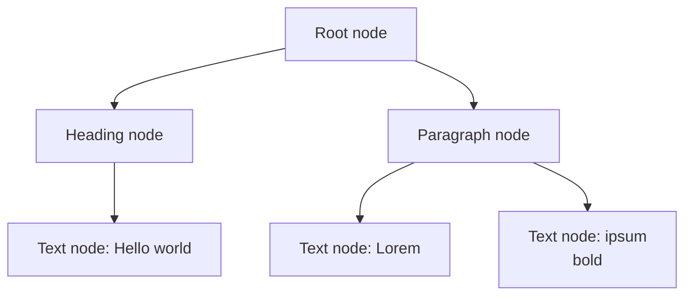
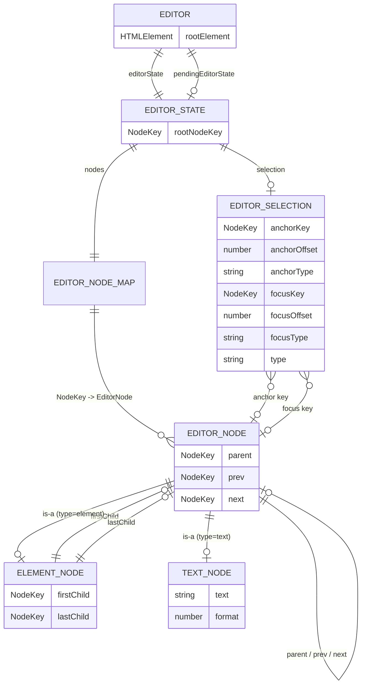
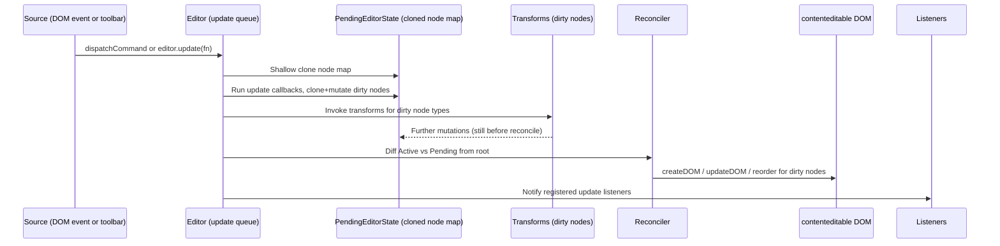
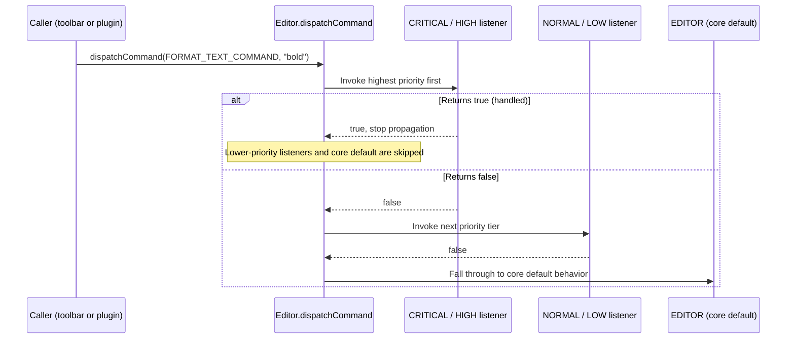
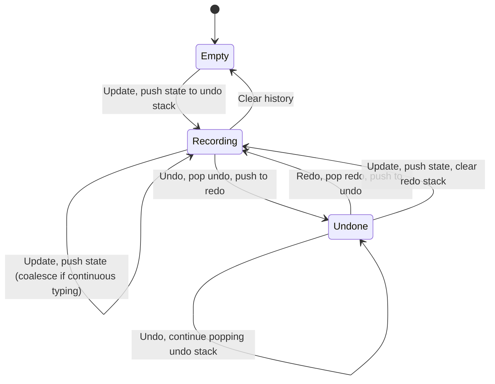

# Rich Text Editor

**Difficulty:** Hard · **Duration:** ~40 min · **Topics:** Performance, UI component

> Source: [rich-text-editor](https://www.greatfrontend.com/questions/system-design/rich-text-editor)

## Question

Design an extensible rich text editor component that allows users to create and edit text with various formatting options.

### Real-life examples

Popular implementations range from framework-level editor libraries to complete document-editing products:

- [Lexical](https://lexical.dev/)
- [Tiptap](https://tiptap.dev/)
- [Slate](http://slatejs.org/)
- [Quill](https://quilljs.com/)
- [Draft.js](https://draftjs.org/) (predecessor of Lexical)

Rich text editors are also commonly known as WYSIWYG editors ("What you see is what you get"), as you can directly format text without using special markup or syntax.

> **The solution includes optional follow-up depth**
>
> A 40-minute interview should focus on the document model, operations, input translation, and DOM reconciliation. Later sections cover optional implementation details and production concerns.

## Solution

### Requirements exploration

Scope the editor by clarifying which formatting features are in play, how content is styled and persisted, the target devices, and whether collaboration is part of the exercise.

#### What formatting features should be supported?

The core design supports a small set of block and inline formats:

- **Block formatting**: headings, paragraphs, blockquotes
- **Inline formatting**: bold, underline, italics

#### How should the various elements be styled?

The browser's default stylesheet is a good starting point. Further customization can be discussed if time permits.

#### Should the editor support media insertion?

The focus is on text formatting. Inserting media objects such as images and videos is an optional follow-up.

#### What keyboard shortcuts should be supported?

The editor should support common editing-related keyboard shortcuts such as Copy, Cut, Paste, and Redo. Custom and user-defined shortcuts are optional follow-ups.

#### What are the non-functional requirements?

Performance and user experience are important. The editor should reflect updates without lagging/stuttering.

A production follow-up should define the supported browser, device, input-method, and assistive-technology test matrix. In the interview, it is enough to name the representative browser and keyboard/IME requirements that affect the core design.

#### Check your understanding 1

You have 40 minutes to design an embeddable rich-text editor. Which scope gives you a useful basis for choosing its model and rendering architecture?

- [ ] Commit to collaboration, offline editing, media, export, and exhaustive browser support before defining the core formatting behavior.
  > Those extensions can change the system substantially, but making all of them mandatory prevents a focused editor model and update loop from emerging.
- [ ] Scope the product to plain text in a textarea, with rich formatting shown only in a read-only preview.
  > Removing block and inline formatting avoids the defining rich-text requirements instead of scoping them.
- [x] Specify representative formatting, styling, shortcuts, input, responsiveness, and accessibility needs, while explicitly scoping optional production extensions.
  > This scope is concrete enough to drive the document model and rendering architecture while leaving production-depth extensions outside the 40-minute core.
- [ ] Choose an editor framework first and treat its built-in schema, commands, and plugins as the product requirements.
  > A library should satisfy the product contract. It should not silently decide the contract before requirements are clarified.

### Overview of the Lexical editor

There are many rich text editors around, and many editors are similar in design and implementation. [Lexical](https://lexical.dev/) is Meta's latest open source rich text editor library (an evolution of [Draft.js](https://draftjs.org/)) and is used across their products – the composer on facebook.com, workplace.com, etc. It is designed with extensibility, reliability, accessibility, and performance in mind.

Lexical's architecture supports customized editing features for applications ranging from simple text inputs to document editors.

The design below draws heavily from Lexical's public architecture and source code:

1. **Editor instances**: Lexical creates editor instances that attach to a single `contenteditable` element. Each instance manages its own state and updates.
2. **Editor states**: The framework uses a set of editor states to represent the current and pending states of the editor at any given time. This allows for efficient updates and undo/redo functionality.
3. **Dependency-free core**: Lexical is a lightweight, 22KB dependency-free library that can work with vanilla JavaScript or integrate seamlessly with other libraries like React.
4. **Plugin architecture**: Plugins extend editing functionality independently of the core editor.
5. **Node-based structure**: Lexical uses a node-based structure to represent the content. Different types of nodes (e.g., text nodes, paragraph nodes) make up the document tree.
6. **State management**: When changes occur in the editor, Lexical updates its internal state. Plugins can register listeners to react to these state changes.
7. **Serialization**: Lexical can serialize its state to JSON, making it easy to save and restore editor content.
8. **Framework-agnostic**: While Lexical provides React bindings, it's designed to be framework-agnostic, allowing integration with other JavaScript frameworks like Vue.js, Angular, Svelte, etc.
9. **Extensible**: Simple, flexible core APIs are exposed to allow community-driven external plugins.
10. **Collaboration support**: Lexical can be extended to support real-time collaboration through plugins that translate editor state changes to and from collaborative protocols like [Yjs](https://github.com/yjs/yjs).
11. **Accessibility**: The framework is built with accessibility in mind, following WCAG best practices and ensuring compatibility with screen readers and other assistive technologies.
12. **Performance optimization**: Lexical is designed for performance, handling large documents and complex editing operations efficiently using a virtual DOM-like approach.

---

### Approach

As with most problems in Computer Science, there are multiple approaches to building a rich text editor, each with its own pros and cons.

As a reminder, rich text editors need to support:

1. **Rendering rich text**: Headings, paragraphs, bold, etc.
2. **Rendering of cursors**: Indication of the current typing position
3. **WYSIWYG**: What-you-see-is-what-you-get. Inline updates and preview of rich text
4. **Cross-browser**: Consistent experience across different browsers

To get a better sense of the various features a rich text editor supports, along with the user experience, try out [Lexical's playground](https://playground.lexical.dev/).

#### Rendering approaches

The main rendering options have different browser-support and implementation tradeoffs.

##### 1. Form elements like `<input>` and `<textarea>`

This is an obvious no-go because, although these elements can render text and update inline, they only render plain text and are unable to render formatted text.

##### 2. DOM with fake cursors

A regular DOM, containing the formatted text using HTML elements and styling, can be used to meet the rendering requirements.

However, all editors need to display a cursor to indicate the typing position. By using the regular DOM, cursors have to be faked by rendering a DOM element on top of the existing text. Rendering fake cursors isn't trivial at all:

- **Cursor position calculation**: Cursor positioning has to be manually calculated. You have to know which character is being clicked on (not supported natively), then find the nearest position that is around/between characters. Adding to the complexity, different characters have different widths depending on the font size and family.
- **Cursor height calculation**: The cursor has to match the height of the current line.

Rendering fake cursors involves a ton of complex text measurement that you have to implement yourself. This is supposed to be the browser's job, and you're reimplementing it!

> **Do not hand-roll cursor rendering on top of a regular DOM tree**
>
> Cursor positioning and line-height measurement are things the browser already solves for editable elements. Reimplementing them manually adds substantial work to an interview-scale design. Prefer `contenteditable` to reuse native caret and text measurement behavior; use canvas only when its rendering control justifies implementing that behavior yourself.

##### 3. `contenteditable` attribute

The `contenteditable` attribute to the rescue! Elements with the `contenteditable="true"` attribute are editable by the user. This attribute is available on every element. If you aren't familiar with the `contenteditable` attribute, [read more about it here](https://developer.mozilla.org/en-US/docs/Web/HTML/Global_attributes/contenteditable).

Browsers provide native editing, selection, and input behavior for `contenteditable` elements. Some browsers also perform formatting for common shortcuts or editing intents, but neither the supported shortcuts nor the resulting markup are portable contracts. The editor should normalize supported intents into its own model operations.

This is **editable and format-able** text thanks to `contenteditable`. Native formatting behavior can vary by browser.

This seems to be a good starting point. What's the catch?

- **No normalized rich-text contract**: `contenteditable` makes DOM content editable, but it does not define portable formatting commands, generated markup, or a document schema for elements such as headings and blockquotes.
- **Browser inconsistencies**: Different browsers implement `contenteditable` functionality differently, leading to inconsistent behavior across platforms. This inconsistency can affect the user experience and result in unexpected formatting issues.
- **Unsafe format**: The contents are essentially HTML. By storing the contents as HTML, you could be introducing security vulnerabilities like [XSS (cross-site scripting) attacks](https://developer.mozilla.org/en-US/docs/Glossary/Cross-site_scripting).

> **Never persist raw `contenteditable` HTML as your document format**
>
> Round-tripping HTML straight from the DOM to your backend and back means any pasted `<script>`, `javascript:` URL, or dangerous attribute can be re-rendered for other users. Store a structured model instead (tree of typed nodes, JSON), and sanitize aggressively on both paste-in and any HTML export path before it reaches `innerHTML` or `dangerouslySetInnerHTML`. URL and embed allowlists, document authorization, CSP, and Trusted Types are production security follow-ups.

`contenteditable` still fulfills important rich text editor requirements, especially caret and selection behavior. Most popular web-based rich text editor libraries build on it while replacing browser-owned document semantics with a normalized internal model.

##### 4. Canvas with custom… everything

An advanced approach is to use a `<canvas>` element and render everything within it – styled text, layout, cursor, etc. This approach basically sidesteps a lot of what the browser provides and requires reimplementing everything within a canvas context. You can view it as an even tougher version of using DOM with fake cursors.

This approach is used by one of the world's most widely used document editors – Google Docs. In 2021, Google [announced that Google Docs would be moving towards a canvas-based rendering approach](https://workspaceupdates.googleblog.com/2021/05/Google-Docs-Canvas-Based-Rendering-Update.html) to "improve performance and consistency in how content appears across different platforms".

Canvas renderers provide you with absolute full control over the rendering, but come at the cost of:

- **Complexity and maintenance burden**: As mentioned, you'll have to implement layout, text rendering, cursor rendering, user inputs, etc., yourself.
- **Accessibility**: Canvas-based editors have poor accessibility by default since screen readers cannot read what is within the `<canvas>`. Google had to [implement accessibility features themselves](https://html.spec.whatwg.org/multipage/canvas.html#best-practices) on top of everything else that this approach required.
- **Incompatible with some existing extensions**: Browser extensions that rely on inspecting and manipulating the contents in the DOM will cease to function since the contents are entirely within the `<canvas>` element.

Canvas can improve control and consistency for specialized document-layout workloads, but it is not universally faster than DOM rendering. The tradeoff must be measured against representative documents, and few teams can justify rebuilding text layout, input, selection, and accessibility. VS Code is another popular tool that uses canvas for rendering text, but [only for the terminal](https://code.visualstudio.com/blogs/2017/10/03/terminal-renderer#_dom-rendering).

##### Which rendering approach to choose?

For an interview-scale editor, `contenteditable` provides the best balance of native text behavior and implementation effort.

| Approach              | Rich formatting | Cursors   | Implementation effort | Cross-browser    |
| --------------------- | --------------- | --------- | --------------------- | ---------------- |
| `<textarea>`          | No              | Supported | N/A                   | Generally same   |
| DOM with fake cursors | Supported       | Custom    | High                  | Generally same   |
| contenteditable       | Supported       | Supported | Moderate              | Some differences |
| `<canvas>`            | Custom          | Custom    | Very high             | Generally same   |

Given the tradeoffs of features vs. implementation effort, most rich text editor libraries use the `contenteditable` attribute on a root element and add event listeners to intercept browser events and standardize the result across browsers. With a `contenteditable` approach:

> **Default to `contenteditable` plus a custom model, not canvas**
>
> In an interview, the safe default is to build on `contenteditable` for rendering and cursors, while owning an editor-internal content model separately. Reserve canvas-based rendering for cases where you genuinely need Google Docs-level control over layout and cross-platform consistency, and call out the accessibility and extension-compatibility costs when you do.

1. **Rendering rich text**: This is available for free, since `contenteditable` renders using the various DOM elements.
2. **Rendering cursors**: Also available for free. The cursor's line height and positioning match the currently selected text.
3. **Inline text updates**: Text can be updated through native input behavior, while supported editing and formatting intents are normalized into model operations.
4. **Consistent experience across different browsers**: Event handlers can normalize supported input, selection, and pointer behavior across browsers, operating systems, and devices.
5. **Handling limited formatting**: Since the result is DOM-based, the renderer can insert and style the elements required by the editor's model.
6. **Backed by a different content model**: While the rendered content result is DOM/HTML, the underlying model can be customized for performance optimizations and restricted to only certain supported elements.
7. **Widely used**: Some of the world's most widely used rich text editing surfaces, such as facebook.com's post composer, Gmail composer, and Medium's article editor, use `contenteditable`.

#### Check your understanding 2

A browser-based editor needs WYSIWYG block and inline formatting with native caret behavior. Which rendering foundation is the best starting point?

- [ ] Store formatting markers in a `<textarea>` and render a separate preview beside it.
  > A textarea reliably accepts plain-text input, but a separate preview does not satisfy the required in-place WYSIWYG editing experience.
- [x] Use `contenteditable` for native input and selection while an editor-owned document model defines supported content and operations.
  > The browser supplies mature caret and text-input behavior, while the custom model normalizes browser differences and remains the source of truth.
- [ ] Render semantic DOM elements and calculate a custom caret from pointer coordinates and font measurements.
  > This can display rich content, but it needlessly reimplements browser text measurement, caret placement, and selection behavior.
- [ ] Draw all text, selection, and controls on canvas so every platform receives identical pixels.
  > Canvas offers control for specialized layout workloads, but rebuilding input, text layout, selection, and accessibility is disproportionate for the scoped editor.

#### Check your understanding 3

An editor accepts pasted HTML and can export HTML for display in another application. Which policies keep untrusted markup from becoming the document's source of truth or an injection path? Select all that apply.

- [x] Parse supported elements and attributes into typed semantic nodes while rejecting or degrading unsupported markup.
  > An allowlisted model preserves intended content without retaining arbitrary scripts, event handlers, or renderer-specific DOM as canonical state.
- [ ] Save the current `contenteditable` HTML verbatim and sanitize it only if a later reader reports a problem.
  > Persisting untrusted markup carries dangerous attributes and URLs across users, and delayed sanitization leaves every renderer responsible for containing it.
- [x] Sanitize any generated or imported HTML before inserting it into an HTML rendering sink.
  > A structured model reduces risk, but HTML interchange still crosses a trust boundary where unsafe output must be removed before browser interpretation.
- [x] Render persisted content through known node-type renderers instead of restoring saved markup directly into the editable area.
  > A controlled model-to-view mapping prevents stored HTML from bypassing the same semantic boundary used during paste and import.
- [ ] Skip validation when pasted markup came from another page on the same origin.
  > Origin does not prove that copied document content or stored user input is safe, so paste must use the same semantic import boundary.

#### Model and state design

With the rendering approach selected, the next decision is how to model content state. Using the DOM itself as the model is possible, but it has several drawbacks:

- **No built-in state management features**: The DOM does not provide built-in features for state management, such as undo/redo, or allow the use of complex data structures, which are sometimes necessary.
- **No good way of storing extra related fields**: If extra fields are required for certain elements (e.g. type of custom elements), they have to be stored as data attributes on the DOM nodes, which can clutter up the DOM and adds overhead when they have to be read.
- **DOM is bloated**: DOM elements are huge and have a ton of properties and methods. This can be bad for maintenance, and it's better to keep the API surface small.
- **Prone to tampering**: Browser extensions often mess with the DOM and have unwanted consequences. By using the DOM as the underlying content model, third-party extensions can easily tamper with the source of truth.

> **Do not treat the DOM as the editor's source of truth**
>
> The DOM is what you render, not what you store. A separate in-memory model gives you undo/redo, serialization, headless testing, and, critically, protection from browser extensions and pasted markup quietly rewriting state. Every production-grade editor (Lexical, Slate, Tiptap/ProseMirror, Quill) keeps its own model and reconciles to the DOM.

A better approach is to model the content state in JavaScript and render to the DOM based on the content state. This content state will need to capture tree-like relationships, just like the DOM. An example could be:

```js
{
  type: "document",
  children: [
    {
      type: "heading",
      children: [{ type: "text", content: "Hello" }]
    },
    {
      type: "paragraph",
      children: [
        { type: "text", content: "This is John Doe. " },
        { type: "text", content: "He is strong", bold: true }]
    },
  ]
}
```

The editor will iterate through this object, convert each entry to the relevant DOM nodes (e.g. `heading` -> `<h1>`, `paragraph` -> `<p>`), and render it to the screen.

Operating on a state model in JavaScript without relying on the DOM brings the following benefits:

- **Portability**: The same data can be rendered on different platforms using platform-specific UI primitives.
- **Headless mode**: Tests are easier to write, and state manipulation can be done on the server without an actual browser.

During initialization:

1. The editor initializes all required states (content state, selection state) in JavaScript.
2. The editor loops through the content state and renders it to the DOM.

#### Update approach

Editor updates modify the underlying state model and then update the DOM. Rebuilding the entire DOM after every change works, but wastes work for long documents with many nodes.

Incremental reconciliation updates only the affected parts:

1. The editor intercepts the user event (e.g. `input`, `keypress`).
2. The editor converts the event into a supported command (e.g. inserting a character, deleting a character, etc.).
3. The editor makes a clone of the content state.
4. The editor modifies the cloned content state.
5. The editor compares the original content state with the cloned content state to determine the DOM changes required (also known as reconciliation).
6. The editor modifies the DOM based on the determined changes.

Such an update flow is similar to how React maintains a virtual DOM and only makes the minimum necessary DOM changes when updating based on the new state. This process is called reconciliation.

> **Lexical's DOM reconciler is independent of React**
>
> Lexical implements its own [DOM reconciliation process](https://lexical.dev/docs/intro#dom-reconciler) that is independent of React. This allows Lexical to be UI-agnostic and used within React, Vue, Angular, and Svelte apps.

#### Summary

In summary, most rich text editors on the web use `contenteditable` and take the following high-level approach:

1. Design an editor-specific model of the document content
2. Create a mapping between the model and DOM elements
3. Define a set of supported operations on this model (e.g. insert text at position, delete text, format text)
4. Translate user events (keypresses and mouse clicks) into a sequence of these supported operations
5. Update the DOM based on these operations, ideally with minimal DOM manipulation calls

Covering this high-level approach is sufficient in the context of a 40-minute front end system design interview.

The remaining sections provide optional depth on the architecture, data entities, APIs, and production concerns.

> **Cover the five-step high-level approach before going deeper**
>
> In a 40-minute interview, getting the model, mapping, operations, event-to-operation translation, and DOM reconciliation on the board is usually the whole job. Everything below, including custom nodes, transforms, listeners, undo coalescing, and collaboration, is follow-up depth to reach for only once the core flow is clear.

---

### Architecture / high-level design

The architecture separates the editor's immutable model and update pipeline from its DOM-based input and rendering layer.

#### Editor

The editor consists of two parts: (1) the core, and (2) any additions added by developers (listeners and transformers).

##### Core

This rich text editor design is very extensible. The core contains the bare minimum logic needed for a user event -> state update -> DOM updates operation, while allowing for extension by providing commands that can be invoked from outside.

Breaking down the update flow:

- Commands can be dispatched in multiple ways. They can come from:
  - **DOM events on the content editor**: These originate from a user interacting with the content DOM element (typing, deleting, moving the cursor, etc.). DOM events on the `contenteditable` DOM element are mapped to recognized commands (see [LexicalEvents.ts](https://github.com/facebook/lexical/blob/main/packages/lexical/src/LexicalEvents.ts)). Refer to [Lexical's list of supported commands](https://github.com/facebook/lexical/blob/main/packages/lexical/src/LexicalCommands.ts) that can be dispatched.
  - **Programmatically via the toolbar**: Dispatched programmatically (from the toolbar or within listeners/transforms), e.g. to change formatting or insert/remove nodes.
- The editor receives the commands, makes a clone of the current content state (`PendingEditorState`), and updates the content state as per the command (see [LexicalUpdates.ts](https://github.com/facebook/lexical/blob/main/packages/lexical/src/LexicalUpdates.ts)). Both previous and current editor states are necessary for the DOM reconciliation process.
- The reconciler receives both the current content state (`ActiveEditorState`) and the modified content state (`PendingEditorState`) and compares the two to create/update/remove the relevant DOM nodes corresponding to the new editor state. The contents within the `contenteditable` DOM element will then be modified (see [LexicalReconciler.ts](https://github.com/facebook/lexical/blob/main/packages/lexical/src/LexicalReconciler.ts)). The reconciler serves as a communication layer between the content state and the rendered UI (a `contenteditable` element). If a `<canvas>` UI approach is desired (like in Google Docs), most of the required changes will lie in the reconciler.


##### Listeners

Listeners allow the editor to inform developers when an operation occurs. Since commands are dispatched as part of the editor update flow, developers can treat them as events and react accordingly.

The API of listeners will be discussed in the [deep dive section below](#listeners-and-commands).

> **Listeners are interview-optional but production-essential**
>
> Listeners are typically beyond the scope of a rich text editor system design interview. They let surrounding UI and persistence code respond to editor updates.

##### Transforms

Transforms are a mechanism to respond to changes within the editor before reconciliation happens. Multiple transforms still lead to a single DOM reconciliation pass.

The API of transforms will be discussed in the [deep dive section below](#transforms-1).

> **Transforms are interview-optional but production-essential**
>
> Transforms are beyond the scope of a rich text editor system design interview. They let extensions modify changed nodes before reconciliation.

#### Input UI

Important elements of a rich text editor UI.

##### Content element

The `contenteditable` DOM element. The editor adds event listeners (e.g. `input`, `click`, `keydown`) to this element and responds to these events by mapping them to its internal commands (e.g. `FORMAT_TEXT`, `SELECTION_CHANGE`, `INSERT_LINE_BREAK`) and dispatching them so that the state can be updated.

##### Toolbar element

The toolbar at the top of almost every rich text editor, containing the formatting buttons. It directly tells the editor to dispatch commands. Note that the toolbar UI is left entirely to the developer to customize. The rich text editor simply provides commands for the toolbar to dispatch programmatically, which is independent of the appearance.

#### Headless mode

The proposed architecture allows the rich text editor to be used in a headless fashion. The editor can be initialized with some existing content, and commands can be dispatched programmatically to modify the editor state. The only difference is that there's no need for a reconciliation step because there's no DOM to update.

Headless mode is useful for writing tests for the internals or manipulating the editor state on the server.

#### Check your understanding 4

Typing and toolbar formatting must update one canonical document model while keeping the rendered view consistent. Which architecture best preserves that invariant?

- [x] Route every input through semantic commands, transact model changes and normalization, then reconcile the rendered view from the committed state.
  > One state-changing boundary prevents input sources from bypassing model invariants and avoids exposing intermediate states to the view.
- [ ] Treat `contenteditable` DOM as canonical, translate toolbar actions into DOM mutations, and serialize its HTML after each browser edit.
  > Native editing remains useful for input, but browser-generated DOM is not a stable semantic model for programmatic changes, serialization, or history.
- [ ] Keep a model for typing, but let toolbar controls rewrite the active DOM range before the next model snapshot.
  > The delayed snapshot still leaves two mutation authorities and makes toolbar behavior depend on transient DOM selection and structure.
- [ ] Send semantic inputs to a server-authoritative model and replace the local rendered document after each response.
  > Central authority can validate operations, but round-trip-gated rendering cannot preserve immediate typing feedback and a stable local caret.

#### Check your understanding 5

The same editor model must support browser rendering, server-side document cleanup, and model-level tests. How should headless execution fit the architecture?

- [ ] Require server jobs and tests to create a fake `contenteditable` tree before they can change document state.
  > Making model updates depend on a DOM forfeits the portability and deterministic testing gained from an editor-owned state layer.
- [ ] Implement separate server-only mutation commands that directly rewrite serialized JSON.
  > Two operation systems can normalize the same document differently and make browser and server results diverge.
- [ ] Allow headless callers to mutate nodes directly because invalid intermediate states are not visible to a user.
  > Invalid headless output can still be persisted or later rendered, so it needs the same transaction and normalization guarantees.
- [x] Run the same document state, semantic operations, and normalization pipeline without attaching a rendered root, skipping only DOM reconciliation.
  > Keeping mutation semantics independent of rendering lets every environment enforce the same invariants while the browser alone performs view updates.

---

### Data model

There are a few core entities within rich text editors – the editor instance, which contains editor states, content states (nodes), and selection state. All the Editor-related interfaces/classes will be prefixed with `Editor` to disambiguate them from DOM types with the same name.

#### Editor and EditorState

The core data model for a rich text editor is the `Editor`. There can be multiple rich text editors on the page and each `contenteditable` DOM element is associated with one `Editor` instance, where each instance contains its own content state, selection state, transforms, listeners, customizations, etc.

In TypeScript, the core entities resemble:

```ts
// https://github.com/facebook/lexical/blob/71880d22f63a8f2631352a7032a22f639238b306/packages/lexical/src/LexicalEditor.ts#L562
interface Editor {
  // Reference to contenteditable DOM element.
  rootElement: HTMLElement | null;
  // Both current and pending EditorStates.
  editorState: EditorState;
  pendingEditorState: EditorState | null;
  // Non-core fields are omitted.
}

interface EditorState {
  // Primarily contains content (nodes) and selection state.
  nodes: EditorNodes;
  selection: EditorSelection | null;
}

interface EditorNodes {
  // Exact structure to be discussed.
}

interface EditorSelection {
  // Exact structure to be discussed.
}
```

#### Content state (nodes structure)

The most important entity to discuss is the content state – how to design the state such that it can store rich text formatting consisting of block and inline elements, styling, custom nodes, etc.

A tree-like structure naturally represents the document hierarchy, while the concrete storage format determines lookup and update costs.

##### Nodes

Notice that most text-centric documents (like the current document you're reading) consist of blocks of headings and paragraphs, and within each block-level element, some contain custom inline elements for formatting, like bold, italics, underline, etc. Nodes are discrete pieces of state that hold contents and have a hierarchical relationship with each other. The content state contains heading nodes, paragraph nodes, text nodes, etc.

More accurately, the created DOM looks like this:

```jsx
<HTMLParagraphElement>
  <Text>Hello </Text>
  <HTMLStrongElement>
    <Text>World</Text>
  </HTMLStrongElement>
</HTMLParagraphElement>
```

One reasonable data structure for content state that closely resembles the DOM is to have `ElementNode`s and `TextNode`s that inherit from `EditorNode`:

- `ElementNode`s can contain children, which can be other `ElementNode`s or `TextNode`s.
- `TextNode`s can only contain text. Since they cannot contain any other nodes, they are leaf nodes.

These nodes can be subclassed, e.g. `HeadingNode` and `ParagraphNode` inherit from `ElementNode`.

**Rich text document tree**



> **Editor node types are not DOM Element and Text**
>
> These are custom interfaces/classes implemented within the rich text editor, not to be confused with the DOM `Element` and `Text`.

```ts
interface EditorNode {}

interface ElementNode extends EditorNode {
  children: Array<EditorNode>;
}

interface TextNode extends EditorNode {
  text: string;
}
```

A structure resembling the DOM can represent a broad range of rich text content and formatting.

**Tree representation**: How are these nodes represented within `EditorState`? An intuitive way is to mirror the resulting DOM in JavaScript – a 1:1 tree representation using an `ElementNode` subclass as the root node.

```ts
const TEXT_FORMAT_BOLD = 1 << 0;

{
  type: "root",
  children: [
    {
      type: "heading",
      children: [
        { type: "text", text: "Hello world" },
      ]
    },
    {
      type: "paragraph",
      children: [
        { type: "text", text: "Lorem " },
        { type: "text", text: "ipsum", format: TEXT_FORMAT_BOLD }
      ]
    }
  ]
}
```

Many rich text editors use a nested immutable tree successfully. Without a separate index, looking up a deep node requires traversal from the root; indexed trees and position-based models make different tradeoffs. This design chooses a keyed map because its workload benefits from stable node lookup and copy-on-write updates.

**Map with child pointers**: How about using a `Map` of `EditorNode`s that contains pointers to other nodes?

```ts
type NodeKey = string;

type NodeMap = Map<NodeKey, EditorNode>;

interface ElementNode extends EditorNode {
  children: Array<NodeKey>;
  // Can contain other fields, depending on the node type.
}

interface TextNode extends EditorNode {
  text: string;
}
```

The keyed storage representation and the equivalent logical tree are shown together below:


Using this structure, obtaining a reference to an `EditorNode` is a matter of doing `nodeMap.get(nodeKey)`.

**Map with children as linked list**: Lexical started out using a `Map` of `EditorNode`s with a `children` pointer array. Eventually it moved to doubly linked lists (instead of arrays) for its child node pointers as a performance optimization, along with parent pointers. All `EditorNode`s can have siblings and parents. `ElementNode`s have additional references to their first and last child, if they exist.

```ts
type NodeKey = string;

type NodeMap = Map<NodeKey, EditorNode>;

interface EditorNode {
  parent: NodeKey | null;
  prev: NodeKey | null;
  next: NodeKey | null;
  // Can contain other fields, depending on the node type.
}

interface ElementNode extends EditorNode {
  firstChild: NodeKey | null;
  lastChild: NodeKey | null;
  // Can contain other fields, depending on the node type.
}

interface TextNode extends EditorNode {
  text: string;
}
```

This `NodeMap` gives the same tree as before, but with more pointers between nodes.


This map + linked list structure has the following tradeoffs:

**Advantages**

- Single-layer `Map`, extremely easy to clone both shallowly and deeply
- O(1) access to any `EditorNode` if you know the `NodeKey`
- Efficient removal and addition of child nodes because children are in a doubly linked list
- Provides access to the parent node (not specific to the linked list implementation)
- Reparenting of nodes is a matter of updating pointers

**Disadvantages**

- Updates made to the content require careful updating of pointers on multiple `EditorNode`s, similar to linked list manipulation
- Knowing the size of the children requires counting. This can be mitigated by maintaining a cached size field on `ElementNode`s that is updated whenever children are added/removed
- Getting all the children of a node requires traversal from the first node to the last node
- Hard for human eyes to read (not very important)

Alternative indexed trees, arrays, and persistent structures are a potential follow-up when document size, traversal patterns, serialization cost, or cache locality favor a different representation.

##### Formatting

One tricky issue with formatting text in the DOM is when characters have more than one format applied. E.g. to render the text **Tarzan and** Jane. Note that:

- "Tarzan" is bolded
- "and" is both bolded and underlined
- "Jane" is underlined

**Nested tags**: In HTML/DOM, there are multiple ways to achieve this formatting. Here are some possible ways:

- `<strong>Tarzan </strong><u><strong>and</strong> Jane</u>`
- `<strong>Tarzan <u>and</u></strong><u> Jane</u>`
- `<strong>Tarzan </strong><strong><u>and</u></strong><u> Jane</u>`

The main downside of this approach comes from there being many ways to render the HTML for the formatted text, and many possible ways to nest when the text has even more formatting, e.g. italics or strikethrough.

The first two ways use nested tags for formatting, and it can become a problem when editing already-formatted text to add/remove formatting: the editor needs to introduce more elements for the formatting, or remove the right elements (potentially even combining them) when formatting is removed. Given the number of possible combinations for composite formatting, it is quite complex to implement editing correctly.

`contenteditable` is able to handle the formatting correctly, but the resulting HTML is messy and not optimized.

> **Pick one canonical representation for overlapping formats**
>
> With multiple formats like bold plus underline, there are many valid HTML nestings and many ways for an editor to "drift" between them on edit. Flat text runs with a `format` bitmask, as used by Lexical, and explicit format ranges are both valid choices, but the model must pick one and normalize on write; otherwise add/remove-format operations become a combinatorial mess and diffs look unstable.

**Format ranges**: Another way is to use format ranges (not to be confused with selection range), where each format is labeled with start/end indices. **Tarzan and** Jane would be:

```js
[
  { start: 0, end: 10, format: "bold" },
  { start: 7, end: null, format: "underline" },
];
```

This list-like format is definitely convenient and more readable. But ultimately, to be rendered to the DOM, the list has to first be converted into element and text nodes. Updates to the text will require computation for updating indices correctly.

**Lexical's formatting approach**: The last HTML option produces a flat sequence of formatted text runs:

```jsx
<strong>Tarzan </strong><strong><u>and</u></strong><u> Jane</u>
```

This approach refrains from having multiple tags of the same level within a tag – nested tags will never have sibling HTML tags or sibling text nodes. This is Lexical's and Slate.js's approach for formatting text.

Although this approach results in the most verbose DOM, the structure is flat and can be represented using a flat list of `TextNode`s. A numeric bitfield stores combinations compactly; for example, bold can use bit `1 << 0` and underline can use bit `1 << 1`.

```jsx
<TextNode text="Tarzan " format={TEXT_FORMAT_BOLD} />
<TextNode
  text="and"
  format={TEXT_FORMAT_BOLD | TEXT_FORMAT_UNDERLINE}
/>
<TextNode text=" Jane" format={TEXT_FORMAT_UNDERLINE} />
```

When editing the formatting of the text, the following scenarios are possible:

- **Adding formatting to text**: A `TextNode` is split into two or more `TextNode`s, with some of them having the new formatting.
- **Removing formatting from text**: The editor simply has to look at the surrounding `TextNode`s, determine if the formatting is exactly the same, and combine them into a single `TextNode` if so.

Both Lexical and Slate.js use a similar content structure that supports block and inline styling, elements, and text nodes:

- Content is broadly represented by `ElementNode`s and `TextNode`s
- `ElementNode`s can contain children, which can be other `ElementNode`s or `TextNode`s
- All visible text in the rich text editor is contained within `TextNode`s, which are leaf nodes
- Only `TextNode`s have formatting, since formatting is only relevant to text

_These cover only the core fields needed for basic functionality. Later sections introduce additional fields where needed._

#### Selection state

In web browsers, the "selection state" refers to the portion of a web page that the user has highlighted or selected. This is usually done by clicking and dragging the mouse over text or other content, causing it to be highlighted.

The browser's DOM `Selection` object has the following key components:

1. **Selection object**: The `Selection` object is part of the DOM and provides access to the selection state. It can be accessed via `window.getSelection()` in JavaScript. The `Selection` object has methods and properties to manipulate and retrieve information about the selection.
2. **Anchor and Focus**: The `Selection` object has two primary points: the anchor and the focus. The anchor is the starting point of the selection. The focus is the endpoint of the selection. These points can be either a text node or an element node, along with an offset value, a number representing the offset of the selection within the node. Thus, the anchor and focus points are a combination of references to the `anchorNode`/`anchorOffset` and `focusNode`/`focusOffset` pairs.

The browser selection object has the following important properties:

```ts
interface DOMSelection {
  anchorNode: Node | null;
  anchorOffset: number;
  focusNode: Node | null;
  focusOffset: number;
  type: "caret" | "range";
}
```

If one or more characters are selected, then the `type` will be `Range`; otherwise, it will be `Caret` and the `anchorNode`/`anchorOffset` values will be exactly the same as `focusNode`/`focusOffset`.

> **Selection wraps one or more Range objects under the hood**
>
> Strictly speaking, the `Selection` object contains one or more [`Range` objects](https://developer.mozilla.org/en-US/docs/Web/API/Range). A `Range` object represents a contiguous part of the document, starting and ending at specific points (similar to the anchor and focus points on the `Selection` object). There's a long history to the `Range` object if you're interested, but you don't have to bother with it for the sake of understanding selections.

##### Selection can be backwards

Selection direction matters. A selection can be backwards, with `focusNode` appearing before `anchorNode` when a user highlights text from right to left. Range logic therefore cannot assume that focus always follows anchor.

This is important to remember because users who primarily navigate using the keyboard might experience difficulties if the selection direction is not taken into account. For instance, the <kbd>Shift</kbd> + <kbd>Right Arrow</kbd> keys should extend the selection if the selection order is forward, but shrink the selection if the selection order is backwards.

> **Anchor is not always "start" and focus is not always "end"**
>
> This is a surprisingly common source of bugs because offset math, shift-arrow handlers, and cursor-rendering code all tend to assume `anchor <= focus` in document order. Always derive an explicit `(start, end)` pair from the selection before running range logic, and preserve the original anchor/focus for keyboard extension to still feel correct.

##### How selection works in Lexical

The `Editor` maintains its own selection state that mirrors `document.getSelection()`, but each logical point stores a stable node key, an offset, and whether the offset addresses text or element children. Resolving the key against the current `EditorState` avoids retaining a node object from an older immutable snapshot.

```ts
interface EditorSelectionPoint {
  key: NodeKey;
  offset: number;
  type: "text" | "element";
}

interface EditorSelection {
  anchor: EditorSelectionPoint;
  focus: EditorSelectionPoint;
  type: "caret" | "range";
}
```

The editor updates this state from DOM events such as `selectionchange` and keyboard navigation. Because `selectionchange` is global, the shared handler identifies the active editor from its focused root element and DOM selection.

#### Summary

Here is an overview of the data within `Editor` instances, closely following Lexical's internal state model. To render the content to the DOM, the editor renders recursively from the root node by rendering the node, then iterating through the children starting from the `firstChild` pointer and the `next` field of each subsequent child.

**Editor state entity relationships**



```ts
interface Editor {
  // Reference to contenteditable DOM element.
  rootElement: HTMLElement | null;
  // Both current and pending EditorStates.
  editorState: EditorState;
  pendingEditorState: EditorState | null;

  // Non-core fields are omitted.
}

type NodeKey = string;

interface EditorState {
  // Primarily contains content (nodes) and selection state.
  nodes: EditorNodeMap;
  rootNodeKey: NodeKey;
  selection: EditorSelection | null;
}

interface EditorNode {
  parent: NodeKey | null;
  prev: NodeKey | null;
  next: NodeKey | null;
}

interface ElementNode extends EditorNode {
  type: "element";
  firstChild: NodeKey | null;
  lastChild: NodeKey | null;
  // Can contain other fields, depending on the node type.
}

interface TextNode extends EditorNode {
  type: "text";
  text: string;
  format: number;
}

type EditorNodeMap = Map<NodeKey, EditorNode>;

interface EditorSelectionPoint {
  key: NodeKey;
  offset: number;
  type: "text" | "element";
}

interface EditorSelection {
  anchor: EditorSelectionPoint;
  focus: EditorSelectionPoint;
  type: "caret" | "range";
}
```

#### Check your understanding 6

An editor frequently targets nodes by stable ID, reparents sibling ranges, and creates immutable snapshots without copying an entire large document. Which internal representation best fits that workload?

- [x] Keep nodes in a keyed index and represent hierarchy through stable parent, child, and sibling relationships updated through controlled helpers.
  > Direct key lookup and copy-on-write node replacement make targeted edits cheap, while explicit links support local structural changes without cloning every ancestor object.
- [ ] Use the current DOM tree and element objects as the indexed document representation.
  > DOM identity is renderer-owned and mutable, so normalization, extensions, and reconciliation can invalidate references needed by immutable snapshots.
- [ ] Use only nested immutable child arrays and search from the root for every node-targeted operation.
  > A nested tree is a valid simpler model, but the stated frequent direct lookups and reparenting would repeatedly traverse and copy paths that a keyed index avoids.
- [ ] Store one HTML string and parse it whenever an operation needs to find or move a node.
  > Repeated parsing loses stable logical identity and makes targeted editing proportional to the whole serialized document.

#### Check your understanding 7

The editor incrementally recreates DOM nodes during reconciliation and must restore backward selections afterward. Which modeling choices remain stable across those view changes? Select all that apply.

- [ ] Serialize selection positions as child-index paths through the current DOM tree and resolve those paths after reconciliation.
  > Index paths appear portable, but normalization can insert, merge, or reorder DOM nodes and make the same path identify different content.
- [x] Represent content in an editor-owned document model with logical identities or positions that can be resolved independently of DOM objects.
  > Logical model locations survive DOM recreation and let operations target content without depending on one particular tree or map representation.
- [ ] Treat HTML as the canonical document, rebuild the model after each DOM change, and restore selection from plain-text offsets.
  > Plain-text offsets do not distinguish structural boundaries or custom nodes and cannot reliably preserve selection direction through normalization.
- [x] Choose one canonical representation for overlapping inline formats and normalize edits into that representation.
  > A canonical format model avoids equivalent HTML nesting shapes and makes add/remove-format operations deterministic.
- [x] Represent anchor and focus as logical document positions while preserving selection direction.
  > Logical positions survive view reconciliation, while direction preserves expected keyboard extension for backward selections.

---

### Interface definition (API)

The API is organized by the core abstractions: the `Editor` instance that owns the state, the node types that compose a document, and the helpers for selection, commands, and serialization.

#### `Editor` APIs

The following APIs are for `Editor` instances and heavily reference Lexical's `Editor` API, with some tweaks. There are some minor differences, but they are not crucial.

##### Initialization

The first API to discuss is the initialization of `Editor` instances. The `Editor` constructor can expect the following parameters.

| Name               | Type                                       | Description                                                                  |
| ------------------ | ------------------------------------------ | ---------------------------------------------------------------------------- |
| rootElement        | Element                                    | HTML element to mount the rich text editor                                   |
| namespace          | string                                     | Compatibility domain shared by editors with the same node schema             |
| initialEditorState | EditorState                                | Initial editor state – content nodes and selection                           |
| nodesConfig        | Array of EditorNode classes and subclasses | Array of EditorNode classes and subclasses that are supported by this editor |
| theme              | ThemeObject                                | Mapping of node types to CSS classes. See section on theming below           |

Editors that share a node schema can intentionally use the same `namespace`, which preserves high-fidelity JSON copy and paste between them. Use the editor object, root element, or a separate instance ID when code needs to distinguish editor instances on the same page.

See the [full list of editor constructor arguments here](https://github.com/facebook/lexical/blob/5a7d9c71d8b877f77f7d618ff228159433f4d520/packages/lexical/src/LexicalEditor.ts#L180).

##### Update APIs

While most updates will happen because of users editing the content directly within the editor, it's useful to provide programmatic ways of triggering updates.

- `editor.update(callback: Function)`: A method that receives a function containing the current `EditorState`. Modifications to the `EditorState` will result in DOM updates. Lexical has a slightly different API, but the motivations are similar.
- `editor.setEditorState(editorState: EditorState)`: A method that replaces the current editor state with a new editor state, marks the root node as dirty, and invokes full reconciliation of all nodes.

##### Serialization and deserialization APIs

Serialization APIs move editor state across persistence and clipboard boundaries.

- `editor.getEditorState()`: Get the current `EditorState` as a JavaScript object (not a string). This is useful for passing editor states to other instances.
- `editor.getEditorStateSerialized()`: Get the serialized version of the `EditorState` as a JSON string. A string representation is necessary for long-term persistence (e.g. `localStorage` or sending over the network to save within databases).
- `editor.parseEditorState(serializedEditorState: string): EditorState`: Parse a serialized string into a complete, detached `EditorState`. Pass the returned snapshot to `editor.setEditorState()` to make it the active editor state.

##### Event-related APIs

Commands separate an editing intent from the listener that implements it.

- `editor.dispatchCommand(command: string, payload: unknown): boolean`: Dispatch a command and return whether a listener handled it.
- `editor.registerCommand(command: string, callback: (payload: unknown, editor: Editor) => boolean, priority: CommandPriority): () => void`: Register a listener at a priority and return its unregister function.
- `editor.registerUpdateListener(callback: Function)`: Register a function that will run whenever the editor is updated.
- `editor.registerNodeTransform(nodeType: string, callback: Function)`: Register a function that will run when an `EditorNode` of a specific type is modified during the update phase (happens before reconciliation).

##### Querying APIs

Notice that there are a number of APIs that accept callback functions which can read and modify the editor state. These callback functions will need a good way to query for `EditorNode`s, similar to how the DOM's `document` object has `document.querySelectorAll()`, `document.getElementById()`, `document.getElementsByTagName()`, etc.

- `editor.getNodeByKey(nodeKey: string)`: Get the `EditorNode` given its key.
- `editor.getElementByKey(nodeKey: string)`: Get the underlying HTML DOM `Element` for a specific `EditorNode` given its key.

#### `EditorNode` interface

Lexical implements its base nodes (`LexicalNode`s) as classes whose properties and methods support the following responsibilities:

- **Tree structure**: Properties for maintaining the tree structure and sibling order. E.g. `parent`, `prev`, `next`, etc.
- **Querying**: Methods for querying parent/sibling nodes. These methods abstract the underlying "linked tree" implementation structure. E.g. `getParent()`, `getNextSibling()`, etc.
- **Reconciliation**: Methods for creating and updating the DOM elements based on the node's properties during reconciliation (initial render and updates). E.g. `createDOM()`, `updateDOM()`, `clone()`.
- **Serializing**: Methods for serializing to a JSON string and deserializing from a string, used for importing/exporting to a persistence layer. E.g. `exportJSON()`, `importJSON()`.

APIs for accessing surrounding nodes serve a similar purpose to DOM `Node` properties such as `childNodes`, `firstChild`, `lastChild`, and `parentElement`.

These querying APIs on `EditorNode`s are useful because:

1. They can be used by developers who want to add custom behavior within `editor.update()` and the event-related API callbacks.
2. They are necessary for performing traversal and manipulation of the nodes during updates and reconciliation.

However, as a good software engineering practice, the underlying structure of the `EditorNode` should not be exposed; developers should not need to know that they are implemented as "linked trees". Hence the APIs should be implemented as methods instead of properties in order to conceal the implementation details.

Exposing the implementation details can result in tighter coupling between library code and developer code, resulting in breaking changes and a terrible migration experience. Lexical migrated from the map with child pointers to the map with linked list implementation with ease because its APIs did not make assumptions about how the internal states were implemented.

> **Expose node traversal as methods, not as raw pointer properties**
>
> `getParent()` and `getNextSibling()` let you swap between arrays, linked lists, or any other internal representation without breaking consumer code. Once callers start reading `node.next` or `node.children[0]` directly, the internal structure becomes part of your public API, and any future performance refactor turns into a painful major-version migration.

##### `EditorNode` APIs:

These methods expose common node traversal and editing operations without leaking the internal pointer representation.

- `editorNode.getParent()`
- `editorNode.getNextSibling()`
- `editorNode.insertAfter()`
- `editorNode.insertBefore()`
- `editorNode.isSelected()`
- `editorNode.getTextContent()`

Only the important APIs are mentioned here. For the full surface, see the [Lexical core API reference](https://lexical.dev/docs/api/modules/lexical).

##### `ElementNode` APIs:

`ElementNode` can have child nodes, so additional APIs are provided to query the child nodes.

- `elementNode.getChildren()`
- `elementNode.getFirstChild()`
- `elementNode.getLastChild()`

Only the important APIs are mentioned here. For the full surface, see the [Lexical core API reference](https://lexical.dev/docs/api/modules/lexical).

##### `TextNode` APIs:

`TextNode`s are leaf nodes and they are primarily concerned with text formatting.

- `textNode.setTextContent()`
- `textNode.setFormat()`
- `textNode.getFormat()`

Only the important APIs are mentioned here. For the full surface, see the [Lexical core API reference](https://lexical.dev/docs/api/modules/lexical).

#### Check your understanding 8

A page contains two editors that use the same document schema and support high-fidelity copy and paste between them. Which state, events, and identifiers should be scoped to each instance, and what can be shared? Select all that apply.

- [x] Give each editable root its own document snapshot, pending transaction, selection, listeners, and configuration.
  > Per-root ownership prevents typing or extension state in one editor from mutating the other instance.
- [ ] Store one mutable selection and pending document state for every editor that declares the same compatibility namespace.
  > Compatibility does not imply shared ownership. A selection in one root has no valid focus or DOM mapping in another.
- [x] Resolve a global browser `selectionchange` event to the editor whose root currently owns focus and contains the DOM selection.
  > Browser selection events are shared, so the handler must identify the active root before updating a logical editor selection.
- [x] Use a shared compatibility domain for interchange, but use the editor object, root, or a separate ID when runtime code needs instance identity.
  > Schema compatibility permits meaningful content exchange without turning multiple mounted editors into one stateful instance.

#### Check your understanding 9

A host application wants to insert a mention, read a consistent snapshot, and observe committed changes. How should the editor API provide writes, reads, and subscriptions without exposing mutable internal state?

- [x] Expose transactional writes, immutable document snapshots for reads, and change subscriptions that run only after commits.
  > The editor controls mutation timing and invariants while host code reads and observes stable committed states.
- [ ] Return live internal node objects and let host code change their fields before requesting a render.
  > Direct mutation bypasses the transaction boundary, normalization, view updates, and history.
- [ ] Require hosts to query rendered DOM nodes, update their attributes, and notify the editor afterward.
  > The DOM is an implementation detail and does not expose canonical editor semantics.
- [ ] Expose only post-commit listeners and require each listener to open another write whenever it observes a change.
  > Uncontrolled nested update loops can repeat work and create unstable behavior.

#### Check your understanding 10

An editor may replace its linked sibling representation with child arrays or another persistent structure in a future release. Which public node API best preserves that option?

- [ ] Expose writable `parent`, `prev`, `next`, and `firstChild` fields so extensions can traverse with no method overhead.
  > Callers would depend on and mutate one storage layout, turning an internal performance refactor into a breaking API and invariant risk.
- [ ] Require extensions to locate related document nodes by walking the rendered DOM.
  > The DOM may be absent, normalized differently, or temporarily stale, so it cannot provide a portable document-model traversal contract.
- [x] Expose methods such as `getParent()`, `getNextSibling()`, and `insertAfter()` that resolve against the current editor state.
  > Semantic methods preserve traversal and editing behavior while allowing the internal pointer and storage representation to change independently.
- [ ] Return array-index paths and require callers to cache them for later updates.
  > Insertions and normalization can shift positional paths, causing a cached path to identify different content in a later snapshot.

---

### Optimizations and deep dive

The sections above establish the editor model and API. This section dives into the internal mechanisms and follow-up topics that make a modern rich text editor extensible, reliable, and usable:

- [Update loop in detail](#update-loop-in-detail): This section explains what happens during `editor.update(fn)` and how state changes flow through the editor.
- [Keyboard shortcuts](#keyboard-shortcuts): This section covers input events, formatting shortcuts, command dispatch, and browser editing behavior.
- [Theming](#theming): This section discusses how editor output is styled while keeping document structure independent from presentation.
- [Custom nodes](#custom-nodes): This section explains how custom document nodes extend the editor's core model.
- [Listeners and commands](#listeners-and-commands): This section covers internal events, command registration, update listeners, and extension points.
- [Transforms](#transforms-1): This section discusses efficient content normalization and reactions to node-level changes.
- [Plugins](#plugins): This section explains how plugins combine commands, transforms, listeners, and custom nodes into reusable editor features.
- [Serialization & deserialization](#serialization--deserialization): This section covers exporting, importing, persistence, and API boundaries for editor state.
- [Undo/redo state](#undoredo-state): This section explains how history stacks, grouping, and reversible updates work in a rich text editor.
- [Real-time collaborative editing](#potential-follow-up-real-time-collaborative-editing): This section scopes collaboration as a separate follow-up built on top of the single-user editor model.
- [Performance](#performance): This section covers the design choices that keep editing responsive as documents and plugins grow.
- [Accessibility](#accessibility): This section discusses keyboard behavior, screen-reader support, labels, and accessible editor chrome.
- [Internationalization (i18n)](#internationalization-i18n): This section covers bidirectional text, localized UI strings, and multilingual content editing.

#### Update loop in detail

The update loop begins when `editor.update(fn)` is called, either from a user DOM event such as `input` or from a command dispatched programmatically by a toolbar or plugin.

1. **Clone state**: The editor makes a **shallow clone** of the content state, which is the nodes map (`Map<NodeKey, EditorNode>`). A separate `Map` instance is created, but the values all point to the original `EditorNode`s.
2. **Process updates**: The callback passed to `editor.update(fn)` is called.
3. Whenever `EditorNode`s are modified, they are first cloned before modification.
4. The cloned content state will be updated to point to the new node instance.
5. The modified node and its chain of parent nodes are marked as dirty.
6. Since the callbacks can call `editor.update(fn)` again, the editor maintains a queue of update callbacks to go through, and the queue is processed in sequence.
7. **Process transforms**: All registered transforms are called.
8. **Reconciliation**:
9. If there are any dirty nodes, the reconcile function is called starting from the root node and recursively on all the child nodes.
10. For dirty nodes, the reconcile function updates the DOM based on the new `EditorNode`s.
11. As an optimization, reconciliation can be skipped if both new and old `EditorNode` instances for a `NodeKey` are the same and the node is not dirty. That means nothing in the node or its entire subtree was modified.
12. **Process listeners**: All registered listeners are called.

**editor.update commit cycle from dispatch to listeners**



##### Reconciliation

Lexical implements `EditorNode`s as [`LexicalNode` base classes](https://github.com/facebook/lexical/blob/main/packages/lexical/src/LexicalNode.ts) that other node types extend with the following structure.

```tsx
// https://github.com/facebook/lexical/blob/main/packages/lexical/src/LexicalNode.ts
export class LexicalNode {
  /**
   * Called during the reconciliation process to determine which nodes
   * to insert into the DOM for this Lexical Node.
   */
  createDOM(_config: EditorConfig, _editor: LexicalEditor): HTMLElement {
    invariant(false, "createDOM: base method not extended");
  }

  /**
   * Called when a node changes and should update the DOM
   * in whatever way is necessary to make it align with any changes that might
   * have happened during the update.
   *
   * Returning "true" here will cause lexical to unmount and recreate the DOM node
   * (by calling createDOM). You would need to do this if the element tag changes,
   * for instance.
   *
   * */
  updateDOM(
    _prevNode: unknown,
    _dom: HTMLElement,
    _config: EditorConfig,
  ): boolean {
    invariant(false, "updateDOM: base method not extended");
  }
}
```

All the `LexicalNode` classes have to implement a `createDOM()` and `updateDOM()` method, used for reconciliation purposes:

- `createDOM()`: Called during the initial render or if the root DOM node changes.
- `updateDOM()`: Called during the reconciliation phase if the `EditorNode` instance has been modified. This method should contain reconciliation logic – the node should update the DOM's contents if the node's `HTMLElement` can be reused. If it returns `true`, `createDOM()` is called and the original DOM element is replaced by the newly returned DOM element.

They can be used as part of the reconciliation process.

1. **Reconcile from the root**: Start the reconciliation from the root of the new nodes.
2. **Node comparison**: Call `node.updateDOM()`. As mentioned, if it returns `true`, a new element should be created from scratch. Otherwise, the method should have modified the DOM element corresponding to that node.
3. **Child reconciliation**: If either the old or new node is an `ElementNode`, compare the children of the nodes by using the nodes' keys to match old and new children.

- **Insert**: Add new children that do not have a corresponding old child.
- **Remove**: Remove old children that do not have a corresponding new child.
- **Same position**: Call the reconcile function on the old and new nodes.
- **Different positions**: If the order of children has changed, reorder them within the parent DOM element, then call the reconcile function on the old and new nodes.

There are other nuances with regard to reconciliation, but the general idea is captured above.

#### Check your understanding 11

A user operation changes one text span and normalization affects nearby content. Which update-loop behaviors are appropriate? Select all that apply.

- [x] Produce a new document state through immutable updates or copy-on-write while preserving the previous snapshot.
  > Structural sharing avoids copying the entire document while keeping earlier snapshots safe for undo and concurrent reads.
- [ ] Mutate the active state first and capture the undo snapshot only after normalization finishes.
  > Capturing the snapshot after mutation loses the exact pre-command state that undo needs, even if the final normalized state is valid.
- [x] Track affected content and run applicable normalization before updating the rendered view.
  > Incremental normalization can focus on the changed region instead of rescanning the entire document.
- [x] Batch related operations and normalization into one state commit and one incremental view update.
  > A single commit avoids cascading rendering work and prevents observers from seeing intermediate inconsistent states.

#### Check your understanding 12

An editor commits a new immutable document snapshot after one paragraph changes and another moves. Which reconciliation behaviors minimize DOM work without losing identity? Select all that apply.

- [x] Match old and new logical children by stable node key before deciding whether to insert, move, update, or remove DOM.
  > Stable identity distinguishes a moved node from unrelated content that merely occupies its former child index.
- [x] Let a node-specific update routine mutate an existing element when its semantic element type remains compatible.
  > Reusing a compatible element preserves browser state and avoids replacement when only attributes or text changed.
- [ ] Pair old and new children by array position, then rewrite each paired element with the new child's contents.
  > Positional matching treats moves as unrelated replacements and can transfer DOM or selection state to the wrong logical node.
- [x] Create a replacement element when a node change requires a different semantic root element.
  > Reusing an element with the wrong tag would make the rendered semantics disagree with the committed node type.
- [x] Skip a subtree when its node identity is unchanged and no node in that subtree was marked dirty.
  > Copy-on-write identity plus dirty tracking proves that reconciliation work below that node cannot affect the current commit.

#### Keyboard shortcuts

`beforeinput` is the primary pre-mutation event for editing intents. Lexical inspects [`event.inputType`](https://w3c.github.io/input-events/#interface-InputEvent-Attributes), dispatches the corresponding command, and cancels the native DOM mutation only when the event is cancelable and a command handled it. The later `input` event is a post-mutation notification used for observation or recovery, not a cancelable interception point.

Another benefit of using normalized Lexical commands (e.g. `DELETE_WORD_COMMAND`, `PASTE_COMMAND`, etc.) is that developers can focus on the user's intentions and not worry about the different shortcuts on different operating systems, devices, or keyboard layouts.

The code looks something like:

```js
$contentEditableElement.addEventListener("beforeinput", (event) => {
  // Let the browser manage the temporary composing DOM.
  if (event.isComposing || !event.cancelable) {
    return;
  }

  let handled = false;

  switch (event.inputType) {
    case "deleteContentForward": {
      handled = editor.dispatchCommand("DELETE_CHARACTER_COMMAND", "forward");
      break;
    }
    case "deleteHardLineForward":
    case "deleteSoftLineForward": {
      handled = editor.dispatchCommand("DELETE_LINE_COMMAND", "forward");
      break;
    }

    case "formatUnderline": {
      handled = editor.dispatchCommand("FORMAT_TEXT_COMMAND", "underline");
      break;
    }

    case "formatBold": {
      handled = editor.dispatchCommand("FORMAT_TEXT_COMMAND", "bold");
      break;
    }
  }

  if (handled) {
    event.preventDefault();
  }
});
```

`keydown` remains useful for browser-specific shortcuts and navigation intents. Its default behavior should be canceled only after the editor handles a matching command; unhandled keys and assistive-technology shortcuts must continue to the browser.

```js
$contentEditableElement.addEventListener("keydown", (event) => {
  const { key, ctrlKey, metaKey, altKey } = event;
  let handled = false;

  // All the isX() functions are utility functions to determine the
  // key combinations pressed with support for
  // different browsers and operating systems
  if (isMoveForward(key, ctrlKey, altKey, metaKey)) {
    handled = editor.dispatchCommand("KEY_ARROW_RIGHT_COMMAND", undefined);
  } else if (isMoveBackward(key, ctrlKey, altKey, metaKey)) {
    handled = editor.dispatchCommand("KEY_ARROW_LEFT_COMMAND", undefined);
  } else if (isBold(key, altKey, metaKey, ctrlKey)) {
    handled = editor.dispatchCommand("FORMAT_TEXT_COMMAND", "bold");
  } else if (isUnderline(key, altKey, metaKey, ctrlKey)) {
    handled = editor.dispatchCommand("FORMAT_TEXT_COMMAND", "underline");
  }

  if (handled) {
    event.preventDefault();
  }
});
```

IME composition is a separate lifecycle. Between `compositionstart` and `compositionend`, the editor leaves the native composing DOM intact and defers destructive reconciliation and transforms. At `compositionend`, it commits the composed text as one model update and then reconciles.

Developers are also free to attach their own keyboard event handlers using whichever means are suitable, outside of Lexical core. These custom keyboard event handlers can interact with the editor state by using `editor.dispatchCommand()` to dispatch commands.

#### Check your understanding 13

An editor normalizes browser editing into semantic commands while preserving unhandled browser and assistive-technology behavior. Which event policies support that boundary? Select all that apply.

- [x] Use cancelable `beforeinput` events and their `inputType` values as the primary pre-mutation editing-intent signal.
  > The event describes semantic browser intent before the DOM changes, allowing supported edits to enter the model transaction first.
- [x] Call `preventDefault()` only when the event is cancelable and the editor actually handled the corresponding command.
  > Leaving unsupported intents alone preserves native behavior instead of producing keystrokes that do nothing.
- [ ] Wait for the later `input` event, call `preventDefault()`, and assume the browser mutation will be rolled back.
  > `input` is a post-mutation notification and cannot serve as the cancelable interception point for the change that already occurred.
- [x] Use root-scoped `keydown` handling for navigation or platform-specific shortcuts and pass through unmatched keys.
  > Scoped fallback handling supports missing browser intents without capturing host-page or assistive-technology shortcuts indiscriminately.
- [ ] Install a page-level handler that cancels every Ctrl/Cmd combination whenever any editor exists.
  > Global cancellation breaks browser, operating-system, assistive-technology, and host-application commands outside the active editor.

#### Check your understanding 14

`Ctrl`/`Cmd` + `B` and a toolbar Bold button should behave identically. How should the editor implement them?

- [x] Map both inputs to one semantic Bold command and execute it against the logical selection through the transaction boundary.
  > A shared semantic operation gives every input source the same model behavior without coupling keyboard handling to toolbar DOM.
- [ ] Let the shortcut invoke a native DOM formatting command while the toolbar dispatches a separate model operation.
  > Two mutation systems can produce divergent state and HTML.
- [ ] Have the keydown handler dispatch a synthetic click to the toolbar control that owns the formatting logic.
  > DOM coupling replaces a clear semantic command boundary.
- [ ] Register one global shortcut handler that dispatches Bold whenever the key combination occurs anywhere in the host page.
  > Shortcut handling must respect context, browser, assistive technology, and host application conflicts.

#### Theming

Most rich text editors render vanilla HTML elements and leave the styling to the developer (except for formatting like bold and underlined text), Lexical included. This means that by modifying CSS, developers can style the rich text contents however they please.

```html
<div contenteditable="true" data-lexical-editor="true">
  <h1>Hello World</h1>
  <p><span>Goodbye Earth</span></p>
</div>
```

```css
/* Scoped only to Lexical output */
[data-lexical-editor="true"] h1 {
  font-size: 32px;
}

[data-lexical-editor="true"] p {
  font-size: 16px;
}
```

Lexical provides another way of theming, which is to accept a customizable theme object that maps `EditorNode` types to CSS class names.

```js
// Editor constructor/initializer accepts this `theme` object
const theme = {
  heading: "editor-heading",
  paragraph: "editor-paragraph",
  text: "editor-text",
};
```

When a `HeadingNode` (subclass of `ElementNode`) is rendered, the DOM element will include the `editor-heading` class.

_Further reading: [https://lexical.dev/docs/getting-started/theming](https://lexical.dev/docs/getting-started/theming)_

#### Check your understanding 15

A host wants headings and links to use product-specific classes without changing document data. Where should that customization live?

- [x] Keep the mapping in the presentation layer, using scoped CSS or a configurable semantic-to-style mapping.
  > Presentation stays customizable without encoding host-specific styling into durable content.
- [ ] Store the product's generated CSS class string in every text node.
  > Content becomes tied to one host build and hard to migrate.
- [ ] Scan the DOM after each update and patch matching tags.
  > Post-render mutation fights reconciliation and duplicates renderer responsibility.
- [ ] Convert every theme decision into inline style attributes in serialized state.
  > This mixes transient product presentation with content semantics.

#### Custom nodes

Creating custom nodes in Lexical is a matter of extending base nodes like `ElementNode`, `TextNode`, etc., and overriding the methods. Within Lexical's core, `ParagraphNode` already extends `ElementNode`.

The custom node should also be passed into the `Editor` constructor as `nodesConfig`, which is a list of supported `EditorNode`s in the `Editor` instance.

##### Custom node example

The following complete example uses Lexical's NodeState API to add a serializable color property to `TextNode`. Registering the state through `$config()` gives the node clone, JSON import/export, and collaboration behavior without manually copying a private field.

```ts
import {
  $create,
  $getState,
  $getStateChange,
  $setState,
  createState,
  type EditorConfig,
  type LexicalNode,
  TextNode,
} from "lexical";

const DEFAULT_COLOR = "inherit";

const colorState = createState("color", {
  parse: (value) => (typeof value === "string" ? value : DEFAULT_COLOR),
});

export class ColoredNode extends TextNode {
  $config() {
    return this.config("colored", {
      extends: TextNode,
      stateConfigs: [{ flat: true, stateConfig: colorState }],
    });
  }

  getColor(): string {
    return $getState(this, colorState);
  }

  setColor(color: string): this {
    return $setState(this, colorState, color);
  }

  createDOM(config: EditorConfig): HTMLElement {
    const element = super.createDOM(config);
    element.style.color = this.getColor();
    return element;
  }

  updateDOM(prevNode: this, dom: HTMLElement, config: EditorConfig): boolean {
    if (super.updateDOM(prevNode, dom, config)) {
      return true;
    }

    const colorChange = $getStateChange(this, prevNode, colorState);
    if (colorChange !== null) {
      dom.style.color = colorChange[0];
    }

    return false;
  }
}

export function $createColoredNode(text: string, color: string): ColoredNode {
  return $setState(
    $create(ColoredNode).setTextContent(text),
    colorState,
    color,
  );
}

export function $isColoredNode(
  node: LexicalNode | null | undefined,
): node is ColoredNode {
  return node instanceof ColoredNode;
}
```

The node has no required constructor arguments, so Lexical and Yjs can instantiate it. The state parser supplies a safe default for missing or invalid data, and `flat: true` stores a non-default color as a `color` field in the node's versioned JSON. `$getState()` reads from the latest immutable snapshot, while `$setState()` creates a writable version before changing the value.

_Further reading: [https://lexical.dev/docs/concepts/nodes#creating-custom-nodes](https://lexical.dev/docs/concepts/nodes#creating-custom-nodes)_

#### Check your understanding 16

An extension introduces a callout node with a color and severity that must survive editing, persistence, and collaboration. Which integration responsibilities belong in its node contract? Select all that apply.

- [x] Give the node a stable semantic type plus serializable fields with validated defaults for missing or invalid data.
  > Explicit fields preserve meaning across versions and let older or malformed documents degrade predictably.
- [ ] Serialize the live DOM element and extension class instance so loading can restore the exact runtime node.
  > Runtime objects are not a portable document format and couple persisted content to one browser and implementation build.
- [x] Register the node with the editor schema before documents or operations containing it are accepted.
  > Registration gives import, command, and reconciliation paths one known semantic contract for the node type.
- [x] Update custom fields through the editor's writable-node or transaction mechanism rather than mutating an active snapshot.
  > Custom state needs the same immutability and history guarantees as built-in text and element state.
- [ ] Replace serialized field names whenever the extension changes and require every stored document to use the newest shape.
  > Documents and collaborating clients can outlive one release, so schema changes need versioning, migration, or backwards-compatible parsing.
- [x] Map the node to a semantic view and update compatible rendered output when its fields change.
  > A custom model type needs a deterministic presentation boundary so reconciliation does not depend on post-render DOM patches.

#### Listeners and commands

Listeners are callbacks triggered on internal Lexical events. One of the most common types is an "update" listener, which is code that gets run after an update is finished. They're useful if you want to do something whenever a change is made, for example, if you want to immediately persist the data or update your user interface to enable and disable the appropriate toolbar buttons. The code inside update listeners should be fairly lightweight, as they are run on every keystroke.

```js
editor.registerUpdateListener(({ editorState }) => {
  // Do something with editorState
});
```

Listeners are designed to be generic, and most of the time you'd want to listen for specific events. That's where commands come in handy. Commands are events that can be dispatched and listened to so that both the editor and external code can respond to them. If you are familiar with the concept of actions and reducers in Redux, Flux, or `useReducer` in React, the idea is similar.

Commands in Lexical are objects imported from Lexical core; the examples use strings for simplicity.

The two main command-related APIs are:

- `editor.dispatchCommand(command: string, payload: unknown): boolean`: Dispatch a command and return whether a listener handled it.
- `editor.registerCommand(command: string, callback: (payload: unknown, editor: Editor) => boolean, priority: CommandPriority): () => void`: Register a command listener and return its unregister function.

##### Stopping propagation

A `registerCommand` callback returns `true` when it handles the command, stopping lower-priority command listeners from running. Returning `false` allows dispatch to continue.

The following example demonstrates how to handle bold formatting in a custom fashion within the editor by registering a listener for the bold command.

```ts
const unregister = editor.registerCommand(
  "FORMAT_BOLD_COMMAND",
  (payload) => {
    // Custom code to handle bold formatting.
    return true;
  },
  COMMAND_PRIORITY_HIGH,
);

// Call when the plugin is removed.
unregister();
```

##### Priority

The 3rd parameter of `editor.registerCommand()` is a numerical priority value that determines the order in which the command listeners respond to commands.

```js
export const COMMAND_PRIORITY_EDITOR = 0;
export const COMMAND_PRIORITY_LOW = 1;
export const COMMAND_PRIORITY_NORMAL = 2;
export const COMMAND_PRIORITY_HIGH = 3;
export const COMMAND_PRIORITY_CRITICAL = 4;
```

Listeners registered by Lexical core or its first-party plugins use `COMMAND_PRIORITY_EDITOR` (the lowest priority) to give developers a chance to intercept the events and customize the behavior, potentially even stopping the propagation.

**Command dispatch walks listeners from highest to lowest priority**



_Further reading: [https://lexical.dev/docs/concepts/commands](https://lexical.dev/docs/concepts/commands)_

#### Check your understanding 17

An outline plugin observes committed headings, while keyboard and toolbar inputs can both toggle heading levels. Which responsibilities preserve a single mutation path? Select all that apply.

- [ ] Send persistence and analytics effects from command handlers before the transaction commits so they capture the original intent.
  > A transaction can fail, merge, or normalize the intent. External effects should observe the committed result rather than publish uncommitted state.
- [x] Represent keyboard, toolbar, extension, and API edits as semantic operations applied through the editor's transaction boundary.
  > Multiple input sources can express the same intent without each one implementing its own mutation path.
- [ ] Let the outline observer repair invalid heading levels by writing back after each commit.
  > A write-back observer creates a second mutation cycle. Heading invariants should be enforced inside the original transaction.
- [x] Use observers to react to committed document or selection changes for surrounding UI and side effects.
  > Post-commit observation provides a stable snapshot and does not become a second primary mutation pipeline.

#### Transforms

Commands provide a mechanism to respond to content changes via `editor.registerCommand()`, but listening to commands is not an efficient way to update the content in response to content updates.

During Lexical's early development, updates that reacted to other updates were common. For example, an editor might convert text beginning with a hash symbol into a hashtag node. Doing this in an update listener requires waiting for the current update, reading the new state, scanning the node tree, and then scheduling another update.

Transforms register a closure for a specific node type. They run after the update callback but before reconciliation, when the editor already has a list of dirty nodes. Matching transforms can therefore inspect only those nodes and replace a matching text node with a hashtag node without scanning the entire tree.

Here's an example that makes text bold if it contains the substring "congratulations".

```ts
const congratsTransform = editor.registerNodeTransform(TextNode, (textNode) => {
  if (
    textNode.getTextContent().includes("congratulations") &&
    !textNode.hasFormat("bold")
  ) {
    textNode.toggleFormat("bold");
  }
});
```

Transforms run until no intentionally dirty nodes remain, so each transform needs a precondition and must move the node toward a stable invariant. The format check prevents repeated writes, while `toggleFormat('bold')` preserves unrelated formats such as underline and italics.

Transforms are also useful if you want to validate the content the user can put into the document or which formatting the user is allowed to use. For example, if you wanted to disallow bold text but didn't want to go to the trouble of subclassing a text node, then you could build a transform where you check to see if the dirty node is bold, and if it is, you just set it back to not bold.

_Further reading: [https://lexical.dev/docs/concepts/transforms](https://lexical.dev/docs/concepts/transforms)_

#### Check your understanding 18

Every changed text span containing `#topic` should become a semantic hashtag before the rendered view updates. Which approach avoids full-document rescans?

- [x] Run an idempotent transform on dirty text nodes inside the current transaction before committing the rendered view.
  > Incremental normalization shares the original transaction, preserves one commit boundary, and limits work to changed content.
- [ ] After every commit, scan all text nodes for matches and open a second transaction for any replacements.
  > This creates extra passes and can form update waterfalls.
- [ ] Observe rendered DOM mutations, infer matching text ranges, and write those ranges back into the model.
  > The logical model should drive the DOM, not be reconstructed from it.
- [ ] Leave hashtags as plain text during editing and convert them only when serializing or exporting the document.
  > The live model and UI would not expose hashtag behavior during editing.

#### Check your understanding 19

A transform toggles Bold whenever it sees the word “important.” Because transforms rerun while intentionally dirty nodes remain, the update never settles. What is the correct fix?

- [ ] Allow toggling to continue but stop after an arbitrary number of passes and commit whichever state is last.
  > A pass limit hides a non-convergent invariant and makes the final document depend on an incidental iteration count.
- [x] Check whether the node already satisfies the invariant and only add Bold when it does not.
  > A monotonic precondition moves the node toward a fixed point, so later transform passes observe no further required write.
- [ ] Run the same toggle after every commit and start a new transaction each time.
  > Moving the unstable write across the commit boundary creates an endless update waterfall instead of fixing convergence.
- [ ] Update the DOM between transform runs so the transform can inspect which style was rendered last.
  > Rendering intermediate states adds flicker and still does not make a toggling model operation reach a stable invariant.

#### Plugins

Unlike many frameworks, Lexical does not prescribe an interface that plugins have to adhere to. In Lexical, plugins are a combination of commands, transforms, and custom nodes.

What might be surprising is that Lexical core does not support rich text formatting by default. Rich text editing is done through a plugin called `lexical-rich-text`. From the README:

> This package provides a starting point for Lexical users by registering listeners for a set of basic commands that cover simple text-editing behavior such as entering text, deleting characters, copy + paste, or changing the selection with arrow keys. It also provides default behavior for rich text features, such as headings, formatted text, and blockquotes.

Lexical's [rich text plugin code](https://github.com/facebook/lexical/blob/main/packages/lexical-rich-text/src/index.ts) contains definitions of custom nodes like `QuoteNode`, `HeadingNode`, and many `editor.registerCommand()` calls to add the above-mentioned editing behaviors. [Lexical Playground](https://playground.lexical.dev/) is built using this rich text plugin.

_Further reading: [https://lexical.dev/docs/react/plugins](https://lexical.dev/docs/react/plugins)_

#### Check your understanding 20

Two independently developed editor extensions can both react to the same command and document nodes. Which contracts let them coexist without depending on a particular toolbar? Select all that apply.

- [x] Build extensions against stable semantic-operation, document-schema, normalization, and observation boundaries.
  > Stable boundaries let independent extensions cooperate without reaching into the editor's internal storage or rendered DOM.
- [ ] Resolve competing extension behavior by letting the most recently registered extension mutate the document last.
  > Registration timing is not a semantic conflict policy. Extensions need declared commands, priorities, or normalization rules inside one transaction boundary.
- [x] Require every registration and resource to be cleaned up when an extension detaches.
  > Cleanup prevents duplicated behavior and retained editor instances across remounts.
- [ ] Let each extension write directly to the current document objects, then ask the editor to normalize whatever combined state remains.
  > Post-hoc normalization cannot recover the intent or ordering of side-door mutations that bypass the transaction boundary.

#### Serialization & deserialization

In the API section, it was mentioned that `Editor` instances have methods to export and import the `EditorState`. How is this implemented in practice?

Recap of the APIs:

- `editor.getEditorStateSerialized()`: Get the serialized version of the `EditorState` as a JSON string. A string representation is necessary for long-term persistence (e.g. `localStorage` or sending over the network to save within databases).
- `editor.parseEditorState(serializedEditorState: string): EditorState`: Parse a serialized string into a complete, detached snapshot that can be made active with `editor.setEditorState()`.

As there are many kinds of nodes (`EditorNode` and its subclasses) and even custom nodes, each node type should be responsible for implementing its own serialization and deserialization logic.

```ts
class EditorNode {
  // Other properties and methods omitted.
  exportJSON(): Object {
    u2026;
  }

  static importJSON(serializedNode: Object): EditorNode {
    u2026;
  }
}
```

In `editor.getEditorStateSerialized()`, the `exportJSON()` method of the root node is called, and then recursively for all its children. At the end, the JavaScript object is serialized into a string.

`editor.parseEditorState()` creates a new node map and imports each serialized node into that detached snapshot. It recurses through `children` only for element nodes, returns a complete `EditorState`, and leaves the active immutable state untouched. The caller makes the parsed snapshot active through `setEditorState()`, which makes full reconciliation and history behavior explicit.

```ts
interface SerializedNode {
  type: string;
  children?: SerializedNode[];
  [field: string]: unknown;
}

class Editor {
  // Pseudocode for serializing the active snapshot.
  getEditorStateSerialized(): string {
    const serialize = (nodeKey: NodeKey): SerializedNode => {
      const node = this.editorState.nodes.get(nodeKey)!;
      const nodeObject = node.exportJSON() as SerializedNode;

      if (node.isElement()) {
        nodeObject.children = node.getChildrenKeys().map(serialize);
      }

      return nodeObject;
    };

    const rootNodeObject = serialize(this.editorState.rootNodeKey);
    return JSON.stringify(rootNodeObject);
  }

  // Pseudocode for building a detached immutable snapshot.
  parseEditorState(stringifiedEditorState: string): EditorState {
    const serializedRoot: SerializedNode = JSON.parse(stringifiedEditorState);
    const nodes = new Map<NodeKey, EditorNode>();

    const deserialize = (nodeObject: SerializedNode): NodeKey => {
      const NodeClass = this.getNodeClass(nodeObject.type);
      const node = NodeClass.importJSON(nodeObject);
      nodes.set(node.key, node);

      if (node.isElement()) {
        for (const childObject of nodeObject.children ?? []) {
          node.appendChildKey(deserialize(childObject));
        }
      }

      return node.key;
    };

    const rootNodeKey = deserialize(serializedRoot);
    return { nodes, rootNodeKey, selection: null };
  }
}

const parsedEditorState = editor.parseEditorState(serializedEditorState);
editor.setEditorState(parsedEditorState);
```

These JSON serialization methods are also useful for copying and pasting content between editors of the same namespace.

Lexical's serialization features go beyond JSON serialization:

- `EditorNode`s can also implement `exportDOM()` and `importDOM()` methods for copying and pasting content between Lexical and non-Lexical editors.
- Version numbers can be added to serialized states, and the deserialization logic can access that version to handle backwards-compatible parsing of nodes.

#### Check your understanding 21

Rich-text documents must remain readable after editor upgrades and support import and export through other formats. How should serialization handle schemas, versions, unknown nodes, and interchange formats? Select all that apply.

- [ ] Persist sanitized HTML as the only canonical format and infer every custom node from its current rendered markup on load.
  > Sanitized HTML is useful for interchange, but it can discard custom-node identity and couples durability to one renderer's markup.
- [x] Define an allowlisted semantic JSON schema for every supported content type, independent of rendered DOM and runtime objects.
  > A canonical document schema preserves meaning without coupling persisted content to one renderer or class implementation.
- [ ] Silently drop unknown nodes during loading so the rest of an older document can still open.
  > Availability matters, but silent data loss prevents later recovery. Use an explicit fallback, controlled rejection, migration, or extension-loading path.
- [x] Version persisted shapes and define migration or compatibility handling for older documents.
  > Old documents must remain readable after node implementations evolve.
- [x] Use separate import and export adapters for HTML or other external interchange formats.
  > Canonical persistence and external interchange formats have different trust and compatibility requirements.

#### Undo/redo state

Implementing undo/redo functionality in web applications involves managing state changes in a way that allows the user to revert (undo) to a previous state or reapply (redo) a reverted state.

##### Typical stack-based approach

The typical way to implement undo/redo functionality in applications is to maintain a stack of states and a pointer to the current state. The pointer is initially `null` when the stack is empty.

- **Update operation (when stack is empty or pointer is at the top of the stack)**: Push the new state onto the stack, and set the pointer to the new top of the stack.
- **Undo operation**: Decrease the pointer by one.
- **Redo operation**: Increase the pointer by one.
- **Update operation (when pointer is not at the top of the stack)**: Remove all states that are above the pointer, push the new state onto the stack, and set the pointer to the new top of the stack.

This approach of a single state stack can be implemented using arrays or doubly linked lists.

Another approach is to have two state stacks – one for undo and another for redo. Undoing will shift items from the undo stack to the redo stack, and redoing will shift items from the redo stack to the undo stack. Updating with a non-empty redo stack will clear the redo stack.

**Two-stack undo and redo lifecycle**



Did you know that plain `contenteditable` has implicit undo/redo functionality by default? Try it out in the following example by editing the text and using <kbd>Ctrl</kbd>/<kbd>Cmd</kbd> + <kbd>Z</kbd> to undo and <kbd>Ctrl</kbd>/<kbd>Cmd</kbd> + <kbd>Shift</kbd> + <kbd>Z</kbd> to redo:

**Undo-able** and _redo-able_ text.

However, native history only covers browser-owned editing, not external DOM or model updates. Because Lexical intercepts user events and owns the model, it implements history against `EditorState` instead.

##### Lexical history plugin

Lexical provides the [`@lexical/history`](https://github.com/facebook/lexical/tree/main/packages/lexical-history) plugin to add undo/redo functionality to Lexical editors. It uses the two-stack approach where the stacks contain `EditorState`s. The plugin adds listeners for the `UNDO_COMMAND` and `REDO_COMMAND` commands. Within the listeners, states are shifted between the stacks where relevant, and `editor.setEditorState()` is called with the new current state.

##### Structural sharing

One implicit requirement of the values in the undo/redo states is that new states should not affect the old states. If the states are objects that share the same object references (either directly or within their contents), mutating the current state can affect previous states, affecting the undo/redo functionality.

There are a few general strategies regarding states in undo/redo functionality:

- **Immutable states**: Store each state as an immutable snapshot. This ensures that when you undo or redo an action, you always have a reliable and unaltered version of the state to revert to.
- **Store states as mutable objects**: This can be easier to implement, but it requires careful management to avoid unintended mutations. A common approach is to clone the current state to create a new state, then mutate it. Depending on whether the clone is a deep one, the memory usage can be very high due to the large number of duplicated objects.
- **Immutable states with structural sharing**: When a modification is made to an immutable data structure, only the parts of the structure that are affected by the change are duplicated. The unchanged parts are shared between the old and new versions. This significantly reduces the amount of memory required and the time complexity of modifications. [Immutable.js](https://immutable-js.com/) and [Immer.js](https://immerjs.github.io/immer/) are libraries for creating immutable data structures that use structural sharing under the hood.

[Draft.js](https://draftjs.org/), the predecessor to Lexical, uses Immutable.js to implement its `EditorState`. Lexical instead implements keyed copy-on-write state directly, avoiding a general-purpose immutable-collection dependency while retaining structural sharing.

Lexical's `EditorState` is immutable but does not use Immutable.js or any other immutable libraries. For structural sharing, the `EditorState.nodes` structure is implemented as a `Map` of `NodeKey` (strings) to `EditorNode` classes. When the editor is being updated, the `Map` structure is shallowly cloned. Any updated `EditorNode`s will be cloned and used in the new `Map`, leaving the nodes in the original `Map` untouched. This is how Lexical guarantees immutable `EditorState`s that can be stored in undo/redo stacks.

##### Undo/redo granularity

Undo/redo granularity refers to the level of detail at which user actions are captured and can be undone or redone. Achieving the right granularity is crucial for providing a good editing experience while maintaining performance and accuracy.

- **Action-level granularity**: Users typically expect certain actions, like typing a word or applying a format, to be grouped together into a single undoable action. Complex actions, such as formatting a large block of text or inserting a table, should be captured as single actions for practicality.
- **Performance**: Extremely fine granularity can lead to performance issues, especially if every single keystroke is recorded separately.

Some common granularity levels include:

- **Character level**: Each individual keystroke is captured. This can lead to very fine-grained control but might overwhelm the undo stack and degrade performance.
- **Word level**: Groups of characters (e.g., words or phrases) are captured. This is more user-friendly for text editing, as users typically think in terms of words rather than characters.
- **Action level**: Groups related actions, such as applying a style or inserting an element, into single undoable actions.
- **Transaction level**: Captures complex multi-step actions as a single unit, often used in collaborative editing or complex document manipulations.

Some ways to implement the various granularity levels:

- **Debouncing**: Debouncing can be used to group closely related actions, such as consecutive keystrokes, into a single undoable action.
- **Batching by intention**: Batching actions over a period or logical group can help manage granularity. For example, formatting one word bold and the next word bold could be batched as a single action of bolding two words.

Lexical calls this batching behavior "coalescing", and continuous typing actions will be coalesced into a single undo action. In Lexical, continuous typing events are limited to these three actions:

- **Forward typing characters**: Normal key presses.
- **Deleting backwards**: Backspace gestures, including backspace key presses.
- **Forward deletion**: Forward delete gestures, including <kbd>Delete</kbd> key presses.

_Further reading: [https://lexical.dev/docs/concepts/history](https://lexical.dev/docs/concepts/history)_

> **Production history semantics are a follow-up**
>
> A production design should additionally define selection restoration, push/merge boundaries for composition and structural actions, treatment of remote updates, bounded retention and compaction, redo invalidation, and fallback behavior for selections whose nodes no longer exist.

#### Check your understanding 22

A user types a word, presses Undo, then applies Bold instead of Redo. What should history do?

- [x] Coalesce the typing into one undo unit, move it to redo on Undo, and clear that redo branch when Bold commits.
  > History follows user intent and a new branch invalidates previously undone future states.
- [ ] Record each character as a separate undo item, but clear every redo item after the new Bold edit commits.
  > Clearing redo handles the branch correctly, but character-level entries make one typing intent require many Undo actions.
- [ ] Coalesce the word as one model entry, but keep its redo item after Bold so both futures remain available.
  > Coalescing matches typing intent, but a linear history cannot retain redo from the abandoned branch after a new edit.
- [ ] Store each edit in the browser's native history while recording toolbar operations in a separate model history.
  > Two unrelated histories cannot preserve one causal sequence across native typing and programmatic formatting operations.

#### Potential follow-up: real-time collaborative editing

Real-time collaboration is a separate system design problem. OT and CRDTs are consistency-maintenance families with different tradeoffs; neither eliminates semantic conflicts, and the network topology is a separate decision. For a new Lexical-based editor, a mature Yjs binding is a pragmatic starting point.

Remote document changes should enter through tagged model transactions rather than selection-dependent local commands. Keeping their origin explicit prevents outbound echo and lets local undo history exclude peer updates.

Durable persistence, update IDs and retries, reconnect catch-up, authorization, log compaction, and ephemeral presence are production follow-ups. For the full design, see the [Collaborative Editor system design article](https://www.greatfrontend.com/questions/system-design/collaborative-editor-google-docs).

#### Performance

Lexical stays performant through several key design choices and optimizations:

- **Lightweight core**: The core Lexical package is only 22 kb in size (min+gzip), keeping the initial load time low.
- **Modular architecture**: Lexical uses a plugin-based system, allowing developers to include only the features they need. This "pay for what you use" approach helps maintain performance as projects scale.
- **Lazy-loading support**: Lexical plugins can be lazily loaded and lazily initialized, deferring the loading of additional features until the user interacts with the editor. This helps improve initial load performance.
- **Efficient updates**: Lexical uses an immutable editor state model, which allows for efficient updates and comparisons. Updates are batched and processed through a single `editor.update()` call, preventing cascading updates.
- **Efficient reconciliation approach**: Lexical uses a reconciliation approach that acts similarly to virtual DOM diffing in React, allowing for efficient updates and rendering.

A production performance follow-up should define representative document, paste, plugin, and collaboration workloads; set input-latency and long-task budgets; and profile transforms, serialization, reconciliation, and rendering separately.

#### Check your understanding 23

A rich-text editor has a small core, but loading every optional table, media, and diagram extension delays startup for users who only need basic formatting. Which loading boundary best preserves a fast baseline?

- [x] Ship the editing core and required schema first, then lazy-load and initialize an optional extension before opening the feature that needs it.
  > Modular loading keeps the common editor path small while ensuring the extension is ready before its commands or nodes are used.
- [ ] Download extensions as separate chunks, but initialize every one when the editor mounts so later feature activation is immediate.
  > Code splitting reduces the initial transfer only if optional chunks and their setup work are also deferred until needed.
- [ ] Keep extension code out of the schema until its rendered HTML is encountered, then infer and register the missing node type during reconciliation.
  > Registration must precede parsing and reconciliation so the model can validate the semantic node instead of discovering it from renderer output.
- [ ] Move each optional feature into an independent editor instance and convert the document whenever the user switches features.
  > Multiple editor cores create conversion and state-consistency costs when a single modular core can host extensions on demand.

#### Accessibility

Here are some key accessibility considerations for rich text editors, including things such as the UI, which is outside of the editor core.

##### Keyboard accessibility

Keyboard users need to reach the editor and its controls without losing expected navigation behavior.

- **Focus management**: Ensure the editor can receive focus and that users can navigate through the editor using the keyboard.
- **Keyboard shortcuts**: Provide keyboard shortcuts for common actions (e.g., bold, italic, undo). Ensure these shortcuts are documented and do not conflict with existing browser or screen reader shortcuts. The implementation of keyboard shortcuts is discussed above.
- **Tab order**: Maintain a logical tab order for navigating through toolbar options and the editor content.

##### Screen reader support

The editor and its toolbar need programmatic names, states, and instructions that assistive technologies can announce.

- **ARIA roles and properties**: Use appropriate ARIA roles (e.g., `role="textbox"`, `role="toolbar"`) and properties to describe the editor and its controls. See how many [ARIA attributes](https://github.com/facebook/lexical/blob/main/packages/lexical-react/src/shared/LexicalContentEditableElement.tsx) Lexical adds to the `contenteditable` element.
- **Live regions**: Use ARIA live regions to announce dynamic changes, such as formatting changes or error messages.
- **Labels and instructions**: Provide clear labels and instructions for all editor controls and ensure they are announced by screen readers. Icon-only buttons should use `aria-label`.

##### Visible focus indicators

Ensure that all interactive elements, including the editor itself and toolbar buttons, have visible focus indicators. This helps users who rely on the keyboard to see where the focus is.

##### Semantic HTML

The rendered document should preserve the meaning and reading order represented by the editor model.

- **Semantic markup**: Use semantic HTML elements (e.g., `<strong>`, `<em>`, `<ul>`, `<ol>`, `<li>`) within the editor to convey meaning.
- **Content structure**: Ensure that the content structure is maintained, such as headings and lists, to provide a logical reading order.

##### Speech-to-text software

[Dragon NaturallySpeaking](https://dragon.nuance.com/en-us/dragon-support.html) is popular speech recognition software. Lexical provides a [lexical-dragon package](https://github.com/facebook/lexical/blob/main/packages/lexical-dragon/src/index.ts) that listens for the `message` event (dispatched by Dragon) on `window` and inserts the text into the editor.

Detailed toolbar arrow-key behavior, toggle state, dialog focus return, announcement policy, and screen-reader/voice-control coverage belong in a production accessibility follow-up.

#### Check your understanding 24

A rich-text editor has an icon toolbar followed by the editable area. Which behaviors make both areas discoverable and operable without requiring pointer input? Select all that apply.

- [x] Give the editable area, toolbar, and icon controls programmatic names and instructions that describe their purpose.
  > Programmatic names let assistive technology identify the editing region and commands instead of announcing anonymous controls.
- [ ] Remove the toolbar from the tab order because documented formatting shortcuts provide equivalent access.
  > Shortcuts can supplement visible controls, but they do not make those controls discoverable or usable by all keyboard and assistive-technology users.
- [x] Keep the editor and toolbar controls in a logical tab order with visible focus indicators.
  > Keyboard users need to reach each required control and see which element will receive the next command.
- [ ] Identify each icon only with a hover tooltip and its visual shape.
  > Hover-dependent labels are unavailable to many keyboard, touch, and screen-reader users, so controls still need programmatic names.

#### Check your understanding 25

An editor's document model contains headings, emphasized text, and ordered lists. Which rendering and focus policies preserve that meaning for keyboard and screen-reader users? Select all that apply.

- [x] Map document nodes to elements such as headings, `<strong>`, `<em>`, `<ol>`, and `<li>` where those semantics apply.
  > Semantic elements expose structure and relationships that visual styling alone does not communicate to assistive technology.
- [ ] Render every block as a styled `<div>` and announce the full document through a live region after each keystroke.
  > Repeated announcements do not recreate heading and list navigation and would overwhelm users during ordinary typing.
- [x] Keep the rendered reading order consistent with the document model's logical content order.
  > A coherent DOM order lets sequential navigation and screen-reader reading follow the same structure the user edits.
- [ ] Render the editable document as generic blocks, then maintain a second off-screen semantic copy only for assistive technology.
  > Two document trees can diverge in content, order, and selection. The interactive tree itself should carry the model's semantics.

#### Internationalization (i18n)

An editor handles more languages than the chrome around it, so i18n spans both UI strings and the content itself, starting with bidirectional text.

##### Right-to-left text directions

The editor should support both left-to-right (LTR) and right-to-left (RTL) text directions. This includes not only the content area but also the UI components.

In Lexical, `ElementNode`s support a `direction` property. When rendering the list of children within the node, the `direction` property is taken into account.

##### Input method editors (IMEs)

IMEs are used for typing languages that require complex character input, such as Chinese, Japanese, and Korean. While composition is active, the browser owns the temporary composing DOM; the editor commits the result as one model update at `compositionend` before resuming transforms and reconciliation.

#### Check your understanding 26

A document contains an English paragraph followed by an Arabic paragraph. How should the editor represent and render their text direction?

- [ ] Reverse the Arabic string in the document model so it appears right-to-left when rendered normally.
  > Reversing storage order corrupts selection, copying, search, punctuation, and the Unicode bidirectional algorithm's intended behavior.
- [ ] Set one global direction when the editor mounts and require every block in that document to use it.
  > A single document can mix scripts and directions, so an editor-wide setting cannot represent the stated content accurately.
- [ ] Store a second visually reordered text value alongside every right-to-left paragraph for rendering.
  > Maintaining separate logical and visual strings creates divergent sources of truth while the platform can derive visual order from semantic direction.
- [x] Keep logical string order, attach or derive direction per semantic block, and let the browser perform bidirectional layout.
  > Block-level direction supports mixed-direction documents without corrupting text content or forcing unrelated blocks into one layout direction.

#### Check your understanding 27

During Japanese input, an editor currently turns every intermediate composition update into a document transaction and reconciles the DOM immediately. Which changes preserve the browser's composition lifecycle? Select all that apply.

- [x] Leave the browser-owned composing DOM intact between `compositionstart` and `compositionend` instead of normalizing each intermediate value.
  > Replacing or normalizing the temporary composing DOM can cancel or corrupt a composition before the user commits it.
- [ ] Serialize each intermediate composing value into the durable document so a reload can restore the candidate-selection state.
  > Intermediate composition is transient browser state, not committed document content, and persisting it can expose text the user never accepted.
- [x] At `compositionend`, translate the committed text into one model update and then resume transforms and reconciliation.
  > One post-composition transaction preserves the final browser input while returning the editor model to its normal update pipeline.
- [ ] Convert each `keydown` directly into an edit and use composition events only to update a visual preview.
  > The committed text and its boundaries come from the composition/input sequence. Keydown events do not encode many language-input edits.

---

### Summary

A Lexical-style rich text editor is best presented in the interview as a five-step authoring flow, where each step pins down one main decision before the next one makes sense.

**Step 1. Design an editor-specific document model.** Each `Editor` owns an immutable `EditorState` that bundles a `Map<NodeKey, EditorNode>` of `ElementNode`s and `TextNode`s with an `EditorSelection`. Child order is stored as `parent`, `prev`, `next`, `firstChild`, and `lastChild` pointers so node lookup and sibling traversal are O(1) and structural edits rewrite only a handful of keys. Overlapping styles collapse into flat `TextNode` runs tagged with a bitfield `format`, which keeps toggle, add-format, and remove-format operations well-defined instead of ambiguous over nested inline tags. Each selection point stores a stable node key, offset, and point type, while preserving anchor/focus direction for keyboard extension and range math.

**Step 2. Map the model onto the DOM through `createDOM` and `updateDOM`.** Nodes render themselves: `createDOM` produces the initial element for a node, and `updateDOM` returns whether an in-place patch is possible or a full rebuild is required. The editor mounts on a `contenteditable` host so caret positioning, line-height measurement, IME composition, and RTL layout stay the platform's responsibility. The rendered DOM is treated as output only, never the source of truth, so a stale or tampered DOM can always be reconciled back from `ActiveEditorState` without data loss.

**Step 3. Define the command surface and the plugin contract.** Every mutation flows through `dispatchCommand`, and features subscribe with `registerCommand`, `registerNodeTransform`, and `registerUpdateListener` at declared priorities. Public traversal is exposed as methods like `getParent()` and `getNextSibling()` rather than raw pointer fields so the linked-tree representation can evolve without breaking consumers, and persistence rides on `getEditorStateSerialized` and `parseEditorState` against a stable JSON shape. Rich text behavior is not baked into the core; it ships as the `lexical-rich-text` plugin, a bundle of custom nodes, commands, and transforms layered on a minimal kernel.

**Step 4. Translate user intent into commands.** Keyboard, pointer, paste, drag, and toolbar interactions are captured at the `contenteditable` boundary and normalized into commands rather than mutating the DOM directly. A cancelable `beforeinput` event is prevented only after a command handles it; `input` observes native mutations, and IME composition remains browser-owned until it commits. This indirection lets smart lists, Markdown shortcuts, and paste sanitization compose predictably without suppressing unhandled browser or assistive-technology behavior.

**Step 5. Reconcile to the DOM with a single update loop.** `editor.update()` shallow-clones the node map into a `PendingEditorState`, clones only dirty nodes, runs registered node transforms until the dirty set stabilizes, and then diffs `ActiveEditorState` against `PendingEditorState` so only changed subtrees touch the DOM. Structural sharing on the immutable node map makes undo and redo stacks in `@lexical/history` cheap to snapshot and coalesce, while update listeners fire after the commit so the toolbar and side effects observe a consistent state.

Start with the document model and the update-loop reconciliation; custom nodes, transforms, listener priority, history coalescing, and Yjs collaboration are depth to reach for only after those two are on the board.

---

### References

References cover editor engineering case studies, open-source editor frameworks, talks and deep-dives, and related system design write-ups on this site.

#### Editor engineering case studies

These posts describe how production teams have reasoned about `contenteditable`, document models, and the engineering tradeoffs behind shipping a rich text editor.

- [Why ContentEditable is Terrible](https://medium.engineering/why-contenteditable-is-terrible-122d8a40e480) for Nick Santos's walkthrough of why Medium moved away from naive `contenteditable` and how the Medium editor handles the resulting edge cases.
- [The data model behind Notion's flexibility](https://www.notion.so/blog/data-model-behind-notion) for a block-structured document data model that informs editor state and serialization choices.
- [Creating the Notion API](https://www.notion.so/blog/creating-the-notion-api) for how a block-based document model is exposed as a stable external API surface.
- [Facebook open sources rich text editor framework Draft.js](https://engineering.fb.com/2016/02/26/web/facebook-open-sources-rich-text-editor-framework-draft-js/) for the engineering rationale behind a React-based rich text framework and its immutable model.

#### Open-source editor frameworks

These projects are concrete references for document models, plugin systems, and DOM reconciliation strategies in rich text editors.

- [Lexical](https://lexical.dev/) for Meta's extensible editor framework with a separate model layer and reconciler.
- [Slate.js](https://docs.slatejs.org/) for a customizable editor framework built around an immutable document model and plugins.
- [Tiptap](https://tiptap.dev/) for a headless editor built on ProseMirror with a plugin and extension architecture.
- [Draft.js](https://draftjs.org/) for an earlier React-based framework that popularized an immutable content-state model.

#### Talks and deep-dives

These talks go deeper into the architecture of modern editor frameworks than a written article usually can.

- [Rethinking Rich Text: A Deep Dive Into the Design of Lexical - Acy Watson](https://www.youtube.com/watch?v=EwoS0dIx_OI) for the design principles, node system, and reconciler behind Lexical.
- [001: Intro to Lexical iOS — Lexical iOS Tutorial Series](https://www.youtube.com/watch?v=_maPaQy9jWY) for an example of reusing a shared editor model across platforms.

#### Related system design articles

These articles on this site cover adjacent editor and collaboration problems that share parts of the rich text editor architecture.

- [Collaborative Editor (Google Docs)](https://www.greatfrontend.com/questions/system-design/collaborative-editor-google-docs) for how the single-user editor surface extends into real-time collaboration with revisioning and conflict resolution.
- [Design a Drawing Tool (Figma / Canva)](https://www.greatfrontend.com/questions/system-design/design-drawing-tool-figma-canva) for adjacent editor-surface tradeoffs around canvas-based document models and command flows.

## Asked at these companies

- Meta
- OpenAI
- Figma
- Anthropic
- Atlassian
- LinkedIn
