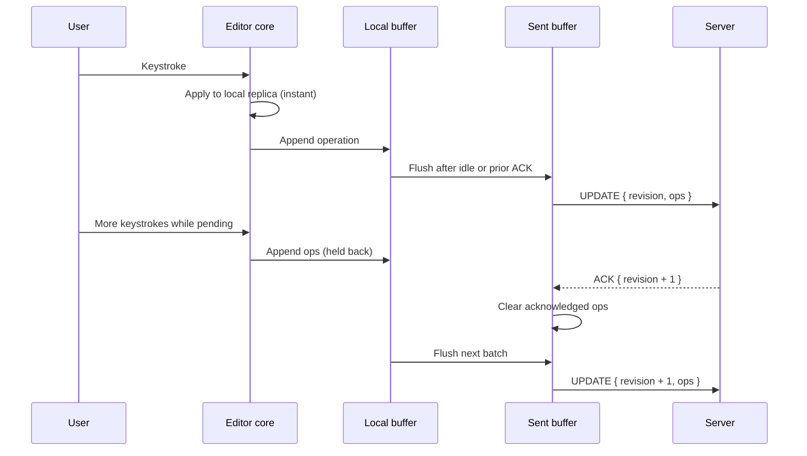
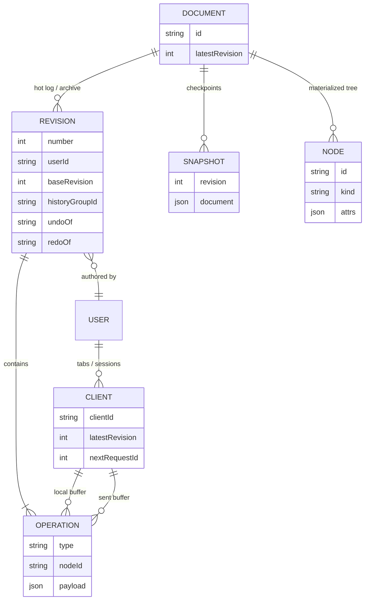
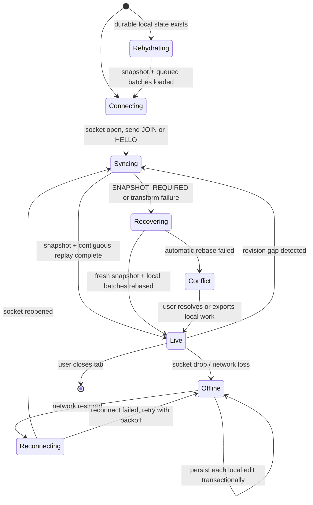

# Google Docs

**Difficulty:** Hard · **Duration:** ~40 min · **Topics:** Networking

> Source: [collaborative-editor-google-docs](https://www.greatfrontend.com/questions/system-design/collaborative-editor-google-docs)

## Question

Design a collaborative document editor that allows users to collaborate on a document in real-time.

> **This article is about collaboration, not text editing itself**
>
> This article focuses on the collaboration aspects of collaborative text editing software and not much about text editing itself. For a deep dive into rich text editing, have a look at the [Rich Text Editor system design article](https://www.greatfrontend.com/questions/system-design/rich-text-editor).

### Real-life examples

Examples of collaborative document editors include:

- [Google Docs](https://www.google.com/docs/about/)
- [Notion](https://www.notion.so/)
- [Quip](https://quip.com/)
- [Etherpad](https://etherpad.org/)

## Solution

### Requirements exploration

The design focuses on these functional and non-functional requirements:

- Functional
  - Any participant can edit / view the document
  - Updates by peers on the same document are reflected automatically
  - Conflicts are resolved if participants are editing the same part
  - All participants should see the same document revision eventually
  - Offline usage? Not required, but we’ll discuss if there's time
- Non-functional
  - Updates by others are reflected in real-time
  - Support up to 100 concurrent editors ([Google has the same limit](https://support.google.com/docs/answer/2494822))

#### Check your understanding 1

You have 30 minutes to design a Google Docs-like editor, but the product brief does not define its collaboration guarantees. Which questions could change the collaboration algorithm or recovery model you choose? Select all that apply.

- [x] Which concurrent edits and conflicts must be represented, and what convergence guarantee is required?
  > These answers determine the operation model, ordering rules, and whether concurrent states can converge without losing intent.
- [ ] Must the formatting controls use a fixed toolbar or a contextual popover?
  > This affects the editor UI, but either presentation can issue the same semantic operations through the same collaboration protocol.
- [x] What local and peer-update latency is acceptable, and how many editors may be active at once?
  > Latency and fan-out targets shape optimistic application, batching, connection strategy, and server distribution.
- [x] Must offline edits survive refreshes or restarts, and how long can clients remain disconnected?
  > Durable offline work adds persisted queues and replay or rebase behavior, while longer gaps can exceed the retained operation window and require a fresh snapshot.

---

### Background

Firstly, let's understand what a collaborative editing session over Google Docs entails. The following characteristics are observed/required of collaborative editing sessions:

- **Responsive (in the delay sense)**: Actions taken by participants (e.g. inserting/deleting characters, formatting) should be reflected instantly.
- **Real-time updates**: Actions taken by peers should be reflected near instantly.
- **Conflict-prone**: During a session, there is a high chance of access conflict as participants work on and modify the same parts of the document, e.g. deleting a sentence while another participant is modifying it.
- **Distributed**: Participants are accessing the web application on their own machines, without any geographical constraints.
- **Ad hoc**: Participants are free to come and go during a session; they may drop off or join at any time.
- **Unpredictable**: In general, participants are not following a pre-planned script; it is not possible to predict what information will be accessed and in what order.

The technical term for such collaborative software is "groupware systems". Most products in Google Workspace (formerly known as G Suite) like Google Sheets and Google Slides also support real-time collaboration.

Note that participants should be considered at the browser tab level. A user can open the same document in two separate tabs. Assuming there is no direct communication between browser tabs for the same user, it will be simpler to treat each tab as a separate participant and sync their document states.

The complexity of real-time collaborative editing solutions arises primarily from communication latency. Ideally, if communication were instantaneous, developing a real-time collaborative editor would be as straightforward as creating a single-user editor, as updates from peers would appear as if they were made by the active user.

However, network latency limits communication speed, leading to a fundamental challenge: users expect their own edits to be incorporated into the document immediately. Yet, if these edits are applied instantly, they are necessarily inserted into different revisions of the document due to the delay in communication.

Consider the following example: Alice and Bob start with a document that contains the word "Mary". Bob deletes the letter "M" and then inserts "H", intending to change the word to "Hary". Meanwhile, Alice, without having received Bob's edits, deletes the letter "r" and then deletes "a", with the intention of changing the word to "My". As a result, both Alice and Bob will receive edits that were applied to versions of the document that never existed on their own machines, and without any special handling, the document states might diverge.

Therefore, the challenge of real-time collaborative editing is to determine how to correctly apply edits from remote users that were originally made in versions of the document that never existed locally and may conflict with the user's own local changes.

Typically, for front end system design, we only need to care about what goes on within the client. However, for collaborative editing, the server also plays an important role in the collaboration protocol, making it necessary to also discuss the server's state and responsibilities.

---

### Approach

The protocol depends on payload size, network topology, concurrency control, and transport.

Hence, we will discuss the various aspects of the system, the various approaches that can be taken, and the tradeoffs involved, then make a decision on the overall approach.

These decisions depend on each other: the payload and concurrency model constrain how clients exchange and reconcile updates.

After deciding on the overall approach, we will then dive deeper into the architecture, data model, and APIs to move forward with.

#### Rendering and editing rich text

In well-architected systems, rendering the document UI is mostly independent of the communication models and protocols behind the scenes. We explain the "front end" of collaborative editors in more detail in the [Rich Text Editor system design article](https://www.greatfrontend.com/questions/system-design/rich-text-editor).

Here is a summary of the ways to build rich text editing on the web:

- **DOM with augmented fake cursors**: Using regular DOM containing formatted text using HTML elements and styling, augmented with fake cursors. This approach is complex due to the cursor height and positioning calculations needed.
- **`contenteditable` attribute**: By adding the `contenteditable` attribute to a DOM element, its content becomes editable and even supports keyboard shortcuts for bold, italics, and underline formatting. However, it behaves differently in different browsers and formatting options are limited.
- **HTML `<canvas>` element**: This is an advanced approach that uses a `<canvas>` element and renders everything within the canvas element – text, layout, cursor, etc. This approach basically sidesteps a lot of what the browser provides and requires reimplementing everything within a canvas context.

These are not mutually exclusive categories: production editors often combine controlled DOM rendering, `contenteditable`, custom input handling, and cursor overlays. Detailed input, selection, composition, and accessibility mechanics are a potential follow-up covered by the [Rich Text Editor system design article](https://www.greatfrontend.com/questions/system-design/rich-text-editor).

In practice, most rich text editors on the web are built using the `contenteditable` attribute backed by custom event handlers, which allows for more content elements.

In 2021, Google [announced that Google Docs will be moving towards a canvas-based rendering approach](https://workspaceupdates.googleblog.com/2021/05/Google-Docs-Canvas-Based-Rendering-Update.html?utm_source=the+new+stack&utm_medium=referral&utm_content=inline-mention&utm_campaign=tns+platform) to "improve performance and consistency in how content appears across different platforms". While Google Docs uses a canvas-based approach, it is too complex to discuss and most front end developers do not have much experience with canvas. We recommend being familiar with the `contenteditable` attribute approach first.

In summary, most rich text editors on the web use `contenteditable` and take the following high-level approach:

1. Design an editor-specific model of the document content, usually tree-based
2. Create a mapping between the model and DOM elements
3. Define a set of supported operations on this model (e.g. insert text at position, delete text, format text)
4. Translate user events (keypresses and mouse clicks) into a sequence of these supported operations
5. Update the DOM based on these operations, ideally with minimal DOM manipulation calls

Read more about the "front end" of collaborative editors in the [Rich Text Editor system design article](https://www.greatfrontend.com/questions/system-design/rich-text-editor).

#### Request payload contents

When a participant makes an update, or receives an update from others, what should the request payload contain?

The two common approaches are:

- **Payload contains the entire current document**: Sending and receiving the entire current document state.
- **Payload contains only changes (the delta)**: Sending and receiving only the updates made.

##### Transmitting entire document

Transmitting the entire document per update has the following properties:

- **Clear document state**: Recipients know the full state of the document the sender was viewing when it was updated.
- **Sender intentions aren't clear**: Just by receiving the updated document, recipients do not know what changes were made unless they compare it with their own document revision or the sender's previous document revision, both of which are troublesome to compute.
- **Not scalable**: As the document grows, the amount of data to transmit will increase proportionately. For large documents, each request will take longer to transmit.

##### Transmitting only changes

Transmitting just the changes has the following properties:

- **Small request payload size**: Since only the changes are sent, the request payload size is generally small, typically containing only the command (e.g. insertion, deletion, formatting) and associated metadata (e.g. characters and position to insert/delete).
- **Efficient request payload size**: The document's length has no impact on the request payload size since the changes are not reliant on the current document state.
- **No document state information**: It's not clear which version of the document the changes were made against. This can be mitigated by including a document revision number in the request payload – more on that later.

##### What should requests contain?

A short response time (under 500ms) is required for a real-time WYSIWIS (What-You-See-Is-What-I-See) experience, meaning that when a user makes an edit, all other participants should see that change reflected on their screens within 500ms. If participants see slightly different or outdated versions of the document, they may find it harder to coordinate their edits.

Updates made by participants should be communicated in a lightweight fashion; thus, the request payload for updates should ideally **contain only the changes**.

#### Check your understanding 2

A participant inserts five characters into a large shared document. What should the normal update payload send to the collaboration server?

- [ ] Send the participant's entire current document after every edit so the server can choose the latest copy.
  > Full snapshots grow with the document and still do not identify which concurrent intent should be preserved when copies differ.
- [x] Send the ordered semantic insertion operation plus the document revision it was authored against.
  > The delta stays small regardless of document size and preserves both user intent and the context needed for transformation.
- [ ] Send the changed DOM subtree and ask other clients to replace their matching rendered elements.
  > Rendered markup is not a stable collaboration schema and can differ across clients, editor versions, and view implementations.
- [ ] Send only the current caret position and a wall-clock timestamp so the server can infer the text change.
  > Selection does not encode the mutation, and client clocks cannot establish the authoritative document revision.

#### Network architecture / communication model

There are two common models for network communication between groupware system participants:

- **Client-server model**: Central server; all participants communicate only with the server
- **Peer-to-peer**: No central server; all participants act as both server and client


##### Client-server model

In a client-server network model, participants (clients) request resources from a central server and send payloads to it. The server processes these requests and provides the appropriate responses.

**Advantages**:

- **Centralized source of truth**: All updates have to first go through the server. The server determines the latest document revision and holds the source of truth.
- **Robustness**: When new participants join or one of the existing clients crashes (due to bugs, network flakiness, etc.), the latest document can be fetched from the server.

**Disadvantages**:

- **Single point of failure**: The central server is a critical component; if it fails, the entire network can be disrupted.
- **Cost**: Higher infrastructure and maintenance costs due to the need for powerful central servers.
- **Scalability**: Can become a bottleneck if the number of clients grows rapidly without proper scaling.

##### Peer-to-peer (P2P) model

In a P2P network model, each participant acts as both a client and a server. Peers communicate directly with each other without the need for a central server.

**Advantages**:

- **Potentially lower latency**: Direct peer connections avoid a server hop, although relayed connections can remove that advantage.
- **Potential infrastructure savings**: Peers carry some network load, but signaling, relays, and durable persistence still require infrastructure.
- **Load distribution**: Network load is distributed among participants, although per-peer fan-out grows with the group size.

**Disadvantages**:

- **Synchronization problems**: Without a central authority, participants need a replication protocol to determine which updates are missing and ensure that their document states converge.
- **Complicated bootstrap**: When participants join or a client crashes, the protocol has to identify an authoritative state and catch the participant up safely.
- **Supporting services**: Signaling, relays, durable persistence, and authorization can still require servers.
- **Security**: Every peer must authenticate updates and enforce document permissions rather than trusting connected participants.

P2P is a potential follow-up when decentralized replication is required. Its connectivity setup, relay usage, fan-out, and recovery protocol are beyond this article's core client-server design; reliable replication is possible over either topology.

##### Which model to use?

The client-server model provides a central source of truth for persistence and synchronization:

- **Database persistence**: The document state has to be persisted in a database. Without a central server to save the document frequently, updates could be lost if clients disconnect before saving the document to the database.
- **Source of truth**: Since new participants are able to join at any time, having the source of truth on the server simplifies the logic of reliably obtaining the latest document – new participants can fetch the latest document from a single consistent location, the server.
- **Optimize for reliability and performance**: Reliability and performance are the most important factors for a seamless collaboration experience and for making sure all participants are updated. In practice, most sessions will not see a large number of participants (> 20) at any given time; there will only be a few participants at most. We should optimize for reliability and performance rather than server costs.

With these reasons in mind, a client-server model is preferred for straightforward serialization, persistence, authorization, and join/recovery behavior.

> **Default to a client-server model for collaborative editors**
>
> A central server provides durable persistence, a single source of truth, and one consistent place for mid-session joiners to fetch the latest document. Treat this as the baseline and discuss P2P as a follow-up when decentralized replication is an explicit requirement.

#### Check your understanding 3

A collaborative editor needs durable persistence, authorization, reliable mid-session joining, and automatic recovery for ordinary sessions of up to 100 editors. Which topology is the best baseline?

- [ ] Have every browser send each operation directly to every other connected browser and persist only when a peer volunteers.
  > A mesh still needs authoritative bootstrap, durable storage, authorization, missing-update recovery, and fan-out that grows with participant count.
- [ ] Elect one participant's tab as the document authority and transfer leadership whenever it disconnects.
  > Browser churn makes authority and durability fragile, and failover must solve the same consensus and catch-up problems the server baseline avoids.
- [x] Route every participant through a central collaboration service that serializes revisions and owns the durable document state.
  > One authority gives clients a consistent bootstrap, ordering, permission, and recovery boundary while keeping peer count out of each client's protocol.
- [ ] Let clients edit independently and periodically upload full snapshots using last write wins.
  > Whole-document last-write-wins drops concurrent work instead of producing one convergent collaboration history.

#### Concurrency control model

There are two kinds of operations that need to be made when discussing collaborative editors:

- **Local updates**: Updates made to the document by the user viewing it.
- **Merge updates from peers**: Updates made to the document by peers.

All these updates have to be merged into the current document. Conflicts might arise if two users are editing the same section of the document (e.g. somebody deletes a sentence while another person is adding a word to the sentence).

Concurrency control is the activity of coordinating interfering actions that operate in parallel to maintain consistency between participants and resolve conflicts that arise between them.

They can be broadly classified into optimistic and pessimistic types:

- **Pessimistic**: Pessimistic methods guarantee that no conflicts occur. Their main objective is inconsistency avoidance. They require communication with other sites or a central coordinator before any data changes are made. This communication can be explicit (e.g. floor control policy) or implicit, where the user's program handles it in the background (e.g. locking). In general, pessimistic methods do not require conflict resolution but have higher network latency and longer response times.
- **Optimistic**: Optimistic methods do not bother with avoiding conflicting updates. They require no prior communication before making local changes and are well-suited for high-latency communication channels since the results of a user's actions can be displayed without waiting for a communications round-trip. The user applies the changes immediately and updates the server, which then notifies the peers. If multiple participants make simultaneous changes, a conflict resolution algorithm creates compensating changes to ensure everyone reaches the same final state. Optimistic methods have zero/near-zero local response times but may require conflict resolution.

Text editing is unlike traditional form submission, where users can tolerate updates taking up to a few seconds to complete. Textual updates made by the user should be reflected instantly without any latency. To support zero-latency local updates, clients should maintain a replica of the document state locally, and user updates are made against the replica so that they can be reflected on their UI instantly.

Let's have a look at the various concurrency control mechanisms, their properties, and their pros and cons.

##### Last write wins model

For traditional web applications like admin dashboards, if two users modify the same entity simultaneously (e.g., changing a person's name), a race condition occurs. The final name saved in the database will be the one submitted by the request that arrives last.

In distributed computing, this behavior is called "last write wins". At the document level, "last write wins" can discard concurrent edits, so it is unsuitable for this collaborative editor.

> **Do not apply "last write wins" at the document level**
>
> Treating the whole document as the unit of concurrency will silently drop one participant's work every time two people save at once. Last-write-wins can still be useful inside narrow CRDT primitives (such as a last-writer-wins register), but it must not be the top-level conflict strategy for a live editor.

##### Floor control model

"Floor control" is a protocol that determines which user has control (has the floor) and how to take turns when multiple people access a resource, a document in this case.

- **Token-based**: A token circulates among participants, and only the participant holding the token can make changes. Participants can request a token and the predefined policy (e.g. first-come-first-served or free-for-all) determines if the request is granted.
- **Chair-controlled**: A designated chairperson or moderator grants and revokes participant access to resources.

Participants without control can still see the updates being made in a live fashion.

Floor control helps to prevent conflicts and ensure orderly interactions. Evidently, this method does not fulfill the requirements because only one participant can make edits at any one time; peers have to wait for their turn to edit. One way around this is to allow participants to take over control of the token anytime they want, but it's not a great user experience for participants who are still typing to have control taken away from them suddenly.

##### Locks model

Locking is the concept of preventing unwanted access to data (read and/or write). In the context of collaborative editing, when an editor starts editing a document, the document (or parts of it) can be locked to prevent unwanted modifications from peers.

There are a few issues to discuss related to locking:

- **Locking granularity**: Locking can be done at the document level, paragraph level, sentence level, word level, etc. Document-level locking is essentially the "floor control" mechanism. Fine-grained granularity is better, but what should happen in sentence-level locking when the paragraph containing the sentence is being deleted?
- **Lock requests**: Locks can be requested in both optimistic and pessimistic fashions.
  - **Pessimistic locking**: Clients make a network request to obtain the lock. Clients will only start allowing modifications after the lock has been granted. There is network latency involved in acquiring the lock, so users will experience a delay before being able to perform any actions, which can be annoying.
  - **Optimistic locking**: Clients allow modifications and request the lock at the same time. If the request for the lock was rejected (possibly because another person also requested the lock at the same time), the client will roll back the updates made prior to requesting the lock.
- **Lock releases**: After a lock is acquired, when should it be released? Should the lock be requested when the cursor is moved or when a key is struck? For example, if locks are released when the cursor is moved, then a user could move to one place to copy some text only to be locked out from pasting it into their previous location. On the other hand, if locks are retained too generously, users might still be granted the lock even when they no longer need it, e.g. a lock is redundant when the user leaves the document open but goes away from the keyboard. Determining the idle threshold is tricky. Similar to floor control, allowing users to take over control of the lock anytime they want is one way of mitigating lock-releasing issues.

Locking is an improvement over floor control (which is also technically a type of locking) and is viable at the right granularity with optimistic locking and appropriate lock-releasing strategies due to the ease of implementation. In fact, collaborative editing apps like [Quip](https://quip.com/) used a lock-based concurrency model in earlier versions of their product. Locking is actually a viable approach for real-time collaboration if the likelihood of editing the same section is low.

##### Transaction-based model

A transaction-based approach is an optimistic method where users make changes locally and changes are validated at the end of the transaction, similar to distributed version control systems like Git and Mercurial. Version control systems manage changes to documents or resources by maintaining different versions and allowing users to merge changes.

Each user has a copy of the document on their computer and can make their changes locally, without any locks or other restrictions. Changes are not pushed immediately. When the user is done updating, the changes are committed and pushed up to the server. If there are any conflicts, the transactions are rolled back and the user has to resolve them in order to update the server.

This approach has the benefit of zero-latency local updates, and all participants can update their documents simultaneously without any locking restrictions. However, in this approach, updates aren't real-time – users are required to explicitly push their updates and explicitly pull updates from others. Additionally, it requires users to resolve conflicts themselves, which is annoying and unreasonable to expect of common users.

##### Version-detection model

In a version-detection model, the document state is replicated on each user's machine and participants can make changes locally, which are then propagated to peers as soon as possible. Under good network connections, users should see updates from peers in under a second.

Each update request contains the new data and the document revision the change was acted on. When the server receives the update request, it first checks if the revision in the request is the same as the current revision. If the revisions match, the server updates the document, saves it as a new revision, and broadcasts this information to all peers so that everyone is on the latest revision. If they are different, then there's a "version mismatch", which can be resolved in one of the following ways:

- **Reject the request**: This avoids having to do any conflict resolution but isn't ideal, as the frequency of it happening can be quite high when there are multiple participants simultaneously updating the same part of the document.
- **Compensate changes**: Automatically compensate the changes to rectify the version mismatch and bring the system to a consistent state. In most cases, compensating is straightforward if changes were made to different parts of the document (probably no need to compensate at all!). If the changes do conflict, we can use conflict resolution methods like Operational Transformations (OTs). On the other hand, if Conflict-free Replicated Data Types (CRDTs) are used, there is no need for compensation.

The version-detection model with compensation enjoys the benefits of zero-latency local updates, all participants being able to update their documents simultaneously in real-time without any locking restrictions, and eventual convergence to the same version of the document if there's a robust conflict detection and resolution approach.

Version detection supports real-time collaboration without requiring users to acquire editing locks. Concurrent edits still require a conflict-resolution algorithm.

##### Which concurrency model to use?

Only the **version-detection consistency model** is able to meet all the real-time collaborative editing requirements because it has the following properties:

- **Replicated**: The document is replicated on the machines of all participants. This is necessary for the model to make optimistic updates.
- **Optimistic and non-blocking**: Updates are made locally without worrying about conflicts. Optimistic behavior is necessary for zero-latency responsiveness during local updates – the speed or reliability of your network connection will not influence how fast users can type.
- **No locking**: The entire document is available to every participant all the time.
- **Automatic conflict resolution**: Any detected conflicts are resolved automatically on the server. Possible approaches include creating compensating changes and informing the client (OT), or using data structures that resolve conflicts automatically (CRDTs).

From each participant's perspective, it will feel as if they are editing an offline Word document – there is no latency involved when editing.

> **Apply local edits optimistically against a client-side replica**
>
> Users will not tolerate keystroke latency, so the client must commit edits to its own replica first and sync with the server in the background. Locks, pessimistic acquisition, and round-trip-gated edits all couple typing speed to network speed and should be avoided for real-time editors.

#### Check your understanding 4

Users must see their own keystrokes immediately even when the network is slow, while concurrent participants may edit the same paragraph. Which concurrency model fits?

- [x] Apply edits to a local replica immediately, send revision-based operations, and automatically reconcile concurrent work into shared order.
  > Local application decouples typing latency from the network, while revision context and conflict resolution let replicas converge later.
- [ ] Wait for the server to grant a paragraph lock before displaying each edit.
  > Lock acquisition prevents some conflicts but makes local responsiveness depend on a network round trip and complicates overlapping structural edits.
- [ ] Allow only one participant at a time to hold the document's editing token.
  > A global floor avoids concurrency by preventing simultaneous editing, violating the central product requirement.
- [ ] Keep changes local until users explicitly publish and resolve conflicts in a merge interface.
  > Explicit publication supports independent work, but it does not provide continuous peer updates or automatically converge replicas.

#### Conflict resolution approaches

Conflicts can arise when two or more participants are editing the same part of the document. Let's run through an example.

Assume we have a document containing a single word "ABCDE", and Alice and Bob edit it at the same time:

1. Alice deletes the fourth character "D". Her computer sends a request `DEL @3` to indicate deletion of the fourth character, which is at index 3 (zero-based indexing).
2. Bob deletes the second character "B". His computer sends a request `DEL @1` to indicate deletion of the second character, which is at index 1 (zero-based indexing).

The server will process both requests. For now, the server simply executes the commands and relays them without any special handling. The intended end result after both deletions is "ACE".

Since network latency is unpredictable, one of two scenarios can happen:


1. **Alice first**: The server receives Alice's request before Bob's, resulting in the server deleting the fourth character and then the second character: "ABCDE" -> "ABCE" -> "ACE". In this scenario, the document on the server correctly deletes Alice's and Bob's intended characters. The server ends up with "ACE".
2. **Bob first**: The server receives Bob's request before Alice's, resulting in the server deleting the second character and then the fourth character: "ABCDE" -> "ACDE" -> "ACD". Notice that when the server processes Alice's request, the fourth character of the document is now "E", but Alice wanted to delete "D". The server ends up with "ACD".

In this naive approach, depending on whose request the server receives first, the server ends up with different document states.

In fact, Bob will always end up with "ACD" regardless of whose request reaches the server first. Remember that updates are first made locally and then sent to the server to be broadcast to others. The problem is that offsets depend on the state of the document at the time an edit was made. Request payloads include the offsets but not the context they depend on, which results in the divergence.

This is just one of the possible scenarios that result in conflicts. There are other possible combinations, like insertion + insertion, deletion + insertion, deletion + deletion, etc.

##### Conflict resolution properties

Therefore, we need a conflict resolution approach that adheres to these properties as much as possible:

- **Convergence**: All replicas will eventually reach the same state, provided that they have received and applied the same set of operations (the quiescence state).
- **Causality preservation**: Ensures that the order of operations respects the causal relationships between them. For example, if one operation logically follows another, the system must apply these operations in that order to maintain consistency (e.g. deletion of a character after its insertion).
- **Intention preservation**: Ensures that the original intent of an operation is maintained after concurrent operations are merged. This means that the result of merging concurrent operations should align with what users expect their operations to achieve, even in the presence of conflicts. For formatting, whether text inserted at a range boundary inherits the mark depends on an explicit range-affinity policy in the editor's operation model; defining the full boundary matrix is a potential follow-up.

Two common conflict resolution approaches are used:

- **Operational Transformations (OT)**: OT accounts for context at the point of editing and transforms the operations accordingly (e.g. by modifying the offsets of insertions/deletions).
- **Conflict-free Replicated Data Types (CRDTs)**: CRDTs enforce the use of data structures where updates are commutative and associative such that the order of operations does not matter.

> **Aim to explain principles with an example, not implementation detail**
>
> Explaining each conflict resolution approach in detail is beyond the scope of this article (there isn't enough time during interviews anyway). However, you should be able to explain the general principles using an example. We will explain how each approach works and provide examples and links to resources for further reading.

##### Operational Transformations (OT)

OT was originally developed for collaborative editing of text documents, allowing multiple users to edit simultaneously without conflicts. It maintains the consistency of document states across different clients by transforming operations based on the context of other concurrent operations.

OT systems typically use a replicated document storage model, where each client maintains a local copy of the document. Users operate on their local copies, and changes are propagated to other clients. When a client receives changes from another client, it applies transformation functions to ensure that the local document remains consistent with the updates.

The key components of OT include:

1. **Operations**: These are the basic actions users perform, such as inserting, deleting, or modifying text. Each operation is associated with a position in the document.
2. **Transformation functions**: These functions determine how to adjust operations when they conflict. For example, if two users insert text at the same position, the transformation function will resolve the conflict to maintain a consistent document state.
3. **Control algorithms**: These algorithms manage the sequence and context of transformations. They decide which operations should be transformed against others based on their causal relationships, ensuring that the order of operations respects the intent of each user.

Let's revisit the Alice and Bob example and see how applying OT can solve the issue.


1. **Alice before Bob**: The server receives Alice's request before Bob's, resulting in the server deleting the fourth character and then the second character: "ABCDE" -> "ABCE" -> "ACE". In this scenario, the document on the server correctly deletes Alice's and Bob's intended characters. However, Bob's computer realizes that Alice's change was made before Bob's deletion, hence it transforms Alice's change from `DEL @3` -> `DEL @2` since Bob deleted an earlier character. Bob ends up with "ACE".
2. **Bob before Alice**: The server receives Bob's request before Alice's, resulting in the server deleting the second character: "ABCDE" -> "ACDE". When the server receives Alice's request, it realizes that Alice's change was made before Bob's deletion, hence it transforms Alice's change from `DEL @3` -> `DEL @2` to account for Bob's deletion of an earlier character. The server correctly deletes "D" (the third character) and passes this transformed operation to Bob. Both the server and Bob end up with "ACE".

Both servers and clients can perform OT and must handle all the various ways that insertion, deletion, and formatting changes can be paired and transformed against each other. The example above showed how a deletion is transformed against a deletion. Some other examples of transformations:

- Formatting is expanded when transformed against insertions: `FORMAT BOLD @10-20` transformed against `INS "ABC" @15` results in `FORMAT BOLD @10-23`.
- Not all changes will conflict, and in those cases they do not require transformation. E.g. `FORMAT BOLD @10-20` and `FORMAT ITALIC @15-25` do not conflict as text can be both bold and italic at the same time.

How does the server know whether Alice's and Bob's requests were made with or without accounting for the other party's changes and whether it has to do any transformation? Each time an update is made on the server and the document is modified, the document is saved as a new revision (e.g. using timestamps or [monotonically](https://en.wikipedia.org/wiki/Monotonic_function) increasing integers). Timestamps are not a great choice because machine time can be manipulated, which results in an incorrect order when sorting by time; a monotonically increasing positive integer is preferred.

Requests and responses can include the document revision number so that both servers and clients know the document version the other party was seeing when the request was made and can correctly determine if operations require transformation.

**Analysis of OT**: Let's take a look at how OT fulfills the conflict resolution properties:

- **Convergence**: OT uses transformation functions to modify operations so that they can be applied consistently across all replicas, even if they arrive in different orders. The core idea is that if two operations conflict, the transformation functions adjust one or both operations to ensure they can be applied in any order but still lead to the same final state.
- **Causality preservation**: OT systems often use causal history tracking to ensure that operations are applied in an order that respects their causal dependencies. This is usually done by tagging operations with metadata, such as timestamps or revision numbers, which indicate their causal relationships.
- **Intention preservation**: OT payloads commonly include the command intention and context (document revision number). The transformation functions consider the context in which an operation was originally applied. The command along with the contextual awareness helps preserve the original intention even when the document has changed due to other concurrent operations.

OT works well for text-based documents but can be less effective for other types of data structures, such as hierarchical or non-linear data. Implementing OT for these types of data requires additional effort and customization.

There are many implementations of OT algorithms and various consistency models, which are beyond the scope of this article. If you're interested, check out the following links:

- [What’s different about the new Google Docs: Conflict resolution](https://drive.googleblog.com/2010/09/whats-different-about-new-google-docs_22.html)
- [Operational Transformations as an algorithm for automatic conflict resolution](https://medium.com/coinmonks/operational-transformations-as-an-algorithm-for-automatic-conflict-resolution-3bf8920ea447)
- [Visualization of OT with a central server](https://operational-transformation.github.io/)

##### Conflict-free Replicated Data Types (CRDTs)

Offset indices depend on the current document state, so OT must transform conflicting updates. Conflict-free Replicated Data Types (CRDTs) instead use data structures and merge rules designed to make concurrent updates converge.

CRDTs are advanced data structures designed for distributed systems, enabling multiple users or applications to update shared data concurrently without coordination, which eventually converges to the same state (strong eventual consistency) when all updates have been received and applied. Instead of resolving conflicts using OT, CRDTs are built so that the operations performed on the data are inherently conflict-free or can be automatically resolved in a consistent manner.

CRDTs have the following properties:

1. **Concurrent updates**: CRDTs enable independent updates across multiple replicas of data. Each replica can be modified without needing to coordinate with others, making them ideal for environments where network connectivity may be intermittent. Updates can be propagated using the gossip protocol without the need for a central authority.
2. **State-based updates**: In a state-based CRDT (CvRDT), local updates move the state monotonically through a join-semilattice.
3. **Merge and delivery rules**: A state-based CRDT's merge function must be associative, commutative, and idempotent. In an operation-based CRDT (CmRDT), concurrent operations must commute, while causally related operations can require causal-order delivery or buffering.
4. **Automatic conflict resolution**: CRDTs incorporate predefined algorithms (e.g. last writer wins) that automatically resolve inconsistencies that may arise from concurrent updates. This means that even if different replicas make conflicting changes, the CRDT can merge these changes without manual user intervention.
5. **Eventual consistency**: Although replicas may have different states at any point in time, CRDTs guarantee that all replicas will eventually converge to the same final state once all updates have been propagated. Strong eventual consistency means replicas that have received the same updates have equivalent states, not that replicas cannot be temporarily inconsistent.

The CRDT model is somewhat similar to Git – every developer in the organization possesses a copy of the repository and is allowed to make changes locally. At the end of the day, the developers can merge changes with every other developer however they like: pair-wise, round-robin, or through a central repository. Once all the merges are complete, every developer will have the same state. However, unlike Git, a CRDT prescribes a way to merge conflicts automatically and can merge out-of-order changes.

**Example of CRDT – Grow-only set**: An example of a CRDT is a grow-only set. A grow-only set is an unordered set that only allows the addition of unique elements. It is a CRDT because:

- The set can be replicated.
- Each replica can add any element it likes and the addition is a monotonically increasing update.
- Each replica can be merged back together in any order.
- Once all merges are complete, all replicas will have the same contents (the union of all individual sets).

**Representing text in CRDTs**: Collaborative text documents can be represented using sequence CRDTs like lists (e.g. [Linear Sequences and Replicated Growable Array](https://www.bartoszsypytkowski.com/operation-based-crdts-arrays-1/)) and trees. Unsurprisingly, text CRDTs are more complicated to implement than a grow-only set. [Cola](https://nomad.foo/blog/cola) is a text CRDT written in Rust, but the data structure can be implemented in any language.

Text editing also involves deleting. How can we represent deletion in CRDTs? One approach is to track deletions as well by using two separate grow-only data structures, one to track insertions and another to track deletions (known as tombstone markers). The resulting value is the items in the insertion set minus the items in the deletion set. Complex CRDTs are often combined from smaller CRDTs, which helps tremendously in preserving the CRDT properties.

**Analysis of CRDTs**: Let's take a look at how CRDTs fulfill the conflict resolution properties:

- **Convergence**: A state-based CRDT converges through its associative, commutative, and idempotent state merge. An operation-based CRDT converges when updates are eventually delivered in causal order and concurrent operations commute.
- **Causality preservation**: Operations are applied to other replicas in a way that respects causality. For example, operations can be propagated in any order, but an operation might be buffered until all preceding causally related operations have been applied. E.g. a deletion only takes effect once the insertion has taken place.
- **Intention preservation**: CRDTs incorporate predefined conflict resolution strategies that aim to preserve user intent. These strategies are application-specific: operation semantics determine how concurrent changes are combined. Whether the result preserves user intent depends on the implementation and use case; convergence alone does not guarantee it.

**Drawbacks of CRDTs**: While CRDTs are more modern compared to OT, they do come with some drawbacks:

- **Metadata overhead**: CRDTs often require additional metadata to track operations, revisions, or unique identifiers. This metadata can grow over time, leading to increased storage requirements, especially in large-scale systems or with complex data types.
- **Ever-increasing metadata**: Some CRDTs have a monotonically increasing state, often having to track removals that do not appear in the final visual result. This metadata can grow over time. Garbage collection or cleanup mechanisms can be used, but they can be technically challenging to implement without causing inconsistencies in replicas.
- **Conflict resolution**: While CRDTs are designed to resolve conflicts by merging concurrent updates in a predefined way, this automatic conflict resolution might not always align with the desired application semantics, leading to unexpected results.

CRDTs do not entirely bypass causality preservation: operation-based CRDTs can still require causal delivery or buffering. Whether CRDTs can preserve intention depends on the chosen conflict resolution strategy and implementation.

##### Which conflict resolution approach to use?

Both OT and CRDTs are designed to manage concurrent updates to shared data in a way that maintains consistency across all replicas, but they do so using different methodologies and with varying trade-offs.

**Convergence**: OT can guarantee convergence but requires more careful handling of operation order and context. It often requires a central server or a more tightly coordinated communication protocol to ensure consistency. CRDTs are designed to guarantee eventual consistency between replicas as long as their delivery assumptions are met. Neither approach is categorically superior independent of its algorithm and delivery protocol.

**Technical complexity**: Implementing CRDTs for complex or hierarchical data structures can be challenging, requiring careful design to ensure that the operations maintain the desired properties. Implementing OT is also complex, especially when designing the transformation functions that must handle all possible conflicts and concurrent operations. Although CRDTs' consistency model is easier to understand, it's harder to understand and implement CRDTs for text structures. In the context of text editing, OT takes the lead.

**Ecosystem**: OT is a mature technology and has been implemented in several well-known collaborative editing systems with many mature libraries and tools available – Google Docs itself uses OT. CRDTs have also been well-studied, and many libraries implement them. Figma uses a centralized, server-authoritative design inspired by multiple CRDTs rather than a true CRDT. There is no clear winner in terms of ecosystem as both approaches have been well-studied (and criticized).

Overall, there's no clearly superior choice. Both CRDTs and OT can be used to implement collaborative editors. CRDTs are general purpose while OT has its roots in document editing. While CRDTs are newer and more trendy, OT is mature and excels in real-time collaborative editing applications where low latency, immediate feedback, and fine-grained control over user intentions are critical. For this design, compare them using the central-authority requirement, rich-tree operations, expected offline duration, metadata and garbage-collection costs, and available library support.

The rest of the article assumes usage of OT as the conflict resolution approach. The primary reason is that Google Docs itself is implemented using OT, so there are also more resources on implementing collaborative text editors using OT as opposed to CRDTs. It is also easier to explain how OT works as opposed to text CRDTs, which have a very complex structure.

> **Default to OT for a Google Docs-style editor in interviews**
>
> OT is the mature, well-documented choice for linear rich text with a central server and is what Google Docs itself uses. CRDTs can fit decentralized or offline-first systems, but text CRDTs are harder to explain and carry metadata overhead. Figma is server-authoritative and CRDT-inspired rather than a true CRDT deployment. Pick OT as the baseline and mention CRDTs as the alternative when the interviewer prompts for tradeoffs.

#### Check your understanding 5

Alice and Bob both start from `ABCDE`. Alice creates `DEL @3` to delete `D`, while Bob creates `DEL @1` to delete `B`. The server commits Bob's deletion first. How should it apply Alice's intent next?

- [ ] Apply Alice's original `DEL @3` directly to `ACDE`.
  > Position 3 now identifies `E`, so using the stale offset preserves neither Alice's intention nor replica convergence.
- [ ] Reject Alice's operation because its base revision no longer matches the server.
  > Rejection detects the mismatch but forfeits the chosen automatic compensation model and would occur routinely during concurrent typing.
- [ ] Ask Alice for her full local document and make that snapshot authoritative.
  > Alice's snapshot does not include Bob's committed intent, so replacement would discard concurrent work rather than merge it.
- [x] Transform Alice's operation to `DEL @2`, then apply it to `ACDE`.
  > Bob removed an earlier character, so Alice's intended `D` shifted left by one and still occupies index 2 in the new revision.

#### Check your understanding 6

A team is comparing Operational Transformation (OT) with CRDTs for a rich-text collaboration protocol. Which claims are sound? Select all that apply.

- [x] OT can transform operations authored against an older revision through concurrent operations before applying them to the current document.
  > Transformation uses operation intent and revision context to preserve positions and ordering as the canonical history advances.
- [x] State-based CRDT merges need associative, commutative, and idempotent behavior, while operation-based CRDTs may require causal delivery or buffering.
  > CRDT convergence depends on its specific merge or delivery contract rather than making every message order automatically valid.
- [ ] Choosing a CRDT guarantees that every concurrent formatting or structural edit matches what all users intended.
  > A CRDT can guarantee convergence under its rules, but application-specific conflict semantics can still produce surprising or invalid user outcomes.
- [x] Compare central authority, offline duration, rich-tree operation support, metadata and garbage-collection costs, and available mature libraries.
  > Neither family is universally best. The workload and operational constraints determine which complexity is more acceptable.
- [ ] OT must order changes using client timestamps, so clock synchronization is a prerequisite.
  > A central OT protocol can use server-assigned monotonic revisions and causal context without trusting client wall clocks.
- [x] Both families can converge when their algorithms and delivery assumptions are implemented correctly.
  > OT and CRDTs reach consistency through different mechanisms, but neither label alone proves a correct implementation or intention policy.

#### Collaboration protocol

We have discussed the conflict resolution approaches, but it is only one part of the story. There are other unanswered questions related to collaborative editing using OT:

- **Request scheduling**: When are update requests sent? On every keystroke, after the user has stopped typing, or something else? If a user makes multiple back-to-back updates, should they all be sent to the server as they are made, or is there a better way to schedule them?
- **Multiple participants**: The OT examples above demonstrate how transformations work for two participants. What happens when there are more than two participants in the session and operations have to be transformed against multiple peers?
- **Participants joining**: How do users who join an editing session mid-way start updating their replica and receiving updates from others?

A collaboration protocol can be designed to answer these questions. It might be helpful to try out this [interactive visualization of OT with a central server](https://operational-transformation.github.io/) before reading on.

##### Central server

While OT does not require a central server at its core, having a central server simplifies certain things.

A central server architecture makes it simple for clients to stay in sync with the server. The role of the server is to receive updates and serve as the authority of the document state, transforming operations when clients send requests that conflict with the latest document. The server can also reject operations if the payload is invalid, if the operation was on a document revision that is too old, if the operation is too hard to transform, or if there are too many operations to transform.

When the server receives an update request, it will broadcast the update to connected clients. Clients do not need to care about how many other connected clients there are. Each client relies on the server to inform it of the changes to make. From a client's perspective, having N peer clients (where N is the number of peers) take turns every second to make updates in a round-robin fashion is equivalent to a single peer client making updates every second. To a client, having one peer is the same as having ten peers. This allows us to achieve N-way synchronization by running N independent two-party synchronizations between each client-server pair. Clients only have to focus on synchronization with the server, and servers can treat all clients equally; there are no special clients to consider.

Participants who join mid-way will be served the version of the document at request time. From that point on, they are a connected client and can send and receive updates like any other participant, as long as the updates are received in order after downloading the initial document.

Joining uses one gap-free WebSocket handshake. The server authorizes and attaches the connection to the document's ordered update stream before reading the snapshot at revision `R`, buffering any later revisions. It sends the snapshot followed by every buffered revision after `R`, and the client enters the live state only after applying that contiguous tail.

#### Check your understanding 7

A participant joins a long-lived document while revisions continue to commit. Which initialization sequence closes the snapshot/stream gap without replaying the document's entire history?

- [ ] Fetch the latest snapshot first, then open a WebSocket and accept whichever update arrives next.
  > A revision can commit after the snapshot read but before stream attachment, leaving the client unaware that its base is missing an operation.
- [x] Attach to the ordered stream, obtain a snapshot at revision `R`, replay the buffered contiguous tail after `R`, then enable editing.
  > Attaching before the snapshot establishes a handoff point, and replaying every later revision closes the gap before the client can edit live.
- [ ] Open the stream, apply the snapshot when it arrives, and let the user submit edits before buffered updates finish.
  > Edits would be authored against a base whose revision tail is incomplete, making subsequent transforms and acknowledgements ambiguous.
- [ ] Attach to the stream and replay the entire operation history instead of sending a current snapshot.
  > Full replay closes the gap, but its unbounded join cost violates the requirement to avoid replaying the document's entire history.

##### Store document as a revision log

The document can be stored as an append-only log of operations/changes, similar to the [Event Sourcing pattern](https://learn.microsoft.com/en-us/azure/architecture/patterns/event-sourcing). The server also maintains the current materialized document and updates it atomically with each accepted batch. Periodic snapshots at revision `R` allow recovery or historical reconstruction to start from the nearest snapshot and replay only the later operations instead of replaying from the beginning. This method of storing data also allows clients to view the document's version history.

| Rev no. | User    | Operations        | Timestamp        | Resulting document state |
| ------- | ------- | ----------------- | ---------------- | ------------------------ |
| 0       | N/A     | N/A               | 2024-08-03 10:00 | <EMPTY>                  |
| 1       | Charlie | `INS "Hello" @0`  | 2024-08-03 10:05 | "Hello"                  |
| 2       | Alice   | `INS " world" @5` | 2024-08-03 10:10 | "Hello world"            |
| 3       | Bob     | `INS "!" @11`     | 2024-08-03 10:15 | "Hello world!"           |

The resulting state is shown for illustration; it is not copied into each log entry. The latest state is stored separately as the materialized document.

Storing as a log is necessary since some clients can be extremely outdated and need to catch up with the current document. Imagine the scenario where a user disconnects from a collaboration session and leaves the tab open. When they reconnect the next day and others have made updates since then, upon reconnecting, the client sends its current outdated document revision number, which allows the server to determine the granular changes since that document revision and respond with a list of operations to be performed on the client, which might also need transformation.

The server retains a bounded hot tail for this catch-up; if the client's revision predates it, the server returns `SNAPSHOT_REQUIRED` so the client can load a fresh base before rebasing local work. Older operations can be archived when full audit or version history is required; retention cadence and archival policy are potential follow-ups.

Clients that join the editing session of a non-empty document do not need to fetch the entire log from the start; the server responds with the current state of the document. Subsequent document revisions can be computed by applying new operations (both local and from peers) to the initial session document state.

Each log entry represents one atomically committed batch and can contain multiple ordered operations.

##### When to send update requests

When should update requests be sent? Should update requests be sent on every keystroke, after the user has stopped typing, or something else?

- **Keystroke**: Send a request per keystroke. Not great because it can be taxing on the server and many potentially redundant operation logs are created.
- **Debouncing**: Send a request after the user has stopped typing for a short duration (e.g. 300ms). Might not be ideal for users who type a lot without stopping, as they can lose data if their browser crashes before the updates are sent out.
- **Throttling**: Send a request every fixed interval (e.g. 300ms) during continuous typing. Seems viable, but it's tricky to determine the throttle duration value.

These strategies determine when buffered edits become eligible to send; they do not determine how many requests can be in-flight. With any cadence, the client can continue adding edits to a local buffer while one sent batch remains pending.

Sequence-numbered pipelining can improve throughput, but handling out-of-order requests and acknowledgements requires additional server buffering and client acknowledgement and rebase state.

To balance peer-update latency against request and log overhead, this design uses a short idle duration. Independently, it limits each user to one update request in-flight (aka pending) and uses a local updates buffer (a queue). The buffer accumulates new operations while a request is pending and is flushed under the following scenarios:

- If there are no pending requests, after a short idle duration (~200ms)
- If there is a pending request, when the pending request has returned

When a user starts typing:

1. User operations are reflected locally on the client computer and added to the local updates buffer
2. After a short duration, a request is made that includes the operations in the local updates buffer
3. The local updates buffer is cleared upon sending of the request, and any new local updates made while there's a pending request are added to the local updates buffer
4. If the local updates buffer is not empty, it only sends the next request after it receives a response for the current request from the server, even if the idle duration has passed
5. This repeats until the local updates buffer is empty (when the user has stopped typing) and there are no more operations to send to the server

**Fast vs slow connections**: Once a batch is ready to send, the one-pending-request limit makes its actual send time dependent on the client's connection speed.


- **Fast connection**: Clients with a faster network connection speed will send requests and receive responses faster, resulting in more frequent requests and each request containing a smaller payload. The local updates buffer will be cleared more often.
- **Slow connection**: Clients with a slower network connection speed will see fewer requests, and each request will contain a larger payload. The local updates buffer will be cleared less often.

By using a local updates buffer to hold local operations and having only one pending request per client, clients ensure that operations are sent in order, and the server can immediately process a client request upon receiving it, knowing that every request from a client is the latest one.

**Local-first edits with one in-flight update request**



> **Keep at most one update request in-flight per client**
>
> Without sequence numbers and reordering, parallel in-flight updates let the server observe operations out of order, which breaks OT's causality assumptions and can produce incorrect transforms. Buffer further local edits while a request is pending and flush the buffer only after the server acknowledges; this avoids requiring the server to reorder requests.

#### Check your understanding 8

A collaboration client should keep peer updates timely without creating one server request and revision for every keystroke. Which baseline send cadence best matches that goal for ordinary typing bursts?

- [x] Buffer nearby operations briefly, then send the eligible batch after a short idle interval when no earlier batch is awaiting acknowledgement.
  > A short buffer coalesces ordinary bursts while keeping peer-update latency bounded independently from the user's local editing latency.
- [ ] Send every operation immediately and create a separate revision for each character so peers receive the smallest possible deltas.
  > Immediate requests minimize buffering but multiply transport and revision-log overhead without improving the already-optimistic local editing path.
- [ ] Debounce all operations until the user stops editing for several seconds, even if continuous typing keeps extending the timer.
  > A long unbounded debounce can withhold peer updates and leave a large unsent buffer during sustained typing.
- [ ] Keep operations local until the user invokes Save, then upload the accumulated document changes as one collaboration batch.
  > Manual publication reduces requests but no longer provides the near-real-time peer updates required by the scoped product.

#### Check your understanding 9

A slow connection leaves one update batch awaiting acknowledgement while the user continues typing. How should the client schedule the new operations in the baseline protocol?

- [ ] Send every newly eligible batch immediately and assume the server will receive requests in browser creation order.
  > Parallel requests can arrive or acknowledge out of order unless the protocol adds sequence-aware buffering and more complex client rebase state.
- [ ] Wait for an idle timeout, send everything, and discard the operations locally as soon as bytes enter the socket.
  > Debouncing controls cadence but does not retain ambiguous in-flight work for retry or distinguish it from later local edits.
- [x] Keep the unacknowledged batch in a sent buffer, collect new operations locally, and send the next batch only after acknowledgement.
  > One in-flight batch keeps the client's OT base and acknowledgement state linear while local editing remains immediate.
- [ ] Disable typing until the server acknowledges the pending batch.
  > Gating the editor on network response defeats optimistic local responsiveness even though the next network batch can safely wait.

##### Operation granularity

A suitable operation granularity is one which doesn't result in too many operations yet also allows differentiation between intentions. Consider the following scenarios:

- If a user is typing continuously, it'd be more efficient to make a single insertion operation that contains multiple characters rather than one insertion operation per character.
- If a user holds backspace and deletes multiple characters, it'd be more efficient to make a single deletion operation that contains the deleted characters rather than one deletion operation per character.
- If a user types some characters, deletes a typo, and then resumes typing, the delete/insert transition should remain an intent boundary unless the editor explicitly models the sequence as one replacement operation and preserves its inverse data.

The following guidelines are chosen:

- **Coalescing of continuous ranges**: Operations on continuous ranges can be combined/coalesced into a single operation of the same kind.
- **One operation per intention**: Each intention (insertion, deletion, formatting) will be a different operation unless the editor deliberately represents multiple actions as one replacement operation.
- **Explicit intent groups**: Only adjacent compatible edits within one `historyGroupId` are coalesced; elapsed time alone does not establish shared intent. Selection, composition, formatting, paste, structural commands, and delete/insert transitions can start a new group. The exact editor-specific boundary rules are a potential follow-up for the history implementation.

#### Check your understanding 10

A client groups fine-grained edits into collaboration and undo batches. How should it group edits so Undo reverses the intended local action rather than unrelated changes? Select all that apply.

- [x] Combine adjacent continuous insertions or deletions of the same kind within one explicit history group.
  > Compatible ranges reduce operation overhead while still representing the user's continuous typing or deletion gesture as one intent.
- [ ] Put every edit within a fixed 300 ms interval into the same group regardless of operation type or selection change.
  > Time is a useful heuristic but can merge unrelated intentions whose correct inverses and conflict behavior differ.
- [x] Start a new group for formatting, paste, structural commands, composition boundaries, or a delete-to-insert transition unless the editor explicitly models one replacement.
  > Different action kinds need distinct inversion and transformation semantics, so elapsed proximity alone does not make them one operation.
- [x] Keep the deleted text, marks, and structural relationships needed to invert destructive intent groups later.
  > An operation cannot support user-scoped undo if the information it removed is no longer reconstructible.
- [ ] Add remote operations received during continuous typing to the local user's active group so the resulting revision is compact.
  > Peer edits belong to different authors and must remain independently transformable and undoable even when they arrive during one local gesture.

##### Update request payload

It wasn't explicitly mentioned, but each update payload can contain multiple operations. On slower network connections where request round-trips take longer, there is a larger window for users to make local updates, and sometimes that can include different kinds of operations, not just insertions.

In earlier network diagrams, the update requests only displayed single operations, but requests on Google Docs actually include an array of operations, which is all the operations in the updates buffer. The server iterates through the array of operations in order and transforms them where necessary.

By allowing update requests to contain an array of operations, the buffer is cleared more frequently, and the likelihood of losing unsent changes (possibly due to crashes or closing of tabs) is lower.

##### Putting them together

We've explained above how a client-server architecture can scale well for a large number of participants. Therefore, we can focus on the communication between clients and servers and what information each tracks.

Each client tracks the following information:

1. **Latest document revision**: The identifier of the most recent revision sent from the server to the client. Google Docs uses a monotonically increasing integer as the document revision id/number. This value is included in the request payload and response of each update request.
2. **Local updates buffer**: Changes (operations) that have been made locally and not yet sent to the server. This is the updates buffer explained earlier.
3. **Sent updates buffer**: Changes (operations) that have been made locally and sent to the server, but not yet acknowledged by the server. Tracking sent operations is necessary because requests can fail and the client should retry the request if a request fails.
4. **Updates log**: Committed changes (operations) for the document since the initialized document revision. These changes could be the user's updates that have been acknowledged, or updates by peers that have been pushed to the client by the server. The operations can be already transformed on the server, or transformed on the client depending on the order of updates.
5. **Initial document state**: The state of the document when the client first joined the editing session.
6. **Document state**: The current state of the document displayed on the client. This can be computed from the initial document state, the received updates, the updates buffer, and the pending updates.

Note that the operations in both the local updates buffer and pending updates buffer can be transformed depending on the contents of the received updates from the server. It is the client's responsibility to:

- Track the statuses of the local updates – send them to the server and move them to the sent updates buffer when appropriate.
- After the sent updates have been acknowledged, move the sent updates to the updates log.
- Receive updates from the server and transform any local updates where relevant.
- Combine the initial document state with the updates log to compute the latest document state and display it.

The server contains the following information:

1. **Pending updates queue**: A list of all changes (operations) received from clients that have not been processed.
2. **Revision log**: A bounded hot tail of processed batches used for transformation and reconnect replay, with older batches archived if full history is required.
3. **Snapshots**: Periodic document snapshots labeled with their revision number, used to bound recovery and historical replay.
4. **Document state**: The materialized current state, updated atomically with the revision log whenever a batch is accepted so it can be sent immediately to new clients.

The server's responsibilities are to:

- Send clients the latest state of the document when they join the editing session.
- Atomically append each accepted batch and update the materialized document state.
- Transform updates from clients if they were originally made on outdated revisions.
- Broadcast updates to the other clients.

_Source: [What’s different about the new Google Docs: Making collaboration fast](https://drive.googleblog.com/2010/09/whats-different-about-new-google-docs.html)_

Let's run through a practical example of how the server works with clients to enable real-time collaborative editing using operational transformations.


1. Alice, Bob, and the server start with an empty document
2. Alice types "Hello" and the insertion operation is added to her "Local updates". Alice sees "Hello" instantly within her document replica
3. Alice's insertion of "Hello" is sent to the server and moved from "Local updates" to "Sent updates"
4. The server receives the request and adds Alice's insertion operation to its "Pending updates" queue
5. At the same time, Alice types the characters " world". This insertion is added to "Local updates" but will not be sent to the server until "Sent updates" is empty
6. The server processes Alice's first insertion and updates its document state. It then sends an acknowledgement to Alice
7. Alice removes that operation from "Sent updates" and updates her latest revision number to 1
8. The server broadcasts Alice's insertion to Bob, and Bob applies the operation to his document replica and updates his latest revision number to 1


1. Alice's second insertion of " world" can now be processed. The operation is sent to the server and moved from "Local updates" to "Sent updates"
2. The server receives Alice's second request and adds her operation to its "Pending updates" queue
3. At the same time, Bob inserts a "!" character at the end of "Hello"
4. Bob's insertion of "!" is sent to the server and added to the server's "Pending updates" queue. Bob moves the operation from "Local updates" to "Sent updates"
5. The server processes Alice's second insertion first and sends an acknowledgement to Alice
6. Alice removes that operation from "Sent updates" and updates her latest revision number to 2
7. The server broadcasts Alice's insertion to Bob. However, Bob has uncommitted updates, so he needs to transform them against Alice's updates. Bob's insertion of "!" is transformed to the 11th position to make room for Alice's " world". Bob updates his latest revision number to 2
8. The server processes Bob's insertion next. It sees that Bob's operation was made against revision 1, which does not account for Alice's second insertion. Hence, the server transforms Bob's insertion of "!" to the 11th position to make room for Alice's " world". This shift is identical to the transformation Bob's client made when it first received Alice's insertion of " world"
9. The server processes Bob's transformed insertion and sends an acknowledgement to Bob. Bob removes that operation from "Sent updates" and updates his latest revision number to 3
10. The server broadcasts Bob's insertion to Alice. It has already been transformed, so Alice can simply apply the operation and update her latest revision number to 3

Alice, Bob, and the server all end up with the same version of the document.

> **Client logs mirror the server's revision log**
>
> The update logs of Alice and Bob aren't shown in the diagrams, but they mirror the server's revision log.

#### Check your understanding 11

Bob has an insertion in his sent buffer based on revision 8. Before it is acknowledged, revision 9 arrives with Alice's insertion before Bob's target position. How should Bob update his replica and pending intent?

- [x] Apply Alice's committed operation to the base, transform Bob's pending insertion through it, and rebuild the visible document with Bob's transformed intent.
  > Rebasing the pending operation preserves Alice's canonical revision while keeping Bob's optimistic intent at the logical position he authored.
- [ ] Apply Alice's operation to the base but leave Bob's insertion at its original numeric offset until the server acknowledges it.
  > The stale offset can now target different text, so the optimistic view and the server's transformed result can diverge visibly.
- [ ] Hold Alice's committed revision outside the document until Bob's earlier request receives an acknowledgement.
  > Deferring canonical peer work leaves Bob on an obsolete revision and prevents subsequent updates from being applied contiguously.
- [ ] Discard Bob's sent operation, show revision 9 alone, and ask him to repeat the edit after the current request resolves.
  > A concurrent peer update requires transformation, not silent loss of an already-issued local intent.

#### Transport mechanisms

The collaboration approaches discussed thus far do not restrict or prescribe any transport mechanisms. However, there are certain requirements that the selected transport mechanism needs to fulfill:

- **Bidirectional**: Servers need to be able to initiate sending of data to peer clients whenever an update from a client is received.
- **Low latency**: Although user edits are first made locally and appear instantaneously, and update payloads are small, a low-latency transport mechanism will help users receive peer updates and persist changes more frequently, reducing the likelihood of data loss due to crashes.
- **Ordered**: Servers assume that updates broadcast to clients will be received in the order they are sent, as transformations are made with the assumption that the operations are made in order. Hence, the transport mechanism needs to guarantee that messages are sent in order during broadcast.

While latency is largely determined by network connection speed and reliability, the protocol also plays a part. Some transport approaches are persistent and therefore more efficient as there is no need for repeated handshakes and initialization. The possible approaches are:

- **Long polling**: In long polling, the client sends a request to the server, and the server holds the connection open until new data is available. Once data is sent, the client immediately reopens the connection to wait for the next update.
- **WebSockets**: WebSockets provide a full-duplex communication channel over a single, long-lived persistent connection. Once a WebSocket connection is established between the client and server, the server can push updates to the client as they occur. Ideal for scenarios where both the client and server need to continuously exchange data, like in chat applications, multiplayer games, or collaborative editing tools.
- **Server-sent events (SSE)**: SSE is a standard that allows the server to push text-based event updates to the client via HTTP. Unlike WebSockets, SSE is unidirectional (server-to-client) and is more suitable for unidirectional scenarios where only the server needs to push data to the client. For client-to-server communication, standard HTTP requests can be used. SSE is well-suited for applications where updates are infrequent or data is primarily sent from the server to the client.

##### Analysis

**Reliability**: Reliability is the biggest concern here – how do we ensure that messages sent from the server are guaranteed to be received by the client? The connection could be unstable if the user is on the move or at a cafe. Persistent connections could disconnect and require reconnection. When a client is connecting, reconnecting, or offline, it can miss out on messages that happened on the server but could not reach the client.

This issue is especially significant in long polling. While long polling tries to mimic real-time updates, there can be a delay between when new data is available on the server and when it is received by the client. This delay occurs because the server needs to wait for an existing long polling request to return before the client can receive the new data. Reconnection is literally built into how long polling works, so there's a larger window for server updates to be missed.

**Ordering**: WebSockets preserve the order of messages sent over a single live connection. The delivery gap appears when that connection drops: messages that did not arrive before the disconnect are not automatically replayed on a replacement connection. Long polling and SSE have their own reconnection behavior, so regardless of the transport, the application protocol should use revision numbers to detect gaps and replay missing updates. Keeping only one client update batch in flight is still useful, but its purpose is to simplify the client's OT rebase and acknowledgement state, not to compensate for transport reordering.

Overall, **WebSockets are the best choice of transport mechanism for collaborative editing** given their low-latency and bidirectional communication properties. A live WebSocket connection provides ordered delivery, but neither raw WebSockets nor default Socket.IO delivery guarantees that a message survives connection loss or is replayed after reconnecting. The application protocol still needs acknowledgements, idempotent retries, revision-based gap detection, and replay. Libraries like [Socket.IO](https://socket.io/docs/v4/delivery-guarantees/) can reduce the transport boilerplate, but do not remove those requirements.

> **Default to WebSockets and add delivery recovery in the app layer**
>
> WebSockets give you the ordered, bidirectional, low-latency channel the protocol needs. Add acknowledgements, idempotent retries, revision-based gap detection, and replay on top so a disconnect cannot silently lose updates; libraries like Socket.IO are a reasonable shortcut for some of the boilerplate.

It is also possible to use SSE. We can use SSE for receiving peer updates and regular HTTP requests for sending messages, but it can be confusing to use two different transport mechanisms for collaborative editing.

Long polling is not viable given that there are more modern technologies that overcome its shortcomings.

#### Check your understanding 12

A collaboration protocol needs low-latency bidirectional updates and already defines acknowledgements, idempotent retries, revision-gap detection, and replay. Which transport is the best baseline?

- [x] Use a persistent WebSocket for live bidirectional delivery while retaining recovery semantics in the application protocol.
  > WebSockets fit continuous two-way traffic, while application revisions and acknowledgements cover messages lost across connection replacement.
- [ ] Use a WebSocket and remove request IDs and replay because its ordering guarantee also provides exactly-once delivery after reconnecting.
  > Ordering applies to one live connection. A dropped connection does not automatically acknowledge, deduplicate, or replay missing application messages.
- [ ] Use one SSE stream for both client-to-server operations and server-to-client broadcasts.
  > SSE is server-to-client only, so edits still need a separate upload channel and more coordination than the bidirectional baseline.
- [ ] Poll for the complete document and upload a new snapshot at a fixed interval.
  > Polling adds latency and payload growth while losing the granular ordered operation stream required for transformation.

#### Overall approach summary

Let's summarize the key areas of the overall approach.

- **Efficient request payload**: Only the operation kind and necessary information is sent and received during updates, resulting in requests being small and efficient. The payload size isn't affected by the length of the document.
- **Client-server network architecture**: A client-server model is selected where participants connect to a central server. Having a central server makes the collaboration protocol easier to understand and implement, as clients only have to focus on synchronization with the server and not other clients. The server can treat all clients in the same fashion.
- **Concurrency control via version-detection**: A version-detection model is the most ideal, where each client holds a replica of the document and changes are propagated to peers as soon as possible. The document is never locked and every user can optimistically make changes locally without waiting for server acknowledgement. The speed and reliability of the network connection doesn’t limit how fast users can type. Conflicts in versions can be resolved by transforming operations (OT) or handled with special data structures (CRDTs).
- **Conflict resolution via OT**: OT is chosen due to its maturity, and OT has its roots in document editing. Each operation provides enough information for merging updates. Google Docs has also stuck with OT technology over the years and is still using OT to this day.
- **Store documents as materialized state plus a revision log**: Each accepted batch atomically updates the current document and a bounded hot operation tail. Periodic snapshots bound replay, while older operations can be archived for version history.
- **Update scheduling**: Each client maintains a "local updates" buffer and a "sent updates" buffer, ensuring that there will only be one network request in-flight at any time.
- **Operation granularity**: Operation granularity is decided at the intention level and continuous typing actions are coalesced.
- **WebSockets for transport**: WebSockets are low-latency and bidirectional, which is suitable for server-to-client communication. Message out-of-order issues can be addressed via custom logic in the application layer.

We highly recommend checking out this [interactive visualization of OT with a central server](https://operational-transformation.github.io/); it really helps with understanding the collaboration protocol.

Now that we have discussed the various options and decided on an approach, we can reorganize and present them using the RADIO framework sections.

---

### Architecture / high-level design

The high-level architecture has already been covered extensively above. In summary, a client-server architecture is the most suitable given the requirements:

- Central server that all clients communicate with. Clients do not communicate with each other directly.
- Server holds the materialized current document, periodic snapshots, and a bounded hot revision log as the source of truth.
- Clients sync with the server as soon as possible.


The diagram groups server persistence into its "Document store" node; that node represents the materialized document, periodic snapshots, and hot revision log described below.

#### Component responsibilities

We'll focus on the key components of a collaborative editor.

- **UI**: Displays the document and sends events to the rich text editor core.
- **Rich text editor core**: Holds the document state/model, similar to the core of the rich text editor system design. Responds to user events by manipulating the underlying document state, which triggers DOM events. Provides APIs for external modifications of the document state.
- **Sync engine**: Module responsible for syncing local updates to the server, receiving updates from the server (transforming appropriate operations), and updating the editor core. Most of what was discussed above lives in this module.
  - **Local updates buffer**: Local operations that have not been sent to the server.
  - **Sent updates buffer**: Local operations that have been sent to the server but not yet acknowledged by the server.
  - **Updates log**: Revisions that have been committed as part of the document history.
  - **Durable offline store**: An IndexedDB database containing the last acknowledged snapshot and revision, local and sent batches with stable IDs, and undo/redo metadata. The sync engine updates these records in one transaction before reporting an edit as safely stored offline.
- **Server**: WebSocket server that can receive and push updates to the client.
  - **Pending updates**: Operations from clients that have not been committed.
  - **Revision log**: Bounded hot tail of processed batches used for transforms and reconnects.
  - **Snapshots and materialized state**: Periodic snapshots plus the current document, which is updated atomically with each accepted batch.

The editor core and UI are entirely decoupled from the sync engine and server back end. The editor core provides APIs for the sync engine to modify the document model depending on the received operations.

#### Check your understanding 13

The design has chosen a central revision authority and optimistic local editing. How should the client divide immediate editing from revision tracking and recovery after brief disconnects?

- [x] Let the editor core own immediate document edits while a sync engine owns revision state, buffering, reconciliation, and transport.
  > Separating local editing from synchronization lets the editor stay responsive while one module enforces collaboration ordering and reconciliation.
- [ ] Let editor controls send their changed DOM fragments through a shared transport module, which broadcasts those fragments to peers.
  > DOM fragments do not form a stable operation protocol and couple collaboration to rendering details.
- [ ] Keep the editor core local, but let each client exchange operations directly and choose its own durable revision order.
  > Decentralized replication can converge, but it is a different topology with additional ordering, persistence, authorization, and recovery work.
- [ ] Let the server own the document model and replace the client's editor HTML after each acknowledged input batch.
  > This adds round-trip latency and loses a composable client operation model.

#### Check your understanding 14

A collaboration service needs fast joins, recent-revision replay for reconnects, and bounded hot storage. Which server-side state model best fits?

- [x] Keep the materialized document, periodic snapshots, and a bounded hot revision log updated with each accepted batch.
  > The materialized state makes current reads cheap, snapshots bound reconstruction work, and the hot log supports recent transforms and replay without growing forever.
- [ ] Keep an unbounded operation log and rebuild every joining client's document from revision zero.
  > The log preserves all changes, but replay cost and hot storage grow with the document's entire lifetime.
- [ ] Keep only the latest document snapshot and discard revisions immediately after materializing them.
  > A snapshot serves the current state, but without a revision tail the server cannot replay a recent gap or transform an update from a recent base.
- [ ] Keep a full document replica and last-seen revision for every active and inactive client.
  > Per-client replicas duplicate canonical state and force the server to retain client-specific synchronization state as the audience grows.

---

### Data model

The core state to discuss here is the document state. As per the [Rich Text Editor system design article](https://www.greatfrontend.com/questions/system-design/rich-text-editor), within the rich text editor core, the document state is modeled as a tree.

However, within the sync engine, the document is stored as the initial document state plus multiple lists (sequences) of operations (local, sent, received). The latest document state can be constructed by applying these operations on top of the initial document state. Each committed batch increases the revision number once.

| Rev no. | User    | Operations        | Timestamp        | Document       |
| ------- | ------- | ----------------- | ---------------- | -------------- |
| 0       | N/A     | N/A               | 2024-08-03 10:00 | <EMPTY>        |
| 1       | Charlie | `INS "Hello" @0`  | 2024-08-03 10:05 | "Hello"        |
| 2       | Alice   | `INS " world" @5` | 2024-08-03 10:10 | "Hello world"  |
| 3       | Bob     | `INS "!" @11`     | 2024-08-03 10:15 | "Hello world!" |

When a new user joins the session without local state, the server returns a snapshot at revision `R` and replays every buffered revision after `R` before the client enters the live state; the client-side operation lists are otherwise empty. After a refresh or browser restart, the client first rehydrates any durable snapshot, revision, unacknowledged batches, and undo/redo metadata from IndexedDB. It then reconciles that state with the server before sending queued work.


The diagram's "Initialize" arrows summarize the gap-free join handshake: a snapshot plus any buffered revisions before the client becomes live. It demonstrates the states of clients who join at different times. Alice joins the session when the document is at revision 1 and only contains "Hello". She adds " world" to the document and sees "Hello world" on her screen. Alice's document was constructed from an initial document state of "Hello" and her insertion operation of " world".

Bob then joins the session at revision 2 and he is directly initialized with the current document state of "Hello world", without any granular operation history.

#### Operational transformations on the document level

So far, the operations (and transforms) we have mentioned in this article are executed at the sentence level in a plaintext context. However, documents are rich text; how can transformations be performed on documents?

In the [Rich Text Editor system design article](https://www.greatfrontend.com/questions/system-design/rich-text-editor), we have discussed how tree data structures can be used to represent rich text documents; hence we need OTs that can be used on tree structures. Discussing the technicalities of OTs is beyond the scope of this article, but we will briefly discuss the rough approach.

A full rich text document is represented as a tree, and there are two categories of nodes – element nodes and text nodes. Element nodes can contain child nodes, which are other element nodes or text nodes, while text nodes are leaves and can only contain textual content (plaintext) and have formatting flags. Headings and paragraphs are subclasses of element nodes because they can contain child text nodes. At a high level, a document contains a root node with a list of heading elements, paragraph elements, etc. as its direct children.

Production rich-text OT is not a straightforward extension of string offsets. Its operation set must cover text edits, marks, and structural node insertions, deletions, moves, splits, and merges using stable, globally unique node IDs. Operations on different nodes can still conflict through ancestry, such as deleting a paragraph while another client edits its text child. The chosen editor or OT library must define parent/child preconditions, ordering rules, and invalid-target behavior; this design rejects structurally invalid batches and asks the client to rebase. The full transformation matrix is beyond the scope of this article.

**Document, revision, and client-side sync engine entities**



#### Check your understanding 15

A collaborative editor applies local changes immediately, sends them in batches, and may reconnect through a different gateway. Which state supports that synchronization model? Select all that apply.

- [ ] Use rendered HTML snapshots as the only canonical server history and reconstruct editing operations on each client.
  > HTML can be an interchange format, but snapshots alone lose the granular intent and ordering needed for transformation and replay.
- [x] A bounded server revision log with monotonically increasing revision numbers, plus snapshots and materialized state for clients older than the retained tail.
  > The retained tail supports exact replay, while a snapshot provides a new base when an older client cannot replay every missing revision.
- [ ] Rely on each gateway's in-memory record of the last revision seen by every connected tab.
  > A reconnect can land on another gateway or outlive that memory. The client must carry its authoritative revision.
- [x] A local buffer for operations applied to the editor but not yet sent.
  > Local intent must remain responsive and available for batching or offline use.
- [x] A sent buffer keyed by request ID for operations awaiting acknowledgement.
  > The client needs to distinguish in-flight work from committed revisions.

#### Check your understanding 16

A collaboration protocol expands from plain text to a rich document tree with paragraphs, marks, and movable blocks. Which operation-model changes are required? Select all that apply.

- [x] Address document nodes through stable globally unique IDs rather than only through rendered DOM objects or root-relative offsets.
  > Stable logical identity survives view reconciliation and lets concurrent structural operations refer to the same document entity.
- [ ] Flatten every operation to one character index and infer all block moves and ancestry changes from that number.
  > A scalar offset cannot uniquely preserve node identity, hierarchy, marks, and structural intent across concurrent tree changes.
- [x] Define operations for text and marks as well as node insertion, deletion, move, split, and merge.
  > A rich tree can change both leaf contents and hierarchy, so a string-only operation union cannot express all supported edits.
- [x] Specify parent/child constraints, ordering rules, and reject-or-rebase behavior when an operation's target or ancestor no longer exists.
  > Concurrent deletion or movement can invalidate an otherwise well-formed target, and the protocol needs deterministic handling instead of corrupting the tree.
- [ ] Send references derived from each client's current DOM elements as the shared operation target.
  > DOM nodes are local runtime objects whose shape and lifetime can differ across replicas and renderers.

---

### Interface definition (API)

We'll focus on the core APIs required for syncing between client and server.

#### Initialization API

Initialization is the first exchange on the document's WebSocket connection. The client sends:

```json
{
  "type": "JOIN",
  "documentId": "doc-123"
}
```

The server authorizes the request and attaches the connection to the ordered document stream before reading the current snapshot. It then responds with:

```json
{
  "type": "JOINED",
  "revision": 145,
  "document": "..."
}
```

The server follows with `SYNC` messages for every revision after 145 that was buffered during initialization, then sends `SYNC_COMPLETE` at the latest delivered revision. The client verifies that revisions are contiguous and does not enter the live state or send updates until synchronization is complete.

#### Update/save API

This API allows sending local updates to the server. Since this is done using WebSockets, a `type` field is necessary to differentiate between the requests. The server commits all operations in an accepted request atomically as one batch, advancing the revision number once. The payload below only illustrates text insertion; the production operation union also includes the mark and structural operations mentioned above, with library-specific schemas.

Request

```jsonc
{
  "type": "UPDATE",
  "requestId": 2, // Monotonically increasing integer per client
  "baseRevision": 146, // Revision that the update is based on
  "historyGroupId": "client-7:typing-42", // Stable ID for one user intent
  "undoOf": null, // Set to a historyGroupId when undoing it
  "redoOf": null, // Set to a historyGroupId when redoing it
  "operations": [
    {
      "type": "INSERT",
      "nodeId": "node-24", // Needed in a document context
      "payload": {
        "characters": "Hello",
        "index": 4,
      },
    },
    {
      "type": "INSERT",
      "nodeId": "node-25",
      "payload": {
        "characters": "Bye",
        "index": 2,
      },
    },
  ],
}
```

#### Update acknowledgement callback

The server sends this to the client upon acknowledgement of an update request. `requestIdAcknowledged` echoes the request's `requestId`, allowing the client to remove that batch from the "Sent updates" and add its operations to the "Updates log".

```json
{
  "type": "ACK",
  "requestIdAcknowledged": 2,
  "revision": 147
}
```

#### On update callback

These are server-initiated messages that indicate a peer made an update.

```jsonc
{
  "type": "PEER_UPDATE",
  "revision": 148,
  "userId": 6543, // User who made the update
  "operations": [
    {
      "type": "INSERT",
      "nodeId": "node-24", // Needed in a document context to identify the node to modify
      "payload": {
        "characters": "Goodbye",
        "index": 8,
      },
    },
    {
      "type": "INSERT",
      "nodeId": "node-25",
      "payload": {
        "characters": " earth",
        "index": 4,
      },
    },
  ],
}
```

#### On reconnect callback

When clients disconnect and finally reconnect, the server should send them any revisions they missed while disconnected.

```jsonc
{
  "type": "SYNC",
  "revisions": [
    {
      "revision": 147,
      "userId": 6543, // User who made the update
      "operations": [
        {
          "type": "INSERT",
          "nodeId": "node-24", // Needed in a document context to identify the node to modify
          "payload": {
            "characters": "Goodbye",
            "index": 8,
          },
        },
        {
          "type": "INSERT",
          "nodeId": "node-25",
          "payload": {
            "characters": " earth",
            "index": 4,
          },
        },
      ],
    },
  ],
}
```

After the missing revisions, the server sends `SYNC_COMPLETE` with the latest delivered revision. The client verifies that the sequence is contiguous before returning to the live state or sending queued updates.

#### Check your understanding 17

A client loses its connection after sending a two-operation batch and cannot tell whether the server committed it. Which fields must be reused when retrying so the server can deduplicate and transform the batch safely?

- [x] Reuse the same client request ID, original base revision, and explicit ordered operations targeting stable document nodes.
  > The stable request ID identifies a retry, while the original base and operations preserve the context needed to transform or return the prior result.
- [ ] Send the complete HTML plus the client wall-clock timestamp.
  > A timestamp is not a reliable base revision and full HTML loses operation intent.
- [ ] Send only the user's current selection and assume the server can infer the edit.
  > Selection does not encode the mutation that should be committed.
- [ ] Retry the same operations with a new request ID and a client-generated revision number.
  > A new request ID defeats duplicate detection, and only the central server can serialize committed revisions.

#### Check your understanding 18

One update request contains three ordered operations that together implement a structural editing command. How should the server commit the accepted request?

- [ ] Commit each operation as a separate revision and acknowledge whichever subset succeeds.
  > Partial visibility can violate structural invariants and makes retrying the original request ambiguous after only some operations committed.
- [ ] Update the materialized document immediately, then append the revision log asynchronously when storage is available.
  > A crash between writes leaves the current state and replay history inconsistent, breaking recovery and transformation.
- [ ] Publish the new revision to clients after logging it, even if materializing the document fails.
  > Joiners and reconnecting clients could receive a revision whose authoritative current document does not yet contain the accepted operations.
- [x] Validate and transform the batch, then atomically update the operation log, materialized document, and one resulting revision.
  > Treating the request as one commit prevents clients from observing partial command state and gives acknowledgements one unambiguous resulting revision.

---

### Optimizations and deep dive

With the core architecture in place, this section dives into collaboration concerns that build on the operation log, revision model, and real-time sync flow:

- [History and versioning](#history-and-versioning): This section explains how the operation log supports document history, named versions, and time travel.
- [Undo/redo](#undoredo): This section covers why undo and redo are harder in collaborative editors and how user-scoped intent affects the design.
- [Reliability](#reliability): This section discusses ordered delivery, reconnection, acknowledgements, and duplicate handling over flaky networks.
- [Offline editing](#offline-editing): This section explains how local edits can queue while disconnected and reconcile once connectivity returns.
- [Document formats](#document-formats): This section covers import and export tradeoffs for formats such as DOCX and ODT.

#### History and versioning

Google Docs allows users to view the document history as a list of versions. By storing the document as a log of operations/updates, we can "time travel" and go back to the document state at any point in time. Each document revision is identified by a monotonically increasing positive integer, which is constructed from the operations up to that point.

| Rev no. | User    | Operations           | Timestamp        | Document state               |
| ------- | ------- | -------------------- | ---------------- | ---------------------------- |
| 0       | N/A     | N/A                  | 2024-08-03 10:00 |                              |
| 1       | Charlie | `INS "Hello" @0`     | 2024-08-03 10:05 | "Hello"                      |
| 2       | Alice   | `INS " world" @5`    | 2024-08-03 10:10 | "Hello world"                |
| 3       | Bob     | `INS "!" @11`        | 2024-08-03 10:15 | "Hello world!"               |
| 4       | Donald  | `INS " Goodbye" @12` | 2024-08-05 09:00 | "Hello world! Goodbye"       |
| 5       | Erin    | `INS " earth" @20`   | 2024-08-05 09:10 | "Hello world! Goodbye earth" |

Although every granular change is stored in the database, it is more meaningful to display a version log that groups multiple revisions together. Changes made together within a short duration are part of the same version:

| Version | Time             | Last edited by      |
| ------- | ---------------- | ------------------- |
| 1       | 2024-08-03 10:15 | Charlie, Bob, Alice |
| 2       | 2024-08-05 09:10 | Donald, Erin        |

This is similar to what Google Docs displays when you click on the "Version History" button.

Periodic snapshots bound the work needed to reconstruct an old revision; older operations can move from the hot transform log to archived history.

#### Check your understanding 19

A document has a granular operation log, but its history panel must open quickly and present understandable restore points. Which policies meet both needs? Select all that apply.

- [x] Assign every committed operation batch a monotonic revision.
  > Monotonic revisions give snapshots and operation batches a stable order and reference point for later reconstruction.
- [ ] Keep only named versions and the current document snapshot, deleting the operations between them.
  > A compact panel loses the granular changes needed to reconstruct or audit intermediate states.
- [x] Group nearby revisions into user-facing versions while retaining the underlying granular log.
  > Users get understandable history without discarding precise replay data.
- [x] Store periodic snapshots so opening an old version does not require replaying the entire log.
  > Snapshots bound reconstruction cost while the log preserves changes between them.

#### Undo/redo

Undo/redo is a tricky topic for rich text editors, and even more so when it is a collaborative one.

Should a user's undo/redo history be at the user level or the document level (all participants share the same undo/redo)? It makes more sense to only undo your own actions, as users are unlikely to be aware of what others are doing and want to undo them.

The document's revision log is append-only; undo and redo therefore append new operation batches instead of removing committed revisions. History is tracked as user-intent groups rather than individual keystrokes. Each group has a stable `historyGroupId`, its author, enough before-state to construct an inverse, and optional `undoOf` or `redoOf` links. Consecutive typing can be one group, while a paste or formatting command starts another.

Each client maintains user-scoped undo and redo stacks of active history groups:

1. A normal edit pushes its group onto the undo stack and clears the redo stack.
2. Undo pops the latest active group, creates its inverse in the group's original context, transforms that inverse through every later committed revision, and submits the transformed inverse as a new batch with `undoOf` set to the target group's ID. The target is marked undone so another Undo cannot select it again, and it moves to the redo stack.
3. Redo takes the latest undone group, transforms its original intent through the revisions committed since it was undone, and appends a new batch with `redoOf` set to that group's ID. The group becomes active again and returns to the undo stack.

An insert can be inverted from its payload, but destructive operations must retain the deleted text, marks, node relationships, or other before-state needed to reconstruct their inverse. If later edits removed the target or make the inverse invalid, transformation can produce a documented no-op or a conflict that the client reports to the user; it must not silently edit a peer's unrelated content.

> **Undo must scope to the current user, not the whole document**
>
> Users expect Ctrl+Z to undo only their own actions, not a peer's. The client selects its latest active intent group and appends an inverse that has been transformed through all later peer operations. Document-wide undo would be disorienting and could reverse work that has already propagated to other participants.

The transform step is what preserves peer edits. Suppose Alice inserts `"cat"` and Bob concurrently inserts `"very "` before it:

| Revision | User  | History action      | Canonical committed operation | Document           |
| -------- | ----- | ------------------- | ----------------------------- | ------------------ |
| 10       | Alice | New group `alice:1` | `INS "cat" @6`                | `"Hello cat"`      |
| 11       | Bob   | New group `bob:1`   | `INS "very " @6`              | `"Hello very cat"` |
| 12       | Alice | `undoOf: "alice:1"` | `DEL 3 @11`                   | `"Hello very "`    |
| 13       | Alice | `redoOf: "alice:1"` | `INS "cat" @11`               | `"Hello very cat"` |

Alice's inverse was `DEL 3 @6` in revision 10's context. Transforming it through Bob's revision shifts the deletion to index 11, so Undo removes `"cat"` without deleting `"very "`. Redo transforms and reapplies Alice's original intent in the current context. Repeated Undo now selects the next active Alice-authored group instead of negating `alice:1` again.

#### Check your understanding 20

Alice inserts a paragraph, Bob edits another paragraph, then Alice presses Undo. What should happen?

- [x] Append Alice's transformed inverse as a new revision while preserving Bob's independently committed edit.
  > User-scoped inverse operations preserve shared append-only history and avoid undoing a peer's intent.
- [ ] Remove the latest server revision and reconstruct the document as though Bob's operation never committed.
  > Document-wide undo surprises users and rewrites already propagated history.
- [ ] Restore Alice's pre-insert document snapshot and publish that complete state as the next shared revision.
  > A full snapshot rollback would erase independent concurrent work.
- [ ] Modify Alice's original log entry in place, then ask connected clients to recompute all later revisions.
  > Committed collaboration history should remain append-only.

#### Reliability

Reliability is about ensuring that messages sent from the server are guaranteed to be received by the client in the order they were sent. Clients can disconnect at any time, resulting in the possibility of the server sending a message that is not received by the client. Clients can also be on unstable network connections, and some messages get lost in transit.

Dropped messages are not an issue if the messages contain the entire document state, but as explained above, that isn't efficient. In our approach, messages contain crucial granular updates, and missing any of them will result in document replicas going out of sync. Clients have to receive all peer operations in order to converge to a consistent document state.

This is where document revision numbers come in useful: if the server is aware of the document revision the client has, it can use that information to compute what updates are missing on the client.

Who should keep track of each client's latest document revision number? It is troublesome and also not scalable for servers to keep track of the document revision number of each client. A scalable approach involves clients maintaining the latest document revision number they have and including that value in server requests. That way, the server can remain relatively stateless.

If a client reconnects to the session with revision 5 in the payload and the server is currently on revision 8, the server knows that the client is missing revisions 6, 7, and 8, and thus can send the updates for revisions 6, 7, and 8.

> **Let the client carry its revision number, not the server**
>
> Storing each client's last-seen revision on the server forces it to track per-connection state and scales poorly. When the client supplies its revision on every request and reconnect, the server can remain stateless with respect to clients and still compute exactly which operations to replay.

WebSockets provide in-order delivery while a connection remains live. The application layer must provide the remaining reliability semantics: acknowledgements, idempotent retries, revision-based gap detection, and replay after reconnecting. [Socket.IO guarantees event ordering but uses at-most-once delivery by default](https://socket.io/docs/v4/delivery-guarantees/), so stronger delivery guarantees still require application-level state and persistence.

The collaboration protocol outlined above can handle flaky connections well. As long as the client retains the document revision number and sends it to the server as part of the request payload, the server will be able to determine what updates are missing from the client. Each update batch also has a client-scoped `requestId`, which facilitates de-duplication when a request is retried.

**Client connection lifecycle across flaky networks**



#### Check your understanding 21

Assume the server still retains revisions 53–57. A client reconnects at revision 52 while the server is at revision 57. Which behaviors support reliable convergence? Select all that apply.

- [x] Have the client identify revision 52 during reconnect.
  > The server can compute the exact missing range without tracking every connection permanently.
- [ ] Apply revision 57 first, then request revisions 53–56 only if the resulting document checksum differs.
  > Revisions are an ordered transition log, so applying the tail before its dependencies can corrupt the client's base state even if a later checksum detects the problem.
- [x] Replay revisions 53 through 57 in order before returning the client to live mode.
  > Every granular operation must be applied in canonical order.
- [x] Record each stable `(clientId, requestId)` pair and its committed result so retries do not reapply the batch.
  > The client-scoped pair is the lookup key. Retaining its result lets the server recognize a retry and return the prior acknowledgement.

**Accessibility follow-up**: Keep connection and save state persistently visible, announce transitions through a polite [`status`](https://www.w3.org/TR/wai-aria/#status) region, give collaborators accessible names, and never distinguish remote cursors by color alone. Remote-change announcements should be user-controlled and coalesced rather than emitted for every keystroke.

#### Offline editing

Offline editing requires durable client state; an in-memory queue alone loses work on refresh, tab closure, a renderer crash, or a browser restart. The sync engine stores the following in IndexedDB, partitioned by user and document:

- The last acknowledged document snapshot and its base revision.
- Local batches and the one sent-but-unacknowledged batch, including stable batch and operation IDs.
- The client identity needed to retry a batch idempotently after reconnecting.
- Undo/redo intent groups and the before-state needed to invert destructive operations.

The snapshot, revision, buffers, and history metadata are committed in one transaction whenever an edit changes them. The editor can still render optimistically, but it only shows an edit as saved offline after that transaction succeeds. If storage is unavailable, full, or evicted, the UI must show that offline changes are not protected, stop claiming they are saved, and offer retry or export/copy recovery instead of silently discarding them.

When the client regains network connectivity:

1. Reopen the connection and send `HELLO` with the last acknowledged revision and the IDs of durable unacknowledged batches. Do not send local operations yet.
2. Fetch and apply every retained server revision after that base through `SYNC_COMPLETE`, then transform the sent and local batches through the missing remote tail in their original order. Persist the new base and transformed queues atomically.
3. Send at most one transformed batch against the latest revision. Reuse its stable ID after an ambiguous disconnect so the server can return the previously committed result instead of applying it twice.
4. On each acknowledgement, atomically advance the durable base revision, remove the acknowledged batch, and promote the next local batch.

The server might no longer retain the transform window for an old base revision, or an operation might target content that no longer exists. In that case it returns `SNAPSHOT_REQUIRED` instead of accepting stale operations. The client downloads a fresh snapshot, attempts to rebase its durable batches onto that snapshot, and keeps the original queued work until the rebase is committed. If automatic rebase fails, the editor opens a conflict flow that lets the user compare, copy, or export the local version; it never replaces the durable work without confirmation.

**Offline reconnect and catch-up sync**

```mermaid
sequenceDiagram
  participant U as User
  participant C as Client (sync engine)
  participant Srv as Server
  Note over C: Network drops, client enters offline
  U->>C: Continue editing
  C->>C: Persist snapshot, revision, buffers, and history
  C->>C: Apply ops to replica&#59; show saved offline
  Note over C: Network restored, reopen socket
  C->>Srv: HELLO { lastRevision: 5, pendingBatchIds }
  alt Transform window retained
    Srv-->>C: SYNC { revisions 6..8 }
    Srv-->>C: SYNC_COMPLETE { revision: 8 }
    C->>C: Apply remote tail, transform durable local ops
    C->>C: Persist revision 8 + transformed queues
    C->>Srv: UPDATE { baseRevision: 8, requestId, ops }
    Srv->>Srv: Apply + transform against concurrent peers
    Srv-->>C: ACK { revision: 9 }
    C->>C: Persist ACK and dequeue batch atomically
    Srv-->>C: Broadcast revision 9 to peers
  else Snapshot or manual recovery required
    Srv-->>C: SNAPSHOT_REQUIRED { latestRevision: 8 }
    C->>Srv: GET_SNAPSHOT
    Srv-->>C: SNAPSHOT { revision: 8, document }
    C->>C: Rebase durable ops or open conflict/export flow
  end
```



#### Document formats

There are numerous file formats that are supported by word processors like Google Docs and Microsoft Word. Of these, the `.docx` (Microsoft Word) and `.odt` (OpenDocument Text) file formats are the most popular.

The specifications for the `.docx` and `.odt` file formats are openly available:

- `.docx`: [Word Extensions to the Office Open XML (.docx) File Format](https://learn.microsoft.com/en-us/openspecs/office_standards/ms-docx/b839fe1f-e1ca-4fa6-8c26-5954d0abbccd)
- `.odt`: [OpenDocument 1.3 specification](https://docs.oasis-open.org/office/OpenDocument/v1.3/)

While Google Docs can open these file formats, it doesn't mean the internal document state matches them exactly. As long as the word processor includes modules to import and export between external formats and its internal state, the software is free to use any format internally.

Let's briefly look at what goes into `.odt` files. `.odt` files are OpenDocument Text files, a format used primarily by word processing applications like LibreOffice Writer and Apache OpenOffice. They are similar to `.docx` files used by Microsoft Word but are based on the OpenDocument format, an open standard for document file types.

An `.odt` file is essentially a ZIP archive that contains several XML files and directories, each serving a specific purpose in storing the content, styles, settings, and other aspects of the document. Here are examples of the main XML files within an `.odt` file:

**`content.xml`**: This is the core file that contains the actual text content of the document along with its structure. It includes elements like paragraphs, tables, lists, and other document elements in XML format. The fragment below assumes the standard `office`, `text`, and `table` namespace declarations from the document root.

```xml
<office:text>
  <text:p>This is a paragraph of text in the document.</text:p>
  <table:table table:name="Table1">
    <table:table-row>
      <table:table-cell office:value-type="string">
        <text:p>Cell content</text:p>
      </table:table-cell>
    </table:table-row>
  </table:table>
</office:text>
```

**`styles.xml`**: This file defines the styles used in the document, such as paragraph styles, character styles, table styles, and page layouts. It ensures consistent formatting across the document.

```xml
<office:styles>
  <style:style style:name="Heading1" style:family="paragraph">
    <style:text-properties fo:font-size="18pt" fo:font-weight="bold"/>
  </style:style>
</office:styles>
```

**`meta.xml`**: Contains metadata about the document, such as the title, author, creation and modification dates, word count, and other descriptive information.

```xml
<office:meta>
  <meta:initial-creator>John Doe</meta:initial-creator>
  <dc:title>My Document</dc:title>
  <meta:creation-date>2024-08-14T10:00:00</meta:creation-date>
</office:meta>
```

**`settings.xml`**: Stores various settings related to the document, such as page view options, printer settings, and other user preferences that affect how the document is displayed or printed.

```xml
<office:settings>
  <config:config-item-set config:name="ooow:ViewSettings">
    <config:config-item config:name="ViewMode" config:type="string">Normal</config:config-item>
  </config:config-item-set>
</office:settings>
```

**`META-INF/manifest.xml`**: This file lists all the files contained within the `.odt` archive and their MIME types. It serves as a directory for the contents of the archive.

```xml
<manifest:manifest>
  <manifest:file-entry manifest:full-path="/" manifest:media-type="application/vnd.oasis.opendocument.text"/>
  <manifest:file-entry manifest:full-path="content.xml" manifest:media-type="text/xml"/>
</manifest:manifest>
```

**Other files**:

- **Images**: If the document contains images, they are stored as separate files within the package.
- **Embedded objects**: Other types of embedded objects, such as charts or spreadsheets, might also be included as separate files.

These XML files work together to define the content, appearance, metadata, and settings of the document, allowing it to be opened, edited, and displayed consistently across different word processing software that supports the OpenDocument format. Package validation, lossy feature mapping, and embedded-media conversion are potential follow-ups rather than concerns of the collaboration protocol.

#### Check your understanding 22

The editor must import and export DOCX and ODT. Which design avoids coupling live collaboration to those file formats?

- [x] Use a canonical collaborative document tree internally, with explicit import and export adapters for each external format.
  > The editor can optimize operations and rendering independently while isolating unavoidable conversion loss.
- [ ] Use each imported format's package structure as the live operation model and translate collaborative edits directly into its files.
  > An interchange package is not necessarily suitable for efficient incremental collaboration.
- [ ] Treat the current rendered DOM as both the collaboration state and the source serialized into every external file.
  > DOM state contains rendering details and does not provide stable portable semantics.
- [ ] Convert each document into one universal external schema and promise lossless round trips without preserving compatibility metadata.
  > Formats have different capabilities, so conversions need explicit tradeoffs and validation.

---

### Summary

A collaborative editor needs to handle four related problems: getting concurrent edits from many clients to converge on one document, buffering and rebasing offline edits, giving each user an undo stack that only touches their own work, and delivering updates reliably across dropped and replacement connections. These requirements determine how other features interact with document state and synchronization.

**Make concurrent edits converge through a central server and revision log.** Clients do not synchronize peer-to-peer. A central server owns the document, and each client keeps a local replica that it edits optimistically so typing is never gated on the network. Conflicting edits are resolved with Operational Transformations against an append-only revision log, with every update carrying the base revision it was authored against.

The server also maintains the current document and periodic snapshots, while a bounded hot log supports transformations and reconnects.

**Persist offline work before reconnecting it.** IndexedDB stores the last acknowledged snapshot and revision, local and sent batches with stable IDs, and undo/redo metadata in transactional updates. On reconnect, the client fetches and applies the missing remote tail before transforming and sending local work. If the transform window is gone, it rebases the durable batches onto a fresh snapshot or opens a conflict/export flow; storage failures are visible and never reported as saved.

**Keep undo personal with intent-group history.** Undo does not rewind the document to an earlier state, which would clobber peers. Each user maintains undo and redo stacks of active intent groups. Undo appends an inverse linked with `undoOf` after transforming it through every later committed revision; redo transforms and reapplies the original intent with `redoOf`. The log retains enough before-state to invert destructive changes and defines no-op or conflict behavior when a target no longer exists.

**Add recovery semantics on top of WebSockets.** WebSockets order messages on each live connection, but do not replay messages lost across a disconnect. Each client keeps at most one update in flight to simplify its OT rebase and acknowledgement state, tags the update with a `requestId` for de-duplication, and waits for an `ACK` before sending the next. Peers see the change as a `PEER_UPDATE` broadcast. Revision numbers detect gaps and drive replay after reconnecting, while request IDs identify duplicate retry attempts.

**Keep document file formats at the import/export boundary.** The `.docx` and `.odt` formats never touch the live editing path, so the internal tree model is free to evolve independently.

Start with the collaboration protocol: client-server, optimistic local edits, OT against a revision-numbered append-only log, and one in-flight update per client. Undo, offline, versioning, and format interop extend from that core flow as the interviewer presses for depth.

---

### References

The references below group Google Docs product and engineering posts, OT and CRDT foundations, case studies from adjacent collaborative tools, transport and format specs, and related system design write-ups on this site.

#### Google Docs product and engineering

These posts describe how Google Docs frames the collaboration problem and the constraints that shape the front-end architecture.

- [What's different about the new Google Docs: Working together, even apart](https://drive.googleblog.com/2010/09/whats-different-about-new-google-docs_21.html) for the high-level collaboration model.
- [What's different about the new Google Docs: Conflict resolution](https://drive.googleblog.com/2010/09/whats-different-about-new-google-docs_22.html) for OT-based conflict resolution.
- [What's different about the new Google Docs: Making collaboration fast](https://drive.googleblog.com/2010/09/whats-different-about-new-google-docs.html) for latency and performance tradeoffs.
- [Improved accessibility in Google Docs and Sites](https://drive.googleblog.com/2011/09/improved-accessibility-in-google-docs.html) for accessibility considerations in collaborative editors.
- [Google Workspace: Up to 100 concurrent editors](https://support.google.com/docs/answer/2494822) for the concrete scale constraint cited in requirements exploration.

#### OT, CRDTs, and concurrency foundations

These sources cover the algorithms behind automatic conflict resolution in real-time collaborative editors.

- [Concurrency Control in Groupware Systems](https://dl.acm.org/doi/pdf/10.1145/67544.66963) for the foundational OT paper.
- [High-Latency, Low-Bandwidth Windowing in the Jupiter Collaboration System](https://dl.acm.org/doi/pdf/10.1145/215585.215706) for the Jupiter protocol, the direct ancestor of the Google Docs approach.
- [Operational Transformations as an algorithm for automatic conflict resolution](https://medium.com/coinmonks/operational-transformations-as-an-algorithm-for-automatic-conflict-resolution-3bf8920ea447) for an accessible walkthrough of OT.
- [Interactive visualization of OT with a central server](https://operational-transformation.github.io/) for hands-on intuition for how OT resolves concurrent edits.
- [ProseMirror rebasing guide](https://prosemirror.net/docs/guide/#transform.rebasing) for how rich-document operations are mapped and can become invalid when their target is deleted.
- [A comprehensive study of Convergent and Commutative Replicated Data Types](https://perso.lip6.fr/Marc.Shapiro/papers/CRDTs_SSS-2011.pdf) for the delivery and convergence requirements of state-based and operation-based CRDTs.
- [CRDT glossary](https://crdt.tech/glossary) for concise definitions of strong eventual consistency, CvRDTs, and CmRDTs.
- [Operation-based CRDTs: Arrays (Linear Sequences and RGA)](https://www.bartoszsypytkowski.com/operation-based-crdts-arrays-1/) for text-sequence CRDT fundamentals.
- [Cola: a text CRDT in Rust](https://nomad.foo/blog/cola) for practical text CRDT implementation notes.

#### Case studies from other collaborative tools

These write-ups describe how adjacent products solve overlapping collaboration problems and are useful for comparing design choices.

- [How Figma's multiplayer technology works](https://www.figma.com/blog/how-figmas-multiplayer-technology-works/) for multiplayer architecture in a non-document-text setting.
- [Realtime editing of ordered sequences](https://www.figma.com/blog/realtime-editing-of-ordered-sequences/) for handling ordered collections under concurrent edits.
- [Understanding sync engines: how Figma, Linear, and Google Docs work](https://liveblocks.io/blog/understanding-sync-engines-how-figma-linear-and-google-docs-work) for a comparative overview of sync engines across products.
- [The data model behind Notion](https://www.notion.so/blog/data-model-behind-notion) for document data-model tradeoffs relevant to block-structured editors.
- [A pragmatic approach to live collaboration](https://hex.tech/blog/a-pragmatic-approach-to-live-collaboration/) for shipping collaboration without a full OT or CRDT engine.

#### Transport, persistence, and document formats

These specs and libraries back the transport, storage, and export decisions discussed in the article.

- [Event Sourcing pattern](https://learn.microsoft.com/en-us/azure/architecture/patterns/event-sourcing) for background on the operation-log storage model.
- [Indexed Database API 3.0](https://www.w3.org/TR/IndexedDB/) for transactional durable client storage used by the offline queue.
- [RFC 6455 section 5.4](https://www.rfc-editor.org/rfc/rfc6455#section-5.4) for WebSocket message-fragment ordering requirements.
- [Socket.IO delivery guarantees](https://socket.io/docs/v4/delivery-guarantees/) for ordered events, at-most-once delivery by default, and patterns for stronger delivery guarantees.
- [Word Extensions to the Office Open XML (.docx) File Format](https://learn.microsoft.com/en-us/openspecs/office_standards/ms-docx/b839fe1f-e1ca-4fa6-8c26-5954d0abbccd) for the `.docx` format spec.
- [OpenDocument 1.3 specification](https://docs.oasis-open.org/office/OpenDocument/v1.3/) for the `.odt` format spec.

#### Related system design articles

These articles on this site cover adjacent problems and share parts of the collaboration backbone.

- [Collaborative Spreadsheet (Google Sheets)](https://www.greatfrontend.com/questions/system-design/collaborative-spreadsheet-google-sheets) for an adjacent collaboration problem involving formulas, ranges, and two-axis virtualization.
- [Design a Drawing Tool (Figma / Canva)](https://www.greatfrontend.com/questions/system-design/design-drawing-tool-figma-canva) for collaboration in a canvas-based editor rather than text.
- [Rich Text Editor](https://www.greatfrontend.com/questions/system-design/rich-text-editor) for the single-user editor-surface tradeoffs that underlie the collaborative case.

## Asked at these companies

- Asana
- Atlassian
- OpenAI
- Figma
- Databricks
- Anthropic
- Canva
- Google
- Harvey
- Microsoft
