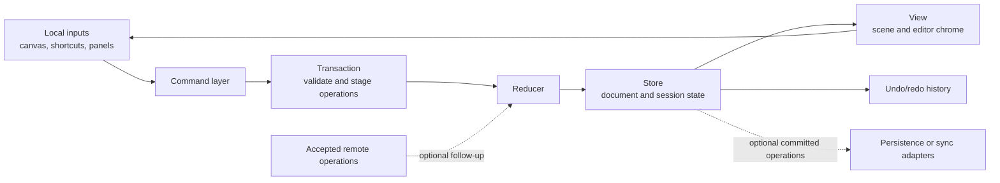
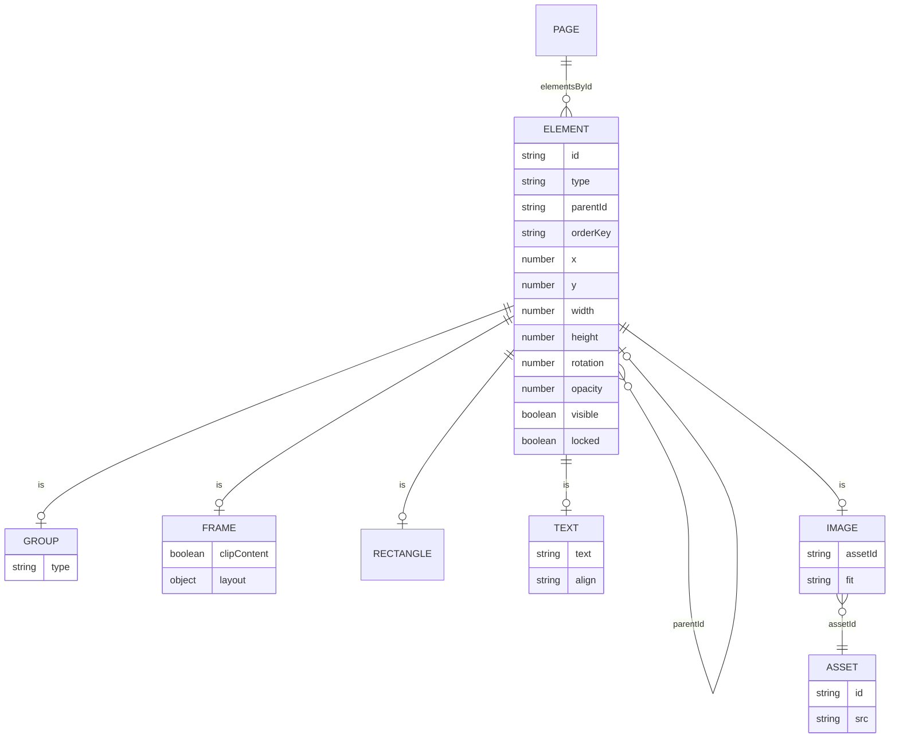
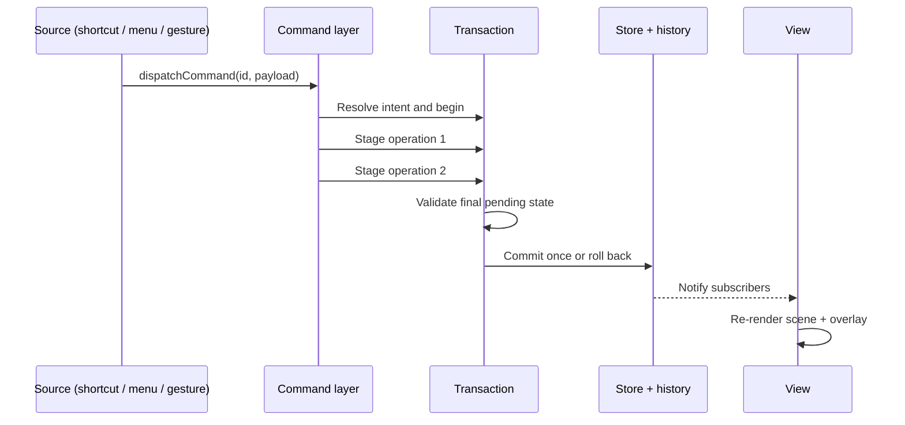

# Design / Drawing Tool (e.g. Figma, Canva, Excalidraw)

**Difficulty:** Hard · **Duration:** ~45 min · **Topics:** Performance, UI component

> Source: [design-drawing-tool-figma-canva](https://www.greatfrontend.com/questions/system-design/design-drawing-tool-figma-canva)

Browser-based design and drawing tools are interaction-heavy editor applications. The design should explain how to model elements, render the canvas, and keep editing responsive as the document grows.

## Question

Design a desktop-first browser-based design and drawing tool similar to Figma, Canva, Excalidraw, or tldraw. Users should be able to create and edit a single document containing common elements such as rectangles, images, frames or groups, and text.

Focus on the front-end architecture for the active editor experience: element modeling, canvas rendering, selection, transforms, layering, undo/redo, keyboard shortcuts, and viewport navigation such as zooming and panning. Assume the initial version is primarily single-user and in-memory during an editing session. Persistence, exporting, offline support, and real-time collaboration can be discussed as extensions rather than the core design.

You do not need to go deep on template marketplaces, comments, version history, advanced vector path editing, animation timelines, or full raster painting engines unless the interviewer asks.

### Real-life examples

- [Figma](https://www.figma.com/)
- [Canva](https://www.canva.com/)
- [Excalidraw](https://excalidraw.com/)
- [FigJam](https://www.figma.com/figjam/)
- [tldraw](https://www.tldraw.com/)

### Requirements

- Support a desktop-first editing surface for a single active document.
- Users should be able to create and edit basic elements such as shapes, images, frames or groups, and text.
- Support single-select and multi-select, moving, resizing, rotating, deleting, copying, and layer ordering operations.
- Support viewport interactions such as zooming and panning across a document that may contain hundreds to low thousands of elements.
- Support undo and redo for recent editing operations.
- The design should explain how document state, selection state, and viewport state are represented on the client.
- Focus on the base editing architecture first. Persistence, exporting, offline behavior, and collaboration can be covered as follow-up extensions.

## Solution

> **Establish the core editor before optional follow-ups**
>
> In a 45-minute interview, first establish requirements, the rendering split, the scene model, and the command/transaction API. Discuss persistence, collaboration, offline recovery, export, and plugins only when the interviewer asks for production extensions.

### Requirements exploration

Before choosing a rendering stack or data model, it helps to clarify the core editing capabilities, navigation behavior, and non-functional constraints the tool needs to support.

#### What design features should be supported?

The scoped editor needs a small but representative set of drawable elements and styles.

- Add basic elements: rectangles, images, frames, and groups
- Enter and edit text
- Ability to move, resize, and rotate elements after creation
- Change elements' styling properties like stroke color, fill color, and stroke thickness

#### What additional operations should be supported?

The editing model must cover the common operations users apply to one or more elements.

- Element selection, including single-select and multi-select
- Multi-element updates and deletion of selected items
- Ordering operations such as bring-to-front and send-to-back
- Undo/redo of recent actions
- Keyboard shortcuts for common operations

#### What navigation features should be supported?

The viewport should support navigation without changing document geometry.

- Zooming in and out of the canvas
- Panning the canvas view via mouse drag or scrollbars

#### Should the document be persisted?

The core design keeps edits in memory for one active session. Device and cloud persistence are optional follow-ups.

#### What are the non-functional requirements?

Performance and keyboard accessibility shape the rendering and interaction architecture.

- **Performance**: interactive updates should stay smooth with hundreds to low thousands of elements
- **Accessibility**: desktop keyboard interactions should work, including keyboard shortcuts and focus management, though full screen reader support for arbitrary shapes on the drawing surface is out of scope

Creative tools are part of the editor-tools family and share concerns around rendering, state models, events, and actions. The [Rich Text Editor question](https://www.greatfrontend.com/questions/system-design/rich-text-editor) introduces several related editor concepts.

Real-time collaboration, conflict resolution, and offline usage are intentionally follow-up topics. The [Collaborative Editor question](https://www.greatfrontend.com/questions/system-design/collaborative-editor-google-docs) covers synchronization in greater depth.

#### Check your understanding 1

A team is defining a browser drawing tool before choosing its renderer and editor architecture. Which requirements should it establish to choose how objects are rendered and edited?

- [ ] Mirror all visible features of one reference product and adopt its rendering stack before measuring the target scene.
  > Copying a mature product's visible features and renderer skips the requirements and tradeoffs that should drive the architecture.
- [x] Specify supported objects and tools, input and navigation behavior, scene scale, accessibility, latency targets, and which extensions are excluded.
  > These constraints directly shape rendering, hit testing, state, and command design without forcing every production extension into the baseline.
- [ ] Treat export formats as the core contract, then derive interactive editing behavior from the constraints of serialized output.
  > Export is a useful extension, but it should not displace the primary direct-manipulation editing loop.
- [ ] Start with unrestricted third-party plugins and let extension needs decide the document model and permission boundaries.
  > A production plugin platform introduces permissions and isolation concerns that obscure the core single-user editor unless explicitly required.

### Background

Creative tools on the web may appear similar at first glance. Users drag shapes, edit text, or move elements around. Under the hood, however, each category has significant differences and therefore faces different tradeoffs in terms of element rendering and interaction overlays.

The product category determines which rendering tradeoffs matter most.

1. **Diagramming / whiteboarding**: Apps for creating structured visuals like flowcharts, org charts, UML diagrams, and wireflows. They focus on connectors, nodes, and alignment grids.
2. **Graphic design**: A broad category of tools for creating marketing visuals, posters, typography, and brand assets. They mix vector, text, and image editing with templates and effects.
3. **UI design / product design**: Tools for designing digital interfaces like apps, websites, and products with features like frames, components, constraints, and prototyping. They emphasize layouts and hierarchical layers.
4. **Raster painting and pixel editors**: Tools focused on freeform drawing and pixel-level editing. They simulate brushes, painting effects, and detailed bitmap control.

#### Diagramming and whiteboarding tools

Examples: Draw.io, FigJam, Excalidraw, tldraw, Lucidchart, Miro

Diagramming and whiteboarding tools are optimized for structured visuals. Their primary concern is connecting nodes with edges, arranging elements on an infinite canvas, and letting users rearrange ideas quickly. The rendering layer must support large, zoomable workspaces with potentially hundreds or thousands of shapes while keeping interactions fluid.

The challenge lies in balancing simplicity of interaction, where shapes and connectors should "just work", with performance, since real-time redrawing of connectors, arrowheads, and text labels can become expensive. Because users expect diagrams to remain crisp when zoomed, vector rendering dominates, but naive use of SVG can choke on too many elements.

Many tools solve this by mixing retained vector graphics for interactivity with a canvas layer for performance-heavy redraws. Whiteboarding also emphasizes immediacy; latency in drawing freehand strokes or moving sticky notes undermines the collaborative and brainstorming flow.

#### Graphic design tools

Examples: Canva, Figma Buzz, Figma Draw, Adobe Illustrator

Graphic design tools sit between diagramming and UI design. They need to support a wide variety of media: vector shapes, typography, and raster images, often combined with templates, stickers, and filters.

Unlike diagramming apps, which focus on structure, or UI design apps, which focus on fidelity to product UIs, graphic design tools emphasize flexibility and creativity. The rendering layer must be versatile enough to handle both crisp vector art and bitmap manipulations without breaking flow.

Challenges here include managing resource-heavy assets such as large images and high-resolution exports, providing real-time previews of filters and effects, and scaling templates across different formats like social media posts, posters, and presentations.

#### UI design and product design tools

Examples: Figma Design, Framer, Sketch, Adobe XD, Penpot, Webflow

UI design and product design tools face a very different set of requirements. Instead of a loose collection of shapes, these tools must handle deeply hierarchical layers, component systems, and layout constraints that mimic how code-driven interfaces behave.

Rendering is more demanding. Users expect to navigate files with tens of thousands of objects, complete with nested frames, masks, auto-layout rules, and real-time previews of responsive designs. This pushes the limits of what the browser can handle with plain DOM or SVG. Tools like Figma therefore rely on GPU-accelerated rendering (WebGL) for compositing, caching layers, and applying effects like blur or blending at scale.

Another unique challenge here is text rendering. UI design depends heavily on typography fidelity, ligatures, and accurate alignment, which means these tools often need custom text layout engines rather than relying solely on browser text. In addition, interaction models like "component overrides" and prototyping introduce complexity into how changes propagate through a deeply nested design tree.

Strictly speaking, tools like Framer and Webflow are more for prototyping and building websites, but they can also be used for UI and product design because the two are closely related.

#### Raster painting and pixel editors

Examples: Adobe Photoshop, Photopea, Microsoft Paint

Unlike vector-based tools, raster painting and pixel editors deal directly with bitmaps and pixel data. The core of the app is a brush engine, which simulates strokes, pressure sensitivity, blending modes, and even smudging in real time. Performance is paramount here because painting involves rapid, continuous updates to large pixel buffers, often with layers stacked on top of one another. Rendering must therefore use GPU acceleration, typically WebGL or WebGPU, to apply brushes and filters at interactive speeds.

Memory management becomes a unique challenge. Large canvases with multiple layers consume huge amounts of memory, and undo/redo stacks must be implemented carefully, often by storing deltas or compressed tiles instead of full images. Fidelity is also critical; artists expect sub-pixel accuracy, color consistency, and advanced features like non-destructive editing, such as adjustment layers and masks.

Unlike diagramming or UI design tools, where vectors and layouts dominate, raster editors push the rendering layer into the domain of high-performance graphics akin to game engines.

Each category emphasizes different priorities: diagramming stresses scalable vector rendering and fluid connectors, UI design pushes toward hierarchical layers and text fidelity at massive scale, graphic design requires a hybrid engine that mixes media types while staying approachable for non-technical users, and raster painting depends on raw GPU performance and memory-efficient brush simulation.

The following table summarizes the main properties of each tool category and highlights what makes them distinct in terms of rendering requirements and design constraints:

| Category            | Diagramming / whiteboarding                               | Graphic design                                         | UI design / product design                                                              | Raster painting and pixel editors                 |
| ------------------- | --------------------------------------------------------- | ------------------------------------------------------ | --------------------------------------------------------------------------------------- | ------------------------------------------------- |
| Number of elements  | Medium - tens to hundreds for large boards                | Low - typically less than a hundred for common designs | Thousands - especially if there are many pages and elements are duplicated across flows | Few - tens, but each element has many pixels      |
| Main element types  | Mostly simple vectors - rectangles, circles, arrows, text | Mix of vector paths, styled text, and raster images    | Frames (layout-aware), text, images                                                     | Pixel buffers (bitmaps), brushes, masks           |
| Layout depth        | Shallow - flat list or simple grouping                    | Moderate - mostly groups                               | Deep - hierarchical element trees, similar to a webpage                                 | Flat layers - stacked with masks/adjustments      |
| Unique requirements | Drag/drop nodes, connect edges                            | Transforming, layering, applying filters               | Flexbox / autolayout                                                                    | Continuous freehand strokes, filters, pixel edits |

### Glossary

These terms define the rendering and layout concepts used throughout the design.

- **Scene graph**: The logical document model for everything on the canvas, including elements, hierarchy, transforms, and stacking order, independent of how the scene is rendered.
- **Canvas**: An immediate-mode raster rendering surface where the app draws pixels manually with JavaScript and must redraw the scene on every update.
- **SVG**: A retained-mode vector graphics system where each shape is a node in the DOM tree, stays crisp at any zoom level, and can be styled and event-bound like regular HTML.
- **WebGL**: A low-level GPU-accelerated rendering API exposed through the `<canvas>` element, used for high-performance 2D and 3D graphics when DOM, SVG, or Canvas 2D cannot keep up.
- **Clipping**: Restricting rendering so child content is only visible within a container's bounds, commonly used for frames, masks, and cropped content.
- **Snapping**: Automatically adjusting an element's position, size, or rotation when it gets close to a meaningful alignment target such as an edge, center line, or grid line.
- **Guides**: Visual alignment indicators shown during movement or resizing to help users understand spacing, centering, and snap targets.
- **Autolayout**: A rule-based layout system popularized by Figma that automatically positions and sizes child elements inside a container such as a frame. It is highly similar to CSS Flexbox.

### Approach

Compare the common rendering approaches against scene size, text needs, accessibility, and implementation cost.

#### Rendering approach

The right rendering approach depends on the category of creative tool being built, the expected scene complexity, and how much browser-native behavior the product wants to retain.

##### DOM (HTML elements)

Rendering via the DOM means constructing drawings directly with regular HTML elements styled using CSS. For example, rectangles can be represented as `<div>` elements, text labels as `<span>` elements, and images as `` tags. This approach relies heavily on the browser's layout and painting engine, with positioning handled through CSS transforms or absolute coordinates.

DOM-based rendering is simple to implement and integrates seamlessly with the rest of the web page. It provides all the benefits of accessibility, event handling, and styling via CSS. However, because every element adds overhead to the layout tree, performance deteriorates as the number of elements grows. Once you exceed a few hundred shapes, interactions such as panning and zooming can become sluggish.

**Advantages**:

- Easiest to implement and requires no custom rendering logic
- Built-in hit-testing and event handling
- Can leverage CSS layout such as Flex and Grid for hierarchical layout constraints
- Full browser support for text, images, and accessibility out of the box
- Resolution independent and scales smoothly at any zoom

**Disadvantages**:

- Limited scalability; performance drops with many shapes
- Shapes are constrained to what HTML and CSS can represent, which rules out effects and compositing that need custom pixel-level control
- Fine-grained control over rendering is difficult
- The browser's default styles will affect the elements. Tools typically get around this by putting the elements in an `<iframe>`
- Zooming and panning are harder to implement, typically done using CSS transforms such as `scale()` and `translate()`
- Selection elements such as selection boxes and resize/rotation knobs will be affected by zoom level if rendered within the same layer as the elements

The biggest advantage of the DOM approach is the built-in event handling and the ability to leverage CSS flex layouts for hierarchical UIs. Website builders like Webflow lean heavily on DOM-based rendering for their published output to stay as close to the actual usable result as possible, though the editing canvas itself may combine DOM with additional overlays for performance and interaction.

##### SVG (Scalable Vector Graphics)

SVG is a retained-mode graphics system where each vector element, such as a line, circle, path, or text node, is a node in the DOM tree. Instead of simulating visuals with generic HTML, SVG exposes drawing primitives as first-class elements.

Because SVG is vector-based, graphics remain crisp at any zoom level. Each node can be styled with CSS and responds to events, making it a good fit for diagramming tools where users select, resize, and connect shapes. That said, SVG performance begins to struggle once the document contains thousands of nodes, since every element adds to the DOM. Complex scenes with freehand strokes, heavy filters, or continuous updates can overwhelm the rendering engine.

**Advantages**:

- Resolution independent and scales smoothly at any zoom
- Declarative markup that is easy to read and manipulate
- Individual shapes are addressable, enabling straightforward hit-testing and interactivity
- Native export to `.svg` files

**Disadvantages**:

- DOM overhead makes it slow with thousands of elements
- Less suitable for freehand drawing or raster-like effects

Since the number of elements will often stay low enough to avoid severe performance issues, SVG is widely used in apps like draw.io and Lucidchart, where interactivity and clarity at scale matter more than raw performance.

##### Canvas (2D context)

Canvas provides an immediate-mode raster rendering surface. Developers draw into a bitmap using JavaScript operations such as `ctx.fillRect()` or `ctx.arc()`. Unlike SVG, the canvas does not remember objects once they are drawn; every frame or update must be explicitly redrawn.

This model makes canvas faster than SVG for large numbers of simple shapes because it avoids DOM overhead. It also opens up direct pixel manipulation, which is vital for painting and freehand drawing applications. The main challenge is that developers must manage their own scene graph, implement hit-testing, and redraw everything when the user pans or modifies the scene.

**Advantages**:

- High performance for hundreds to thousands of shapes
- Supports freehand drawing and pixel-level operations
- Fine-grained control over rendering

**Disadvantages**:

- Text rendering and editing are difficult
- Flex layout does not exist
- No retained mode; the app must reimplement its own scene graph, hit-testing, and per-element event dispatch, which can be a huge undertaking
- The canvas backing store is a bitmap, so naive zooming via CSS `transform` looks blurry; sharp zoom requires redrawing the scene at the new scale

Canvas is often chosen for simple drawing apps and painting tools where immediate rendering speed is more important than retaining semantic structure.

##### WebGL (GPU-accelerated)

WebGL exposes a low-level API for rendering with the GPU. It can draw both 3D and 2D graphics using GPU acceleration, but requires developers to work with shaders, buffers, and GPU pipelines. Like Canvas 2D, WebGL is accessed through the `<canvas>` element via a different rendering context, but the APIs are otherwise unrelated and most 2D primitives have to be rebuilt on top of shaders and buffers.

The advantage of WebGL is that it scales to tens of thousands of objects while maintaining smooth performance. It can also apply advanced visual effects like blending, shadows, and blurs. This power makes it the rendering backbone of professional tools like Figma Design, where users expect responsiveness even with enormous design files.

The downside is complexity. Similar to the canvas approach, you must build your own rendering engine, scene graph, and interaction models on top of the GPU layer.

**Advantages**:

- Hardware acceleration supports massive scale and complex effects
- Superior performance compared to DOM, SVG, and Canvas
- Flexible enough to render both 2D and 3D

**Disadvantages**:

- Shares Canvas's limitations, since text rendering and editing are difficult and flex layout does not exist
- Steep learning curve and verbose setup
- Requires building or adopting an engine for scene management
- Debugging is difficult compared to higher-level approaches

WebGL can suit design applications whose responsiveness and scene-scaling requirements justify the engineering complexity.

As a production follow-up, keep the CPU scene graph authoritative so the app can recreate GPU resources after context creation failure or context loss, or show a supported fallback. The core interview design does not need the restoration protocol.

#### Choosing a rendering approach

Public implementation details for creative tools are uneven, and many mature products use hybrid renderers that evolve over time. So any product examples should be read as rough tendencies, not as audited statements about an exact current stack.

A few useful patterns still emerge:

- **Diagramming / whiteboarding**: tools in this bucket often start with SVG or hybrid SVG + Canvas layers because connectors, selection outlines, and crisp zoomable shapes are easier to implement there. Whiteboards with heavier freehand drawing often add Canvas-backed paths or other rasterized layers as boards grow.
- **UI / product design**: large design editors often move toward GPU-backed or hybrid renderers because deep hierarchies, clipping, effects, auto-layout, and text fidelity push beyond what plain DOM or SVG handle comfortably at scale. Figma's public engineering writeup is a good example of that tradeoff.
- **Graphic design**: the space is broader. Simpler template editors can go far with DOM and SVG, while more advanced tools often adopt hybrid or GPU-backed compositing once effects, media mixing, and export fidelity become more important.
- **Raster painting and pixel editors**: these tools need a GPU-friendly raster pipeline because brushes, blending, filters, and large bitmap layers are fundamentally pixel operations.

There is no universally best renderer even within one product category. The right choice depends on the expected scene complexity, how much browser-native behavior you want to keep, and how much rendering infrastructure the team is willing to build.

Canvas and WebGL remain the most powerful options when you need full control over compositing, caching, and drawing performance. The tradeoff is that you must rebuild more of the browser's behavior yourself, especially around text editing, layout, accessibility, and hit testing.

In interviews, it is useful to quickly outline the unique needs and constraints of the tool you need to design, based on the product category or any differing requirements, then describe the various rendering approaches and propose a suitable one.

A reasonable recommendation for each common category:

- **Diagramming / whiteboarding**: Start with SVG or a hybrid SVG + Canvas approach. SVG makes connectors, arrows, selection outlines, and crisp zoomable shapes much easier to implement, while a canvas layer can help with freehand drawing or performance-heavy redraws on large boards.
- **UI / product design**: Prefer WebGL or a hybrid renderer with a GPU-backed scene plus DOM overlays for text editing and inputs. These tools need to handle very deep hierarchies, clipping, effects, auto-layout, and thousands of elements, which pushes beyond what plain DOM or SVG can comfortably handle at scale.
- **Graphic design**: A hybrid approach is usually the most pragmatic choice. Simpler tools can get far with DOM and SVG, especially when template editing and accessibility matter, while more advanced tools benefit from WebGL for compositing, effects, and higher export fidelity.
- **Raster painting and pixel editors**: Use WebGL or another GPU-accelerated raster pipeline. Brush strokes, blending, filters, and large bitmap layers are fundamentally pixel operations and are too performance-sensitive for DOM or retained vector approaches.

> **Default to a hybrid rendering architecture**
>
> If the interviewer asks for just one concrete design, a good default is to propose a hybrid architecture: use a rendering engine optimized for the main content layer, then use a separate interaction or editing overlay for handles, selections, guides, and text editing where needed. That gives a good balance between implementation complexity, performance, and future extensibility.

#### Check your understanding 2

A diagramming tool expects hundreds of crisp vector nodes and connectors, direct shape interaction, accessible text editing, and occasional dense freehand strokes. Which rendering split best matches that workload without adopting unnecessary engine complexity?

- [ ] Render shapes, handles, text entry, and editor controls through WebGL because professional design products use GPU-backed rendering.
  > Product precedent does not establish this scene's needs, and an all-WebGL design would rebuild text and accessibility behavior without a demonstrated scale requirement.
- [x] Use SVG for the retained vector scene, Canvas for dense freehand strokes when needed, and DOM overlays for active text editing.
  > SVG matches the manageable interactive vector scene, while specialized layers handle the two workloads where SVG is weaker without forcing the whole editor into one renderer.
- [ ] Represent every connector segment and freehand point as a separate positioned HTML element.
  > Browser-native behavior helps text, but a dense collection of generic DOM nodes creates layout and paint overhead and is a poor representation for vector paths.
- [ ] Draw the full editor into one Canvas and derive selection, text input, and control semantics from its pixels.
  > A single bitmap layer loses retained shape interaction and makes every browser-native editing behavior part of a custom engine.

### Assumptions

Since interviewers often ask about many kinds of creative tools, this article does not assume a specific tool or rendering approach. Instead, it focuses on the common aspects across these tools, and there are many.

The initial version supports one page. Multiple pages can reuse the same architecture, data model, and APIs with a higher-level page collection.

### Architecture / high-level design

Complex editors need boundaries that keep many input sources and views consistent:

- Have lots of interaction sources such as keyboard, mouse, panels, menu bar, and background sync
- Need predictable state across many views at once
- Require advanced debugging, undo/redo, and sometimes multiplayer
- Are built by large teams where clear boundaries and conventions reduce chaos

#### Flux-like architecture

Flux/Redux-like architectures are common in complex client apps because they organize state updates and make them predictable. The architecture discussed here is heavily based on the [Flux library by Meta](https://facebookarchive.github.io/flux/docs/in-depth-overview/).

##### Single source of truth

All application state lives in stores.

- No more scattering state across random components, services, or globals
- Any part of the app can subscribe to the store to render the current truth
- Great for debugging because you always know where the state is

##### Predictable state changes

State is updated only through actions processed by reducers.

- Makes mutations explicit and traceable; you can see exactly which action caused which change
- Prevents competing direct mutations from multiple places
- Leads to deterministic behavior: the same sequence of actions always produces the same state

##### Unidirectional data flow

Data moves in one direction: local input -> command -> transaction -> operation -> reducer -> store -> view.

- Views do not directly mutate state; they issue local commands through the architecture
- This breaks circular dependencies and makes data flow easy to reason about

##### Testability

Reducers, or equivalent state-updating functions, are pure functions: (state, action) -> newState.

- Easy to unit test without rendering UI
- Each action can be tested in isolation
- In creative tools, you can validate that `MOVE_ELEMENT` produces the correct new coordinates without spinning up the view layer

##### Time-travel debugging and replay

Because state is immutable and every update is triggered by an action:

- You can record the sequence of actions and replay them to reproduce bugs
- "Time-travel" dev tools let you step forward and backward through state changes
- Reproducing interactions helps diagnose bugs in apps such as drawing tools, form builders, and data dashboards

##### Easier to implement undo/redo, history, and collaboration

The shared commit boundary gives history and optional adapters one reliable result to consume.

- Since every committed edit flows through the same mutation pipeline, the app can derive history entries and inverse patches in one place
- Undo/redo becomes a predictable matter of reverting committed transactions instead of chasing ad-hoc mutations across the UI
- Optional persistence and collaboration adapters can consume committed operations without replaying selection-dependent commands

#### Importance of commands

Actions are the internal mutation units that update store state. User-facing inputs such as `Delete`, `Paste`, or `Align Left` usually sit one layer above that as commands, which later resolve into one or more actions or patches. This separation lets creative tools share command behavior across input sources while applying concrete state changes through actions.

##### Multiple sources, one consistent result

The same local intent can come from very different input sources:

- A mouse drag on the canvas
- A keyboard shortcut, such as pressing the up arrow to nudge position
- A property panel change, such as typing `x = 20` into a field
- An editor-owned automation or extension command

Instead of letting each local source mutate application state directly, each source can issue the same command such as `MOVE_SELECTION`. The command layer resolves that selection-dependent intent into concrete operations targeting stable element IDs, so state updates stay consistent no matter which local control initiated them. A remote collaborator's operation is already concrete and, as a follow-up, enters after validation at the operation/reducer boundary rather than replaying `MOVE_SELECTION` against another user's selection.

##### Decoupling interaction logic from state update logic

The command boundary separates the source of an intent from the code that changes document state.

- **Source**: Tools, UI panels, shortcuts, and editor-owned extensions. They express what the local user wants.
- **Result**: A validated transaction of concrete operations, applied by the reducer to produce new document state.

This decoupling means the UI can evolve, such as adding new gestures or shortcut keys, by firing commands from those places without having to touch the state logic, and vice versa.

##### Replayability and determinism

When the source is abstracted away, the editor can derive explicit operations from the accepted local command:

- Store an inverse operation or before/after data for undo
- Optionally persist or synchronize the concrete operations

The actual pointer moves or key presses are not needed once you have the committed intent; the state result is deterministic.

##### Input-independent state updates

Reducer code does not have to care whether a resize started from a drag handle, keyboard shortcut, or inspector field. It only applies the resulting operation to explicit element IDs. That is easier to test and more reliable than direct mutations spread across the codebase.

Commands sit between the raw input source and the underlying actions that mutate document state.

#### Component responsibilities

The core architecture separates local intent resolution from concrete document mutation:

**Drawing editor mutation flow**



Each component has one responsibility in that flow.

##### View

The View is what the user sees and interacts with. It has two main parts:

1. Workspace UI

- **Toolbar**: buttons to choose tools such as select, rectangle, text, and brush, or trigger commands such as undo, zoom, and export
- **Layers panel**: shows the hierarchy or stacking order of objects and lets the user reorder, lock, or toggle visibility
- **Properties panel**: displays and edits properties of the currently selected element, such as color, stroke width, and font

2. Canvas

- **Interaction overlay**: renders guides, selection boxes, transformation handles, and similar ephemeral UI. It handles hit-testing and user gestures like clicking, dragging, and resizing, and can interpret pointer/keyboard events in terms of editor semantics
- **Elements**: actually draws the shapes, images, and overlays to the screen using the selected rendering approach such as SVG, Canvas, or WebGL

Views do not update themselves directly; they listen to state changes and issue commands based on user input.

##### Commands and actions

Commands represent user-level intents such as `DELETE_SELECTION`, `PASTE`, or `ALIGN_LEFT`. Command handlers resolve those intents into one or more actions or patches, which are the low-level mutation units that actually update the store.

Commands can originate from various places:

- **Workspace UI**: toolbar buttons, inspector fields, menus, and context menus
- **Keyboard shortcuts**: copy, paste, delete, nudge, and similar commands
- **Canvas interactions**: drag, resize, rotate, marquee select, and direct-manipulation gestures
- **Editor-owned extensions**: automation or optional plugin adapters that are allowed to issue local commands

The important point is that every local edit resolves into the same concrete mutation units. Remote operations, hydration, and asset-loaded notifications are not local user intents; if those extensions are added, they enter through typed internal APIs rather than selection-dependent commands.

Operations applied by the reducer are the only way to mutate document state. That boundary keeps undo/redo and optional extensions consistent.

##### Dispatcher

The Dispatcher coordinates a transaction of operations produced by the command layer. Its job is to:

- Validate command preconditions and the resulting operations
- Stage all operations against a pending state
- Commit the pending state to the Store once

This enforces a unidirectional flow: local input -> command -> transaction -> operation -> reducer -> store -> updated view.

##### Store

The Store is the single source of truth for application state, similar to a Flux/Redux store. It holds the elements model, selection, undo/redo stacks, and more.

Once an action is applied, the Store notifies its subscribers, and the View re-renders the UI panels and canvas to reflect changes such as a moved rectangle or a newly applied style.

##### Keyboard events (shortcuts) and keybinding system

This subsystem captures keystrokes like `Ctrl+C`, `Delete`, or arrow keys for nudging and maps them to commands. See [Command system](#command-system) for the full intent-normalization flow.

##### Summary

The architecture keeps intent, mutation, and observation separate:

- The View shows the document and captures input
- Local interactions and shortcuts trigger commands
- Command handlers resolve intents into concrete operations inside one transaction
- The reducer applies those operations, while optional remote operations enter at the reducer boundary
- The Store pushes the new state back into the View for re-rendering

#### Check your understanding 3

A rectangle can be moved by dragging, arrow keys, an inspector field, or a command palette. Which architecture best keeps these local input paths consistent?

- [x] Route local intent through shared commands, stage concrete operations in transactions, and update one canonical store through reducers.
  > Local controls share validation and transaction semantics while reducers receive stable element IDs rather than UI-specific selection state.
- [ ] Let each input controller validate and commit its own element mutations directly to the store and active renderer.
  > Independent mutation paths drift and make validation, atomic history, and rendering updates unreliable.
- [ ] Dispatch shared actions, but treat the currently rendered Canvas or SVG objects as the canonical document state.
  > Renderer objects are not a stable logical document model.
- [ ] Route every input through one server command endpoint and replace the local scene only after its response.
  > Direct manipulation needs a responsive local update loop.

### Data model

The main aspects of the data model are:

- **Elements**: Scene graph nodes placed on the page, such as frames, text layers, rectangles, and images, with stable IDs, hierarchy, transforms, styling, and z-order
- **Canvas state**: Ephemeral app state that tracks viewport, selection, active tool, focus target, and in-progress gestures

#### Elements

There are many element types in mature creative tools. For example, Figma's Plugin API exposes [dozens of node types](https://developers.figma.com/docs/plugins/api/nodes/). The core model only needs `GROUP`, `FRAME`, `TEXT`, `RECTANGLE`, and `IMAGE`. Elements share identity, hierarchy, transforms, and stacking fields; each type adds its own payload.

##### Base element

Every scene element carries the fields needed for identity, hierarchy, transforms, visibility, and locking.

| Name       | Type                                                     | Description                                                                                                                                                                                                                        |
| ---------- | -------------------------------------------------------- | ---------------------------------------------------------------------------------------------------------------------------------------------------------------------------------------------------------------------------------- |
| `id`       | `string`                                                 | Stable identity referenced by selection, history, and constraints. This can be a globally increasing integer or a UUID. UUIDs are useful for real-time collaboration, where multiple users may generate new elements concurrently. |
| `type`     | `"GROUP"`, `"FRAME"`, `"TEXT"`, `"RECTANGLE"`, `"IMAGE"` | Discriminator for the concrete element kind.                                                                                                                                                                                       |
| `name?`    | `string`                                                 | Optional label used for layers panel display and search.                                                                                                                                                                           |
| `parentId` | `string \| null`                                         | Parent container ID. `null` means the element lives at the page root.                                                                                                                                                              |
| `orderKey` | `string`                                                 | Sort key within one parent's children. Together with `parentId`, this is the durable hierarchy and z-order authority.                                                                                                              |
| `x`        | `number`                                                 | Horizontal position in the element's **parent-local coordinate space**. Root elements use page coordinates.                                                                                                                        |
| `y`        | `number`                                                 | Vertical position in the element's **parent-local coordinate space**. Root elements use page coordinates.                                                                                                                          |
| `width`    | `number`                                                 | Width in the element's local coordinate space.                                                                                                                                                                                     |
| `height`   | `number`                                                 | Height in the element's local coordinate space.                                                                                                                                                                                    |
| `rotation` | `number`                                                 | Rotation angle in degrees.                                                                                                                                                                                                         |
| `opacity`  | `number`                                                 | Opacity in the range `0..1`, where `0` is fully transparent and `1` is fully opaque.                                                                                                                                               |
| `visible`  | `boolean`                                                | Whether the element should currently be rendered on the canvas.                                                                                                                                                                    |
| `locked`   | `boolean`                                                | Whether the element is protected from normal selection and editing interactions.                                                                                                                                                   |

A minimal TypeScript shape:

```ts
type ElementId = string;
type ElementType = "GROUP" | "FRAME" | "TEXT" | "RECTANGLE" | "IMAGE";
type SceneElement =
  GroupElement | FrameElement | TextElement | RectangleElement | ImageElement;

interface BaseElement {
  id: ElementId;
  type: ElementType;
  name?: string;
  parentId: ElementId | null;
  orderKey: string;
  x: number;
  y: number;
  width: number;
  height: number;
  rotation: number;
  opacity: number;
  visible: boolean;
  locked: boolean;
}
```

The distinction between local and world coordinates matters. A child inside a group or frame stores `x`, `y`, `width`, `height`, and `rotation` relative to that parent, not as absolute page coordinates. Rendering, hit testing, snapping, and selection overlays derive world-space bounds by composing ancestor transforms. Reparenting therefore converts the element's transform into the new parent's coordinate space so it stays visually stationary unless the command explicitly says otherwise.

The page stores elements by ID. Each element's `(parentId, orderKey)` pair is the one durable authority for hierarchy and sibling order:

```ts
interface Page {
  elementsById: Record<ElementId, SceneElement>;
}
```

Runtime indexes can derive ordered root IDs and child IDs for fast traversal. They are caches, not independently serialized state, so they cannot disagree with the canonical hierarchy.

> **Keep one durable hierarchy and ordering authority**
>
> Reparent and reorder operations update `parentId`, `orderKey`, and any affected transforms atomically. They reject missing parents, non-container parents, cycles, duplicate IDs, and non-finite geometry before committing; derived child indexes are rebuilt from the accepted state.

The [Rich Text Editor](https://www.greatfrontend.com/questions/system-design/rich-text-editor) discusses similar choices between canonical tree state and derived indexes.

##### Rectangle element

A rectangle is a basic vector shape with optional rounded corners. It only needs to store the x/y/width/height/rotation instead of the coordinates of the 4 corners because those can be computed during rendering.

```ts
interface SolidPaint {
  type: "SOLID";
  color: string;
}

interface StrokeStyle {
  paint: SolidPaint;
  width: number;
  dash?: number[];
  join?: "miter" | "round" | "bevel";
  cap?: "butt" | "round" | "square";
}

interface RectangleElement extends BaseElement {
  type: "RECTANGLE";
  borderRadius?: number | { tl: number; tr: number; br: number; bl: number };
  stroke?: StrokeStyle;
  fill?: SolidPaint;
}
```

##### Text element

Text stores a default style plus composable range overrides. The minimal style fields are enough to reproduce the required text after serialization without pulling advanced typography into the core design.

```ts
interface TextStyle {
  fontFamily: string;
  fontSize: number;
  fontWeight: number;
  fontStyle: "normal" | "italic";
  decorations: Array<"underline" | "line-through">;
  fill: SolidPaint;
  lineHeight: number | "auto";
  letterSpacing: number;
}

interface TextElement extends BaseElement {
  type: "TEXT";
  text: string;
  defaultStyle: TextStyle;
  ranges: Array<{
    start: number;
    end: number;
    style: Partial<TextStyle>;
  }>;
  align: "start" | "center" | "end";
  overflow: "clip" | "ellipsis";
}
```

Gradients, shadows, OpenType features, and richer paint stacks are reasonable follow-ups. They extend the same style records rather than changing the document architecture.

##### Image element

An image references an asset by ID and a placement rectangle. Fit and crop are purely logical; renderers resolve them.

```ts
interface ImageElement extends BaseElement {
  type: "IMAGE";
  assetId: string; // Stable reference into the asset store / blob cache
  fit: "fill" | "fit" | "crop" | "tile";
  crop?: { x: number; y: number; w: number; h: number }; // in image pixels
  borderRadius?: number | { tl: number; tr: number; br: number; bl: number };
}
```

Most of the time, the actual image bytes are uploaded to a separate file storage service and stored outside the document itself. The document keeps only an `assetId` reference, while an asset table, CDN URL resolver, or local blob cache maps that ID to actual bytes. If offline editing is later required, the same `assetId` can point to a locally cached blob until connectivity returns and the asset is uploaded.

##### Group element

A group is a structural container that lets several elements transform and reorder as one unit without adding layout or clipping behavior.

```ts
interface GroupElement extends BaseElement {
  type: "GROUP";
}
```

Children belong to a group through `parentId`; their `orderKey` values define local z-order. Grouping creates one `GroupElement`, reparents the selected siblings, and converts their transforms into group-local coordinates in one transaction. Ungrouping performs the inverse conversion so every child remains visually stationary.

##### Frame element

A frame is a layout-capable container with optional clipping. Unlike a group, it can reposition children through an autolayout policy.

```ts
interface FrameElement extends BaseElement {
  type: "FRAME";
  clipContent?: boolean; // acts as a mask for children
  layout?: {
    direction: "row" | "column";
    spacing: number;
    padding:
      number | { top: number; right: number; bottom: number; left: number };
    sizing: {
      width: "hug" | "fixed" | "fill";
      height: "hug" | "fixed" | "fill";
    };
    alignMain: "start" | "center" | "end" | "space-between";
    alignCross: "start" | "center" | "end" | "stretch";
  };
}
```

Frames are common where hierarchy affects layout. Simpler drawing and diagram tools may support groups without implementing frame layout.

Elements are represented in a rendering-agnostic fashion, so no SVG, Canvas, or WebGL specifics leak into the model. That makes it easier to swap rendering approaches and serialize the model into JSON for persistence.

**Scene graph entity relationships**



#### Canvas state

Selection is app state (temporary / ephemeral), not document state. It should live alongside viewport state, tool mode, focus state, and in-progress interaction state, and it should support multi-select naturally.

```ts
interface CanvasState {
  viewport: ViewportState;
  selection: SelectionState;
  tool: ToolState;
  focus: FocusState;
  interaction: InteractionState | null;
}

interface ViewportState {
  zoom: number;
  x: number;
  y: number;
}

type ToolMode = 'select' | 'hand' | 'text' | 'rectangle' | 'image';

interface ToolState {
  mode: ToolMode;
}

interface SelectionState {
  ids: ElementId[]; // ordered, first is "primary" for handles/inspector
  anchor?: ElementId; // last clicked element ID, for shift-range operations
}

type FocusState =
  | { kind: 'canvas' }
  | {
      kind: 'text';
      elementId: ElementId;
      range: { start: number; end: number };
      composing: boolean; // IME / composition in progress
    };

type ResizeHandle = 'n' | 'ne' | 'e' | 'se' | 's' | 'sw' | 'w' | 'nw';

type InteractionState =
  | { kind: 'marquee'; start: Vec2; current: Vec2 }
  | {
      kind: 'drag-selection';
      startPointer: Vec2;
      originalPositions: Record<ElementId, { x: number; y: number }>;
    }
  | {
      kind: 'resize-selection';
      handle: ResizeHandle;
      startPointer: Vec2;
      draftBounds: Rect;
    }
  | {
      kind: 'rotate-selection';
      pivot: Vec2;
      startPointer: Vec2;
      startAngle: number;
    }
  | { kind: 'pan'; startPointer: Vec2; startViewport: { x: number; y: number } };
}
```

This separation is important because many editor interactions have a **preview phase** before commit. While the user is dragging, resizing, rotating, or typing into a text box, the app needs temporary state such as the active handle, draft geometry, text caret range, or IME composition state. These are real editor states, but they should not be serialized into the document or treated as durable history entries until the interaction is committed.

##### Allowing multiple selection, and why it matters

Real editing workflows require transforming several elements at once, including move, align, distribute, and batch style changes. Restricting selection to a single element forces users into repetitive steps and complicates features like alignment or grouping.

Multi-select enables:

- **Group transforms**: Transforming all selected items with shared resize/rotate handles within a bounding box
- **Bulk operations**: Delete, duplicate, align, distribute, and set common fill/stroke/text styles
- **Nudging**: Keyboard nudging and snapping that respect the combined bounds rather than just one element

##### Decoupling from the document

Selection should not be serialized with the document. It is ephemeral, user-session state. This separation keeps saved files clean and prevents merge conflicts if collaboration is added later. It also makes undo/redo simpler: history concerns document mutations, not focus or selection. That's not a hard rule though; Figma does track certain selection actions in the undo/redo stack.

> **Keep selection, viewport, and focus out of the durable document**
>
> Session state such as selection, viewport, active tool, and in-progress gestures should never flow into the serialized document. Mixing it in pollutes saved files, creates meaningless merge conflicts once collaboration is added, and forces every undo entry to carry noise that has nothing to do with the document itself. Keep one model for the document and a separate `CanvasState` for the current session.

#### Using plain objects vs. classes for elements

Elements in a creative tool can be represented either as plain data objects (simple JSON-like structures) or as classes (objects with both data and methods).

##### Plain objects

**Advantages**:

- Easy to serialize and deserialize to JSON, which is critical for persistence, collaboration, and undo/redo
- Rendering-agnostic and portable, and work well with Redux-like immutable stores
- Simple to diff, patch, and clone
- Keeps the model declarative: elements describe what they are, not how they behave

**Disadvantages**:

- No built-in behavior; all logic such as hit-testing, transforms, and rendering must live in separate utility functions or systems
- Can become verbose if many helper functions are required

##### Classes

**Advantages**:

- Encapsulate both data and behavior, such as `element.hitTest(point)` or `element.render(ctx)`
- Can enforce invariants through constructors and methods
- More familiar to developers coming from OOP backgrounds

**Disadvantages**:

- Harder to serialize and deserialize cleanly because class instances do not translate directly to JSON. Each class needs import/export logic.
- More brittle for undo/redo and collaboration, since behavior is embedded with state
- Can blur concerns if rendering logic leaks into the data model

> **Default to plain objects for element models in interviews**
>
> In interviews, it is usually fine to go with plain objects. When the app becomes complicated and logic needs to be shared across elements, class instances can become a better choice due to inheritance.

Note that [Rich text editor nodes](https://www.greatfrontend.com/questions/system-design/rich-text-editor) in editors like Lexical are class instances.

#### Rendering-agnostic and serializable

No element stores renderer-specific constructs such as SVG path strings, Canvas image data, or WebGL buffers. Everything is logical geometry plus transforms and style references.

That gives several benefits:

- Renderers can be swapped more easily: SVG backends can generate `<rect>` and `<text>`, while Canvas and WebGL can tessellate quads or glyphs from the same model
- The whole page serializes cleanly as compact JSON
- Assets can stay as separate blobs referenced by URL or asset ID from within the document

#### Check your understanding 4

The same drawing document must render through Canvas in the editor, export through SVG, and reopen after signed asset URLs expire. Which modeling choices keep it portable? Select all that apply.

- [x] Represent scene elements as serializable logical geometry with stable IDs and parent or stacking relationships.
  > Stable logical identity supports lookup, history, rendering, and synchronization.
- [ ] Cache Canvas contexts and measured text objects directly on scene elements, then treat those runtime fields as authoritative geometry.
  > Renderer caches can exist beside the model, but authoritative geometry must remain serializable and independent of one runtime.
- [x] Keep selection, viewport, active tool, hover, and in-progress gestures outside the durable document.
  > Ephemeral editor state should not pollute saved content or peer documents.
- [ ] Maintain separate parent-child and z-order arrays, updating each independently so its common lookup stays fast.
  > Independent authoritative structures can diverge after partial updates. Derive indexes from one ordering model or update them atomically.
- [x] Reference images and other large assets by stable asset ID, resolving temporary URLs outside the document.
  > Stable logical references keep the document compact and portable even when CDN or signed URLs change.
- [ ] Embed every image's original bytes in each scene element so the document never depends on an external asset reference.
  > Repeated binary payloads make documents large and defeat asset deduplication. Stable IDs can resolve durable assets separately from temporary delivery URLs.

#### Check your understanding 5

A rectangle at a stable world-space position is moved from the page root into a rotated frame. How should the reparent command keep the rectangle visually stationary and the hierarchy consistent?

- [ ] Keep the rectangle's numeric `x`, `y`, and rotation unchanged and update only its `parentId`.
  > The same numbers are interpreted in the new parent's coordinate space, so the rectangle can jump, scale, or rotate unexpectedly.
- [ ] Store both world and parent-local transforms as independent authorities and update whichever one the renderer currently uses.
  > Two canonical transforms can diverge after later ancestor edits. World geometry should be derived by composing the one local hierarchy.
- [x] Convert the rectangle's world transform into the frame's local space, then atomically update its `parentId`, `orderKey`, and local transform.
  > Reparenting changes the coordinate basis as well as hierarchy, so the placement and ordering fields must become one validated document transition.
- [ ] Move the SVG or Canvas object under the frame visually and update the scene model during the next serialization pass.
  > Renderer placement is not the durable hierarchy and leaves selection, history, and other renderers observing stale document state.

#### Check your understanding 6

A set of icons should sometimes move as one unit. A separate button component must arrange its label with padding, resize to hug the label, and optionally clip overflowing children. How should these containers be modeled?

- [x] Use a group for the icons and a frame with layout and clipping policy for the button.
  > A group preserves child placement under shared transforms, while a frame is a layout-capable container that may reposition, size, or clip its children.
- [ ] Use a frame for the icons and a group for the button because groups are lighter-weight layout containers.
  > Groups do not define padding, hug/fill sizing, or clipping, so they cannot express the button's required layout behavior.
- [ ] Use groups for both and store the button's computed child positions directly after every label edit.
  > Materializing each layout result loses the durable rule that should recompute placement when content or container constraints change.
- [ ] Use frames for both and automatically run layout on every collection of selected elements.
  > Adding a layout policy where only shared transformation is intended can unexpectedly move icon children and changes normal grouping semantics.

#### Check your understanding 7

A text layer contains one string with bold and colored spans and must reopen through different rendering backends. Which document-model choices keep it editable and portable? Select all that apply.

- [x] Keep the text string and paragraph-level properties as renderer-independent data.
  > Logical content remains editable and can be laid out again by SVG, Canvas, WebGL, or a DOM editing overlay.
- [ ] Treat the DOM produced by the active text editor as the canonical saved representation.
  > Editor markup can contain browser and implementation details and couples the document to one renderer and editor.
- [x] Store a default text style plus bounded character ranges containing partial style overrides.
  > Range patches represent mixed styling without fragmenting one editable text layer into unrelated scene nodes.
- [ ] Save Canvas measurements and positioned glyph caches directly on the text element as authoritative layout.
  > Measurements depend on fonts, scale, and runtime rendering state. They can be cached but must be derived from portable text and style data.

### Interface definition (API)

For a drawing tool, the most important API is not a broad HTTP surface. It is a structured editor API shared by the canvas, inspector, keyboard shortcuts, menus, and clipboard flows. The same general pattern appears in the [Rich Text Editor](https://www.greatfrontend.com/questions/system-design/rich-text-editor): keep one local operation layer inside the editor, then let optional adapters consume committed results instead of mutating UI state directly.

#### Core API shape

A useful mental model is a `DrawingEditor` facade. UI surfaces talk to this facade to read state, dispatch commands, and subscribe to committed updates. Internally it can wrap a Redux-like store, dispatcher, and command registry, but the surface exposed to the rest of the product should stay compact and stable.

```ts
type CommandId =
  | "MOVE_SELECTION"
  | "GROUP_SELECTION"
  | "SET_FILL"
  | "INSERT_IMAGE"
  | "ZOOM_TO_FIT"
  | "UNDO"
  | "REDO";

interface DrawingDocument {
  page: Page;
}

interface EditorSnapshot {
  document: DrawingDocument;
  canvas: CanvasState;
}

type DeepReadonly<T> = T extends (...args: never[]) => unknown
  ? T
  : T extends readonly (infer U)[]
    ? readonly DeepReadonly<U>[]
    : T extends object
      ? { readonly [K in keyof T]: DeepReadonly<T[K]> }
      : T;

type TransactionResult<T> =
  { ok: true; value: T } | { ok: false; error: Error };

interface DrawingEditor {
  getDocument(): DeepReadonly<DrawingDocument>;
  getCurrentPage(): DeepReadonly<Page>;
  getElementById(id: ElementId): DeepReadonly<SceneElement> | null;
  getCanvasState(): DeepReadonly<CanvasState>;
  getSelection(): DeepReadonly<SelectionState>;
  getViewport(): DeepReadonly<ViewportState>;
  canExecute(commandId: CommandId): boolean;

  dispatchCommand(commandId: CommandId, payload?: unknown): void;
  runTransaction<T>(label: string, fn: () => T): TransactionResult<T>;

  serializeDocument(): string;
  loadDocument(serialized: string): void;
  subscribe(listener: (snapshot: EditorSnapshot) => void): () => void;
  registerCommand?(
    commandId: CommandId,
    handler: (payload: unknown) => void,
  ): () => void;
}
```

The exact names are not critical in an interview. What matters is that every editor view shares one facade for immutable reads, one command boundary for writes, and one subscription boundary for observing committed state.

#### Initialization APIs

Initialization should look more like constructing an editor instance than like calling a backend endpoint. Similar to the [Rich Text Editor](https://www.greatfrontend.com/questions/system-design/rich-text-editor) article, the editor should accept the minimum state and configuration needed to mount the active editing surface.

| Name               | Type                      | Description                                                                      |
| ------------------ | ------------------------- | -------------------------------------------------------------------------------- |
| `rootElement`      | `HTMLElement`             | Mount point for the active editor surface and overlays.                          |
| `initialDocument`  | `DrawingDocument`         | Initial scene graph for the current file or page.                                |
| `initialViewport`  | `ViewportState`           | Initial zoom and pan state for the canvas.                                       |
| `commandRegistry?` | `CommandDescriptor[]`     | Optional command metadata for menus, shortcuts, and command palette integration. |
| `listeners?`       | `{ onUpdate?; onError? }` | Optional update and error hooks used by surrounding app code.                    |

The rendering approach itself should stay internal to the editor implementation. Whether the scene is drawn with DOM, SVG, Canvas, or WebGL should not leak into the API contract because the rest of the product should only care about editor state and editor intents.

#### Querying APIs

Read-side APIs should expose deeply immutable snapshots or read-only selector results, not renderer-specific objects or live mutable references.

- `getDocument()`: Returns the current immutable document model for persistence, export, or dev tooling.
- `getCurrentPage()`: Returns the active page or canvas state being edited.
- `getElementById(id)`: Looks up one element by stable ID, typically through `elementsById`.
- `getCanvasState()`: Returns viewport, selection, active tool, focus target, and any in-progress gesture state.
- `getSelection()`: Returns the current committed selection state, including selected IDs and primary selection.
- `getViewport()`: Returns current zoom and pan values.
- `canExecute(commandId)`: Lets menus, toolbars, and keyboard handlers ask whether a command is currently valid.

This split keeps view code declarative. The inspector can read `getSelection()`, the canvas overlay can read `getCanvasState().interaction`, the minimap can read `getViewport()`, and menus can check `canExecute('GROUP_SELECTION')` without duplicating business logic. Canonical mutable references remain private to reducers, preventing callers from bypassing validation, history, and subscriptions.

#### Mutation and command APIs

This is the core of the editor API. Mutations should enter through commands, not through raw direct state edits scattered across the UI. Commands represent user-level intents such as move, group, style, paste, or zoom. Internally, command handlers can resolve those intents into lower-level actions plus explicit document operations or patches, and transactions batch those internal updates into one logical edit for history and analytics.

For most editor views, `dispatchCommand(commandId, payload)` is the primary write API. Keyboard shortcuts, toolbar buttons, inspector fields, context menus, and clipboard flows should all use the same command entry point.

`runTransaction(label, fn)` is useful for editor-owned flows that need to batch several low-level mutations into one commit, such as paste or alignment operations that touch many elements at once. The callback is synchronous: operations are staged against a pending state, validated together, and published once. A thrown error or failed invariant discards the pending state. Nested calls join the outer transaction, and dispatch after an `await` is rejected because it falls outside that transaction. One successful outer call emits one state notification, one history entry, and one committed operation batch.

```ts
editor.dispatchCommand("MOVE_SELECTION", { dx: 24, dy: 0 });
editor.dispatchCommand("SET_FILL", { color: "#2563eb" });
editor.dispatchCommand("GROUP_SELECTION");

const result = editor.runTransaction("Paste imported image", () => {
  editor.dispatchCommand("INSERT_IMAGE", {
    assetId: "asset_42",
    x: 120,
    y: 80,
  });
});

if (result.ok) {
  editor.dispatchCommand("ZOOM_TO_FIT"); // Ephemeral viewport command.
}
```

One important distinction: **commands are local editor intents, not the persistence or wire format**. A command like `MOVE_SELECTION` depends on ephemeral local state such as the current selection and focus target, so it should not be logged or sent over the network directly. After command handling, the editor should produce explicit operations with stable IDs and concrete payloads, such as:

```ts
type DocumentOperation =
  | {
      type: "SET_ELEMENT_TRANSFORMS";
      transforms: Array<{
        elementId: ElementId;
        x: number;
        y: number;
        width: number;
        height: number;
        rotation: number;
      }>;
    }
  | { type: "SET_FILL"; elementIds: ElementId[]; paint: SolidPaint }
  | { type: "INSERT_ELEMENT"; element: SceneElement }
  | {
      type: "REPARENT_ELEMENTS";
      placements: Array<{
        elementId: ElementId;
        parentId: ElementId | null;
        orderKey: string;
        transform: Pick<
          BaseElement,
          "x" | "y" | "width" | "height" | "rotation"
        >;
      }>;
    }
  | {
      type: "SET_TEXT_CONTENT";
      elementId: ElementId;
      text: string;
      ranges: TextElement["ranges"];
    };
```

Those explicit operations are what history records. Optional persistence or collaboration adapters can consume the same committed batch later without replaying ephemeral selection state. Using final transforms rather than `dx`/`dy` also makes a retried or deduplicated batch safer. The later [Command system](#command-system) section goes deeper on registry design, coalescing, and context-aware enablement.

#### Serialization and subscription APIs

Like the [Rich Text Editor](https://www.greatfrontend.com/questions/system-design/rich-text-editor) solution, the editor should expose explicit serialization and subscription hooks rather than forcing external code to reach into internal stores.

- `serializeDocument()`: Returns a durable representation of the scene graph, usually JSON or a JSON-derived string.
- `loadDocument(serialized)`: Parses and validates a versioned document, then replaces state atomically without creating a local undo entry.
- `subscribe(listener)`: Registers a selector-oriented listener for committed editor state and returns an unsubscribe function.
- `registerCommand(commandId, handler)`: Optional extension hook for editor-owned surfaces such as menus, palettes, or import/export adapters. This is an editor extension point, not a full plugin SDK.

The first version can keep this entire API inside one browser tab. If persistence or collaboration is added later, expose a separate committed-transaction subscription carrying concrete operations, source, transaction ID, and revision metadata. State subscriptions remain optimized for rendering and do not need to double as an operation log.

#### Check your understanding 8

The properties panel reads an element and then needs to change its `x` position. What contract should the editor API expose?

- [x] Return an immutable snapshot and require a validated position-change command.
  > Read APIs cannot become a side door around transactions. Writes still pass through validation, history, and subscriptions.
- [ ] Return a mutable copy and let the panel change it without dispatching anything.
  > Mutating a detached copy cannot update the canonical store or notify the rest of the editor.
- [ ] Return a live mutable reference from the internal element map.
  > A live reference lets callers bypass validation, transaction rollback, history, and subscriptions.
- [ ] Read and mutate whichever SVG or Canvas object currently represents the element.
  > Logical document mutations must not depend on a particular rendering backend.

#### Check your understanding 9

A paste command inserts an image element, reparents it into a frame, and updates the frame's layout. Which transaction rules keep the editor state and observers consistent? Select all that apply.

- [x] Apply the operations to pending state before exposing them to the live store.
  > Staging prevents views and subscribers from observing a half-inserted element or temporarily invalid hierarchy.
- [ ] If the final layout update fails, keep the inserted and reparented element because those earlier operations were valid.
  > Partial success violates the command's atomic intent and can leave a document shape the user never requested.
- [x] Check IDs, references, hierarchy, geometry, and command preconditions against the final pending state.
  > Some invariants span several operations and can only be judged after the whole logical edit has been assembled.
- [x] On success, emit one state notification, history item, and committed operation batch.
  > All downstream consumers should observe the same user intent boundary rather than an implementation sequence of partial edits.
- [ ] Allow the transaction callback to await asset loading and then append more operations to the original pending state.
  > An open-ended asynchronous boundary can interleave unrelated edits. Asset work should complete before a new synchronous transaction commits its result.
- [x] Let a nested editor-owned transaction participate in the outer synchronous commit instead of publishing independently.
  > Joining preserves one rollback and observation boundary when a command calls a helper that also batches mutations.

### Optimizations and deep dive

The architecture so far covers the main building blocks of a modern creative tool. This section groups the harder implementation details into the areas most likely to come up in follow-up discussion:

- [Rendering and interaction internals](#rendering-and-interaction-internals): This section explains how the editor draws the scene, layers interaction UI, hit tests objects, and keeps direct manipulation responsive.
- [Editing model and command flow](#editing-model-and-command-flow): This section covers commands, transactions, selection state, history, undo/redo, and predictable document mutations.
- [Potential follow-ups](#potential-follow-ups): This section briefly scopes persistence, collaboration, offline recovery, export, import, and plugin boundaries.
- [Accessibility](#accessibility): This section explains keyboard access, focus, semantic editor chrome, and DOM-backed text editing.

> **This section is deeper than the minimum interview answer**
>
> Choose the deep dives that match the interviewer’s follow-up questions. Rendering, hit testing, transactions, and undo/redo are closest to the core prompt; persistence, collaboration, offline recovery, export, and plugins are optional extensions.

#### Rendering and interaction internals

This group covers how the editor draws the scene, layers interaction UI on top, and keeps direct manipulation responsive as files grow.

##### Canvas rendering

This section covers some of the nuances and complexities of using HTML Canvas as the rendering approach. It assumes some familiarity with the canvas drawing paradigm and the basic HTML Canvas APIs.

> **New to HTML Canvas? Start with the appendix primer**
>
> If you're not familiar with HTML Canvas, check out the [Appendix section](#appendix) for a brief introduction to HTML Canvas APIs.

###### Flex layout / autolayout

Figma's autolayout is a dynamic layout system that automatically arranges and resizes design elements based on predefined rules, similar to CSS Flexbox. When applied to a frame, it becomes a smart container that adjusts spacing, alignment, and sizing of child elements automatically. For example, a button will resize when you change its text while maintaining consistent padding.

This feature eliminates manual positioning work and makes designs more responsive and maintainable. Elements can be set to fill space, hug content, or stay at a fixed size, while the container handles spacing automatically. It is particularly useful for building components like navigation bars or cards that need to adapt when content changes, making designs behave more like actual code implementations.

HTML Canvas provides only drawing APIs. For autolayout, Figma implements a separate flex layout algorithm:

1. **Layout engine**: Figma implements a custom layout engine (in C++ compiled to WebAssembly) similar to CSS Flexbox. This engine calculates positions, sizes, and spacing for elements marked as autolayout containers.
2. **Virtual layout tree**: Figma maintains a virtual representation of the layout hierarchy separate from the visual rendering tree. This allows layout calculations without directly manipulating canvas elements.

> **React Native's Yoga engine uses the same layout approach**
>
> Another popular technology that uses a similar approach is React Native. React Native uses the [Yoga layout engine](https://www.yogalayout.dev/) to convert flexbox elements into absolute coordinates before painting them to a native app's screen. It is worth looking at [React Native](https://reactnative.dev/) and Yoga side by side to see how that style of layout engine works.

###### Text rendering and editing

Canvas provides only basic text rendering with the `fillText()` and `strokeText()` methods. Many common text features such as text decoration, text shadows, or complex text effects require manual implementation. Advanced typography features like ligatures, kerning pairs, or OpenType features are not directly accessible.

Canvas has no built-in text layout engine, so the app must manually handle:

- Line breaking and wrapping by detecting word boundaries and splitting text across lines
- Text measurement for correct positioning and bounds
- Multi-line alignment for left, center, right, and justified text
- Baseline alignment across different font sizes and families

Figma is a useful case study in how far this problem can go. In [Building a professional design tool on the web](https://www.figma.com/blog/building-a-professional-design-tool-on-the-web/), Figma describes using a WebGL-backed renderer and a C++ codebase compiled with Emscripten so it could control rendering quality, memory layout, and cross-browser consistency more directly. The broader lesson is that once a creative tool needs high-fidelity, browser-independent text behavior at scale, text layout stops being a small widget problem and starts to become part of the rendering engine itself.

That level of investment is unusual. Most teams should not assume they need to build a Figma-like text stack from day one.

A practical compromise is hybrid text editing. In display mode, text is rendered into Canvas or WebGL like the rest of the scene. When the user double-clicks a text box or enters edit mode, the app temporarily places a real DOM text surface such as a `textarea`, `input`, or `contenteditable` element on top of the canvas at the exact same position, size, and transform. The browser then handles caret movement, selection, IME composition, copy/paste, spellcheck, accessibility, and other difficult text-editing behaviors. Once editing is complete, the app commits the updated text back into the document model, removes the DOM overlay, and resumes rendering the text through the graphics engine. This is often a good tradeoff between engineering effort and performance because it avoids building a full text editor inside Canvas or WebGL from day one while still preserving a fast scene renderer for the rest of the app.

[Pretext](https://pretextjs.net/) is a new text measurement and layout library that can also be useful in this setup. It is not a full text editor, so it should be thought of as an emerging building block rather than a complete solution. It can be used to compute text height, line breaks, and rich inline layout without depending on DOM reflow, which is helpful for Canvas or WebGL renderers that need accurate text layout in display mode. In a creative tool, Pretext can drive line wrapping, hit testing, selection geometry, and text box sizing before anything is painted. The `@chenglou/pretext/rich-inline` helper is especially relevant when inline content such as mentions, chips, code spans, or mixed text styles needs to flow correctly. In a hybrid architecture, Pretext can handle layout and measurement while the DOM overlay continues to handle the actual editing interaction.

###### Event handling

Canvas event handling requires manual implementation because the canvas is just a bitmap; the browser does not know what objects you have drawn or where they are.

Canvas elements still receive standard DOM events, but the editor must convert viewport coordinates into scene coordinates before querying drawn objects:

```ts
canvas.addEventListener("pointerdown", (event) => {
  const rect = canvas.getBoundingClientRect();
  const canvasPoint = new DOMPoint(
    event.clientX - rect.left,
    event.clientY - rect.top,
  );
  const worldPoint = canvasPoint.matrixTransform(viewMatrix.inverse());
  const candidates = spatialIndex.queryPoint(worldPoint);
  const hit = candidates
    .sort(compareReversePaintOrder)
    .find((element) => hitTestInElementSpace(element, worldPoint));

  if (hit) {
    editor.dispatchCommand("SELECT_ELEMENT", { elementId: hit.id });
  }
});
```

The spatial index returns coarse candidates. The editor then checks them from front to back and maps the world point through each element's inverse world transform before applying a local bounding-box or shape-specific test. Canvas backing-store scaling is relevant for pixel reads, but logical hit testing can stay in CSS-pixel and world coordinate spaces.

**Pixel-perfect detection** is another plausible hit detection strategy, used by [Konva.js](https://konvajs.org/). It involves drawing an object using unique colors on an invisible canvas overlay for precise hit testing. See their article [Hit Region Detection for HTML5 Canvas and How to Listen to Click Events on Canvas Shapes](https://medium.com/@lavrton/hit-region-detection-for-html5-canvas-and-how-to-listen-to-click-events-on-canvas-shapes-815034d7e9f8).

###### Cursor display

Displaying the right cursor for each element is also tricky. Because the HTML `<canvas>` element is just a bitmap, it does not know about objects like text boxes or draggable handles. You cannot assign a cursor per element directly like in CSS. Instead, you need to detect which element the pointer is currently over and set `canvas.style.cursor = "grab"` or `"text"`, `"move"`, `"crosshair"`, and so on.

###### Zooming and panning

Thankfully, zooming and panning are not especially difficult to achieve with HTML Canvas. To implement zooming and panning, you do not move already-drawn pixels. Instead, you control the coordinate system with transforms and then redraw the scene.

A [canvas zoom/pan demo](https://claude.ai/public/artifacts/a86a0f85-b24d-4061-b6da-ba3969307a15) illustrates the coordinate transformation.

When a canvas is zoomed and panned, the screen coordinates no longer match world coordinates. Mouse clicks have to be converted back into world coordinates so the cursor selects the correct objects after zoom and pan.

> **Always convert pointer events into world coordinates before hit testing**
>
> Pointer events arrive in screen space, but the scene graph stores geometry in world space, and nested frames add their own local coordinate systems on top of that. Converting the pointer to world space once at the input boundary, then into the element's parent-local space only when committing a transform, avoids a whole class of off-by-zoom and off-by-pan bugs in drag, resize, snapping, and selection math.

Overall, Canvas is a good choice for drawing-heavy tools, large freeform surfaces, and products that need a custom rendering pipeline with tight control over performance. The tradeoff is that the app must rebuild many browser features itself, especially around text editing, accessibility, hit testing, and input behavior. For simpler or more text-centric tools, DOM or SVG is often faster to build and easier to maintain, but Canvas becomes attractive once rendering flexibility and scene size matter more than browser-native primitives.

##### DOM rendering

DOM rendering delegates much more of layout, hit testing, text editing, and accessibility to the browser, which makes many interactions simpler to implement than in Canvas or WebGL.

###### Native text editing and accessibility

This is the biggest advantage of DOM rendering. If text elements are backed by real browser primitives such as `input`, `textarea`, or `contenteditable`, the app gets caret movement, text selection, IME composition, copy/paste, spellcheck, focus management, and screen reader semantics largely for free. That makes DOM especially attractive for text-heavy tools, template editors, and lighter-weight whiteboards where editing fidelity matters more than extreme scene size.

Even when the full scene is not editable all the time, using DOM elements for text still reduces the amount of custom editor logic the app has to build. The browser already knows how to handle arrow-key movement, double-click word selection, accessibility tree generation, and platform-specific input behavior. Reproducing those details correctly in Canvas or WebGL is much harder.

###### Clipping, transforms, and stacking

DOM rendering also maps naturally to frames and nested containers. A frame can become an absolutely positioned element, clipping can be implemented with `overflow: hidden`, and rounded clipping can often be achieved with `border-radius`. For simpler tools, this is much easier than manually implementing masking and clipping in Canvas.

However, complexity returns once the design surface becomes deeply nested. CSS transforms create new coordinate spaces, `transform-origin` affects how scaling and rotation behave, and stacking contexts created by `transform`, `opacity`, `filter`, or `position` can make `z-index` reasoning surprisingly tricky. In practice, once elements live inside multiple transformed parents, selection math, drag handles, and alignment guides often need `getBoundingClientRect()` or `DOMMatrix`-style calculations to map between local and world coordinates correctly.

###### Event handling and hit testing in the DOM

Basic hit testing is much easier in the DOM because the browser already knows which element is under the pointer. Each element can receive pointer or mouse events directly, so for simple interactions there is no need to write a manual hit-testing loop like there is in Canvas.

That said, DOM interaction is not entirely free of complexity. Overlapping layers, selection overlays, and nested transformed elements can cause events to land on the wrong node unless `pointer-events` is configured carefully. During drag interactions, the app will often need pointer capture so movement continues even if the cursor leaves the original element. It is also common to temporarily disable browser text selection with CSS such as `user-select: none` while dragging, otherwise native selection behavior can interfere with move and resize operations.

###### Performance and scaling limits

DOM rendering is easy to start with, but each visible element is a real browser node that participates in style calculation, layout, paint, and memory usage. As files grow, those costs compound. Large scenes with hundreds or thousands of elements, especially when they include nested frames, shadows, filters, or blurs, can become sluggish because the browser has to maintain and repaint a large render tree.

Effects are a particular pain point. Shadows, CSS filters, masks, and semi-transparent overlapping layers can force expensive paint and compositing work. Deep nesting also increases the cost of layout invalidation when parent size or transform changes ripple down the subtree. Techniques such as flattening the DOM structure, avoiding unnecessary wrappers, and virtualizing offscreen regions can help, but there is still a ceiling. That is why many large professional creative tools eventually move the main scene renderer to Canvas or WebGL once DOM overhead becomes the bottleneck.

###### Zooming and panning

When rendering through the DOM, zooming and panning can be implemented using CSS transforms on the scene container. This is convenient because the browser handles the visual transformation, and child elements automatically move together with the scene.

However, the coordinate system still changes after transformation, so events like clicks need to be transformed back into world coordinates. Overlay elements such as selection boxes or resize handles also need to stay in sync with the transformed scene, which becomes harder when the scene is nested inside other transformed or scrollable containers.

Overall, DOM is a good choice for simpler creative tools, lightweight whiteboards, template editors, and products where text editing and accessibility are more important than rendering massive scenes. For large-scale product design tools with deep hierarchies and thousands of elements, DOM often becomes the bottleneck and teams move the primary scene renderer to Canvas or WebGL.

##### Interaction overlay

The interaction overlay layer exists to separate user interaction concerns from rendering of the elements. This layer draws things that are not part of the document: selection outlines, resize and rotate handles, guides, snapping indicators, pivot points, and marquee boxes.

These visuals help the user understand what is selected and what operations are available, but they do not get serialized into the saved file or exported image.

###### Why it is usually a separate layer

In practice, the interaction overlay is often implemented as a separate layer stacked above the main scene, for example, as a second transparent `<canvas>`, an SVG overlay, or an absolutely positioned DOM layer. Separating it from the elements layer lets interaction visuals redraw independently of document content.

The main reason is redraw frequency. Ephemeral visuals such as hover outlines, selection boxes, drag handles, and snap guides change much more often than the document itself. If they were painted directly into the same canvas as the scene, every pointer move could force a full redraw of all elements. With a separate overlay layer, the app can update only the interaction visuals while leaving the main scene untouched.

This also keeps coordinate systems and responsibilities clearer. The elements layer is responsible for rendering the document, while the overlay is responsible for manipulation UI and temporary interaction state. That separation makes it easier to clear and repaint handles, keep controls above all elements regardless of document z-order, and render screen-space affordances whose size should stay visually consistent across zoom levels.

Zoom level is another major reason to keep the overlay separate. The document itself should scale with zoom, but interaction controls often should not. For example, resize handles, rotation knobs, selection outlines, and cursor indicators usually need to remain usable at a fixed on-screen size even when the user is zoomed far in or far out. A separate overlay layer makes that easier: the app can project element bounds from world coordinates into screen coordinates, then draw the manipulation UI in screen space instead of letting it scale blindly with the scene.

###### Input handles

The interaction overlay is a good candidate to own hit-testing for selection and transformation handles. Instead of mixing that logic into shapes themselves, the interaction overlay knows where handles are and interprets pointer events. It translates raw pointer, mouse, and touch events into higher-level edit intents such as "move this object", "rotate selection by 15 degrees", or "scale from center". This keeps input logic unified and prevents accidental interference with the elements rendering code.

Depending on the rendering approach used for the elements layer, the responsibilities of the interaction overlay can differ. If the elements are rendered using the DOM, it can be easier to attach event listeners directly to DOM elements while rendering transformation handles on a separate layer and handling transformations there. If the elements layer is rendered using HTML Canvas, the interaction logic has to be implemented manually anyway, so it can be cleaner to put interaction logic inside the interaction overlay.

Performance and UX considerations:

- **Handle ergonomics**: handles should remain a reasonable size regardless of zoom level so that elements can still be manipulated even when heavily zoomed out. When zoomed out, fewer handles can be rendered, such as only corners and not edges. The hitbox can also be slightly larger than the visible handle.
- **Large scenes make hit testing expensive**: when manual hit testing is required, spatial indexing may be needed. The [Performance](#performance) section covers that optimization.

###### Guides and snapping

Guides and snapping are interaction aids that make alignment and spacing easier.

Guides are visual helper lines that appear while you move or resize an element. Their purpose is to show relationships between the active element and nearby elements, artboard edges, or predefined rules. They do not affect position directly; they are visual indicators.

Examples:

- A vertical line through the center of the canvas when you center an object
- Lines showing equal spacing between three objects

Snapping is a behavior where an element's position or size is automatically adjusted when it is near a significant alignment target. Its purpose is to help objects align precisely without requiring pixel-perfect dragging.

Examples:

- When you drag a box near another box's edge, it "sticks" so the edges align
- Objects snapping to grid lines or the artboard center
- Rotation snapping every 45 or 90 degrees

Snapping changes behavior because the element's position is corrected to a target. Guides usually accompany snapping so the user can see why the element jumped.

Guides and snapping behavior operate by tracking distances between the current element and surrounding elements:

- Track bounding boxes for every element using `x`, `y`, `width`, and `height`
- While dragging or resizing one element, compute distances to the nearest edges of nearby elements
- If a distance is small, for example, less than 10px, display a measurement line
- If within a tighter threshold, for example, 5px, snap the element's coordinate and show a guide line

Performance and UX considerations:

- During each drag, you do not want O(n^2) checks against every element. Use spatial indexing such as a quadtree, R-tree, or grid bucketing to quickly find nearby elements.
- Avoid over-snapping: if multiple snap targets are found, pick the strongest one
- Use easing: do not lock completely, allow the user to break free by dragging past the threshold

###### Hybrid renderer choices

To recap, the elements layer contains what the user is creating, while the interaction overlay contains guides and ephemeral UI handles for manipulating elements.

A hybrid approach means the elements layer and the interaction overlay do not have to use the same rendering technology. Common combinations include:

- **Canvas or WebGL scene + DOM overlay**: Strong choice when the main scene needs performance, but text editing, focus, clipboard behavior, and accessibility should still rely on browser primitives.
- **Canvas or WebGL scene + SVG overlay**: Useful when selection boxes, handles, guides, and connector paths benefit from crisp vector rendering and easy styling.
- **DOM scene + separate DOM or SVG overlay**: Still useful even when the main scene is already in the DOM, because ephemeral interaction UI can stay isolated from document content and be managed independently.

The key idea is to choose the renderer for each layer based on what that layer needs to do. The scene layer optimizes for drawing the document, while the overlay optimizes for manipulation, feedback, and temporary interaction state.

##### Performance

Performance in creative tools is mostly about keeping editing interactions responsive even as the scene grows large and the rendering, layout, and hit-testing work become more expensive.

###### Redrawing only visible parts

Large design files should not force the renderer to redraw everything on every update. The first optimization is to make rendering proportional to what the user can actually see. For large scenes, the renderer should draw only what intersects the current viewport, plus a small overscan buffer so fast pans and scrolls do not expose empty gaps.

This idea shows up differently depending on the rendering approach. DOM-based implementations may use virtualization or windowing to mount only visible elements, while Canvas and WebGL renderers usually perform explicit culling before drawing. In both cases, partial invalidation matters too: if only one object moves, the app should avoid rebuilding unrelated parts of the scene where possible. A separate interaction overlay helps here because ephemeral selection and guide updates can be redrawn independently from the main scene.

The goal is simple: work should scale with what the user can actually see and interact with, not with the total size of the document. If the product later adds masks, shadows, filters, connectors, or cached parent tiles, culling and invalidation must use conservative visual bounds and include affected ancestors and dependents; those renderer-specific rules are a production follow-up.

###### Throttling/debouncing updates

Throttle and debounce solve different problems and should not be used interchangeably.

- **Throttle** is for continuous streams such as `pointermove`, scroll, window resize, or collaborator cursor updates. In direct manipulation flows like dragging, throttling should usually be aligned with `requestAnimationFrame` so that the app updates at most once per frame without feeling laggy.
- **Debounce** is for work that should only happen after activity settles, such as autosave, expensive layout recalculation, persistence, or non-urgent background processing.

For creative tools, this distinction matters a lot. Debouncing direct drawing, dragging, or resize previews too aggressively makes the editor feel sluggish and disconnected from the pointer. Throttling is the better default for interactive previews, while debouncing is better for follow-up work that does not need to happen immediately. This is related to the transaction coalescing discussion in [Command system](#command-system), but it is not the same thing: the UI may render many intermediate preview states while history still collapses them into one logical edit.

> **Align direct-manipulation redraws with requestAnimationFrame**
>
> Raw `pointermove` fires faster than the display can paint, so repainting the scene on every event wastes work and can actually feel laggier than rAF-aligned updates. Batch pointer-driven preview state and flush it once per frame via `requestAnimationFrame` so the renderer runs at most once per refresh. Keep debouncing for background work like autosave, text measurement, or thumbnail regeneration where immediate response is not needed.

###### Spatial indexing

Scanning every element on every pointer move does not scale. As scenes grow, the editor needs a spatial index so hit testing and nearby-element queries do not become O(n) across the full document.

Spatial indexing is useful for:

- Hit testing which element is under the pointer
- Marquee or box selection across many objects
- Snapping and guide lookup during drag or resize
- Finding nearby elements, connectors, or alignment targets

Common approaches include quadtrees, R-trees, and simpler uniform-grid or grid-bucketing schemes. The exact structure is less important than the core idea: maintain a fast mapping from regions of space to candidate elements. That index must also be updated incrementally whenever elements move, resize, appear, disappear, or otherwise change their bounds.

###### Caching and layerization

Not every frame should recompute and redraw the entire scene from scratch. Expensive content can often be cached once and reused until it becomes invalid. For example, a complex group, frame, or tile can be prerendered into an offscreen surface and then reused as a cached texture or bitmap during panning and zooming.

The same principle applies to text and layout work. Text measurement, line breaking, and layout results are often expensive enough to cache, especially when the underlying text and styles have not changed. Separating the editor into layers, such as background, scene, and interaction overlay, also helps because each layer can be invalidated independently. Typical invalidation triggers include style changes, transform changes, text or content edits, and zoom changes when the cache is zoom-sensitive.

###### Off-main-thread work

The main thread should prioritize input, animation, and composition. Heavy background work should move off the main thread whenever possible so pointer input, dragging, and typing remain responsive.

Good candidates include image decoding, serialization and deserialization, compression, large layout or text calculations, and other computationally expensive helpers implemented in Web Workers or WASM. The same approach can support the [offline editing](#offline-editing) follow-up: expensive work should not compete directly with interactive editing on the UI thread.

#### Check your understanding 10

A WebGL-backed editor must support caret movement, range selection, clipboard shortcuts, and Japanese IME composition inside a rotated text box. Which editing lifecycle handles those requirements most directly?

- [ ] Keep focus on the canvas, handle each keydown as a character, and draw a custom caret in WebGL.
  > Keydown events do not reproduce composition, selection, platform clipboard, spellcheck, or assistive-technology behavior needed by a real text editor.
- [ ] Focus an off-screen input but update the text box only from individual input characters, without synchronizing selection or composition state.
  > A text value alone is insufficient because caret range and IME lifecycle determine how edits should be applied to the document.
- [ ] Convert the text box to an image while editing and replace it with a new text element after submission.
  > Rasterization discards editable structure during the interaction and cannot supply native text semantics or selection.
- [x] Overlay a transformed DOM text editor in edit mode, then commit its logical text and style ranges back to the document.
  > The browser owns complex text input while the graphics renderer remains responsible for display mode, and the durable model stays independent of both surfaces.

#### Check your understanding 11

A pointer lands where several rotated elements overlap inside a zoomed and panned scene. Which hit-testing steps identify the visually topmost precise target efficiently? Select all that apply.

- [x] Apply the inverse viewport transform to the pointer before querying document geometry.
  > Scene bounds live in world space, so screen coordinates would otherwise drift with zoom and pan.
- [x] Use a spatial index to retrieve elements whose coarse world bounds contain the point.
  > Candidate filtering avoids running expensive shape tests against every element in a large document.
- [ ] Compare the pointer directly with Canvas backing-store pixels and choose the first nontransparent color, regardless of scene ordering.
  > Device-pixel scaling and composited effects do not provide stable element identity or replace hierarchy-aware candidate resolution.
- [x] Check overlapping candidates from front to back according to the scene's hierarchy and sibling order.
  > The first precise hit in reverse paint order matches the object the user can visually reach.
- [x] Apply each candidate's inverse world transform before its local bounding-box or shape-specific test.
  > Rotated and nested geometry is simplest and most accurate to test in the element's own coordinate space.

#### Check your understanding 12

Moving a transformed group changes the world-space bounds of the group and its descendants. Which spatial-index maintenance rules keep hit testing and nearby-object queries correct? Select all that apply.

- [x] Index conservative world-space bounds for every queryable element rather than viewport-relative screen rectangles.
  > World-space entries remain meaningful across pan and zoom, while conservative bounds avoid excluding an element that could intersect the query.
- [ ] Index screen-space rectangles once and reuse them after the viewport pans or zooms.
  > Screen rectangles depend on the viewport transform, so retaining them makes candidate queries describe the old view.
- [x] Remove stale entries and insert new bounds for the group and every descendant whose world transform changed.
  > An ancestor transform changes descendant world geometry even when their local coordinates stay the same, so each affected entry must be refreshed.
- [ ] Update only the selected group's index entry because its descendants did not change their local coordinates.
  > Spatial queries use world geometry, and the descendants' world bounds changed with their ancestor even though their local fields did not.

#### Check your understanding 13

A scene is zoomed to 20%, but selection handles, snap guides, and a marquee must remain clear and responsive. Which interaction-overlay choices support that behavior? Select all that apply.

- [x] Derive handles and guides from selection and interaction state instead of storing them as document elements.
  > Manipulation affordances describe the current session and should not appear in saved files, exports, or document z-order.
- [ ] Create normal scene elements for every handle and scale them with their selected object.
  > Document elements would serialize and export the controls, and scaling them to 20% would make their visible and interactive targets too small.
- [x] Project selected world bounds into an overlay and draw handles with stable on-screen sizes and hit areas.
  > Screen-space rendering keeps controls usable across zoom levels while still tracking the document geometry they manipulate.
- [x] Redraw hover, handles, and guides without repainting unchanged scene content.
  > Ephemeral feedback changes more frequently than the document, so a separate invalidation boundary reduces work during pointer movement.

#### Check your understanding 14

A display refreshes at 60 Hz, but a drag produces pointer events much faster and the scene renderer recomputes every preview. Which scheduling policy best reduces redundant rendering without adding visible lag?

- [x] Keep the latest pointer-derived preview state and schedule at most one requestAnimationFrame callback to render it per frame.
  > Coalescing samples into one frame-aligned render preserves the newest pointer position while avoiding work the display cannot present.
- [ ] Debounce every preview update until pointer events stop, then render only the final pointer position.
  > Debouncing removes redundant work, but withholding all intermediate previews makes direct manipulation lag behind the pointer.
- [ ] Start a zero-delay timer for every pointer event and render each captured position when its timer runs.
  > Moving every sample to another task does not coalesce it, so the renderer still performs more work than the display can show.
- [ ] Render synchronously for every pointer event but skip recording those intermediate positions in undo history.
  > Excluding preview samples from history is useful, but it does not reduce the repeated scene work causing dropped frames.

#### Check your understanding 15

A large drawing file becomes slow during pan and small style edits. Which optimizations make work track visible or changed content without serving stale derived results? Select all that apply.

- [x] Render objects intersecting the viewport plus bounded overscan instead of traversing every off-screen element for paint.
  > Visibility culling makes draw work scale with the current view while overscan avoids gaps during nearby movement.
- [x] Redraw changed elements and any visually affected ancestors or dependents rather than rebuilding unrelated scene layers.
  > Partial invalidation saves work only when bounds, clipping, effects, and dependent visuals are included conservatively.
- [ ] Retain every rendered layer and spatial result after edits so future interactions never recompute them.
  > Unbounded caches consume memory and become stale when document or viewport dependencies change. Reuse requires eviction and invalidation.
- [x] Reuse cached groups, text layouts, or tiles until a content, style, transform, or scale dependency invalidates them.
  > Explicit dependencies let expensive results be reused without showing stale pixels or geometry.
- [x] Move serialization, compression, decoding, or large layout calculations off the main interaction thread when measurements justify it.
  > Workers can prevent supporting computation from blocking input and animation, even though they do not reduce the amount of work.

#### Editing model and command flow

Once the scene can be rendered and manipulated efficiently, the next question is how the editor turns user intent into predictable document mutations and history entries.

##### Single-element operations

Single-element operations are the baseline editing workflow. Most user actions begin with one primary selection, and multi-element behavior is best understood as an extension of these same mechanics.

###### Select and inspect

The simplest flow is selecting one element. A click hit-tests the scene, updates `SelectionState.ids` to contain that element ID, clears any marquee interaction, and sets the primary selection used by handles and the inspector. At that point, the properties panel can read that one element's current geometry, style, visibility, and lock state directly from the document model.

This matters because many other single-element operations depend on a stable primary selection:

- Direct manipulation on canvas, such as move, resize, and rotate
- Inspector edits, such as changing `x`, `y`, `width`, `height`, fill, stroke, or opacity
- Contextual actions, such as delete, duplicate, lock, hide, bring forward, or send backward

###### Move / resize / rotate

Direct manipulation usually has two phases: **preview** and **commit**.

1. Pointer down on an element body or transform handle starts an `InteractionState`, such as `drag-selection`, `resize-selection`, or `rotate-selection`.
2. Pointer move updates draft geometry every frame so the overlay and scene show immediate feedback.
3. Pointer up commits one logical document edit and clears the interaction state.

The implementation is usually easiest if pointer coordinates are first converted into the same world space used by hit testing and overlay rendering, then mapped back into the selected element's parent-local space before committing. That avoids mixing screen coordinates, viewport transforms, and nested frame transforms in the same calculations.

**Moving**: Movement is the simplest transform. On pointer down, capture:

- The pointer's starting world coordinate
- The selected element's original local `x` and `y`
- The selected element's `parentId`, so deltas can later be converted back into that parent's coordinate space

On every pointer move:

1. Compute `worldDelta = currentPointerWorld - startPointerWorld`
2. If the parent is transformed, convert that delta into the parent's local coordinate space
3. Preview `x = startX + dx`, `y = startY + dy`
4. Apply snapping if the moved bounds are close to grid lines, guides, or nearby elements

The key point is that move should preserve the element's size and rotation and only translate its origin. Locked elements should not enter this flow at all, and hidden elements usually should not be directly movable from the canvas.

**Resizing**: Resizing is more subtle because the active handle determines which edges move and which remain fixed. For a single selected element, a common mental model is "drag one side or corner while the opposite side stays anchored".

Typical implementation steps:

1. On pointer down, store the element's original bounds and which handle was grabbed, such as `e`, `sw`, or `n`
2. Convert the pointer into the element's local axis if the element is rotated
3. Update only the edges controlled by that handle
4. Recompute `x`, `y`, `width`, and `height` from the new edges

Examples:

- Dragging the east handle changes width but keeps the west edge fixed
- Dragging the northwest handle changes `x`, `y`, `width`, and `height` together because the southeast corner remains anchored
- Holding modifiers can alter the rule, such as resize-from-center or preserve-aspect-ratio

There are a few important edge cases:

- Enforce a minimum width and height so the box does not collapse into invalid geometry
- Decide whether negative width or height is allowed; many editors instead flip the active handle when the drag crosses past the opposite edge
- For rotated elements, project pointer movement into the element's local coordinate system before updating edges
- For text or autolayout frames, resizing may trigger secondary layout behavior rather than just changing a raw rectangle

**Rotating**: Rotations are usually computed relative to a pivot point, often the center of the element's bounds. On pointer down, store:

- The pivot point in world coordinates
- The pointer's starting angle relative to the pivot
- The element's starting rotation

On every pointer move:

1. Compute `currentAngle = angle(pointerWorld - pivotWorld)`
2. Compute `deltaAngle = currentAngle - startAngle`
3. Preview `rotation = startRotation + deltaAngle`
4. Optionally snap to common increments such as 15 or 45 degrees

This works well because the rotation gesture only depends on the relationship between the pivot and the pointer, not on the element's width or height. If the product supports rotate-around-custom-pivot behavior, then that pivot becomes part of the interaction state too.

###### Commit and history behavior

Even though pointer move may update preview geometry dozens of times, the commit step should still produce one logical edit. A drag that moves a rectangle from `(10, 20)` to `(110, 60)` should create one committed transform operation, not one history entry per frame. The same rule applies to resize and rotate.

For a single selected element, the committed result usually becomes one explicit operation with a stable target ID, for example:

```ts
type DocumentOperation =
  | {
      type: "UPDATE_ELEMENT_TRANSFORM";
      elementId: ElementId;
      x: number;
      y: number;
      width: number;
      height: number;
      rotation: number;
    }
  | {
      type: "SET_ELEMENT_STYLE";
      elementId: ElementId;
      patch: Partial<Pick<RectangleElement, "fill" | "stroke">>;
    };
```

The command that triggers this may still be selection-oriented, such as `MOVE_SELECTION` or `RESIZE_SELECTION`, because the same command can later support multi-select. Once resolved, the committed operation targets explicit element IDs and final transform values.

###### Inspector and menu edits

Not every single-element edit comes from dragging on the canvas. Many come from typing into the inspector or using menus:

- Typing `x = 120` or `width = 240`
- Changing fill color, border radius, font size, or line height
- Toggling `visible` or `locked`
- Executing duplicate, delete, or reordering commands

These should all reuse the same command path as direct manipulation. For example, dragging a rectangle to `x = 120` and typing `x = 120` in the inspector should not mutate state through different code paths. They should converge on the same normalized transform or property-update logic so validation, history, analytics, and subscriptions stay consistent.

###### Text edit mode as a special single-element case

Text layers deserve special mention because selecting a text element and **editing** a text element are not the same state. A single click may only select the text box, while double-click or Enter can switch `FocusState` into text-edit mode for that one element. In that mode, commands like `Delete`, arrow keys, paste, and IME composition should affect the text range inside that element rather than deleting the whole layer.

Single-element operations therefore need command routing that distinguishes:

- Element-level editing: move, resize, rotate, delete layer, set fill/stroke
- Text-content editing within one selected text element

That is one reason the earlier `FocusState` and `InteractionState` distinctions are important: a single selected element can still be in very different editing modes.

##### Multi-element operations

Multi-element operations build on top of multi-select. Once `SelectionState.ids` contains multiple elements, the editor should treat many user actions as one logical command so undo/redo and subscribers observe one edit instead of a pile of unrelated updates.

###### Grouping

Grouping lets several selected elements behave like one unit for move, resize, rotate, hide, lock, and reorder operations while preserving each child's relative transform and local z-order. The command creates the `GroupElement` defined in the data model, places it under the selection's common parent, and reparents the selected siblings into it.

Grouping and ungrouping each run as one transaction. The transaction converts child transforms between the old parent space and the group space, assigns valid sibling `orderKey` values, and either commits the entire tree change or leaves the document untouched. Drill-down selection, often via double-click or Enter from the layers panel, lets users edit an individual child without dissolving the group.

###### Bulk selection and editing

When multiple elements are selected, the editor computes one aggregate bounding box and shows shared transformation handles around it. Transform operations should apply deltas to each selected element rather than assigning every child the same absolute `x`, `y`, `width`, or `height`. For example, move applies the same translation to all selected elements, while resize and rotate typically use a shared pivot and preserve each element's relative placement within the selection.

Bulk operations commonly include delete, duplicate, move, rotate, lock, hide, reorder, and shared style updates such as fill, stroke, opacity, or text properties. The inspector also needs to handle mixed state: if selected elements disagree on a property, the UI should show a mixed value until the user applies a new one. Internally, the editor may expand a bulk edit into multiple `UPDATE_ELEMENT` patches, but it should batch them into one command or transaction so undo/redo treats the whole action as one step.

###### Alignment / distribution

Alignment and distribution operate relative to the combined selection bounds, a containing frame or artboard, or a chosen anchor element such as the primary selection. Common actions include align left, right, top, bottom, horizontal center, vertical center, and distribute elements evenly along the horizontal or vertical axis.

The implementation idea is straightforward: compute the bounds of the participating elements, exclude locked or hidden elements, sort them along the target axis, and then update positions according to the requested rule. Alignment snaps multiple elements to the same reference edge or center line. Distribution keeps their order but recomputes gaps so spacing becomes even. These commands are some of the clearest examples of why a stable selection model matters: they depend on consistent bounds calculation, predictable batching, and a clean command system.

Multi-element operations are one of the main reasons creative tools need both a reliable selection model and a consistent command system. Users think of these edits as one action, even when the implementation touches many elements underneath, so the architecture should preserve that mental model.

##### Copying / pasting / dropping

The core editor only needs a reliable internal copy/paste contract. Copy serializes the selected subtrees and required asset references into an application-owned payload. Paste validates that payload, assigns fresh IDs, resolves dependencies, converts transforms to the target parent or viewport, and inserts everything in one transaction. A failure leaves the document unchanged.

Operating-system clipboard interoperability is a follow-up rather than a core architecture decision. A production implementation can write standard fallback formats such as `text/plain`, `text/html`, or `image/png`, plus a feature-detected app-specific web custom format. It should handle permission and user-activation failures and validate every pasted payload before it reaches the transaction boundary.

##### Command system

Commands are high-level local editor intents. Keyboard shortcuts, menus, panels, and gestures dispatch commands, and a command handler resolves them into one or more concrete operations within a single transaction. The main benefit is simple: many local input sources, one consistent mutation path.

###### Many sources, one command

The same editing intention can originate from many places:

- Keyboard shortcuts, such as pressing the arrow keys to nudge a selection
- Toolbar or properties panel changes, such as typing `x = 20`
- Right-click context menus
- Command palette actions
- Editor-owned automation

The important thing is that these sources should not all mutate state in their own custom way. Instead, they normalize user intent into the same command. For example, both arrow-key nudging and typing `x = 20` in an inspector can become `MOVE_SELECTION`. A toolbar fill picker and a pasted style can both become `SET_FILL`. A menu click and a keyboard shortcut can both become `GROUP_SELECTION`.

###### Command registry

User-facing commands should be registered with metadata instead of being hardcoded independently in every UI surface. That metadata can drive shortcut resolution, command palette listing, context menu enablement, discoverability, and even analytics.

A minimal shape could look like this:

```ts
type CommandId = "MOVE_SELECTION" | "SET_FILL" | "GROUP_SELECTION";

interface CommandDescriptor {
  id: CommandId;
  label: string;
  shortcuts?: string[];
  group?: "Arrange" | "Style" | "Edit";
  when: (state: AppState) => boolean;
  execute: (payload: unknown, ctx: CommandContext) => void;
}

const commands: CommandDescriptor[] = [
  {
    id: "GROUP_SELECTION",
    label: "Group selection",
    shortcuts: ["Mod+G"],
    group: "Arrange",
    when: (state) => state.selection.ids.length > 1,
    execute: (_, ctx) => ctx.dispatch({ type: "GROUP_ELEMENTS" }),
  },
];
```

The exact API does not matter much in an interview. What matters is the architecture: a central registry gives the app one place to answer questions like "Is this command currently allowed?", "What shortcut should trigger it?", and "Should it appear in the command palette right now?"

###### Dispatch flow and handlers

A typical command flow looks like this:

1. A source dispatches a command ID with an optional payload.
2. The dispatcher validates preconditions and current context.
3. A handler resolves the command into document updates.
4. The transaction validates the complete pending state.
5. One state, history entry, and operation batch are committed, then subscribers are notified.

**Command dispatch flow with transaction coalescing**



Validation is important because the same command ID can be invalid in one context and valid in another. Common checks include:

- The current tool or focus target
- Whether the app is in text editing mode or canvas selection mode
- Whether the selected elements are locked or hidden
- Whether the target elements are editable in the current session

It is also useful to think of commands as something that can be reacted to by multiple handlers or listeners. A specific handler might claim a command first, while more generic fallback handlers only run if no earlier handler has handled it. That idea keeps command processing extensible without forcing every command through one giant switch statement.

###### Transactions, batching, and coalescing

This is the core reason command systems matter in creative tools. Many visible interactions generate a stream of low-level updates, but users still expect them to behave as one logical action.

Examples:

- Dragging a selection may produce dozens of intermediate position updates while the pointer moves.
- Resize and rotate gestures may continuously update preview geometry.
- Alignment, grouping, or bulk style changes may touch many elements at once.

> **Coalesce intermediate updates by intent, not event count**
>
> These should still execute inside one transaction boundary. Internally, the command may stage multiple updates, but history should coalesce by **intent**, not by raw event count. The synchronous transaction publishes one final state or rolls back all staged work. The [Undo/redo history](#undoredo-history) section covers the resulting history entry.

###### Context-aware commands

Commands are also context-sensitive. The meaning of `Delete` depends on what the user is doing:

- If a text editor is active, `Delete` should delete selected text.
- If canvas selection is active, `Delete` should remove selected elements.
- If the selection is locked, `Delete` should do nothing.

That means command enablement predicates should consult state such as:

- Current selection
- Active tool
- Focus target
- Locked or hidden state

This context awareness should not live only in the UI. It should be enforced in the command system itself so menus, the command palette, and keyboard shortcuts all behave consistently. Unavailable commands should usually be hidden or disabled rather than only failing at execution time.

###### Keyboard shortcuts, palette, and menus as thin adapters

Keyboard shortcuts, context menus, and command palettes should be treated as thin adapters over the command layer, not as separate places that contain mutation logic. Their job is only to:

- Resolve user intent
- Map it to a command ID and payload
- Dispatch the command

This keeps behavior consistent across the product. It also makes power-user features easier to build because the command palette can list registered commands and their shortcuts instead of inventing a parallel action model.

A consistent command system makes undo/redo tractable. Once every local edit goes through the same intent and transaction layers, the app has one place to validate, batch, and record changes. Optional persistence and collaboration adapters can later consume committed operations without becoming command sources.

##### Undo/redo history

Undo/redo is the mechanism for reverting recent user commands in the active editing session. It is local, interaction-oriented history: the goal is to let users quickly step backward and forward through their recent edits without affecting the long-term document record.

There are two common implementation approaches. One is to store immutable state snapshots in `undoStack` and `redoStack`, then move a pointer or shift snapshots between stacks as the user undoes and redoes. The other is to store inverse commands or inverse patches so each committed edit knows how to revert itself. Both approaches can work, but for a creative tool built around commands and transactions, a transaction-based command history is usually the better fit.

In that model, each history item represents one committed user intent, even if it expands into multiple low-level updates internally. A drag operation may emit many preview position updates, but the final committed move should produce one history item. The same is true for grouping, alignment, or bulk style changes across many elements. The explicit transaction boundary coalesces noisy intermediate updates into one logical undo step.

Granularity matters a lot for user experience. Dragging a shape across the canvas should undo once, not 50 times. Repeated typing or keyboard nudging may be coalesced into fewer history items if they are part of one continuous editing intention. At the same time, transient UI state such as hover, focus rings, or interaction overlays usually should not go into history. Selection state is often excluded too, though some products selectively include certain selection transitions because they are meaningful in the editing flow.

> **A new edit after an undo should clear the redo branch**
>
> One practical rule is that creating a new edit after an undo should clear the redo branch because the user has started a different future. Durable version history and multiplayer-scoped undo are separate follow-up topics.

#### Check your understanding 16

A user drags the east resize handle of a rectangle rotated 30 degrees. Which geometry flow changes its width while keeping the opposite edge anchored?

- [ ] Add the pointer's screen-space `x` delta directly to width and leave all other fields unchanged.
  > Screen horizontal movement is not aligned with a rotated east edge and also ignores zoom, pan, and transformed parents.
- [x] Map the pointer into local axes, move the east edge, derive valid bounds, and compose the result through the parent transform.
  > The handle's meaning is defined by the element's rotated axes, so local-space math preserves the west edge and avoids mixing viewport and document coordinates.
- [ ] Temporarily set rotation to zero, resize the axis-aligned world bounds, and then restore the original rotation.
  > Resizing the world bounding box changes a different shape and can move the intended fixed edge when rotation is reapplied.
- [ ] Expand equally from the center for every east-handle drag so no coordinate conversion is necessary.
  > Centered resizing is a possible modifier policy, but it does not satisfy the default invariant that the opposite edge remains anchored.

#### Check your understanding 17

Three differently sized elements are selected and resized from their shared southeast handle. Which commit preserves their arrangement and makes the gesture one undo step?

- [ ] Set every element to the aggregate selection's final `x`, `y`, `width`, and `height`.
  > Identical absolute geometry collapses the elements onto one another and destroys their original differences within the selection.
- [ ] Resize each element independently and add one history entry after each update succeeds.
  > The document can expose partial selection state, and undo would split one visible gesture into several unrelated steps.
- [x] Transform every element relative to the original selection bounds and shared anchor, then commit all results in one transaction.
  > Applying one selection transform preserves relative placement and scale while the transaction matches the user's single gesture.
- [ ] Resize the primary selection and translate the remaining elements by the pointer delta.
  > Other elements would not scale around the shared anchor, so the displayed aggregate resize would disagree with the committed result.

#### Check your understanding 18

An internal clipboard payload contains a frame subtree, image references, and links between copied elements. How should paste validate and insert it without creating broken references or a partially inserted subtree? Select all that apply.

- [x] Check the payload version, element kinds, hierarchy, numeric geometry, depth, count, and referenced data before mutation.
  > Clipboard content is untrusted input, and bounded validation prevents malformed or excessive trees from entering the reducer.
- [x] Assign fresh IDs and rewrite parent and internal element references through the resulting mapping.
  > Reusing source IDs would collide with existing elements, while remapping keeps relationships inside the copied subtree intact.
- [ ] Insert valid elements immediately and skip descendants whose IDs, assets, or transforms fail validation.
  > Partial insertion can sever hierarchy and references and produces a document different from the clipboard intent without a coherent recovery boundary.
- [x] Resolve required asset references and convert root transforms into the target parent or viewport coordinate space.
  > The pasted content needs durable assets and a placement expressed in the coordinate basis where it will be inserted.
- [x] Insert the complete validated subtree and its ordering updates atomically, or leave the document unchanged.
  > One transaction prevents observers and history from seeing dangling references or only part of the user's paste.

#### Check your understanding 19

A text layer is selected, its DOM text editor currently owns focus, and the layer itself is locked. The user presses Delete. Where should the decision about what Delete means be enforced?

- [x] Resolve Delete through command predicates that inspect focus, editing mode, selection, and lock state before staging an operation.
  > Central context checks keep shortcuts, menus, and palettes consistent and prevent a text keystroke from accidentally becoming a layer deletion.
- [ ] Let the global keydown listener inspect the DOM target and mutate either the text string or element map directly.
  > A shortcut-specific mutation path bypasses the validation and behavior shared with menus and other command sources.
- [ ] Always dispatch `DELETE_SELECTION`; let the reducer discover afterward whether text focus or locking should have blocked it.
  > Selection alone does not capture whether text editing owns the command, and invalid commands should be rejected before document operations are staged.
- [ ] Allow whichever Canvas, DOM overlay, or layers-panel event listener runs first to claim Delete.
  > Event-listener order is not a stable product contract and can make the same command behave differently across focus surfaces.

#### Check your understanding 20

Dragging 20 selected elements produces 120 `pointermove` events. How should preview state and undo history represent the gesture?

- [x] Render movement as ephemeral preview state, then commit every selected element's final transform in one transaction.
  > Preview updates remain responsive, while the committed intent becomes one atomic and undoable edit.
- [ ] Coalesce pointer events by animation frame, but append one undo entry for every rendered preview position.
  > Frame coalescing reduces render work, but history would still expose many entries for one user intent.
- [ ] At pointerup, commit each selected element's final transform in a separate document transaction and undo entry.
  > The final geometry is preserved, but observers can see partial selection state and Undo would split one gesture across 20 steps.
- [ ] Write each pointer preview directly into the canonical document and omit history because the final positions are already stored.
  > Persisting the result does not make it undoable, and publishing every preview exposes transient gesture state as committed edits.

#### Check your understanding 21

The committed history is A → B → C. The user undoes twice to A, then commits a new edit D. Which states should remain available through Undo and Redo?

- [ ] Keep B and C available after D so the user can redo them in their original order.
  > Those edits were derived from the old state after A and may not compose safely with the new branch containing D.
- [ ] Discard A and make D the first history entry because the user returned to the beginning before editing.
  > The new edit changes the current document but does not erase the earlier committed state needed to undo D.
- [ ] Restore C and coalesce D into it because C was the newest entry before the undo sequence.
  > Coalescing follows continuous user intent on the active branch, not recency from a branch the user explicitly left.
- [x] Make the active branch A → D and remove B and C from the redo path.
  > A new edit creates a different future from A, so replaying the abandoned branch would overwrite or interleave with state it was not based on.

#### Potential follow-ups

The core interview answer can stop after rendering, the scene model, interactions, transactions, and undo/redo. The following extensions reuse those boundaries without requiring a production protocol in the initial design.

##### Data persistence

Persist the versioned, renderer-agnostic document separately from large asset blobs. Periodic whole-document snapshots are the simplest default for a single-user tool; committed operation batches become useful only when incremental autosave, durable version history, or synchronization is required. A state subscription serves views, while a separate transaction stream carries operation IDs, source, and revision metadata to persistence adapters.

##### Real-time collaboration

Collaboration sends concrete, revisioned operations with stable element IDs, never commands such as `MOVE_SELECTION` that depend on one user's selection. Accepted remote operations enter through an authenticated, idempotent operation ingress and reuse the reducer, but they do not create local undo entries. Read-only mode gates local mutating commands by capability while still allowing hydration and accepted remote updates; the server independently authorizes every durable write.

Scalar properties may use a last-writer-wins policy, but structural operations such as reparent, reorder, group, and delete-versus-edit need operation-specific conflict handling that preserves tree invariants. Presence stays ephemeral. The [Collaborative Editor question](https://www.greatfrontend.com/questions/system-design/collaborative-editor-google-docs) covers ordering, rebasing, and convergence if the interviewer wants this extension.

##### Offline editing

Offline recovery needs more than “save a snapshot and replay a log.” A production design would atomically append uniquely identified operation batches with checkpoint metadata, make replay idempotent, publish a checkpoint before truncating covered entries, and handle schema migration, corruption, quota, and best-effort browser storage. Until those policies are defined, the UI should distinguish an in-memory edit, a local save, and a server-synchronized edit instead of promising exact crash recovery.

##### Exporting

Export renders the canonical scene into a delivery format such as PNG, SVG, or PDF; it is not the editable persistence format. Client-side raster export must use same-origin or CORS-enabled images and fonts so the output canvas remains origin-clean. A production system can fall back to a server renderer when browser origin, memory, font, or format constraints prevent a faithful export.

##### Plugin system

A production plugin platform should expose a versioned, permissioned capability API rather than mutable store objects or the unrestricted internal command registry. Imported files, pasted payloads, remote operations, assets, and plugin messages are all untrusted inputs: validate their schema and version, reject cycles and invalid references, bound depth, counts, bytes, and numeric values, sanitize active content, and fail a multi-element import atomically. Sandboxing, message-origin checks, network allowlists, and execution budgets are follow-up platform decisions.

#### Accessibility

Accessibility in a creative tool does not require exposing every rendered pixel as a semantic node. The core version still needs keyboard access to every required editing operation, deterministic focus, an accessible layers representation, and DOM-backed text editing. Rich semantics for arbitrary vector paths can remain a follow-up.

##### Keyboard accessibility

Keyboard behavior should be treated as a core interaction model, not as a thin layer added after pointer interactions are complete.

- Maintain a logical tab order across the main editor chrome: toolbar, layers panel, properties panel, canvas focus target, and any open dialogs or menus.
- Let users traverse and select document objects through the layers panel or equivalent accessible list, then return focus to the canvas while preserving that selection.
- Provide keyboard commands or inspector controls for move, resize, rotate, reorder, group/ungroup, delete, duplicate, zoom, and undo/redo. Enter can drill into a group or begin editing selected text; Escape leaves the current interaction mode.
- Keep focus movement deterministic: Tab should move between major UI regions, while arrow keys and editor shortcuts operate within the currently active region instead of unpredictably escaping it.
- Document the main shortcuts in menus, tooltips, or a command palette so keyboard access is discoverable rather than hidden.

##### Focus management and visible focus

The editor should maintain one clear active surface at a time: either the surrounding chrome, the canvas selection surface, or a DOM text-edit overlay. That maps naturally to the `FocusState` discussed earlier.

- The canvas itself should have a focusable wrapper or focus proxy so users can intentionally enter and leave canvas interaction mode without relying on the mouse.
- Focus should visibly move when the user switches from selecting an object to editing a text layer. Entering text-edit mode should transfer DOM focus to the text overlay; exiting should return focus to the canvas selection surface while preserving the selection.
- Toolbar buttons, layer rows, inspector controls, menus, and any keyboard-manipulable canvas affordances should have clear visible focus indicators so users always know which surface owns keyboard input.
- Composite widgets such as toolbars or layers lists may use roving `tabindex` or similar managed-focus patterns so keyboard navigation stays efficient without exploding the tab order.

##### Screen reader support for the editor shell

Even if the drawing surface itself is not fully semantic, the surrounding editor shell should still be screen-reader friendly.

- Toolbars, buttons, menus, layers panels, zoom controls, and property fields should expose clear accessible names. Icon-only controls should use labels such as `aria-label`.
- Treat the layers panel as the synchronized accessible tree or list for document objects. Expose names, hierarchy, selection, hidden/locked state, and keyboard traversal; canvas and layers-panel selection update each other.
- Use status or live regions for concise announcements of meaningful state changes such as "rectangle selected", "3 items selected", "layer locked", "entered text editing", "saved locally", or "synced". These announcements should be short and meaningful rather than narrating every pointer move.
- Property controls should expose labels and current values clearly so non-visual users can still inspect and edit geometry and style fields through the editor chrome.

##### Text editing overlays and IMEs

This is where the hybrid rendering approach pays off. When the user edits text, the editor should temporarily rely on a real DOM text surface so caret movement, range selection, composition events, copy/paste, spellcheck, and platform input behavior remain accessible. That same DOM surface is also the best place to support IMEs correctly.

This is the same general principle described in the [Rich Text Editor](https://www.greatfrontend.com/questions/system-design/rich-text-editor) article: text editing, focus management, keyboard behavior, and IME composition are much easier to implement accessibly when the browser owns the active editing surface instead of a custom bitmap renderer. For a drawing tool, that does not mean the whole scene must become DOM-based; it means text edit mode should intentionally switch to a DOM-backed overlay for that one focused element.

##### Canvas / WebGL limitation and fallback strategy

Canvas and WebGL surfaces are fundamentally bitmap-oriented, so assistive technologies cannot automatically infer the semantic meaning of every drawn object. That is one of the main architectural costs of those rendering approaches.

A practical core strategy keeps required operations available through the editor shell:

- Keep the main scene renderer optimized for performance
- Expose accessible surrounding UI for tools, layers, properties, menus, and status
- Use DOM-backed overlays for text editing and other browser-native interactions
- Synchronize document hierarchy and selection into the layers panel and properties panel

That is similar to the accessibility tradeoff discussed in the [Collaborative Spreadsheet (Google Sheets)](https://www.greatfrontend.com/questions/system-design/collaborative-spreadsheet-google-sheets) article: dense, high-performance views often need an accessible shell and editor overlays even when the primary rendering layer is highly customized. A full DOM mirror for arbitrary shape semantics can remain a future extension.

#### Check your understanding 22

The visible Canvas exposes no semantic objects, and users must edit selected shapes and text without precise pointer input. Which additions provide operable alternatives? Select all that apply.

- [ ] Offer an accessible SVG or PDF export of the current drawing instead of maintaining an operable semantic representation inside the editor.
  > An export can make the result readable, but it does not let a keyboard or screen-reader user select and edit objects in the application.
- [x] Provide keyboard paths for selection, movement, resizing, ordering, and tool activation.
  > Core editing operations cannot depend exclusively on precise pointer input.
- [ ] Keep text editing inside Canvas and mirror the current string into an `aria-live` region after each keydown.
  > Announcing the result does not provide native caret, selection, composition, or editing semantics. Use a positioned DOM text editor.
- [x] Expose hierarchy and selection through a synchronized accessible layers tree, with labeled property controls for the selected elements.
  > The layers tree and inspector provide an operable semantic path when the rendered bitmap has no native object structure.

### Summary

A Figma- or Canva-style editor combines a hierarchical document, direct manipulation, custom rendering, and local history. A concise interview answer can stay focused on those core concerns.

**Scope the active editor first.** Support one in-memory document with rectangles, images, text, frames, and groups; selection and transforms; layer ordering; zoom and pan; keyboard access; and undo/redo. Persistence, collaboration, offline recovery, export, and plugins are follow-ups.

**Choose the rendering split from the scale.** A hybrid design can use Canvas or WebGL for the scene, a separate interaction overlay for selections and handles, and DOM overlays for text editing and accessible editor controls. Pointer input is converted through the inverse viewport and element transforms before candidates are tested from front to back.

**Keep one mutation pipeline.** Local controls issue commands such as `MOVE_SELECTION`, `GROUP_SELECTION`, or `SET_FILL`. A command resolves ephemeral intent into concrete operations on stable element IDs. A synchronous transaction stages and validates all operations, then commits one state, notification, operation batch, and history entry, or rolls back everything.

**Separate durable and ephemeral state.** `SceneElement`s use an explicit `GROUP` or layout-capable `FRAME`, minimal serializable paint and text styles, and one authoritative `(parentId, orderKey)` hierarchy. Runtime child indexes are derived. Selection, viewport, tool, focus, and gesture previews live in `CanvasState` and stay out of the document and undo history.

**Expose an editor facade.** Read APIs return deeply immutable snapshots, writes use `dispatchCommand` or `runTransaction`, and `subscribe` serves rendering. This prevents callers from mutating live state around validation, history, or notifications.

**Make required interactions keyboard-operable.** The layers panel provides an accessible hierarchy and selection path, the inspector or commands expose move, resize, rotate, reorder, group, and style operations, and DOM text overlays preserve native caret, selection, IME, and assistive-technology behavior.

**Name the performance techniques.** Use viewport culling, rAF-aligned preview updates, a spatial index for hit testing and snapping, cached render layers, and workers for expensive background computation. Measure before adding renderer-specific complexity.

If time is short, start with the rendering split, the document/`CanvasState` separation, and the command-to-transaction-to-operation flow. Add production extensions only when the interviewer asks for them.

### Appendix

This appendix covers supporting implementation details that are useful context but not central to the main architecture discussion.

#### How HTML Canvas works

HTML Canvas provides a bitmap drawing surface for graphics, animations, and interactive visualizations controlled with JavaScript.

The canvas element itself is simple HTML:

```html
<canvas id="myCanvas" width="400" height="300"></canvas>
```

To draw on it, you need to get the 2D rendering context in JavaScript:

```js
const canvas = document.getElementById("myCanvas");
const ctx = canvas.getContext("2d");
```

How to draw basic shapes:

```js
// Rectangle
ctx.fillRect(10, 10, 100, 50); // Filled rectangle
ctx.strokeRect(150, 10, 100, 50); // Rectangle outline

// Circle/Arc
ctx.beginPath();
ctx.arc(100, 150, 30, 0, 2 * Math.PI); // x, y, radius, startAngle, endAngle
ctx.fill();

// Line
ctx.beginPath();
ctx.moveTo(200, 100);
ctx.lineTo(300, 200);
ctx.stroke();
```

How to set styling:

```js
ctx.fillStyle = "red"; // Fill color
ctx.strokeStyle = "blue"; // Stroke color
ctx.lineWidth = 3; // Line thickness
ctx.font = "20px Arial"; // Font for text
```

How to render text:

```js
ctx.fillText("Hello Canvas!", 50, 200); // Filled text
ctx.strokeText("Outline text", 50, 230); // Text outline
```

Paths, for complex shapes:

```js
ctx.beginPath();
ctx.moveTo(50, 250);
ctx.lineTo(100, 200);
ctx.lineTo(150, 250);
ctx.closePath();
ctx.fill(); // Creates a triangle
```

Canvas is immediate-mode graphics. Once you draw something, it becomes pixels. Unlike SVG, there is no retained object model, so animations typically clear and redraw the entire canvas each frame.

There is also a zoom/pan demo here: [Canvas zoom/pan demo](https://claude.ai/public/artifacts/a86a0f85-b24d-4061-b6da-ba3969307a15)

### References

The references below group design-tool engineering posts, editor and layout foundations, plugin platform docs, multiplayer case studies, and related system design write-ups on this site, so it is easier to map each source back to the part of the article it informed.

#### Creative tool architecture and rendering

These sources describe the high-level rendering and architectural choices behind large browser-based design tools.

- [Building a professional design tool on the web](https://www.figma.com/blog/building-a-professional-design-tool-on-the-web/) for the high-level rendering and architecture tradeoffs behind large browser-based design tools.
- [Konva.js](https://konvajs.org/) for a practical retained-scene abstraction over HTML Canvas.
- [Hit Region Detection for HTML5 Canvas and How to Listen to Click Events on Canvas Shapes](https://medium.com/@lavrton/hit-region-detection-for-html5-canvas-and-how-to-listen-to-click-events-on-canvas-shapes-815034d7e9f8) for canvas hit-testing patterns when the browser does not provide per-shape events.
- [html2canvas](https://github.com/niklasvh/html2canvas) for one common client-side export approach when the editor surface is DOM-based.

#### Editor state, actions, and layout systems

These references back the command and state flow and layout primitives discussed in the article.

- [Flux in-depth overview](https://facebookarchive.github.io/flux/docs/in-depth-overview/) for the unidirectional action and dispatcher model used as a reference for command and state flow in the article.
- [React Native](https://reactnative.dev/) for an example of separating a platform-agnostic UI model from the underlying rendering target.
- [Yoga layout engine](https://www.yogalayout.dev/) for a production-tested flexbox-style layout engine that is relevant to frame and auto-layout discussions.

#### Plugins and extension architecture

These docs describe the plugin runtime, manifest, and launch principles that inform the extension architecture.

- [Figma Developer Docs: Introduction / Plugins](https://developers.figma.com/docs/plugins/) for the overall plugin model, editor targeting, and user-invoked execution model.
- [Figma Developer Docs: How Plugins Run](https://developers.figma.com/docs/plugins/how-plugins-run/) for the sandboxed runtime, optional iframe UI, message passing, and lifecycle behavior.
- [Figma Developer Docs: Plugin Manifest](https://developers.figma.com/docs/plugins/manifest/) for manifest-declared entrypoints, commands, relaunch buttons, document access, and network restrictions.
- [Figma Blog: Plugins are coming to Figma](https://www.figma.com/blog/plugins-are-coming-to-figma/) for the launch principles around API stability, security, and performance.
- [Figma Blog: Introducing Figma Plugins](https://www.figma.com/blog/introducing-figma-plugins/) for examples of the kinds of workflows plugins enable in practice.

#### Collaboration and multiplayer

These case studies describe how shared editing is implemented in production design tools.

- [How Figma's multiplayer technology works](https://www.figma.com/blog/how-figmas-multiplayer-technology-works/) for the operational model behind real-time collaborative editing in complex design files.
- [Enabling real-time collaboration with RSocket](https://www.canva.dev/blog/engineering/enabling-real-time-collaboration-with-rsocket/) for a case study on the transport and reliability layer behind shared editing at Canva.

#### Related system design articles

These articles on this site cover adjacent editor and collaboration problems that share parts of the design-tool architecture.

- [Rich Text Editor](https://www.greatfrontend.com/questions/system-design/rich-text-editor) for adjacent editor-surface tradeoffs around document models, commands, and browser editing constraints.
- [Collaborative Spreadsheet (Google Sheets)](https://www.greatfrontend.com/questions/system-design/collaborative-spreadsheet-google-sheets) for another example of an operation layer shared by local UI and later collaboration or persistence adapters.
- [Collaborative Editor (Google Docs)](https://www.greatfrontend.com/questions/system-design/collaborative-editor-google-docs) for the deeper discussion of optimistic local edits, revisioning, and real-time conflict resolution.

## Asked at these companies

- Anthropic
- Canva
- Figma
- Adobe
