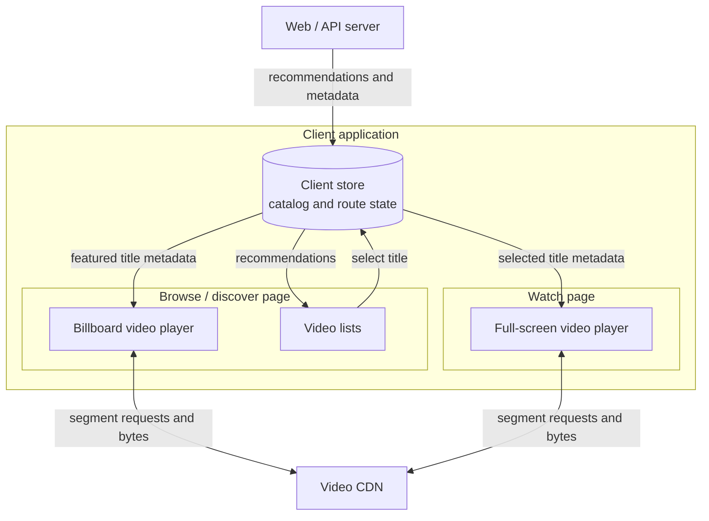
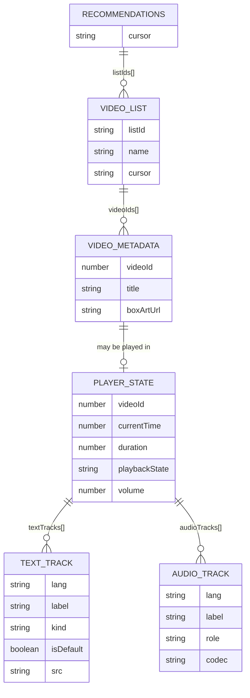
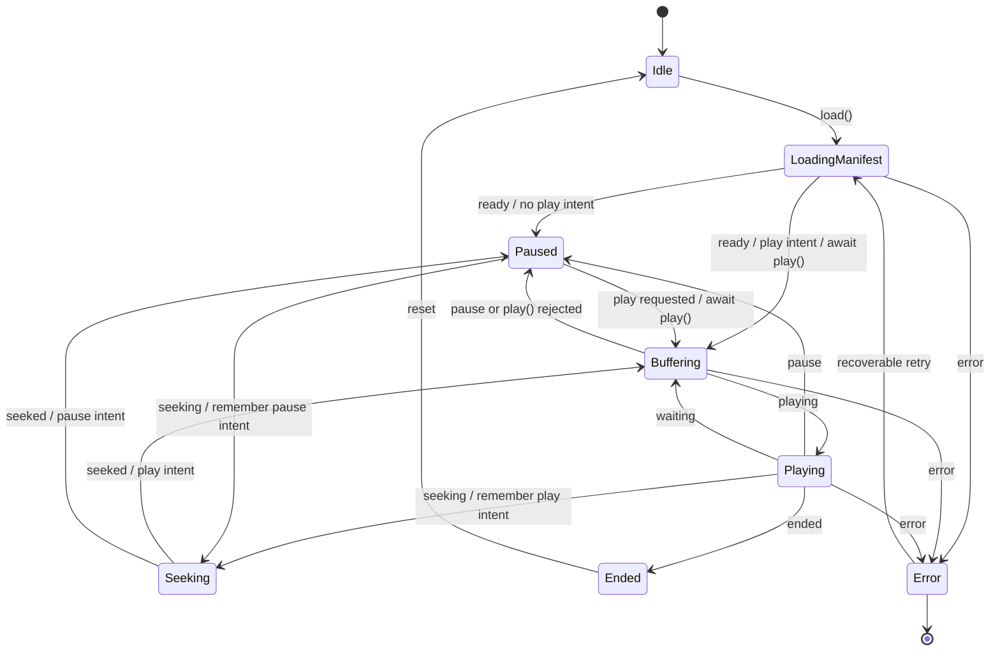
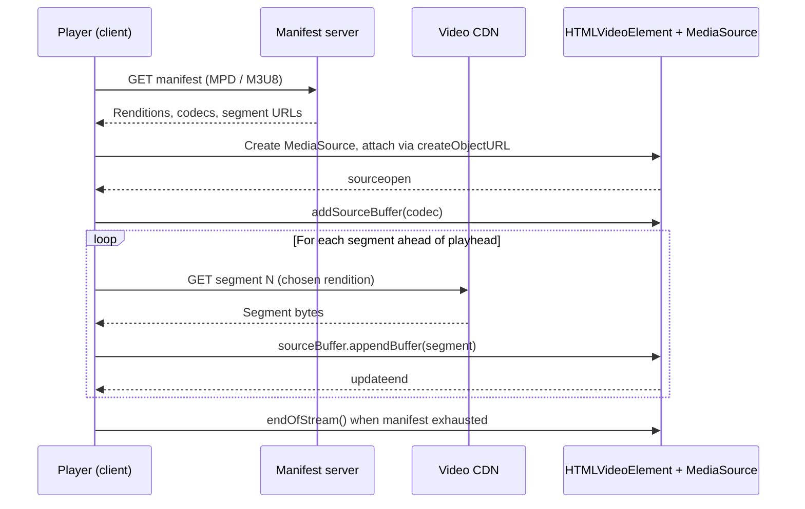
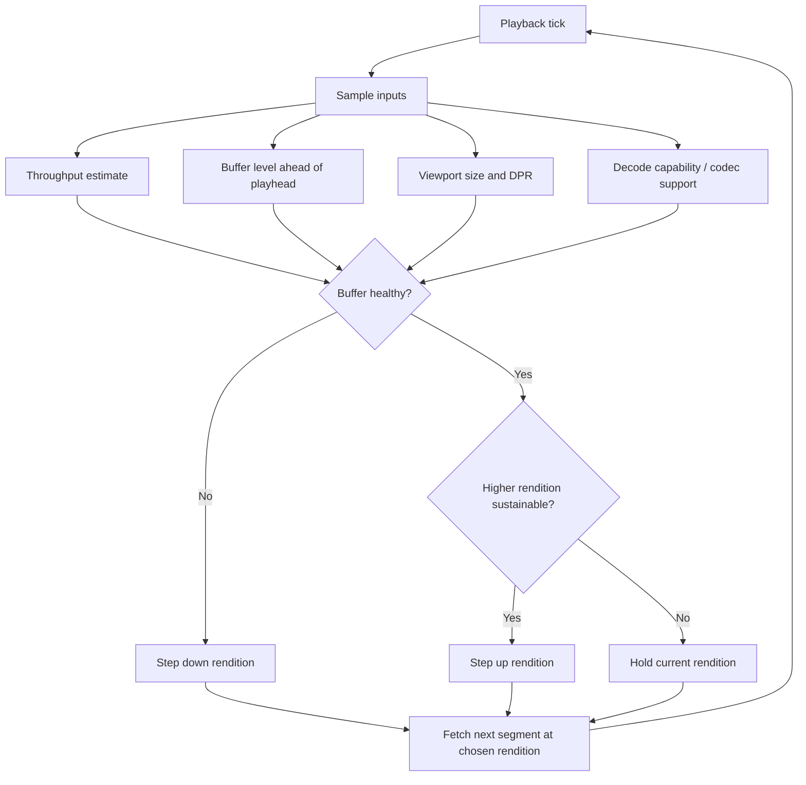
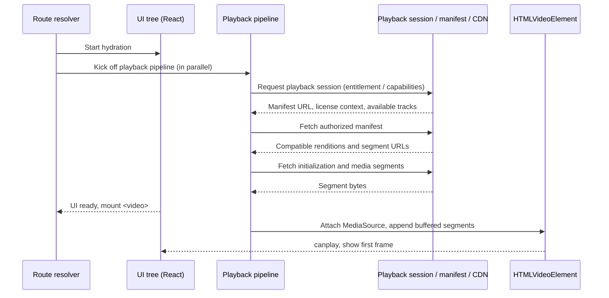

# Video Streaming (e.g. Netflix)

**Difficulty:** Hard · **Duration:** ~45 min · **Topics:** Networking, Performance

> Source: [video-streaming-netflix](https://www.greatfrontend.com/questions/system-design/video-streaming-netflix)

A video streaming front end combines content discovery with a stateful media player.

## Question

Design a video streaming application similar to platforms like Netflix and YouTube that allows users to browse through a library of video content to discover and watch interesting videos.


### Real-life examples

- [https://www.netflix.com](https://www.netflix.com)
- [https://www.youtube.com](https://www.youtube.com)
- [https://www.hulu.com](https://www.hulu.com)
- [https://www.primevideo.com](https://www.primevideo.com)

## Solution

### Requirements exploration

We scope the exercise by clarifying which product surfaces are in play (discovery, playback, billboard autoplay), which devices to target, and which streaming formats and media APIs belong in the interview.

#### What are the core features to be supported?

- Browsing of recommended videos on the homepage (Discover/recommendations page).
- A muted, inline billboard video that attempts autoplay while visible at the top of the Discover/recommendations page.
- Playback of video content on a standalone page.

#### What is the desired video playback quality and resolution?

Multiple resolutions and streaming quality options should be supported and automatically chosen depending on the device conditions.

#### What functionality should the video player include?

- **Video progress**: Play, pause, skip, seeking (jumping) to a specific timestamp of the video, adjusting playback rate.
- **Audio**: Changing language, adjusting volume.
- **Subtitles and captions**: Display and selection of subtitle and closed-caption tracks.

#### What devices will the application be used on?

Primarily desktop but it should also be usable on tablet and mobile.

#### What are the non-functional requirements?

Prioritize a smooth video watching experience; users shouldn't have to wait too long before they can start watching the video:

- Users on slow internet connections should still be able to watch the videos even if a lower quality version is to be served.
- Reduce stuttering and buffering.
- Fast [video startup time](https://www.mux.com/blog/the-video-startup-time-metric-explained).

#### Check your understanding 1

You are asked to design a Netflix-like web application. Which requirements should you clarify before choosing page-rendering and media-delivery architecture? Select all that apply.

- [ ] Standardize previews and protected titles on one playback pipeline before clarifying their duration, protection, and adaptation needs.
  > That implementation choice is premature: bounded previews can use simpler delivery while long-form titles may require adaptive, protected playback.
- [x] Clarify the discovery, title, and watch surfaces, including which routes are public and which require entitlement.
  > Route visibility influences rendering, while entitlement boundaries determine when the player may obtain protected playback resources.
- [x] Ask about quality and device targets, controls, startup time, rebuffering, seeking, watch-progress continuity, and expected network conditions.
  > These constraints drive rendition selection, buffering policy, player state, and the metrics used to evaluate the design.
- [x] Confirm subtitle and audio-language needs, accessibility expectations, DRM requirements, and supported locales.
  > Track, protection, accessibility, and locale requirements affect bootstrap contracts and client capabilities that a basic video element does not resolve alone.

### Background

Since media playback on the web is a fairly specialized domain that most people would not have much experience in, we've provided a summary of the important technicalities you need to be aware of regarding video playback in the context of a system design interview. In fact, most of the content covered here is more than what is expected of candidates, but it doesn't hurt to know more.

#### Glossary

These terms are enough to explain the client-side playback decisions that follow.

- **Streaming**: The process of delivering multimedia content over the internet while it is being consumed, without waiting for the entire file to download first.
- **Buffering**: The process of preloading video content to ensure smooth playback, preventing interruptions due to slow network connections.
- **Bitrate**: Refers to the amount of data transferred per second in a video stream. It determines the quality and size of video files, with higher bitrates yielding better quality but larger file sizes.
- **Frame rate**: The number of video frames displayed per second, typically measured in frames per second (fps). Common frame rates include 24fps for film and 30fps or 60fps for television and online video.
- **Resolution**: Specifies the dimensions of a video in terms of width and height (e.g., 1920 x 1080 pixels for Full HD). Higher resolutions offer better visual quality but require more bandwidth.
- **Codec**: A software or hardware component that encodes and decodes video and audio data. Common video codecs include H.264, H.265 (HEVC), VP9, and AV1.
- **Bandwidth**: The amount of data that can be transmitted over a network connection in a given time frame. In video streaming, sufficient bandwidth is necessary to deliver video content smoothly and at the desired quality. Higher-quality videos with higher bitrates require more bandwidth for uninterrupted playback.
- **Poster**: Static thumbnail image of the video.
- **Closed captions (CC)**: Timed text for viewers who are deaf or hard of hearing. Unlike subtitles for translated dialogue, captions also identify relevant speakers, music, and sound effects. Preserve the distinction in track metadata even if both use the same selection UI.
- **Playback controls**: User interface elements for video control, including play, pause, seek, and volume.
- **Seeking**: Seeking in video playback is the action of moving to a specific point or time in the video without playing it from the beginning. Users can jump to a specific scene or timecode within the video, often by interacting with a seek bar or timeline.
- **Scrubbing**: Scrubbing is a user action that involves dragging the playhead or seek bar of a video player to navigate through the video content. It allows users to quickly move forward or backward in the video to find specific scenes or moments.

We will be using these terms frequently in the content below.

#### Video playback on the web

The most basic way of playing videos on websites is to use a `<video>` HTML tag on a page with the `src` attribute pointing to an `mp4` or `webm` file, just like the `` tag. However, this most basic way of playing videos on a webpage doesn't offer the best user experience as it does not support adaptive bitrates.

Sophisticated video players on Netflix and YouTube leverage the following key components:

1. **Player interface**: This includes the user interface of the video player, which provides controls like play, pause, and volume adjustment. Browsers offer a basic playback controls UI but often you'd want to have more control over the styling and appearance.
2. **Streaming protocol**: Streaming involves progressively downloading a large video file that has been split into smaller segments. The player downloads and plays these segments in sequence, maintaining a buffer to handle network fluctuations. Common streaming protocols are HTTP Live Streaming (HLS) and Dynamic Adaptive Streaming over HTTP (DASH).
3. **Manifest file**: Manifest files guide the video player to the location of video segment files. They include a master manifest, which is the first point of contact and directs the player to various renditions of the video, and rendition manifests for each specific video quality. The format of the manifest files differs depending on the streaming protocol used.
4. **Adaptive bitrate streaming**: This technique allows the player to select from different versions of a video (various resolutions and bitrates) to ensure smooth playback based on the user's internet speed. To avoid buffering, video players dynamically adjust the playback quality and use the manifest files to determine the location of the segment files for the desired quality.

#### Video formats

[WebM](https://www.webmproject.org/) and MP4 are common media containers. A container does not determine playability by itself; the player must check the complete MIME type and codecs, relevant profiles or levels, device decode capability, and DRM key-system support.

| Area                     | WebM                                                                                                      | MP4                                                                                             |
| ------------------------ | --------------------------------------------------------------------------------------------------------- | ----------------------------------------------------------------------------------------------- |
| Usage                    | Online streaming.                                                                                         | Video storage, video editing, broadcasting, and streaming.                                      |
| Browser support          | Depends on the codecs and device; WebM commonly carries VP8, VP9, or AV1 video with Vorbis or Opus audio. | Depends on the codecs and device; MP4 commonly carries H.264 or HEVC video with AAC audio.      |
| Encoding and compression | Supports several codec combinations; VP9 and AV1 are common choices for efficient web delivery.           | Supports several codec combinations; H.264 with AAC remains a common broadly compatible choice. |

Like WebP, WebM was developed by Google for media on the web. MP4 is widely used across devices and platforms, but selection should be capability-driven rather than based only on the container name.

### Architecture / high-level design

The architecture follows from the product: the discover page is content-heavy and SEO-relevant, while the playback page wraps a stateful media player. Both share a common shell but diverge on rendering model and data flow.

#### Rendering approach

Video streaming applications have the following characteristics:

- Video titles are searchable via search engines. YouTube videos are mostly public while Netflix has a title page containing just the video details and some art/thumbnails ([Netflix title page example](https://www.netflix.com/title/80057281)).
- Certain video watching pages are only accessible by logged-in premium users (in the case of Netflix).
- Pages are interaction heavy due to browsing of video recommendations and video playing interactions.
- Fast initial loading speed and video startup speed are desired.

For pages accessible by logged-in users only, server-side rendering (SSR) may improve initial delivery when the benefit outweighs server latency and hydration cost, but SSR is not crucial. For pages that are discoverable by search engines (public videos), SEO and hence SSR will be important.

YouTube SSRs a basic skeleton of their browse/discover page.


Netflix SSRs the entire [video title page](https://www.netflix.com/title/80057281).


For watch pages, especially in the case of Netflix where the video fills up the entire page, SSR is not as useful. The SSR-ed HTML doesn't include a loaded video or any buffered data needed to start playback, and JavaScript is required for video streaming playback anyway. It can still deliver the poster, controls shell, title metadata, or preload hints.

> **Default to CSR for the watch page and SSR only for discovery surfaces**
>
> Streaming playback is driven by JavaScript, so SSR cannot prefill the client media buffer. Reserve most SSR work for the discovery feed and public title pages, while using it on a watch route only when its shell, metadata, or preload hints measurably improve startup.


YouTube SSRs a static preview of the video (poster image) while Netflix does not SSR anything visible.


However, Netflix's initial HTML contains data needed by the React application to boot up the video player on the page. If this data is not present in the initial HTML, the page needs to make a request to fetch the data, which requires an extra round trip and will be slower.


| Service | Page                       | Access    | Rendering                                         |
| ------- | -------------------------- | --------- | ------------------------------------------------- |
| Netflix | Video title page           | Public    | SSR full page                                     |
| Netflix | Browse/discover page       | Logged in | SSR above the fold                                |
| Netflix | Watch page                 | Logged in | SSR just the app data (JSON)                      |
| YouTube | Homepage (recommendations) | Public    | SSR a skeleton                                    |
| YouTube | Watch page                 | Public    | SSR UI skeleton with video preview / poster image |

As seen from the table, there's no hard and fast rule here. YouTube SSRs only the skeleton for its pages. Netflix SSRs public pages and the browse page because it improves user engagement. SSR can be used for video listing pages, which benefit from high user engagement. For video watching pages, the playback pipeline remains client-owned even if the server supplies an initial shell or data.

#### Single-page application (SPA) or Multi-page application (MPA)?

As video streaming websites are highly interactive and navigation between discovery pages and watch pages can be pretty common (especially when the user is still choosing a video), persisting the data fetched on the discovery page across page navigations will improve the performance. Moreover, on SPAs, clients can prefetch the metadata needed by subsequent watch pages, improving the video startup time.

Netflix and YouTube are both single-page applications.

#### Component responsibilities

**Video streaming client architecture**



- **Server**: Provides HTTP APIs to fetch video recommendations and video object metadata.
- **Video CDN server**: CDN server to fetch the video contents itself. Allows fetching individual segments of the video.
- **Client store**: Stores data needed across the whole application. Most of the data in the store will be server-originated data needed by the video recommendations page. Persists data across navigation so that revisiting the recommendations page will not require fetching the recommendations list again.
- **Discover page**: The page users use to browse the recommended videos.
  - **Billboard video player**: Featured video that requests muted, inline autoplay while visible and falls back to a poster and play control when blocked.
  - **Video lists**: List of video categories. Each category shows a horizontal list of video thumbnails.
- **Watch page**: The page where users watch a full video.
  - **Full-screen video player**: Plays the video and contains video playback controls.

The video player components on each page will make requests to the video CDN server to fetch video segments in a streaming fashion.

#### Check your understanding 2

Public title pages need search visibility, while the watch page is a stateful JavaScript media application. Which rendering architecture is appropriate?

- [x] SSR public discovery and title content where useful, hydrate into an SPA, and run the watch page and persistent player state client-side.
  > SEO and fast content entry benefit from SSR, while actual media startup and controls require a long-lived client pipeline.
- [ ] Server-render each watch route, then use full-document navigation whenever the viewer changes titles.
  > The initial title can still hydrate into a player, but full reloads repeatedly destroy the long-lived media and session state that make watch navigation resilient.
- [ ] Server-render public and watch pages, and require a server action before applying play, pause, or seek locally.
  > The rendering split is reasonable, but latency-sensitive player controls must update the local media pipeline immediately rather than wait for a network round trip.
- [ ] Use one client-rendered SPA for public title pages and the watch experience, relying on metadata endpoints for search previews.
  > The player benefits from a long-lived client, but metadata alone does not provide useful, indexable title content in the initial public document.

### Data model

Use stable IDs across server responses and client state, and explicitly map the nested response into the normalized store.

| Entity            | Source | Belongs to    | Fields                                                       |
| ----------------- | ------ | ------------- | ------------------------------------------------------------ |
| `Recommendations` | Server | Discover page | `listIds` (ordered `VideoList` IDs), `cursor`                |
| `VideoList`       | Server | Discover page | `listId`, `videoIds` (ordered `VideoMetadata` IDs), `cursor` |
| `VideoMetadata`   | Server | Discover page | `videoId`, `title`, `boxArtUrl`, etc.                        |

The video recommendations should be stored in the client store, which is preserved across page navigations. This acts as a cache to allow presenting the video recommendations immediately (without a network request) whenever the user goes back to the "Discover page" to browse more recommendations.

The API shape below stays nested for readability. On receipt, normalize `recommendations.items` into `listIds` and each `videos.items` into `videoIds`, keyed by `listId` and `videoId` so repeated titles share one entity.

**Client store entity relationships for discover and watch surfaces**



Video players contain standalone data models and APIs, which will be covered in a [dedicated section below](#video-player-data-model-architecture-and-api).

### Interface definition (API)

The client talks to two main API surfaces: recommendations for the discover page, and manifest and segment endpoints for streaming playback.

#### Video recommendations API

This API is used on the browse/discovery page to render the list of video categories and the top videos within each category. Cursor-based pagination can be used to fetch more recommendation categories and more category videos.

```json
{
  "recommendations": {
    "items": [
      {
        "listId": "tv-shows",
        "name": "TV Shows",
        "videos": {
          "items": [
            { "videoId": 123, "title": "...", "boxArtUrl": "..." },
            { "videoId": 124, "title": "...", "boxArtUrl": "..." }
          ],
          "cursor": "..."
        }
      },
      {
        "listId": "new-releases",
        "name": "New Releases",
        "videos": {
          "items": [
            { "videoId": 125, "title": "...", "boxArtUrl": "..." },
            { "videoId": 126, "title": "...", "boxArtUrl": "..." }
          ],
          "cursor": "..."
        }
      }
    ],
    "cursor": "..."
  }
}
```

To keep the interview answer focused, this design uses cursor-based pagination. Cursor generation, deduplication, cache invalidation, and response ordering are not covered here, but could be discussed if the interviewer asks about pagination edge cases.

The data for the first page of recommendations and videos:

1. Is used to SSR the initial HTML (refer to image in rendering approach section).
2. Rendered as JSON data within `<script>` tags and is injected into the client store (`window.netflix.reactContext`).

Data for subsequent pages is fetched from an HTTP API and added into the client store, which is then added to the page's DOM.

#### Media streaming and subtitles API

The APIs for streaming the video data, audio data, and subtitles for a video depend on the selected streaming protocol (DASH, HLS), which is [covered in more detail below](#streaming-protocols).

For protected titles, first request a short-lived playback session after entitlement and capability checks. It returns an authorized manifest URL, license context, and the available video, audio, and text tracks. Fetch the manifest, select a compatible rendition, and only then request initialization and media segments. Detailed EME messaging, signed CDN access, CORS, and token or license refresh are omitted here, but can be discussed if the interviewer asks about protected playback.

#### Video player API

Video players are covered in a [dedicated section below](#video-player-data-model-architecture-and-api).

#### Check your understanding 3

The server-rendered discovery page already includes its first recommendation page as JSON, and the same title appears in several rows. How should the client initialize navigation-ready state?

- [ ] Use the HTML for first paint, discard its data during hydration, and request the same recommendation page again.
  > The duplicate request delays interactivity and can return content that no longer matches the server-rendered document.
- [ ] Copy each complete row response into component state so every occurrence owns its own title metadata.
  > Duplicated entities can drift when a shared title changes and cannot form one cache across navigation.
- [x] Seed the persistent client store from the embedded response, normalizing lists and titles by stable ID before continuing pagination.
  > The client reuses the server's work without another round trip while repeated titles and subsequent pages share one identity model.
- [ ] Treat rendered cards as the authoritative catalog and reconstruct API state from their DOM attributes when navigating.
  > Presentation markup omits pagination and entity relationships and is not a reliable application data contract.

#### Check your understanding 4

A user opens a protected title on a device with specific codec and DRM capabilities. What should playback bootstrap provide?

- [x] Return a short-lived manifest or license context plus available video, audio, and text tracks appropriate for the entitlement and device.
  > The player can select compatible renditions while catalog metadata remains durable and cacheable.
- [ ] Return a short-lived URL for one preselected progressive MP4 plus its captions.
  > Expiry improves access control and captions are explicit, but one file cannot adapt bitrate during playback or offer compatible audio and video renditions across devices.
- [ ] Return durable catalog metadata and let the client construct media-segment and license URLs from the title ID.
  > Client-constructed URLs bypass entitlement-scoped bootstrap and omit the authoritative rendition, track, and protection metadata required for playback.
- [ ] Return the manifest but keep current time, play state, and volume server-authoritative through synchronous control mutations.
  > Persisting progress can be asynchronous, but round trips on immediate controls add latency and make playback dependent on connectivity after authorization.

### Video player data model, architecture, and API

As a video player involves multiple properties (state), lots of actions resulting in state changes, and many components that rely on the central video player state, a unidirectional reducer + actions pattern is appropriate. This can be implemented using `useReducer` in React or React + Redux, where Redux provides more structure around the actions and reducers along with additional devtools for an enhanced developer experience.


- **View** (UI Components): Progress control, Control bar, Media
- **State** (naming may differ from actual DOM properties): Playback intent, observed media status, buffering, seeking, errors, buffered ranges, current time, duration, playback rate, volume, muted, selected audio/video/text tracks, poster, height, and width
- **Dispatcher**: Dispatches an action to the reducer. Alternatively, clients can directly dispatch the actions from within the UI components or event handlers.
- **Actions**: Play, Pause, Skip, Seek, Adjust volume, Mute, Toggle full screen
- **Keyboard events** resulting in actions:
  - Space -> Play/Pause
  - Volume key -> Adjust volume
  - Mute key -> Mute sound
  - Arrow keys -> Skip
  - Full screen shortcut -> Toggle full screen
- **Background events**: `loadstart`, `loadeddata`, `ended`, `error`, `stalled`, `waiting`, etc. See the [full list of events available on the `<video>` element](https://developer.mozilla.org/en-US/docs/Web/HTML/Element/video#events).

A [Flux-like unidirectional flow model](https://facebookarchive.github.io/flux/docs/in-depth-overview) works well here. In a reducer pattern, `newState = reducer(action, state)`. Actions are operations that mutate state. A list of actions, the known operations that can modify state, is defined. The only way to change the state is to dispatch an action; there is no way to update the state directly. This helps to centralize state mutation logic within the reducer.

Actions can also originate from different sources – they can be triggered from various UI elements, keyboard events, or background events. The reducer does not need to care about where the actions were dispatched from; it simply has to take in an action + current state and return the new state.

YouTube experienced performance issues due to its player video controls being over-componentized, and certain interactions caused extra style recalculations due to circular dependencies and memory leaks. To fix the issue, YouTube updated the video player to synchronize all updates by refactoring the player into a top-level component that would pass down data to its children. This ensured only one UI update (paint) for any state change, eliminating chained updates. Although YouTube does not use React or Redux, this refactoring is essentially an implementation of the Flux-like reducer pattern. _Source: [Building a Better Web - Part 1: A faster YouTube on web](https://web.dev/case-studies/better-youtube-web-part1)._

In 2018, Netflix rewrote their video player in React and Redux; they chose to use Redux in order to single-source and encapsulate the complex playback business logic. Redux is a well-known library/pattern in web UI engineering, and it facilitated separation of concerns in ways that met their goals. By combining Redux with data normalization, they enabled parallel development across teams in addition to providing standardized, predictable ways of expressing complex business logic. _Source: [Modernizing the Web Playback UI. Since 2013, the user experience of… | by Netflix Technology Blog](https://netflixtechblog.com/modernizing-the-web-playback-ui-1ad2f184a5a0)._

Buffered video data can be cached, especially for the billboard video which doesn't change across the session. However, clients should pay attention to the amount of buffered video data and release memory when it reaches the point where page performance is affected.

Media elements also expose observed state such as `paused`, `ended`, and `readyState`. Keep requested intent such as `shouldPlay` separate from observed playback, buffering, seeking, and error state. Commands update intent, while media events reconcile what the browser actually did; this avoids duplicating one ambiguous `playing` flag across the UI and the element.

> **Separate playback intent from observed media state**
>
> External inputs like media keys, OS controls, and Picture-in-Picture can change the `HTMLVideoElement` directly. Route commands through the reducer, await `play()`, and reconcile `playing`, `pause`, `waiting`, `seeking`, `seeked`, and `error` events into observed state so the controls reflect the browser rather than predicting it.

Here are some libraries that provide custom video players or help you build one:

- [Shaka Player](https://github.com/shaka-project/shaka-player): An open-source JavaScript library for adaptive media that supports DASH and HLS.
- [Video.js](https://videojs.com/): Similar to Shaka Player, with many different themes and skins.
- [Media Chrome](https://www.media-chrome.org/): Elements for building media players.

Tutorials:

- [Mobile Web Video Playback | Articles | web.dev](https://web.dev/articles/media-mobile-web-video-playback)
- [Building a Media Player Series | Chrome for Developers](https://www.youtube.com/watch?v=--KA2VrPDao&list=PLNYkxOF6rcIBykcJ7bvTpqU7vt-oey72J&index=20)

#### Check your understanding 5

A custom video player receives commands from controls and media keys as well as media-element events. How should it coordinate playback state and separate it from catalog data and buffered media? Select all that apply.

- [ ] Store fetched segment bytes beside the corresponding VideoMetadata record so navigation can reuse them.
  > Catalog metadata and transient buffered media have different ownership and lifecycles.
- [x] Centralize play, seek, track, waiting, and error transitions in one player state machine.
  > UI, keyboard, media, and background events share one mutation path.
- [x] Reconcile media-element events into application state and drive intended properties from that state.
  > External media controls and DOM events otherwise cause UI and element state to drift.
- [ ] Let each subtitle, progress, and control component read the media element independently when it renders.
  > Multiple clocks create inconsistent playback surfaces.

#### Check your understanding 6

A custom player receives play commands from its controls and media keys, then the browser rejects one request and later stalls during a seek. Which state transitions keep the UI aligned with actual playback? Select all that apply.

- [x] Record requested play or pause intent, await the media command, and reconcile observed status from element events.
  > Intent describes what the user requested, while the browser remains authoritative about whether playback actually advanced.
- [ ] Mark playback as advancing as soon as the `play` event fires.
  > `play` means the element is no longer paused. `playing` is the event that confirms media can advance.
- [x] Use `waiting`, readiness, and playback progress to enter buffering, and use `playing` to leave it.
  > Buffering is an observed interruption in playback rather than merely a network fetch notification.
- [ ] Show rebuffering whenever a `stalled` event occurs, even if buffered media keeps playing.
  > `stalled` describes a fetch delay and does not by itself prove the playhead has stopped.
- [x] Remember whether playback should resume or remain paused while processing `seeking` and `seeked`.
  > Seeking is a transient media state and should not erase the user's prior play or pause decision.
- [x] Treat a rejected `play()` promise as a recoverable paused state and expose an explicit play control.
  > Browser policy can reject a valid command, so the UI needs a clear gesture-based recovery path rather than a false playing state.

### Optimizations and deep dive

The heart of the design is the video player itself, so this section starts with native browser playback before moving into streaming protocols, adaptive quality, subtitles, performance, and player UX:

- [Understanding native HTML `<video>` elements](#understanding-native-html-video-elements): This section explains progressive downloading, `<video>` attributes, methods, events, and the limits of basic browser playback.
- [Video streaming](#video-streaming): This section covers Media Source Extensions, adaptive bitrate streaming, media capabilities, streaming protocols, and manifest files.
- [Subtitles and closed captions](#subtitles-and-closed-captions): This section discusses timed text delivery, embedded captions, separate caption APIs, accessibility features, and multilingual support.
- [Performance](#performance): This section explains startup latency, buffering, lifecycle separation, stream selection, image optimization, bandwidth efficiency, and memory usage.
- [User experience](#user-experience): This section covers playback controls, customization, seek behavior, thumbnails, and details that shape the watching experience.
- [Accessibility (a11y)](#accessibility-a11y): This section discusses captions, visual assistance, screen-reader support, keyboard controls, and external control surfaces.
- [Internationalization (i18n)](#internationalization-i18n): This section covers multilingual player UI, audio tracks, subtitles, and regional formatting concerns.
- [Bonus](#bonus): This section collects extra production-grade details such as seek-bar thumbnails and homepage autoplay previews.

#### Understanding native HTML `<video>` elements

HTML5 provides a `<video>` tag to play a video within a webpage. It was introduced with HTML5 and represents a significant improvement in web standards, allowing direct embedding of videos without the need for external plugins like Flash. In this section, we introduce some basics about the `<video>` tag.

##### Progressive downloading

The simplest way to render a video is similar to images, where the `src` attribute points to a video file.

```html
<video src="movie.mp4"></video>
```

This method of using the `<video>` tag with a `src` attribute pointing to one encoded resource is called "progressive downloading". The browser manages fetching, often sequentially with byte ranges for seeking, and can suspend the download when playback stops. It may download ahead, but it does not necessarily fetch the entire file when the viewer leaves early. The important limitation is that one resource does not provide manifest-driven multi-rendition adaptation or application-controlled segment scheduling and recovery.

Seeking can be achieved by using an [HTTP `Range` request](https://developer.mozilla.org/en-US/docs/Web/HTTP/Range_requests) to download the appropriate byte range. An HTTP `Range` request asks the server to send only a portion of an HTTP message back to the client, which is useful for media players because they want to support random access of a file.

Large streaming products use adaptive delivery rather than relying only on one progressive resource. Depending on browser capabilities, that can be native HLS or JavaScript/library handling of HLS or DASH over the [Media Source API](https://developer.mozilla.org/en-US/docs/Web/API/Media_Source_Extensions_API). More on that [below](#media-source-api).

##### `<video>` element attributes

Supported HTML attributes include:

- `src`: Specifies the source of the video file.
- `width` and `height`: Define the size of the video player on the webpage.
- `controls`: Adds video controls like play, pause, and volume.
- `autoplay`: Requests playback when media is ready, but the browser can reject it. Muted inline media is the broadly supported billboard path; always handle the `play()` promise and retain an explicit play control.
- `loop`: Enables the video to start over again, every time it is finished.
- `muted`: Mutes the audio by default.
- `poster`: Specifies an image to be shown while the video is downloading, or until the user hits the play button.

Most of these HTML attributes become the `HTMLVideoElement`'s properties in the DOM when the HTML is parsed by the browser.

The `<video>` element also allows specifying multiple video sources via the `source` tag so that the browser can pick the format that works best. This is done to ensure compatibility across various browsers, as not all browsers support the same video formats.

```html
<video width="320" height="240" controls>
  <source src="movie.webm" type="video/webm" />
  <source src="movie.mp4" type="video/mp4" />
  <source src="movie.ogg" type="video/ogg" />
  Your browser does not support the video tag.
</video>
```

Text placed between the `<video>` tags (but outside the `<source>` tags) serves as fallback content for browsers that do not support the `<video>` tag.

##### `HTMLVideoElement` methods

The `HTMLVideoElement` element can be manipulated using JavaScript for further interactivity. `HTMLVideoElement`s inherit from the `HTMLMediaElement` interface which provides a range of methods that allow for controlling and interacting with media elements like `<audio>` and `<video>` in HTML. Some of the important methods available on the `HTMLMediaElement`:

- `play()`: This method is used to start playing the media. If the media is already playing, this method has no effect. If playback is paused and the request succeeds, it will resume. The returned promise can reject, such as when autoplay is blocked.
- `pause()`: This method pauses the media playback. If the media is already paused, this method has no effect.
- `load()`: This method is used to reset the media element and reload the source media. It's useful when the source of the media has changed.
- `addTextTrack()`: Adds a new text track to the media element. This can be used for subtitles, captions, descriptions, chapters, or metadata.
- `fastSeek()`: This method allows for fast seeking to a specific time point in the media.

##### `HTMLVideoElement` events

The `HTMLVideoElement` inherits from the `HTMLMediaElement` interface which provides a range of events that allow developers to monitor and control media playback. These events are crucial for creating interactive and responsive media experiences on web pages.

Here are some of the important events associated with `HTMLMediaElement`:

- `loadstart`: Fired when the browser starts looking for the media; beginning of the loading process.
- `loadeddata`: Triggered when the media element has data for its current playback position, often the first frame.
- `progress`: Fired periodically as the browser loads the media. Useful for showing media loading progress.
- `play`: Fired when the element is no longer paused after playback was requested; playback might still be waiting for data.
- `playing`: Fired when playback is ready to start or resume after being paused or delayed for data.
- `pause`: Occurs when the media playback is paused.
- `ended`: Triggered when playback has stopped because the end of the media was reached.
- `waiting`: Occurs when the media playback is stopped due to temporary lack of data.
- `stalled`: Fired when there is an unexpected halt in media downloading, often due to network issues.
- `volumechange`: Occurs when the volume changes, including when the `muted` attribute changes.
- `error`: Fired when an error occurs while fetching the media.

These events are essential for creating a detailed control interface for media elements, handling errors, tracking progress, and responding to user interactions. By adding event listeners to these events, developers can manage media playback in a custom manner and also gather user analytics.

**Video player lifecycle state machine driven by media events**



The `play` event indicates that the element is no longer paused after playback was requested; `playing` confirms that it is ready to advance media. A `stalled` event describes network fetching and should not show rebuffering unless readiness or `waiting` also indicates playback has stopped. Preserve play or pause intent across a seek, and treat `play()` rejection as a recoverable paused state with an explicit control.

##### Drawbacks of using `<video>`

Using "vanilla" `<video>` elements also comes with some drawbacks:

**Limited adaptive streaming support**: The `<video>` element doesn't natively support adaptive streaming protocols like DASH or HLS in all browsers. These protocols dynamically adjust video quality based on the user's internet speed, ensuring a smooth streaming experience. Without this, users may experience buffering or low-quality video. The `<video>` element might not be optimized for scenarios where low latency is crucial, such as live streaming events.

**Restricted customization and control**: `<video>` elements also contain playback controls, but like most native elements, each browser renders them differently. If you want a consistent and branded user interface across browsers, you will have to build your own playback controls. However, styling these controls isn't straightforward, unlike other HTML elements like `<button>`s and `<input>`s. You will have to build your own components.

Note that `<video>` elements also contain their own state as mentioned in the attributes/properties above. If you are using a JavaScript framework/library (e.g. React, Vue) and have built your own `Video` component that renders the `<video>` elements along with custom controls, you will need to do a two-way sync between your React component state and the `<video>`/`HTMLVideoElement` state, as there can be native controls that directly affect the `HTMLVideoElement` like the play/pause/volume buttons (also known as media keys) on some keyboards.

In the following example, the React component state is synced with the DOM video state. Try playing the video using either "Play" button and see that the playback and custom UI states are synced properly.

Also ensure that custom-built video controls meet the accessibility requirements and standards provided by the native video controls.

**No support for advanced features**: Features like video previews, thumbnails on seek, multi-bitrate streaming, and live streaming are not natively supported or are limited in the `<video>` element.

Choose native or custom controls separately from the media delivery path. Native controls can be the more accessible choice when product styling and behavior allow them; custom controls are justified when the product needs consistent cross-browser UI or additional playback features.

> **Choose the simplest playback layer that meets the requirements**
>
> Progressive playback can suit short clips and bounded fallbacks but does not provide manifest-driven quality switching or application-controlled segment scheduling. Prefer native HLS where it satisfies the product, or use a tested DASH/HLS player library over MSE when the application needs client-managed adaptive playback. Custom controls are an independent product decision.

#### Check your understanding 7

A product has short unprotected previews and long-form titles that need adaptive quality. How should it choose the browser playback layer?

- [ ] Use one custom MSE pipeline with an application-owned manifest parser and bitrate controller for both short previews and protected full titles.
  > MSE only supplies coded-media buffers, and rebuilding protocol and recovery logic adds risk where simpler playback already meets the requirement.
- [x] Use progressive playback for bounded clips, native HLS where supported, and a tested HLS or DASH player when client-managed adaptation is required.
  > Matching the layer to the requirement avoids unnecessary machinery while retaining adaptive delivery for long-form playback.
- [ ] Serve one progressive file selected from device capabilities at bootstrap, then issue a new file URL if network conditions change.
  > A single resource has no manifest of aligned renditions from which the player can adapt quality.
- [ ] Have the server render the initial media segments into the watch page, then navigate to a new response when quality changes.
  > Server rendering cannot feed the browser's long-lived media buffer or preserve playback across rendition choices.

#### Check your understanding 8

A browser can play the chosen adaptive stream natively, but the product is deciding whether to use native controls or a branded control bar. Which principle should guide the decision?

- [ ] Use custom controls whenever playback is adaptive, because the control layer must choose and fetch every media segment itself.
  > The controls manipulate the media element independently of whether the browser or application selects stream segments.
- [ ] Use native controls only for progressive files, then replace them with custom controls whenever native HLS or MSE backs the element.
  > Native controls can operate a media element backed by native HLS or an attached `MediaSource` as well.
- [ ] Choose native controls for server-rendered watch shells and custom controls for client-rendered routes so each matches its page lifecycle.
  > Page rendering does not determine the product behavior, consistency, or accessibility needed from playback controls.
- [x] Choose native controls when they satisfy the product, or custom controls for additional behavior while preserving equivalent accessibility semantics.
  > Control UI and media delivery are separate layers, so each can use the simplest option that satisfies its own requirements.

#### Check your understanding 9

Why does a production web player need more than `<video src="movie.mp4">`? Select all that apply.

- [ ] It needs ordinary play, pause, seek, and volume controls that the native element already exposes.
  > Standard media controls do not by themselves require an application-managed adaptive playback layer.
- [x] It must append segments from adaptive renditions while keeping buffered ranges bounded.
  > Media Source Extensions or a playback library manage a dynamic buffered timeline.
- [x] It must coordinate audio, video, captions, codec support, and possibly encrypted media.
  > A complete player resolves compatible tracks and protection before playback.
- [ ] It must choose one compatible progressive source at load time from a `<source>` list.
  > Native source selection can handle a fixed compatible file. The extra architecture is needed for ongoing adaptation and coordinated state.
- [x] It must normalize asynchronous media events and external controls into application state.
  > Readiness, stalls, PiP, and media keys can alter playback outside button handlers.

#### Video streaming

Video streaming addresses some of the drawbacks of progressive downloading by allowing the player to request segments and adapt playback quality.

##### Media Source API

The [Media Source API](https://developer.mozilla.org/en-US/docs/Web/API/Media_Source_Extensions_API), formally known as Media Source Extensions (MSE), is a web API that enhances the capabilities of streaming media in web applications. The Media Source API allows replacing the standard single progressive `src` URI in media elements with a `MediaSource` object. This object manages the media's ready state and references `SourceBuffer` objects for compatible coded media streams, commonly separate audio and video streams.

```js
// Setup the video element and MediaSource
const videoEl = document.getElementById("my-video");
const mediaSource = new MediaSource();

// Set the MediaSource object as the source of the video element.
videoEl.src = URL.createObjectURL(mediaSource);
mediaSource.addEventListener("sourceopen", sourceOpen);

async function sourceOpen() {
  // Create a source buffer with a specific MIME type.
  const sourceBuffer = mediaSource.addSourceBuffer(
    'video/mp4; codecs="avc1.64001E"',
  );

  // Append the initialization segment first, followed by media segments.
  const segmentUrls = [
    "path/to/your/video/init.mp4",
    "path/to/your/video/segment1.m4s",
    "path/to/your/video/segment2.m4s",
  ];
  let nextSegmentIndex = 0;

  async function appendNextSegment() {
    // End only after the final segment has finished appending.
    if (nextSegmentIndex === segmentUrls.length) {
      if (!sourceBuffer.updating && mediaSource.readyState === "open") {
        mediaSource.endOfStream();
      }
      return;
    }

    // Fetch and append one segment at a time because SourceBuffer updates are serialized.
    const response = await fetch(segmentUrls[nextSegmentIndex]);
    if (!response.ok) throw new Error("Segment request failed");
    nextSegmentIndex += 1;
    sourceBuffer.appendBuffer(await response.arrayBuffer());
  }

  // Continue the queue after each append completes.
  sourceBuffer.addEventListener("updateend", appendNextSegment);
  // Start by appending the initialization segment.
  await appendNextSegment();
}
```

This simplified queue calls `endOfStream()` only after every initialization and media segment has been appended and the buffer is idle. Request cancellation, buffer eviction, and detailed recovery can be discussed if the interviewer asks about production failure handling.

Segmented video files, along with the Media Source API, allow clients to stream video content. This API also allows for the creation of more interactive video experiences, such as the ability to insert ads dynamically, switch between multiple video angles, or synchronize additional content with video playback. [Netflix's Bandersnatch](https://postperspective.com/netflixs-black-mirror-bandersnatch-lets-viewers-choose/) is an interactive film with 5 unique endings where users can "choose their own adventure" while watching. As such, the number of combinations is huge, and it is not feasible to create video files for all possible film paths. Using `MediaSource` helps to dynamically stitch the different parts of the film together depending on the user's choice.

**Manifest fetch and segmented playback via the Media Source API**



If you inspect the `src` attribute of `<video>` elements on Netflix and YouTube, you'll see that they look like `<video src="blob:https://www.netflix.com/b4bc251f-5b0d-47a3-b0cb-4fbf653a16f4">`. This is because the `src` was created using `URL.createObjectURL()`.

Read more about Media Source API on:

- [Media Source API | Articles | web.dev](https://web.dev/articles/media-mse-basics)
- [Media Source API | MDN](https://developer.mozilla.org/en-US/docs/Web/API/Media_Source_Extensions_API)

Adaptive bitrate streaming adjusts playback quality to changing network and device conditions.

##### Adaptive Bitrate Streaming

While streaming helps to improve the video playback experience, it does not take into account the client's device and network conditions. If a user is on a choppy mobile network, they will not be able to watch a high-resolution video immediately, as they will have to wait longer for the segments to be downloaded. Users on mobile devices also do not benefit from high-resolution videos when their screen size is not wide enough to display all the details.

**Adaptive Bitrate Streaming** is a technique used in online video and audio streaming that dynamically adjusts the quality of a video to suit the available bandwidth and processing capabilities of the user's device.

Clients use an adaptive bitrate (ABR) algorithm to select a compatible rendition that can be downloaded in time without causing stalls or rebuffering.

These factors are monitored in real-time and used by the algorithm:

- Available bandwidth
- Available codecs
- Connection quality
- Video player dimensions
- Playback rate

This decision is made dynamically as the video plays, adapting to changing network speeds.

Use rolling throughput and buffer estimates with a safety margin rather than reacting to one sample. Switch only between aligned segments and compatible audio/video combinations, step down quickly when the buffer is at risk, and require sustained headroom or a minimum dwell before stepping up to avoid oscillation. Exact estimators, emergency-abandon rules, manual overrides, and codec transitions are beyond this core policy; explore them only if the interviewer asks about ABR tuning.

**Adaptive bitrate decision pipeline for the next segment**



> **Start on a low-bitrate rendition and let ABR ramp up**
>
> Prioritizing fast startup over initial quality is almost always the right tradeoff: users tolerate a few seconds of lower resolution far better than a blank spinner. Begin playback at a rendition that the current bandwidth estimate can clearly sustain, then allow the ABR algorithm to step up once the buffer is healthy.

##### Media Capabilities API

The [Media Capabilities API](https://developer.mozilla.org/en-US/docs/Web/API/Media_Capabilities_API) allows websites to get more information about the client's video decode performance and make an informed decision about which codec and resolution to deliver to the user.

[YouTube used the Media Capabilities API](https://web.dev/case-studies/youtube-media-capabilities) to prevent their adaptive bitrate algorithm from automatically selecting resolutions that a device could not play smoothly.

##### Streaming protocols

There are two popular streaming protocols that are used on the web that can be used to enable adaptive bitrate streaming: **Dynamic Adaptive Streaming over HTTP (DASH)** and **HTTP Live Streaming (HLS)**.

These streaming protocols have the following in common:

- **Segmented media files**: Media content of various quality is divided into small segments, enabling seamless streaming and the ability to switch between different quality streams.
- **HTTP-based delivery**: They utilize standard HTTP web servers for media delivery, simplifying distribution and reducing the need for specialized streaming servers. Media can be served through a CDN backed by an object-storage origin such as Amazon S3.
- **Manifest files**: Each protocol uses a type of manifest file (like MPD for DASH, M3U8 for HLS) to provide information about the available streams, their resolutions, bitrates, and segment locations (URLs).

##### Dynamic Adaptive Streaming over HTTP (DASH)

Dynamic Adaptive Streaming over HTTP (DASH) is a streaming protocol and technology that allows for the efficient delivery of multimedia content, such as video and audio, over the internet. DASH is designed to optimize the viewing experience for users by adapting to their network conditions and device capabilities in real-time.

Additional features of DASH:

1. **Media Presentation Description (MPD)**: DASH relies on an XML-based manifest file known as the [Media Presentation Description (MPD)](https://ottverse.com/structure-of-an-mpeg-dash-mpd/). The MPD contains metadata about the video content, including information about available quality levels, segment URLs, and other attributes that guide the video player in making adaptive streaming decisions.
2. **Latency control**: DASH can be designed to control latency based on specific use cases. Low-latency DASH (LL-DASH) is an extension that optimizes the protocol for live and interactive streaming applications.
3. **Interoperability**: DASH is designed for interoperability across different devices and platforms. As a result, it's possible to use the same DASH-encoded content for various playback environments.

Streaming services including Netflix, YouTube, and Amazon Prime Video use DASH to adapt video quality to network conditions, device capabilities, and screen sizes.

The [dash.js](https://reference.dashif.org/dash.js/) library is a reference client implementation for the playback of DASH via JavaScript and compliant MSE platforms.

##### HTTP Live Streaming (HLS)

HTTP Live Streaming (HLS) is a streaming protocol and technology developed by Apple for the delivery of multimedia content, such as video and audio, over the internet. HLS is widely used for streaming video content, especially on iOS devices (iPhones and iPads), as well as in web browsers and other platforms.

Additional features of HLS:

1. **M3U8 playlist files**: HLS uses M3U8 playlist files, which are text-based manifest files that describe the media content and provide information about available quality levels, segment URLs, and other attributes. The playlist files are hosted on the server and are used by the client (the video player) to request and play the media content.
2. **Media encryption**: HLS can support media content encryption using various encryption methods to protect content from unauthorized access. This can include methods like Advanced Encryption Standard (AES) encryption.
3. **Compatibility**: HLS is compatible with a wide range of devices, including iOS devices, web browsers, Android devices, smart TVs, and more. Many media players and streaming platforms support HLS.
4. **Low latency mode**: Low-Latency HLS reduces the delay between live events and viewers, making it useful for latency-sensitive broadcasts such as live sports.
5. **HTTP delivery**: An encoder or media service packages HLS content, which ordinary web servers and CDNs can then deliver. Specialized services can help with live encoding and packaging but are not required for HTTP delivery.

HLS is widely used for on-demand and live video streaming. It supports iOS devices and adaptive quality across network conditions and device types.

An M3U8 file can describe multiple video qualities, allowing the player to switch between different streams based on network conditions or user preferences. This is a key feature of adaptive streaming in HTTP Live Streaming (HLS). Here's an example of an M3U8 playlist with multiple video qualities.

##### Manifest file

The manifest file provides metadata that tells the video player how to request and display video segments.

There are different types of manifest files used in various streaming protocols, such as:

- **DASH**: In DASH, the manifest file is known as the [Media Presentation Description (MPD)](https://www.brendanlong.com/the-structure-of-an-mpeg-dash-mpd.html) file. This file, typically in XML format, contains information about the available quality levels, segment URLs, and other attributes necessary for the video player to request and play the content.
- **HLS**: For HLS, the manifest file is known as the Media Playlist or [M3U/M3U8](https://en.wikipedia.org/wiki/M3U) file. It is a plain text file with an `.m3u8` extension that contains metadata and URLs to video segments.

It is not important to know the exact format of the manifest files, but you should know what details they contain. Manifest files contain details about the video stream, such as:

- **Available quality levels**: Information about different bitrates and resolutions available for the video, allowing the player to choose the appropriate quality based on network conditions.
- **Segment URLs**: Links to individual video segments or chunks. These segments make up the complete video and are requested by the player as needed for playback.
- **Playback timing and structure**: Details on the sequence and duration of segments, allowing the player to organize and play them in the correct order.
- **Adaptive streaming information**: Information that enables adaptive streaming, ensuring the player can switch between different bitrates or resolutions based on network conditions.
- **Audio and subtitle tracks**: Information about alternative audio tracks and subtitle options available for the video.

The player uses manifest metadata to choose renditions and request the segments needed for adaptive playback.

Netflix primarily uses a proprietary adaptive bitrate streaming technology based on DASH and is similar to other adaptive streaming protocols like HLS, but with some unique features and optimizations tailored to Netflix's large-scale streaming service. Netflix optimizes its streams not only for the user's bandwidth but also for the type of content (like action vs. dialogue-heavy films) and the device being used (smart TVs, smartphones, tablets, etc.). YouTube uses DASH but supports HLS for certain applications, such as on Apple devices where HLS is more prevalent.

> **Choose the adaptive path by browser capability**
>
> MSE supplies byte buffers; it does not parse a DASH MPD or HLS playlist. Use native HLS where it meets the requirements, or pair MSE with a tested manifest and ABR library after checking the full codec and key-system configuration. MSE availability alone does not prove that a particular DASH representation is playable.

Here's a simplified example of what an MPD file used for DASH might look like:

```xml
<MPD xmlns="urn:mpeg:dash:schema:mpd:2011" type="static" mediaPresentationDuration="PT6M16S" minBufferTime="PT1.5S">
  <Period start="PT0S">
    <AdaptationSet mimeType="video/mp4" segmentAlignment="true" startWithSAP="1">
      <Representation id="video_1" width="1920" height="1080" bandwidth="8000000" codecs="avc1.640028">
        <SegmentTemplate media="video_1_$Number$.m4s" initialization="video_1_init.m4s" duration="4" timescale="1" startNumber="1"/>
      </Representation>
      <Representation id="video_2" width="1280" height="720" bandwidth="4000000" codecs="avc1.64001f">
        <SegmentTemplate media="video_2_$Number$.m4s" initialization="video_2_init.m4s" duration="4" timescale="1" startNumber="1"/>
      </Representation>
      <!-- More Representations for different resolutions and bitrates -->
    </AdaptationSet>
    <AdaptationSet mimeType="audio/mp4" lang="en">
      <Representation id="audio_1" bandwidth="128000" codecs="mp4a.40.2">
        <SegmentTemplate media="audio_1_$Number$.m4s" initialization="audio_1_init.m4s" duration="4" timescale="1" startNumber="1"/>
      </Representation>
      <!-- More Representations for different audio qualities -->
    </AdaptationSet>
  </Period>
</MPD>
```

In this example, the MPD file describes a video with two video quality options (1080p and 720p) and one audio track. Each `Representation` element provides details about a specific version of the content, including resolution, bitrate, codec, and the naming pattern for the segment files (`SegmentTemplate`). The client player uses this information to select the most appropriate stream based on current playback conditions.

Used in HLS, an M3U8 file can describe multiple video qualities, allowing the player to switch between different streams based on network conditions or user preferences. Here's an example of an M3U8 playlist with multiple video qualities:

```txt
#EXTM3U
#EXT-X-STREAM-INF:BANDWIDTH=800000,RESOLUTION=640x360
http://example.com/low.m3u8
#EXT-X-STREAM-INF:BANDWIDTH=1400000,RESOLUTION=960x540
http://example.com/medium.m3u8
#EXT-X-STREAM-INF:BANDWIDTH=2800000,RESOLUTION=1280x720
http://example.com/high.m3u8
#EXT-X-STREAM-INF:BANDWIDTH=5000000,RESOLUTION=1920x1080
http://example.com/hd.m3u8
```

And an example of what `http://example.com/low.m3u8` can contain:

```txt
#EXTM3U
#EXT-X-VERSION:3
#EXT-X-TARGETDURATION:10
#EXT-X-MEDIA-SEQUENCE:0

#EXTINF:10.0,
http://example.com/low/segment0.ts
#EXTINF:10.0,
http://example.com/low/segment1.ts
#EXTINF:10.0,
http://example.com/low/segment2.ts

#EXT-X-ENDLIST
```

Note that the `.ts` extension is an MPEG-2 Transport Stream file, which contains a segment of the media stream. It's not a TypeScript file!

##### Resources

- [Setting up adaptive streaming media sources - Developer guides](https://developer.mozilla.org/en-US/docs/Web/Guide/Audio_and_video_delivery/Setting_up_adaptive_streaming_media_sources)
- [How Netflix Pioneered Per-Title Video Encoding Optimization - Streaming Learning Center](https://streaminglearningcenter.com/encoding/how-netflix-pioneered-per-title-video-encoding-optimization.html)

#### Check your understanding 10

An MSE player has fetched initialization data and several media segments for one compatible rendition. Which append rules keep the `SourceBuffer` timeline valid? Select all that apply.

- [x] Append the initialization segment before media segments that depend on its codec and track configuration.
  > The buffer needs initialization metadata before it can interpret subsequent coded frames.
- [ ] Call `appendBuffer()` for every completed request as soon as its bytes arrive.
  > A `SourceBuffer` accepts one update at a time, so concurrent appends can fail or reorder the intended timeline.
- [x] Queue media in timeline order and start the next append only after the prior update finishes.
  > `updateend` establishes the serialization boundary for the next buffer mutation.
- [ ] Create a separate video `SourceBuffer` for every available quality and switch the element between them.
  > Renditions represent alternatives on one media timeline. Buffers are organized by compatible elementary stream rather than by bitrate.
- [x] Call `endOfStream()` only after the final segment has appended and no source buffer is updating.
  > Ending early closes the media source while required bytes are still queued or being incorporated.

#### Check your understanding 11

Which adaptive streaming policies improve playback on changing networks? Select all that apply.

- [x] Start with a conservative compatible rendition and ramp up after measuring throughput and buffer health.
  > Fast reliable startup is usually better than an early high-resolution stall.
- [x] Select future segments from a different bitrate at safe boundaries while maintaining one playback timeline.
  > Segmented manifests allow quality changes without replacing the whole player.
- [x] Filter renditions using device codec, resolution, and decoding capability.
  > Network bandwidth alone does not make an unsupported format playable.
- [x] Consider recent throughput together with buffer health and the cost of switching renditions.
  > A bandwidth estimate alone can choose an aggressive bitrate even when the remaining buffer is too small to absorb another slow segment.
- [ ] Choose the highest initially sustainable rendition and hold it for the session to avoid visible quality changes.
  > Network conditions can deteriorate and require a lower rendition.
- [ ] Seed quality from a cached global bandwidth estimate and update it only after playback ends.
  > A prior estimate can accelerate startup, but it becomes unsafe after network changes and cannot react to current segment timing or buffer depletion.

#### Subtitles and closed captions

Subtitles and closed captions both provide on-screen text to accompany video content, but they serve different purposes and audiences:

Subtitles are primarily intended for users who can hear the audio but do not understand the language spoken in the video. Typically, subtitles only include the dialogue or spoken words, and not much beyond that. They are used by people who are not deaf or hard of hearing.

Closed captions are designed for users who are deaf or hard of hearing. Closed captions include not only the dialogue but also other relevant parts of the soundtrack such as sound effects, background noises, and music cues. They also indicate who is speaking or note significant sounds. They are particularly helpful for those who cannot hear the audio in the video.

The player can present both in one track menu, but its data model should preserve each track's `kind`, language, label, and default status.

##### Separate timed text files

Subtitles and captions are often provided in separate files that are downloaded and displayed along with the video. Common timed text formats include:

1. **SubRip Subtitle (SRT)**: A simple and widely supported format that contains timestamped text.
2. **Timed Text Markup Language (TTML)**: An XML-based format for captions and subtitles.
3. **Scenarist Closed Caption (SCC)**: A format used for closed captions and captions for broadcast video.
4. **WebVTT (VTT)**: A format that offers more styling options and is commonly used for HTML5 video. You can use the `<track>` element within the HTML5 `<video>` element to reference a WebVTT file, and the browser handles the rendering of subtitles.

```html
<video controls>
  <source src="video.mp4" type="video/mp4" />
  <track
    label="English"
    kind="subtitles"
    srclang="en"
    src="subtitles.vtt"
    default
  />
</video>
```

##### Embedded subtitles

In some cases, subtitles are embedded directly into the video file itself. This method is common for broadcast and streaming video formats like DVB, ATSC, and some streaming protocols. The subtitles are decoded and displayed by the video player.

DASH and HLS manifests can reference available subtitle renditions or tracks, which the player can fetch and let the user select.

##### Separate API

Some web video player libraries offer APIs that allow developers to dynamically load subtitles from external sources or services. This can be useful for applications where subtitles change based on user preferences or dynamic content.

##### Accessibility features

When displaying captions, provide proper markup and keyboard-operable selection. Let users customize font size, color, and background to improve readability.

In addition to spoken dialogue, captions and transcripts should identify music and sound effects that communicate important information. This includes emotion and tone:

```txt
14
00:03:14 --> 00:03:18
[Dramatic rock music]

15
00:03:19 --> 00:03:21
[whispering] What's that off in the distance?
```

##### Multilingual support

To cater to a global audience, video players typically allow users to select from multiple languages and subtitle tracks, making it possible to switch between different languages or caption styles.

##### Resources

- [Implementing Japanese Subtitles on Netflix | by Netflix Technology Blog](https://netflixtechblog.com/implementing-japanese-subtitles-on-netflix-c165fbe61989)
- [Web Video Text Tracks Format (WebVTT) - Web APIs | MDN](https://developer.mozilla.org/en-US/docs/Web/API/WebVTT_API)
- [Subtitles, Captions, WebVTT, HLS, and those magic flags | Mux](https://www.mux.com/blog/subtitles-captions-webvtt-hls-and-those-magic-flags)
- [Adding captions and subtitles to HTML video - Developer guides | MDN](https://developer.mozilla.org/en-US/docs/Web/Guide/Audio_and_video_delivery/Adding_captions_and_subtitles_to_HTML5_video)
- [WebAIM: Captions, Transcripts, and Audio Descriptions](https://webaim.org/techniques/captions/)

#### Check your understanding 12

Which subtitle design choices support accessibility and multiple languages? Select all that apply.

- [ ] Burn the default subtitle language into each rendition and use timed text only for alternatives.
  > The default language would still be impossible to hide or restyle and would require another video encode for viewers who do not want it.
- [x] Deliver WebVTT or equivalent timed text tracks independently from video segments.
  > Users can switch languages and styling without fetching another video asset.
- [x] Expose language, label, kind, default status, and timing metadata for each text track.
  > The player can present captions and subtitles meaningfully.
- [x] Allow readable size, contrast, position, and background settings while avoiding important visual content.
  > Viewers may need captions repositioned or restyled so they remain readable without covering important content.
- [ ] Render subtitles into a styled canvas overlay instead of exposing timed text tracks.
  > Canvas pixels do not expose the timed text and track semantics that assistive technology and built-in caption controls need.

#### Performance

Video streaming performance affects startup delay, rebuffering, and playback quality. Efficient bandwidth use also affects operational costs and scalability; playback problems can cause viewers to stop watching or leave the service.

##### Minimizing latency and delay

- **Video loading time**: Reduce video loading times to minimize buffering delays. Use adaptive streaming techniques to deliver the appropriate quality based on the user's network conditions.
- **Buffering optimization**: Optimize video buffering to provide smooth playback. Preload video content where possible, and use efficient buffering algorithms. Buffer ahead of the current timestamp.
- **Network efficiency**: Leverage adaptive bitrate streaming to adjust video quality based on the user's available bandwidth. This ensures that users with slower connections can still watch videos (albeit at a lower quality) without frequent buffering.
- **Video compression**: Use modern video compression codecs (e.g., H.264, H.265, VP9) to minimize the size of video files, reducing the amount of data that needs to be transferred over the internet.
- **CDN usage**: Utilize Content Delivery Networks (CDNs) to serve video content from servers located closer to users, reducing latency and improving playback performance.
- **Lazy loading**: Implement lazy loading for videos so that they only load when they come into the user's viewport. Lazy load non-visible UI like dropdowns and modals during idle cycles or when it's being interacted with. This reduces initial page load times.
- **Player responsiveness**: Ensure that video player controls and the user interface remain responsive during video playback. Users should be able to interact with the player without delays.
- **Preloading media files**: Use the `preload` attribute for a predefined `src`. For MSE playback, the application schedules manifest and segment requests itself and can use appropriate resource hints where useful ([source](https://web.dev/articles/fast-playback-with-preload)).

A complete playback recovery policy is outside the happy path. If the interviewer asks about failure handling, discuss aborting obsolete requests, using bounded retries, stepping down quality, refreshing expired playback context, and trying an alternate CDN before showing a terminal error.

##### Improving video startup time by separating video lifecycle from UI lifecycle

The conventional approach of allowing the UI component tree to control the lifecycle of video playback can lead to a sluggish user experience. This is primarily due to the dependency on UI lifecycle methods, like those in React, where video initiation is tied to specific component calls, causing users to wait until the playback is sufficiently loaded before viewing the content.

A more efficient alternative involves separating the logic for managing video playback from the UI component tree. This allows the execution of video-related processes from any point within the application, including before the UI tree is rendered during the initial application loading. By starting entitlement checks, manifest loading, rendition selection, and initial segment requests in parallel with UI rendering, the application gains valuable time before mounting the media element and attaching its `MediaSource`. Consequently, this approach enables users to start playing the video sooner, enhancing the overall responsiveness and user experience.

**Parallel UI hydration and playback pipeline for faster startup**



> **Decouple the video pipeline from the UI component tree**
>
> Tying manifest fetch, `MediaSource` setup, and initial segment download to component mount forces the user to wait for hydration before any bytes start flowing. Start entitlement and capability work early, but fetch the manifest from the authorized URL and select a compatible rendition before requesting media segments.

_Source: [Modernizing the Web Playback UI | by Netflix Technology Blog](https://netflixtechblog.com/modernizing-the-web-playback-ui-1ad2f184a5a0)_

##### Separating audio and video streams

Audio and video streams can be separated so that the video stream can be reused when the audio language changes. Page visibility is only one input to background policy: keep video running for Picture-in-Picture, casting, external displays, or explicit user intent; otherwise, reduce quality or pause video fetching at an aligned boundary when the tracks are demuxed. Muxed audio/video segments cannot drop video independently.

##### Image optimizations

Prioritize the image that supports playback startup and defer offscreen discovery artwork.

- **Preload poster image**: `<link as="image" rel="preload" href="poster.jpg" fetchpriority="high">`.
- **Video thumbnails**: Optimize the generation and display of video thumbnails, which can contribute to faster loading times and improve the user experience when seeking through a video.
- **Responsive images**: Use responsive thumbnail images to load images of the suitable dimensions for the current device.

##### Bandwidth efficiency

Allocate bandwidth according to visible playback and current user intent.

- **Selective autoplay**: When opening a video in a new tab, YouTube does not start playing the video until the tab is in focus.
- **Non-visible tabs**: Treat visibility as a policy signal, not a command to stop video. Account for Picture-in-Picture, casting, external playback, muxed streams, and the user's chosen behavior.
- **Buffer sufficiently but not excessively**: Don't buffer more than necessary, especially if the video is paused as the user might not intend to resume watching.

##### Memory usage

Video watching requires pages to be long-lived, so it is important to pay attention to memory usage and efficiency.

> **Unbounded `SourceBuffer` growth will degrade long-lived playback sessions**
>
> `SourceBuffer`s contain coded media ranges, and browsers may evict ranges under memory pressure. Keep bounded ranges around the playhead, observe `buffered`, handle quota errors, and measure decoder or GPU memory separately.

- **Memory usage**: Minimize memory consumption to prevent performance degradation over time, especially on devices with limited RAM. Background policy can reduce buffering when no active presentation mode requires video.
- **Resource cleanup**: Properly release resources, including video buffers and memory, when a video is no longer needed to prevent memory leaks and performance issues.

#### Check your understanding 13

A video player stays active while controls and surrounding routes change, and its media buffer grows during playback. Which lifecycle and buffering policies avoid restarting the pipeline or accumulating unbounded media? Select all that apply.

- [ ] Keep every recommendation row and preview mounted, but memoize their props and pause offscreen videos.
  > Pausing media helps, but an unbounded mounted catalog still accumulates layout, component, and decoded-resource cost.
- [x] Keep the media pipeline mounted independently from transient control and route UI lifecycles.
  > UI changes should not destroy decoders, source buffers, or playback progress.
- [x] Evict old SourceBuffer ranges and cap forward buffering based on memory and seek policy.
  > Unbounded media buffers degrade long sessions and can crash constrained devices.
- [ ] Recreate the media pipeline for each watch route and restore only its last playback snapshot.
  > A state snapshot cannot preserve initialized decoders and buffers, so route ownership adds avoidable startup work between titles.

#### Check your understanding 14

A viewer changes the spoken language without changing video quality or losing the current timeline position. Which stream model best supports that transition?

- [x] Use synchronized but separate audio and video streams so the player can replace audio while reusing the selected video rendition.
  > Demuxed tracks with aligned timestamps let one media type change while the other continues on the same timeline.
- [ ] Encode a complete copy of every video rendition for each audio language and restart playback when language changes.
  > Coupling audio language to full video duplicates media and disrupts a timeline that could remain stable.
- [ ] Keep audio and video muxed together, then request only the alternate-language bytes from the same segment URLs.
  > A client cannot independently replace one encoded track when the requested segment binds its audio and video bytes together.
- [ ] Fetch audio and video on unrelated timelines and periodically seek whichever one falls behind.
  > Separate streams still require aligned timestamps to avoid repeated audiovisual drift and correction.

#### Check your understanding 15

A watch route is starting playback while the surrounding discovery page contains many posters and preview videos. Which loading choices protect first frame and the page's data budget? Select all that apply.

- [x] Prioritize the poster, authorized manifest, and first compatible media while deferring unrelated discovery assets.
  > The visible playback path affects perceived startup, while offscreen decoration does not.
- [ ] Warm every visible recommendation-row preview after hydration so later hovers have no startup delay.
  > Several visible rows can still start competing media and decoder work while the active title is trying to reach its first frame.
- [x] Use responsive artwork and defer offscreen images or previews until they near demand.
  > Matching image bytes to display size and demand avoids spending bandwidth on unseen or oversized assets.
- [ ] Preload one high-resolution artwork source per visible row to maximize reuse across its card sizes.
  > Reuse does not recover the transfer and decode cost when responsive candidates could match each rendered slot.

#### Check your understanding 16

The watch page becomes hidden while playback may continue through Picture-in-Picture or casting. Which policies reduce waste without overriding the viewer's active presentation? Select all that apply.

- [x] Combine visibility with Picture-in-Picture, casting, external-display, and explicit playback state before changing media behavior.
  > A hidden document can still be the source of an active Picture-in-Picture or cast presentation.
- [ ] Stop playback, discard the session, and clear all buffers whenever `document.hidden` becomes true.
  > Visibility alone cannot distinguish an abandoned tab from active external or Picture-in-Picture playback.
- [x] When no active presentation needs video, lower quality or pause demuxed video fetching at an aligned boundary while preserving the intended session.
  > Reducing future work saves bandwidth without corrupting timeline continuity or discarding user choices.
- [ ] Continue muxed audio playback but omit only the video bytes from each segment request.
  > Audio and video in a muxed segment cannot be fetched independently.
- [x] Cap forward buffering while backgrounded instead of accumulating media indefinitely.
  > A viewer may not return soon, so unbounded speculative data increases memory and bandwidth without improving current playback.

#### User experience

Video streaming interfaces need usable controls and clear feedback so viewers can find content, manage playback, and recover from problems. These behaviors can affect whether viewers continue using and recommending the service.

##### Ease of use

The primary controls should remain visible or easy to reveal and respond without waiting for the network.

- **Playback controls**: The player should provide essential playback controls, including play/pause, volume control, mute, and fullscreen mode. These controls should be easily accessible and responsive.
- **Consistent user interface**: Maintain a consistent and familiar user interface across different devices and platforms. Users should feel comfortable with the player's layout and controls and their positioning should conform to common standards.
- **Responsive design**: The video player should adapt to various screen sizes and orientations, ensuring that it works well on desktops, laptops, tablets, and mobile devices.
- **Seeking and scrubbing**: Ensure that seeking (moving forward or backward in the video) is easy and precise. Users should be able to scrub through the video accurately.

##### Customization

Persist user choices where appropriate, but fall back when a title lacks the selected track or quality.

- **Customization options**: Allow users to customize aspects of the player, such as subtitles, captions, video quality, and playback speed to suit their preferences.
- **Video quality settings**: Provide options for users to adjust video quality based on their internet connection and device capabilities. This can help prevent buffering issues and provide a smoother viewing experience.
- **Playback speed control**: Some users prefer to watch videos at a faster or slower speed. Include an option to adjust the playback speed to cater to individual preferences.
- **Error handling**: Display clear and informative error messages when playback issues occur, such as when the video can't be loaded or an error is encountered during playback.

##### Enhanced experience

Small loading and layout details reduce disruption around the media element.

- **Prevent layout shifts**: Set the `width` and `height` attributes on the `<video>` tag to [prevent layout shifts](https://web.dev/patterns/web-vitals-patterns/video/video).
- **Video thumbnail previews**: Offer video thumbnails or previews when users hover over the timeline. This helps users quickly identify specific scenes in the video.
- **Poster image**: For autoplay videos, [YouTube found that using a solid black poster image](https://web.dev/case-studies/better-youtube-web-part1#improving_core_web_vitals) for autoplay videos was a better experience because it made the transition from solid black to the first frame of the video less jarring.

#### Check your understanding 17

A user leaves full-screen playback to inspect a title, then returns. What design best preserves viewing context?

- [x] Keep playback choices and progress in a player session that survives surrounding UI transitions, with bounded recoverable buffering.
  > The product can resume coherently without treating navigation as a new viewing session.
- [ ] Persist only current time, then reset captions, audio language, volume, and playback rate whenever the surrounding route changes.
  > This discards explicit user choices and continuity.
- [ ] Serialize the visible control values and progress-bar width before navigation, then rebuild the player from those rendered values.
  > Rendered pixels are not a reliable session model.
- [ ] Keep the media element and every fetched buffer range mounted indefinitely whenever the user navigates away from playback.
  > Session continuity does not require unbounded buffered bytes.

#### Accessibility (a11y)

Video streaming applications need captions, audio alternatives, keyboard operation, and accessible controls so people with disabilities can access content and manage playback.

##### Captions and subtitles

Caption delivery has been covered in the ["Subtitles and closed captions"](#subtitles-and-closed-captions) section above. To recap:

- **Audio impairment issues**: Closed captions should be provided for viewers who are deaf or hard of hearing; subtitles serve translated dialogue and a different user need.
- **Implementation**: One way to implement captions and subtitles is to use `<track>` tags within `<video>` tags while preserving each track's `kind`.
- **Readability**: Ensure timed text is easy to read, with clear fonts, appropriate sizes, and high contrast against the video in the background. Common choices are white text with a drop shadow or white text highlighted in a dark color.
- **Inclusion of non-speech elements**: Captions should include significant sounds, speaker identification, and audio cues.
- **Customization options**: Support the display and customization of captions, including font size, color, and background.
- **Multilingual support**: Subtitles should be offered in multiple languages to cater to a diverse audience with different linguistic backgrounds.

##### Visual assistance

Visual information in the program needs an alternative that is distinct from captions for audio.

- **Audio description or descriptive alternative**: Provide a labeled, keyboard-operable selector for available audio-description tracks. A descriptive transcript or other media alternative is beyond the core scope, but can be discussed if the interviewer asks about alternatives to audio-description tracks.
- **Contrast and color choices**: Ensure that the video player's user interface, including controls and text, meets minimum contrast ratios to make it easier to read and interact with. Avoid relying solely on color to convey important information.
- **Load progress indicator**: Display a loading progress bar or spinner to inform users that the video content is loading. This can help manage user expectations and reduce frustration.
- **Buffering indicator**: Clearly indicate when the video is buffering to manage user expectations and provide feedback on the loading process.
- **Description of site's capabilities**: Netflix describes the video's features to screen reader users.


##### Screen readers

Expose the player name, controls, and meaningful status without announcing every time update.

- **Buttons have labels**: Providing alternative text for video controls, offering descriptive labels for buttons (which are usually icon-only).
- **Video playback information**: Screen reader users should receive pertinent information about the video, such as title, duration, and playback status.
- **Text-to-speech compatibility**: Video players should not interfere with or disrupt assistive technologies that convert on-screen text to speech.

##### Keyboard support

Keyboard operation should match the pointer-accessible controls without trapping focus.

- **Keyboard accessibility**: Video players should be operable using keyboard navigation alone. This includes allowing users to play, pause, adjust volume, and seek through the video using keyboard shortcuts. Keyboard focus should be visible and logical.
- **Keyboard shortcuts**: Offer keyboard shortcuts for common actions, such as volume control, playback, and seeking within the video.
- **Focus management**: Maintain a clear and logical focus order, ensuring that keyboard and screen reader users can easily navigate through controls without getting stuck.

##### External sources of control

Reconcile actions from outside the visible control bar through the same player state model.

- **Multiple input methods**: Ensure that the video player can be operated using a variety of input methods, including touchscreens and pointing devices.
- **External peripherals**: External peripherals can also control the media object state; the web user interface is not the only source of control. Reconcile those observed media events into application state so custom controls accurately reflect playback.

_Source: [Accessible multimedia - Learn web development | MDN](https://developer.mozilla.org/en-US/docs/Learn/Accessibility/Multimedia#accessible_audio_and_video_controls)_

#### Check your understanding 18

Which behaviors make a custom video player accessible? Select all that apply.

- [ ] Build seek and volume controls from generic elements with keyboard handlers but no range metadata.
  > Custom key handlers provide some operability, but assistive technology still cannot identify the controls as ranges or announce their state.
- [x] Provide labeled keyboard-operable controls for captions, audio descriptions or alternate audio, and track selection.
  > Users need independent access to non-visual and text alternatives.
- [x] Expose seek and volume controls with current values, bounds, and keyboard increments.
  > Custom sliders must provide the semantics of native range controls.
- [x] Announce meaningful state such as buffering and errors without moving focus on normal playback updates.
  > Feedback should not interrupt the user's position in the controls.
- [ ] Announce every current-time update through an assertive live region.
  > Per-second assertive announcements overwhelm other output. Expose the slider value and reserve status messages for meaningful changes or failures.

#### Internationalization (i18n)

Internationalization concerns for a web video player involve making sure that the player is designed and developed to support users from various regions and languages.

- **Language support**: The user interface should be translated into multiple languages to support a global audience. Use internationalization libraries or frameworks like i18next or `react-intl` to manage language translations.
- **Translated labels for buttons**: Non-visible button labels like `aria-label`s should also be translated for the user's selected language.
- **Subtitle and captioning**: Support multiple languages for subtitles and closed captions. Users from different regions may require subtitles in their native languages to fully understand the content.
- **Audio track selection**: Provide the ability for users to select audio tracks in different languages if the video offers multiple audio options, such as dubbing.
- **Region-based content**: Some content may be geographically restricted due to licensing or regional regulations. The player should handle content availability based on the user's location.
- **RTL (Right-to-Left) support**: If supporting languages with right-to-left writing systems (e.g., Arabic or Hebrew), ensure that the video player's interface adapts to RTL layout when necessary.
- **Localization of content metadata**: If the video player displays metadata about the content, such as titles and descriptions, ensure that this information can be localized and is presented accurately for different regions.
- **Content ratings and guidelines**: Some regions have specific content rating systems and guidelines. Make sure that content ratings and warnings comply with local regulations and standards.
- **Legal and compliance**: Be aware of international copyright and intellectual property laws. Ensure that the video player and content distribution comply with local regulations and licensing agreements.

#### Check your understanding 19

Which choices support a global video-streaming product? Select all that apply.

- [x] Localize title metadata, controls, dates, ratings, and artwork where markets require it.
  > The surrounding catalog and player chrome must match language and region.
- [x] Persist audio and subtitle language preferences while falling back to tracks actually available for each title.
  > User preference and per-title availability both matter.
- [x] Use logical layout and test RTL player controls, menus, and subtitle placement.
  > Mirroring should not require separate ad hoc styles.
- [ ] Use the account's interface locale as the required audio language and hide titles without an exact match.
  > Interface locale is a preference signal, not a replacement for per-title track metadata and sensible fallback choices.
- [ ] Translate one canonical market's maturity rating and legal notices alongside the title metadata.
  > Translation cannot substitute for classifications and legal requirements that differ by market.

#### Bonus

A couple of production-grade details worth mentioning in an interview if there's time left: seek-bar thumbnail previews and the autoplay billboard on the homepage.

##### How to serve thumbnails when hovering over the seek bar

Precomputed previews avoid decoding the active full-resolution stream during pointer movement.

- YouTube creates low-res images for each timestamp and stitches a few frames together into a sprite sheet uploaded to a CDN. When the seek bar is hovered, a request is made to fetch the sprite sheet that contains the thumbnail for the current timestamp.
- Netflix includes the thumbnails as part of their streamed data.

For the billboard, use muted, inline, visible-only autoplay; handle a rejected `play()` promise with a poster and play control; and provide a persistent pause control that respects reduced-motion and stored preferences.

#### Check your understanding 20

The discovery billboard should preview a title without surprising users or failing when autoplay is blocked. Which behaviors satisfy that contract? Select all that apply.

- [x] Attempt muted inline playback only while the billboard is visible.
  > Muted inline media is broadly compatible with autoplay policy, and visibility prevents an unseen preview from consuming resources.
- [ ] Retry muted autoplay on every visibility return, even after the viewer explicitly paused previews.
  > Visibility permits an attempt but does not override a stored user preference. An explicit pause should govern later previews.
- [x] Handle a rejected play promise by keeping the poster visible and offering an explicit play control.
  > The fallback preserves a usable billboard and gives the browser the user gesture needed for playback.
- [x] Provide a persistent pause control and honor reduced-motion and stored autoplay preferences.
  > User motion and playback choices should continue to govern later billboard visibility changes.

### Summary

Netflix on the web combines content browsing and stateful video playback. Browsing helps viewers find a title quickly; playback needs to keep video and audio playing with minimal stalls. These functions have different constraints, rendering models, and failure modes: the watch page does not need the browse page's SEO work, and the browse page does not need the watch page's playback pipeline.

**The browse surface.** Server-render the public video title page so crawlers see real content, and consider server-rendering the above-the-fold of the discover and recommendations surface when it improves first paint for logged-in users. Past that, run the app as a single-page application so navigation from a row to a title page to the next row is client-side and feels instant. Hold `Recommendations`, `VideoList`, and `VideoMetadata` in the client store and treat it as a cache that survives back-button navigation and repeat visits inside the session. Bootstrap the React application with inline data on the HTML response (for example, `window.netflix.reactContext`) so hydration and subsequent store reads never pay an extra round trip for data the server already had. Offscreen thumbnails are lazy-loaded with `loading="lazy"` and served through responsive images (`srcset` plus `sizes`) so a dense grid of box art does not blow the data budget on mid-range mobile.

**The watch surface.** Keep the playback pipeline client-owned, even if server-rendered HTML supplies a shell, metadata, or preload hints. In the reducer, track playback intent separately from observed `status`, `currentTime`, `bufferedRanges`, `selectedBitrate`, `audioTrack`, `captionTrack`, and `isFullscreen` so DOM events, media keys, OS controls, and Picture-in-Picture reconcile through the same actions. For adaptive playback, use native HLS where it fits or a tested DASH/HLS player over MSE, with one `SourceBuffer` per compatible elementary media stream rather than per rendition. Choose future aligned segments using smoothed throughput, buffer health, viewport size, and decode support. Keep audio and video separate when supported, but treat page visibility as only one input alongside Picture-in-Picture, casting, muxed streams, and user intent. Serve segments from a nearby CDN edge, preload the poster, render captions as WebVTT through `<track>` elements, and make every control keyboard-operable with visible focus and translated `aria-label`s. Start entitlement and capability checks in parallel with UI hydration; after bootstrap returns a short-lived manifest URL and license context, fetch the manifest, select a compatible rendition, and then request initialization and media segments. Keep detailed DRM, recovery, ABR tuning, recommendation consistency, and privacy-aware telemetry out of the core answer unless the interviewer asks to explore them.

Optimize browsing for relevant recommendations, fast first paint, and preserved results during navigation. Optimize playback for time-to-first-frame and buffer stability to reduce startup delay and rebuffering.

### References

Video-streaming references are grouped by topic.

#### Video streaming case studies (YouTube, Netflix, Mux)

These references cover how major streaming products approach web playback, encoding, subtitles, and perceived loading performance.

- [Building a better web - part 1: a faster YouTube on web](https://web.dev/better-youtube-web-part1/) for how YouTube tunes its web client for faster playback start.
- [How YouTube improved video performance with the Media Capabilities API](https://web.dev/youtube-media-capabilities/) for capability-aware quality selection in a real product.
- [Reverse-engineering YouTube](https://tyrrrz.me/blog/reverse-engineering-youtube) for a concrete look at YouTube's streaming protocol surface.
- [HTML5 video at Netflix](https://netflixtechblog.com/html5-video-at-netflix-721d1f143979) for Netflix's original rationale for moving to HTML5 playback.
- [Update on HTML5 video for Netflix](https://netflixtechblog.com/update-on-html5-video-for-netflix-fbb57e7d7ca0) for how the HTML5 playback stack evolved after the initial rollout.
- [Modernizing the web playback UI](https://netflixtechblog.com/modernizing-the-web-playback-ui-1ad2f184a5a0) for player UX modernization on the web client.
- [Implementing Japanese subtitles on Netflix](https://netflixtechblog.com/implementing-japanese-subtitles-on-netflix-c165fbe61989) for the subtitle rendering challenges beyond basic WebVTT.
- [How we made Mux Player's loading feel great](https://www.mux.com/blog/mux-player-lazy-loading-with-blurhash) for perceived-performance techniques around video loading.

#### Streaming foundations and protocols

These references cover the underlying concepts and protocols that adaptive video streaming on the web is built on.

- [How video works](https://howvideo.works/) for a ground-up explanation of digital video fundamentals.
- [Digital video introduction](https://github.com/leandromoreira/digital_video_introduction) for a deeper, code-oriented primer on video encoding and streaming.
- [Dynamic Adaptive Streaming over HTTP (DASH)](https://en.wikipedia.org/wiki/Dynamic_Adaptive_Streaming_over_HTTP) for the DASH protocol that underlies many web streaming stacks.
- [HTTP Live Streaming (HLS)](https://developer.apple.com/streaming/) for Apple's HLS streaming protocol and its tooling.

#### Browser media APIs and standards

These references cover the browser APIs that a web video player integrates with directly.

- [`<video>` element | MDN](https://developer.mozilla.org/en-US/docs/Web/HTML/Element/video) for the core HTML element the player is built around.
- [`<video>` and `<source>` tags | web.dev](https://web.dev/articles/video-and-source-tags) for practical guidance on authoring video markup.
- [Media Source Extensions API | MDN](https://developer.mozilla.org/en-US/docs/Web/API/Media_Source_Extensions_API) for the API that enables segment-driven adaptive playback in the browser.
- [Media Source Extensions | web.dev](https://web.dev/articles/media-mse-basics) for a task-oriented MSE walkthrough.
- [Setting up adaptive streaming media sources | MDN](https://developer.mozilla.org/en-US/docs/Web/Guide/Audio_and_video_delivery/Setting_up_adaptive_streaming_media_sources) for configuring DASH and HLS playback in the browser.
- [DASH adaptive streaming for HTML5 video | MDN](https://developer.mozilla.org/en-US/docs/Web/Media/DASH_Adaptive_Streaming_for_HTML_5_Video) for an MDN-hosted DASH integration guide.
- [Fast playback with audio and video preload](https://web.dev/articles/fast-playback-with-preload) for preload strategies that reduce time-to-first-frame.
- [Lazy loading video](https://web.dev/articles/lazy-loading-video) for deferring video loads on content-heavy pages.

#### Player UX and accessibility

These references cover player controls, UI integration, and making video usable for everyone.

- [UI frameworks and media elements](https://medium.com/axon-enterprise/ui-frameworks-and-media-elements-c0c6832528e5) for integrating media elements with modern UI frameworks.
- [Media accessibility | web.dev](https://web.dev/articles/media-accessibility) for practical guidance on captions, transcripts, and descriptive audio.
- [Video and audio accessibility](https://web.dev/learn/accessibility/video-audio/) for a structured lesson on accessible media.

#### Open-source players and libraries

These references cover well-known player libraries whose architecture is a useful reference when designing a new player.

- [Shaka Player](https://github.com/shaka-project/shaka-player) for a production-grade DASH and HLS player maintained by Google.
- [dash.js](https://reference.dashif.org/dash.js/) for the reference DASH client implementation.
- [Video.js](https://videojs.com/) for a long-running HTML5 video player framework.
- [Media Chrome](https://www.media-chrome.org/) for composable web components for building custom media UIs.

#### Related system design articles

The articles below overlap with video streaming on playback, buffering, and media transport.

- [Music Streaming (e.g. Spotify)](https://www.greatfrontend.com/questions/system-design/music-streaming-spotify) for how manifest-driven adaptive playback, buffering, and cross-tab control apply to audio.
- [Video Conferencing (e.g. Zoom)](https://www.greatfrontend.com/questions/system-design/video-conferencing-zoom) for how live media transport differs from prerecorded streaming and where player concerns overlap.

## Asked at these companies

- Netflix
- OpenAI
- Snap
- Apple
- Google
- TikTok
