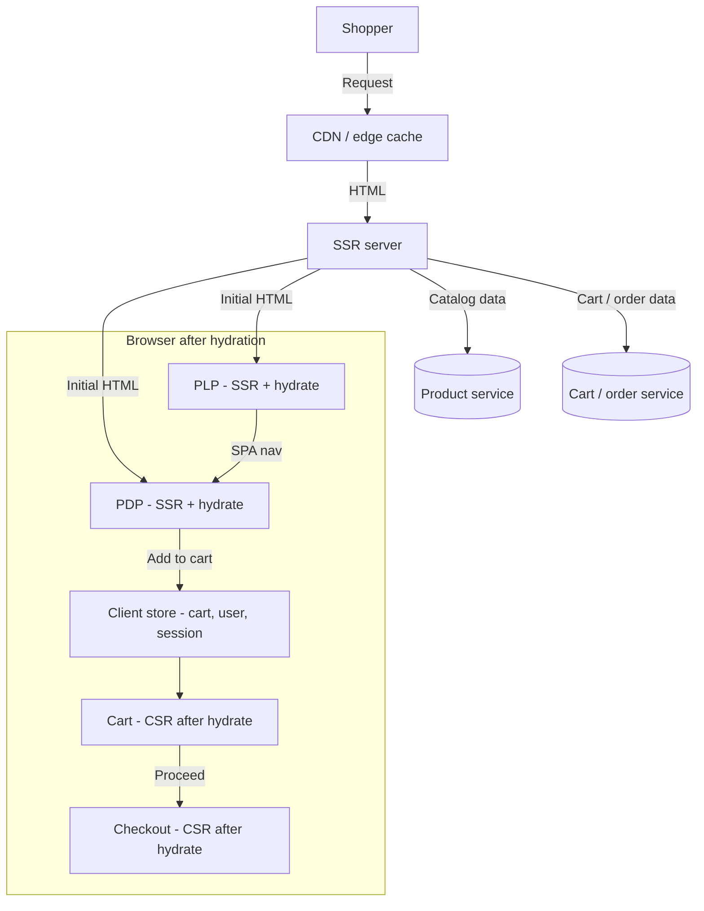
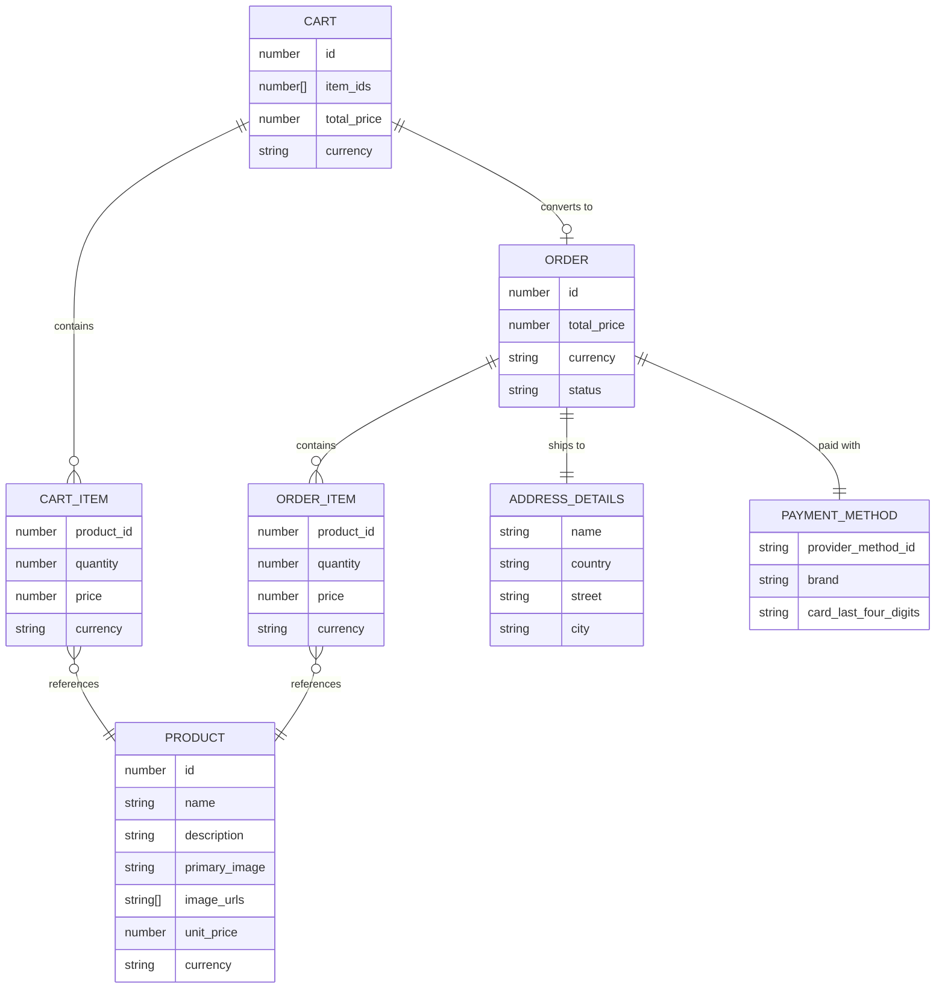
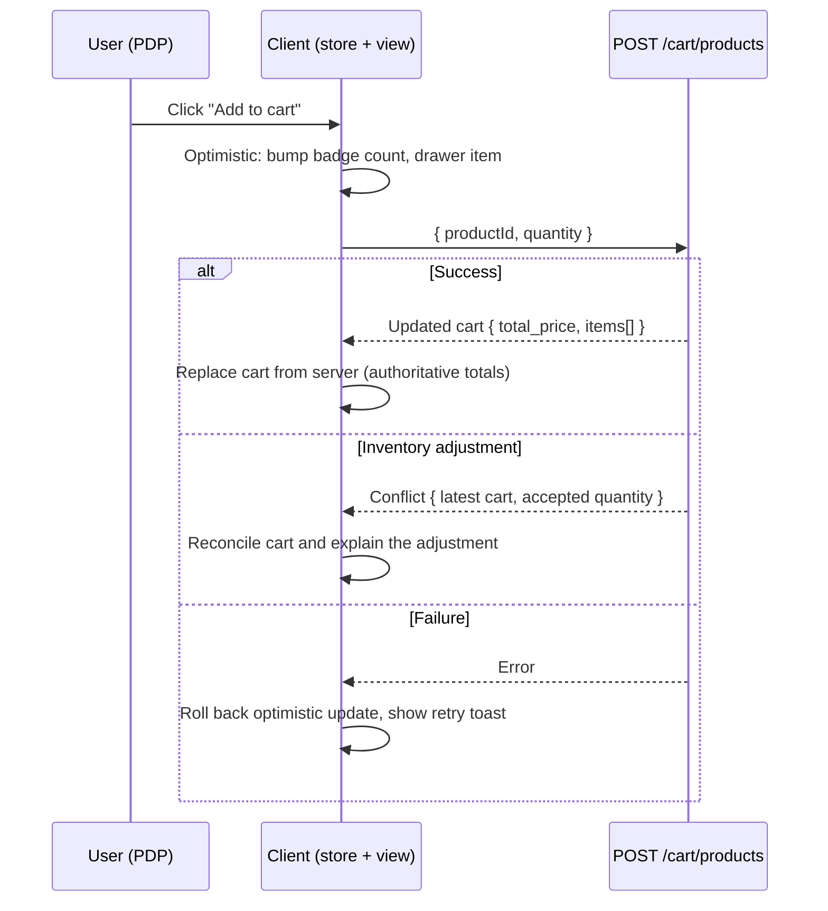
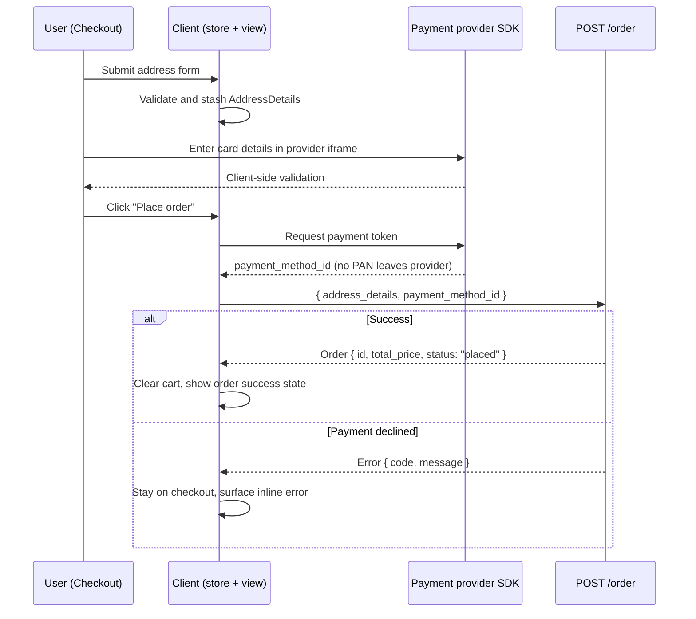
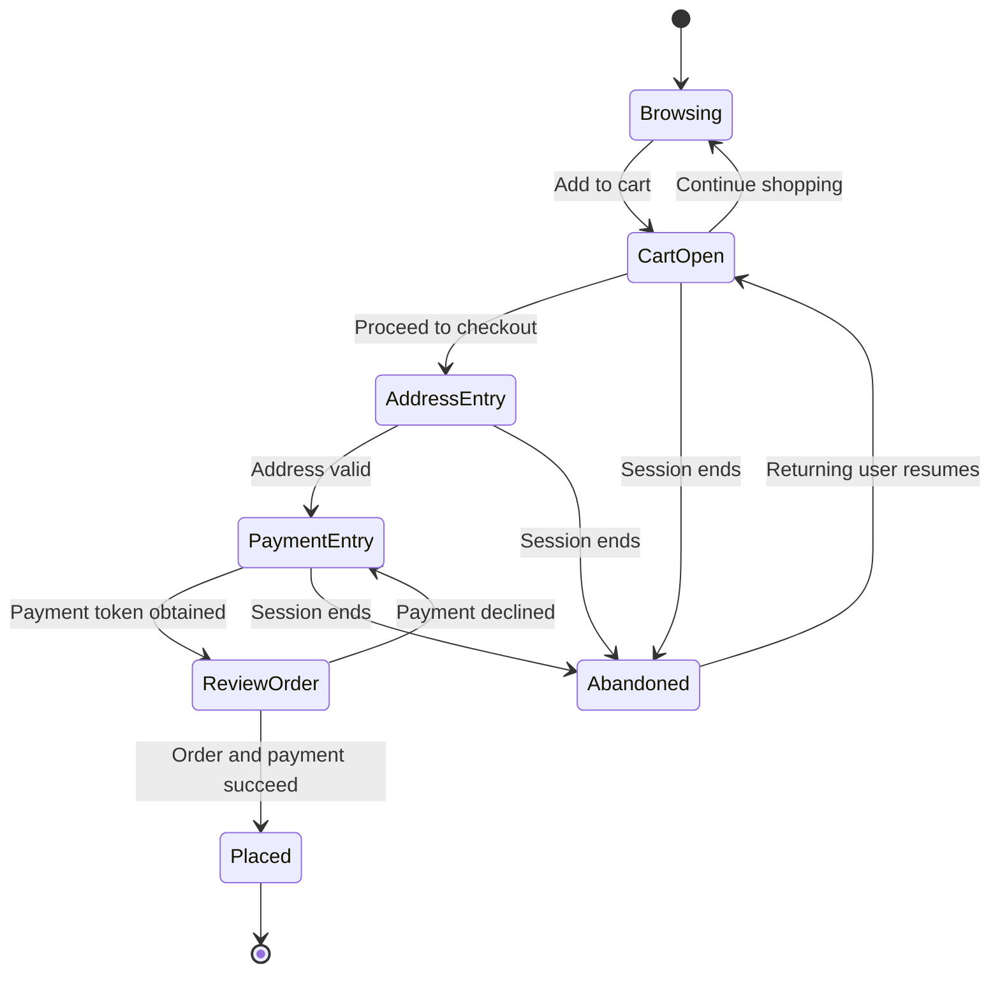

# E-commerce Marketplace (e.g. Amazon)

**Difficulty:** Medium · **Duration:** ~40 min · **Topics:** SEO, Forms

> Source: [e-commerce-amazon](https://www.greatfrontend.com/questions/system-design/e-commerce-amazon)

## Question

Design an e-commerce website that allows users to browse products and purchase them.


### Real-life examples

- [https://www.amazon.com](https://www.amazon.com)
- [https://www.ebay.com](https://www.ebay.com)
- [https://www.walmart.com](https://www.walmart.com)
- [https://www.flipkart.com](https://www.flipkart.com)

## Solution

### Requirements exploration

Before designing the storefront, we scope the exercise by clarifying which user journeys are in play, which devices to target, and which commerce concerns (payments, localization, accessibility) fall inside the interview.

#### What are the core features to be supported?

- Browsing products.
- Adding products to cart.
- Checking out successfully.

#### What are the pages in the website?

- Product listing page (PLP)
- Product details page (PDP)
- Cart page
- Checkout page

#### What product details will be shown on the PLPs and PDPs?

- PLPs: Product name, Product image, Price.
- PDPs: Product name, Product images (multiple), Product description, Price.

#### What do the user demographics look like?

International users of a wide age range: US, Asia, Europe, etc.

#### What are the non-functional requirements?

For key routes, target p75 LCP ≤ 2.5 seconds, INP ≤ 200 ms, and CLS ≤ 0.1, measured separately for mobile and desktop in important markets. Cart and checkout mutations should also have route-specific latency and error-rate targets.

#### What devices will the application be used on?

All possible devices: laptop, tablets, mobile, etc.

#### Do users have to be signed in to purchase?

Users can purchase as a guest without being signed in.

#### Check your understanding 1

A storefront design focuses on the customer journey from discovery through purchase. Which workflows and quality requirements belong in this initial scope? Select all that apply.

- [x] Define separate loading, responsiveness, layout-stability, and mutation-reliability targets for public catalog and checkout routes.
  > Route-specific targets make the public discovery and transactional paths measurable instead of treating performance as one vague site-wide goal.
- [x] Support international shoppers across desktop and mobile, including checkout without mandatory account creation.
  > Locale, viewport, and guest identity affect presentation and cart continuity without requiring account onboarding.
- [ ] Make seller catalog administration, fulfillment queues, and payout reporting part of the first-version storefront design.
  > Those are adjacent commerce systems with different users and workflows, not part of the customer journey being designed here.
- [ ] Treat personalized recommendation ranking and sponsored-product auctions as required parts of the baseline listing page.
  > Product discovery can later add those subsystems, but the stated listing-to-checkout flow does not depend on designing their internal ranking logic.
- [x] Cover product listing and detail pages, a shared cart, checkout, and the successful order result.
  > These routes form one end-to-end customer journey, so the design can trace shared state and mutations from discovery through purchase.

---

### Architecture / high-level design


The diagram connects the product, cart, and checkout pages to a controller and shared client store backed by server APIs. Its “Payment Details” label refers only to an opaque payment-method ID created by provider-hosted fields; raw card data never enters the controller or store.

#### Component responsibilities

- **Server**: Provides HTTP APIs to fetch product data and cart items, modify the cart, and create orders.
- **Controller**: Controls the flow of data within the application and makes network requests to the server.
- **Client Store**: Stores data needed across the whole application. Since there are many pages with some amount of overlapping data, a client store is useful for sharing data across sections of a page and across pages.
- **Pages**:
  - **Product List**: Displays a list of product items that can be added to the cart.
  - **Product Details**: Displays details of a single product along with additional details.
  - **Cart**: Displays added cart items and allows changing of quantity and deleting added items.
  - **Checkout**: Displays address and payment forms the user has to complete in order to place the order.

#### Server-side rendering or client-side rendering?

Firstly, let's understand what the two terms mean:

- **Server-side rendering (SSR)**: The traditional way of building websites where the server fetches all necessary data, uses it to create the final markup, and sends down the HTML needed every time a user visits a page. Most of the rendering work is done on the server.
- **Client-side rendering (CSR)**: The server sends down initial HTML which contains the JavaScript to bootstrap the application. The client then fetches the necessary data, combines it with templates, and creates the final page, all within the browser. CSR is typically used with Single-page Application models, and subsequent navigations don't require a full page refresh. Most of the rendering work is done on the client.

Possible benefits of SSR for public catalog routes:

- Product content can appear in the initial HTML without waiting for client JavaScript, although actual performance still depends on server latency, caching, and hydration cost.
- Reserving layout space in the initial HTML can reduce layout shift.
- SSR allows for personalization of pages (user-specific content) as opposed to static site generation. Personalization is an important factor for conversion as e-commerce platforms scale up.

Downsides of SSR:

- SSR can add server work and time to first byte, although navigation after hydration can still remain client-side.

SEO is important for public PLPs and PDPs, so SSR or pre-rendering is a strong default for those routes rather than a guarantee for every page.

> **Prefer SSR or pre-rendering for public PLPs and PDPs**
>
> Unlike a personalized feed, public catalog pages benefit from crawlable product content in the initial HTML. SSR and pre-rendering are both reasonable choices; select between them based on freshness, personalization, caching, and server cost.

#### Single-page application (SPA) or Multi-page application (MPA)?

SPA and MPA describe navigation, while CSR and SSR describe rendering, so the choices are not inherently coupled. Universal rendering (or SSR with hydration) renders the initial HTML on the server, after which rendering and navigation can become client-side.

Most universally rendered sites use popular UI frameworks (e.g. React, Vue, and Angular), and the page will need to be hydrated (add event handlers) after initial load. Hydration also brings about the [double data problem](https://web.dev/rendering-on-the-web/#a-rehydration-problem-one-app-for-the-price-of-two).

Which application architecture should be used? SPA and MPA are both viable; choose rendering per route based on crawlability, first-load performance, freshness, and interaction needs.

Real-world technologies to implement the following rendering and architecture choices:

|     | SSR                    | CSR                       |
| --- | ---------------------- | ------------------------- |
| SPA | Next.js, Remix, Nuxt   | Vite-based SPA            |
| MPA | Ruby on Rails, Django* | Less common, but possible |

- Refers to the default mode of server-side web frameworks, which render HTML, and routing is done on the server side.

#### What top e-commerce sites use

Let's take a look at e-commerce sites in the wild and their rendering choices:

|          | Architecture | Rendering | UI Framework                 |
| -------- | ------------ | --------- | ---------------------------- |
| Amazon   | MPA          | SSR       | In-house                     |
| eBay     | MPA          | SSR       | [Marko](https://markojs.com) |
| Walmart  | SPA          | SSR       | React                        |
| Flipkart | SPA          | SSR       | React                        |

**All the sites listed above use SSR.** Server-rendered product content supports initial loading and search-engine indexing.

The discussion below assumes that we'll be using a universal rendering approach of SSR + SPA. Concretely, this means the catalog surfaces (PLP, PDP) prioritize SSR for SEO and first paint, while interactive transactional surfaces (Cart, Checkout) lean more on the client after hydration.

**Page-type rendering strategy across the storefront**



#### Check your understanding 2

Which rendering architecture best supports crawlable public product pages while preserving an instant shared cart across client navigation?

- [ ] Use client-side rendering for every route, but emit product metadata from the server for crawlers.
  > Metadata alone does not make the product body and navigation available in the initial HTML, weakening discovery and making first content depend on JavaScript execution.
- [ ] Server-render every catalog, cart, and checkout transition and discard the hydrated client store on each navigation.
  > Public pages remain crawlable, but replacing the client on every transactional step loses the responsive shared cart and account state the scenario calls for.
- [ ] Statically generate every catalog and checkout route at build time, refreshing the deployment whenever product data changes.
  > Static catalog pages can work for durable content, but build-time checkout cannot safely represent per-user carts, current inventory, or canonical totals.
- [x] Server-render public listing and product pages, then hydrate interactive features while keeping cart and account flows client-rich.
  > Public routes arrive with crawlable content and a fast first view, while hydration still enables rich cart and account interactions where they are needed.

---

### Data model

There are quite a number of entities involved in an e-commerce website due to the complexity of the user flow spanning multiple pages.

| Entity           | Source              | Belongs To                                 | Fields                                                                                                         |
| ---------------- | ------------------- | ------------------------------------------ | -------------------------------------------------------------------------------------------------------------- |
| `ProductList`    | Server              | Product Listing Page                       | `products` (list of `Product`s), `pagination` (pagination metadata)                                            |
| `Product`        | Server              | Product Listing Page, Product Details Page | `id`, `name`, `description`, `unit_price`, `currency`, `primary_image`, `image_urls`                           |
| `Cart`           | Server              | Client Store                               | `items` (list of `CartItem`s), `total_price`, `currency`                                                       |
| `CartItem`       | Server              | Client Store                               | `quantity`, `product`, `price` (line total), `currency`                                                        |
| `AddressDetails` | User input (Client) | Checkout Page                              | `name`, `country`, `street`, `city`, etc.                                                                      |
| `PaymentMethod`  | Payment provider    | Checkout Page                              | Opaque provider method/session ID plus non-sensitive display metadata such as brand and last four digits       |
| `Order`          | Server              | Checkout success state                     | `id`, `items` (list of `OrderItem`s), `total_price`, `currency`, `status`, `address_details`, `payment_method` |
| `OrderItem`      | Server              | `Order`                                    | `product_id`, `quantity`, `price` (line total), `currency`                                                     |

Few points for discussion:

- The `Cart` entity belongs to the Client Store because some websites might want to show the number of cart items in the navbar or have a popup that allows users to quickly access the cart items and make modifications. If there's no such need, then it's acceptable for the cart to belong to the Cart page.
- `Cart` and `CartItem` have `total_price` and `price` fields respectively fetched as part of the server response, instead of having the client compute the price (multiply the quantity by the `unit_price`), to give the flexibility of applying discounts due to bulk purchases or use of promo codes. The price computation logic is defined on the server, so the final price should be computed on the server, and the client should rely on the server to calculate the total price instead of making its own calculations.
- Since our website has an international audience, we should have localized prices in the user's currency, hence the `currency` field.

The examples use decimal prices for readability; a production API should document an exact money representation such as `{ amountMinor, currency }` or a decimal string.

The diagram below summarizes how these entities relate once the shopper moves from browsing a product to placing an order. Both `CartItem` and `OrderItem` reference `Product`, while `AddressDetails` and a tokenized `PaymentMethod` are attached to the order record.

**Core e-commerce entities and their relationships**



For simplicity, each product maps to one cart line. If the interviewer expands into marketplace behavior, discuss variants, seller offers, fulfillment choices, and immutable order-line snapshots.

> **Treat the server as the source of truth for cart totals and prices**
>
> Client-side multiplication of `quantity` times `unit_price` silently breaks once bulk discounts, promo codes, tax, or regional pricing enter the picture. Always render the `price` and `total_price` returned by the server and reconcile from the cart returned by each mutation.

#### Check your understanding 3

How should a storefront organize shared cart data, pricing values, editable checkout input, and completed orders? Select all that apply.

- [x] Keep the current cart in shared client state when the navbar, drawer, and cart page all consume it.
  > One shared cart lets the navbar, drawer, and cart page show the same server-reconciled items and badge count.
- [ ] Persist the formatted price shown on the product card and use it to calculate the eventual cart total.
  > A display string loses currency and pricing semantics and may be stale after promotions, tax, or inventory changes. The server must return canonical totals.
- [ ] Create the order entity when the browser reaches the confirmation route, before the order service responds.
  > Navigation is presentation state and cannot prove that inventory, pricing, and payment produced an order.
- [x] Represent each cart line with product identity, quantity, currency, and a server-returned line price.
  > Explicit line identities and quantities let mutations target the intended item and allow the UI to reconcile the server's accepted cart.
- [x] Keep editable address input separate from the server-created order returned after checkout succeeds.
  > A local checkout draft supports correction, while only the server order represents a completed purchase.

### Interface definition (API)

We need the following HTTP APIs:

1. Product Information

- Fetch products listing
- Fetch a particular product's detail

2. Cart Modification

- Fetch the current cart
- Add a product to the cart
- Change quantity of a product in the cart
- Remove a product from the cart

3. Complete the order

We will omit discussion of the APIs between the client components because the data format and functionalities are similar to the HTTP APIs.

The server owns the cart identity. `GET /cart` resolves a signed-in shopper from the account and a guest from an opaque, high-entropy token stored in a `Secure`, `HttpOnly`, appropriately `SameSite` cookie. Cart and order APIs operate on that resolved server cart rather than trusting a browser-supplied cart ID.

#### Fetch products listing

| Field       | Value                       |
| ----------- | --------------------------- |
| HTTP Method | `GET`                       |
| Path        | `/products`                 |
| Description | Fetches a list of products. |

##### Parameters

| Parameter | Type   | Description                                                                          |
| --------- | ------ | ------------------------------------------------------------------------------------ |
| `size`    | number | Number of results per page                                                           |
| `page`    | number | Page number to fetch                                                                 |
| `country` | string | Market or shipping-country hint; the server returns the canonical price and currency |

##### Sample response

```jsonc
{
  "pagination": {
    "size": 5,
    "page": 2,
    "total_pages": 4,
    "total": 20,
  },
  "products": [
    {
      "id": 123, // Product ID.
      "name": "Cotton T-shirt",
      "primary_image": "https://www.greatcdn.com/img/t-shirt.jpg",
      "unit_price": 12,
      "currency": "USD",
    },
    // ... More products.
  ],
}
```

We use offset-based pagination here as opposed to cursor-based pagination because:

1. Having page numbers is useful for navigating between search results and jumping to specific pages.
2. Use a stable ordering because ranking, price, or availability changes can otherwise shift products between pages.
3. It's useful to know how many total results there are.

For a more in-depth comparison between offset-based pagination and cursor-based pagination, refer to the [News Feed system design article](https://www.greatfrontend.com/questions/system-design/news-feed-facebook).

#### Fetch product details

| Field       | Value                             |
| ----------- | --------------------------------- |
| HTTP Method | `GET`                             |
| Path        | `/products/{productId}`           |
| Description | Fetches the details of a product. |

##### Parameters

| Parameter   | Type   | Description                                                                          |
| ----------- | ------ | ------------------------------------------------------------------------------------ |
| `productId` | number | ID of product to be fetched                                                          |
| `country`   | string | Market or shipping-country hint; the server returns the canonical price and currency |

##### Sample response

```jsonc
{
  "id": 123, // Product ID.
  "name": "Cotton T-shirt",
  "description": "A lightweight cotton T-shirt.",
  "primary_image": "https://www.greatcdn.com/img/t-shirt.jpg",
  "image_urls": [
    "https://www.greatcdn.com/img/t-shirt.jpg",
    "https://www.greatcdn.com/img/t-shirt-black.jpg",
    "https://www.greatcdn.com/img/t-shirt-red.jpg",
  ],
  "unit_price": 12,
  "currency": "USD",
}
```

#### Add a product to cart

| Field       | Value                     |
| ----------- | ------------------------- |
| HTTP Method | `POST`                    |
| Path        | `/cart/products`          |
| Description | Add a product to the cart |

##### Parameters

| Parameter   | Type   | Description                 |
| ----------- | ------ | --------------------------- |
| `productId` | number | ID of product to be added   |
| `quantity`  | number | Number of items to be added |

##### Sample response

The updated cart object is returned.

```jsonc
{
  "id": 789, // Cart ID.
  "total_price": 24,
  "currency": "USD",
  "items": [
    {
      "quantity": 2,
      "price": 24,
      "currency": "USD",
      "product": {
        "id": 123, // Product ID.
        "name": "Cotton T-shirt",
        "primary_image": "https://www.greatcdn.com/img/t-shirt.jpg",
      },
    },
  ],
}
```

On the client, add-to-cart benefits from an optimistic update so the cart badge and drawer feel instant, but the server still owns the authoritative totals once discounts and tax kick in. The flow below shows the client applying a temporary update, hitting `POST /cart/products`, and then reconciling against the canonical cart returned by the server.

**Add-to-cart flow with optimistic update and server reconciliation**



#### Change quantity of product in cart

| Field       | Value                                    |
| ----------- | ---------------------------------------- |
| HTTP Method | `PUT`                                    |
| Path        | `/cart/products/{productId}`             |
| Description | Change quantity of a product in the cart |

##### Parameters

| Parameter   | Type   | Description                  |
| ----------- | ------ | ---------------------------- |
| `productId` | number | ID of product to be modified |
| `quantity`  | number | New quantity of the product  |

##### Sample response

The updated cart object is returned.

```jsonc
{
  "id": 789, // Cart ID.
  "total_price": 36,
  "currency": "USD",
  "items": [
    {
      "quantity": 3,
      "price": 36,
      "currency": "USD",
      "product": {
        "id": 123, // Product ID.
        "name": "Cotton T-shirt",
        "primary_image": "https://www.greatcdn.com/img/t-shirt.jpg",
      },
    },
  ],
}
```

#### Remove product from cart

| Field       | Value                          |
| ----------- | ------------------------------ |
| HTTP Method | `DELETE`                       |
| Path        | `/cart/products/{productId}`   |
| Description | Remove a product from the cart |

##### Parameters

| Parameter   | Type   | Description                 |
| ----------- | ------ | --------------------------- |
| `productId` | number | ID of product to be removed |

##### Sample response

The updated cart object is returned.

```jsonc
{
  "id": 789, // Cart ID.
  "total_price": 0,
  "currency": "USD",
  "items": [],
}
```

#### Place order

| Field       | Value                       |
| ----------- | --------------------------- |
| HTTP Method | `POST`                      |
| Path        | `/order`                    |
| Description | Create an order from a cart |

##### Parameters

| Parameter           | Type   | Description                                                 |
| ------------------- | ------ | ----------------------------------------------------------- |
| `address_details`   | object | Object containing address fields                            |
| `payment_method_id` | string | Opaque identifier created by provider-hosted payment fields |

##### Sample response

The order object is returned upon successful order creation.

```jsonc
{
  "id": 456, // Order ID.
  "total_price": 36,
  "currency": "USD",
  "items": [
    // ... Same items as per the cart.
  ],
  "address_details": {
    "name": "John Doe",
    "country": "US",
    "address": "1600 Market Street",
    "city": "San Francisco",
    // ... Other address fields.
  },
  "status": "placed",
  "payment_method": {
    "brand": "visa",
    "card_last_four_digits": "1234",
  },
}
```

> **Never let raw card numbers touch your servers or client storage**
>
> Accepting full PANs through your own `POST /order` endpoint drags the application into PCI DSS scope and makes an XSS or log leak catastrophic. Collect card data in provider-hosted fields and send only the resulting opaque payment method ID; the application API, state, analytics, and logs should never receive a PAN or CVC. This reduces but does not eliminate the merchant's PCI and payment-page security responsibilities.

Concretely, the checkout page hosts the address form directly but embeds the payment fields inside the provider's iframe-backed SDK. The sequence below captures how the client collects an address, exchanges card fields for a payment token with the provider, and then sends only that token to `POST /order`.

**Checkout and place-order flow with tokenized payment**



The order endpoint recalculates price and inventory on the server. This answer assumes sequential cart updates and an immediate payment result. If the interviewer asks about reliability, discuss idempotency keys, cart versions, overlapping mutations, asynchronous payment states, authenticated provider webhooks, and compensation.

#### Notes

- To help returning users resume checkout, save safe address progress. If the interviewer asks about saved payment methods, discuss explicit consent and a customer-bound provider setup; never persist raw card fields in the cart.

The state machine below names the checkout steps explicitly so the UI and the persisted cart can share the same vocabulary. Each transition is driven by a user action or a server response, and any terminal state (placed, abandoned) is a useful analytics boundary for funnel instrumentation.

**Checkout and order lifecycle states**



#### Check your understanding 4

The same cart APIs serve signed-in shoppers and guests. Which identity choices prevent one browser from selecting another shopper's cart? Select all that apply.

- [x] Resolve a signed-in shopper's cart from the authenticated account on each request.
  > Server-established identity binds cart authorization to the current session instead of a caller-controlled identifier.
- [x] Resolve a guest cart from a high-entropy opaque token stored in a `Secure`, `HttpOnly`, appropriately `SameSite` cookie.
  > An unguessable server-issued handle supports guest continuity while cookie controls reduce script and cross-site exposure.
- [ ] Put the guest-cart token in every cart URL so the browser can restore it after navigation.
  > URL credentials can leak through history, logs, referrers, and copied links, allowing another party to reuse the cart session.
- [ ] Accept a cart ID from application state and authorize the request when the ID has the expected format.
  > A well-formed identifier does not prove ownership and can be changed to target another cart.

#### Check your understanding 5

A product listing needs numbered pages, direct jumps to page 12, and an approximate total result count. Which pagination contract best fits that experience?

- [x] Use page and size parameters with a deterministic sort and unique tie-breaker, returning page and total metadata.
  > Offset pagination supplies page navigation while stable ordering limits drift between adjacent requests.
- [ ] Download all matching product IDs once and paginate them entirely in the browser.
  > Large catalogs make full-result transfer and client storage unbounded, and the snapshot still becomes stale as products change.
- [ ] Use page and size parameters while allowing ties to be returned in any order on each request.
  > Without deterministic ordering, tied products can move between pages and appear twice or be skipped.
- [ ] Return only an opaque next cursor and remove page numbers from the interface.
  > Cursors provide continuation but do not naturally support direct jumps to arbitrary numbered pages.

#### Check your understanding 6

A shopper optimistically requests three units, but the server accepts only two and applies a promotion. Which cart mutation contract lets the client converge on what can actually be purchased?

- [ ] Return an empty success response and keep the optimistic quantity and total already shown by the client.
  > A successful request does not reveal the accepted quantity or promotion, so the displayed cart can remain inconsistent with purchasable state.
- [ ] Return a localized total string and ask the browser to infer each line's accepted price from it.
  > A display string cannot reveal the structured currency and line values needed to reconcile the cart.
- [x] Return the updated cart with the accepted quantity and server-calculated line and total prices.
  > The response supplies the authoritative values needed to replace the optimistic projection after inventory and promotion rules run.
- [ ] Return only the requested quantity and let the browser keep its previous prices and promotion state.
  > The accepted quantity alone cannot update the promotion-adjusted line price or cart total.

#### Check your understanding 7

A cart quantity updates optimistically, but the server reports that only one item remains. What should the UI do?

- [ ] Roll back the entire cart to the snapshot from before the quantity edit to guarantee consistency.
  > A conflict on one line does not invalidate unrelated accepted state. Replacing the whole cart can discard valid concurrent changes.
- [ ] Keep the requested quantity but show a warning, allowing checkout to resolve the final availability later.
  > Leaving a known-unavailable quantity in the cart makes totals misleading and postpones a recoverable conflict until a more expensive step.
- [x] Replace the cart with the server-returned quantity and totals, then explain the inventory adjustment near the affected line.
  > The UI converges on the server-owned purchasable cart while making the adjustment understandable where it occurred.

#### Check your understanding 8

A shopper enters an address, obtains a payment token, reviews the order, receives a decline, and later retries. Which checkout transitions match the server-owned lifecycle? Select all that apply.

- [x] Treat order review as an editable pre-submission state rather than an already placed order.
  > Reviewing structured address and payment input does not establish an order before the service accepts it.
- [ ] Navigate to order success as soon as the payment provider returns an opaque payment-method ID.
  > Tokenization creates a payment input, not an accepted order or successful charge.
- [x] Enter the placed state only after the order service returns a canonical order ID and status.
  > The server response is the commitment boundary that the confirmation page can represent truthfully.
- [ ] Discard the address, cart, and all safe checkout progress after a payment decline.
  > A declined payment does not invalidate unrelated cart or address data and forcing re-entry increases abandonment.
- [x] Return a declined attempt to payment entry with the error attached, preserving unaffected state for correction and retry.
  > Localizing recovery to the failed step keeps the lifecycle accurate without throwing away still-valid shopper input.

---

### Optimizations and deep dive

With the core flows in place, this section dives into production concerns that directly affect discovery, conversion, checkout reliability, and customer trust:

- [Performance](#performance): This section explains why page speed matters for commerce and how to prioritize loading work across the shopping flow.
- [Search engine optimization](#search-engine-optimization): This section covers crawlable product pages, metadata, structured data, and search discovery for product listings.
- [Images](#images): This section discusses responsive product images, modern formats, lazy loading, CDN delivery, and layout stability.
- [Form optimizations](#form-optimizations): This section covers checkout form ergonomics, validation, autofill, payment flow, and reducing user friction.
- [Internationalization (i18n)](#internationalization-i18n): This section discusses translations, currencies, addresses, dates, and locale-specific commerce expectations.
- [Accessibility](#accessibility): This section covers semantic HTML, forms, buttons, images, and keyboard support across shopping and checkout pages.
- [Security](#security): This section explains client-facing security concerns around authentication, payment data, transport, and third-party scripts.
- [User experience](#user-experience): This section covers checkout focus, cart behavior, error recovery, and other details that reduce abandonment.

#### Performance

Loading performance can affect e-commerce conversion rates and revenue. A [study by Google and Deloitte](https://web.dev/milliseconds-make-millions/) showed that even a 0.1-second improvement in load times can improve conversion rates across the purchase funnel. [web.dev by Google has a long list of case studies of how improving site performance led to improved conversions](https://web.dev/tags/case-study/).

##### General performance tips

- Code split JavaScript by routes/pages.
- Split content into separate sections and prioritize above-the-fold content while lazy loading below-the-fold content.
- Defer loading of non-critical JavaScript (e.g. code needed to show modals, dialogs, etc.).
- Prefetch JavaScript and data needed for the next page upon hovering over or focusing links/buttons.
  - Prefetch product details when users hover over or focus items in PLPs.
  - Prefetch checkout page while on the cart page.
- Optimize images with lazy loading and adaptive loading.
- Consider prefetching top search results after measuring whether the transferred data is usually used.

For a deeper caching discussion, separate public catalog responses from private cart and checkout data, then define cache keys, freshness, and invalidation by market and currency.

##### Core Web Vitals

Know the various Core Web Vital metrics, what they are, and how to improve them.

Measure these targets with real-user monitoring by route, device class, market, and release; use synthetic checks only as regression guards.

- [Largest Contentful Paint (LCP)](https://web.dev/lcp/): The render time of the largest image or text block visible within the viewport, relative to when the page first started loading.
  - Optimize performance – loading of JavaScript, CSS, images, fonts, etc.
- [Interaction to Next Paint (INP)](https://web.dev/articles/inp): Measures overall interaction responsiveness using the longest observed interaction latency while ignoring defined outliers. INP replaced First Input Delay (FID) as a Core Web Vital on March 12, 2024; FID is no longer measured by Chrome's web-vitals reporting.
  - Reduce the amount of JavaScript executed on page load and break up long tasks so input handlers stay responsive throughout the session, not just on the first interaction.
- [Cumulative Layout Shift (CLS)](https://web.dev/cls/): Measures visual stability by quantifying unexpected layout shifts. A low CLS indicates more stable page content.
  - Include size attributes on images and video elements or reserve space for these elements using CSS [`aspect-ratio`](https://developer.mozilla.org/docs/Web/CSS/aspect-ratio) to reserve the required space for images while the images are loading. Use CSS [`min-height`](https://developer.mozilla.org/docs/Web/CSS/min-height) to minimize layout shifts while elements are lazy loaded.

#### Check your understanding 9

A product page has a strong server response time but poor LCP and INP on mid-range phones. Which changes and measurements help improve product rendering and interaction latency? Select all that apply.

- [x] Load route-critical catalog and cart code first and defer reviews, recommendations, and secondary widgets.
  > Deferring nonessential widgets reduces the JavaScript that competes with product rendering and add-to-cart interactions.
- [ ] Prefetch full product records for every item linked from the current category so later navigation is instant.
  > Eagerly transferring an entire category consumes bandwidth and memory for products most visitors will never open. Prefetching should follow likely intent and remain bounded.
- [x] Track LCP, INP, and CLS by route, device, and release.
  > Route- and device-level field data reveals whether releases improve the actual discovery and conversion paths rather than only synthetic lab runs.
- [x] Cache reusable public responses with explicit freshness and invalidation rules.
  > Reusing public catalog responses reduces latency, provided invalidation prevents stale price or availability claims from lingering indefinitely.
- [ ] Hydrate recommendations, reviews, experimentation, and marketing widgets before enabling the product controls so the page becomes interactive all at once.
  > Coordinating a single interactive moment lets secondary code delay the product controls and increases main-thread contention on slower devices.

#### Search engine optimization

SEO is extremely important for e-commerce websites as organic search is the primary way people discover products.

- PDPs should have useful `<title>` and description metadata plus [open graph tags](https://ahrefs.com/blog/open-graph-meta-tags/). Do not rely on the ignored `keywords` meta tag.
- Generate a `sitemap.xml` to tell crawlers the available pages of the website.
- Use [JSON structured data](https://web.dev/structured-data/) to help search engines understand the kind of content on your page. For the e-commerce case, the [`Product` type](https://developers.google.com/search/docs/appearance/structured-data/product) would be the most relevant.
- Use real links for category and product navigation, stable canonical URLs, and meaningful success or not-found status codes.
- Use semantic markup for elements on the page, which also helps accessibility.
- Keep pages fast for users; good Core Web Vitals can contribute to page experience but do not guarantee rankings.
- Prefer SSR or pre-rendering for durable public catalog content so it remains fast and crawlable without depending on client JavaScript.
- Pre-generate only curated, durable pages for popular searches or lists rather than indexing every filter combination.

> **Emit accurate `Product` JSON-LD on eligible PDPs**
>
> Valid `schema.org/Product` data can make a page eligible for product search features but does not guarantee their display or ranking. Keep `price`, `priceCurrency`, and `availability` synchronized with the visible, current product data.

The [Travel Booking (Airbnb) system design article](https://www.greatfrontend.com/questions/system-design/travel-booking-airbnb) goes into more details about SEO.

#### Check your understanding 10

Which choices help search engines understand product and listing pages? Select all that apply.

- [ ] Load primary product descriptions and offer data only after the shopper expands each section.
  > Hiding primary content behind interaction makes important product information less reliably discoverable and leaves the initial document incomplete.
- [x] Return meaningful product names, descriptions, prices, and links in the initial HTML.
  > Initial HTML gives crawlers and users the primary product information without requiring a successful client-side render.
- [x] Use real links for crawlable category and product navigation.
  > Anchor destinations expose the category and product graph to crawlers while preserving normal browser navigation behavior.
- [ ] Give every sort, filter, and pagination permutation a self-referencing canonical URL.
  > Unbounded near-duplicate URLs dilute crawl effort and ranking signals. Only curated, durable listing pages should be independently canonicalized.
- [x] Provide unique titles, descriptions, canonical URLs, and appropriate structured data.
  > Route-specific metadata and synchronized structured data help search engines identify the canonical product and understand its current offer.

#### Images

Images are one of the largest contributors to page size, and image-heavy e-commerce websites need optimized delivery for product images.

- Serve appropriately compressed modern formats such as AVIF or WebP, with a compatible fallback where required.
- Use `srcset` and `sizes` so the browser selects an image appropriate for the rendered slot.
- Images should be hosted on a CDN.
- Define the priority of the images and divide them into critical and non-critical assets.
- Lazy load below-the-fold images.
  - Use `` for non-critical images.
- Load critical images early.
  - Give the LCP image high priority and preload it only when normal HTML discovery is too late; do not inline large product images into the HTML.
- [Adaptive loading](https://web.dev/adaptive-loading-cds-2019/) of images, loading high-quality images for devices on fast networks and using lower-quality images for devices on slow networks.

#### Check your understanding 11

Which image policies improve product-page speed and visual stability? Select all that apply.

- [x] Prioritize the likely LCP product image while lazy-loading offscreen gallery media.
  > The hero can arrive early enough to improve LCP while gallery images avoid competing for bandwidth before they are likely to be viewed.
- [x] Declare dimensions or aspect ratios before image bytes arrive.
  > Reserving the final geometry prevents surrounding product information and controls from shifting as images decode.
- [ ] Eagerly preload the full-resolution gallery after the hero request so later thumbnail selections feel instant.
  > The speculative downloads compete with the hero and critical page resources, especially on constrained networks, for a benefit many users never use.
- [ ] Use the product name as the alternative text for every image in the gallery to keep descriptions consistent.
  > Repeating one label hides meaningful differences such as color or viewing angle. Each informative image needs purpose-specific text, while truly decorative duplicates should use empty text.
- [x] Provide modern responsive sources sized for the rendered slot.
  > The browser can choose an efficient source for the actual slot instead of downloading desktop-sized assets on every device.

#### Form optimizations

Completing forms is a substantial part of checkout. Clear inputs, validation, and recovery can help shoppers finish this final step of the purchase process.

Completing forms is especially painful on mobile devices, and extra attention has to be given to optimize forms for mobile. There are two kinds of forms to fill out during checkout: the shipping address form and the credit card form.

##### Country-specific address forms

Different countries have different address formats. To optimize for global shipping, having localized address forms helps greatly in improving conversions and ensures that users do not drop off when filling out the address forms because they do not understand certain fields. For example:

- "ZIP Code"s are called "Postal Code"s in the United Kingdom.
- There are no states in Japan, only prefectures.
- Different countries have their own postal/zip code formats and require different validation.

It is a hassle to have to find out this country-specific knowledge and build these forms yourself. This is where services like [Stripe Checkout](https://docs.stripe.com/payments/checkout) come in handy by providing a localized checkout form. Users will complete the rest of the payment flow on Stripe's platform.

**Examples of Stripe checkout forms for different countries**

| US                                                                                                                | UK                                                                                                                |
| ----------------------------------------------------------------------------------------------------------------- | ----------------------------------------------------------------------------------------------------------------- |
|  |  |

_Further reading: [Frank's Compulsive Guide to Postal Addresses](http://www.columbia.edu/~fdc/postal/) provides useful links and extensive guidance for address formats in over 200 countries._

##### Optimize autofilling

Filling up forms, especially long ones, is prone to typos. Most modern browsers have a feature called autofill, which helps users enter data faster and avoid filling up the same form data again by using values from similar forms filled previously.

Help users autofill their address forms by specifying the right `type` and `autocomplete` values for the form `<input>`s for the shipping address forms and credit card forms.

**Shipping Address Form**

| Field          | `type`         | `autocomplete`            | Others                                                                    |
| -------------- | -------------- | ------------------------- | ------------------------------------------------------------------------- |
| Name           | `text`         | `shipping name`           | `autocorrect="off"` `spellcheck="false"`                                  |
| Country        | Use `<select>` | `shipping country`        | N/A                                                                       |
| Address line 1 | `text`         | `shipping address-line1`  | `autocorrect="off"` `spellcheck="false"`                                  |
| Address line 2 | `text`         | `shipping address-line2`  | `autocorrect="off"` `spellcheck="false"`                                  |
| City           | `text`         | `shipping address-level2` | `autocorrect="off"` `spellcheck="false"`                                  |
| State          | Use `<select>` | `shipping address-level1` | N/A                                                                       |
| Postal Code    | `text`         | `shipping postal-code`    | `autocorrect="off"` `spellcheck="false"` and country-specific `inputmode` |

**Credit Card Form**

| Field       | `type` | `autocomplete` | Others                                                         |
| ----------- | ------ | -------------- | -------------------------------------------------------------- |
| Card Number | `text` | `cc-number`    | `autocorrect="off"` `spellcheck="false"` `inputmode="numeric"` |
| Card Expiry | `text` | `cc-exp`       | `autocorrect="off"` `spellcheck="false"` `inputmode="numeric"` |
| Card CVC    | `text` | `cc-csc`       | `autocorrect="off"` `spellcheck="false"` `inputmode="numeric"` |

**Notes**

- Postal codes are not universally numeric. Use `inputmode="numeric"` only after the selected country establishes a digits-only format; otherwise keep a text keyboard and validate against that country's rules.
- `inputmode="numeric"` provides a hint to browsers for devices with onscreen keyboards to help them decide which keyboard to display. Unlike `<input type="number">`, `inputmode="numeric"` does not prevent users from typing non-numeric values; it simply affects the keyboard being shown. For numeric card fields, `<input type="text" inputmode="numeric">` avoids quantity chevrons and still works with the `maxlength`/`minlength`/`pattern` attributes, which do not work with `<input type="number">`.

Read more about forms:

- [Autofilling | web.dev](https://web.dev/learn/forms/autofill/)
- [Autofill on Browsers: A Deep Dive | eBay Engineering Blog](https://tech.ebayinc.com/engineering/autofill-deep-dive/).

##### Alternative ways of address input

Instead of making users fill up a form containing granular address fields, there are other approaches that may be easier, at the cost of engineering complexity or reliance on external services:

1. **Address search/autocomplete**: Allow users to search for an address by typing in their street number and selecting from a list of suggestions. This reduces typos and is generally faster. However, users should still be given the option to override some values in case none of the suggestions are correct, which can happen due to an outdated address database. The Google Maps JavaScript API provides this via the [Place Autocomplete library](https://developers.google.com/maps/documentation/javascript/place-autocomplete).
2. **Selecting address location from a map**: Open up a map and allow users to pinpoint a location on the map. This is less common for checkout addresses and more common for ride-hailing applications.

##### Error messages

Leverage client-side validation and clearly communicate any form errors. Keep the associated live region empty initially; after validation fails, set `aria-invalid="true"` on the input and insert the message. Use a polite announcement by default and reserve assertive interruptions for urgent errors.

The example below shows the resulting state after validation has failed.

```html
<form>
  <div>
    <label for="name">Name</label>
    <input
      required
      type="text"
      id="name"
      name="name"
      aria-invalid="true"
      aria-describedby="name-error-message"
    />
    <span id="name-error-message" aria-live="polite" class="name-error-message">
      Enter the name to use for this order.
    </span>
  </div>
  <button>Submit</button>
</form>
```

_Source: [Help users find the error message for a form control | web.dev](https://web.dev/learn/forms/accessibility/#help-users-find-the-error-message-for-a-form-control)_

##### Focus states

Make the currently focused form control visually different from the other form inputs to help users identify which element is focused.

##### Best practices for payment and address forms

Read more about building good [Payment forms](https://web.dev/learn/forms/payment/), [Address forms](https://web.dev/learn/forms/address/), and [general form best practices](https://web.dev/payment-and-address-form-best-practices/) on web.dev.

#### Check your understanding 12

How should checkout forms support autofill, validate inputs, and recover from submission failures without making shoppers repeat safe input? Select all that apply.

- [x] Retain safe form progress across navigation or recoverable submission failures.
  > Preserving non-sensitive progress prevents a transient server or navigation failure from forcing the shopper to repeat the checkout.
- [ ] Disable browser autofill so previously entered address data cannot overwrite the form's controlled state.
  > Controlled state should integrate with native input events. Removing autofill adds friction and disproportionately harms users who rely on browser assistance.
- [x] Use correct names, input types, and autocomplete tokens for address and payment fields.
  > Semantic fields let keyboards, autofill, and assistive technology provide the right behavior without custom inference.
- [x] Validate fields without blocking typing and connect errors to the affected controls.
  > Timely, associated errors help shoppers correct the affected value without interrupting input or searching for what failed.
- [ ] Reset the form after a failed submission so the user cannot accidentally retry stale values.
  > Most failures do not invalidate every field. Retaining safe values and identifying what must change offers recovery without duplicate work.

#### Internationalization (i18n)

- Have pages translated into the supported languages.
  - Set the `lang` attribute on the `html` tag (e.g. `<html lang="zh-cn">`) to tell browsers and search engines the language of the page, which helps browsers offer a translation of the page.
  - Provide support for RTL languages by using [CSS Logical Properties](https://web.dev/learn/css/logical-properties/).
- Forms
  - Use a single form field for names.
  - Allow for various address formats. This is covered in the section above on address forms.

Read more:

- [Internationalization and localization | Forms | web.dev](https://web.dev/learn/forms/internationalization/)
- [Internationalization | Design | web.dev](https://web.dev/learn/design/internationalization/)

#### Check your understanding 13

Which responsibilities belong in an international commerce front end? Select all that apply.

- [x] Format server-provided amounts with the intended currency and locale.
  > Locale-aware formatting presents the server's exact monetary value correctly without inventing a new exchange rate in the browser.
- [x] Allow address fields, ordering, and validation to vary by country.
  > Address structure is country-dependent, so a single fixed field order and validation rule will reject legitimate customers.
- [ ] Convert prices in the browser with a bundled exchange-rate table, then submit that amount at checkout.
  > Client-shipped rates become stale and are not an authoritative charge amount. The server must price the order in the selected market and currency.
- [x] Support RTL and text expansion with logical properties and flexible controls.
  > Logical layout and flexible sizing allow the same controls to accommodate writing direction and longer translations.
- [ ] Concatenate translated fragments around localized dates, numbers, and plural words.
  > Word order and plural rules vary by language, so translators need complete messages and locale-aware formatters rather than English-shaped fragments.

#### Accessibility

- Use semantic elements where possible: headings, buttons, links, and inputs instead of styled `<div>`s.
- Give informative product images concise alternative text based on their purpose. Use `alt=""` only when an image is truly decorative or repeats adjacent information, not merely because a merchant omitted a description.
- Announce successful cart changes and inventory adjustments politely without moving focus.
- Building accessible forms has been covered in detail above. In summary:
  - `<input>`s should have associated `<label>`s.
  - `<input>`s are linked to their error messages via `aria-describedby`; set `aria-invalid` after failure and announce new messages with an appropriate live region.
  - Use `<input>`s of the correct `type`s and appropriate validation-related attributes like `pattern`, `minlength`, `maxlength`.
  - Visual order matches DOM order.
  - Make the currently focused form control obvious.

_Reference: [Accessibility | Forms | web.dev](https://web.dev/learn/forms/accessibility/) and [WebAIM: Creating Accessible Forms](https://webaim.org/techniques/forms/)_

#### Check your understanding 14

Which practices make shopping and checkout accessible? Select all that apply.

- [x] Give quantity, variant, and form controls clear labels and programmatically associated errors.
  > Programmatic labels and error relationships make the purpose and current problem available independently of visual proximity.
- [ ] Use red and green outlines for stock and validation states while keeping the surrounding copy unchanged.
  > Color alone may be imperceptible and does not expose the state to assistive technology. Text and programmatic state must carry the same meaning.
- [ ] Handle product-card navigation on the card container while leaving the product title styled as non-interactive text.
  > Pointer event handling does not supply link semantics, keyboard access, or expected browser actions such as opening in a new tab.
- [x] Structure navigation, main content, product sections, and checkout steps with semantic landmarks and headings.
  > Landmarks and a consistent heading hierarchy let keyboard and screen-reader users move directly among major shopping regions.
- [x] Confirm cart changes without moving focus or interrupting unrelated work.
  > A polite status confirmation exposes the result without stealing focus from the shopper's next action.

#### Security

Since payment details are highly sensitive, we have to make sure the website is secure:

- Use HTTPS so that all communication with the server is encrypted and so that other users on the same Wi-Fi network cannot intercept and obtain any sensitive details.
- The payment details submission API should not use HTTP `GET` because the sensitive details will be included as a query string in the request URL, which will get added to the browsing history, which is potentially unsafe if the browser is shared with other users. Use HTTP `POST` or `PUT` instead.
- Authorize every cart and order against the current user or guest-cart token, protect cookie-authenticated mutations from CSRF, escape untrusted text and sanitize only supported rich product or review markup, keep server-rendered output and third-party scripts under a strict CSP, and validate every product, price, inventory, address, and redirect value at its trust boundary.

> **HTTPS-only, and keep payment fields out of URLs and analytics**
>
> Sensitive fields in query strings leak into browser history, referer headers, CDN access logs, and third-party analytics scripts, so `GET` is unsafe even over TLS. Serve the whole site over HTTPS with HSTS, submit payment forms via `POST`, and scrub any inputs in checkout iframes from session-replay and error-tracking tools.

_Source: [Security and privacy | web.dev](https://web.dev/learn/forms/security-privacy/)_

#### Check your understanding 15

How should an e-commerce client handle untrusted content, payment data, and cart or order requests to prevent unauthorized purchases and data exposure? Select all that apply.

- [x] Collect card details in provider-hosted fields and send only an opaque payment-method ID to the application server.
  > Keeping raw card data inside the payment provider's protected boundary reduces its exposure to application state, logs, analytics, and cross-site scripting.
- [x] Escape product and review content, sanitizing only explicitly supported rich markup.
  > Contextual escaping handles plain text safely, while an allowlist sanitizer limits executable markup in the few fields that intentionally support rich content.
- [x] Use appropriate CSRF and same-site protections for authenticated mutations.
  > Cookie-authenticated cart and order endpoints need request-origin protections so another site cannot trigger mutations with the shopper's ambient session.
- [ ] Cache payment form values in local storage so a refresh can restore the checkout in progress.
  > Script-readable durable storage exposes highly sensitive credentials to XSS and third-party code. Payment details should stay inside the payment provider's protected boundary.
- [ ] Sign the amount into a hidden field when rendering checkout and accept that value on submission to avoid another pricing lookup.
  > Even a signed snapshot can become stale after inventory, tax, or promotion changes. The order service still needs to revalidate the current purchase terms.
- [x] Have the server revalidate identity, price, promotion, inventory, and order totals.
  > Recomputing sensitive values at the trust boundary prevents a modified or stale client from choosing what it may buy or charge.

#### User experience

- Make the checkout page clean (e.g. minimal navbar and footer) and remove distractions to reduce bounce rate.
- Allow persisting cart contents (either in a database or cookies), as some people spend time researching and considering, only making the purchase during subsequent sessions. You don't want them to have to add all of the items to their cart again.
- Make promo code fields less prominent so that people without promo codes will not leave the page to search the web for a promo code. Those who have a promo code beforehand will take the effort to find the promo code input field.

> **Persist the cart server-side for signed-in users, cookie-backed for guests**
>
> Losing a cart across sessions or devices can prevent a shopper from completing a purchase. Tie the cart to the user ID for authenticated shoppers; for guests, persist the server cart and keep only its opaque handle in the secure cookie described above. If the interviewer focuses on identity continuity, discuss cart expiration and deterministic guest/account merging on sign-in.

#### Check your understanding 16

Shoppers often return days later, and signed-in users may switch devices. How should cart continuity be persisted?

- [x] Store the canonical cart on the server and resolve it by account or an opaque guest-cookie handle.
  > Server persistence supports cross-session continuity while each identity mechanism resolves the current canonical cart safely.
- [ ] Create a fresh cart whenever the shopper navigates between product, cart, and checkout pages.
  > Route navigation is not a new purchase intent and would erase the shared state required by the shopping journey.
- [ ] Put every cart line and calculated total into a long-lived cookie that accompanies all storefront requests.
  > A large client-authored cookie wastes request bandwidth and still cannot establish authoritative prices or inventory.
- [ ] Store the complete cart, prices, and inventory snapshot in local storage and restore it as authoritative.
  > Script-readable device-local state neither follows a signed-in shopper across devices nor preserves current server pricing and availability.

---

### Summary

The front-end design can support e-commerce revenue by improving first-paint speed, making catalog pages accessible to organic search, and reducing friction between adding an item and completing `POST /order`.

**First paint?** The PLP and PDP are server-rendered, so shoppers see product imagery, titles, and prices in the initial HTML response rather than after a hydration round trip. Critical above-the-fold assets are prioritized, responsive modern image formats are served through a CDN with below-the-fold lazy loading, and route-level code splitting keeps the JavaScript budget lean. Intent-based prefetching can reduce the perceived latency of the next click, and LCP, INP, and CLS are measured against the targets defined above.

**Organic search?** Catalog surfaces should be fast and crawlable, so SSR or pre-rendering is a strong default for `ProductList` and `Product` pages while Cart and Checkout can lean more on client rendering. Accurate `Product` JSON-LD makes eligible PDPs available for rich-result consideration, a generated `sitemap.xml` exposes canonical product pages, and route metadata keeps deep links and share previews coherent.

**Checkout friction?** The Client Store holds an optimistic `Cart` of `CartItem`s so the navbar badge and drawer respond instantly, but every mutation reconciles against the authoritative cart returned by the server. `price` and `total_price` remain server-owned, `GET /products` uses offset pagination, `AddressDetails` adapts to country-specific forms, and provider-hosted payment fields create an opaque `PaymentMethod` so raw card data never reaches `POST /order`.

Start with the goals of fast product pages, searchable catalog content, and a reliable checkout. Explain the SSR-for-catalog and CSR-for-transactional rendering split, then cover server-owned pricing, optimistic-but-reconciled cart mutations, performance, and form UX.

---

### References

The references below group e-commerce sources by the topic they inform, so it is easier to map each source back to the part of the article it relates to: real-world performance case studies, form and address input patterns, rendering strategy, and related system design articles.

#### Performance case studies

This subsection collects production postmortems from major e-commerce sites showing how page speed and Core Web Vitals improvements translated into concrete business metrics such as conversion and revenue.

- [Shopping for speed on eBay.com | web.dev](https://web.dev/shopping-for-speed-on-ebay/) for eBay's end-to-end story of optimizing a large product catalog experience.
- [Speed by a thousand cuts | eBay Engineering](https://tech.ebayinc.com/engineering/speed-by-a-thousand-cuts/) for the incremental wins that compound into a measurably faster shopping flow.
- [How Rakuten 24's investment in Core Web Vitals increased revenue per visitor by 53.37% | web.dev](https://web.dev/rakuten/) for a concrete link between Core Web Vitals improvements and revenue per visitor.
- [How focusing on web performance improved Tokopedia's click-through rate by 35% | web.dev](https://web.dev/tokopedia/) for a large marketplace's mobile-first performance work.
- [Luxury retailer Farfetch sees higher conversion rates for better Core Web Vitals | web.dev](https://web.dev/farfetch/) for how performance gains shift conversion at a high-end retailer.
- [How Renault improved its bounce and conversion rates | web.dev](https://web.dev/renault/) for a long-funnel purchase flow where bounce and conversion were both sensitive to speed.
- [Lowe's website is among fastest performing e-commerce websites | web.dev](https://web.dev/lowes/) for the kinds of architecture choices that keep a catalog-heavy retailer fast.
- [JD.ID improves their mobile conversion rate by 53% with caching strategies | web.dev](https://web.dev/jdid/) for how caching and network strategy lift mobile conversion.
- [Milliseconds make millions | web.dev](https://web.dev/milliseconds-make-millions/) for the broader research backing latency-to-revenue sensitivity across retailers.

#### Forms, autofill, and address input

This subsection covers the specific UX and browser integrations that make checkout forms fast and correct, especially around autofill and international addresses.

- [Autofill on browsers: a deep dive | eBay Engineering](https://tech.ebayinc.com/engineering/autofill-deep-dive/) for how browser autofill interacts with real-world checkout forms.
- [Autofilling | web.dev](https://web.dev/learn/forms/autofill/) for the standard guidance on wiring forms so browsers can autofill them reliably.
- [Address forms | web.dev](https://web.dev/learn/forms/address/) for conventions and pitfalls when designing address entry fields.
- [Payment and address form best practices | web.dev](https://web.dev/payment-and-address-form-best-practices/) for end-to-end guidance on checkout form quality.
- [Frank's compulsive guide to postal addresses](http://www.columbia.edu/~fdc/postal/) for background on the real-world variance in postal address formats across countries.

#### Rendering strategy

This subsection links the canonical overview that frames the rendering tradeoffs used throughout the architecture discussion.

- [Rendering on the web | web.dev](https://web.dev/rendering-on-the-web/) for the vocabulary and tradeoffs behind CSR, SSR, SSG, and hybrid approaches applied to e-commerce pages.

#### Related system design articles

The articles below overlap with this one on product surfaces, media-heavy pages, or input UX, and are useful cross-references when extending the e-commerce design.

- [Travel booking (Airbnb)](https://www.greatfrontend.com/questions/system-design/travel-booking-airbnb) for another catalog-plus-detail-plus-checkout product with similar rendering and performance tradeoffs.
- [Photo sharing (Instagram)](https://www.greatfrontend.com/questions/system-design/photo-sharing-instagram) for image-heavy rendering and media pipeline patterns that also apply to product imagery.
- [Autocomplete](https://www.greatfrontend.com/questions/system-design/autocomplete) for the interaction pattern powering product search suggestions on the storefront.

## Asked at these companies

- Amazon
- Shopify
- Stripe
- PayPal
- eBay
