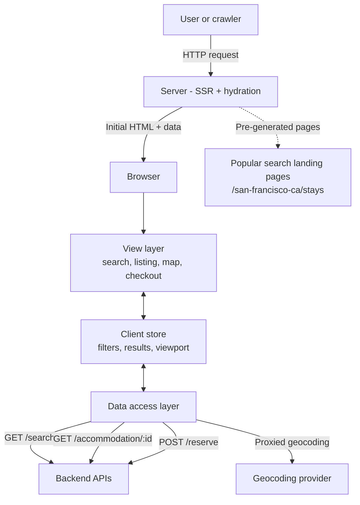
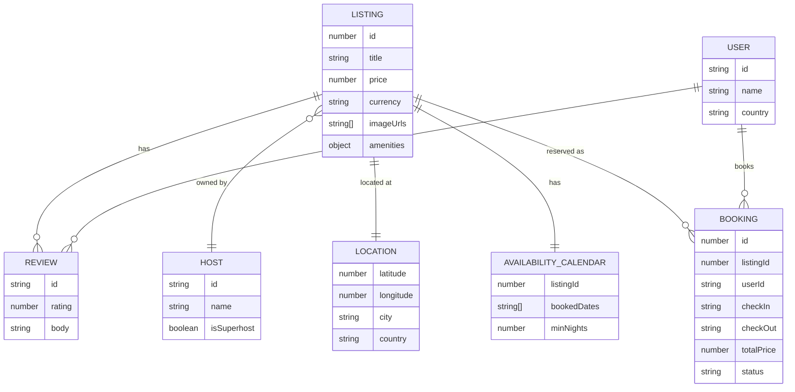
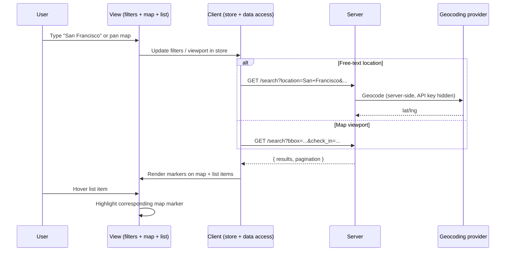
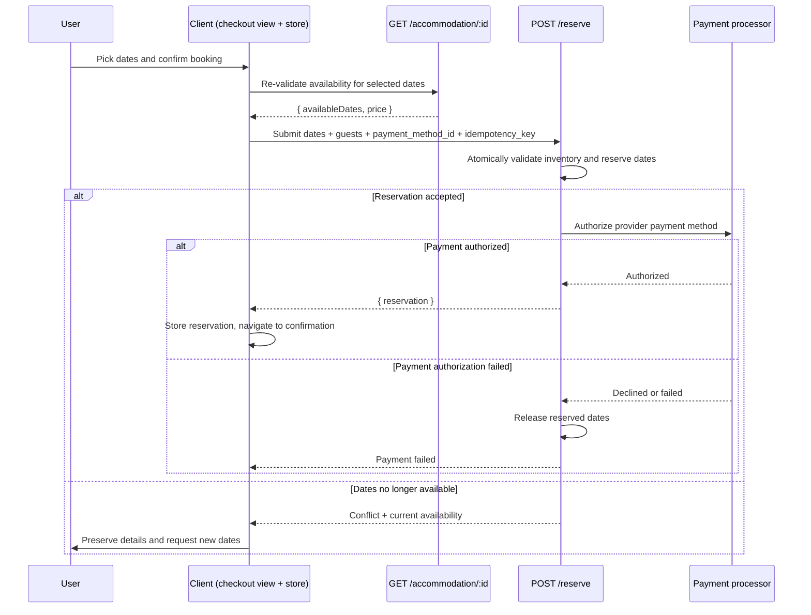
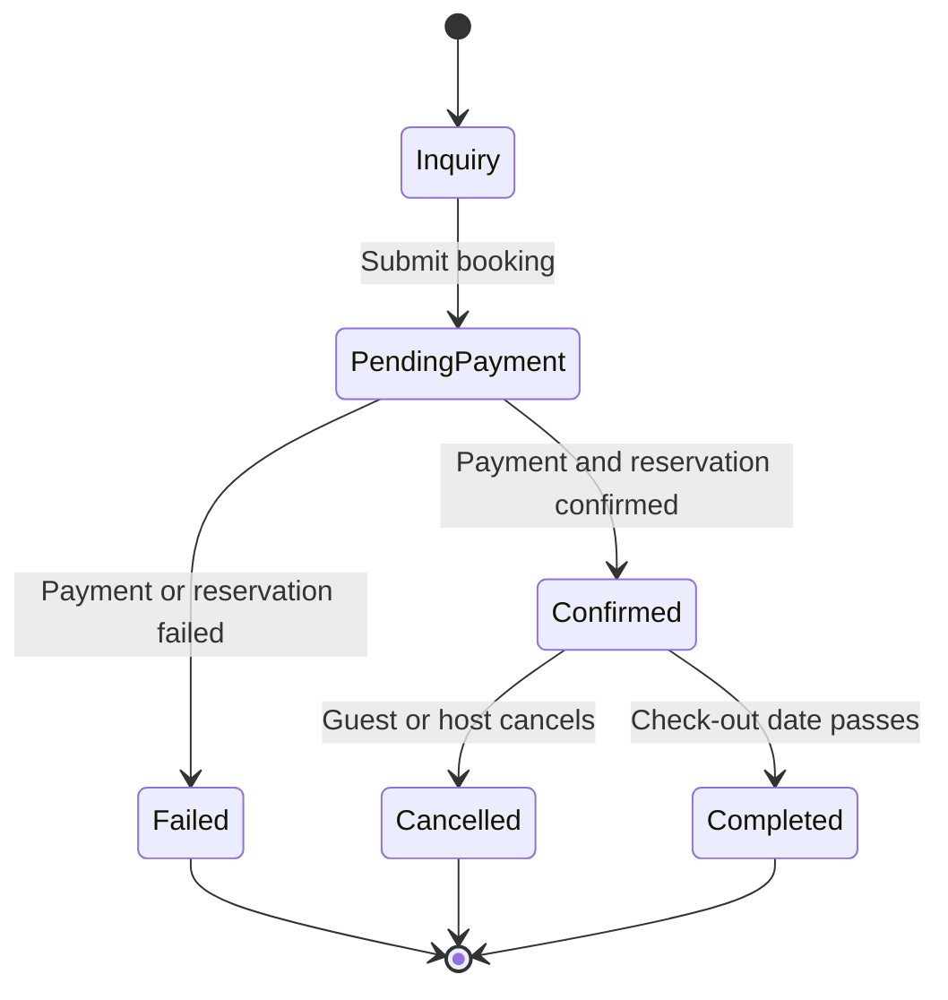

# Travel Booking (e.g. Airbnb)

**Difficulty:** Medium · **Duration:** ~30 min · **Topics:** Performance, SEO

> Source: [travel-booking-airbnb](https://www.greatfrontend.com/questions/system-design/travel-booking-airbnb)

## Question

Design a travel booking website that allows users to search for accommodations and make a reservation.


### Real-life examples

- [Airbnb](https://airbnb.com)
- [Booking.com](https://www.booking.com)
- [Expedia](https://www.expedia.com)
- [TripAdvisor](https://www.tripadvisor.com)

## Solution

### Requirements exploration

We scope the problem by clarifying which user journeys are in play, which devices to target, and which global concerns, including SEO, localization, and currency, shape the design.

#### What are the core features to be supported?

- Search and browse accommodation listings.
- Viewing accommodation details such as price, location, photos, and amenities.
- Make reservations for accommodations.

#### What do the user demographics look like?

International users of a wide age range: US, Asia, Europe, etc.

#### What are the non-functional requirements?

Each key public route should meet the recommended p75 [Core Web Vitals](https://web.dev/articles/vitals) targets of LCP ≤ 2.5 seconds, INP ≤ 200 ms, and CLS ≤ 0.1, measured separately for mobile and desktop in key markets. Search and reservation APIs should also have route-specific latency and error-rate targets.

#### What devices will the website be used on?

All possible devices: laptops, tablets, mobile, etc.

#### Do users have to be signed in?

Anyone can search for listings and browse details, but users need to be logged in to make a booking.

#### Summary

From the above, we can gather that the most important aspects of the website are:

- **Search engine optimization**: Travel sites should aim to rank high on search engines since organic search is one of the primary discovery mechanisms.
- **Performance**: Loading and interaction performance can affect whether visitors complete a booking.
- **Internationalization**: The users are from many different countries and from various age groups. To capture a larger market, the website should be translated and localized.
- **Device support**: The site should work well on a variety of devices since the user demographics are very broad.
- **Pricing scope**: Assume the displayed price for the selected stay does not change during the reservation attempt.

The requirements and nature of a travel booking website are very similar to the [E-commerce website system design](https://www.greatfrontend.com/questions/system-design/e-commerce-amazon), so there is a high degree of overlap between the solutions. In this solution, we will cover the unique aspects of travel booking websites that aren't found on e-commerce websites.

> **Public travel pages depend on SEO and performance**
>
> Travel sites use organic search for discovery, and load times can affect whether visitors complete bookings. Evaluate rendering strategy, URL shape, and image loading for public-page indexing and fast results on first load.

#### Check your understanding 1

A traveler-facing booking design focuses on the journey from search through reservation. Which workflows, access rules, and quality requirements belong in this initial scope? Select all that apply.

- [x] Allow anonymous public discovery across devices while requiring sign-in when the traveler books.
  > This boundary keeps global browsing broadly reachable while giving the reservation an authenticated user identity.
- [x] Hold the displayed stay price fixed during one reservation attempt.
  > Fixing the attempt price keeps the baseline focused on availability and reservation instead of introducing a separate repricing consistency protocol.
- [x] Cover search and filtering, listing details and availability, reservation, and the resulting confirmation.
  > These steps form the traveler journey whose routes, state, and mutation boundaries the front end must connect end to end.
- [ ] Include host listing management, payout reporting, and property onboarding in the first-version traveler experience.
  > Those are adjacent host workflows with different users and state boundaries, so they do not belong in the scoped traveler journey.
- [x] Treat SEO, internationalization, and route-specific performance and reliability as first-version constraints for public search and listing pages.
  > Global, crawlable discovery and measurable route quality drive rendering, URL, media, and loading decisions throughout the design.
- [ ] Require live bidding and repeated price negotiation while a traveler completes the reservation form.
  > The baseline explicitly fixes the displayed price for one attempt, so auction mechanics would add a different consistency problem without serving the stated flow.

---

### Architecture / high-level design

The key architectural decisions for a travel booking site, including where to render, how to navigate, and how to structure the client, all flow from two realities: public pages must rank on search engines, and users compare many listings in parallel.

#### Server-side rendering (SSR) or Client-side rendering?

As with the [E-commerce website system design](https://www.greatfrontend.com/questions/system-design/e-commerce-amazon), performance and SEO are critical. SSR or pre-rendering is a strong default for durable public destination and listing routes; private and highly interactive routes can choose a different rendering mode when its tradeoffs are acceptable.

**Travel booking rendering and navigation topology**



> **Default to SSR with hydration for public listing and search pages**
>
> Pure client-side rendering is a weak default for durable public search and listing routes because they need to be crawlable by search engines and fast on the first paint. Render their initial HTML on the server and hydrate for interactivity rather than shipping an empty shell that fills in via JavaScript.

#### Single-page application (SPA) or Multi-page application (MPA)?

Travel users often compare several listings after narrowing the search results, which is why many travel sites open listing details in a new tab. However, the product should use ordinary listing links by default so users retain control over that choice. Preserve filters in the URL and restore the result cursor, map viewport, stable listing anchor, and scroll offset on back/forward navigation.

Hence, whether the site is an SPA or MPA matters less than choosing an appropriate rendering mode for each route. Both can be viable depending on how important the subsequent navigation experience is, and travel websites are one of the few products where an MPA architecture is still viable.

However, travel websites have a fair bit of interaction (e.g. changing search filters, interacting with the map, expanding accommodation details, etc.). Using UI frameworks is crucial for writing maintainable client-side code. React, Vue, and Angular are top choices for doing so.

For an SSR + interaction-heavy use case, we can leverage universal/isomorphic rendering (or SSR with hydration). In universal rendering, the server renders the full initial HTML, but after that, rendering and navigation become client-side. JavaScript event handlers are attached to the interactive elements within the HTML (hydration).

Airbnb is one of the pioneers of building universal/isomorphic apps with the invention of [Rendr](https://github.com/rendrjs/rendr), a library that renders Backbone.js apps on the client and the server. Rendr is a historical example; modern React frameworks such as Next.js provide SSR with hydration.

#### Illustrative travel-site architectures

The following table is a simplified historical illustration of possible rendering choices, not a current stack audit:

|             | App Type          | Rendering | UI Framework |
| ----------- | ----------------- | --------- | ------------ |
| Airbnb      | SPA (some routes) | SSR       | React        |
| Booking.com | MPA               | SSR       | React        |
| Expedia     | MPA               | SSR       | React        |
| TripAdvisor | SPA (some routes) | SSR       | React        |

These examples show that SSR and React have been common choices, not that either is a universal requirement. Both SPA and MPA examples appear because rendering and navigation architecture are separate decisions.

For simplicity, and since SPAs are covered commonly in other questions, the discussion below assumes that we'll be using an MPA architecture with server-side rendering + hydration due to the need for interactivity after initial load.

**References**

- [Rearchitecting Airbnb's Frontend | Airbnb Engineering Blog](https://medium.com/airbnb-engineering/rearchitecting-airbnbs-frontend-5e213efc24d2)
- [Server Rendering, Code Splitting, and Lazy Loading with React Router v4 | Airbnb Engineering Blog](https://medium.com/airbnb-engineering/server-rendering-code-splitting-and-lazy-loading-with-react-router-v4-bfe596a6af70)
- [Rendr: Run your Backbone apps in the browser and Node | Airbnb Engineering Blog](https://medium.com/airbnb-engineering/rendr-run-your-backbone-apps-in-the-browser-and-node-a3481af49312)
- [Isomorphic JavaScript: The Future of Web Apps | Airbnb Engineering Blog](https://medium.com/airbnb-engineering/isomorphic-javascript-the-future-of-web-apps-10882b7a2ebc)
- [Breaking the Monolith — Modular redesign of Agoda.com | Agoda Engineering & Design](https://medium.com/agoda-engineering/breaking-the-monolith-f3538d9c3ad6)

#### Check your understanding 2

Which rendering approach best supports indexable accommodation pages while preserving filter and map state during client navigation?

- [ ] Server-render public routes and replace the page for every filter, gallery, and booking interaction.
  > Public content remains crawlable, but full-page transitions discard the interactive search and booking state that hydration can preserve.
- [x] Server-render indexable destination and accommodation content, then hydrate search, filters, galleries, and booking interactions.
  > Public routes provide useful, crawlable content immediately, while hydration adds the stateful filtering, media, and booking behavior users need.
- [ ] Statically generate every listing with its current price and calendar, refreshing pages only during scheduled deployments.
  > Durable listing descriptions can be static, but price and availability change too quickly to remain authoritative without runtime revalidation.
- [ ] Client-render destination and listing bodies, but server-render their metadata and social preview tags.
  > Metadata alone does not expose accommodation content or crawlable navigation in the initial document and makes first content depend on JavaScript.

#### Check your understanding 3

A traveler filters search results and opens several listings for comparison. Which navigation design preserves normal browser control and shareable search state?

- [x] Use ordinary listing links and encode committed search criteria in the results URL.
  > Links preserve standard tab and history behavior, while URL-backed criteria make the search bookmarkable and shareable.
- [ ] Use ordinary listing links, but keep the committed filters only in `history.state` or session storage.
  > Links preserve browser control within the current session, but session-only criteria do not produce a shareable or directly reproducible search URL.
- [ ] Store filters and scroll offset only in client memory and require all listing navigation to stay inside one SPA session.
  > In-memory state disappears on refresh, direct entry, or a separate tab, so it cannot provide durable browser navigation semantics.
- [ ] Show every listing in a modal without changing the URL, because leaving the results route would lose its state.
  > A modal can be a product choice, but hiding listing identity and search state from navigation makes deep links and browser history unreliable.

---

### Data model

| Entity           | Source              | Belongs to                        | Fields                                                                                                             |
| ---------------- | ------------------- | --------------------------------- | ------------------------------------------------------------------------------------------------------------------ |
| Search Params    | User input (Client) | Search/Listing Page               | City/Geolocation/Radius Date Range, Number of People, Amenities, etc.                                              |
| `ListingResults` | Server              | Search/Listing Page               | query key, ordered listing IDs, pagination metadata, request status                                                |
| `ListingItem`    | Server              | Search/Listing Page, Details Page | stable `id`, `title`, `price`, `currency`, `image_urls`, `amenities`; the detail response enriches the same entity |

We have omitted the entities related to payments and addresses since they are covered in [E-commerce website system design](https://www.greatfrontend.com/questions/system-design/e-commerce-amazon). If the interviewer wants you to focus on the checkout flow as well, do mention those entities.

Across search, map, detail, and checkout surfaces, the client store holds a compact set of related entities. Listings reference hosts and locations, and a booking ties together a user, a listing, and a date range.

**Client-side entity relationships for listings and bookings**



#### Check your understanding 4

How should travel search and booking data be organized? Select all that apply.

- [ ] Parse the localized price and date labels from the selected card when constructing the reservation request.
  > Display strings lose identifiers, currency semantics, and property-local date meaning. Mutations need structured values and server repricing.
- [ ] Store complete mutable listing snapshots inside each search page so cached pages can render independently.
  > A listing can appear on several pages and the detail route, so separate snapshots can show conflicting save, price, or availability state.
- [x] Store each search result set as a query key, ordered listing IDs, pagination metadata, and request status.
  > Query-scoped order preserves server ranking and request lifecycle without copying the shared listing entities into every result page.
- [x] Store accommodations and reusable entities by stable ID.
  > Shared entities let search, map, and detail routes update one listing identity instead of maintaining divergent copies.
- [x] Represent destination, dates, party size, filters, and sort in shareable route state where appropriate.
  > Shareable route state preserves a reproducible search and supports back, forward, refresh, and deep linking.

#### Check your understanding 5

A booking UI collects traveler input, submits a reservation, and later shows confirmed, failed, cancelled, or completed trips. Which data should determine the reservation status shown to the traveler, and how should in-progress input and submission attempts be represented? Select all that apply.

- [ ] Mark a booking confirmed when the client reaches the confirmation URL.
  > Navigation shows what the client attempted to display. It does not prove that inventory and payment produced a confirmed reservation.
- [ ] Create a confirmed reservation in the client store as soon as provider-hosted fields return a payment method token.
  > An opaque payment identifier is only an input to the reservation request and says nothing about availability, authorization, or booking status.
- [x] Store the server reservation record by ID and treat its status as canonical for trip and confirmation views.
  > Reservation state can change after submission, so durable server status, not a client navigation event, must drive the lifecycle shown across sessions.
- [x] Keep local form input and pending submission state separate from confirmed or failed reservation entities.
  > Draft data supports editing and recovery, while a server record represents the durable outcome. Merging them can turn an optimistic attempt into a false booking.

---

### Interface definition (API)

We will need the following HTTP APIs:

1. **Search**: Fetch accommodation listings given some search/filter parameters. The results are rendered on the map and/or in a list view.
2. **Listing details**: Fetch the details for an accommodation listing.
3. **Reserve**: Make a reservation for an accommodation.

#### Search accommodations

| Property    | Value                                                         |
| ----------- | ------------------------------------------------------------- |
| HTTP Method | `GET`                                                         |
| Path        | `/search`                                                     |
| Description | Returns a list of accommodations that match the search query. |

##### Parameters

| Parameter  | Type              | Description                                                                         |
| ---------- | ----------------- | ----------------------------------------------------------------------------------- |
| Size       | number            | Number of results per page                                                          |
| Page       | number            | Page number to fetch                                                                |
| Guests     | number            | Number of staying guests                                                            |
| Locale     | string            | Presentation preference for language and formatting                                 |
| Currency   | string            | Optional ISO currency preference; the server still returns the reservation currency |
| Location   | mixed (see below) | Location of the search                                                              |
| Date range | mixed (see below) | Date range to occupy the accommodation                                              |
| Amenities  | mixed (see below) | Amenities criteria                                                                  |

**Location**: The exact format of the `location` field depends on the business requirements, but in general, we need to tell the server the desired boundary so that results within the boundary will be shown. There are two common ways to represent boundaries: (1) center position + radius, and (2) boundary coordinates.

1. **Center position + radius**: The radius can be in miles/km and the center position can be either of:

- **Free text search**: This is any string containing a location, e.g. "San Francisco", "New York City". An external location service will be needed to convert the string into geographic coordinates (via geocoding). Geocoding is preferably done on the server to prevent API abuse.
- **Geolocation/Coordinates**: This format is useful for map-based UIs where users can pan/zoom the map to search for listings within the area, or when users allow the app to access their current location to search around them.

> **Do not call the geocoding provider directly from the client**
>
> Shipping the geocoding API key to the browser exposes it to abuse and quota exhaustion, and makes it trivial for third parties to scrape the provider on your bill. Proxy geocoding through your own server so the key stays private and the service can be rate limited and cached per user. 2. **Boundary coordinates**: For map-based UIs, we can use the coordinates of the 4 corners of the presented map as the boundary area.

If geographic search becomes a deeper discussion, normalize free text to a stable place ID and define one longitude/latitude boundary order so URL, cache, map, and list requests share the same identity.

It's likely that the search API will have to support both formats if the website has different search UIs:

- Landing pages for travel sites usually have a search bar with compulsory parameters like date range and number of guests. Such a UI will need the free text search location format.
- Results pages with maps will use the geolocation/boundary coordinates format.

**Date range**: There are several date range formats to choose from, and none are clear winners:

| Format                    | Example                                               | Pros                | Cons                       |
| ------------------------- | ----------------------------------------------------- | ------------------- | -------------------------- |
| Array/tuple               | `['2022-12-24', '2022-12-27']`                        | Short               | Unclear. Has to be encoded |
| Object                    | `{ check_in: '2022-12-24', check_out: '2022-12-27' }` | Clear               | Long. Has to be encoded    |
| Separate query parameters | `check_in` and `check_out`                            | Don't need encoding | Two query params vs one    |

The array format is the least clear of the three, and the object requires encoding to be used in `GET`, so separate query parameters would be the most recommended.

**Amenities**: Structuring the query parameters for amenities has the same issues as the date range.

| Format                    | Example                             | Pros          | Cons                    |
| ------------------------- | ----------------------------------- | ------------- | ----------------------- |
| Object                    | `{ breakfast: true, washer: true }` | Clear         | Long. Has to be encoded |
| Separate query parameters | `breakfast` and `washer`            | More readable | N query params vs One   |

In this case, due to the sheer number of query parameters if each amenity criterion is a separate query parameter, the object format is better because:

- Putting each criterion in its own query parameter makes the query string really long, and the hierarchy is lost.
- There's a possibility of query parameter name collisions with the non-amenities fields. This can be solved by prefixing all the amenity fields with `amenities_` (e.g. `amenities_breakfast` and `amenities_washer`).
- Moreover, some amenities criteria have non-primitive values, which will require URL encoding and decoding anyway.

There's no [fixed standard on how to encode arrays and objects into the query string of URLs](https://stackoverflow.com/questions/6243051/how-to-pass-an-array-within-a-query-string), and the format tends to be implementation-dependent. The most important thing is to maintain a consistent format between the server and the client.

##### Sample response

```jsonc
{
  // Pagination metadata.
  "pagination": {
    "size": 5,
    "page": 2,
    "total_pages": 15,
    "total": 74,
  },
  "results": [
    {
      "id": 561602, // Accommodation ID.
      "title": "Great view in the Mission, 15 mins by bus downtown",
      "images": [
        "https://www.greathotels.com/img/1.jpg",
        "https://www.greathotels.com/img/2.jpg",
        "https://www.greathotels.com/img/3.jpg",
        "https://www.greathotels.com/img/4.jpg",
      ],
      "rating": 4.82,
      "coordinates": {
        "latitude": 37.74403,
        "longitude": -122.41755,
      },
      "price": 200,
      "currency": "USD",
    },
    // ... More accommodation results.
  ],
}
```

Offset-based pagination supports numbered result pages. Use a deterministic sort with a unique tie-breaker, while accepting that results can still shift when ranking, price, or availability changes.

We use offset-based pagination here as opposed to cursor-based pagination because:

1. Having page numbers is useful for navigating between search results and jumping to specific pages.
2. Accommodation results do not suffer from the stale results issue that much because new listings are not added that quickly/frequently.
3. It's useful to know how many total results there are.

For a more in-depth comparison between offset-based pagination and cursor-based pagination, refer to the [News Feed system design article](https://www.greatfrontend.com/questions/system-design/news-feed-facebook).

If infinite scroll is desired, then a cursor-based pagination approach might be required. Offset-based pagination can still be used, but the client will need to go through the trouble of filtering out duplicate results.

On a typical search-with-map surface, filter changes, map panning, and free-text input all converge on the same `/search` call, with geocoding proxied through the server and the map + list views re-rendered from the same result set.

**Search with map and filters flow**



Derive a normalized request key from committed URL state, debounce only transient text or viewport input, abort superseded reads where practical, and accept a response only when its generation/key is still current. Keep previous data visible while exposing loading, empty, partial, offline, and retry states.

> **Default to offset pagination for travel search, cursor only if infinite scroll**
>
> Numbered pages can use offset pagination with a deterministic sort. If a continuous or frequently re-ranked result set needs stable continuation, use an opaque continuation token instead.

#### Fetch accommodation details

The details endpoint can serve SSR and client navigation through one documented response contract; it does not depend on forcing a new browsing context.

| Property    | Value                                            |
| ----------- | ------------------------------------------------ |
| HTTP Method | `GET`                                            |
| Path        | `/accommodation/{accommodationId}`               |
| Description | Fetches the details of an accommodation listing. |

##### Parameters

| Parameter         | Type   | Description                                                       |
| ----------------- | ------ | ----------------------------------------------------------------- |
| `accommodationId` | number | ID of accommodation to be fetched                                 |
| `check_in`        | string | Optional property-local check-in date used to check availability  |
| `check_out`       | string | Optional property-local check-out date used to check availability |
| `guests`          | number | Optional guest count used to check availability                   |
| `locale`          | string | Presentation preference for language and formatting               |
| `currency`        | string | Optional ISO currency preference                                  |

##### Sample response

```jsonc
{
  "id": 561602, // Accommodation ID.
  "title": "Great view of Brannan Street, 15 mins by bus downtown. Bed and Breakfast provided!",
  "images": [
    "https://www.greathotels.com/img/1.jpg",
    "https://www.greathotels.com/img/2.jpg",
    "https://www.greathotels.com/img/3.jpg",
    "https://www.greathotels.com/img/4.jpg",
  ],
  "rating": 4.82,
  "coordinates": {
    "latitude": 37.74403,
    "longitude": -122.41755,
  },
  "price": 200,
  "currency": "USD",
  "time_zone": "America/Los_Angeles",
  "amenities": {
    "breakfast_provided": true,
    "internet": true,
    "washer": true,
    "dryer": false,
    // Any additional amenities details.
  },
  "house_rules": "...",
  "contact_email": "...",
  // Any additional details.
}
```

#### Make reservation

| Property    | Value                     |
| ----------- | ------------------------- |
| HTTP Method | `POST`                    |
| Path        | `/reserve`                |
| Description | Reserve an accommodation. |

##### Parameters

| Parameter           | Type   | Description                                                 |
| ------------------- | ------ | ----------------------------------------------------------- |
| `accommodation_id`  | number | ID of accommodation to be reserved                          |
| `dates`             | mixed* | Dates to reserve the accommodation                          |
| `guests`            | number | Number of guests covered by the reservation                 |
| `payment_method_id` | string | Opaque identifier created by provider-hosted payment fields |
| `idempotency_key`   | string | Stable key reused for retries of this reservation attempt   |

- The format of the `dates` field should be consistent with the selected date range format in the search API.

The reservation flow spans availability, payment, and confirmation. For this interview scope, the displayed price remains unchanged during the booking attempt. The earlier availability `GET` is a UX hint; correctness comes from `POST /reserve` atomically validating the date range, reserving the dates, and deduplicating retries by idempotency key.

If the dates are no longer available, the endpoint returns a conflict with current availability. The client preserves the other booking details and asks the user to choose available dates before retrying.

If payment orchestration becomes the focus, extend this flow with hold expiry, authenticated provider webhooks, and compensation when payment succeeds but booking confirmation fails.

**Reservation flow with availability re-check and payment**



A reservation moves through a small number of states between inquiry and completion, and the client UI (confirmation page, trip dashboard, cancellation controls) is driven by this status field.

**Reservation lifecycle states**



##### Sample response

A reservation object is returned upon successful reservation.

```jsonc
{
  "id": 456, // Reservation ID.
  "total_price": 400,
  "currency": "USD",
  "dates": {
    "check_in": "2022-12-24",
    "check_out": "2022-12-27",
  },
  "accommodation": {
    "id": 561602,
    "address": {
      "country": "US",
      "street_address": "888 Brannan Street",
      "city": "San Francisco",
      "zip": "94103",
      "state": "CA",
      // ... Other address fields.
    },
  },
  "payment_method": {
    "brand": "visa",
    "card_last_four_digits": "1234",
  },
}
```

#### Check your understanding 6

A travel search accepts either free-text destinations or map boundary coordinates and uses an external geocoding provider for text. Where should the provider call happen?

- [x] Send the location to the application server, which calls the provider with a private key behind caching and rate limits.
  > Keeping the provider credential server-side protects it from extraction and gives the product one controlled boundary for abuse prevention and reuse of normalized locations.
- [ ] Geocode in the browser and have the application server validate only the returned coordinates before searching.
  > Coordinate validation does not prevent third parties from exhausting the exposed geocoding credential or bypassing the application's request controls.
- [ ] Call the provider directly from the browser with a referrer-restricted API key, then send coordinates to the search service.
  > Referrer restrictions reduce casual reuse but still expose the provider boundary to scraping and make application-level quotas, caching, and per-user controls harder to enforce.

#### Check your understanding 7

A travel search offers numbered pages and total-result counts, and its ranking changes relatively slowly. Which pagination contract is the best default?

- [x] Use numbered offset pages with a deterministic sort and a unique listing tie-breaker.
  > Offsets support page jumps and totals, while stable ordering limits duplicates and gaps between adjacent requests.
- [ ] Use offsets ordered only by a non-unique relevance score because listings with equal scores are interchangeable.
  > Without a unique tie-breaker, equal-score listings can swap positions between requests and appear twice or disappear across page boundaries.
- [ ] Use opaque cursor pagination and reconstruct numbered navigation from the chain of cursors the client has already visited.
  > Cursors help changing streams, but a visited cursor chain cannot provide arbitrary page jumps or a simple total-page contract for this relatively stable result set.

#### Check your understanding 8

A traveler types a destination, changes filters, and pans the map while search requests complete at different times. Which client policies keep the visible list and markers aligned with the latest committed search? Select all that apply.

- [ ] Apply whichever response finishes last because network completion reflects the most recent interaction.
  > An older slow request can finish after a newer one, so completion time does not identify the search the traveler currently wants.
- [ ] Blank the existing results and debounce page, sort, and committed filter actions through one long timer.
  > Delaying deliberate actions makes the interface feel unresponsive, and clearing usable data adds flicker without preventing stale responses.
- [x] Accept a response only when its key or generation is current, keeping previous results visible with an explicit refreshing state meanwhile.
  > The guard prevents stale list and map replacement, while retained data preserves context until the matching response supplies the next state.
- [x] Debounce transient text or viewport input and abort superseded reads when practical.
  > Debouncing noisy intermediate states limits request volume, while cancellation avoids spending work on searches already replaced by newer intent.
- [x] Derive a normalized request key from committed destination, dates, guests, filters, sort, page, and viewport state.
  > A stable key gives the list, map, cache, and response guard one identity for the search the URL represents.

#### Check your understanding 9

A traveler shares a search for a property-local stay from November 1 through November 5. Which GET contract represents the date range most clearly?

- [ ] Convert each property-local date to a UTC timestamp using the browser's current time zone.
  > A viewer-zone conversion can move the property's calendar boundary and change the requested check-in or check-out date.
- [x] Send property-local ISO dates in separately named `check_in=2026-11-01` and `check_out=2026-11-05` query parameters.
  > Named ISO local-date fields are unambiguous, readable in a URL, and avoid converting the stay through the viewer's time zone.
- [ ] Send one localized label such as `11/1–11/5` and let the server infer its order and year.
  > Numeric date order varies by locale, and the shortened label omits information needed to reproduce the stay.
- [ ] Encode `["2026-11-01","2026-11-05"]` as one query value without naming the positions.
  > The values are complete, but the positional meaning is less explicit and requires an extra encoding convention.

#### Check your understanding 10

A traveler saw available dates, submits a reservation, experiences a timeout, and may also receive a payment failure or an availability conflict. Which service and client behaviors keep inventory and booking state correct? Select all that apply.

- [x] Reuse the attempt's idempotency key so a retry returns the original reservation outcome instead of creating another booking.
  > A timeout is ambiguous: the first request may have committed, so stable mutation identity prevents duplicate reservations or charges.
- [x] Release reserved dates when payment authorization fails.
  > A failed payment did not complete the booking, so releasing its reservation makes the dates available again instead of stranding inventory.
- [x] Use the earlier availability response for UX, but do not treat it as an inventory commitment.
  > Another traveler can reserve the dates after the read, so only the reservation mutation can establish the booking outcome.
- [x] Have `POST /reserve` atomically recheck the requested dates and reserve them before returning success.
  > Combining validation and the inventory write closes the race between a prior availability read and reservation creation.
- [ ] Keep the dates reserved indefinitely when payment authorization fails so the traveler can try another card later.
  > An unbounded failed hold removes inventory without a completed booking and can strand availability for other travelers.
- [ ] Show a confirmed trip as soon as the client disables the date picker and begins submission.
  > Local UI state cannot reserve shared inventory or prove that payment and the server transaction succeeded.

#### Check your understanding 11

Availability changes after a user selected dates but before reservation confirmation. What should the front end do?

- [ ] Keep the original selection and show a provisional confirmation while availability is reconciled in the background.
  > Confirmation promises an inventory commitment the service has already rejected and risks misleading the traveler about a nonexistent booking.
- [x] Show the current availability, preserve unaffected details, and ask the user to choose available dates before retrying.
  > The front end respects canonical inventory while keeping traveler data that is still valid and guiding the one decision that must change.
- [ ] Reset the entire booking journey so no state from the stale quote can leak into another reservation attempt.
  > The failed dates do not invalidate destination, guest, or traveler information. Discarding everything turns a recoverable conflict into abandonment.

---

### Optimizations and deep dive

To recap, the most important aspects of a travel booking website are search discovery, global usage, performance, device support, booking UX, accessibility, and forms:

- [Search engine optimization (SEO)](#search-engine-optimization-seo): This section explains how search and listing pages stay crawlable, shareable, and useful for organic discovery.
- [Internationalization (i18n)](#internationalization-i18n): This section covers locale, language, currency, dates, addresses, and region-specific travel expectations.
- [Performance](#performance): This section discusses loading speed, image delivery, Core Web Vitals, and performance tradeoffs that affect conversion.
- [Device support](#device-support): This section covers responsive images, mobile layouts, and cross-device booking behavior.
- [User experience](#user-experience): This section explains search context preservation, date-range selection, optimistic reservation flows, and high-friction travel UX details.
- [Accessibility](#accessibility): This section covers image alternatives, forms, controls, and keyboard access across search and booking flows.
- [Form optimizations](#form-optimizations): This section discusses checkout-style form improvements for guest details, payment, validation, and autofill.
- [Other topics](#other-topics): This section lists adjacent travel-product concerns that are useful follow-up discussion points.

#### Search engine optimization (SEO)

Travel sites rely heavily on organic traffic, so search result pages and listing pages both need to be crawlable and shareable, starting with making search URLs bookmarkable.

##### Bookmarkable search results

When searching on these travel sites, notice that the search query and filters are reflected in the URL. If you load the URL in a new window, the same results and search query are shown. Syncing the search query with the URL is an important feature because:

1. **Bookmarking**: Allows the particular search to be bookmarked, which is a common action users take when doing research for travel.
2. **Deep linking**: Other sites like travel blogs can link to the results page of specific search filters (e.g. vacation rentals in San Francisco). This helps improve the site's SEO and discoverability.

> **Treat the URL as the source of truth for search filters**
>
> Location, dates, guests, and amenity filters all belong in the query string or path so the same state can be bookmarked, shared, and restored on reload. Only selected durable destination pages should be indexed. Keeping filters only in client memory breaks back/forward navigation and forces users to re-enter their criteria whenever they open a listing in a new tab.

##### Pre-generate pages for popular searches

When you search for "Vacation in San Francisco" in a search engine, you will most likely see results from popular travel sites like Expedia, Airbnb, and TripAdvisor, among many others. These pages aren't content articles; they're the site's search results page with some pre-filled filters. How is this accomplished?

To improve SEO by appearing relevant to what users are searching for, travel sites generate dedicated pages for popular destination searches that show relevant listings for these terms. For example, Airbnb has generated dedicated pages for ["Vacation rental apartments in San Francisco"](https://www.airbnb.com/san-francisco-ca/stays) and ["Vacation rental apartments in New York"](https://www.airbnb.com/new-york-ny/stays). Selected destination pages can be included in a [sitemap](https://developers.google.com/search/docs/crawling-indexing/sitemaps/overview) so search engines can discover them. Transient dates, guests, sort order, map bounds, and low-value filter combinations should remain shareable without being indexed.

URLs are commonly implemented in one of two ways:

- **Readable URLs**: [https://www.airbnb.com/san-francisco-ca/stays](https://www.airbnb.com/san-francisco-ca/stays)
- **"Ugly" URLs**: [https://www.airbnb.com/search?location=123](https://www.airbnb.com/search?location=123) (where 123 is an internal ID mapping to San Francisco city)

Airbnb uses readable URLs because they are easier for users and crawlers to understand. However, putting a keyword in the path does not by itself guarantee a better ranking.

> **Prefer readable URLs for popular search landing pages**
>
> A path like `/san-francisco-ca/stays` is easier to understand than `/search?location=123`. Reserve opaque query-parameter URLs for internal or transient routes that should not be indexed.

##### Dynamic rendering as a legacy workaround

[Dynamic rendering](https://developers.google.com/search/docs/crawling-indexing/javascript/dynamic-rendering) sends crawlers a rendered page while serving users a different client-rendered page. Google no longer recommends it as a long-term solution because maintaining two rendering paths creates parity and operational risks. Prefer server-side rendering, static generation, or hydration so crawlers and users receive equivalent content.

For a legacy route that cannot be migrated immediately, dynamic rendering can be a short-term fallback with automated parity checks and a removal plan. The historical [Expedia Group Vrbo case study](https://medium.com/expedia-group-tech/improving-vrbo-homepage-loading-experience-e4b2207535f4) illustrates the technique: crawlers received a full page while users received above-the-fold content first and loaded the rest asynchronously.

#### Check your understanding 12

Which choices support travel-site SEO without indexing every transient search state? Select all that apply.

- [x] Prevent low-value or duplicate filter permutations from creating uncontrolled crawl space.
  > Deliberate indexing prevents transient date, guest, sort, and filter combinations from creating unbounded duplicate crawl space.
- [x] Provide stable canonical URLs and metadata for indexable pages.
  > Stable canonical identity consolidates ranking signals even when users reach a listing through different search parameters.
- [x] Return meaningful destination and accommodation content in initial HTML.
  > Initial route content makes durable destination and property information available without relying on client execution.
- [ ] Use clickable result-card containers for client navigation, keeping the destination URL only in application state.
  > Without real links, crawlers cannot reliably discover listing routes and users lose standard navigation behaviors such as opening in a new tab.
- [ ] Give each live date and guest search its own self-referencing canonical URL so specific availability can rank independently.
  > Combinatorial, fast-changing searches create duplicate and quickly stale pages. Canonical public routes should represent durable content.

#### Internationalization (i18n)

Some of the following is extracted from our [Quiz Questions](https://www.greatfrontend.com/questions/quiz) on [internationalization](https://www.greatfrontend.com/questions/quiz/designing-or-developing-for-multilingual-sites):

- Have dedicated pages translated in the supported languages.
- Make the language and country selector very prominent (e.g. in the navbar).
- For listing details that are contributed by users, add an automatic translation feature so that users visiting country X who don't speak country X's language can understand the listing in their native language.
- Set the `lang` attribute on the `html` tag (e.g. `<html lang="zh-cn">`) to tell browsers and search engines the language of the page, which helps browsers offer a translation of the page. This is also important for SEO.
- Enable locale-specific UI:
  - Using the [`:lang()` CSS pseudo-class](https://developer.mozilla.org/en-US/docs/Web/CSS/:lang) to change display
  - Right-to-left languages
    - Using [CSS Logical Properties](https://web.dev/learn/css/logical-properties/)
    - HTML's [`dir` attribute](https://developer.mozilla.org/en-US/docs/Web/HTML/Global_attributes/dir)
    - CSS [`direction: rtl`](https://developer.mozilla.org/en-US/docs/Web/CSS/direction)
- Consider differences in the length of text in different languages.
- Do not concatenate translated strings.
- Do not put text in images.
- Be mindful of how colors are perceived in different cultures.
- Treat check-in and check-out as property-local calendar dates. Use the property's IANA time zone for time-bearing rules rather than silently converting dates to the browser's time zone.
- Treat locale as a presentation preference. The server returns the amount and ISO currency code used for display and reservation.

#### Check your understanding 13

Which concerns must a global travel-booking UI handle? Select all that apply.

- [ ] Translate guest and night nouns separately, then concatenate them with locale-formatted counts.
  > Plural categories and word order differ across languages, so translators need complete messages with structured placeholders.
- [x] Use logical layout and flexible controls for RTL and longer translations.
  > Logical layout and flexible sizing adapt interface chrome to writing direction and longer translated labels.
- [x] Interpret check-in rules and calendar dates in the property's intended time zone.
  > A stay is defined by calendar dates at the property, so interpreting them in the viewer's zone can change the intended night boundaries.
- [x] Display server-provided prices, fees, and counts with locale-aware formatters.
  > Formatters present canonical values using local conventions without changing the currency or amount the service returned.
- [ ] Convert check-in and check-out midnights to the browser's zone before displaying or submitting them.
  > Time-zone conversion can move a property-local calendar date to the previous or next day and change the requested stay.

#### Performance

Performance is known to affect conversions, so for websites where the aim is to get customers to make bookings, performance is important. Performance optimizations have been covered in great detail in earlier questions, so in this question we will list the relevant performance optimizations along with blog articles by companies should you want more details.

##### Image optimizations

- **Image carousel**: Photos are widely used on travel websites to showcase how attractive the destination/accommodation is. We have covered the implementation of image carousels in the [Image Carousel system design article](https://www.greatfrontend.com/questions/system-design/image-carousel).
- **Image preloading/lazy loading**: One super useful technique is to use JavaScript to have fine-grained control over when images load.
  - [Airbnb optimized the image carousel experience in their room listings with a combination of lazy loading and preloading](https://medium.com/airbnb-engineering/building-a-faster-web-experience-with-the-posttask-scheduler-276b83454e91):
    1. Initially, only the first image is loaded (the remaining images will be lazily loaded).
    2. The second image is preloaded when the user shows possible intent of viewing more images:
    - Cursor hovers over the image carousel.
    - Focuses on the "Next" button via tabbing.
    - Image carousel comes into view (on mobile devices).
    3. If the user does view the second image (which signals high intent to browse even more images), the next three images (3rd to 5th) are preloaded.
    4. As the user clicks "Next" again to browse more images, the (n + 3)th image is preloaded.


Airbnb image carousel lazy loading example on mobile

- **Responsive images**: Serving the most suitable image for the device.
  - [Images on the Web: Part 1 — Responsive Images | Expedia Group Technology](https://medium.com/expedia-group-tech/images-on-the-web-part-1-responsive-images-5dc0066461bd)
  - [Images on the Web: Part 2 — Implementing responsive images | Expedia Group Technology](https://medium.com/expedia-group-tech/images-on-web-part-2-implementing-responsive-images-ca1d30f533f8)
- **Image formats**: Use `webp` format for photos and SVGs for icons where possible.
  - [Choose the right image format| web.dev](https://web.dev/articles/choose-the-right-image-format)

##### Code splitting

- [Expedia's Vrbo prioritizes above-the-fold content and loads code for it first](https://medium.com/expedia-group-tech/improving-vrbo-homepage-loading-experience-e4b2207535f4).
- Page/route-level code splitting to prevent huge JavaScript bundles if using a single-page app architecture.
- Lazy load UI components that are not shown on initial render: (1) below-the-fold elements (e.g. footer), and (2) elements that only appear after interaction (e.g. popover, modal).

##### Performance monitoring

- Use tools like Lighthouse and Web Vitals to profile websites and measure performance.
- Airbnb came up with their own [Page Performance Score](https://medium.com/airbnb-engineering/creating-airbnbs-page-performance-score-5f664be0936) and [defined the metrics that mattered for web performance](https://medium.com/airbnb-engineering/measuring-web-performance-at-airbnb-122da8d3ea3f).
- Set up performance budgets that run on CI.
- If caching becomes the focus, distinguish immutable media and public listing metadata from query-keyed search results, short-lived availability checks, and private reservations; each needs a different cache key and freshness policy.

##### React-specific tips

- React-specific performance optimizations done by Airbnb: [React Performance Fixes on Airbnb Listing Pages | The Airbnb Tech Blog](https://medium.com/airbnb-engineering/recent-web-performance-fixes-on-airbnb-listing-pages-6cd8d93df6f4).
- [12 Tips to Improve Client Side Page Performance | Expedia Group Technology](https://medium.com/expedia-group-tech/12-tips-to-improve-client-side-page-performance-88c7bec27933)

##### Bundling optimizations

- Module federation: [Using Webpack Module Federation to Create an App Shell | Expedia Group Technology](https://medium.com/expedia-group-tech/using-webpack-module-federation-to-share-an-app-shell-7d23633510e)
- [Optimizing a Page: Resource Hints, Critical CSS, and Webpack | Expedia Group Technology](https://medium.com/expedia-group-tech/optimize-a-page-resource-hint-critical-css-webpack-c8cc7319fb87)

##### Virtual list/windowing for long lists with infinite scrolling

Use virtual list/windowing for long lists with infinite scrolling. Read more about [List Virtualization on patterns.dev](https://www.patterns.dev/posts/virtual-lists/).

##### Progressive web apps

- [Progressive Web Apps with Service Workers | Booking.com Engineering](https://medium.com/booking-com-development/progressive-web-apps-with-service-workers-887e80abf9ef)

##### Other performance tips

- When using client-side rendering, split up the listing response into multiple payloads so as to show results faster. To quickly show results, the response payload can be split into a few chunks, e.g. returning the first 5 results (or however many are above the fold), then loading the rest of the results on the page after that.
- [Web Applications: Analyzing Client-Side Performance | Expedia Group Technology](https://medium.com/expedia-group-tech/web-applications-analyzing-client-side-performance-37e9cc4ad86b)
- [Go Fast or Go Home: The Process of Optimizing for Client Performance](https://medium.com/expedia-group-tech/go-fast-or-go-home-the-process-of-optimizing-for-client-performance-57bb497402e)

##### Further reading

- [What kind of things must you be wary of when designing or developing for multilingual sites?](https://www.greatfrontend.com/questions/quiz/designing-or-developing-for-multilingual-sites)
- [How do you serve a page with content in multiple languages?](https://www.greatfrontend.com/questions/quiz/how-do-you-serve-a-page-with-content-in-multiple-languages)
- [Building Airbnb's Internationalization Platform](https://medium.com/airbnb-engineering/building-airbnbs-internationalization-platform-45cf0104b63c)
- [Adding support for Arabic and Hebrew languages on Airbnb](https://medium.com/airbnb-engineering/adding-support-for-arabic-and-hebrew-languages-on-airbnb-355f35a4e6b7)

#### Check your understanding 14

A travel app shows search results, map markers, listing photos, and reservation controls alongside reviews and recommendations. Which optimizations reduce loading and rendering delays for the traveler’s current task? Select all that apply.

- [x] Split code by route and defer below-the-fold or interaction-only components.
  > Loading route-critical controls first keeps optional widgets from delaying search and booking interactions.
- [ ] Hydrate reviews, recommendations, experiments, and marketing widgets before enabling search results so the route becomes interactive consistently.
  > Coordinating everything behind one boundary lets secondary code delay the search and booking controls and increases main-thread contention.
- [x] Fetch and render results for the active page or map viewport, virtualizing long lists where needed.
  > Viewport and page boundaries keep marker, DOM, and media work proportional to what the traveler can currently inspect.
- [ ] Load the complete result set for the current filters once, then filter its map markers locally as the viewport moves.
  > Broad searches can return enormous result sets, making transfer, memory, and map rendering unbounded. Viewport and zoom should constrain the work.
- [x] Reserve and serve appropriately sized listing and gallery images.
  > Reserved geometry prevents result shifts, and responsive sources avoid transferring gallery pixels the current slot cannot display.
- [x] Show route-critical search or listing content before secondary recommendations and reviews.
  > Showing route-critical content first shortens the path to evaluating a stay while secondary widgets load without blocking it.

#### Device support

- **Responsive images**: Serving the most suitable image for the device, as mentioned in the image optimization section above.
  - [Images on the Web: Part 1 — Responsive Images | Expedia Group Technology](https://medium.com/expedia-group-tech/images-on-the-web-part-1-responsive-images-5dc0066461bd)
  - [Images on the Web: Part 2 — Implementing responsive images | Expedia Group Technology](https://medium.com/expedia-group-tech/images-on-web-part-2-implementing-responsive-images-ca1d30f533f8)
- **Device-specific UI**: Showing different UI for different devices, which can involve using a totally different information architecture.
  - Dynamic number of result items in a row and per page depending on device width and height.
  - Since maps are hard to use on smaller devices due to the limited screen real estate, consider not having a map UI at all. Without the map, clients can avoid loading map code and textures entirely on mobile devices.
  - Airbnb's listings are more app-like on mobile, with a floating bottom bar. The listing page also does not open listings on a new page, presumably because it is harder to manage many open tabs on mobile.
  - Support swiping on image carousels on mobile.
  - A less aggressive preloading strategy on mobile since mobile data can be more expensive.
  - Interactive elements should be larger on mobile.

#### Check your understanding 15

Which responsive strategy best supports booking on both mobile and desktop?

- [ ] Maintain a separate mobile booking flow with simplified search parameters and its own reservation payload.
  > Layout may differ, but divergent domain contracts make a booking behave differently by device and duplicate validation and recovery logic.
- [x] Reuse the search and booking state model while adapting filter presentation, touch targets, galleries, and sticky actions by viewport.
  > The traveler keeps one search and reservation model, while each viewport gets controls suited to its space and input mode.
- [ ] Preserve the desktop layout and scale it down on phones so every feature remains in the same visual position.
  > Visual scaling produces tiny targets, unreadable content, and a desktop interaction model instead of adapting priority and control presentation.

#### User experience

A few travel-specific UX details matter disproportionately: preserving the user's search context when they dive into a listing, date-range pickers, and optimistic reservation flows.

##### Preserving search context

Travel shoppers tend to compare multiple listings after narrowing the results. Opening details without losing filters, map position, and the current result location lets them return to that comparison quickly.

Use an ordinary link to listing details and preserve URL-backed search state plus an item anchor for restoration. Users can choose a new tab with standard browser controls.

The alternative is to open the listing details within a full-screen modal on the same page and shallowly update the URL (via [`History.pushState()`](https://developer.mozilla.org/en-US/docs/Web/API/History/pushState)), similar to [Zillow.com](https://www.zillow.com) and [Instagram.com](https://www.instagram.com). Dismissing the modal will reveal the search results behind it, and users can continue browsing the results. The downside of this approach is that it is more complicated to implement and will require more JavaScript on the client since everything is on one single page and the listing details need to be fetched via AJAX.

> **Preserve search context without overriding browser navigation**
>
> Keep filters, continuation, map viewport, and the invoking listing anchor restorable. A shallow modal is an optional product choice, not the only way to preserve context.

#### Check your understanding 16

A user opens a listing from filtered search results and then returns. What should the app preserve?

- [x] Restore destination, dates, guests, filters, result continuation, and a sensible scroll position.
  > Restoring both the query and the user's place in its ordered results makes listing detail a reversible exploration step.
- [ ] Keep only the old scroll offset and reapply it after fetching the default result list.
  > A coordinate does not identify the same content after query or order changes, so it can return the traveler to an unrelated listing.
- [ ] Start a fresh search on return so availability and ranking are current, resetting the user to the first result.
  > Freshness matters, but replacing the search destroys the user's filters and discovery trail. The existing context can be restored and then revalidated.

#### Accessibility

- Accommodation photos are usually decision-relevant. Provide or facilitate concise descriptions, and use `alt=""` only for images that are truly decorative or redundant.
- Give destination, date, guest, and filter controls programmatic labels and instructions. Use appropriate input types, names, and `autocomplete` values in reservation forms.
- Make the date picker fully keyboard-operable and expose selected and unavailable dates without relying only on color.
- Keep a list alternative to the map and announce meaningful result, availability, and reservation-status changes without moving focus unexpectedly.
- Associate validation errors with their fields, move focus to a useful recovery point, and preserve safe form progress across steps and transient failures.
- The [W3C Web Accessibility Initiative tutorials](https://www.w3.org/WAI/tutorials/) cover page structure, menus, images, tables, forms, and carousels with current standards-based guidance.

If accessibility becomes a deeper discussion, expand the date-picker keyboard model and the synchronization between the map and its equivalent results list.

#### Check your understanding 17

Which practices make a travel search and reservation flow accessible? Select all that apply.

- [x] Announce meaningful search-result and booking-status changes without moving focus unexpectedly.
  > Relevant status announcements communicate async results while leaving focus on the control or content the traveler is using.
- [ ] Make the map the primary results control and expose listing details only after a marker is selected.
  > A map-only path depends on spatial and pointer interaction. Equivalent structured results must remain navigable independently.
- [x] Give destination, date, guest, and filter controls programmatic labels and instructions.
  > Programmatic names and instructions expose each control's purpose and constraints beyond its visual arrangement.
- [ ] Use muted and highlighted colors for unavailable and selected dates while leaving every calendar cell otherwise identical.
  > Color does not expose availability or selection to users who cannot perceive it or to assistive technology. Text or programmatic state is also required.
- [x] Implement complete keyboard behavior and clear selected and unavailable date states.
  > A date grid needs predictable focus movement and non-color state so keyboard and screen-reader users can choose a valid stay.

#### Form optimizations

Form optimizations have been covered in detail in [E-commerce website system design](https://www.greatfrontend.com/questions/system-design/e-commerce-amazon). To recap:

- Country-specific address/payment forms.
- Optimize the autofill experience.
- Show error messages.
- Clear focus states.
- Read more about building good [Payment forms](https://web.dev/learn/forms/payment/) and [general form best practices](https://web.dev/payment-and-address-form-best-practices/) on web.dev.

#### Check your understanding 18

How should travel-booking forms validate traveler input, support browser autofill, and retain safe progress across steps and submission failures? Select all that apply.

- [x] Place clear errors near controls and connect them programmatically.
  > Proximity plus a programmatic relationship makes each problem understandable and reachable regardless of visual presentation.
- [ ] Reset the reservation form after any availability refresh so no field is based on an outdated quote.
  > Availability may invalidate dates or price, not the traveler's identity and contact details. Only affected state should require reconfirmation.
- [ ] Delay validation until final payment submission so earlier booking steps remain visually quiet.
  > Deferring known, actionable errors until payment makes recovery more expensive. Validation should occur at useful boundaries without blocking typing.
- [x] Use input types, names, and autocomplete tokens suited to traveler and payment information.
  > Semantic metadata enables appropriate keyboards, browser autofill, and assistive-technology interpretation without custom inference.
- [x] Retain recoverable form state across steps and transient submission failures.
  > Keeping non-sensitive progress prevents a transient failure or step change from forcing the traveler to repeat the reservation form.

#### Other topics

- Map
  - Markers that are in close proximity can be [clustered together](https://developers.google.com/maps/documentation/javascript/marker-clustering).
- Whitelabelling
  - [Building and scaling different travel websites with one codebase | Agoda Engineering & Design](https://medium.com/agoda-engineering/building-and-scaling-different-travel-websites-with-one-codebase-fc6f0202c2e1)
  - [Managing and scaling different white label development and testing environments | Agoda Engineering & Design](https://medium.com/agoda-engineering/managing-and-scaling-different-white-label-development-and-testing-environments-4e90748fcb3b)

---

### Summary

A travel booking product like Airbnb needs crawlable, shareable public pages and a reliable signed-in flow from search through reservation. Public pages target long-tail city and neighborhood queries, while the booking flow takes guests through dates, guest counts, pricing, and payment. The design needs to support both discovery and reservation completion.

**Through the SEO lens.** Public destination and listing detail pages default to server-side rendering with hydration so crawlers see complete HTML, the first contentful paint arrives before hydration, and subsequent interactions run on the client. Popular destinations are served from pre-generated landing pages under readable URLs like `/san-francisco-ca/stays` and surfaced to search engines through `sitemap.xml`. The URL is treated as the source of truth for search filters, including location, `check_in`/`check_out` dates, guest count, and amenities, so filtered results are bookmarkable and shareable. Only durable destination and listing pages with unique value are made indexable. Canonical tags, locale-aware `hreflang`, and `lang`/`dir` attributes round out the discoverability story across translated markets.

**Through the conversion lens.** The `/search` endpoint accepts either free-text location resolved through a server-side geocoding proxy or explicit bounding-box coordinates, along with separate `check_in` and `check_out` parameters so date validation and property-time-zone handling stay explicit. The client-side data model keeps `Listing` referencing `Host` and `Location`, binding to an `AvailabilityCalendar`, and participating in `Booking` records so the reservation lifecycle can be reasoned about without refetching. `POST /reserve` atomically validates and reserves the selected dates before payment authorization; if authorization fails, it releases those dates. Airbnb-style image carousels load the first image eagerly, preload the next on hover or focus intent, and lazily request the remainder, keeping the gallery feeling instant without blowing the image budget. Map and list stay synchronized through a shared client store of results, with marker clustering at low zoom levels and viewport-driven `/search` calls as the user pans. The server-provided currency is formatted for the user's locale, and device-specific UI can remove the map on small screens, use a floating bottom action bar, and enlarge touch targets for thumb reach.

Both discovery and booking depend on the URL-backed search state used by `/search` and preserved while navigating to `/accommodation/:id`. It lets guests share, bookmark, reload, and return to their results without losing context, while `/reserve` remains a separate mutation contract rather than URL state. Keep these search-state and reservation boundaries consistent across rendering, APIs, and the data model.

---

### References

References are grouped by topic.

#### Airbnb frontend architecture and performance

These references inform the rendering strategy, code-splitting, and client performance choices discussed throughout the architecture and optimizations sections.

- [Rearchitecting Airbnb's frontend](https://medium.com/airbnb-engineering/rearchitecting-airbnbs-frontend-5e213efc24d2) for the overall frontend platform direction behind airbnb.com and the tradeoffs that shaped its client architecture.
- [Building a faster web experience with the postTask scheduler](https://medium.com/airbnb-engineering/building-a-faster-web-experience-with-the-posttask-scheduler-276b83454e91) for scheduling long-running work off the main thread on interactive booking pages.
- [Server rendering, code splitting, and lazy loading with React Router v4](https://medium.com/airbnb-engineering/server-rendering-code-splitting-and-lazy-loading-with-react-router-v4-bfe596a6af70) for the SSR and route-based code-splitting approach relevant to listing and search pages.
- [Isomorphic JavaScript: the future of web apps](https://medium.com/airbnb-engineering/isomorphic-javascript-the-future-of-web-apps-10882b7a2ebc) for the isomorphic rendering background used in the rendering approach discussion.
- [Creating Airbnb's page performance score](https://medium.com/airbnb-engineering/creating-airbnbs-page-performance-score-5f664be0936) for how a large travel site turns performance into a shared internal metric.
- [Measuring web performance at Airbnb](https://medium.com/airbnb-engineering/measuring-web-performance-at-airbnb-122da8d3ea3f) for the RUM and lab measurement practices behind the performance work referenced in the article.
- [React performance fixes on Airbnb listing pages](https://medium.com/airbnb-engineering/recent-web-performance-fixes-on-airbnb-listing-pages-6cd8d93df6f4) for concrete listing-page performance wins that map directly onto the listing detail design here.

#### Internationalization and localization

These references inform the i18n, currency, and locale considerations called out for a global travel product.

- [Building Airbnb's internationalization platform](https://medium.com/airbnb-engineering/building-airbnbs-internationalization-platform-45cf0104b63c) for the platform-level approach to translations, message management, and locale routing.
- [Adding support for Arabic and Hebrew languages on Airbnb](https://medium.com/airbnb-engineering/adding-support-for-arabic-and-hebrew-languages-on-airbnb-355f35a4e6b7) for the RTL layout, typography, and bidirectional text considerations relevant to global travel sites.

#### Expedia and other travel-site case studies

These references provide cross-company context for images, bundling, and resource prioritization on travel sites with a similar listing-heavy shape.

- [Images on the web: Part 1 — responsive images](https://medium.com/expedia-group-tech/images-on-the-web-part-1-responsive-images-5dc0066461bd) for the responsive image fundamentals behind listing media.
- [Images on the web: Part 2 — implementing responsive images](https://medium.com/expedia-group-tech/images-on-web-part-2-implementing-responsive-images-ca1d30f533f8) for the implementation details of `srcset`, `sizes`, and art direction on large travel pages.
- [Expedia's Vrbo prioritizes above-the-fold contents](https://medium.com/expedia-group-tech/improving-vrbo-homepage-loading-experience-e4b2207535f4) for concrete above-the-fold prioritization techniques on a travel homepage.
- [12 tips to improve client side page performance](https://medium.com/expedia-group-tech/12-tips-to-improve-client-side-page-performance-88c7bec27933) for a practical checklist of client performance fixes applicable to listing and search pages.
- [Using Webpack module federation to create an app shell](https://medium.com/expedia-group-tech/using-webpack-module-federation-to-share-an-app-shell-7d23633510e) for a micro-frontend style app-shell architecture on a multi-team travel codebase.
- [Optimizing a page: resource hints, critical CSS, and Webpack](https://medium.com/expedia-group-tech/optimize-a-page-resource-hint-critical-css-webpack-c8cc7319fb87) for resource hints and critical CSS techniques referenced in the loading discussion.
- [Progressive web apps with service workers | Booking.com](https://medium.com/booking-com-development/progressive-web-apps-with-service-workers-887e80abf9ef) for a booking-focused view on service workers, offline behavior, and caching.
- [Breaking the monolith — modular redesign of Agoda.com](https://medium.com/agoda-engineering/breaking-the-monolith-f3538d9c3ad6) for how another travel site evolved from a monolithic frontend into modular surfaces.
- [Yes I'm lazy | TripAdvisor Engineering](https://www.tripadvisor.com/engineering/yes-im-lazy/) for lazy-loading patterns on image-heavy travel listing pages.

#### Form best practices for booking flows

These references back the payment, address, and autofill guidance in the form optimizations section.

- [Payment and address form best practices | web.dev](https://web.dev/payment-and-address-form-best-practices/) for end-to-end guidance on payment and address fields in a checkout-style flow.
- [Address forms | web.dev](https://web.dev/learn/forms/address/) for the address-specific field structure and locale-aware layout recommendations.
- [Autofill on browsers: a deep dive | eBay](https://tech.ebayinc.com/engineering/autofill-deep-dive/) for the browser autofill behavior and attribute choices that directly affect booking form completion rates.

#### Related system design articles

The articles below dive deeper into mechanics that are touched on but not fully explored here.

- [E-commerce (Amazon)](https://www.greatfrontend.com/questions/system-design/e-commerce-amazon) for the broader checkout, form, and catalog patterns that a booking flow reuses and adapts.
- [Photo Sharing (Instagram)](https://www.greatfrontend.com/questions/system-design/photo-sharing-instagram) for the image loading, lazy loading, and media-heavy feed techniques that apply to listing galleries.

## Asked at these companies

- Airbnb
