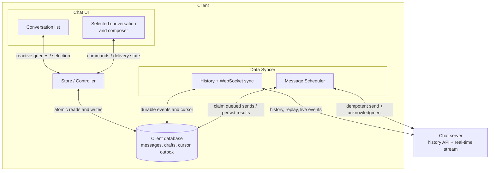
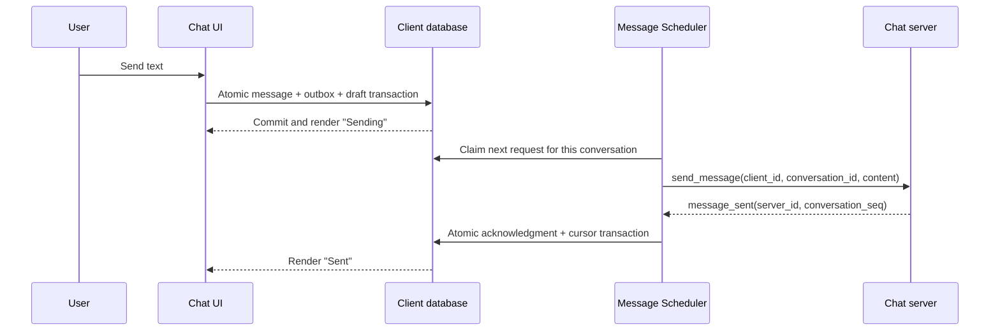
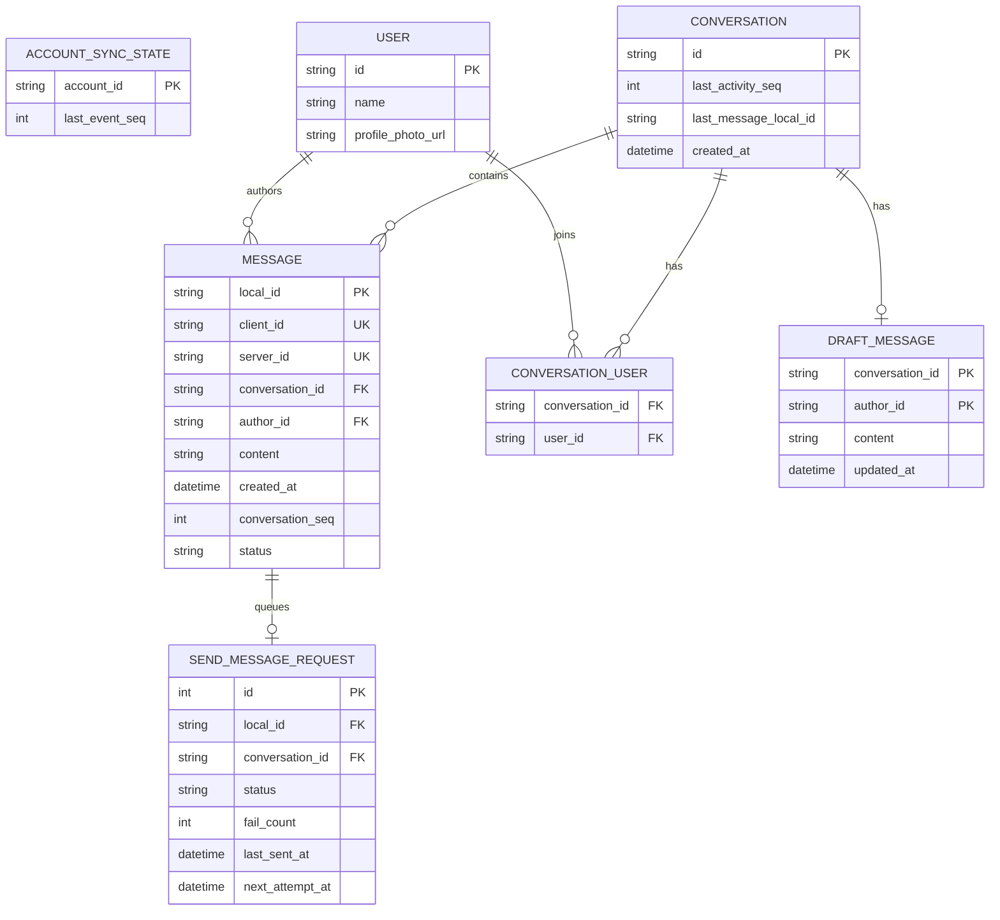

# Chat App (e.g. Messenger)

**Difficulty:** Hard · **Duration:** ~30 min · **Topics:** Networking

> Source: [chat-application-messenger](https://www.greatfrontend.com/questions/system-design/chat-application-messenger)

## Question

Design a browser-based 1:1 chat application that supports text messages, real-time delivery, optimistic sending, offline queuing, delivery states, and reconnect catch-up. Assume one active tab per account for the core design.

Group conversations, rich media, calls, search, push notifications, end-to-end encryption, and coordinated multi-tab ownership are potential follow-ups rather than core requirements.


### Real-life examples

These products demonstrate the messaging, delivery-state, and conversation-navigation patterns in scope.

- [Messenger](https://www.messenger.com)
- [WhatsApp Web](https://www.whatsapp.com)
- [Slack](https://www.slack.com)
- [Discord](https://www.discord.com)
- [Telegram](https://www.telegram.org)

## Solution

### Requirements exploration

Start by fixing the reliability contract. This design covers a browser-based 1:1 text chat with real-time delivery, optimistic sends, offline queuing, delivery states, and reconnect catch-up.

The core journey is deliberately small:

- Open a conversation and read cached history.
- Send a text message and see it immediately.
- Receive messages without refreshing.
- Distinguish sending, sent, delivered, read, and failed states.
- Queue sends while offline and reconcile them after reconnecting.

Assume one active tab per account. Group conversations, rich media, calls, search, push notifications, end-to-end encryption, and coordinated multi-tab ownership are potential follow-ups.

The most important non-functional requirements are low perceived latency, no lost user intent, deterministic message ordering, and recovery from duplicated or replayed network events.

#### Check your understanding 1

Before evaluating WebSocket, SSE, and local-storage technologies for a browser chat, which missing product guarantees must be explicit? Select all that apply.

- [x] Which conversation types and message formats are core, and must users browse or send while offline?
  > Message shape and offline expectations determine local persistence, outbox behavior, and synchronization boundaries.
- [x] What ordering and delivery guarantees are required, which retries must be idempotent, and which failures need visible recovery controls?
  > These decisions define identifiers, cursors, outbox state, deduplication, and terminal failure behavior.
- [ ] Must the baseline use a managed WebSocket service, or can it combine SSE with HTTP sends?
  > That is an implementation choice to evaluate after ordering, offline, retry, device, and failure guarantees are known.
- [x] How should multiple devices behave, and is coordinated ownership across browser tabs part of the baseline or a follow-up?
  > Device and tab scope changes synchronization, local namespaces, and whether clients need explicit cross-context coordination.

### Architecture / high-level design

The chat client is local-first: the UI reads from a persistent client database, while a Data Syncer reconciles that database with the server. The real-time connection is a transport, not the UI's source of truth.

> **Write locally before using the network**
>
> A message should appear immediately and survive a reload even when the network is unavailable. Persist the optimistic message and its outbox work first, then let the Data Syncer send and reconcile it asynchronously.

The main components are:

- **Chat UI**: Renders the Conversations List, selected conversation, composer, delivery states, and recovery controls.
- **Store/Controller**: Exposes reactive queries and short database transactions to the UI.
- **Client database**: Stores the account's cached conversations, messages, drafts, sync position, and outgoing requests.
- **Data Syncer**: Owns the WebSocket, reconnect loop, durable-event application, and Message Scheduler.
- **Message Scheduler**: Claims queued sends, preserves FIFO order within each conversation, retries transient failures, and exposes terminal failures.
- **Server**: Provides history APIs, an authenticated real-time event stream, idempotent message creation, and authoritative ordering.

The architecture diagram shows these boundaries and the data flow among the UI, local storage, synchronization components, and server.

**Local-first chat client architecture**



#### Sending a message

The synchronous user action ends at the client database. One IndexedDB `readwrite` transaction spans the `Message`, `SendMessageRequest`, and `DraftMessage` stores:

1. Generate a stable `local_id`, reuse it as the outgoing `client_id`, and insert a `Message` with `status: "sending"`.
2. Insert a `SendMessageRequest` that references the same `local_id`.
3. Delete the matching saved draft.
4. Publish the database-change notification and render the message only after the transaction commits.

If the transaction aborts, none of the three mutations take effect. The composer keeps its text and shows a recoverable local-storage error.

The network portion happens later and can be retried without changing the optimistic row's identity.

**Optimistic send and acknowledgment**



#### Receiving and reconnecting

The Data Syncer opens an authenticated WebSocket and subscribes with the account's last committed event sequence. The server first replays missed durable events, then streams live events over the same connection.

Each durable event is applied in one database transaction together with every affected row, derived conversation metadata, and the new account cursor. A crash therefore cannot commit an event without its cursor or advance the cursor without its data.

The client reconnects with capped exponential backoff after a dropped socket. Replayed events are expected: upsert by durable identity, ignore already-committed event sequences, and request catch-up rather than guessing if a gap appears.

#### Rendering strategy

Use client-side rendering for the authenticated chat application. Messages are private, highly interactive, and not search-engine content, so server rendering adds limited value compared with a small application shell that hydrates from IndexedDB and then reconnects.

#### Check your understanding 2

A signed-in chat client must show cached conversations while offline, render a sent message immediately, and reconcile it after reconnecting. Which architecture best supports those requirements?

- [x] Use a persistent local database as the reactive UI source, with store transactions and a separate syncer owning transport, retries, and reconciliation.
  > The Store can commit immediate local state without the network, while the Data Syncer keeps transport and reconciliation logic out of UI components.
- [ ] Use component memory as the UI source, persist only server-confirmed messages, and let each conversation view call the transport directly.
  > Direct network coupling loses durable pending work on reload and spreads retry and deduplication logic across the UI.
- [ ] Use server-rendered conversation snapshots as the UI source and refetch after each local send or streamed event.
  > A long-lived, highly interactive private application needs local state and streaming updates rather than repeated document renders.
- [ ] Use the WebSocket event buffer as the UI source, adding IndexedDB only as a periodically refreshed read cache.
  > A connection is a transport, not durable storage, and cannot support offline browsing or recovery.

#### Check your understanding 3

A chat client writes an optimistic message, queues its send request, and removes the saved draft when the user presses Send. A local storage failure can occur during this work. Which design preserves the user's intent without showing state that was never durably saved?

- [ ] Render the optimistic message immediately, then write the message, request, and draft changes independently.
  > If a later write fails, the UI can show a send that has no durable outbox work or lose a draft that was never queued.
- [x] Commit the optimistic message, outbox request, and draft deletion in one local transaction, then render after it succeeds.
  > One commit makes the message and its send work durable together. An aborted transaction leaves the draft available for recovery.
- [ ] Write each record separately and recreate earlier records if a later write fails.
  > Compensation can itself fail or be interrupted, leaving partially saved intent where an atomic transaction would provide an all-or-nothing boundary.
- [ ] Start the network request first and persist local state only after the server responds.
  > A network-first path cannot preserve offline sends or recover the user's intent after a reload before the response arrives.

#### Check your understanding 4

A reconnecting chat client receives a durable event that changes a message and its conversation preview. The client may crash at any point while applying it. How should it persist the event sequence?

- [ ] Advance the account cursor first, then update the message and conversation in later writes.
  > A crash after the cursor write would make reconnect skip an event whose data was never applied.
- [ ] Commit the message row and new cursor together, then update the conversation preview in a later write.
  > A crash after the first commit leaves the cursor past an event whose derived conversation state was never applied, so replay will not repair the preview.
- [x] Commit the changed rows, derived conversation metadata, and new account cursor in one transaction.
  > The transaction ensures reconnect sees either the old cursor and old data or the new cursor and complete event effects.
- [ ] Update the cursor only when the next connection heartbeat succeeds.
  > Heartbeats show transport health, not whether a durable event and all of its data changes committed locally.

### Data model

The data model separates stable local identity, server identity, per-conversation message order, and the account-level event cursor. Those values solve different problems and should not be overloaded.



#### Message identity and ordering

Every message has an immutable `local_id`, which is the IndexedDB primary key and React key for the row's lifetime. For an outgoing message, the client generates this value before the transaction and also sends it as `client_id`. For a message first learned from history or an incoming event, the client can derive a stable local value from `server_id`.

The server later supplies a nullable, unique `server_id`; acknowledging an optimistic message updates the existing row rather than replacing it. Keeping `local_id`, `client_id`, and `server_id` separate avoids requiring incoming messages to have a sender-scoped idempotency key.

The server also assigns `conversation_seq` transactionally when it accepts a message. Confirmed messages are ordered by `(conversation_id, conversation_seq)`, never by sender time or arrival order. Pending messages have no `conversation_seq`; render them after confirmed messages in their local enqueue order until acknowledgment places them canonically.

`created_at` remains useful for display, but client clocks cannot establish identity or ordering.

#### Conversation ordering

Each durable account event has an `event_seq`. An accepted or incoming message updates `Conversation.last_activity_seq` from that authoritative account sequence, so devices converge on the same conversation-list order for that account. Delivery and read receipts still advance the account cursor but do not reorder the Conversations List.

A local pending send may temporarily surface its conversation using a separate in-memory or client-only `pending_activity_at` value. It must not overwrite the authoritative `last_activity_seq`; acknowledgment replaces the provisional placement.

#### Drafts, outgoing requests, and failure states

`DraftMessage` is unique by `(conversation_id, author_id)` and persists text across reloads. Writes can be debounced or flushed on blur rather than performed on every keystroke.

`SendMessageRequest` references the stable `local_id` and stores the conversation, retry count, last attempt, next attempt, and one of these states:

- `pending`: Ready to send when the connection is healthy.
- `in_flight`: Sent and waiting for an acknowledgment.
- `retry_wait`: A transient failure is waiting for backoff.
- `terminal`: Automatic retries ended; the user must retry, copy, or discard the message.

The request and original message content remain available in the terminal state. Never silently delete old or exhausted sends. An explicit retry reuses the same `client_id`; discard is the only action that removes the user's intent.

#### Account boundary

Use a separate IndexedDB namespace for each authenticated account, such as `chat:<account_id>`. The sync position, cached entities, drafts, and outbox all live inside that namespace.

On account change, stop the old Data Syncer before opening the new namespace. On logout, clear that account's local database by default; any retained encrypted offline cache requires an explicit product and reauthentication policy.

#### Check your understanding 5

A message may be rendered optimistically, survive a reload, receive a server ID, and later be replayed during reconnect. Which data-model decisions preserve its identity and ordering through that lifecycle? Select all that apply.

- [x] Give every message row an immutable local ID. For outgoing messages, also retain the client-generated idempotency ID after the server assigns its durable ID.
  > The local ID remains the storage and rendering identity, while the client ID lets retries and acknowledgments locate the optimistic send without replacing the row.
- [ ] Persist outgoing messages only after the first network attempt; keep queued offline messages and drafts in component-local state until then.
  > A reload before the first attempt would lose queued intent. Durable outbox state must begin when the user sends, while drafts follow their own persistence policy.
- [x] Persist outgoing request status, retry count, and last-attempt time in a client-side outbox.
  > Durable scheduler state survives reloads and lets retries resume deterministically.
- [ ] Replace the optimistic row's local primary key with the server message ID when acknowledgement arrives, then order it by the sender's timestamp.
  > Replacing the key destabilizes rendering and references, while sender timestamps still cannot provide canonical order.
- [x] Store a server-assigned per-conversation sequence for canonical message ordering and a separate account event cursor for reconnect replay.
  > Message position and replay progress are different concerns. Separating them avoids client clock skew without making history pagination advance the event stream.

#### Check your understanding 6

A conversation receives a message, then a read receipt, while the local user also has an unacknowledged outgoing message in another conversation. Which state should determine the durable order of the conversation list?

- [ ] Move a conversation to the top whenever any receipt or message event arrives.
  > Receipts advance synchronization but do not represent new conversation activity, so arrival order would reshuffle the list unexpectedly.
- [ ] Sort by the newest sender-supplied or local timestamp from any rendered message.
  > Client clocks can be skewed, so their timestamps cannot make different devices converge on one durable order.
- [ ] Persist a pending send's local enqueue time as the conversation's authoritative activity value.
  > A pending send may provisionally show a conversation, but it has no server order yet and must not replace authoritative activity state.
- [x] Use the server activity sequence from accepted or incoming messages, while keeping pending placement separate and provisional.
  > Server-authored message activity gives devices the same durable order. Receipts leave it unchanged and acknowledgment replaces provisional placement.

#### Check your understanding 7

A browser chat switches from account A to account B and later logs B out. Which actions keep cached messages, drafts, outgoing work, and synchronization state within the correct account boundary? Select all that apply.

- [x] Stop account A's Data Syncer before activating account B.
  > Otherwise the old syncer can continue applying events or sending queued work after the visible account has changed.
- [ ] Reuse one database namespace and distinguish accounts only when rendering rows.
  > Rendering filters do not prevent account A's cursor or queued requests from affecting account B's synchronization and scheduler work.
- [x] Store account B's cache, drafts, cursor, and outbox in a namespace dedicated to B.
  > A per-account namespace makes the persistence and synchronization boundary explicit instead of relying on every query to filter perfectly.
- [x] Clear B's local database on logout unless the product defines secure offline retention and reauthentication.
  > Cached private data should not remain available by accident. Retaining it requires an explicit security policy rather than an implicit convenience.

### Interface definition (API)

The client uses HTTP for paginated reads and one WebSocket for live commands and account events. Both surfaces use the same authenticated account and conversation-authorization rules.

#### Send command and server idempotency

Every send attempt carries the same immutable request identity and payload.

```json
{
  "type": "send_message",
  "client_id": "tmp_01HW...",
  "conversation_id": "c_01HW...",
  "content": "See you at 7!"
}
```

The server enforces uniqueness on `(sender_account_id, client_id)`. It atomically assigns the conversation sequence and stores the message. If an acknowledgment is lost, an identical retry returns the original `server_id` and `conversation_seq`; reusing the same `client_id` with different content fails validation.

To preserve a sender's intended order, the scheduler permits only one in-flight send per conversation while allowing sends to different conversations in parallel. It does not start the next send for a conversation until the prior request is acknowledged or the user explicitly discards it. A terminal failure remains visible at the head of that conversation's queue, where the user can retry or discard it without a later message overtaking it.

The acknowledgment is a normal durable event.

```json
{
  "type": "message_sent",
  "event_seq": 48213,
  "payload": {
    "client_id": "tmp_01HW...",
    "server_id": "m_01HW...",
    "conversation_id": "c_01HW...",
    "conversation_seq": 817
  }
}
```

Applying it updates the optimistic row, advances the conversation metadata and account cursor, and removes the successful outbox request in one IndexedDB transaction.

Permanent validation or authorization failures move the request and message to a terminal failed state immediately. Timeouts and rate limits use capped exponential backoff; exhausting the cap produces the same visible state with Retry, Copy, and Discard actions.

#### Check your understanding 8

An optimistic message and its outbox request are already committed locally. The first send times out after the server may have accepted it. Which send and acknowledgment contract prevents a duplicate and reconciles the existing row?

- [x] Reuse one client ID and identical payload on every attempt; enforce sender-scoped uniqueness and acknowledge the client ID, server ID, and conversation sequence.
  > Sender-scoped idempotency lets the server return the original result after an ambiguous timeout, while the acknowledgment maps that result onto the existing optimistic row.
- [ ] Hash the message text and device timestamp on each attempt; deduplicate matching hashes and acknowledge only the server ID.
  > Two legitimate messages can share content, device timestamps are not authoritative, and the acknowledgment cannot directly identify the optimistic row.
- [ ] Reuse a client ID only within one socket connection, then generate a replacement ID whenever reconnect creates a new session.
  > A reconnect can follow an accepted send with a lost acknowledgment, so changing identity across connections turns a retry into a second message.
- [ ] Use the client ID as the durable server ID and use device creation time as the message's final conversation position.
  > A client may choose retry identity, but only the server can assign canonical conversation order across concurrent senders.

#### Check your understanding 9

A user queues messages A1 and A2 in one conversation and B1 in another. A1 reaches a terminal failure before acknowledgment. Which scheduler behavior preserves intended order without unnecessarily blocking unrelated work?

- [ ] Send A1, A2, and B1 concurrently and sort each conversation after acknowledgments arrive.
  > Server sequences reflect acceptance order, so concurrent A1 and A2 sends can make the later message overtake the earlier one.
- [x] Keep A1 at the head of its conversation until retry or discard, while allowing B1 to proceed independently.
  > One in-flight request per conversation preserves local send order, while per-conversation queues avoid turning A1 into an account-wide bottleneck.
- [ ] Send A2 after A1 fails so new messages do not wait for user action.
  > Bypassing the visible failed head lets A2 receive an earlier server position than A1 if the user later retries it.
- [ ] Block B1 and every other conversation until the user resolves A1.
  > Account-wide serialization preserves order more broadly than necessary and lets one failed conversation stall unrelated sends.

#### Local indexes

The hot client queries require a small set of deliberate indexes:

- `Message(conversation_id, conversation_seq)` for ordered history reads.
- Unique `Message(client_id)` for reconciling acknowledgments with this account's optimistic sends.
- Unique `Message(server_id)` for replay deduplication after acknowledgment.
- `SendMessageRequest(status, next_attempt_at, id)` for scheduler polling.
- `Conversation(last_activity_seq)` for the server-authoritative conversation list.
- Unique `DraftMessage(conversation_id, author_id)` for account-isolated drafts.

Native IndexedDB indexes support key lookups and ordered ranges, not full-text search. Text search needs a separate token index or a deliberately bounded scan and belongs in the follow-up discussion.

#### Check your understanding 10

A local chat database contains millions of messages across conversations. Which indexes match the hot client queries? Select all that apply.

- [x] Index messages by conversation ID and server-assigned conversation sequence.
  > The composite index returns one conversation's messages in sequence order without scanning unrelated records, and the same key supports backward history pages.
- [x] Index messages by client-generated ID.
  > Acknowledgments and failures can locate the optimistic row efficiently.
- [ ] Index messages by conversation ID and client-created timestamp, using that timestamp for both optimistic and confirmed ordering.
  > The compound index scopes the query, but clock skew can still reorder confirmed messages. Canonical reads need the server sequence.
- [x] Index outgoing requests by status, next-attempt time, and stable queue order.
  > The composite index finds work that is ready now and returns it deterministically without scanning or sorting the whole outbox.

#### History APIs

History reads use opaque pagination cursors that are separate from the account event sequence.

- `GET /conversations?limit=N&cursor=<opaque>` returns conversations in authoritative activity order plus `next_cursor`.
- `GET /conversations/:id/messages?limit=N&before=<opaque>` returns older messages plus `next_cursor`.

The first endpoint hydrates the Conversations List. The second only loads older history; reconnect catch-up comes from the durable account event stream.

#### Durable event stream

Every server-originated durable mutation uses one per-account sequence namespace.

```json
{
  "type": "incoming_message",
  "event_seq": 48214,
  "payload": {
    "server_id": "m_01HX...",
    "conversation_id": "c_01HW...",
    "conversation_seq": 818,
    "sender_id": "u_01HW...",
    "content": "See you then",
    "created_at": "2026-04-22T19:11:02.410Z"
  }
}
```

The account stream includes new messages, send acknowledgments, delivery and read receipts, edits, and tombstones. Every event advances `event_seq`, including events that do not create a message.

The client applies events with these rules:

1. Ignore an event at or below the last committed `event_seq`.
2. If the next sequence is missing, pause live application and request replay from the last committed sequence.
3. Upsert entities by durable identity and prevent delivery states from regressing.
4. Commit changed rows, derived conversation order, and `ACCOUNT_SYNC_STATE.last_event_seq` atomically.

Message history cursors never replace the account event cursor. This separation lets pagination move backward through one conversation while synchronization moves forward across every durable account mutation.

Use `wss:`, authenticate with a short-lived credential, and authorize every conversation-scoped command and history request. Render text messages as text rather than injecting HTML. More detailed socket hardening is a potential follow-up.

#### Check your understanding 11

A chat client is loading older messages in one conversation while durable message and receipt events continue arriving for the account. How should it track progress for those two flows?

- [ ] Use one numeric offset that advances for live account events and moves backward whenever an older history page loads.
  > Pagination walks one result set backward, while synchronization follows every account mutation forward. One offset cannot represent both positions.
- [ ] Derive reconnect progress from the oldest and newest message sequences currently mounted in the selected conversation.
  > The visible window omits other conversations and non-message events such as receipts, so it cannot describe account sync progress.
- [x] Use an opaque conversation-history cursor for pagination and a separate committed account-event cursor for reconnect.
  > Independent cursors let history move backward within one conversation while durable synchronization advances across the whole account.
- [ ] Keep separate cursor values, but advance the account-event cursor to the newest message returned by every successful history page.
  > A history response does not prove that intervening durable account events were received and committed.

#### Check your understanding 12

The last committed account event sequence is 40. After reconnecting, the client receives live event 42 before replayed event 41. How should it proceed when messages also have a separate per-conversation sequence?

- [x] Hold event 42, recover and commit event 41 first, then commit 42; place each message by its conversation sequence.
  > The client must close the account-stream gap before advancing its cursor, while the separate conversation sequence determines each message's rendered position.
- [ ] Commit event 42 and advance the account cursor, while recording event 41 as a gap to repair after live traffic settles.
  > Advancing past a missing durable event makes the cursor claim state the local database has not actually applied.
- [ ] Buffer gaps only when two events affect the same conversation; otherwise commit event 42 and leave event 41 for history pagination.
  > The account cursor sequences every durable mutation, so a gap matters even when adjacent events affect different conversations.
- [ ] Apply both events in account order and use their account event sequences as the final ordering of every conversation's messages.
  > Account order controls synchronization progress, but each conversation's server sequence controls message placement within that thread.

#### Check your understanding 13

A chat client has already recorded a message as read when replay delivers an older event that marks the same message as only delivered. How should reconciliation handle the replayed status?

- [x] Upsert the message by durable identity but retain the more advanced read state.
  > Replay may repair missing entity fields, but delivery state must merge monotonically so older events cannot undo confirmed progress.
- [ ] Replace the row with the replay payload because the durable stream is authoritative.
  > The stream is authoritative for mutations, but an older event can still arrive after a newer state and must not downgrade it.
- [ ] Keep whichever status event reached this device most recently.
  > Network arrival time does not establish causal order and can make delayed replays overwrite newer server state.
- [ ] Preserve both statuses by storing the replay as another message row.
  > Replayed events describe the same durable message, so appending creates a duplicate instead of reconciling its state.

#### Check your understanding 14

A chat client uses one persistent connection for live commands and separate HTTP requests for history. Which controls belong in the baseline security boundary? Select all that apply.

- [x] Use encrypted transport and authenticate the connection with a short-lived credential.
  > Encryption protects traffic in transit, while a short credential lifetime limits exposure when a session token leaks or expires.
- [ ] After authenticating the connection, accept any conversation ID supplied by that account.
  > Authentication establishes identity, not membership in every conversation. Trusting IDs alone creates an authorization gap.
- [x] Authorize every conversation-scoped command and history request on the server.
  > Per-action checks prevent an authenticated user from reading or mutating conversations they do not belong to.
- [ ] Render message content as HTML when it arrived through an authenticated event stream.
  > Authentication does not make user-authored content safe markup. Injecting it can execute content supplied by another participant.
- [x] Insert ordinary message content as text rather than interpreting it as markup.
  > Text rendering preserves the message while preventing user content from becoming executable HTML.

### Optimizations and deep dive

Optimistic writes, idempotent sends, deterministic ordering, and replay establish message consistency. The client also needs typing indicators, reconnect handling, efficient rendering, accessibility, and scroll preservation.

#### Typing indicators

Typing indicators are ephemeral rather than durable. Keep them in memory, omit them from the account event cursor, and do not retry or replay them after reconnecting.

Throttle `typing_start` on the sender and emit `typing_stop` on idle, blur, or send. On the receiver, keep a short expiry timer so a dropped stop event cannot leave the indicator visible indefinitely. Dropped, duplicated, or reordered typing events are acceptable because the state is only a temporary hint.

#### Check your understanding 15

A typing-stop event is lost when a recipient briefly disconnects. Which policies let the indicator recover without giving it durable-message semantics? Select all that apply.

- [ ] Keep the latest typing state in a short-lived server cache and replay it when a recipient reconnects within the expiry window.
  > Replayed activity can already be stale. Receiver-side expiry should clear the hint without turning reconnect into a typing-state recovery protocol.
- [x] Keep current typing state in memory and expire it on a short receiver-side timer.
  > Typing is ephemeral and stale signals should disappear automatically.
- [ ] Persist typing-stop events until every recipient device acknowledges them or its session expires.
  > Durable per-device acknowledgement adds message-like cost to transient state. Receiver-side expiry already clears a missed stop.
- [x] Allow dropped, duplicated, or out-of-order typing events without replaying them after reconnect.
  > A transient hint does not justify acknowledgments, durable ordering, or sync replay.

#### Network recovery

Connection state should be explicit: `connecting`, `connected`, `reconnecting`, and `offline`. A healthy WebSocket heartbeat is the authoritative signal; `navigator.onLine` is only a hint because it cannot prove the chat server is reachable.

The recovery policy is:

- Pause outbox claims while the socket is unhealthy.
- Reconnect with capped exponential backoff and jitter.
- Resume from the last committed account event sequence.
- Retry transient sends with the same `client_id`.
- Keep one in-flight send per conversation and bounded parallelism across conversations.
- Stop automatic retries at a visible terminal state rather than retrying forever or deleting the request.

#### Check your understanding 16

A mobile chat session repeatedly loses connectivity. Which behaviors create a resilient send and reconnect path? Select all that apply.

- [x] Pause outbox claims until a heartbeat confirms the chat connection is healthy.
  > A socket or browser network hint can exist without an end-to-end server path, so health must gate new sends.
- [ ] Treat `navigator.onLine === true` as proof that the chat service is reachable and immediately mark the connection healthy.
  > The browser signal only describes a network interface and cannot verify authentication, routing, or the server heartbeat.
- [x] Reconnect and retry transient failures with capped exponential backoff and jitter.
  > The cap bounds recovery delay, while jitter prevents many disconnected clients from retrying in lockstep.
- [ ] Flush every queued send as soon as a replacement socket opens, then request missed account events in the background.
  > An open socket does not prove catch-up is complete, so sending first lets new work run against stale conversation and delivery state.
- [x] Resume from the last committed cursor, apply the missing replay, and only then resume queued sends.
  > Catching up first restores canonical state and closes event gaps before new outgoing work can depend on stale local data.

#### Performance

Chat performance depends on bounding work at the UI, storage, and network boundaries.

- Virtualize long message histories and preserve a small overscan window.
- Key every bubble by immutable `local_id`. Status, content, and reactions are props, not parts of the key.
- Update only the appended or changed bubble and the affected conversation row.
- Batch IndexedDB reads through the `(conversation_id, conversation_seq)` index instead of issuing one read per message.
- Load older history in pages and lazy-load heavy composer tools.
- Reserve fixed media dimensions so resolved assets do not shift the scroll position.

#### Check your understanding 17

A conversation with years of history becomes slow whenever one new message arrives. Which change most directly fixes the rendering hot path?

- [x] Mount a bounded message window keyed by stable local IDs, and patch only the changed bubble and affected conversation row.
  > Bounded mounting and targeted updates prevent each event from re-rendering the full history.
- [ ] Virtualize the visible window but key bubbles by their current array index and rebuild the window whenever older history is prepended.
  > Windowing bounds mounted DOM, but index keys make a prepend change every identity and trigger avoidable bubble reconciliation.
- [ ] Keep the complete history mounted and memoize each bubble using a serialized copy of its full message record.
  > Memoization can reduce component work, but unbounded mounted DOM and repeated record serialization still grow with the conversation.
- [ ] Reload and replace the selected conversation snapshot from IndexedDB after every incoming event or delivery-state change.
  > A targeted event already identifies the affected rows, so replacing the snapshot amplifies reads and renders for a one-row change.

#### Accessibility

Incoming content must remain discoverable without interrupting composition or moving focus.

- Use a labeled `role="log"` for live message appends. Suppress announcements while hydrating cached content or prepending older history so a screen reader does not narrate the backlog.
- Announce routine new messages politely. Reserve assertive announcements for failures such as a send error or lost connection.
- Keep focus in the composer while messages arrive. Modal tools trap focus and restore it to their trigger when closed.
- On desktop, Enter may send and Shift+Enter may insert a newline, but never send while `KeyboardEvent.isComposing` is true. Provide a labeled Send button and define an appropriate mobile `enterkeyhint` behavior.
- Do not encode delivery states by color alone, and honor `prefers-reduced-motion`.
- Treat 44 by 44 CSS pixels as a generous product target; WCAG 2.2 AA permits a 24 by 24 CSS-pixel minimum with exceptions.
- Use logical CSS properties for RTL layout and determine text direction per message. Whether sender ownership sides mirror is a product convention, not an automatic consequence of RTL text.

#### Check your understanding 18

On reconnect, a chat prepends cached history, receives new messages, and shows a connection error while the user is typing. Which behaviors communicate the changes without replaying history or disrupting input? Select all that apply.

- [x] Append incoming messages to a labeled chat log with polite announcements, while suppressing announcements during cache hydration and history prepends.
  > Users hear genuinely new content after the current utterance without replaying old history or interrupting their typing and navigation.
- [ ] Show a red failed icon beside the message and put the detailed error in a tooltip reachable from that icon.
  > A tooltip can explain the failure once discovered, but the message still needs a programmatic status and a keyboard-reachable recovery control.
- [x] Announce the connection failure through a programmatic status and expose a keyboard-reachable recovery control without moving composer focus.
  > The failure becomes perceivable and actionable while the user's unfinished composition and focus remain stable.
- [ ] Move focus to the reconnect banner when it appears, then restore focus to the composer after connectivity returns.
  > Restoring focus later does not prevent the initial interruption. Announce the failure without moving focus unless the user invokes the banner.

#### Check your understanding 19

A desktop chat uses Enter to send and Shift+Enter for a newline. Some users compose characters with an input method editor (IME). Which behaviors keep sending intentional and accessible? Select all that apply.

- [x] Do not send when the Enter key event reports that text composition is still active.
  > During IME composition, Enter may confirm a candidate rather than express intent to submit the message.
- [ ] Send on every unmodified Enter keypress because the desktop shortcut is documented.
  > A documented shortcut does not distinguish submission from an IME candidate-confirmation event.
- [x] Provide a clearly labeled Send button in addition to the keyboard behavior.
  > A visible operable control gives pointer, touch, assistive-technology, and keyboard users an explicit submission path.
- [ ] Hide the Send button once the browser has observed the Enter shortcut successfully.
  > Prior shortcut use does not prove that every user or input mode can reliably use it, so removing the control weakens access.

#### Offline app behavior

IndexedDB makes cached conversations and pending sends available without a network connection. A service worker may cache the versioned application shell and static assets, but API responses and the WebSocket remain network-only.

The correctness baseline does not depend on background execution: the outbox survives closing the tab and the normal Message Scheduler resumes it on the next launch. A closed-tab Background Sync transport is optional and requires a separate idempotent HTTP mutation path, described under potential follow-ups.

#### Check your understanding 20

A send request with a stable client ID is already persisted when the user closes the offline app. On the next launch, which baseline resumes it without requiring closed-tab background execution?

- [x] Rehydrate pending and interrupted requests, reconnect and catch up, then let the normal scheduler retry the conversation head with its original client ID.
  > Startup recovery converts persisted work back into schedulable state and reuses its idempotency key only after the client has restored a healthy synchronization path.
- [ ] Mark every previously in-flight request as sent because the server might have accepted it before the app closed.
  > An ambiguous attempt needs an idempotent retry. Assuming success can leave a message permanently absent from the server.
- [ ] Copy each interrupted request into a new outbox entry with a new client ID before resuming the scheduler.
  > A new identity prevents the server from recognizing an earlier accepted attempt, so restart recovery can create duplicates.
- [ ] Treat a service worker that delivers every request while the app is closed as a prerequisite for preserving queued messages.
  > The correctness baseline can preserve work durably and resume it when the app next opens. Guaranteed closed-tab execution is not required.

#### Navigation and scroll position

Appending a live message and prepending older history require different scroll behavior.

If the reader is already pinned to the bottom, keep the view pinned as messages arrive. Otherwise preserve the visible content and show a new-message or Scroll to Bottom affordance. When older history is prepended, compensate for the inserted height or anchor to the first previously visible message.

Use fixed-size media placeholders, because late image sizing can otherwise move the viewport. Preserve a per-conversation scroll anchor in session state, and place an unread divider at the first unread message when opening a conversation.

#### Check your understanding 21

A user has scrolled up to read older messages when new messages arrive below and older history is prepended above. What should the interface do?

- [x] Anchor the visible content through prepends and show a new-message affordance instead of moving the reader to the bottom.
  > Retaining the current position keeps the reading context while still exposing that newer content is available.
- [ ] Keep the same numeric `scrollTop` after prepending older rows, and scroll to the bottom for each live message.
  > Prepended height changes what a numeric offset points to, while forced bottom scrolling abandons the reader's current context.
- [ ] Commit incoming messages to storage but leave the rendered list unchanged until the reader returns to the bottom.
  > Storage remains current, but hiding list changes prevents the reader from discovering new content and can invalidate list geometry around later prepends.
- [ ] Restore the same visible array index after a prepend and allow late-loading media above it to use intrinsic dimensions.
  > Prepending shifts array indices and unresolved media changes row heights, so neither value identifies stable visible content.

#### Potential follow-ups

These production concerns are useful interviewer follow-ups, but they should not displace the core send and sync design in a 30-minute answer.

- **Coordinated multi-tab ownership**: Let every tab write short IndexedDB transactions, but elect one network owner with Web Locks and notify peers with `BroadcastChannel`. A production design also releases resources on freeze or `pagehide` and uses a generation token so an old leader cannot resume beside a new one.
- **Very stale clients**: When the server can no longer replay from an old cursor, fetch a bounded recent snapshot. Preserve all data needed to replay unsent mutations (request, optimistic message or self-contained payload, conversation/account context, and attachment references) then revalidate the account and conversation before replay.
- **Closed-tab sending**: Background Sync cannot reuse a page-owned WebSocket. It needs an authenticated, idempotent HTTP send endpoint with the same `client_id`, ordering, result, and outbox-claim rules as the socket path, plus coordination when a page reopens.
- **Search**: IndexedDB has no native full-text index. Maintain a token or inverted index, usually in a worker, or scan only a bounded local window and use server search for nonresident history.
- **Push notifications**: Ask for notification permission from a visible user action, then create the Push subscription. Handle denial and revocation without weakening in-app delivery.
- **Attachments and binary data**: Upload bytes through resumable HTTP or object storage and send only the resulting reference through the chat protocol. Do not block the shared real-time connection with large attachment frames.
- **WebSocket hardening**: Validate the handshake origin, close sockets on logout or token expiry, authorize every action, validate event schemas and payload sizes, and rate-limit by account and connection.
- **Protocol evolution and product extensions**: Use explicit event types and tolerate unknown optional fields. Reactions are durable idempotent events; disappearing-message expiry is server-enforced and reconciled with tombstones rather than independent client timers.
- **Incoming flow control**: Cap frame and sync-page sizes, decode and apply through a bounded queue, and reconnect from the last committed cursor if the client cannot keep up.

### Summary

The core design is a local-first chat client with one persistent database and one Data Syncer. The UI commits an optimistic `Message`, its `SendMessageRequest`, and draft deletion atomically, then renders from IndexedDB. The Message Scheduler preserves FIFO order within each conversation and retries with the same `client_id`; the server enforces idempotency and assigns the durable `server_id` and `conversation_seq`.

Synchronization uses a separate per-account `event_seq`. Every durable event, affected entity, derived conversation order, and cursor advancement commits in one transaction. History pagination has its own opaque cursor, so loading older messages cannot corrupt reconnect state. The immutable `local_id` also gives React a key that survives acknowledgment and delivery-state changes.

For a concise interview answer, start with the local-first boundary, atomic optimistic send, idempotent server contract, per-conversation ordering, and account-level replay. Then cover virtualized rendering, accessible live updates, visible terminal failures, and scroll preservation. Multi-tab leadership, stale snapshots, closed-tab delivery, search, push, attachments, protocol evolution, and backpressure are follow-ups when the interviewer asks for production depth.

### References

The following references provide deeper background for the transport, storage, synchronization, and accessibility decisions in this design.

#### Messaging architecture and synchronization

These case studies describe ordered update queues, client persistence, and reconnect behavior in large messaging systems.

- [Building mobile-first infrastructure for Messenger](https://engineering.fb.com/2014/10/09/production-engineering/building-mobile-first-infrastructure-for-messenger/)
- [How Discord stores trillions of messages](https://discord.com/blog/how-discord-stores-trillions-of-messages)
- [Airbnb's approach to client-side messaging sync](https://medium.com/airbnb-engineering/messaging-sync-c1e9396b0363)

#### Browser platform primitives

These platform documents define the client storage, real-time transport, and accessibility semantics used above.

- [Indexed Database API 3.0](https://www.w3.org/TR/IndexedDB/)
- [The WebSocket Protocol](https://www.rfc-editor.org/rfc/rfc6455.html)
- [Web Locks API](https://developer.mozilla.org/en-US/docs/Web/API/Web_Locks_API)
- [Broadcast Channel API](https://developer.mozilla.org/en-US/docs/Web/API/Broadcast_Channel_API)
- [Using `role="log"` for sequential updates](https://www.w3.org/WAI/WCAG21/Techniques/aria/ARIA23)
- [UI Events composition behavior](https://www.w3.org/TR/uievents/)

#### Security and optional background capabilities

These references cover the safeguards and browser APIs intentionally left as follow-up depth.

- [OWASP WebSocket Security Cheat Sheet](https://cheatsheetseries.owasp.org/cheatsheets/WebSocket_Security_Cheat_Sheet.html)
- [Background Synchronization API](https://developer.mozilla.org/en-US/docs/Web/API/Background_Synchronization_API)
- [Push API](https://developer.mozilla.org/en-US/docs/Web/API/Push_API)

## Asked at these companies

- Airbnb
- OpenAI
- Anthropic
- Discord
- Snap
- Canva
- LinkedIn
- Harvey
- Meta
- Microsoft
- Roblox
- TikTok
- Uber
