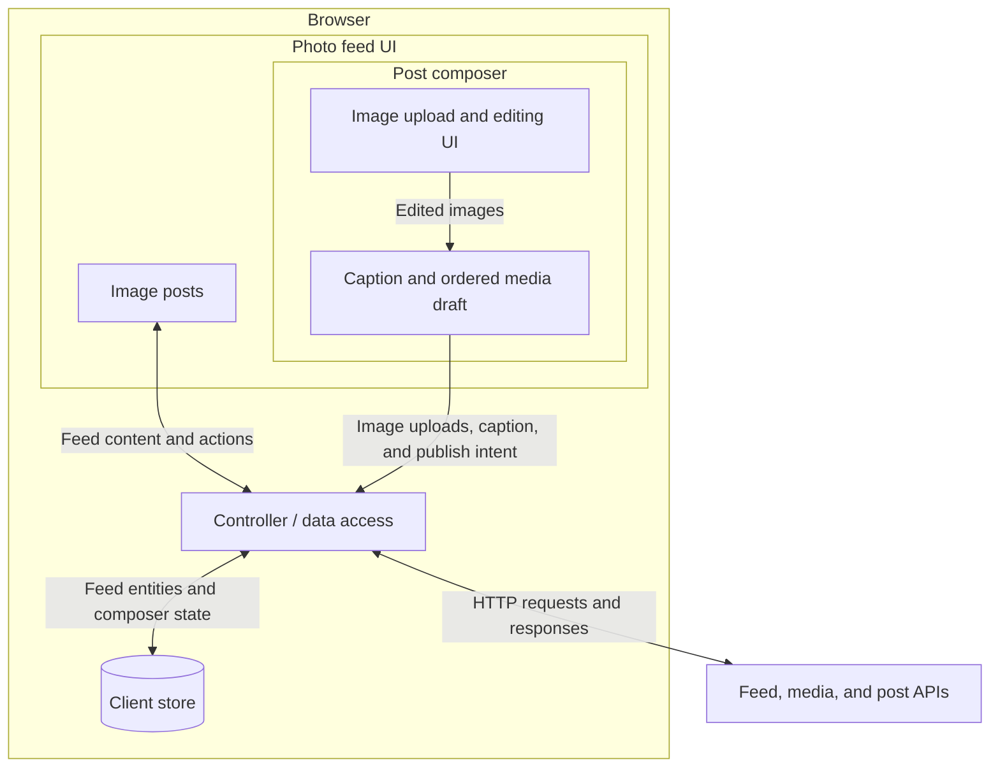
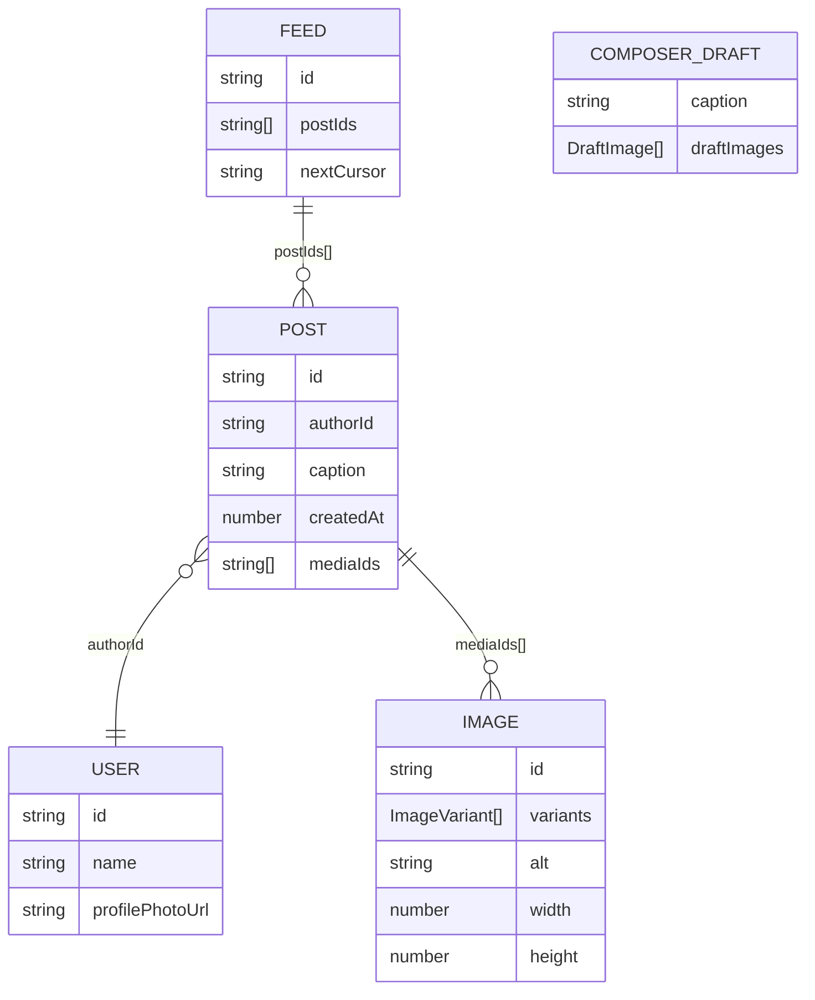
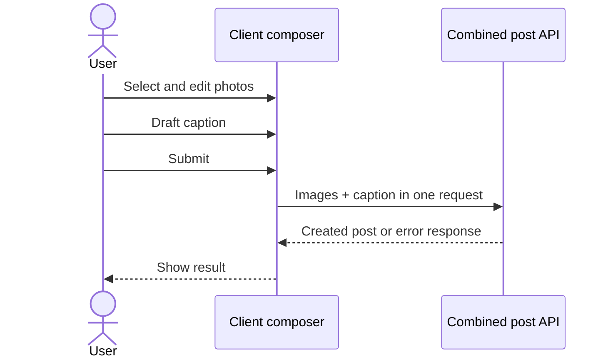
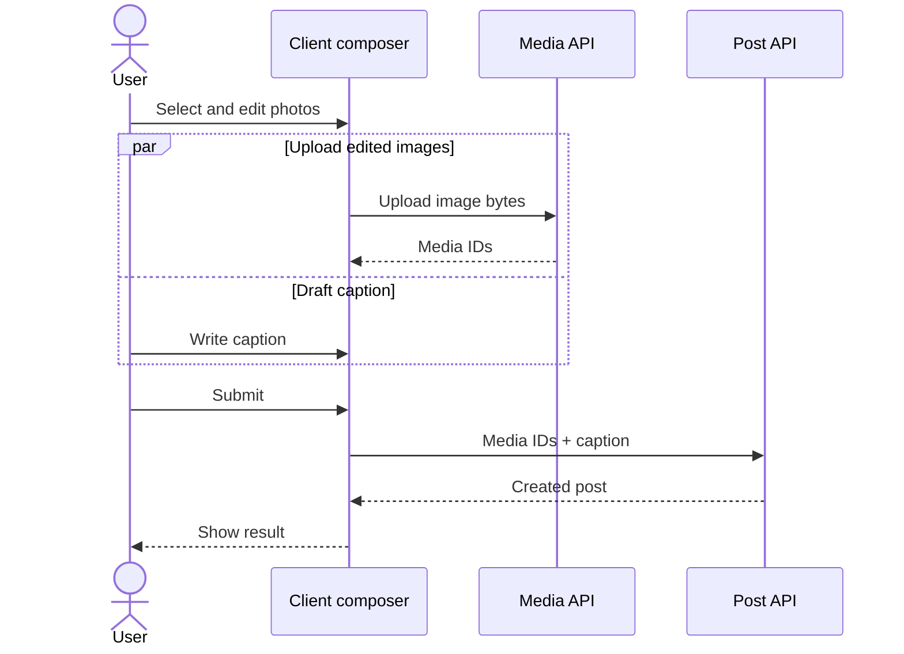
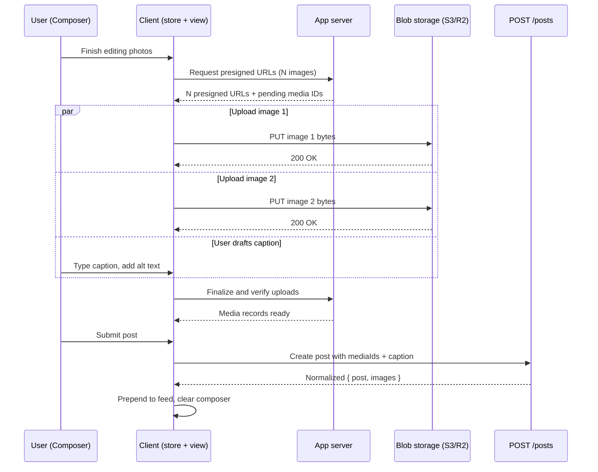
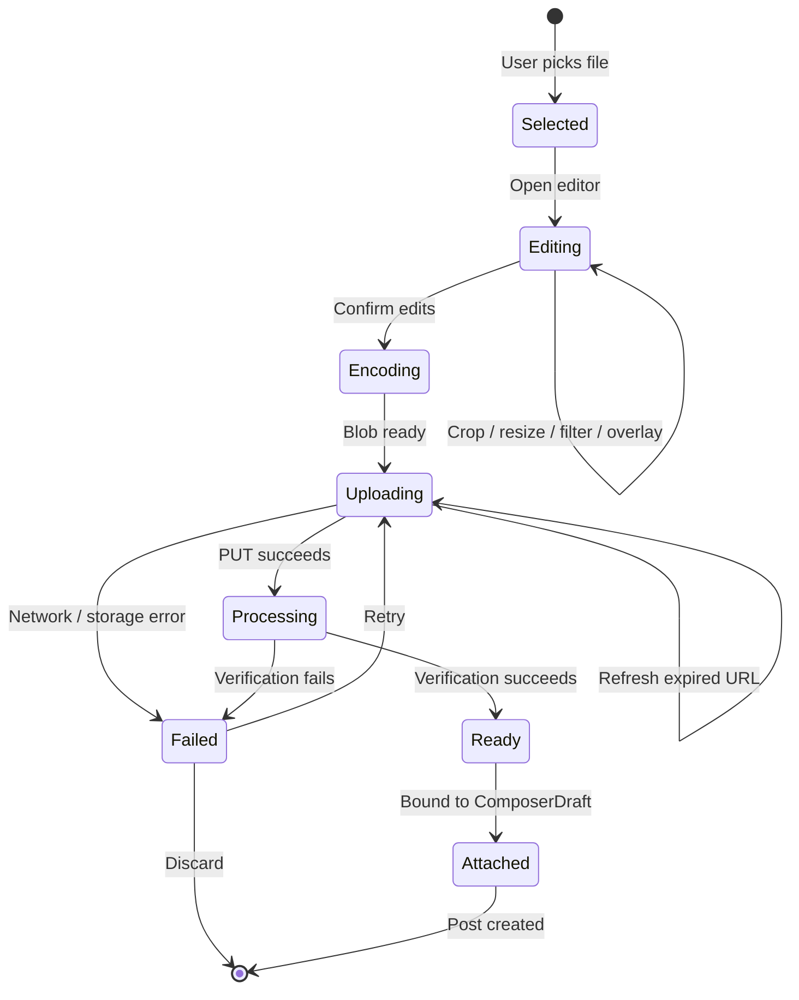
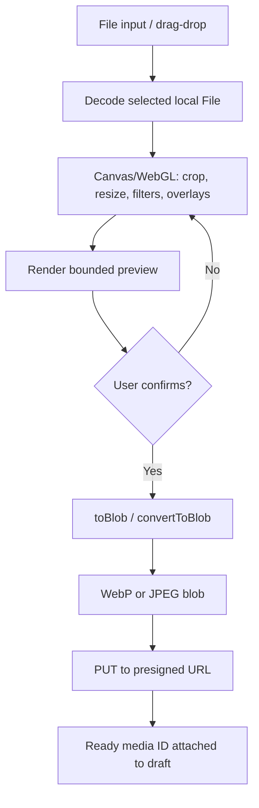

# Photo Sharing (e.g. Instagram)

**Difficulty:** Medium · **Duration:** ~30 min · **Topics:** Accessibility, Networking, Performance

> Source: [photo-sharing-instagram](https://www.greatfrontend.com/questions/system-design/photo-sharing-instagram)

## Question

Design a photo sharing application that contains a list of photo posts created by users. Users can create new posts containing photos. Public posts must also be viewable by logged-out users and discoverable by search engines.


### Real-life examples

- [https://www.instagram.com](https://www.instagram.com)
- [https://www.flickr.com](https://www.flickr.com)

## Solution

> **Related: News Feed and Image Carousel**
>
> This application shares many similarities with the [News Feed system design](https://www.greatfrontend.com/questions/system-design/news-feed-facebook) application, and the image carousels within the feed posts will benefit from the [Image Carousel system design](https://www.greatfrontend.com/questions/system-design/image-carousel). Those questions are optional deeper reading rather than prerequisites. For this question, we will focus on things that haven't been covered, and the discussion will be centered around the photos and images.

> **Photo sharing extends the News Feed design**
>
> The feed shape, pagination, rendering strategy, and store design are inherited from the News Feed write-up, and the in-post media UI is inherited from the Image Carousel write-up. In an interview, anchor on those defaults and spend your time on what is actually Instagram-specific: the image pipeline, upload flow, in-browser editing, and media-heavy rendering concerns.

### Requirements exploration

We scope the exercise by clarifying which user journeys are in play (browsing, uploading, editing), which pagination pattern the feed uses, and which image-specific concerns belong in the interview.

#### What are the core features to be supported?

- Browse a feed containing image posts by people a user follows.
- View individual public posts without signing in.
- Upload photos, add captions, and apply filters to them before posting.

#### What pagination UX should be used for the feed?

Infinite scrolling, meaning more posts will be added when the user reaches the end of their feed.

#### Is the user able to add captions to individual photos/images or only one overall caption to the post?

Only one overall caption to the post.

#### What devices will the application be used on?

Primarily mobile, but should be usable on desktop and tablet as well.

#### Check your understanding 1

You are asked to design a front-end photo-sharing experience centered on browsing and creating image posts. Which requirements should be included before choosing the architecture? Select all that apply.

- [ ] Include comments, direct messages, follower-graph updates, and recommendation ranking in the baseline because each can affect photo discovery.
  > Those systems affect the wider product but would displace the feed, public-post, and media-composer decisions in this design.
- [x] Cover browsing the followed-photo feed, opening a public post, and creating a post by selecting, filtering, and captioning photos.
  > These are the read and creation journeys the architecture must connect without expanding into the rest of the social product.
- [x] Use infinite scrolling for continuation and design primarily for mobile while keeping desktop and tablet usable.
  > Pagination and device mix determine how the feed loads, renders, and adapts across viewports.
- [x] Use one caption for the overall post and allow filters to be applied before upload.
  > The composer supports photo-level filter choices but does not need a separate caption model for every image.

---

### Architecture / high-level design

Because posts must be reachable by logged-out users and crawlable by search engines, the architecture depends on the rendering model and how the client talks to the image and feed APIs.

#### Rendering approach

Photo sharing applications have the following characteristics:

- Posts are viewable by non-logged-in users.
- Posts are searchable via search engines.
- The application is interaction-heavy due to post composing and liking/commenting functionality on posts.
- Fast initial loading speed is desired.

These are also characteristics of a [News Feed system design](https://www.greatfrontend.com/questions/system-design/news-feed-facebook), where there's a good amount of static content that also requires interaction. Hence, server-rendering public post pages with hydration and using client-side rendering for later interactions would be ideal.

#### Architecture diagram

**Photo-sharing client architecture**



- **Server**: Provides HTTP APIs to fetch feed posts, upload images, and to create new image posts.
- **Controller**: Controls the flow of data within the application and makes network requests to the server.
- **Client store**: Stores data needed across the whole application. In the context of a photo sharing application, most of the data in the store will be server-originated data needed by the feed UI.
- **Feed UI**: Contains a list of image posts and the UI for creating new posts.
  - **Image post**: A post containing a list of one or more images.
  - **Post composer**: UI for uploading images, applying filters to them, and adding a caption before submitting to the server.

#### Check your understanding 2

Public photo posts need crawlable content and fast entry, while feed and composer interactions should remain responsive after load. Which rendering boundary best fits?

- [ ] Server-render every feed continuation, carousel change, and composer step as a new document.
  > Public content is crawlable, but document navigation repeatedly discards the interactive feed and in-progress composer state.
- [x] Server-render public post entry pages with their visible content and metadata, then hydrate client-side feed, carousel, and composer interactions.
  > Public routes arrive as useful HTML while the long-lived client handles interaction without a full navigation for each action.
- [ ] Server-render title and preview metadata, but leave the public post body empty until client JavaScript fetches it.
  > Metadata alone does not make the actual post content or its links available in the initial document.
- [ ] Prebuild one generic photo feed and refresh it only at deployment time, then let clients upload posts into local state.
  > A build-time snapshot cannot represent personalized continuation or make newly created posts durable.

#### Check your understanding 3

A photo-sharing client needs a media-heavy feed and a post composer with uploads and editable drafts. How should it divide API requests, shared entities, media rendering, and draft input among components?

- [ ] Let each post component fetch its own author and media data, while the feed stores only an array of rendered post components.
  > Per-post orchestration creates duplicate requests and leaves no canonical place to deduplicate entities or coordinate page boundaries.
- [x] Use a controller for API flow, a normalized client store for shared server data, reusable post media components, and a dedicated composer for draft input.
  > Feed continuation, canonical entities, media display, and in-progress composition each retain a clear owner and lifecycle.
- [ ] Keep the composer as a modal-local form and infer upload completion from whether its preview image has rendered.
  > A rendered preview says nothing about remote upload progress or retry state, so closing or remounting the modal can lose an in-flight workflow.

---

### Data model

A photo feed shows image posts fetched from the server, so most durable data is server-originated. The client additionally keeps the active feed-request state and the user's in-progress images and caption in the post composer.

| Entity          | Source              | Belongs to       | Fields                                                                                                                |
| --------------- | ------------------- | ---------------- | --------------------------------------------------------------------------------------------------------------------- |
| `Feed`          | Server              | Feed UI          | ordered `postIds` and cursor                                                                                          |
| `Post`          | Server              | Feed Post        | `id`, `created_time`, `caption`, `authorId`, ordered `mediaIds`                                                       |
| `User`          | Server              | Client store     | `id`, `name`, `profile_photo_url`                                                                                     |
| `ComposerDraft` | User input (Client) | Post composer UI | `caption` and ordered draft images, each with its local source, edit parameters, upload state, and eventual `mediaId` |
| `Image`         | Server              | Multiple         | stable `id`, responsive `variants`, `alt`, `width`, `height`                                                          |

Just like in the [News Feed system design](https://www.greatfrontend.com/questions/system-design/news-feed-facebook), a normalized client-side store will also be useful for a Photo Sharing application.

The Feed UI also keeps transient request state (its request key, generation, and status) without treating that state as part of the server-originated `Feed` entity.

**Normalized client store for a photo feed with composer drafts**



> **Ship `width` and `height` with every image entity, not just the URL**
>
> Knowing the intrinsic dimensions up front lets the client reserve the correct aspect-ratio box before the image decodes, which is the main defense against cumulative layout shift in an image-heavy feed. It also lets the server or client pick the right `srcset` candidate without waiting for the bytes to arrive.

#### Check your understanding 4

Which data and state boundaries keep reusable server entities separate from composer workflow and feed-request state? Select all that apply.

- [x] Store posts by ID and reference ordered media records with dimensions and variants.
  > Ordered references preserve carousel sequence while reusable media records carry the dimensions and variants needed by both feed and detail views.
- [ ] Embed a mutable author and full post snapshot in each feed item so the view can render without entity lookups.
  > The convenience creates divergent copies when a profile, caption, or interaction count changes in one placement but not another.
- [x] Represent local media, upload progress, retry state, and server identity explicitly.
  > An explicit state machine distinguishes local preview, transfer, failure, retry, and server acceptance instead of treating upload as one opaque boolean.
- [ ] Treat the current canvas pixels as the edit source and recreate composer state from the mounted canvas when needed.
  > DOM lifetime is not durable workflow state, and a pixel-only representation loses the original plus reversible crop, rotation, and filter parameters.
- [x] Keep the active request key, generation, and status outside the server-originated Feed entity.
  > Request ownership changes with refreshes and navigation, while the canonical feed remains ordered server data identified by stable post IDs.

---

### Interface definition (API)

The client talks to four API surfaces: the feed list, public post details, image uploads, and post creation.

#### Feed list API

Like [News Feed's](https://www.greatfrontend.com/questions/system-design/news-feed-facebook) list API, the photo sharing application's feed list API should also use a **cursor-based pagination approach**.

Return ordered post IDs and normalized entities with an opaque next cursor. As part of its request state, the client captures the current feed generation when starting a fetch. It merges by stable post ID and ignores a response when its request key or captured generation no longer matches the active feed.

#### Public post API

`GET /posts/{postId}` returns only anonymously visible post, author, and media data. A stable public URL is server-rendered with a unique title, description, canonical URL, crawlable links, and image alternatives; private or missing posts return the appropriate non-indexable `404`/authorization response.

#### Post creation API

All posts in a photo sharing application have attached images. Hence, the post creation process in such apps is more complex.

Let's break down the post creation into steps:

1. User selects photos from their device.
2. User is able to perform light edits on their photos: resize/crop/filter.
3. User adds a caption to the post.
4. User submits post.

There are two common ways to implement post creation functionality involving images:

1. Create a single API for both image uploading and post creation.
2. Create separate APIs for image uploading and post creation.

##### 1. Create a single API for both image uploading and post creation

**One request for media upload and post creation**



Pros:

- Simple to implement, upload all required data in one request.

Cons:

- API logic is more complex because it has to do multiple things on the back end (though that's not really a concern of the front end).
- Upload will take longer because the post images have to be uploaded within one request.
- The API has to take in both text-based data and media data.

##### 2. Create separate APIs for image uploading and post creation

**Separate media uploads and post creation**



Pros:

- The image upload stage can be done in an async fashion. Images can be uploaded in the background after the image editing stage while the user is drafting the post caption.
- A small number of images can be uploaded concurrently across multiple HTTP requests, which is faster than uploading all the images in a single HTTP request without creating unbounded network work.
- Can leverage existing general image uploading APIs, if any.

Cons:

- More coordination is needed on the client. The client needs to wait for all the images to be uploaded, get references to the uploaded images, and use them when creating the post.

#### Which approach is better?

Comparing the two approaches, the separate APIs approach would be better.

- **Reusable**: The image uploading API can be a general one that is used across the entire website and not just for the post creation flow (e.g., profile image upload).
- **Reduced bandwidth**: Practically, blob storage solutions like Amazon S3 and Cloudflare R2 are used for storing static assets like images. Clients can request a presigned URL and upload directly to the storage buckets without going through the app servers, which reduces bandwidth, leading to lower server costs.

> **Upload photos via presigned URLs, then create the post by media ID**
>
> The client asks the server for a presigned URL, PUTs the image bytes straight to blob storage, and then calls the post creation endpoint with just the returned media IDs. This keeps large binaries off application servers, lets uploads run in parallel and in the background while the user is still writing the caption, and makes the final post creation a small JSON request.

The upload capability is short-lived and bound to the user, draft, object key, type, size, and checksum. The `ComposerDraft` owns each image's progress and retry state, requesting a replacement capability if one expires. Uploaded bytes remain non-public until the server verifies and re-encodes them, strips metadata, scans them, generates variants, and marks the media `ready`; `POST /posts` accepts only owned, ready media IDs.

For bounded photo sizes, a one-shot `PUT` is enough. If large files, unreliable mobile networks, or abandoned drafts become important, discuss resumable uploads, cancellation, and expiry-based orphan cleanup.

**Parallel presigned-URL uploads while the user drafts the caption**



If the interviewer asks about retrying an ambiguous post-creation timeout, reuse one idempotency key for the same submission so the server can return the original result instead of creating a duplicate post.

#### Check your understanding 5

A composer uploads several images while the author continues editing a caption. Which API boundary best separates binary transfer from final post publication?

- [x] Issue scoped upload targets with pending media IDs, upload bytes directly to blob storage, then create the post with the verified ready media IDs.
  > Staging keeps large transfers out of the post mutation and lets the final JSON request reference only media that completed server verification.
- [ ] Send the caption and every base64-encoded image through one post-creation request after the author finishes editing.
  > One request couples caption publication to every large transfer, so one failed image forces the mutation and its completed uploads to restart together.
- [ ] Upload directly to blob storage without creating media records, then pass the resulting storage object keys in the post mutation.
  > Raw object keys do not establish that the media belongs to the author or completed the application's verification pipeline.

#### Check your understanding 6

A feed refresh starts a new recommendation generation, but an older page request returns after the refreshed first page. How should the client handle the late response?

- [ ] Append the old page and remove duplicate post IDs after merging.
  > Deduplication removes repeated identities but cannot make results from an abandoned ordering valid in the new generation.
- [ ] Accept the response when it contains a next cursor that differs from the active feed cursor.
  > Different cursors can represent different feed generations, so inequality does not prove that the response belongs to the active request chain.
- [x] Capture the request key and feed generation, then merge by stable post ID only while both still match.
  > The generation prevents an obsolete ordering from contaminating the refreshed feed, while identity-based merging handles overlap within the valid generation.
- [ ] Abort the old request during refresh and accept any response that still reaches the completion handler.
  > Cancellation can race with completion or be unavailable, so the response still needs an ownership check before it mutates state.

#### Check your understanding 7

A photo post can be opened through a public URL by a signed-out visitor or crawler. Which contract choices keep that route useful without exposing viewer-specific data? Select all that apply.

- [x] Return only publicly visible post, author, and media fields and server-render them at a stable canonical URL.
  > The initial document can represent the public resource without serializing authenticated feed or viewer state.
- [ ] Render the current user's feed card payload, including viewer relationship and interaction fields, whenever the post itself is public.
  > Public visibility of the post does not make account-specific fields safe to disclose or cache anonymously.
- [x] Include a unique title, description, crawlable links, canonical URL, and meaningful image alternatives in the server response.
  > Search engines and link previews can understand the same public content that visitors receive.
- [ ] Return only route metadata from the server and fetch the post, author, and images after hydration.
  > The route exists, but its meaningful content and navigation are absent from the initial HTML.
- [x] Return an appropriate non-indexable not-found or authorization response for missing and private posts.
  > The route does not leak protected data or leave a misleading indexable shell for unavailable content.

#### Check your understanding 8

A mobile composer uploads several edited photos directly to blob storage while the user writes a caption. Which policies keep the upload capability bounded and retryable? Select all that apply.

- [x] Scope each short-lived upload capability to the account, draft, object key, media type, size, and checksum.
  > A leaked capability can authorize only the intended upload for a limited time instead of arbitrary storage writes.
- [ ] Issue one reusable upload URL for the whole draft and let the client choose object keys and content types for every retry.
  > Client-selected scope turns one leaked URL into broader write access and weakens server validation of the intended media.
- [x] PUT media bytes directly to blob storage with a small concurrency limit while caption editing can continue.
  > Direct bounded transfers keep large binaries off the application server without creating unbounded mobile network and memory work.
- [ ] Send every image through the final post-creation endpoint so the application server can report one aggregate progress value.
  > Coupling binary transfer to post creation makes partial retries expensive and prevents uploads from progressing independently of submission.
- [x] Keep progress and retry state on the draft image and request a replacement capability for the same pending media identity after expiry.
  > Credential refresh can resume the logical upload without duplicating the draft item or losing its edit and progress state.
- [ ] Allocate a new media and draft-image identity whenever an upload URL expires, then leave cleanup to the user.
  > Retrying the same logical image under new identities creates duplicate pending media and makes orphan cleanup harder.

#### Check your understanding 9

The blob store accepted every photo in a draft, but the application has not attached them to a post yet. Which checks should complete before publishing? Select all that apply.

- [ ] Let the client create the post as soon as each direct PUT returns success because storage acceptance proves the bytes are publishable.
  > Storage confirms receipt, not ownership, safe content, valid encoding, or completion of the server's media pipeline.
- [x] Have the server verify and re-encode the media, strip metadata, scan it, generate delivery variants, and mark the media record ready.
  > Server-controlled processing establishes the trusted artifact and variants that public clients are allowed to render.
- [ ] Accept a client-reported MIME type and checksum as sufficient proof that the uploaded file is safe and correctly encoded.
  > Client validation improves feedback but cannot replace server verification of untrusted bytes.
- [x] Allow post creation to reference only media IDs owned by the submitting account and already in the ready state.
  > The final mutation cannot attach another user's upload or publish media that is still pending or failed.

### Optimizations and deep dive

The deeper discussion builds on the News Feed optimizations but pays extra attention to image-heavy concerns, upload flow, and media accessibility:

- [Feed optimizations](#feed-optimizations): This section explains which News Feed performance and state-management techniques also apply to an Instagram-style feed.
- [Image carousel optimizations](#image-carousel-optimizations): This section covers the carousel behavior used when a post contains multiple images.
- [Rendering images](#rendering-images): This section discusses image formats, sizing, CDN delivery, lazy loading, and responsive rendering.
- [Image editing](#image-editing): This section explains in-browser cropping, resizing, filters, stickers, text overlays, and upload preparation.
- [Accessibility (a11y)](#accessibility-a11y): This section covers text alternatives, keyboard interaction, and screen-reader support for an image-first product.

#### Feed optimizations

The optimizations covered in the [News Feed system design](https://www.greatfrontend.com/questions/system-design/news-feed-facebook) also apply. Locally, keep rendering bounded, retain a focused virtualized post, and restore navigation by stable post anchor rather than only a pixel offset.

- Rendering approach
- Infinite scrolling implementation
- Virtualized lists
- Code splitting JavaScript
- Loading indicators
- Preserving feed scroll position
- Lazy load code
- Optimistic updates
- Timestamp rendering
- Icon rendering

#### Check your understanding 10

A photo feed keeps loading older pages while new posts can arrive. How should it avoid duplicate or skipped posts and limit rendering work during a long session? Select all that apply.

- [x] Continue with server-provided cursors so new insertions do not shift older-page boundaries.
  > A cursor anchors continuation to server-defined ordering, reducing skips and duplicates when newer posts arrive above the current window.
- [ ] Cache each page as an immutable nested snapshot and concatenate pages without reconciling overlapping post IDs.
  > Page immutability does not prevent overlap from rendering duplicate posts or retaining conflicting snapshots of the same entity.
- [x] Merge entities by ID and append only unseen feed references.
  > Identity-based merging makes overlapping pages harmless and updates an existing post without inserting another feed entry.
- [ ] Keep all visited posts mounted but pause offscreen media so reverse scrolling remains instant.
  > DOM, decoded-media, observer, and component costs grow without bound. A windowed feed can preserve essential view state without retaining every node.
- [x] Bound mounted work while preserving focused or actively viewed posts.
  > Bounded mounting protects memory and interaction latency, while retaining focused content avoids removing the user's current keyboard context.

#### Check your understanding 11

A user opens a post, returns to a virtualized feed, and finds that responsive image sizing changed some card heights. What should drive restoration?

- [ ] Apply the previous document scroll offset after the feed renders.
  > The same pixel can point to different content after card geometry or the mounted virtualization window changes.
- [ ] Fetch a new feed generation and start at the top so the restored layout is internally consistent.
  > Replacing the generation discards the user's browsing trail instead of returning to the post they opened.
- [ ] Keep every visited post mounted while detail is open so the browser preserves exact scroll geometry.
  > DOM, observer, and decoded-image costs then grow without bound during a long feed session.
- [x] Restore the feed generation and stable post anchor, then reapply its relative offset and focus in the rebuilt window.
  > Content identity remains meaningful when pixels and mounted nodes change, while the relative offset restores the user's local position.

#### Image carousel optimizations

The images within a post are shown as a carousel, so the [Image Carousel system design article](https://www.greatfrontend.com/questions/system-design/image-carousel) is also useful for this question. Locally, load the active and adjacent slides, identify each slide by stable media ID, and expose a post-specific carousel label plus slide position such as “2 of 5”.

#### Check your understanding 12

Which carousel-loading policy best balances fast post rendering and smooth next-slide navigation?

- [x] Load the active responsive image, reserve its geometry, and prefetch only adjacent slides when budgets allow.
  > The visible image receives the critical bandwidth, layout remains stable, and limited look-ahead hides common navigation latency without downloading the whole post.
- [ ] Preload and decode all carousel images at their largest available size before revealing the first slide.
  > Later slides delay the content the user is actually waiting for and can exhaust bandwidth and decoded-image memory on a long carousel.
- [ ] Load only the active slide and begin the next request after navigation, using a skeleton during the transition.
  > It minimizes speculation but guarantees network latency on the most predictable next action. Bounded adjacent prefetch offers a better tradeoff.

#### Rendering images

- Use modern image formats such as [WebP](https://developers.google.com/speed/webp), which provides superior lossless and lossy image compression.
- ``s should use proper `alt` text.
  - Prefer author-provided text. A generated fallback should be labeled and editable so the author can correct sensitive, speculative, or poorly localized descriptions.
- Image loading based on device screen properties
  - The server can use request signals such as Client Hints to choose a stable candidate family, provided those signals vary the cache key.
  - Return stable variants with intrinsic dimensions and use `srcset`/`sizes` so the browser makes the final choice for the rendered slot and device pixel ratio.
- Image caching and loading priority
  - Use versioned URLs for processed variants so browsers and CDNs can cache them without coupling the image bytes to caption or alt-text updates.
  - Load the likely first-viewport LCP image eagerly and lazy-load offscreen images.
- Adaptive image loading based on network speed
  - **Devices with good internet connectivity/on WiFi**: Prefetch offscreen images that are not in the viewport yet but are about to enter the viewport.
  - **Poor internet connection**: Render a low-resolution placeholder image and require users to explicitly click on it to load the high-resolution image.

> **Serve multiple sizes and modern formats, and let the browser choose**
>
> Produce WebP (or AVIF) variants at several widths during the upload pipeline and expose them via `srcset` plus `sizes`. The browser will then pick the right candidate for the current viewport and device pixel ratio, which matters far more in a photo-first feed than in a text-heavy one because images dominate both byte budget and perceived load time.

#### Check your understanding 13

Which image-rendering choices improve visual stability and bandwidth use? Select all that apply.

- [x] Provide responsive sources and an accurate `sizes` hint.
  > Candidate widths plus the expected slot size let the browser avoid downloading pixels the current layout cannot use.
- [ ] Use one high-resolution source per photo so feed and detail placements can reuse the same cached URL.
  > Reusing one image across pages does not remove the first oversized transfer or decode cost for feed slots that cannot display the extra pixels.
- [x] Reserve width, height, or aspect ratio before loading.
  > Known geometry reserves the media box before bytes arrive, preventing feed content from shifting during scroll.
- [x] Lazy-load below-the-fold feed images while prioritizing the likely LCP image.
  > Offscreen images stop competing with the likely LCP asset, while prioritizing that first visible image avoids applying lazy loading indiscriminately.
- [ ] Render cropped photos as CSS backgrounds and put the photo description on the surrounding card link.
  > A card label describes the destination but does not give meaningful media native image semantics, responsive source selection, or its own text alternative.
- [x] Use a low-resolution or color placeholder inside the reserved media box while the selected source loads.
  > A bounded placeholder provides early visual feedback without changing the final geometry or requiring the full-resolution asset up front.

#### Check your understanding 14

A photo composer can receive author-written alternative text or offer a generated suggestion. Which policies preserve author control? Select all that apply.

- [ ] Auto-fill the generated description and publish it unless the author opens a separate advanced setting before submission.
  > An opt-out hidden away from the composer still treats uncertain generated text as authoritative instead of requesting meaningful author review.
- [x] Prefer author-provided alternative text over a generated suggestion.
  > The author's description reflects their intended context and should not be silently replaced by generated output.
- [ ] Use the visible post caption as the image's alternative text whenever the author leaves the dedicated field empty.
  > A caption can add commentary rather than describe the image, and repeating nearby text can add noise without supplying an equivalent.
- [x] Clearly label generated text as a suggestion that the author can review, edit, replace, or remove.
  > Generated descriptions can be inaccurate, sensitive, or poorly localized, so explicit provenance and editing keep the author in control.

#### Check your understanding 15

A post's caption and alternative text can change without changing its processed image bytes. Which URL-versioning rule keeps media caching independent from mutable post metadata?

- [x] Give each processed image variant a stable versioned URL that changes only when that variant's bytes change.
  > Browsers and CDNs can cache immutable media independently from mutable caption and accessibility metadata.
- [ ] Append the post's latest `updatedAt` value to every image URL, including after caption-only edits.
  > The timestamp is easy to obtain but invalidates immutable image bytes whenever unrelated post metadata changes.
- [ ] Keep one permanent URL per variant and overwrite the object in place after a crop or encoding change.
  > Existing browser and CDN entries can continue serving the old bytes because the URL does not identify the new representation.
- [ ] Generate fresh signed image URLs whenever the feed is fetched, even when the variant bytes and viewer permissions are unchanged.
  > Constant URL churn prevents repeat views from reusing otherwise immutable public media and couples caching to feed-request timing.

#### Image editing

In-browser editing covers three capabilities before upload: cropping and resizing, applying filters, and drawing overlays like stickers or text.

**Per-image lifecycle from selection to attached media**



##### Cropping and resizing

Cropping and resizing of the images can be done via HTML5's `<canvas>`.

```js
const canvas = document.getElementById("image-editor");
const context = canvas.getContext("2d");
const file = fileInput.files[0];
const image = await createImageBitmap(file);
context.drawImage(image /* crop/resize parameters */);
```

Starting from the selected local `File` avoids a tainted cross-origin canvas and waits for decoding before drawing. Keep the source immutable, bound preview resolution, and move expensive transforms to a worker with `OffscreenCanvas` when profiling shows main-thread cost.

A lightweight editor can use inline transform and filter styles to preview changes before exporting the same parameters into the final bitmap.

##### Filters

CSS provides a [`filter`](https://developer.mozilla.org/en-US/docs/Web/CSS/filter) property which allows applying filter functions like `blur`, `contrast`, `hue`, and `sepia`, to name a few. By using a combination of these filter functions, you can achieve Instagram-like filtering functionalities right within your browser.

Here are examples of the 1977 and Brannan filter effects, taken from [Instagram.css](https://picturepan2.github.io/instagram.css/).

```css
.filter-1977 {
  filter: sepia(0.5) hue-rotate(-30deg) saturate(1.4);
}

.filter-brannan {
  filter: sepia(0.4) contrast(1.25) brightness(1.1) saturate(0.9)
    hue-rotate(-2deg);
}
```

The following images are enhanced right within your browser using these CSS filters.

| Original                                                                                                    | 1977                                                                                                                                | Brannan                                                                                                                                |
| ----------------------------------------------------------------------------------------------------------- | ----------------------------------------------------------------------------------------------------------------------------------- | -------------------------------------------------------------------------------------------------------------------------------------- |
|  |  |  |

The final upload must match the preview. Apply the same crop, rotation, overlays, and filter parameters in one origin-clean Canvas/WebGL pipeline, then export with `toBlob()` or `OffscreenCanvas.convertToBlob()`; a CSS-only preview is not itself an exported bitmap.

**In-browser editing pipeline from file picker to uploaded blob**



#### Check your understanding 16

Which practices keep basic client-side photo editing responsive during repeated adjustments? Select all that apply.

- [ ] Send the full-resolution bitmap through a worker and block the preview on every input event.
  > A worker protects the UI thread only when the interaction can continue asynchronously. Blocking every gesture on full-resolution work still makes feedback slow.
- [x] When profiling shows expensive pixel work, move it to a worker or GPU-backed path.
  > Isolating pixel work prevents filter and crop computation from blocking pointer input, animation, and form controls on the UI thread.
- [ ] Apply every input event directly to the full-resolution canvas so the preview always matches the eventual export exactly.
  > Exact pixels are not useful if each gesture stalls. A bounded preview can represent the transformation while final export runs only when needed.
- [x] Use a bounded preview resolution and produce the final export only when needed.
  > A smaller preview provides fast feedback, while delaying full-resolution export avoids paying its cost for every slider movement.

#### Check your understanding 17

A filtered crop looks correct in the composer preview, but the uploaded image is uncropped and unfiltered. Which editing pipeline prevents that mismatch?

- [x] Keep the source and edit parameters, using the same origin-clean Canvas or WebGL transformation pipeline for preview and final export.
  > Preview and final export derive from one transformation model, so responsiveness can use a bounded preview without changing the result.
- [ ] Apply CSS transforms and filters to the preview, then upload the original file because the styles already describe the desired appearance.
  > CSS changes only the displayed element. It does not modify the bytes sent to storage.
- [ ] Overwrite the current preview bitmap on every adjustment and export those pixels when the user submits.
  > Repeated destructive transforms lose fidelity and make undo or a higher-resolution final render unreliable.
- [ ] Load the displayed CDN image into a canvas for final export without requiring an origin-clean source.
  > Cross-origin pixels can taint the canvas and block export, while the selected local file is already a safe source.

#### Accessibility (a11y)

An image-first product leans heavily on text alternatives and keyboard operability, which are covered in the screen reader and keyboard interaction subsections below.

##### Screen readers

- `` tags should have a meaningful `alt` description specified or use an empty string.
- Add `aria-label`s to the prev/next buttons within an image carousel.
- Give each carousel a post-specific label and a non-focusable `role="region"` or `role="group"` container with `aria-roledescription="carousel"`; expose each visible slide as a named group with its position and set size.
- Icon-only buttons should have the appropriate `aria-label`s if there are no accompanying labels (e.g., heart, share, bookmark).

##### Keyboard support

- Use the `<button>` HTML tag for the Prev/Next buttons where possible so that the buttons are focusable.
- Keep native Previous/Next buttons in the tab order. Do not add a redundant focus stop to the carousel wrapper unless the component deliberately defines its own composite keyboard interaction.

#### Check your understanding 18

Which practices make a photo-sharing feed accessible? Select all that apply.

- [ ] Send every reaction-count change from currently mounted cards through a polite live region.
  > Restricting updates to mounted cards still produces unrelated, high-frequency announcements. Reserve them for relevant action results or intentionally followed activity.
- [x] Expose author-provided or contextual alternative text for meaningful images.
  > Purposeful text makes visual post content available when the image cannot be perceived or loaded.
- [x] Use real labeled controls and expose slide position for multi-image posts.
  > Semantic buttons provide keyboard behavior, and position context tells non-visual users where they are in the ordered media set.
- [ ] Label icon actions with hover and focus tooltips but omit programmatic accessible names.
  > A visible tooltip can help some pointer and keyboard users, but assistive technology still needs a programmatic name for the control.
- [x] Make Like, Comment, Save, and composer actions reachable with visible focus.
  > Reachable controls and visible focus provide equivalent operation without depending on pointer gestures or icon recognition.

---

### Summary

**Treat Instagram as News Feed plus Image Carousel plus a media delta.** Once the inherited feed and carousel mechanics are named, focus on the Instagram-specific image pipeline, upload flow, in-browser editing, and media-heavy rendering concerns.

**Most of the scaffolding comes from News Feed and Image Carousel.** The Server, Controller, and normalized Client store shape the feed as in News Feed, with ordered post and media IDs rather than nested copies. Cursor-paginated requests drive a virtualized, infinite-scroll Feed UI so memory stays bounded as the user scrolls, while stable IDs and the feed generation keep page merges consistent. Each post hosts the Image Carousel patterns for multi-image navigation, with `srcset` and `sizes` picking the right asset per viewport and accessibility defaults such as image alternatives, labeled controls, and named slide positions.

**The media pipeline is the Instagram-specific design.** The Post composer asks the Server for a scoped upload capability per image, then PUTs a bounded number of images directly to blob storage while the user composes the caption. Post creation is a second call that references verified, ready media IDs, keeping the `ComposerDraft` submission small and the stored `Image` entities immutable. In-browser cropping, resizing, and filters use one Canvas/WebGL pipeline so the exported bitmap matches the preview. Every `Image` ships with `width` and `height` metadata so the Feed UI can reserve aspect-ratio boxes and avoid layout shift as posts hydrate. The upload, edit, and submit flow is distinctly Instagram's and deserves explicit walkthrough.

Spend interview time on the presigned-URL upload pipeline, the `<canvas>`-based editor, and the layout-stability contract around `width`/`height`; the inherited feed mechanics can be named quickly and moved past.

---

### References

References are grouped by topic.

#### Instagram engineering case studies

These references inform the overall client architecture, caching, and bundle-size choices discussed throughout the optimizations section.

- [Making Instagram.com faster: Part 1](https://medium.com/instagram-engineering/making-instagram-com-faster-part-1-62cc0c327538) for baseline performance work and the measurement approach behind the redesign.
- [Making Instagram.com faster: Part 2](https://medium.com/instagram-engineering/making-instagram-com-faster-part-2-f350c8fba0d4) for additional client-side loading and rendering strategies relevant to a photo feed.
- [Making Instagram.com faster: Part 3 — cache first](https://medium.com/instagram-engineering/making-instagram-com-faster-part-3-cache-first-6f3f130b9669) for the cache-first data access pattern referenced in the client caching discussion.
- [Making Instagram.com faster: Code size and execution optimizations (Part 4)](https://medium.com/instagram-engineering/making-instagram-com-faster-code-size-and-execution-optimizations-part-4-57668be796a8) for code-splitting and execution tuning on a long-lived feed surface.

#### Accessibility

This reference informs the accessibility recommendations for the feed.

- [Crafting an accessible Instagram feed](https://about.instagram.com/blog/engineering/crafting-an-accessible-instagram-feed) for feed-specific accessibility patterns, focus management, and assistive technology considerations.
- [Launching Instagram Messaging on desktop](https://about.instagram.com/blog/engineering/launching-instagram-messaging-on-desktop) for how a large photo product layered real-time messaging onto an existing web client.

#### Image loading and performance APIs

These references back the image lazy-loading, infinite scroll, and rendering-strategy guidance covered in the optimizations section.

- [Intersection Observer API | MDN](https://developer.mozilla.org/en-US/docs/Web/API/Intersection_Observer_API) for infinite scroll triggers and prefetch boundaries around the viewport.
- [Lazy loading images and iframe elements | web.dev](https://web.dev/articles/browser-level-image-lazy-loading) for browser-native image lazy loading guidance used in the media optimization discussion.
- [Rendering on the Web | web.dev](https://web.dev/rendering-on-the-web/) for the SSR, CSR, and hybrid rendering background that informs the rendering approach for feed and profile pages.
- [Instagram.css](https://picturepan2.github.io/instagram.css/) for a community CSS reference that mirrors Instagram-style visual treatments when prototyping a photo feed.

#### Related system design articles

The articles below dive deeper into mechanics that are touched on but not fully explored here.

- [News Feed (Facebook)](https://www.greatfrontend.com/questions/system-design/news-feed-facebook) for the shared feed architecture, pagination, and client store patterns that a photo feed builds on top of.
- [Pinterest](https://www.greatfrontend.com/questions/system-design/pinterest) for masonry-style image layouts and additional photo-heavy performance considerations.

## Asked at these companies

- Airbnb
- Dropbox
- Meta
- Apple
- Roblox
