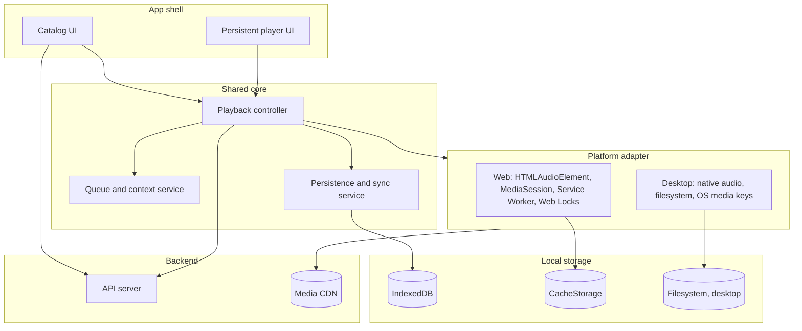
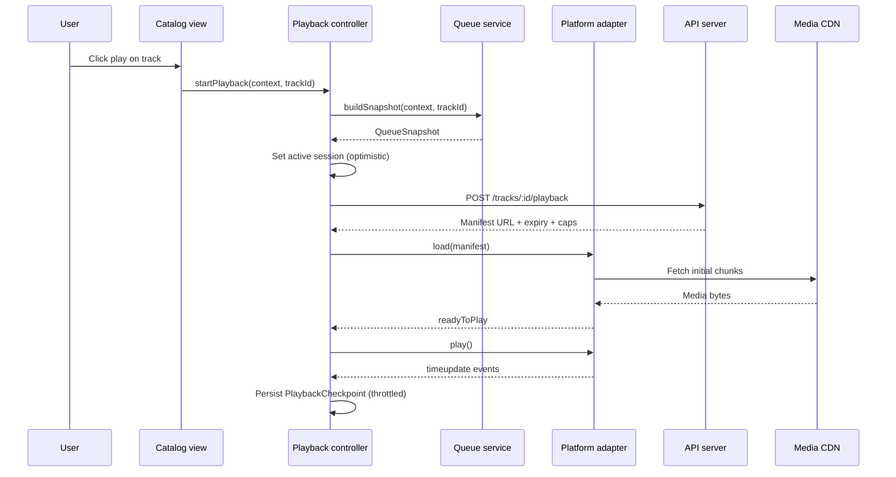
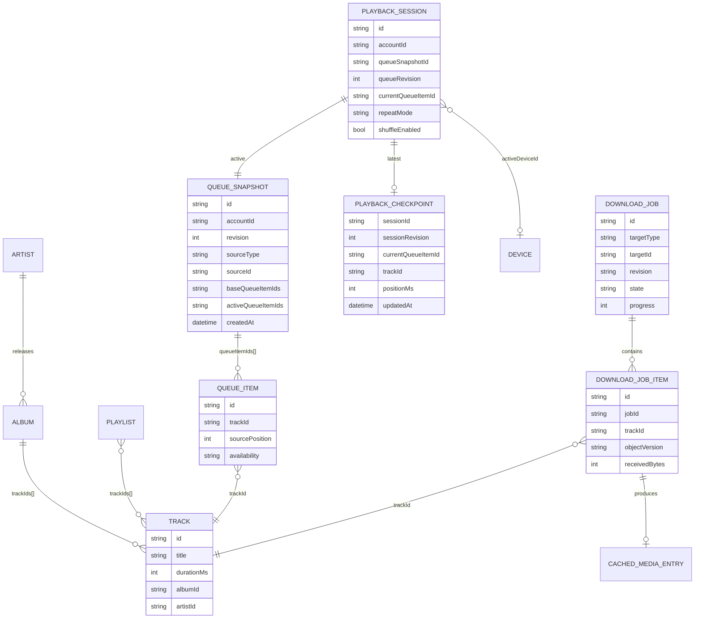
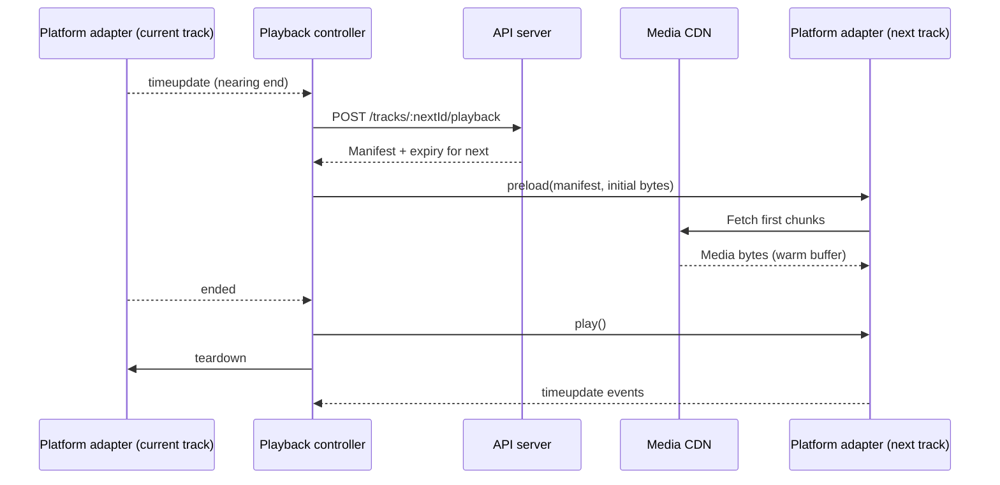
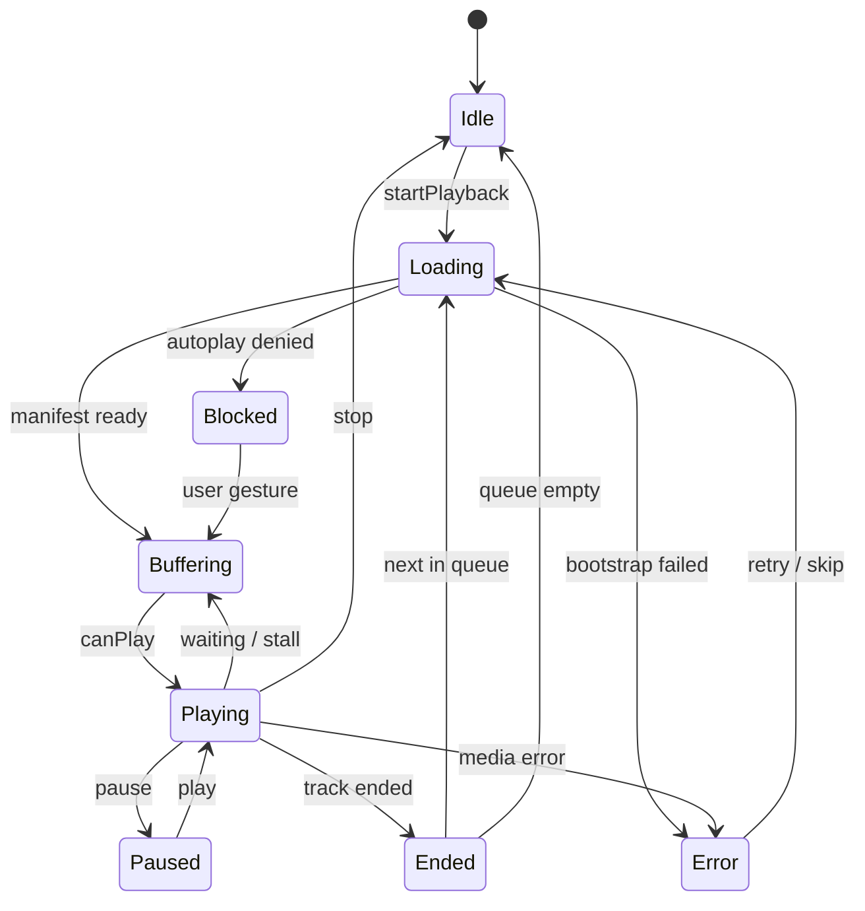
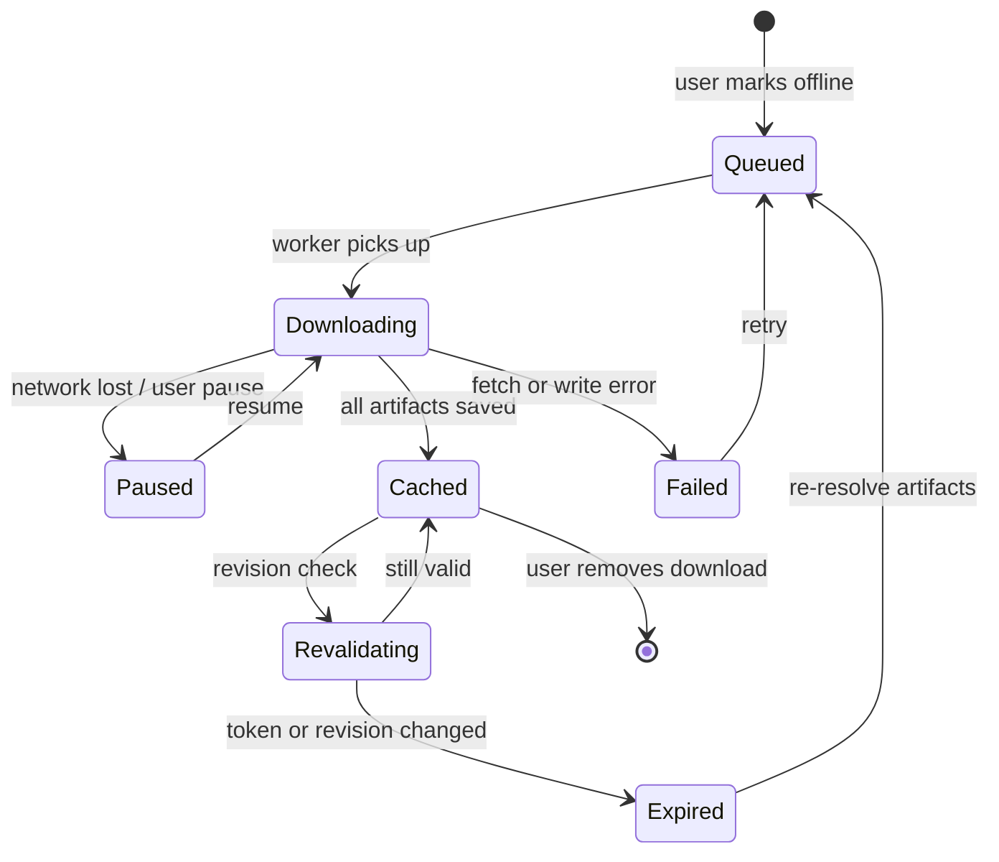

# Music Streaming (e.g. Spotify)

**Difficulty:** Hard · **Duration:** ~45 min · **Topics:** Networking

> Source: [music-streaming-spotify](https://www.greatfrontend.com/questions/system-design/music-streaming-spotify)

Music streaming combines content-heavy browsing with a player that must remain stable for hours across navigation, network changes, and platform constraints.

## Question

Design a music streaming application similar to Spotify, Apple Music, or YouTube Music that lets users browse and discover music, search for tracks and artists, open albums and playlists, and play audio with a persistent player and queue.

Focus on the front-end architecture and the client/server contract for browsing, playback, queue management, local persistence, and reconnect behavior. You do not need to go deep on recommendation ranking, music licensing, or the full audio ingestion and transcoding pipeline.

### Real-life examples

Examples include browser and desktop products with persistent playback and queue management:

- [https://open.spotify.com](https://open.spotify.com)
- [https://music.apple.com](https://music.apple.com)
- [https://music.youtube.com](https://music.youtube.com)

### Requirements

Scope the design around the catalog-to-playback journey and the continuity guarantees that support it.

- Users should be able to browse or discover music, search for tracks, artists, albums, and playlists, and open collection detail pages.
- Users should be able to play music with a persistent player while navigating between different parts of the application.
- Users should be able to manage a queue while moving between different playback contexts.
- The design should consider offline and reconnect behavior where relevant.
- You do not need to cover recommendation ranking, music licensing, or the full media ingestion and transcoding pipeline.

## Solution

### Requirements exploration

Designing a music streaming application is a useful front-end system design exercise because playback must persist across navigation, queue state must remain consistent during long listening sessions, and offline or reconnect behavior changes how the client stores and syncs data.

#### What are the core features to be supported?

The baseline covers browsing, starting playback, and maintaining one coherent listening session.

- Browse and discover music on home or editorial surfaces.
- Search for tracks, albums, artists, and playlists.
- Open artist, album, and playlist detail pages and start playback from any track.
- Keep a persistent player visible across navigation.
- Support queue operations such as play now, add next, append, remove, reorder, shuffle, and repeat.

#### Is this a web-only player or should it also cover desktop?

While the problem sounds platform-neutral, many interviewers really mean "design the Spotify Web Player". The web player is the best baseline answer because it is the stricter environment, while the same shared frontend core can also power a desktop shell.

- The **web shell** is the baseline target and owns browser playback, service workers, and browser storage constraints.
- The **desktop shell** is the extension path and can offer stronger offline guarantees, filesystem-backed downloads, and OS media integrations.

If the interviewer wants a web-only answer, the desktop shell can be collapsed and the shared core plus the web-specific pieces can stand on their own.

#### What should offline support mean?

Offline support matters, but it should not dominate the baseline architecture.

- On **web**, offline is best-effort because storage quotas, eviction, autoplay policies, and service worker lifecycle constraints vary by browser. The baseline promise should be cached metadata, artwork, local queue or session restore, and opportunistic cached playback when a previously fetched response is still available.
- On **desktop**, explicit offline downloads can be treated as a richer first-class capability because the shell can use durable local storage and OS hooks.

Start by focusing on local restore and reconnect behavior in the baseline flow. Reliable downloadable offline listening for tracks, albums, and read-only playlists fits better as a desktop or offline-capable-shell extension. Writable personal playlists and offline playlist editing are useful, but they belong to a deeper extension rather than the baseline flow.

#### What are the non-functional requirements?

Prioritize fast, uninterrupted, and recoverable playback over advanced audio effects.

- Fast time to first audio after the user presses play.
- Smooth transitions between tracks with minimal rebuffering.
- Queue state should stay consistent during long listening sessions and after refresh or restart.
- The product should behave gracefully during connectivity loss, reconnects, and partial offline availability.
- Playback controls should be accessible through keyboard, screen reader, and system media surfaces.

#### Check your understanding 1

Before choosing media, storage, and cross-tab technologies for a Spotify-like player, which missing product requirements could change those architectural boundaries? Select all that apply.

- [ ] Must protected audio be delivered through the existing CDN, or may the player fetch it directly from the media origin?
  > That implementation constraint matters only after startup, adaptation, entitlement, and offline guarantees define the required media contract.
- [x] Which browse, search, queue, shuffle, and repeat workflows are core, which platforms are targeted, and what offline guarantee does each platform promise?
  > Product workflows and platform guarantees determine the shared core, adapter boundaries, and persistence model.
- [x] Must playback survive navigation, refresh, restart, and multiple tabs, and is cross-device resume or remote control part of the baseline?
  > Continuity scope determines persistent session state, single-tab ownership, and whether server-mediated device control is required.
- [x] What startup and transition-quality targets apply, and which keyboard, assistive, and system-media controls are required?
  > These constraints shape buffering priorities, recovery expectations, and integration with platform controls.

---

### Architecture / high-level design

For products that have both web and desktop clients, a common and practical app architecture is to use platform-specific app shells wrapping a shared core. That is the main design choice for this problem. The baseline answer targets a web player, where the player, queue, and playback controller stay mounted above route changes. A desktop client can then reuse the same core while swapping in stronger playback and storage adapters.

#### Rendering approach

A hybrid rendering model fits well:

- Use server-side rendering for browse and detail routes when fast first paint, link previews, or search discoverability matter.
- Hydrate into a single-page application so navigation between browse surfaces does not recreate the player.
- Keep the persistent player, queue, and playback controller inside the app shell rather than inside individual pages.

If the interviewer wants a simpler answer, this can be framed as "SSR for content-heavy entry pages, then SPA-style navigation after hydration". The important architectural point is that playback state does not live inside route-local UI.

> **Mount the player above the router, not inside a route**
>
> The persistent player, queue, and playback controller must live in the app shell so route changes never unmount the audio element. Tearing down and remounting audio on navigation causes audible gaps, lost buffers, and broken Media Session state, so playback should not be owned by a page-level component.

#### Shared core plus platform adapters

Use a shared frontend core with thin platform-specific adapters around it:

- The **shared core** owns domain models, queue rules, playback state transitions, checkpoint persistence, reconnect policy, and client-side interfaces such as `startPlayback()`, `insertIntoQueue()`, and `restoreSession()`.
- The **web shell** owns browser-specific playback and storage concerns such as `HTMLAudioElement`, service workers, IndexedDB, CacheStorage, `MediaSession`, and cross-tab coordination.
- The **backend and CDN layer** provides browse/search metadata, playback bootstrap data, and media delivery, but it does not own the queue logic, which must remain responsive on the client.

For desktop, the same shared core can sit inside a desktop shell that swaps in native playback, filesystem-backed downloads, OS media controls, and stronger background behavior. That keeps the main interview answer web-first without giving up a clean extension path.

This keeps the hardest product logic in one place. Queue behavior, shuffle and repeat semantics, playback checkpoints, and reconnect handling should not diverge between web and desktop just because the playback and storage primitives differ.

State ownership should also be explicit:

- **Catalog state** such as artists, albums, playlists, and search results is server-originated data cached on the client.
- **Playback session state** such as the current track, base and active queue order, repeat or shuffle mode, and checkpoint position is client-owned, account-scoped state that should be restored locally first after refresh or restart.
- **Server continuity state** such as the last synced track, position, repeat or shuffle mode, source context, and device metadata is a smaller shared subset used for signed-in cross-device continuity, not an authoritative copy of the mutable queue.
- **Local media state** such as cached responses, downloaded files, and storage bookkeeping is adapter-owned local state exposed through stable interfaces to the shared core.

#### Component responsibilities

The persistent shell delegates product state to the shared core and environment-specific media work to platform adapters.

- **App shell**: Owns top-level navigation, route transitions, and the persistent player surface that stays mounted across pages.
- **Catalog UI**: Renders browse, search, artist, album, and playlist pages using server-originated metadata.
- **Playback controller**: Runs the playback state machine, handles play, pause, seek, skip, and reacts to readiness, failure, connectivity, and media-key events from the platform adapter.
- **Queue and context service**: Builds queue snapshots from search, artist, album, or playlist contexts, applies local queue mutations, and keeps shuffle and repeat behavior deterministic.
- **Persistence and sync service**: Stores queue snapshots, playback checkpoints, cached media metadata, and recent session information locally; pushes lightweight continuity checkpoints to the server when online; and reconciles local state after refresh, restart, or reconnect.
- **Platform adapter**: Hides environment-specific playback and storage APIs behind a stable interface used by the shared core.
- **API server**: Provides HTTP APIs to fetch recommendations, search results, artists, albums, playlists, and audio metadata.

**Shared core with platform adapters on web and desktop**



The browser version of the persistence layer should usually split structured state from media caches:

- IndexedDB for queue state, checkpoints, cache bookkeeping, continuity metadata, and entity metadata.
- CacheStorage for artwork, manifests, and opportunistically reusable media responses.

The desktop version can keep the same logical interfaces while backing durable downloads with the filesystem. On web, the baseline remains cache-first rather than download-first. The storage responsibility breakdown is covered in the offline storage responsibilities section under interface definition.

#### Playback flow

The main playback path should stay event-driven from end to end:

1. A user starts playback from a track, album, artist, or playlist page.
2. The catalog UI calls `PlaybackController.startPlayback()`, which asks the queue and context service to create a `QueueSnapshot` anchored to that source context.
3. The playback controller updates `PlaybackSession` immediately so the player reflects the requested track without waiting for the network round-trip.
4. The client requests playback bootstrap data for the active track, such as stream URLs, manifests, entitlement data, or capability flags.
5. The platform adapter loads and buffers the media, then emits readiness, progress, ended, and failure events back to the shared core.
6. The persistence and sync service writes a `PlaybackCheckpoint` in the background so refresh or restart can restore the session.
7. As the current track nears completion, the controller prefetches the next track's bootstrap data and warms the next playback handoff.

**Playback startup from user intent to first audio**



This split keeps UI responsiveness local while still relying on server-authoritative metadata and media URLs.

Failure handling should go through the same state machine rather than through one-off UI code paths:

- If playback bootstrap fails or a track is unavailable, mark the item as unavailable and either skip forward or show a recoverable error state.
- If the user is offline but the next item is already cached, the platform adapter can continue playback from local media without changing the queue model.
- If the user is offline and the next item is not cached, preserve the queue and checkpoint, but move the player into a blocked state that can recover automatically after reconnect.
- On web, if another tab becomes the active playback owner, keep queue and UI state in sync while handing playback control to the active tab.

#### Check your understanding 2

A web player will later support a desktop shell. Queue, shuffle, checkpoint, and reconnect behavior must stay consistent even though playback and storage primitives differ. Which architecture best fits?

- [x] Keep session semantics in a shared core behind platform media and storage adapters, mounting the web controller above route content.
  > Route changes cannot unmount audio, while web and desktop reuse queue and session semantics without hiding runtime differences.
- [ ] Implement queue, checkpoint, and reconnect rules separately in web and desktop so each can call its native APIs directly.
  > Direct platform access is convenient, but duplicating session rules lets queue order and recovery behavior diverge between clients.
- [ ] Put the mutable queue on the server and make both clients await each server mutation before playback advances.
  > A shared service can sync continuity hints, but network-gated queue changes make local playback fragile and unresponsive.
- [ ] Let each platform adapter own its queue shape so download and streaming fields can live beside runtime playback objects.
  > Adapters should hide runtime mechanics. Owning product queue semantics there recreates the platform divergence the shared core is meant to prevent.

#### Check your understanding 3

Browse and album entry pages need fast first paint and useful link previews, but music must continue while the listener navigates. Which rendering approach best satisfies both goals?

- [ ] Server-render every navigation and mount the audio player inside the destination route after each response.
  > Replacing the route-local player tears down the active media element, its buffer, and its playback state.
- [x] Server-render content-heavy entry routes, hydrate a client app, and keep the player above route content while later navigation happens in the client.
  > Entry pages retain their first-paint and preview benefits while client navigation leaves the active player mounted.
- [ ] Return an empty shell for every entry route and render all catalog content in the browser so the player can remain mounted.
  > Keeping playback client-side does not require giving up the entry-page benefits that selective server rendering can provide.
- [ ] Keep a route-local application for each page but move playback into a separate embedded frame that survives page replacement.
  > A second browsing context adds messaging and synchronization boundaries when one persistent application shell already solves the lifecycle problem.

#### Check your understanding 4

A music player spans catalog APIs, a shared client core, continuity sync, and platform storage. Which parts should own catalog records, the exact listening session, cross-device recovery hints, and stored media? Select all that apply.

- [x] Treat artists, albums, playlists, and search results as server-originated entities that the client may cache.
  > Catalog records remain canonical server data without becoming mutable playback-session state.
- [ ] Make the server's latest playlist or album order authoritative for every local queue insertion, removal, and reorder.
  > A listening session can diverge from its source collection, so server catalog order cannot reconstruct its exact ad hoc queue.
- [x] Keep the exact account-scoped queue, session, and checkpoint locally while syncing only a reduced continuity hint for cross-device recovery.
  > Local state preserves every queue edit, while the smaller server subset supports best-effort continuity without pretending to own the queue.
- [ ] Let the shared player core manage cached response bodies, downloaded files, and runtime-specific storage locations directly.
  > Media storage capabilities differ by runtime and belong behind the platform adapter rather than inside shared queue logic.
- [x] Let the platform adapter own cached or downloaded media and expose it to the shared core through stable playback and storage interfaces.
  > The core can apply one session model while web caches and desktop files retain their different lifecycle guarantees.
- [ ] Use the browser origin as the namespace for all listening state because only one account can be active in a tab at a time.
  > Origin storage is shared across sign-ins, so records and protected media still need explicit account scoping and cleanup.

#### Check your understanding 5

The visible player, queue, persistence layer, and media runtime all react to the same listening session. Which parts should coordinate playback transitions, queue edits, checkpoint recovery, and platform media operations? Select all that apply.

- [x] Have one playback controller normalize user commands and adapter events into application playback states.
  > A single transition owner keeps audio output, visible controls, and persisted session state synchronized.
- [ ] Let album and search views call the media primitive and update queue records directly so playback starts near the initiating button.
  > Route-level views can unmount or issue differently ordered updates, bypassing the persistent controller and queue rules.
- [x] Have the queue and context service build snapshots and apply deterministic insert, remove, reorder, shuffle, and repeat rules.
  > Keeping queue mutations together prevents catalog views or platform adapters from developing different ordering semantics.
- [ ] Make the service worker the source of truth for the active track and queue because it can intercept offline media requests.
  > Fetch interception can locate cached bytes, but it should not own playback intent or the mutable listening session.
- [x] Have persistence and sync commit checkpoints and reconcile recovery, while the platform adapter implements environment-specific media and storage primitives.
  > Durable state transitions and runtime mechanics remain independently replaceable without creating another player state machine.

#### Check your understanding 6

A listener presses Play on a track inside an album. Which startup sequence provides immediate feedback without confusing catalog context, playback authorization, and media readiness?

- [ ] Request playback bootstrap first, then create a queue and visible session only after the media adapter reports that audio can play.
  > Waiting for both network and media readiness makes the interface feel unresponsive and delays establishing the user's selected context.
- [ ] Send the album directly to the platform adapter, let it choose the next track, and persist whichever order its media events produce.
  > The adapter should load media, not own product queue semantics or construct the restorable session.
- [x] Build and expose the queue snapshot immediately, then fetch the playback contract, load media, play when ready, and checkpoint in the background.
  > Local intent becomes visible at once while protected delivery, media events, and durable recovery still pass through their proper boundaries.
- [ ] Persist the requested track and zero position first, start playback, and derive the queue from the current route after the first progress event.
  > A track-only checkpoint cannot preserve source context or ad hoc queue state, especially if navigation occurs during startup.

---

### Data model

The data model should follow the same ownership boundaries as the architecture. Catalog entities are server-originated and cached locally, playback session state is client-owned, and offline media bookkeeping stays in the local adapter layer.

| Entity               | Source                                                        | Used by                                                                      | Purpose / key fields                                                                                                                                                                                                                                                                                       |
| -------------------- | ------------------------------------------------------------- | ---------------------------------------------------------------------------- | ---------------------------------------------------------------------------------------------------------------------------------------------------------------------------------------------------------------------------------------------------------------------------------------------------------- |
| `Track`              | Server                                                        | Catalog UI, queue, playback controller                                       | Canonical playable unit. Key fields include `id`, `title`, `durationMs`, artwork references, artist or album references, and catalog-level streamability or availability flags. Stream URLs or manifests should come from playback bootstrap, not from the catalog entity itself.                          |
| `Album`              | Server                                                        | Catalog UI, queue and context service                                        | Read-only playback context with ordered `trackIds`, album metadata, and artwork.                                                                                                                                                                                                                           |
| `Artist`             | Server                                                        | Catalog UI, queue and context service                                        | Artist metadata plus entry points into top tracks, albums, and related playback contexts.                                                                                                                                                                                                                  |
| `Playlist`           | Server                                                        | Catalog UI, queue and context service                                        | Read-only playlist in the baseline article. Acts as a queue seed with ordered `trackIds` and playlist metadata, not as a writable user-owned model.                                                                                                                                                        |
| `QueueSnapshot`      | Client, persisted locally                                     | Queue and context service, playback controller, persistence and sync service | Materialized playback context created from search, album, artist, or playlist entry points. Key fields include `id`, `accountId`, `revision`, source identity, immutable `baseQueueItemIds`, realized `activeQueueItemIds`, and `createdAt`. This is the primary source of truth for exact queue restores. |
| `QueueItem`          | Client                                                        | Queue and context service, playback controller                               | Represents a track inside a queue snapshot. Key fields include stable `id`, `trackId`, `queueSnapshotId`, original source position, insertion mode, and session-level availability state.                                                                                                                  |
| `PlaybackSession`    | Client, persisted locally                                     | Playback controller, persistent player, persistence and sync service         | The current listening session. Key fields include account id, active queue snapshot id and revision, `currentQueueItemId`, repeat mode, shuffle enabled state, playback status, and active device id.                                                                                                      |
| `PlaybackCheckpoint` | Client, persisted locally and partially synced                | Persistence and sync service, playback controller, cross-device resume UI    | Restorable playback position for a committed session revision. Local restore uses `accountId`, `sessionId`, `queueSnapshotId`, `sessionRevision`, `currentQueueItemId`, `trackId`, `positionMs`, and `updatedAt`.                                                                                          |
| `Device`             | Client and server metadata                                    | Persistence and sync service, handoff or resume UI                           | Best-effort continuity target, not full remote orchestration. Key fields include `deviceId`, `type`, capability flags, and `lastSeenAt`.                                                                                                                                                                   |
| `DownloadJob`        | Local adapter state, mainly desktop or offline-capable shells | Persistence and sync service, platform adapter                               | Tracks account-scoped offline intent for an album or playlist snapshot. Key fields include target type and id, revision, state, aggregate progress, and last validation time.                                                                                                                              |
| `DownloadJobItem`    | Local adapter state, mainly desktop                           | Platform adapter, privileged download worker                                 | Tracks each resolved track artifact within a collection job, including track id, stable object/version identity, byte progress, validation state, and linked file or cache entry.                                                                                                                          |
| `CachedMediaEntry`   | Local adapter state                                           | Platform adapter, service worker, persistence layer                          | Tracks account-scoped cached artwork, manifests, or opportunistically reusable media responses. Key fields include cache key, media type, storage location, validation metadata, and size.                                                                                                                 |

#### Relationship notes

The relationships preserve stable queue identity without making catalog collections mutable playback state.

- `Album` and `Playlist` should keep ordered track references rather than duplicating full `Track` payloads inside every collection entity.
- `QueueSnapshot` materializes a playback context, while `QueueItem` stores the entries inside that snapshot. Separating records avoids rewriting one large blob, but safety comes from committing every logical queue mutation, affected items, session pointer, and checkpoint in one IndexedDB `readwrite` transaction with one incremented revision. Restore only records that share the last committed revision. An abort or quota failure keeps that revision and surfaces a recoverable persistence warning without applying the mutation twice.
- `Track` should stop at catalog metadata. Media delivery data such as stream URLs, manifests, or download package references should only come from playback bootstrap.
- `PlaybackCheckpoint` is the persisted subset of `PlaybackSession`. Local restore should reload the full session and queue snapshot first, then apply the most recent checkpoint. A smaller synced checkpoint can be used for best-effort continuity on another device.
- Exact ad hoc queue edits belong to local restore. A server resume hint can remember source context, current track, repeat and shuffle mode, but it should not be treated as an authoritative copy of the locally mutated queue.
- A collection-level `DownloadJob` owns ordered `DownloadJobItem` records, and each item resolves one track artifact and resulting file or `CachedMediaEntry`.

Every persisted queue, checkpoint, cache record, and download job is namespaced by an opaque account ID. Restore first verifies the active account; switching accounts stops playback and makes the prior namespace inaccessible, while sign-out, entitlement loss, and explicit clear-data actions remove account-bound media or licenses according to policy. Origin-level browser storage is never treated as account isolation.

**Client store entities and their relationships**



> **Keep stream URLs and manifests out of the Track entity**
>
> Catalog entities should carry only long-lived metadata. Stream URLs, manifests, and entitlement data are short-lived, device-specific, and issued per playback session, so they belong in the playback bootstrap response rather than on `Track`. Embedding them in the catalog leaks expiring tokens into every cached list response and couples browse APIs to DRM and device capability concerns they should never know about.

#### Queue semantics

Starting playback from search results, an album, an artist page, or a playlist should create a queue snapshot. The player should then operate on that snapshot instead of directly mutating the source collection.

- Queue mutations such as "play now", "add next", append, remove, and reorder should only update `QueueItem`s inside the current `QueueSnapshot`.
- Enabling shuffle should persist both the immutable base order and the realized shuffled `activeQueueItemIds`; restore never reruns an unspecified random algorithm.
- Previous should usually restart the current track if playback is already a few seconds in; otherwise, it should move to the previous playable item in the active snapshot.
- Inserts, removals, and reorders update the base and active orders in the same transaction according to the current mode. Turning shuffle off restores the base order and locates the stable `currentQueueItemId` without restarting playback.
- Unavailable tracks should remain representable inside the queue with a session-level availability state, which keeps queue indexes stable even when a specific track cannot be played on the current device or under current offline conditions.
- Local resume should restore both `PlaybackSession` and `PlaybackCheckpoint`, not just a raw `trackId`, because repeat mode, queue position, and source context also matter. A reduced server resume hint can restore the source context and current track on another device, but exact ad hoc queue edits are not guaranteed to transfer in the baseline design.

#### Client-only UI state

Some player UI state does not need to be persisted. Examples include whether the queue panel is expanded, hover state, a transient seek preview, and an in-flight volume slider drag.

That state can stay in route-local or component-local memory. Losing it on refresh is acceptable; losing the queue, session, or playback checkpoint is not.

#### Check your understanding 7

A user shuffles an album, inserts an ad hoc track, and closes the app during a checkpoint write. Which modeling choices restore the same logical session rather than a mixed or reshuffled one? Select all that apply.

- [ ] Write queue order, current item, and playback checkpoint independently, then restore whichever latest record exists for each key.
  > Per-key freshness can assemble records from different mutations. One transaction and shared revision define a coherent restore point.
- [x] Create a QueueSnapshot with stable QueueItems rather than mutating the source album or playlist.
  > Ad hoc insertions, availability, reorder, and restore remain session-specific.
- [x] Persist the immutable base order, realized shuffled order, and current queue-item ID.
  > Restore should not depend on an unspecified random algorithm, and a stable item ID survives queue mutations better than an index.
- [x] Namespace the queue, session, and checkpoint by account, and commit each logical mutation with one shared revision in one local transaction.
  > Restore should use only records for the active account that share the latest committed revision, so an interrupted write cannot create a mixed session.

#### Check your understanding 8

A desktop listener saves a revisioned playlist for offline playback, and individual tracks may pause, resume, or need revalidation. Which records preserve both collection intent and per-track progress? Select all that apply.

- [ ] Store the playlist metadata, every media file, aggregate progress, and retry state in one replaceable record.
  > One large record makes a single track retry or progress update rewrite unrelated collection and media state.
- [x] Use a DownloadJob for the account-scoped collection target, pinned revision, ordered contents, aggregate state, and overall progress.
  > The collection record preserves what the user asked to keep offline and which version that intent resolved.
- [ ] Attach signed URLs, received bytes, licenses, and filesystem paths to QueueItems in the active listening session.
  > Queue entries are session state and can be reordered or discarded independently of durable offline artifacts.
- [x] Use DownloadJobItems for track-level object identity, version, byte progress, validation state, and the resulting file or cached-media reference.
  > Per-artifact records allow individual tracks to resume or refresh without losing the parent collection's intent.

#### Check your understanding 9

A shuffled queue is reordered, one track becomes unavailable, and the listener later disables shuffle. How should the player update queue order and identify the current track through these changes? Select all that apply.

- [x] Track the current entry by a stable queue-item ID and keep unavailable entries representable with session-level availability.
  > Stable identity survives reordering, while retaining an unavailable item prevents surrounding positions from shifting silently.
- [ ] Persist only that shuffle is enabled and generate a fresh random order whenever the app restores the session.
  > A new permutation changes what the listener already heard and what should play next.
- [x] Apply inserts, removals, and reorders to the base and realized active orders in one transaction, then locate the current item by ID when shuffle is disabled.
  > Both views of the queue remain consistent without restarting the active track or depending on a stale index.
- [ ] Remove unavailable tracks immediately and decrement every later queue index before playback advances.
  > Deletion changes stable ordering and can move the current pointer. Availability should be modeled independently from queue membership.
- [ ] Apply the queue reorder back to the album or playlist so its server-originated order matches the active session.
  > Ad hoc listening-session edits must not rewrite the source catalog collection.

#### Check your understanding 10

A listener presses Previous 18 seconds into a track, then presses it again two seconds after the track restarts. Which policy makes the action predictable in a mutable queue?

- [x] Restart the current item on the first press, then move to the previous playable queue item on the second.
  > Playback time distinguishes restart intent from queue navigation, while playable stable items remain valid after reordering or availability changes.
- [ ] Move to the previous playable queue item on both presses, regardless of time already heard in the current track.
  > This navigates consistently but removes the familiar way to restart a track after the listener has progressed into it.
- [ ] Restart the current queue item on both presses and require a separate control for backward queue navigation.
  > Restarting is useful after substantial progress, but repeating it near the beginning makes the Previous action unable to traverse the queue.
- [ ] Choose the previous track from the source album or playlist instead of the active queue snapshot.
  > The active queue may contain shuffle, insertion, removal, or reorder changes that the source collection does not represent.

#### Check your understanding 11

After a refresh, the player must restore the queue and listening position, but it is acceptable for hover state and an open queue panel to reset. How should the state boundary be drawn?

- [ ] Persist hover targets, open panels, seek previews, slider drags, the queue, and playback progress in one session record.
  > Frequent ephemeral changes create storage churn and can restore stale interaction details that no longer match the interface.
- [ ] Keep the queue and playback session inside the persistent player component and use the server resume response after a full refresh.
  > A component instance does not survive refresh, and the reduced server hint cannot reproduce exact local queue edits.
- [ ] Persist the current route and transient control state, then reconstruct the queue from the page that opens after reload.
  > The visible route may not be the source of the active listening session and cannot recover ad hoc mutations.
- [x] Persist account-scoped queue, session, and checkpoint state, but keep panels, hover, previews, and active gestures transient.
  > Durable playback intent survives restart without paying to restore presentation state whose loss is harmless.

---

### Interface definition (API)

The player needs two API layers. The shared core exposes local interfaces through the playback controller and the queue and context service, while the data layer talks to server APIs for catalog data, playback bootstrap, signed-in continuity hints, and cache or download revalidation.

#### Catalog and discovery APIs

These APIs serve browse and detail routes and should return normalized entities plus ordered ids for the current surface.

- `GET /browse?cursor=...`: Returns home or discovery shelves with pagination cursors.
- `GET /search?q=...&types=track,artist,album,playlist&cursor=...`: Returns mixed search results grouped by entity type.
- `GET /artists/:id`: Returns artist metadata and playback entry points such as top tracks and albums.
- `GET /albums/:id`: Returns album metadata plus ordered `trackIds`.
- `GET /playlists/:id`: Returns playlist metadata plus ordered `trackIds` and a revision token useful for offline revalidation.

These APIs are straightforward metadata reads. They should not try to encode queue behavior, because the queue is client-owned.

#### Playback bootstrap APIs

The playback bootstrap API should return only the data needed to start playback for the current environment, not a second copy of the full catalog payload.

- `POST /tracks/:id/playback`: Returns playback bootstrap data, expiration metadata, and capability flags for the requested track. Because the response contains short-lived entitlement data, return `Cache-Control: no-store`; POST alone does not prohibit caching.

Playback request:

```json
{
  "deviceType": "web",
  "mode": "stream",
  "quality": "high"
}
```

Playback response:

```json
{
  "trackId": "trk_123",
  "mode": "stream",
  "playback": {
    "manifestUrl": "https://cdn.example.com/playback/trk_123.m3u8",
    "expiresAt": "<short-lived ISO-8601 timestamp>",
    "capabilities": {
      "canSeek": true,
      "canPlayOffline": false
    }
  }
}
```

For desktop, the same logical playback contract can point at a different adapter or packaged media path. Separate download-resolution APIs can return downloadable media references for explicit offline jobs. The shared core should not need to know which platform-specific primitive ultimately plays or stores the audio.

On web, the adapter selects a path through capability detection: native HLS where supported, or a playback library that parses HLS/DASH manifests, chooses renditions, and appends compatible initialization and media segments through [Media Source Extensions](https://developer.mozilla.org/en-US/docs/Web/API/Media_Source_Extensions_API). MSE accepts media bytes; it does not parse a manifest by itself.

Spotify's own [Web Playback SDK](https://developer.spotify.com/documentation/web-playback-sdk) is an example of a higher-level browser playback adapter, but the frontend architecture here should not depend on a vendor-specific SDK.

#### Local playback and queue interfaces

Queue mutation should stay local in the baseline design. User interactions such as "play now" or "add next" should not require a round trip before the UI updates.

```ts
type PlaybackContextInput = {
  sourceType: "search" | "artist" | "album" | "playlist";
  sourceId?: string;
  startTrackId: string;
};

type QueueInsertionInput = {
  trackId: string;
  queueSnapshotId?: string;
  sourceType?: "search" | "artist" | "album" | "playlist";
  sourceId?: string;
  insertionMode: "playNow" | "addNext" | "append";
};

type PlaybackCommandResult =
  | { status: "applied" | "pending" }
  | { status: "blocked" | "rejected"; reason: string };

interface PlaybackController {
  getState(): PlaybackStateSnapshot;
  subscribe(listener: (state: PlaybackStateSnapshot) => void): () => void;
  startPlayback(
    input: PlaybackContextInput,
    commandId: string,
  ): Promise<PlaybackCommandResult>;
  play(commandId: string): Promise<PlaybackCommandResult>;
  pause(commandId: string): Promise<PlaybackCommandResult>;
  stop(commandId: string): Promise<PlaybackCommandResult>;
  seek(positionMs: number, commandId: string): Promise<PlaybackCommandResult>;
  next(commandId: string): Promise<PlaybackCommandResult>;
  previous(commandId: string): Promise<PlaybackCommandResult>;
  setVolume(volume: number): void;
  setRepeat(mode: RepeatMode): Promise<PlaybackCommandResult>;
  setShuffle(enabled: boolean): Promise<PlaybackCommandResult>;
  setQuality(quality: AudioQuality): Promise<PlaybackCommandResult>;
  insertIntoQueue(input: QueueInsertionInput): Promise<PlaybackCommandResult>;
  removeQueueItem(queueItemId: string): Promise<PlaybackCommandResult>;
  reorderQueue(
    queueItemId: string,
    beforeQueueItemId?: string,
  ): Promise<PlaybackCommandResult>;
  handleAdapterEvent(event: PlaybackAdapterEvent): void;
  cancelCommand(commandId: string): void;
  restoreSession(
    session: PlaybackSession,
    checkpoint?: PlaybackCheckpoint,
  ): Promise<PlaybackCommandResult>;
}
```

In-app controls, Media Session handlers, desktop media keys, and adapter callbacks all enter this facade. The state snapshot is the single UI subscription surface, command IDs let asynchronous work be canceled or deduplicated, and blocked or rejected results keep autoplay, entitlement, and availability failures explicit.

If full multi-device remote control were in scope (e.g. [Spotify Connect](https://support.spotify.com/us/article/spotify-connect/)), server-side queue mutation APIs would matter much more. For this baseline answer, the queue should remain a client-owned structure derived from playback contexts and persisted locally.

#### Resume and offline APIs

Local restore should happen before any network call. After refresh or restart, the client should rebuild the exact `QueueSnapshot`, `PlaybackSession`, and `PlaybackCheckpoint` from local storage first. `GET /resume` is a best-effort continuity API for signed-in recovery when there is no local session to restore, or when the user intentionally resumes on another device.

- `GET /resume`: Returns the last accepted continuity hint for the account plus its server revision. It should not be treated as an authoritative copy of the locally mutated queue.
- `POST /playback/checkpoint`: Accepts the server-side subset with an idempotency key and per-device monotonic sequence. The server deduplicates retries and ignores a sequence older than the latest accepted value for that device; choosing among concurrently active devices remains a follow-up.
- `POST /downloads/collections/resolve`: For desktop or another offline-capable shell, resolves a downloadable album or playlist into a revisioned ordered collection plus the per-track download artifacts needed to enqueue one batch download job.
- `POST /downloads/revalidate`: Accepts local revision tokens or cached entry ids and returns invalidated, changed, or removed media references.

Resume response:

```json
{
  "trackId": "trk_456",
  "positionMs": 91342,
  "repeatMode": "off",
  "shuffleEnabled": true,
  "sourceType": "playlist",
  "sourceId": "pl_42",
  "serverRevision": 42,
  "updatedAt": "<server-issued ISO-8601 timestamp>",
  "device": {
    "deviceId": "web_chrome",
    "type": "web"
  }
}
```

Checkpoint request:

```json
{
  "idempotencyKey": "checkpoint_01",
  "deviceSequence": 18,
  "trackId": "trk_456",
  "positionMs": 91342,
  "repeatMode": "off",
  "shuffleEnabled": true,
  "sourceType": "playlist",
  "sourceId": "pl_42",
  "deviceId": "web_chrome"
}
```

Exact queue mutations such as ad hoc inserts, removals, or reorders should be guaranteed only by local restore in the baseline design. Across devices, the continuity contract is intentionally smaller: it helps the product resume the right track in the right source context without pretending the server has an authoritative copy of every local queue edit. Active-device arbitration and simultaneous cross-device writes are potential follow-ups.

These APIs should support reconnect and offline recovery without turning the baseline design into a full sync engine. On web, they back best-effort cache revalidation and signed-in continuity. On desktop, they can support stronger durable download workflows.

The offline bridge should stay batch-oriented on offline-capable shells. Token-bearing download-resolution responses also use `Cache-Control: no-store`.

- `POST /downloads/collections/resolve` accepts a collection type and id and returns the ordered tracks, a revision token, and the download artifacts required for the whole collection in one response.
- The client can enqueue one `DownloadJob` from that response instead of making one follow-up bootstrap request per track.
- `POST /downloads/revalidate` checks stored revision tokens and cached entries and tells the client what must be refreshed or removed.

Download-resolution request:

```json
{
  "collectionType": "playlist",
  "collectionId": "pl_42"
}
```

Download-resolution response:

```json
{
  "collectionType": "playlist",
  "collectionId": "pl_42",
  "revisionToken": "rev_17",
  "tracks": [
    {
      "trackId": "trk_100",
      "artifacts": {
        "objectId": "media_trk_100",
        "version": "v17",
        "byteLength": 8453120,
        "etag": "etag_trk_100_v17",
        "packageUrl": "https://cdn.example.com/downloads/trk_100.pkg",
        "expiresAt": "<short-lived ISO-8601 timestamp>"
      }
    },
    {
      "trackId": "trk_101",
      "artifacts": {
        "objectId": "media_trk_101",
        "version": "v17",
        "byteLength": 7929856,
        "etag": "etag_trk_101_v17",
        "packageUrl": "https://cdn.example.com/downloads/trk_101.pkg",
        "expiresAt": "<short-lived ISO-8601 timestamp>"
      }
    }
  ]
}
```

Stable object identity, byte length, and validators let a desktop worker use range requests and preserve verified bytes when refreshing an expired signed URL. Detailed range retry, checksum, and platform-worker behavior belongs to the desktop-download follow-up rather than the web baseline.

#### Offline storage responsibilities

Offline support spans multiple storage layers, and the boundaries between them should stay explicit.

| Layer                                                                                 | Stores                                                                                                                               | Why                                                                                  |
| ------------------------------------------------------------------------------------- | ------------------------------------------------------------------------------------------------------------------------------------ | ------------------------------------------------------------------------------------ |
| App state                                                                             | Visible job status, progress, optimistic UI flags, and currently mounted errors                                                      | Fast reactive updates while the app is open                                          |
| [IndexedDB](https://developer.mozilla.org/en-US/docs/Web/API/IndexedDB_API)           | Queue snapshots, checkpoints, continuity hints, revision tokens, cache metadata, and download bookkeeping for offline-capable shells | Structured persistence across refreshes and restarts                                 |
| [CacheStorage](https://developer.mozilla.org/en-US/docs/Web/API/CacheStorage)         | Artwork, playback manifests, and previously fetched media responses that are still reusable                                          | Efficient browser-native response caching                                            |
| [Service worker](https://developer.mozilla.org/en-US/docs/Web/API/Service_Worker_API) | Fetch interception, offline lookup, cache versioning, and revalidation policy                                                        | Central place to serve offline hits without making the page own every fetch decision |

The service worker's fetch-interception strategy should vary by resource type:

- Playback bootstrap and catalog API calls should use a network-first strategy because freshness and entitlement validity matter.
- Artwork and other immutable metadata can use a cache-first or stale-while-revalidate strategy because these resources are versioned and safe to reuse.
- Previously fetched media responses can be reused opportunistically when they are still present and still valid, but the web baseline should not promise a dedicated "download" flow that makes tracks durably available offline.
- Cached protected bytes are playable only while the platform adapter has a usable license. Generic `Cache.put()` also rejects HTTP 206 responses, so persistent-license and range-cache eligibility remain capability-dependent follow-ups rather than baseline guarantees.
- Streaming media chunks should generally bypass the service worker entirely, since they are short-lived, managed by the playback adapter, and usually not worth caching for offline use in the web baseline.

This split also makes failure handling easier to reason about. The queue and session should not depend on binary cache state being in memory, and the service worker should not become the source of truth for playback intent or queue order. It also makes the browser's [storage quotas and eviction behavior](https://developer.mozilla.org/en-US/docs/Web/API/Storage_API/Storage_quotas_and_eviction_criteria) easier to explain.

#### Check your understanding 12

A player must start protected audio quickly, restore its exact local queue after a restart, and offer best-effort cross-device continuity. Which contracts meet those goals without putting every queue edit on the server? Select all that apply.

- [x] Return a short-lived manifest or media contract, expiry and entitlement information, and capability flags for the current device and mode, with token-bearing responses marked `no-store`.
  > Catalog reads stay cacheable while protected, device-specific delivery data is resolved only when playback starts.
- [ ] Cache the first successful playback URL on the Track entity and reuse it until the CDN returns an authorization error.
  > Reactive refresh causes failed starts and mixes device-specific delivery data into otherwise cacheable catalog entities.
- [x] Expose one client playback controller for state subscriptions and typed, cancelable commands while applying queue mutations locally.
  > In-app controls, platform inputs, and adapter events share one responsive state machine.
- [ ] Optimistically render queue changes, but require server acknowledgement before the playback controller may advance to the affected item.
  > The UI appears responsive, but actual playback still stalls on the network and cannot rely on the locally persisted queue as its exact state.
- [x] Sync a reduced checkpoint with an idempotency key and per-device sequence, while restoring the exact mutable queue from local state.
  > The server can deduplicate retries and provide best-effort continuity without pretending to own every local queue edit.

#### Check your understanding 13

An offline-capable client downloads a playlist whose signed media URLs expire before every track finishes. Which API choices let the job resume and revalidate safely? Select all that apply.

- [x] Resolve the playlist once into an ordered, revisioned collection and the artifact metadata needed to enqueue its track jobs.
  > A batch response preserves collection order and avoids one playback-bootstrap round trip per track.
- [ ] Call the streaming playback endpoint for each track and persist every returned manifest or signed URL as the durable download record.
  > Playback contracts are short-lived and device-specific, so persisting their URLs does not define a resumable offline artifact.
- [x] Mark token-bearing resolution responses `no-store`, but persist stable object identity, version, byte length, validators, and received progress.
  > A refreshed signed URL can still refer to the same verified artifact without treating the expired credential as durable state.
- [ ] Delete all partial bytes whenever a signed package URL expires, even when the object version and validator are unchanged.
  > Credential expiry alone does not mean verified bytes for the same artifact became invalid.
- [x] Send stored collection revisions and cached entry IDs to a revalidation endpoint that identifies changed, invalid, or removed artifacts.
  > Targeted revalidation refreshes only stale work while preserving still-valid downloads.

#### Check your understanding 14

A web player must restore structured session state, reuse eligible responses, and show live download or cache progress. Where should each kind of data be stored and managed? Select all that apply.

- [x] Keep currently visible progress, optimistic flags, and mounted errors in reactive application state.
  > These values drive the open interface and do not need to become the durable source of the job.
- [ ] Serialize queue snapshots and checkpoints as synthetic responses in CacheStorage so the service worker can restore playback.
  > Structured, transactional session records belong in IndexedDB, while CacheStorage is optimized for request-response objects.
- [x] Persist queue snapshots, checkpoints, revisions, cache metadata, and download bookkeeping in IndexedDB.
  > IndexedDB supports structured records and transactions across refreshes and restarts.
- [ ] Copy every artwork, manifest, and reusable media response into IndexedDB blobs to keep all offline data in one database.
  > Moving browser-native responses into the structured store adds serialization work and bypasses CacheStorage's fetch-oriented model.
- [x] Keep eligible artwork, manifests, and reusable media responses in CacheStorage, with the service worker coordinating lookup, versioning, and revalidation.
  > Response storage and fetch interception stay together without making either layer authoritative for the listening session.
- [ ] Let the service worker own the active queue because it decides whether a media request is served from the network or cache.
  > Media availability is an adapter concern. The queue and playback intent must survive independently of binary cache state.

#### Check your understanding 15

A service worker handles catalog data, short-lived playback contracts, versioned artwork, and streaming media. Which caching policies respect their different freshness and entitlement needs? Select all that apply.

- [ ] Cache playback bootstrap responses until their manifest URL fails, then request a replacement in the background.
  > Reusing expired or account-specific entitlement data causes avoidable playback failures and can cross the intended authorization boundary.
- [x] Use network-first handling for playback bootstrap and catalog API reads where entitlement validity or current metadata matters.
  > Fresh server state takes priority, while explicit offline fallbacks can still use previously validated local data where allowed.
- [ ] Intercept and persist every streaming range response so any partially heard track automatically becomes an offline download.
  > Range caching and protected-media eligibility are capability-dependent, and speculative chunks do not provide a durable offline guarantee.
- [x] Use cache-first or stale-while-revalidate for versioned artwork, reuse prior media responses only while valid, and generally let active streaming chunks bypass the service worker.
  > Stable assets benefit from reuse, while short-lived range traffic remains under the playback adapter's control.

---

### Optimizations and deep dive

Once the baseline player model is clear, this section refines it for long listening sessions, changing network conditions, and the practical limits of web and desktop runtimes:

- [Browser audio primitives](#browser-audio-primitives): This section explains the browser media APIs that a web music player wraps behind its playback abstraction.
- [Audio delivery and buffering](#audio-delivery-and-buffering): This section covers how tracks are delivered, buffered, cached, and kept playable across network changes.
- [Playback startup, seeking, and quality selection](#playback-startup-seeking-and-quality-selection): This section discusses fast startup, seek behavior, and choosing an appropriate audio quality.
- [Event-driven playback and failure handling](#event-driven-playback-and-failure-handling): This section explains how playback state is reconciled from audio events, queue state, network events, and user actions.
- [Platform tradeoffs](#platform-tradeoffs): This section compares what changes between web, desktop, mobile, and offline-capable runtimes.
- [Performance](#performance): This section covers responsiveness during long sessions, control latency, progress updates, and queue rendering costs.
- [User experience](#user-experience): This section discusses startup latency, transitions, resumability, queue behavior, and other details that shape listening quality.
- [Accessibility and controls](#accessibility-and-controls): This section covers keyboard behavior, screen-reader output, media-session integration, and repeated control usage.

#### Browser audio primitives

On web, music playback still starts from the browser media stack. A frontend music player will usually wrap the browser's `HTMLMediaElement` or `HTMLAudioElement` behavior behind the platform adapter, so route-level UI never talks to the media primitive directly and the shared playback controller can stay in charge of queue, session, and checkpoint behavior.

In the most basic form, audio can be played progressively once enough of the file has been fetched to start playback. More advanced delivery uses native manifest support or a playback library that parses the manifest, chooses a rendition, and schedules compatible segments through [Media Source Extensions](https://developer.mozilla.org/en-US/docs/Web/API/Media_Source_Extensions_API). This is why the architecture separates catalog metadata from playback bootstrap instead of baking media URLs into track entities.

Commercial music streaming also requires content protection. The server authorizes playback and issues the entitlement or license contract; the platform adapter owns [Encrypted Media Extensions (EME)](https://developer.mozilla.org/en-US/docs/Web/API/Encrypted_Media_Extensions_API), key-system probing, CDM sessions, and platform-specific renewal. The playback controller does not implement DRM, but it must expose product-visible states such as capability missing, renewal required, entitlement expired, or terminally unavailable.

> **Separate entitlement policy, DRM mechanics, and player state**
>
> Authorization belongs on the server, key-system and decryption mechanics belong in the platform adapter, and recoverable or terminal outcomes belong in the playback controller's typed state. Keeping these boundaries distinct prevents the UI from duplicating entitlement logic without hiding failures users must act on.

This is also why playback in the article is modeled as an event-driven state machine. Browser [media element events](https://developer.mozilla.org/en-US/docs/Web/API/HTMLMediaElement#events) such as play, pause, waiting, ended, error, and time updates become inputs to the playback controller, whether the web shell is wrapping native browser primitives directly or a higher-level adapter such as Spotify's own Web Playback SDK.

#### Check your understanding 16

Lock-screen Play works, but the in-app player remains paused; progress also drifts when the tab is backgrounded. Which browser integrations restore one playback source of truth? Select all that apply.

- [x] Use HTMLAudioElement or a media pipeline as the actual playback and timing source.
  > The browser media element provides decoding, buffering, seeking, and authoritative progress events.
- [ ] Maintain canonical progress with animation frames in front and a timer in background tabs.
  > Both schedulers can pause or drift. The media element's current time and events remain authoritative.
- [x] Map Media Session actions and metadata back into the shared playback controller when supported.
  > OS controls become another command source without creating a second state machine.
- [ ] Call the audio element from Media Session handlers and let later media events update the controller.
  > Platform actions should enter through the controller so commands, cancellation, persistence, and visible state follow the same transition path.

#### Check your understanding 17

A protected track can fail because the account is not entitled, the browser lacks a supported key system, or an existing license needs renewal. How should the server, platform adapter, and playback controller divide authorization, DRM handling, and recovery states? Select all that apply.

- [ ] Put key-system probing, Content Decryption Module sessions, and license renewal directly in the shared playback controller.
  > DRM mechanics vary by runtime and would couple shared session logic to one platform's decryption APIs.
- [x] Have the server enforce entitlement and issue the short-lived playback or license contract for the active account and device.
  > Authorization remains server-controlled instead of trusting client-visible catalog or UI state.
- [ ] Map entitlement, capability, and renewal failures to one buffering state and let each player view decide when to retry.
  > These failures need different recovery paths, and view-level retries create competing state machines.
- [x] Have the platform adapter manage key-system capability checks, encrypted-media sessions, and platform-specific renewal.
  > The adapter can translate runtime mechanics into stable outcomes without exposing them to catalog or queue logic.
- [x] Represent capability missing, renewal required, entitlement expired, and terminal unavailability as explicit controller states.
  > Product UI can offer the correct action while authorization and DRM implementation remain in their owning layers.

#### Audio delivery and buffering

Once browser playback is abstracted behind the platform adapter, the next question is how media should actually be delivered and buffered for a music product. The goal here is not to go deep into media protocols, but to explain the delivery and buffering choices that have the biggest impact on how responsive the player feels.

**Same protocols, different priorities.** Audio streaming can use the same delivery mechanisms as video, including CDN-backed chunked media, manifest files, and short-lived playback tokens. The difference is usually not the transport itself but the client behavior around it: a music player optimizes for instant startup, smooth track-to-track transitions, and quick recovery instead of long-form viewing, subtitles, and complex bitrate switching. Audio codec choice also matters: common codecs include AAC, Opus, and OGG Vorbis, and browser support varies across them. The playback bootstrap response can include codec and format information so the platform adapter selects a rendition the current environment can decode, keeping codec negotiation out of the shared core.

**Playback bootstrap is the media boundary.** `Track` entities should stop at catalog metadata, while playback bootstrap returns the short-lived contract that tells the player how to load the current track in the active environment. On web, that can still mean HLS or DASH-style audio manifests, just as a video player might use, but here the point is to keep browse APIs cacheable while letting the playback contract carry expiry, entitlement, and device capability information. Offline-capable shells can layer download packaging on top without polluting the catalog entities.

**Buffering favors fast starts.** The player only needs enough audio buffered to start confidently; it can then extend the buffer in the background as playback continues. It should also warm the next track before the current one ends by prefetching the next track's playback bootstrap data, and sometimes the first media chunks, so skip-forward actions feel immediate and normal transitions reduce network-induced delay.

**Next-track prefetch and low-latency handoff**



Because this baseline waits for `ended` before calling `play()`, it reduces transition delay but does not guarantee gapless audio. True gapless playback requires a continuous media timeline or prepared decoders scheduled against one audio clock, including encoder delay and padding handling, and remains an advanced follow-up.

> **Warm the next track's bootstrap and first chunks before the current one ends**
>
> Starting the next track's playback bootstrap request and pulling a small amount of initial media while the current track is still playing is usually the single largest win for perceived responsiveness. It keeps skip-forward and normal transitions near-instant without committing to a large speculative buffer window that would be wasted on the next user skip.

**Interrupts are normal.** Music playback is far more skip-heavy than long-form video, so stale bootstrap work, manifest fetches, and partial media requests should be canceled aggressively when the user changes quality, skips tracks, or switches playback context. That makes request cancellation and next-track warmup more important here than large speculative prefetch windows.

**Keep the protocol depth shallow.** It is useful to mention HLS or DASH-style audio delivery because it explains why playback bootstrap and buffering contracts exist, and why audio can reuse the same core streaming ideas as video. Offline-capable shells may add separate download-resolution contracts, but you do not need to give a Netflix-style deep dive into bitrate ladders, subtitle tracks, or full adaptive-streaming internals, because the harder front-end problems in this system are queue continuity, resume behavior, and offline handling. It's still helpful to understand media streaming, which the [Netflix system design article](https://www.greatfrontend.com/questions/system-design/video-streaming-netflix) covers.

#### Check your understanding 18

A listener frequently skips tracks on a constrained connection. Which delivery policies reduce time to audio without letting abandoned requests compete with the active track? Select all that apply.

- [ ] Prefetch several complete upcoming tracks whenever the connection is unmetered.
  > Network type does not make the queue predictable. Bounded opening chunks provide fast handoff with far less wasted media.
- [x] Prioritize a small initial buffer for the requested track before speculative catalog work.
  > Time to first audio is a primary product metric.
- [x] Resolve and prefetch the opening chunks of the likely next track near the current track's end.
  > A bounded warm handoff improves skips and transitions.
- [x] Cancel old manifests and partial media requests when the user skips or changes context.
  > Music is skip-heavy, so stale work otherwise competes with the active request.

#### Playback startup, seeking, and quality selection

Playback bootstrap stays small only if the client has a clear policy for what to do with it once it arrives.

**Initial quality selection should be conservative.** The player should choose a starting rendition based on user preference, device capability, and current network conditions, but it should bias toward uninterrupted audio instead of immediately chasing the highest bitrate. For music, a slightly lower bitrate is usually less noticeable than a stalled start, and browser signals such as the [Media Capabilities API](https://developer.mozilla.org/en-US/docs/Web/API/Media_Capabilities_API) can help avoid obviously bad choices.

**Adaptive fallback should happen early.** If buffering becomes unstable or the reported connection quality drops, the player should switch down before the user hears audible gaps. That keeps the listening experience smooth and avoids a retry loop where the same high-quality rendition keeps failing.

**Seeking depends on the media format.** For plain file playback, seeking can map directly to the media element's `currentTime`. For segmented playback, the platform adapter should translate the requested timestamp into the correct segment window and refill the buffer from there without rebuilding the queue or session, similar to how [adaptive streaming media sources](https://developer.mozilla.org/en-US/docs/Web/Media/Guides/Audio_and_video_delivery/Setting_up_adaptive_streaming_media_sources) are managed on the web.

**Startup warmup should stay selective.** Prefetching the current track and the opening media for the next likely track is usually enough. Buffering large stretches of future audio too aggressively wastes bandwidth, memory, and offline storage without helping the most important user interactions.

#### Check your understanding 19

A listener starts on a constrained network and conditions worsen during playback. Which adaptation policy best protects listening continuity?

- [x] Choose a conservative supported rendition, step down as buffer risk rises, and step up only after sustained headroom.
  > Buffer-aware switching protects continuity, while a higher threshold for stepping up prevents quality oscillation on an unstable connection.
- [ ] Choose each rendition from a rolling throughput estimate, but ignore current buffer health and recent switches.
  > Throughput is useful, but without buffer risk and hysteresis the player can switch too late or oscillate around one estimate.
- [ ] Keep the selected rendition until the current track ends, even when its remaining buffer is falling faster than new audio arrives.
  > Avoiding mid-track switches is stable, but it sacrifices continuity when a lower aligned rendition could prevent an imminent stall.
- [ ] Switch up or down after every throughput sample so quality follows the newest estimate immediately.
  > One noisy sample can trigger repeated switches. Adaptation should combine recent throughput with buffer health and switching hysteresis.

#### Event-driven playback and failure handling

Playback lasts for minutes or hours, but the signals that drive it arrive piecemeal from the audio element, the queue, the network, and the user. Without a single place to reconcile them, the visible player state, persisted session state, and actual audio output can drift out of sync very quickly.

**Playback should be state-machine-driven.** The platform adapter will emit low-level events such as `play`, `pause`, `timeupdate`, `waiting`, `ended`, and `error`, but the UI should not react to those events directly. The **Playback controller** should normalize them into a small set of application states that update `PlaybackSession`, `PlaybackCheckpoint`, and the visible player controls in one place, just as browser [media element events](https://developer.mozilla.org/en-US/docs/Web/API/HTMLMediaElement#events) are normalized in more specialized players.

**Playback controller lifecycle**



**Failures should become explicit states.** Autoplay denial, expired playback contracts, buffering stalls, and unavailable tracks should not all collapse into a generic error banner. Each one needs a distinct recovery path: autoplay denial waits for user interaction, an expired contract triggers a new playback bootstrap call, buffering stalls keep the current queue item active, and an unavailable track can be marked on the `QueueItem` and skipped without corrupting the rest of the queue.

**Reconnect should resume the session, not rebuild it.** When the network drops and later returns, the player should continue from the current local `QueueSnapshot`, `PlaybackSession`, and `PlaybackCheckpoint` instead of reconstructing playback from route data or search results. That keeps the queue stable across temporary failures and lets the **Persistence and sync service** decide whether the current track can resume immediately, needs a refreshed playback contract, or must fall back to cached media on web or downloaded media on an offline-capable shell.

**Concurrency matters most on web.** Multiple tabs can compete for media ownership, listen to the same checkpoint store, or issue playback commands against stale local state. The simplest model is to elect one active playback owner while other tabs observe queue and progress state. The [Web Locks API](https://developer.mozilla.org/en-US/docs/Web/API/Web_Locks_API) (`navigator.locks.request`) is a clean way to implement leader election, while the [Broadcast Channel API](https://developer.mozilla.org/en-US/docs/Web/API/Broadcast_Channel_API) carries state and command messages.

An observer sends a command ID to the owner, which acknowledges and applies it through the playback controller. An explicit "play here" action asks the old owner to pause, flush its checkpoint, and release ownership; the new owner then reloads the committed account-scoped IndexedDB snapshot before playing. Timeouts, crash takeover, and a lease-record fallback for browsers without Web Locks are potential follow-ups.

> **Two tabs playing audio at once is a visible product bug**
>
> Without explicit leader election, a second tab can start its own audio element while the first is still playing, producing overlapping output and conflicting checkpoint writes that corrupt resume state. Pick one active playback owner via Web Locks or a similar coordination primitive, and demote all other tabs to observers that render queue and progress from the shared store.

#### Check your understanding 20

Autoplay can be denied, a playback contract can expire, and a track can become unavailable while audio is playing. Which controller behaviors keep those media events recoverable? Select all that apply.

- [x] Normalize media readiness, play, waiting, ended, error, and user actions into explicit playback states.
  > One controller keeps audio output, visible controls, and persistence synchronized.
- [ ] Let the mini-player and full player each translate raw media events into store updates, relying on identical reducers to keep them consistent.
  > Shared reducers do not prevent duplicate or differently ordered dispatches. One controller should normalize the media event stream.
- [x] Model autoplay denial, expired playback contracts, stalls, and unavailable tracks with different recovery paths.
  > These conditions require user gesture, refresh, buffering, or skip behavior respectively.
- [ ] Map autoplay denial, manifest expiry, and unavailable media to one paused error state while preserving the queue.
  > Preserving context helps, but one state cannot choose between a user gesture, contract refresh, buffering retry, or skip.

#### Platform tradeoffs

The core player model should stay the same across platforms, but the runtime still changes what guarantees are realistic. Grouping those tradeoffs in one place makes it easier to compare what the web baseline can safely promise and what a desktop shell can strengthen without forking the architecture.

##### Web baseline

The browser can support a capable music player, but it does not behave like a single long-lived app process. Autoplay policy, storage quotas, tab lifecycles, and cross-tab coordination all shape what the web player can promise and where it needs explicit fallbacks.

**Startup is policy-bound.** The web player cannot assume that calling `play()` will succeed as soon as a track is selected, because browsers may require a user gesture before audio can start. That means autoplay denial should be modeled as a normal blocked state in the playback controller, not as an exceptional failure, and any protected-playback capability checks should stay inside the platform adapter and playback bootstrap path instead of leaking into the catalog or queue model. The browser's [autoplay rules](https://developer.mozilla.org/en-US/docs/Web/Media/Guides/Autoplay) are part of the platform contract here.

> **Autoplay denial is a normal state, not an error**
>
> Designing it as a first-class "waiting for user gesture" state in the playback controller keeps session restore, cross-tab handoff, and resume-on-reconnect paths all reusing the same recovery surface. If autoplay denial is treated as a thrown error instead, every one of those flows has to re-implement the same gesture-prompt fallback.

**Storage, lifecycle, and ownership are best-effort.** IndexedDB, CacheStorage, and service-worker-managed caches can support metadata caching, local session restore, and opportunistic cached playback, but they are still subject to quota pressure and eviction, and background execution is tied to the tab and browser lifecycle rather than a durable app process. The same account can also be open in multiple tabs or windows, so the player needs explicit media-ownership rules and should treat offline support on web as conditional rather than promising desktop-level durability.

**System hooks are progressive enhancement.** Browser APIs such as the [Media Session API](https://developer.mozilla.org/en-US/docs/Web/API/MediaSession) improve lock-screen metadata, hardware media keys, and notification-surface controls, but they should remain thin layers on top of the shared player state. That keeps the web player usable even when those integrations are missing and prevents browser-specific features from becoming a second control path. Cross-tab ownership can also use the [Broadcast Channel API](https://developer.mozilla.org/en-US/docs/Web/API/Broadcast_Channel_API) without changing the core player model.

> **Route Media Session and media-key input back through the playback controller**
>
> Treat lock-screen buttons, hardware media keys, and OS notification controls as another input device that dispatches the same play, pause, skip, and seek actions as the in-app UI. If those handlers mutate the audio element directly, the visible player state, Media Session metadata, and `PlaybackCheckpoint` drift apart within a single track.

##### Desktop extension

Desktop is not a different product so much as a richer runtime for the same player core. The goal is to take advantage of durable storage, background work, and operating-system integrations without splitting queue, session, and checkpoint ownership into a separate native-only design.

**Offline can become durable.** A desktop shell can store downloaded tracks, albums, and read-only playlists on the filesystem instead of relying on browser-managed storage that may be evicted later. That makes it reasonable to promise reliable offline playback, but downloads should still be modeled as explicit user intent with revalidation handled in the persistence layer rather than scattered across the UI.

**Offline download job lifecycle**



**Background work and lifecycle are more predictable.** Desktop applications can keep download jobs running when the window is hidden and resume more predictably after restarts or transient disconnects. Actual system sleep pauses normal audio and download execution, so the app checkpoints work before suspension and resumes after wake. Preventing sleep with a hook such as Electron's [powerSaveBlocker](https://www.electronjs.org/docs/latest/api/power-save-blocker) is an explicit, visible, power-intensive product policy rather than a baseline survival guarantee.

**Privileged download work stays behind a narrow boundary.** In a desktop runtime, a sandboxed privileged process owns signed URLs, application-controlled file paths, licenses, and artifact verification; the renderer requests operations through validated IPC and never receives broad filesystem access. Exact Electron process policy, signatures or checksums, and runtime-specific sandbox configuration are implementation follow-ups.

**Native controls should reuse the same control surface.** Media keys, lock-screen controls, notification controls, and richer audio routing make a desktop player feel native, but they should still map back to the same play, pause, seek, skip, and queue actions used by the in-app UI. If native integrations bypass the shared playback flow, the operating system and the app will drift out of sync. On desktop, that usually means routing native triggers through shell APIs such as Electron's [global shortcuts](https://www.electronjs.org/docs/latest/api/global-shortcut) instead of inventing a second playback state machine.

#### Check your understanding 21

A browser and desktop client share queue semantics but promise different offline durability and receive media-key input through different APIs. Which adapter boundaries preserve a shared music core? Select all that apply.

- [ ] Treat browser download jobs as durable background work with the same lifecycle as desktop jobs.
  > Browsers can suspend or evict work without a reliable shutdown callback, so their adapter must treat caching and resumption as best effort.
- [x] Treat browser offline media as quota- and eviction-sensitive best-effort storage.
  > Browser caches cannot promise filesystem-level durability.
- [x] Use explicit account-scoped download jobs backed by the filesystem for durable desktop offline playback.
  > Desktop storage can be more durable, while byte-range resumption and privileged worker details remain implementation follow-ups.
- [ ] Give the desktop adapter a platform-specific queue model that embeds download state directly.
  > Platform-specific download records can reference shared queue items. Duplicating queue semantics risks divergent ordering and shuffle behavior.
- [x] Route browser Media Session and desktop media-key input through the same play, pause, seek, and queue actions.
  > Platform integrations should not fork player behavior.

#### Check your understanding 22

A desktop shell supports durable offline downloads, but its renderer displays untrusted catalog metadata and should not receive broad operating-system access. Which boundary is safest?

- [x] Keep downloads in a sandboxed privileged service with narrow validated commands, and let it own credentials, controlled paths, licenses, and verification.
  > The renderer can request intended operations without gaining arbitrary filesystem or credential access.
- [ ] Give the renderer direct filesystem access and validate only the target folder selected by the user.
  > A compromised renderer could still read credentials or write outside application-controlled download operations.
- [ ] Move downloads into a service worker inside the renderer so they continue after windows close and can write files through browser cache APIs.
  > A renderer-bound service worker neither provides durable desktop process lifetime nor a privileged filesystem boundary.
- [ ] Keep file writes privileged, but give the renderer each signed URL and stream the downloaded bytes through IPC.
  > Privileged writes narrow filesystem access, but the renderer still receives reusable credentials and becomes an unnecessary byte-transfer boundary.

#### Performance

Performance in a music player is not just about initial load time. The more important question is whether playback, controls, progress updates, and queue interactions still feel smooth after the app has been open for a long time.

**Playback-critical work should dominate.**

- **Startup latency**: Users notice the delay between pressing play and hearing sound much more than they notice small differences in page render metrics.
- **Priority**: Playback bootstrap, small startup buffers, and next-track warmup deserve precedence over background catalog work.
- **Selective prefetching**: Warm the current track, the likely next track, and nearby queue metadata, but avoid letting artwork loads, search prefetches, or metadata refreshes compete with active playback.

**Rendering cost should track what is visible.**

- **High-frequency state**: Progress bars, current time, buffered state, and volume changes can update many times per second, but most of the page does not need to react at that cadence.
- **Isolation**: Keep those updates local to the persistent player instead of re-rendering the whole app shell while music is playing.
- **Large lists**: Search results, album track lists, and long queues should use incremental rendering or virtualization.
- **Artwork loading**: Non-critical artwork should be lazy-loaded at the right size so browsing does not interfere with playback responsiveness.

**Long sessions need disciplined background work.**

- **Timing source**: The media element should remain the source of truth for playback progress instead of spawning many independent timers.
- **Storage writes**: Checkpoints should be throttled to roughly every 10–30 seconds during continuous playback, plus on significant events such as pause, skip, or queue mutation. Queue persistence and download progress should be similarly batched so storage churn does not compete with playback.
- **Cross-tab work**: On web, only the active playback owner should do expensive sync, polling, or warmup work.
- **Cleanup**: Across all platforms, the player needs explicit teardown for listeners, timers, stale buffers, and abandoned media state so performance stays stable over hours of use.

#### Check your understanding 23

After several hours, catalog navigation rerenders every second, storage writes are continuous, and background tabs duplicate media work. Which policies address those measured costs? Select all that apply.

- [x] Keep high-frequency progress and buffer updates local to the persistent player instead of re-rendering catalog routes.
  > Most of the application does not need media-time cadence.
- [ ] Let each visible player control subscribe to its own timer, but pause those timers when the control scrolls off-screen.
  > Visibility limits some work, but visible controls still duplicate a value that should come from one player-owned progress source.
- [x] Throttle storage checkpoints and flush on meaningful events such as pause, skip, and queue mutation.
  > Continuity is preserved without constant storage churn.
- [x] Let only the active playback owner run warmup and sync work while observer tabs send commands and consume committed state.
  > Assigning background work to the same elected owner prevents tabs from duplicating media, network, and persistence work.

#### Check your understanding 24

Search results and the active queue each contain thousands of rows. Audio remains stable, but scrolling and queue actions slow down as more rows mount. Which change addresses that list cost directly?

- [x] Window the rendered rows and lazy-load offscreen artwork while retaining the complete queue and result state.
  > Bounding mounted UI and decoded artwork reduces render work without deleting the data needed for queue behavior or reverse scrolling.
- [ ] Render every row but memoize each card so scrolling never changes the component tree.
  > Memoization can reduce rerenders, but thousands of mounted nodes and decoded images still consume layout, paint, and memory budgets.
- [ ] Delete queue items after they leave the viewport and fetch them again when the listener scrolls backward.
  > DOM lifetime should be bounded independently from queue state, which must retain exact ordering and current-item identity.
- [ ] Update the player's progress display less often while leaving the full result and queue lists mounted.
  > Slower progress updates address a different hot path and do not reduce the list's DOM, layout, or artwork cost.

#### Check your understanding 25

After hours of skips and quality changes, old media events still fire, memory grows, and abandoned requests compete with the current track. What is the most direct architectural correction?

- [ ] Drop references from visible components and rely on garbage collection to discover obsolete listeners, timers, and media buffers.
  > Registered listeners and active asynchronous work can retain their resources even after the initiating component is no longer visible.
- [ ] Remount the entire player shell on each route change so every component receives a fresh lifecycle.
  > Tearing down the persistent shell interrupts playback and still does not define cleanup between tracks or quality changes.
- [x] Explicitly tear down superseded listeners, timers, buffers, and requests on playback and ownership transitions.
  > Lifecycle ownership stops stale work at the transition that invalidates it while preserving one long-lived player and timing source.
- [ ] Checkpoint the session and reload the application periodically during long listening sessions.
  > Reloading hides leaked ownership temporarily but disrupts the user and leaves the underlying lifecycle defect unchanged.

#### User experience

Long listening sessions require low startup latency, smooth transitions, reliable resume, and clear recovery states.

**Playback should feel immediate.** Pressing play, pause, skip, or add next should produce visible feedback right away, even if some underlying work still depends on network or media readiness. That means the player should update control state, queue state, and loading indicators optimistically enough to feel responsive while still making it clear when playback is waiting on buffering or user interaction.

**Continuity matters more than page transitions.** Users expect the player to survive navigation, refresh, temporary disconnects, and device sleep without losing the queue or forgetting where playback left off. That expectation is what makes queue snapshots, checkpoints, and resume behavior central to the architecture rather than implementation details hidden deep in the data layer.

**Failures should be recoverable and legible.** A capable media player does not just stop working when autoplay is blocked, a track becomes unavailable, or connectivity drops. It should explain what happened in the language of playback, preserve as much context as possible, and give the user a clear next step such as retrying, resuming, or skipping forward.

**Long sessions amplify rough edges.** Small inconsistencies in progress display, volume behavior, shuffle order, queue editing, or track transitions become much more noticeable when the player runs for hours instead of minutes. A good front-end design therefore treats these as first-class UX concerns rather than as nice-to-have refinements for later.

#### Check your understanding 26

The network drops midway through a queue, then returns after the user navigates and refreshes. What should recovery use?

- [x] Restore one account-scoped queue and playback checkpoint from a committed revision, then obtain usable media before seeking to that checkpoint.
  > One committed snapshot preserves queue order and progress without mixing accounts or revisions. Entitlement and autoplay policy still govern whether playback may resume.
- [ ] Rebuild the queue from the current catalog route, then apply the last saved track position if that track still appears there.
  > The route may omit ad hoc queue edits or represent a different context, so matching one track does not restore the listening session.
- [ ] Restore the committed queue and position, then reuse the cached playback URL and license without checking whether either expired.
  > The local context is useful, but protected media still requires a currently valid playback contract and license.
- [ ] Restore the newest queue, session, and checkpoint records independently, even when they were persisted under different revision numbers.
  > Combining independently newest records can produce a torn session whose position, track, and queue no longer describe the same commit.

#### Accessibility and controls

Music players are unusually control-heavy interfaces because the same actions are used over and over again during long listening sessions. That makes keyboard behavior, screen-reader output, focus management, and persistent controls part of the core player design rather than a late-stage accessibility checklist.

**The persistent player needs a stable interaction model.** Play, pause, skip, seek, volume, queue access, and device or output controls should stay in predictable locations and expose the same semantics across routes. That is especially important in a player that persists across navigation, because users should not have to rediscover how to control playback every time the surrounding page changes.

**Keyboard support should cover the common listening workflow.** Space to play or pause, arrow-based seek adjustments, volume changes, and queue navigation are useful shortcuts, but global handlers must not override text editing, native control behavior, or active dialogs. A visible shortcut-help surface documents the available commands, and every shortcut dispatches the same playback action as pointer input.

**Screen-reader feedback should track meaningful playback changes.** Prefer native buttons and `input[type="range"]` for seek and volume; a custom slider must implement the equivalent role, value, arrow-key, Home, and End behavior. Announce track changes and actionable failures politely, but debounce routine buffering and progress updates so they do not overwhelm the live region.

**Focus management has to respect a long-lived shell.** The player should not steal focus on progress updates or track transitions. Queue and device dialogs return focus to the control that opened them, preserving a predictable path through the persistent shell.

#### Check your understanding 27

Playback continues across route changes while progress updates every second and OS media controls can issue commands. Which behaviors keep the persistent player operable without flooding or stealing focus? Select all that apply.

- [x] Prefer native controls where possible and give play, seek, volume, queue, and device controls clear names, values, and keyboard behavior.
  > Frequently used controls need stable semantics across routes.
- [ ] Let OS controls act on the audio element while in-app controls dispatch through the player controller.
  > Parallel command paths can leave visible state, persisted state, and actual playback disagreeing. Every control should dispatch the same controller actions.
- [x] Announce track changes and actionable failures concisely, while debouncing routine buffering and progress updates.
  > Important playback changes otherwise remain visual only.
- [x] Route keyboard shortcuts and assistive or OS controls through the same controller actions as pointer input, without overriding editable controls or dialogs.
  > One control path keeps behavior consistent and testable.

### Summary

A long listening session needs to retain playback context across navigation, refreshes, lost connectivity, tab switches, and handoff to the desktop app. The continuity design must address four questions.

**Playback survives route changes and refresh because the player is mounted above routing.** The persistent player, queue, and playback controller sit above browse, search, artist, album, and playlist routes, so navigation never unmounts the audio element or resets transport state. `PlaybackSession` and `PlaybackCheckpoint` are client-owned and persisted locally, with throttled writes plus significant-event flushes. On reload the controller restores the account-scoped queue, track, and seek position before consulting the network; audible playback resumes only if `play()` succeeds, otherwise the existing blocked state waits for user activation.

**The queue stays coherent by materializing playback context separately from playlists.** `QueueSnapshot`, `QueueItem`, `PlaybackSession`, and the checkpoint commit atomically with one revision, including immutable base order, realized shuffle order, and the current queue-item ID. Records are account-scoped, so switching users cannot restore another account's history or protected media. On web, one tab owns playback through Web Locks; observers forward commands and synchronize state through Broadcast Channel. Cross-device checkpoints remain a smaller, idempotent best-effort hint rather than an authoritative queue copy.

**Skips and transitions feel responsive because playback bootstrap is the only media boundary.** `POST /tracks/:id/playback` returns short-lived manifest URLs, expiry, and capability flags without polluting catalog payloads, which keeps the shared core out of codec negotiation. Next-track warmup reduces network delay by fetching bootstrap data and initial chunks before the current track ends, while true gapless scheduling remains an extension. Aggressive cancellation tears down stale bootstrap work, manifest fetches, and partial media requests when the user skips or changes quality. High-frequency progress, buffered state, and volume updates remain isolated from the rest of the shell.

**Offline works without forking the player by hiding runtime details behind an adapter.** The platform adapter hides `HTMLAudioElement`, `MediaSession`, service worker, and storage primitives on web, and native audio, filesystem, and OS media keys on desktop, so the player core never branches on runtime. Web offline stays best-effort through IndexedDB, CacheStorage, and service worker revalidation, while desktop downloads become durable, filesystem-backed jobs with explicit revision tracking. `DownloadJob` represents collection intent, `DownloadJobItem` tracks each resolved artifact, and privileged filesystem or byte-resume mechanics remain desktop follow-ups.

Start with client-owned, locally restorable session and queue state behind a single playback bootstrap boundary. Streaming protocol choice and offline durability become easier to explain once that boundary is clear.

### Advanced optimizations and topics

Under typical interview circumstances, presenting the above would usually be sufficient. However, if you have time to spare or the interviewer wants to dive deeper into certain areas, here are some plausible topics and possible optimizations.

#### Search and discovery responsiveness

Search is one of the most interrupt-driven parts of the product, and the same browsing surfaces are often revisited repeatedly during a listening session. That makes result stability and cancellation behavior just as important as raw API speed.

**Requests should be cancellable.** Search input should be lightly debounced and stale requests should be aborted, for example with [AbortController](https://developer.mozilla.org/en-US/docs/Web/API/AbortController), so older responses do not overwrite newer ones when a user types quickly or changes filters mid-request.

**Pagination should preserve ordering.** Search and browse cursors should stay tied to the query and the server's current ranking or shelf version, so loading more results does not silently mix incompatible result orderings inside the same surface.

**Local affordances can hide latency.** Recent searches, cached top results, and lightweight suggestions can make the product feel much faster even before the full result set arrives. These are useful local enhancements because they improve perceived responsiveness without changing the core playback architecture.

#### Advanced audio features as extensions

The baseline player does not need gapless playback, crossfade, equalizers, or visualizers to be credible in an interview. They are still worth mentioning because they change how much low-level control the client needs over timing, mixing, and audio processing.

**Track transitions are the hardest upgrade.** Gapless playback and crossfade both require the next track to be prepared before the current one finishes, and they need more precise scheduling than simply waiting for one media element to end and starting another. That usually pushes the platform adapter toward the [Web Audio API](https://developer.mozilla.org/en-US/docs/Web/API/Web_Audio_API) (`AudioContext`, `GainNode`, `AnalyserNode`), because `HTMLAudioElement` alone cannot mix multiple sources, apply volume ramps, or perform real-time audio processing. The same API is what enables equalizers and visualizers, which is why all of these features tend to arrive together as a richer audio pipeline upgrade.

**Effects should layer on top of the same player core.** Equalizers, loudness normalization, and visualizers should observe or process the active audio stream without becoming new owners of queue, checkpoint, or session state. The playback controller should still decide what is playing and when, while any audio-processing layer only changes how that playback is rendered.

**These features should stay outside the baseline answer.** Bringing them up is useful because it shows awareness that some products will eventually need deeper control over audio rendering on web or desktop. They should still be framed as extensions, so the main design remains centered on persistent playback, queue continuity, resume behavior, and offline support.

#### Lyrics and synchronized text as an extension

Lyrics are another playback-adjacent feature that benefits from the same shared player model without needing to reshape the baseline architecture. They sit on top of the current track and playback time, so the main queue, session, offline, and reconnect design can stay exactly the same whether lyrics exist or not.

**Loading should stay separate from playback bootstrap.** Lyrics availability, licensing, locale, and versioning can vary independently from audio playback, so the client should fetch them through a separate extension contract such as `GET /tracks/:id/lyrics?locale=...&version=...`. That keeps catalog metadata small, avoids coupling lyric availability to stream entitlement, and lets the product choose among original, translated, or region-specific lyric payloads without changing the player core.

**Synchronization should follow the shared playback clock.** The lyrics renderer should subscribe to the playback controller for current track identity, playback position, pause state, and seeks. That way, pausing freezes the active line, seeking jumps to the right cue, reconnects resume from the current checkpoint, and track changes swap the lyric document without the lyrics UI becoming a second timing source. Even when the product uses custom scrolling UI instead of native [TextTrack](https://developer.mozilla.org/en-US/docs/Web/API/TextTrack) rendering, the timing model is still conceptually the same: cues advance in response to the media clock.

**Formats vary, so the client should normalize them.** Music products often use simple line-timed LRC-style payloads, while richer timed text can arrive in formats such as [WebVTT](https://developer.mozilla.org/en-US/docs/Web/API/WebVTT_API/Web_Video_Text_Tracks_Format) or [TTML2](https://www.w3.org/TR/ttml2/). Regardless of source, the client should normalize lyrics into a small internal cue model with start time, optional end time, text, language, cue kind, and optional word-level timing. That normalized shape makes it easier to support plain line highlighting today and karaoke-style word highlighting later without tying the UI to one upstream format.

**Edge cases are mostly product problems, not player problems.** Instrumental sections, unsynced lyrics, missing lines, multiple languages, censored variants, and word-level highlighting all affect how the lyrics panel renders, but they do not require changes to queueing or playback continuity. Offline support can also stay lightweight: if a track is already cached on web or downloaded on an offline-capable shell, the client can cache the lyric payload and version token beside it so the lyrics panel still works offline when rights and storage policy allow.

#### Personal playlists and offline playlist listening as an extension

Writable personal playlists change the shape of the problem because playlists stop being read-only playback contexts and become user-owned data that can diverge across devices and offline sessions.

The main difficulty is not rendering the playlist page itself, but preserving a stable playback experience while playlist contents are being edited, downloaded, and later reconciled. This is essentially another form of conflict resolution that has been discussed in the [Google Docs article](https://www.greatfrontend.com/questions/system-design/collaborative-editor-google-docs).

**Playlist editing should reuse the same sync architecture.** Creating, renaming, adding tracks, removing tracks, and reordering tracks should be handled as optimistic client updates that flow through the same persistence and sync layer used for checkpoints and downloads. The important boundary is that the currently playing queue should remain a separate queue snapshot, so editing a playlist does not silently rewrite the order of the active session unless the user explicitly starts playback again from the updated playlist.

**Offline playlist listening should pin a playlist revision.** Downloading a playlist is more than downloading its tracks one by one, because the client also needs the ordered track list, playlist metadata, and a revision marker describing what version of the playlist was saved for offline use. That lets the player keep a stable offline snapshot for browsing and playback, while the download layer fans that snapshot out into track-level downloads and cached media entries underneath.

**Reconciliation becomes an ordered-list problem.** When the user comes back online, the client may need to merge local playlist edits with changes made on another device or by a server-side refresh of the playlist. Add, remove, and reorder operations are harder to reconcile than simple field edits, so the client should keep a log of pending playlist mutations, fetch the latest playlist revision on reconnect, and rebase those mutations where possible instead of blindly overwriting one side. Rebasing here means replaying each pending local operation (add, remove, reorder) on top of the latest server state, skipping or flagging any operation that conflicts with a remote change such as a track that was already removed by another device.

**Conflicts should favor continuity over surprise.** If the same track was removed remotely, reordered in two places, or the playlist changed while a user was listening offline, the product needs a deterministic policy for what happens next. In practice, that usually means preserving the current playback queue until the session ends, applying merged playlist results only to future playback starts, and surfacing clear conflict states when automatic reconciliation would otherwise produce a surprising playlist order.

#### Multi-device handoff as an extension

[Spotify Connect](https://support.spotify.com/us/article/spotify-connect/)-style multi-device control is one of the product's most distinctive features, and the baseline architecture already has some of the pieces to support it without a major redesign. The `Device` entity is already in the data model, and checkpoint sync already pushes lightweight continuity state to the server. The extension is primarily about adding a real-time command channel and an explicit playback-transfer path between devices.

**Device discovery should be server-mediated.** Each active client registers its `Device` with the server and periodically refreshes its `lastSeenAt` timestamp. The server maintains an active device list that any client can query, so a user can see available targets for playback transfer without devices needing to discover each other directly.

**Playback transfer is a checkpoint handoff plus queue export.** When the user transfers playback to another device, the source client flushes its current `PlaybackCheckpoint` and either uploads a serialized `QueueSnapshot` for that transfer or promotes the session into a short-lived server-owned transfer object. The target device then receives a transfer command through a real-time channel such as a WebSocket or server-sent events and restores playback using the same `restoreSession()` path that already handles refresh and restart recovery.

**Remote commands should flow through the same playback controller.** Play, pause, skip, and seek commands from a remote device should enter the local playback controller through the same interface as local UI actions. That keeps the state machine centralized and prevents remote commands from creating a second control path that can drift out of sync with the local player state.

**The baseline design does not need to fully solve this.** Multi-device control adds real complexity around conflict resolution when two devices issue commands simultaneously, and around latency when remote commands travel through the server. It is worth mentioning in an interview because it shows how the architecture extends, but the baseline answer should remain focused on single-device playback with best-effort resume across devices.

---

### References

The references below cover Spotify's own engineering writing, browser media and storage APIs, desktop shell integration, and related system design articles on this site.

#### Spotify and product architecture

These references cover Spotify's own engineering writing on how the client and player are structured across platforms.

- [Building the Future of Our Desktop Apps | Spotify Engineering](https://engineering.atspotify.com/2021/04/building-the-future-of-our-desktop-apps), useful background for the shared-core-plus-desktop-shell framing.
- [Spotify Player API | Spotify Engineering](https://engineering.atspotify.com/2022/04/spotifys-player-api), good reference for player orchestration and capability-aware control surfaces.
- [Web Playback SDK reference | Spotify for Developers](https://developer.spotify.com/documentation/web-playback-sdk/reference), useful for understanding what a browser playback integration can expose.

#### Browser media playback and UX

These references cover the browser media APIs and timed-text formats the player UI integrates with.

- [Media Source Extensions API | MDN](https://developer.mozilla.org/en-US/docs/Web/API/Media_Source_Extensions_API), background on manifest-driven media streaming and segmented playback.
- [Setting up adaptive streaming media sources | MDN](https://developer.mozilla.org/en-US/docs/Web/Media/Guides/Audio_and_video_delivery/Setting_up_adaptive_streaming_media_sources), useful background for segmented playback, seeking, and buffering behavior.
- [Media Capabilities API | MDN](https://developer.mozilla.org/en-US/docs/Web/API/Media_Capabilities_API), relevant for capability-aware quality selection.
- [HTMLMediaElement events | MDN](https://developer.mozilla.org/en-US/docs/Web/API/HTMLMediaElement#events), useful for playback state machines driven by browser media events.
- [Media Session API | MDN](https://developer.mozilla.org/en-US/docs/Web/API/MediaSession), relevant for lock-screen metadata, hardware media keys, and system media controls.
- [Encrypted Media Extensions API | MDN](https://developer.mozilla.org/en-US/docs/Web/API/Encrypted_Media_Extensions_API), relevant for DRM-protected audio playback and Content Decryption Module negotiation.
- [Web Audio API | MDN](https://developer.mozilla.org/en-US/docs/Web/API/Web_Audio_API), relevant for crossfade, equalization, visualization, and advanced audio processing beyond basic HTMLAudioElement playback.
- [Autoplay guide for media and Web Audio APIs | MDN](https://developer.mozilla.org/en-US/docs/Web/Media/Guides/Autoplay), useful for browser autoplay constraints and recovery behavior.
- [Accessible multimedia controls | MDN](https://developer.mozilla.org/en-US/docs/Learn/Accessibility/Multimedia#accessible_audio_and_video_controls), useful for accessible seek bars, control labels, and playback announcements.
- [AbortController | MDN](https://developer.mozilla.org/en-US/docs/Web/API/AbortController), useful for canceling stale search and metadata requests.
- [WebVTT format | MDN](https://developer.mozilla.org/en-US/docs/Web/API/WebVTT_API/Web_Video_Text_Tracks_Format), useful background for line-timed and cue-based lyric formats.
- [TextTrack | MDN](https://developer.mozilla.org/en-US/docs/Web/API/TextTrack), useful background for browser timed-text concepts and cue synchronization.
- [Timed Text Markup Language 2 | W3C](https://www.w3.org/TR/ttml2/), useful background for richer timed-text payloads and metadata.

#### Offline storage and browser platform APIs

These references cover the storage and coordination APIs that support offline playback and cross-tab behavior in the browser.

- [Service Worker API | MDN](https://developer.mozilla.org/en-US/docs/Web/API/Service_Worker_API), relevant for offline fetch interception and cache coordination on web.
- [IndexedDB API | MDN](https://developer.mozilla.org/en-US/docs/Web/API/IndexedDB_API), useful for structured local persistence of queue state, checkpoints, and download metadata.
- [CacheStorage | MDN](https://developer.mozilla.org/en-US/docs/Web/API/CacheStorage), useful for cached manifests, artwork, and media responses.
- [Storage quotas and eviction criteria | MDN](https://developer.mozilla.org/en-US/docs/Web/API/Storage_API/Storage_quotas_and_eviction_criteria), important background for why web offline remains best-effort.
- [Broadcast Channel API | MDN](https://developer.mozilla.org/en-US/docs/Web/API/Broadcast_Channel_API), relevant for cross-tab playback ownership and coordination.
- [Web Locks API | MDN](https://developer.mozilla.org/en-US/docs/Web/API/Web_Locks_API), relevant for cross-tab leader election to determine the active playback owner.

#### Desktop shell and OS integration

These references cover the desktop shell hooks that the web client delegates to for native integration.

- [Process model | Electron docs](https://www.electronjs.org/docs/latest/tutorial/process-model), helpful when thinking about desktop shell boundaries and native integration points.
- [Global shortcuts | Electron docs](https://www.electronjs.org/docs/latest/api/global-shortcut), relevant for media-key handling on desktop.
- [powerSaveBlocker | Electron docs](https://www.electronjs.org/docs/latest/api/power-save-blocker), relevant for sleep behavior during playback or downloads.

#### Related system design articles

The articles below overlap with music streaming on player state, persistence, and sync concerns.

- [Video Streaming (e.g. Netflix)](https://www.greatfrontend.com/questions/system-design/video-streaming-netflix), useful background for player state, buffering, manifests, and adaptive delivery.
- [Chat Application (e.g. Messenger)](https://www.greatfrontend.com/questions/system-design/chat-application-messenger), useful for understanding client-owned persistence, offline recovery, and cross-tab coordination patterns.
- [News Feed (e.g. Facebook)](https://www.greatfrontend.com/questions/system-design/news-feed-facebook), useful for understanding browse-surface pagination, caching, and rendering tradeoffs.
- [Google Docs](https://www.greatfrontend.com/questions/system-design/collaborative-editor-google-docs), useful for understanding conflict resolution techniques.

## Asked at these companies

- Apple
