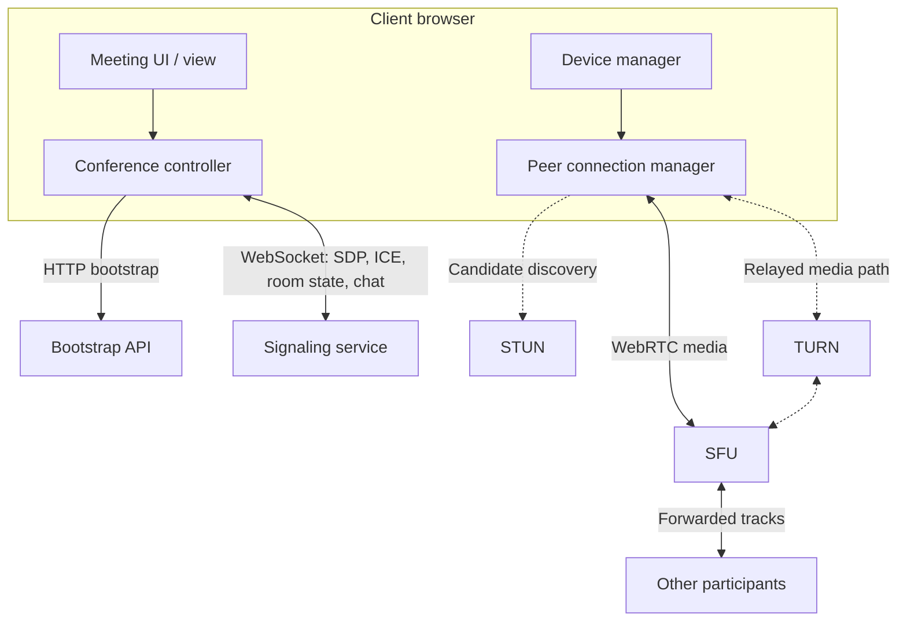
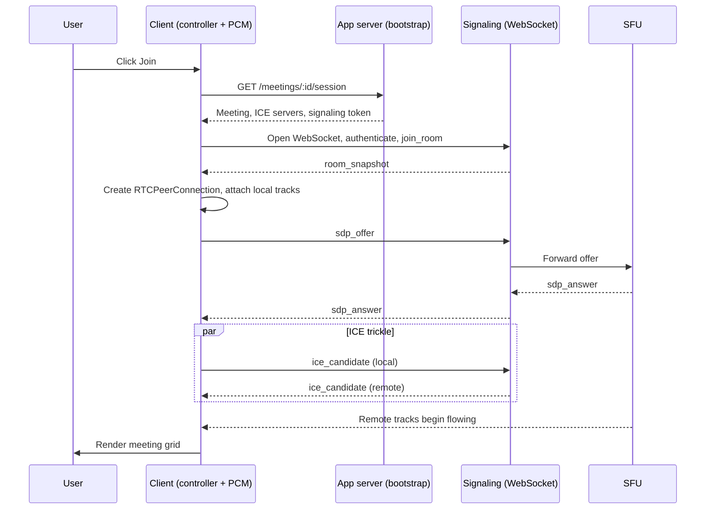
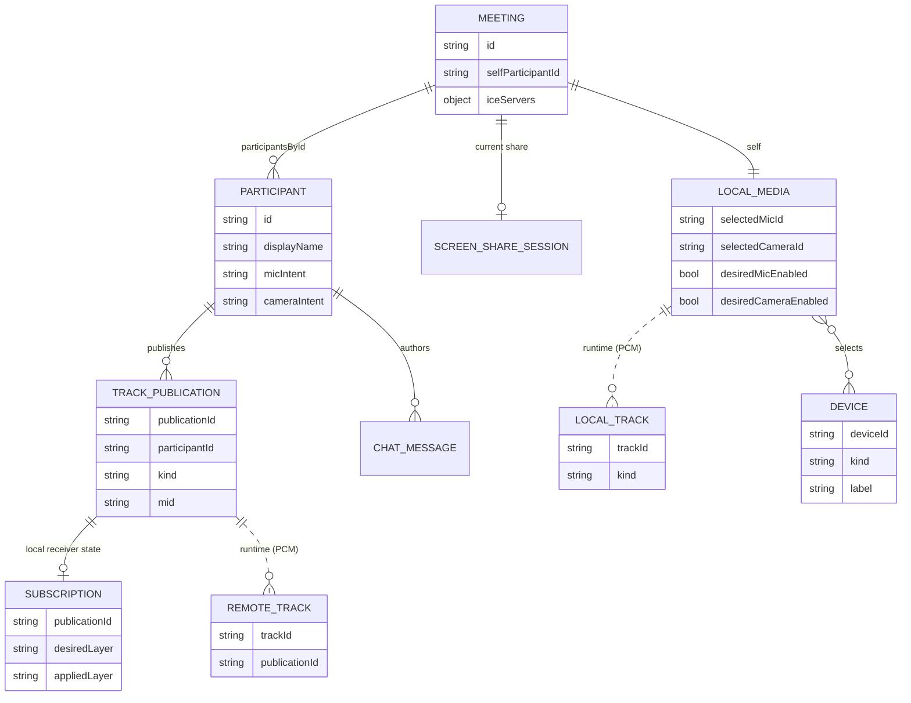
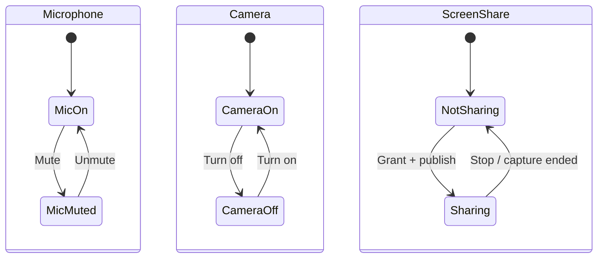
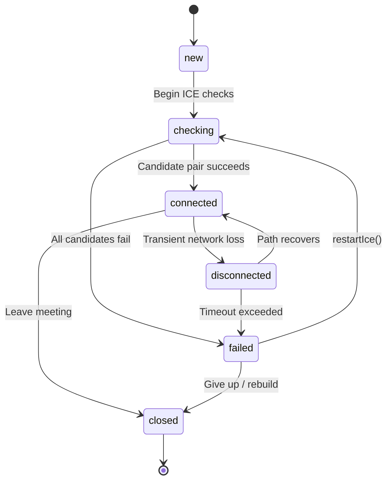
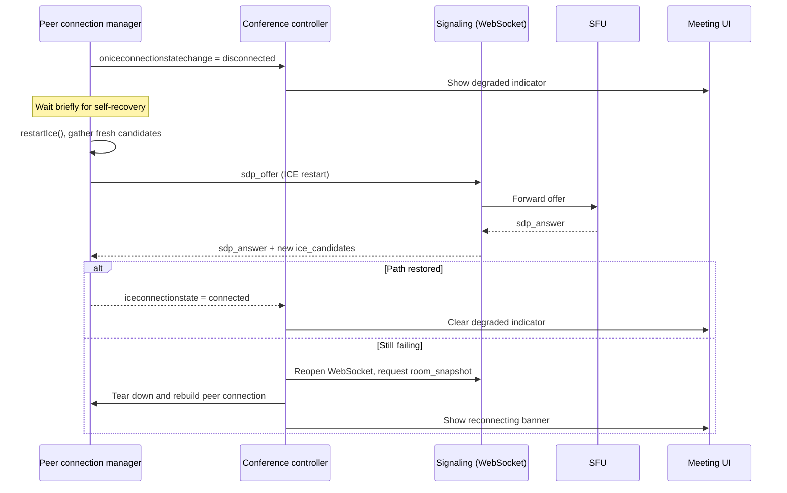

# Video Conferencing (e.g. Zoom)

**Difficulty:** Hard · **Duration:** ~45 min · **Topics:** Networking, Performance

> Source: [video-conferencing-zoom](https://www.greatfrontend.com/questions/system-design/video-conferencing-zoom)

## Question

Design a browser-based video conferencing application similar to Zoom, Google Meet, or Whereby that lets authenticated users preview their camera and microphone before joining, participate in a multi-person meeting, mute and unmute themselves, toggle their camera, switch between grid and speaker layouts, share their screen, and send basic in-meeting chat messages.

Focus on the front-end architecture and the client/server contract for joining a room, establishing and maintaining media connections, handling real-time participant state, and adapting gracefully to changing network quality. You do not need to go deep into scheduling, recording, breakout rooms, captions, webinars, native applications, or server-side media transcoding details.

Assume one active screen share at a time. Chat is session-scoped: acknowledged messages can be replayed after a reconnect, but long-term chat retention after the meeting is out of scope.

### Real-life examples

These products demonstrate the prejoin, in-meeting media, layout, and control patterns in scope.

- [https://zoom.us](https://zoom.us)
- [https://meet.google.com](https://meet.google.com)
- [https://teams.microsoft.com](https://teams.microsoft.com)
- [https://whereby.com](https://whereby.com)

### Requirements

Use the following baseline unless the interviewer changes the product boundary.

- Support a desktop-first web meeting room for up to roughly 25 active participants.
- Include a prejoin flow for camera and microphone permissions, device selection, and local preview.
- Support participant roster updates, active speaker indication, mute/camera controls, one active screen share, and session-scoped in-meeting chat.
- Handle network degradation, reconnects, and quality adaptation gracefully.
- You do not need to cover scheduling, recording, breakout rooms, captions, webinars, or native applications.

## Solution

### Requirements exploration

Browser-based video conferencing combines real-time media, device permissions, networking tradeoffs, and rapidly changing UI state in one application.

Unlike simpler media products, a conferencing app has to establish live connections, recover from flaky networks, adapt audio and video quality in real time, and keep the meeting UI responsive while participants join, leave, mute, and share screens.

#### What are the core features to be supported?

The baseline covers one interactive meeting rather than the surrounding scheduling product.

- Prejoin device check with local camera and microphone preview.
- Join an existing meeting room.
- See remote participants in a grid or speaker-focused layout.
- Mute and unmute microphone, turn camera on and off, and switch devices.
- Share the screen during the meeting.
- Send and receive basic chat messages.

#### How many participants do we need to support?

Assume up to roughly 25 active participants in a meeting. That is large enough that a naive peer-to-peer mesh becomes impractical, but still small enough that we can focus on an interactive meeting room rather than a webinar product.

#### What devices and platforms are in scope?

Desktop web is the primary target. The layout can adapt to tablet and mobile browsers where possible, but native desktop applications are out of scope.

#### What are the non-functional requirements?

Prioritize conversational continuity and understandable recovery over maximum video quality.

- Fast join time after the user clicks Join.
- Low enough latency for natural conversation quality.
- Audio should remain stable even when network conditions degrade.
- Video quality should adapt dynamically to bandwidth and device constraints.
- The app should recover automatically from brief disconnects.
- The meeting UI should stay responsive even while participant state changes frequently.
- Keyboard and screen reader support should be considered for core meeting actions.

#### What is explicitly out of scope?

Scheduling, recording, webinars, captions, breakout rooms, reactions, end-to-end encryption, virtual backgrounds, and desktop applications. We can mention some of them later as advanced topics, but they are not part of the main design.

#### Check your understanding 1

A team is defining a Zoom-like browser meeting client before selecting media topology and protocols. Which requirements should it establish to choose how the live meeting connects, adapts, and recovers?

- [ ] Scope a one-to-one call first, assume peer-to-peer WebRTC, and leave group-size and recovery constraints to implementation.
  > Participant scale is what determines whether mesh is viable, so choosing the topology first reverses the design process.
- [ ] Treat scheduling, live media, recording, webinars, captions, breakout rooms, reactions, and virtual backgrounds as equal baseline concerns.
  > Treating the complete production suite as core leaves too little room to design the live media session coherently.
- [ ] Define codecs, TURN deployment, and signaling messages in detail, using current Zoom behavior as the implicit product contract.
  > Protocol details should follow the meeting contract and quality constraints rather than substitute for them.
- [x] Bound participant scale, active media, target browsers, essential meeting actions, quality priorities, reconnect behavior, accessibility, and excluded follow-ups.
  > This scope supplies the inputs needed for topology, signaling, adaptation, and lifecycle decisions while keeping follow-up features bounded.

---

The design below approaches WebRTC from a frontend architecture point of view. The goal is to establish clear ownership and lifecycle boundaries, not to reproduce every detail of the networking stack.

### Background

Before [WebRTC](https://developer.mozilla.org/en-US/docs/Web/API/WebRTC_API), browser-based video conferencing was much less standardized. Products often depended on plugins such as Flash, Java applets, or custom native applications because browsers did not expose a common way to access cameras, microphones, or low-latency real-time media transport directly from the page.

WebRTC made plugin-free conferencing practical by giving browsers a standard set of APIs for media capture and real-time communication. That did not remove the need for application infrastructure, though: products still need signaling to coordinate session setup, and they usually rely on SFUs plus STUN/TURN services to make multi-party meetings reliable at scale.

This question uses a few networking and media terms that many frontend engineers do not work with every day. Here's a short primer to help frame the architectural choices without being a full WebRTC tutorial.

#### Glossary

**Core browser APIs & concepts**

- **WebRTC**: A browser-standard set of APIs and protocols for capturing media and transporting real-time audio, video, and optional data between endpoints.
- **Signaling**: Messages used to help endpoints establish and maintain a media session. In this design, signaling carries offers, answers, ICE candidates, participant presence changes, chat messages, and other meeting control events.
- **SDP (Session Description Protocol)**: The text-based format used inside WebRTC offers and answers to describe media details such as which tracks, codecs, and connection parameters each side supports.
- **`RTCPeerConnection`**: The browser primitive that manages a WebRTC connection. It handles negotiation, ICE, track publishing and receiving, and connection state changes.

**Connectivity and NAT traversal**

- **NAT (Network Address Translation)**: The router behavior that lets many devices in a home or office share one public IP address. This improves address reuse, but it also makes direct inbound connectivity between two browsers harder.
- **ICE (Interactive Connectivity Establishment)**: The process of finding a working network path between endpoints, often by trying several candidates before settling on one.
- **STUN (Session Traversal Utilities for NAT)**: A helper service that lets a client discover its public-facing network address so it can attempt direct connectivity.
- **TURN (Traversal Using Relays around NAT)**: A relay service used when direct connectivity is not possible. It is more expensive than direct transport, but critical for reliability.

**WebRTC network topologies**

- **Mesh**: Each participant sends media directly to every other participant. This works for very small rooms (2-4 people), but upload and download costs grow too quickly as the room size increases.
- **SFU (Selective Forwarding Unit)**: A server receives multiple media streams and forwards selected streams to each participant without mixing them together. This is the standard baseline for modern multi-party conferencing on the web.
- **MCU (Multipoint Control Unit)**: A server mixes participant streams before sending them back to clients. This simplifies the client but increases server cost and reduces layout flexibility.

If you want a deeper primer after this section, the official browser documentation linked in the references section is the best next step.

We will use the terms above throughout the rest of the article when discussing join flow, media transport, and quality adaptation.

---

### Architecture / high-level design

There are three important architectural decisions to make here: the rendering approach, the WebRTC network topology, and the communication model.

#### Rendering approach

This product is highly interactive, requires JavaScript for media and device APIs, and is generally used by authenticated users. CSR is the right default because:

- The prejoin lobby, meeting shell, chat panel, and participant layout all depend heavily on client-side state.
- Media connections, permission prompts, and reconnect logic only exist on the client.
- SEO is not required for the meeting room itself.

The server can still return a minimal HTML shell and bootstrapping JSON for faster startup, but an SSR-heavy architecture does not meaningfully reduce the complexity of the conferencing experience.

#### WebRTC network topology

For a room of roughly 25 active participants, a direct mesh topology (with the client uploading a separate media stream to every other participant) becomes too expensive in bandwidth and decode work, while Multipoint Control Unit (MCU)-style server mixing reduces layout flexibility and pushes more cost to the server.

Selective Forwarding Unit (SFU) is the best default here because each participant maintains one upstream peer connection carrying a bounded set of audio, camera, and optional screen-share tracks and encodings. The server forwards selected encodings to receivers, while the client keeps control over layout, active-speaker behavior, and per-tile quality decisions. Upload no longer grows with the number of receivers, although it still depends on the local publications, simulcast layers, bitrates, and codecs.

> **Default to SFU for rooms above a handful of participants**
>
> Mesh is fine for 2-4 person calls but collapses at ~25 participants because every client pays upload and decode costs for every peer. MCU centralizes mixing at the cost of layout flexibility and server spend. An SFU bounds each publisher's transport topology while leaving layout, active-speaker, and per-tile quality decisions on the client.

#### Communication model

There are many different kinds of data involved in a video conferencing app, and the transport mode used for each kind of data differs according to its properties.

- The **bootstrap API** uses HTTP to return meeting metadata, capability flags, ICE server configuration, and the information needed to open the session.
- The **signaling service** uses WebSocket to carry participant join/leave events, active speaker updates, chat messages, meeting control state, and SDP / ICE negotiation messages.
- The **media path** uses WebRTC to publish local tracks and receive remote tracks through the SFU.

This split keeps product state and control flow on a simpler real-time channel (WebSockets) while reserving WebRTC for the low-latency media path.

WebRTC encrypts each browser-to-SFU hop with DTLS-SRTP, but the SFU can access media while forwarding it and is therefore inside the trust boundary. Application-level media encryption that hides content from the SFU is a follow-up.

Therefore, the best architectural choices would be a CSR-first single-page application backed by a bootstrap API, a WebSocket signaling service, and WebRTC over an SFU. For a video conferencing application, the interesting front-end problems are not SEO or route rendering; they are managing device permissions, the `RTCPeerConnection` lifecycle, real-time participant state, adaptive subscriptions, and stable media elements in the meeting UI.

#### Component responsibilities

The browser components and session infrastructure divide ownership as follows.

##### Session infrastructure

The backend services establish the session, synchronize room state, and route media.

- **Bootstrap API**: Authenticates the user, authorizes meeting access, and returns initial meeting data plus ICE server configuration.
- **Signaling service**: Coordinates room presence, chat, active speaker updates, and the offer/answer plus ICE candidate exchange required to establish media sessions.
- **SFU**: Receives published audio/video tracks and forwards the right streams to each participant based on the room state.
- **STUN/TURN services**: Help ICE establish a working path and provide relay candidates when direct connectivity is not possible.

##### Client application

The browser keeps product state separate from the live media objects owned by WebRTC.

- **App shell**: Owns routing, top-level layout, and meeting-wide state that must stay mounted across room interactions.
- **Prejoin lobby**: Requests permissions, renders the local preview, allows device selection, and surfaces readiness or failure states before join.
- **Conference controller**: Owns session lifecycle, signaling connection, reconnect logic, and the mapping between user actions and meeting state updates.
- **Peer connection manager**: Wraps `RTCPeerConnection`, attaches or replaces local tracks, listens for remote tracks, and reacts to negotiation or connection-state changes.
- **Device manager**: Tracks camera and microphone devices, optional speaker-output selection where supported, and current permission plus selection state.
- **Layout manager**: Decides which participants are visible, who is dominant, and which tiles deserve higher-quality subscriptions.
- **Chat and presence panel**: Renders participant roster state, chat history, and transient room activity.

#### Why keep chat and controls on WebSocket?

In this scoped design, chat, presence, and meeting control updates are simpler over the signaling channel than over `RTCDataChannel`. They need predictable ordering, straightforward reconnect behavior, and easy server fan-out. Media still uses WebRTC, but product state stays on WebSocket, where it is easier to reason about and recover.

This division of responsibilities is similar in spirit to the [Chat App system design](https://www.greatfrontend.com/questions/system-design/chat-application-messenger), where real-time events and reconnect behavior are important, but the media path here is much more specialized.

**Client, signaling, SFU, and TURN at a glance**



#### Call setup flow

The setup flow uses HTTP once for bootstrap, WebSocket for signaling, and WebRTC for the selected browser-to-SFU media path.

1. The client fetches meeting metadata, capability flags, and ICE server configuration from the application server over HTTP.
2. In the prejoin lobby, the browser requests camera and microphone access with `getUserMedia()` and renders a local preview.
3. When the user joins, the client opens a WebSocket signaling channel and creates an `RTCPeerConnection`.
4. The browser sends SDP offers and the SFU returns SDP answers over the signaling channel.
5. The browser first attempts direct paths to the SFU using ICE and STUN-discovered candidates.
6. If no direct path works, ICE can select TURN relay candidates from the configured servers.
7. Once connected, local audio, video, and optional screen-share tracks flow through WebRTC to the SFU, which forwards the right remote tracks back to each participant.
8. The peer connection manager publishes local tracks, receives remote tracks, and reacts to negotiation or ICE state changes.
9. The layout manager decides which participants should be emphasized and which subscriptions deserve higher quality.
10. The chat and presence panel reacts to signaling updates for roster changes, active speaker state, and messages.
11. The conference controller coordinates reconnect, recovery, and resynchronization when the network or room state changes.

**Join meeting with SDP offer/answer and ICE exchange**



The browser is the only SDP offerer. Initial setup, publication changes, and ICE restart enter one serialized queue that waits for a stable signaling state and tags each offer and answer with a `negotiationId`; stale answers are ignored. Perfect negotiation is a follow-up if the product later requires both sides to initiate offers.

#### Check your understanding 2

A signed-in browser meeting has a prejoin device check, live media, participant churn, and reconnect behavior. Which rendering model should manage prejoin and the active meeting without restarting the media session for routine room updates?

- [ ] Server-render the participant grid after every room event so the browser mainly attaches click handlers.
  > Server rendering cannot own browser capture, peer connections, or frequent in-session state transitions without adding round trips to the live interaction path.
- [x] Return a lightweight shell and bootstrap data, then let a client-rendered application own the prejoin and active meeting session.
  > The browser is where permissions, media objects, signaling, and responsive room interactions live, while the server can still accelerate initial setup data.
- [ ] Render a static meeting document and use only native media controls for participant updates.
  > Native media controls do not synchronize roster, layout, chat, or reconnect state across participants.
- [ ] Use a multi-page flow that reloads whenever a participant joins, leaves, or starts sharing.
  > Full navigation would destroy the long-lived signaling and media session during normal room activity.

#### Check your understanding 3

A meeting supports about 25 active participants with flexible grid and speaker layouts. Which transport architecture is the best default?

- [x] Use an SFU so each participant publishes a bounded set of tracks and receivers choose the forwarded encodings they need.
  > Each client publishes a bounded set of tracks and encodings independent of receiver count while retaining per-subscriber layout and quality control.
- [ ] Use a full mesh so every browser can choose its own layout without relying on a media server or server-side subscription state.
  > Upload bandwidth and peer-connection work grow poorly beyond a handful of participants.
- [ ] Use an MCU to mix one server-selected layout and send each browser a single composite stream plus the signaling channel.
  > An MCU can work but adds server processing and sacrifices flexible per-client layout.
- [ ] Send encoded camera and microphone chunks over the same ordered WebSocket used for room state so reconnect has one protocol.
  > WebRTC provides congestion control, real-time transport, device, codec, and NAT traversal support.

#### Check your understanding 4

A camera publication change and an ICE restart both request SDP negotiation while an earlier answer is still in flight. How should the client prevent signaling races?

- [ ] Send both offers immediately with distinct IDs, then apply each answer when it arrives as long as its ID is recognized.
  > Overlapping negotiations can produce answers for obsolete signaling states, so arrival order does not establish which exchange is valid.
- [ ] Allow both the browser and SFU to initiate offers whenever either side detects a change.
  > Two uncoordinated offerers can collide unless the application implements an explicit collision-resolution protocol.
- [x] Use one designated offerer, queue changes until signaling is stable, and match each answer to its negotiation ID.
  > A single queue establishes ordering, while the ID prevents a late answer from mutating a newer connection state.
- [ ] Queue each requested change, but close and recreate the peer connection before negotiating it so no prior offer remains in flight.
  > Rebuilding avoids an offer collision only by disrupting working media and discarding reusable transport state.

---

### Data model

Most of the interesting data in a conferencing app is session-scoped and changes quickly while the meeting is live. Unlike a chat app, we do not need a durable client-side database as the baseline. The most important modeling decision is separating synchronized meeting state from browser-owned media objects. The bootstrap HTTP response can stay relatively small and setup-focused, while the authoritative room state arrives over signaling after the user joins.

| Entity               | Source                                              | Belongs to                              | Fields                                                                                                                                       |
| -------------------- | --------------------------------------------------- | --------------------------------------- | -------------------------------------------------------------------------------------------------------------------------------------------- |
| `Meeting`            | Server                                              | App shell / conference controller       | `id`, `title`, `selfParticipantId`, `capabilities`, `iceServers`, `signaling`                                                                |
| `Participant`        | Server via WebSocket                                | Roster, layout manager, chat panel      | `id`, `displayName`, `role`, `presence`, `micIntent`, `cameraIntent`, `connectionQuality`                                                    |
| `TrackPublication`   | Server via WebSocket                                | Peer connection manager, layout manager | `publicationId`, `participantId`, `kind`, `source`, `mid`, `simulcastLayers`                                                                 |
| `Subscription`       | Client, acknowledged by server                      | Layout manager, peer connection manager | `publicationId`, `desiredLayer`, `appliedLayer`, `priority`, `pendingCommandId`                                                              |
| `ChatMessage`        | Server via WebSocket                                | Chat and presence panel                 | `messageId`, `clientMessageId`, `participantId`, `roomSeq`, `text`, `sentAt`                                                                 |
| `ScreenShareSession` | Server via WebSocket                                | Layout manager, participant tiles       | `participantId`, `publicationId`, `startedAt`                                                                                                |
| `LocalMedia`         | Client                                              | Prejoin lobby, conference controller    | `selectedMicId`, `selectedCameraId`, `selectedSpeakerId`, `desiredMicEnabled`, `desiredCameraEnabled`, `actualMicState`, `actualCameraState` |
| `Permissions`        | Client                                              | Prejoin lobby, device manager           | `camera`, `microphone`, `captureAttemptId`                                                                                                   |
| `ScreenShareState`   | Client                                              | Conference controller, layout manager   | `status`, `trackId`, `surfaceType`, `withAudio`, `lastError`                                                                                 |
| `ConnectionState`    | Client                                              | Conference controller                   | `meetingStatus`, `signalingStatus`, `iceStatus`, `reconnectAttemptCount`, `lastError`                                                        |
| `LayoutState`        | Client                                              | Layout manager                          | `mode`, `pinnedParticipantId`, `dominantSpeakerId`, `visibleParticipantIds`                                                                  |
| `StatsSnapshot`      | Client (derived from periodic `getStats()` polling) | Conference controller, layout manager   | `publicationId`, `direction`, `packetLoss`, `rtt`, `jitter`, `bitrate`, `decodePressure`, `updatedAt`                                        |

These entity shapes do not need to match the wire payloads one-to-one. For example, the bootstrap response can be normalized so that `selfParticipant` becomes a `Participant` plus `Meeting.selfParticipantId`, while signaling connection details are folded into meeting or session state.

Track publications are the canonical source for actual media availability; participant media badges are derived from them, while acknowledged mic and camera intent remains participant metadata. Receiver-specific subscription choices stay in the local `Subscription` records rather than on shared publications.

#### Server-originated meeting state

The synchronized meeting state sent over WebSocket after join should live in a normalized client store because the same participant and track data are rendered in multiple places at once:

- Roster and participant tiles both need participant identity and mute/camera state.
- Active speaker and pinned layout both need track and participant metadata.
- Chat messages reference the same participants already shown elsewhere in the meeting UI.

A normalized shape keeps those updates consistent:

- `participantsById`
- `trackPublicationsById`
- `chatMessagesById`
- `screenShareSession`
- ordered lists such as `participantOrder` or `chatMessageIds`

This is a better fit than storing one large server payload per view because participant state changes arrive continuously and need to update multiple UI surfaces at once.

**Normalized conferencing store with runtime media held outside**



#### Client-owned meeting state

Some state belongs entirely to the browser tab and should not come from the server:

- `LocalMedia` tracks current microphone and camera selection, whether the local user intends to publish those tracks, and the preferred audio output device where browser support exists.
- `Permissions` reflects whether the browser has granted or denied access to camera and microphone.
- `ScreenShareState` tracks the transient state of display capture. Unlike camera and microphone access, screen-share permission cannot be silently reused and must be requested via a user gesture each time.
- `ConnectionState` tracks whether the room is joining, connected, reconnecting, or failed, along with signaling and ICE health.
- `LayoutState` controls local presentation choices such as grid vs. speaker view and who is pinned.
- `StatsSnapshot` is a reduced summary derived from WebRTC stats APIs for UI decisions and quality indicators.

These fields are ideal for an in-memory store because they change frequently and are tightly coupled to the active tab.

#### Keep live media objects outside the serializable store

`MediaStream`, `MediaStreamTrack`, and `RTCPeerConnection` should not be stored in the serializable app state. They are browser-managed objects, not plain data:

> **Do not put `MediaStream` or `RTCPeerConnection` in your app store**
>
> These are live browser objects that mutate in response to network and hardware events, not plain data. Putting them in a serializable store causes unnecessary rerenders, subtle lifecycle bugs, and makes reconnect reasoning harder. Keep stable IDs and status flags in the store, and let the peer connection manager own the runtime objects imperatively.

- They are not safely serializable.
- They change in response to browser and network events at a much higher frequency than normal UI state.
- They often need imperative lifecycle handling, such as attaching tracks to media elements, swapping tracks, or reacting to connection callbacks.

Instead, the app state should store stable identifiers and status flags, while the peer connection manager owns the live objects in memory:

- Treat `publicationId` as the stable application identity. The SFU returns the negotiated `{ publicationId, mid }` binding in its answer; when `track` fires, the peer connection manager resolves `event.transceiver.mid` to the publication instead of assuming the sender's `MediaStreamTrack.id` survives the SFU hop.
- Keep media element refs and track attachment logic close to the rendering layer.
- Derive lightweight UI state from those objects rather than exposing the raw objects throughout the app.

This is similar to how the [Chat App system design](https://www.greatfrontend.com/questions/system-design/chat-application-messenger) separates durable synced data from transient controller state, but conferencing has a stricter boundary because the media objects are much more specialized.

#### What should be persisted locally?

Only lightweight preferences are worth persisting across sessions:

- Last-used microphone and camera device IDs, plus preferred speaker output where browser support exists.
- Preferred layout mode, if the product wants to remember it.
- Optional defaults such as joining with microphone muted or camera off.

Everything else should stay in memory:

- Live participant presence
- Active speaker state
- Connection health
- Stats snapshots
- Current screen-share session
- WebRTC runtime objects

If the user refreshes the page, the client should rebuild this state from the bootstrap response, signaling resynchronization, and fresh media setup rather than try to restore a stale local copy.

#### Check your understanding 5

A participant can publish several tracks, WebRTC stats arrive every second, and the UI must recover from a signaling snapshot. Which modeling choices keep state serializable without making rendering own media lifecycles? Select all that apply.

- [x] Normalize participants, publications, and chat messages by stable IDs, and derive participant media badges from publication state.
  > Stable entity identity lets shared updates change one canonical record while the UI derives badges without copying publication state into participant records.
- [x] Keep permissions, desired and actual local media state, receiver subscriptions, layout, connection status, and reduced quality summaries as client-owned state.
  > These values belong to the receiving browser session and must not be stored as shared publication truth.
- [x] Let a peer connection manager own RTCPeerConnection, MediaStream, and MediaStreamTrack objects outside the serializable store.
  > Live browser objects need imperative lifecycle control and should not trigger generic state serialization.
- [ ] Render a cached participant roster immediately, then merge the signaling snapshot into it by participant ID.
  > A cached roster can show users who are no longer present. Current membership must be replaced atomically from the room snapshot.
- [ ] Normalize every raw stats report by participant ID in the global store so any quality component can derive its own metric.
  > Normalization does not reduce update frequency or volume. The media layer should publish bounded quality summaries needed by the UI.

#### Check your understanding 6

An SFU forwards a participant's camera and screen tracks, but the receiving browser observes track IDs that differ from the sender's IDs. How should the client bind each remote track to application state?

- [ ] Use the received `MediaStreamTrack.id` as the persistent publication ID.
  > An SFU can terminate and recreate tracks, so the receiver's browser track ID is not a stable cross-session application identity.
- [ ] Match tracks to the participant's publication list by the order in which `track` events arrive.
  > Network and negotiation timing can change event order independently of publication order.
- [ ] Key each track only by participant ID and whether it is audio or video.
  > One participant can publish multiple tracks of the same media kind, such as camera video and screen video.
- [x] Bind the arriving track through the SFU's negotiated transceiver `mid` to stable `publicationId` mapping.
  > The negotiated binding connects the browser-owned track handle to the server-authoritative publication without assuming transport IDs survive the SFU hop.

#### Check your understanding 7

A user refreshes midway through a meeting and later joins another meeting. Which persistence choices avoid restoring stale live-session state? Select all that apply.

- [ ] Restore the prior participant roster and screen-share owner before signaling reconnects.
  > Membership and publications are live server state, so a cached roster can immediately show participants who have left.
- [x] Remember device preferences, layout preference, and optional mic or camera join defaults.
  > These are user choices that remain meaningful across sessions, subject to current device availability.
- [x] Recreate current membership, publications, connection state, and capture from fresh bootstrap, signaling, and browser media setup.
  > Fresh authorities are required because the previous tab's live state and browser handles cannot establish the current meeting truth.
- [ ] Persist the peer connection, media tracks, and recent raw stats so the refreshed tab can resume them.
  > Browser-managed media objects are neither serializable nor transferable as a recoverable session snapshot.

---

### Interface definition (API)

The interface surface is intentionally small: one bootstrap request before join, one long-lived WebSocket for real-time non-media state, and one WebRTC session for media tracks.

#### Protocol matrix

Each interface has one responsibility and a different lifecycle.

| Source  | Destination        | Protocol  | Purpose                                                                                                           |
| ------- | ------------------ | --------- | ----------------------------------------------------------------------------------------------------------------- |
| Browser | Application server | HTTP      | Fetch meeting bootstrap data before join                                                                          |
| Browser | Signaling service  | WebSocket | Join room, sync participant state, send chat messages, exchange SDP / ICE messages, resynchronize after reconnect |
| Browser | SFU                | WebRTC    | Publish local media and receive subscribed remote media                                                           |

Keeping these interfaces separate makes the client easier to reason about:

- HTTP is good for the initial authenticated fetch.
- WebSocket is good for ordered real-time room state and control flow.
- WebRTC is good for low-latency audio and video transport.

#### Bootstrap API

Before the client opens signaling or creates media sessions, it should fetch a single bootstrap payload with `Cache-Control: no-store`. This payload is for session setup and prejoin rendering; the authoritative live room state should come from signaling after the user joins. Signaling and TURN credentials are short-lived, scoped to the meeting and participant, and redacted from normal logs.

| Field       | Value                                                                                      |
| ----------- | ------------------------------------------------------------------------------------------ |
| HTTP Method | `GET`                                                                                      |
| Path        | `/api/meetings/:meetingId/session`                                                         |
| Description | Returns everything the browser needs to render the prejoin lobby and establish the session |

Example response:

```json
{
  "meeting": {
    "id": "meeting_123",
    "title": "Weekly Product Sync",
    "capabilities": {
      "chat": true,
      "screenShare": true
    }
  },
  "selfParticipant": {
    "id": "participant_self",
    "displayName": "Alice"
  },
  "iceServers": [
    { "urls": ["stun:stun.example.com:3478"] },
    {
      "urls": ["turn:turn.example.com:3478"],
      "username": "user",
      "credential": "secret",
      "expiresAt": "2026-08-22T10:05:00Z"
    }
  ],
  "signaling": {
    "url": "wss://signal.example.com/meetings/meeting_123",
    "token": "session_token",
    "expiresAt": "2026-08-22T10:05:00Z"
  }
}
```

This response should be enough to:

- Render the meeting title and local participant identity in prejoin.
- Initialize the prejoin lobby.
- Create `RTCPeerConnection` with the correct ICE server configuration.
- Open the authenticated WebSocket session when the user joins.

The full synchronized roster, track publications, and other live room state should come from the first `room_snapshot` after the signaling connection is established.

#### Signaling channel

The WebSocket should carry small, typed messages instead of many bespoke endpoints. Open it over WSS without putting the token in the URL, then send the bootstrap token as the first application message. The server validates `Origin`, binds the authenticated socket to one meeting and participant, rejects pre-authentication traffic, validates message schemas and sizes, and authorizes every command. A simple event is enough:

```json
{
  "type": "participant_joined",
  "payload": {
    "id": "participant_3",
    "displayName": "Carol"
  }
}
```

The most important event types are:

- Room synchronization:
  - `room_snapshot`: full meeting snapshot on first join or after reconnect
  - `participant_joined`
  - `participant_left`
  - `participant_updated`
  - `meeting_ended`
- Chat and presence:
  - `chat_message`
  - `active_speaker_changed`
- Media metadata:
  - `track_published`
  - `track_unpublished`
- Negotiation:
  - `sdp_answer`
  - `ice_candidate`

The same channel can also carry client-originated commands such as:

- `join_room`
- `leave_room`
- `update_participant_state`
- `send_chat_message`
- `update_subscription_preferences`
- `sdp_offer`
- `ice_candidate`

Every `room_snapshot` includes a room `generation` and the last `eventSeq`; every later room event carries the same generation and a monotonically increasing sequence. While fetching a reconnect snapshot, buffer newer events, install the snapshot atomically, then drain only contiguous events. A gap or generation mismatch triggers another snapshot rather than applying uncertain state.

Chat is scoped to the meeting session and includes `clientMessageId`, server `messageId`, `roomSeq`, sender, timestamp, and an acknowledgment or terminal error. Retrying the same client ID is idempotent, and a bounded recent history in `room_snapshot` fills reconnect gaps; messages are length- and rate-limited and rendered as text rather than trusted markup. Chat is not retained after the meeting ends.

#### Key client operations

Beyond the initial join, a handful of in-meeting actions need careful handling to avoid unnecessary renegotiation or dropped media. The subsections below cover mute and camera toggles, device switching, screen sharing, and quality monitoring.

##### Mute and camera toggle

Mute and camera toggles should not trigger a full renegotiation in the normal case:

1. Update local intent in `LocalMedia`.
2. Enable or disable the current local track.
3. Send a versioned `update_participant_state` command with a stable command ID, then reconcile the acknowledged room state or show a rejection.

Desired intent, the actual captured/sender track, and server-acknowledged state are separate. Reconnect can safely reapply desired intent after installing the versioned room snapshot, while moderation or authorization failures remain visible instead of silently overwriting it. Camera off is a warm mute in this baseline: disabling the track keeps capture ready for fast resume, and the UI should disclose that the device may remain active.

##### Device switching

When the user switches microphone or camera devices:

1. Capture a new track from the selected device.
2. Await `RTCRtpSender.replaceTrack()` on the existing sender.
3. Update `LocalMedia` and device preferences.

Only stop the old track after replacement succeeds. On failure, retain the old sender track, stop the new capture, and show a recoverable error; if the new source requires renegotiation, enqueue that work through the same serialized negotiation policy.

> **Prefer `replaceTrack()` over renegotiation for device and mute changes**
>
> Mute, camera toggles, and device switching should all avoid a full SDP renegotiation in the common case. Toggle `track.enabled` for mute, and call `RTCRtpSender.replaceTrack()` when swapping devices. This keeps the peer connection, SFU routing, and remote tiles stable while the local user changes hardware.

##### Screen sharing

Screen sharing has a distinct capture lifecycle:

1. The user clicks Share screen.
2. The browser calls `getDisplayMedia()` from that user gesture.
3. The client requests the room's single screen-share grant, then publishes the track and sends the corresponding metadata update.
4. When the browser ends capture or the user stops sharing, the client unpublishes the screen-share track and clears the related state.

For a video conferencing app, it is reasonable to model screen share as a separate published track so that the user can keep the camera and microphone state unchanged. If two participants race, the server grants one request and rejects the other; the losing client stops its captured track and shows that another participant is already sharing.

**Independent local media state transitions**



Joining and leaving are a separate session axis. Starting or stopping screen share changes neither microphone nor camera intent.

Leaving, unmounting, or abandoning a failed join calls one idempotent teardown: stop every owned camera, microphone, and display track; close the peer connection and socket; clear timers and queued work; remove listeners; detach media-element `srcObject` references; and prevent callbacks from an older session generation from updating current state.

##### Quality monitoring and subscription hints

The client should use `getStats()` to derive a lightweight `StatsSnapshot` for connection-quality UI and adaptive behavior. It does not need to stream raw stats to the server continuously.

Summarize inbound and outbound RTP per publication, plus the selected candidate pair, instead of averaging unrelated tracks. For a simple control loop, sustained packet loss, low inbound bitrate, or decode pressure lowers off-screen and thumbnail layers first; sustained recovery raises them gradually. Exact thresholds, hysteresis, and device-specific tuning are production follow-ups.

Instead, the client can send occasional `update_subscription_preferences` messages with high-level intent such as:

- which participant is pinned
- whether screen share is visible
- which tiles are on screen

This gives the signaling layer and SFU enough information to prioritize forwarding and quality decisions without turning the API into a stats firehose.

#### Check your understanding 8

What should happen when a participant joins a meeting after the prejoin lobby?

- [x] Use HTTP for authorized bootstrap, WebSocket for room state and negotiation, and WebRTC for participant media.
  > Setup, synchronized state, single-offerer negotiation, and media transport have clear ownership and reconnect boundaries.
- [ ] Use HTTP bootstrap for credentials and the initial roster, then poll that endpoint for membership and publication changes during the call.
  > Participants and publications change continuously after bootstrap.
- [ ] Use WebRTC data channels for negotiation, chat, and room commands after HTTP returns credentials and ICE configuration.
  > Ordered product state and reconnect are simpler on the signaling channel.
- [ ] Open signaling and publish muted camera and microphone tracks first, then attach meeting authorization to the established transport.
  > Media setup should follow authenticated meeting access.

#### Check your understanding 9

The meeting bootstrap returns signaling and TURN access for one participant, then the browser opens a WebSocket for room commands. How should the server constrain setup credentials, authenticate the socket, and validate room commands? Select all that apply.

- [ ] Put the signaling token in the WebSocket query string because WSS encrypts the connection.
  > URL credentials can leak through infrastructure and logs even when transport encryption protects bytes in transit.
- [x] Return meeting- and participant-scoped, short-lived credentials with `Cache-Control: no-store`, and redact them from normal logs.
  > Narrow scope, expiry, and non-caching limit reuse if setup credentials are exposed.
- [x] Validate the page origin, accept the token as the first application message, and bind the authenticated socket to one meeting and participant.
  > The server must establish socket identity and room scope before processing user-controlled traffic.
- [ ] After socket authentication, accept any message type and payload size sent by that participant.
  > Authentication identifies the sender but does not make commands well-formed, bounded, or authorized.
- [x] Validate schemas and sizes and authorize each requested room operation.
  > Per-command checks prevent a valid participant from sending malformed data or performing capabilities they were not granted.

#### Check your understanding 10

A chat send times out as signaling reconnects, and the room snapshot may already contain the message. How should retries, message ordering, snapshot history, and send outcomes be handled without duplicating messages? Select all that apply.

- [x] Retry the send with the same client-generated message ID until it receives an acknowledgment or terminal error.
  > A stable idempotency key lets the server recognize a retry of the same logical message instead of creating another one.
- [ ] Use each sender's local timestamp as the canonical order, breaking ties by arrival time after reconnect.
  > Device clocks can differ, so client time cannot establish a consistent room order.
- [x] Assign a server message ID and room sequence, and include bounded recent history in the versioned room snapshot.
  > Server ordering plus snapshot history lets the client fill a reconnect gap against the same room generation.
- [ ] Store the full chat history permanently so any reconnect can replay from the beginning.
  > The scoped meeting chat needs only bounded recovery history. Indefinite retention changes its privacy and storage contract.
- [x] Return an acknowledgment for acceptance or a terminal error that the UI can expose without silently discarding the draft.
  > An explicit outcome distinguishes a retryable transport gap from an authorized rejection or invalid command.

#### Check your understanding 11

Meeting chat shares the signaling channel with room state and displays participant-authored text. Which boundary prevents one message from exhausting that channel or becoming active content?

- [x] Enforce server-side size and rate limits, and render accepted message content through an escaped text path.
  > Server limits protect the shared channel even from modified clients, while text rendering keeps authored content inert.
- [ ] Allow HTML from authenticated participants after checking that each message matches the expected event schema.
  > Authentication and schema validation identify a valid message shape but do not make participant-authored markup safe to execute.
- [ ] Enforce size and rate limits in the composer, then let the signaling service forward any authenticated payload unchanged.
  > Client checks improve feedback but can be bypassed, leaving room control traffic exposed to oversized or excessive messages.
- [ ] Split oversized messages into small signaling events and reconstruct their HTML after every chunk reaches the receiver.
  > Smaller frames do not reduce aggregate channel use and reconstructing HTML preserves the active-content risk.

#### Check your understanding 12

A participant turns the camera off just before signaling disconnects, then reconnects into a room where moderation rules may reject a later change. Which state transitions keep the control state clear? Select all that apply.

- [x] Track the user's desired state, the actual captured or sender track state, and the server-acknowledged participant state separately.
  > Capture, transport, and room authorization can succeed or fail independently, so one boolean cannot represent all three.
- [ ] Create a new SDP offer for every mute or camera toggle, and treat completed negotiation as the authoritative room state.
  > Enabling or disabling an existing track normally changes media immediately without altering the negotiated transport shape.
- [x] Toggle the current track locally, send a versioned command with a stable ID, and reconcile its acknowledgment after a recovered snapshot.
  > Versioning and idempotency prevent a retry or stale acknowledgment from reversing newer user intent.
- [ ] Keep showing the optimistic local state after a rejected command, then wait for the next room snapshot to correct it.
  > Hiding an authorization failure makes the UI disagree with the state other participants receive.
- [x] If camera off only disables the track for fast resume, disclose that capture hardware can remain active.
  > The privacy meaning of a warm mute differs from stopping and releasing the camera device.

#### Check your understanding 13

A participant switches microphones during a healthy call, but capturing from the newly selected device can fail. Which sequence preserves the working publication?

- [ ] Persist the new preference, stop the current microphone, then request and publish the replacement source.
  > A capture failure would unnecessarily leave the participant without the track that was already working.
- [x] Capture the new track, replace the existing sender track, then persist the choice and stop the old track only after replacement succeeds.
  > The handoff commits only after transport accepts the replacement, giving the operation a safe rollback path.
- [ ] Capture the new microphone, close the current peer connection, and perform a fresh room negotiation that publishes only the replacement track.
  > A compatible source can replace one sender track without discarding unrelated remote tracks, subscriptions, or room state.
- [ ] Publish both microphones during the handoff, update the picker immediately, and leave cleanup to a later device-health sweep.
  > Keeping both captures alive wastes resources and makes the UI unable to identify the actual published source.

#### Check your understanding 14

Two participants start display capture almost simultaneously, but the room permits only one active screen share. How should the clients resolve the race?

- [ ] Let both clients publish distinct screen tracks, then have each receiver keep whichever screen-share metadata event arrives last.
  > Receivers could briefly subscribe to conflicting publications, and arrival order is not an authoritative room decision.
- [ ] Serialize share requests per participant and replace that participant's camera publication identity with the captured display track when granted locally.
  > Camera and screen share have independent state and layout lifecycles, so reusing identity corrupts both.
- [x] Capture from the user gesture, request one authoritative room grant, publish the winner separately, and stop the rejected capture.
  > Server arbitration gives every receiver one winner, while cleanup prevents the losing browser from continuing an unused capture.
- [ ] Queue both share requests by client timestamp, then grant the earliest one after every participant has disabled their camera.
  > Screen sharing does not require changing camera intent, and unrelated camera state cannot resolve the concurrency race.

#### Check your understanding 15

A user leaves while capture, negotiation, stats polling, and reconnect work are still active. Which teardown steps prevent leaked devices and stale updates? Select all that apply.

- [x] Idempotently stop every owned capture track and close the peer connection and signaling socket.
  > Explicit closure releases devices and network resources even when several leave paths invoke the same cleanup.
- [ ] Remove the meeting component and let the browser eventually collect tracks and connections.
  > Live media and network objects can outlive their UI references and continue using hardware or invoking callbacks.
- [x] Clear timers and queued work, remove listeners, and detach media-element `srcObject` references.
  > Background work and attached elements otherwise retain obsolete session resources after the visible room disappears.
- [x] Tag asynchronous callbacks with the session generation and ignore results from the session being torn down.
  > A late permission, negotiation, or reconnect result must not mutate a later join that reused the same controller.
- [ ] Save active tracks and the peer connection in local storage before closing the page.
  > Runtime browser handles cannot be serialized into a valid future media session.

---

### Optimizations and deep dive

Once the baseline architecture is clear, this section refines it for real-world meeting conditions where bandwidth shifts, device limits, and fast-changing UI state all matter:

- [Adaptive subscriptions and quality selection](#adaptive-subscriptions-and-quality-selection): This section explains how the client chooses which remote tracks deserve high quality at any moment.
- [Screen sharing and layout impact](#screen-sharing-and-layout-impact): This section covers how screen share changes layout priority, tile sizing, and media subscription behavior.
- [Reconnect and recovery](#reconnect-and-recovery): This section discusses network interruptions, session recovery, media renegotiation, and user-visible reconnect states.
- [Rendering performance](#rendering-performance): This section explains how to keep video grids, participant state, and frequent UI updates responsive.
- [Browser and UX realities](#browser-and-ux-realities): This section covers browser permissions, autoplay constraints, device switching, and practical web platform limits.
- [Accessibility and advanced topics](#accessibility-and-advanced-topics): This section discusses captions, keyboard controls, status announcements, and deeper meeting features.

#### Adaptive subscriptions and quality selection

The main optimization principle is that not every remote tile deserves the same quality at the same time. A production meeting client should prioritize the following:

- Screen share first, because it is often the primary content people are trying to read.
- Pinned participant or dominant speaker next.
- Visible on-screen participants before off-screen participants.
- Larger tiles ahead of thumbnail tiles.

This is where `LayoutState`, `StatsSnapshot`, and `update_subscription_preferences` start working together. The layout manager already knows which participants matter most to the current view, and the stats layer knows when bandwidth or device capacity is getting tight. Instead of treating every incoming video equally, the client can send higher-level intent to the server and SFU about which tracks deserve the best available quality.

This is also the first line of defense for intermittent or unstable connections. If the call is still alive but packet loss, jitter, or bitrate is getting worse, the client should adapt quality before it drops into a full reconnect flow. In practice, the right behavior is usually to protect intelligibility first and visual richness second.

An unstable connection usually affects the meeting in visible and audible ways before it causes a full disconnect:

- Audio becomes choppy, robotic, or delayed.
- Video tiles become blurry, frozen, or have a lower frame rate.
- Screen share becomes harder to read and less responsive.
- Room-state updates such as active speaker, mute state, roster changes, or chat can feel delayed or briefly out of sync.

That lets us make practical tradeoffs, such as:

- Preserve audio quality before preserving every video tile.
- Keep the main stage or screen share sharp.
- Allow thumbnails to drop resolution first.
- Reduce quality for participants who are off screen.
- Reduce incoming video load before abandoning the session entirely.
- Recover quality as layout importance or network conditions improve.

> **Protect audio intelligibility before visual richness under bandwidth pressure**
>
> Conversations survive blurry tiles and frozen thumbnails far better than they survive choppy or robotic audio. When packet loss or bitrate degrades, drop thumbnail resolution and off-screen subscriptions first, keep the pinned speaker or screen share sharp, and only downgrade audio as a last resort before giving up the session.

For a more scalable production design, the natural extension is simulcast or layered encodings. In WebRTC, simulcast means publishing multiple simultaneous encodings of the same source at different resolutions or bitrates so that the SFU can forward the best-fit version to each subscriber:

- The publisher sends multiple quality layers for the same camera track.
- The SFU forwards the best-fit layer for each subscriber.
- The client can react to layout changes without forcing a full renegotiation every time the active speaker changes.

In an interview, it is enough to say that the baseline should support per-tile prioritization and that simulcast is the production technique that makes this efficient at larger room sizes.

#### Check your understanding 16

Available bandwidth falls during a 25-person call with a pinned screen share and several off-screen participants. Which subscription changes preserve the most useful meeting experience? Select all that apply.

- [x] Preserve intelligible audio before high-resolution thumbnail video.
  > Conversation can continue with degraded visuals but not with unusable audio.
- [x] Give screen share, pinned participants, dominant speakers, and large visible tiles higher quality.
  > Layout importance should guide limited decode and network budgets.
- [x] Lower layers or unsubscribe off-screen tiles and recover quality when they become important.
  > Invisible video should not compete with the active stage.
- [ ] Assign every visible track the same quality layer and rely only on transport congestion control to share the bandwidth.
  > Transport control can respect the total budget, but it does not know that a screen share or large pinned tile matters more than a thumbnail.

#### Screen sharing and layout impact

When a participant starts sharing their screen, the meeting layout shifts fundamentally: the screen-share track becomes the dominant tile, and camera feeds collapse into a secondary strip or sidebar. This transition directly affects adaptive subscription logic because the screen-share track now deserves the highest quality budget, while camera thumbnails can drop to lower simulcast layers.

Screen content also has different encoding characteristics than webcam video. Slides, code, and documents benefit from higher resolution at lower frame rates to keep text sharp, while a demo showing motion content needs the opposite tradeoff. The `contentHint` property on `MediaStreamTrack` lets the client signal this preference to the browser encoder: setting it to `"text"` or `"detail"` prioritizes sharpness, while `"motion"` prioritizes smoother frame delivery. Applying the right hint at capture time helps the encoder make better decisions without requiring additional server-side logic.

The layout manager should also handle the end of screen sharing cleanly. When the browser ends capture asynchronously or the presenter stops sharing, the layout needs to revert to the previous arrangement, and the subscription priorities need to readjust so that camera tiles regain their normal quality allocation.

#### Check your understanding 17

A presenter alternates between a static code editor and a motion-heavy prototype demo. Which screen-share encoding policy best matches the content?

- [x] Favor spatial detail at a lower frame rate for code, then favor smoother frame delivery for the motion-heavy demo.
  > Text needs sharp edges to stay readable, while motion benefits more from temporal smoothness. The publisher can signal that distinction to its encoder.
- [ ] Always prioritize maximum spatial detail because every display track is more readable at the highest available resolution.
  > A static document benefits from detail, but a motion-heavy demo can become difficult to follow if its frame rate is sacrificed indiscriminately.
- [ ] Always prioritize the highest frame rate because pointer movement is present in both the code editor and the prototype demo.
  > Occasional cursor movement does not outweigh the need for sharp text in a mostly static code or document share.
- [ ] Apply the presenter's current camera encoding preference to the display track so both publications adapt together.
  > Camera and display tracks carry different content and have independent encoding needs, even when one participant publishes both.

#### Reconnect and recovery

Reconnect and recovery matter more in video conferencing than in many other products because the session is long-lived, interactive, and extremely sensitive to interruption. Users move between networks, laptops sleep and wake, VPNs or captive portals interfere with connectivity, and browser tabs can briefly lose their real-time connection even while the meeting is still in progress.

In a news feed, a retry usually just means waiting a little longer for content. In a video conferencing product, a failed recovery path can mean missing part of a conversation, talking over others because audio has frozen, or thinking the room is empty when the roster is merely out of sync. That is why reconnect behavior is part of the core architecture, not just an edge-case optimization.

Adapt quality for unstable connections that remain usable. Reconnect and recover sessions whose signaling or media paths have failed or repeatedly disconnect.

Reconnect logic is easier to reason about if we separate signaling recovery from media-path recovery instead of treating everything as one generic failure mode.

> **Model signaling recovery and media-path recovery as two separate flows**
>
> Signaling can fail while media is still flowing, and media can degrade while the WebSocket looks healthy. Treating the whole thing as one "connection" causes UI flicker, unnecessary full reconnects, and room-state resyncs that tear down otherwise working peer connections. Drive signaling recovery through fresh `room_snapshot` fetches and media-path recovery through ICE restart before escalating to a full session rebuild.

- Signaling recovery is about restoring the WebSocket session and resynchronizing room state.
- Media-path recovery is about restoring a healthy WebRTC path when ICE connectivity degrades or fails.

For signaling recovery, the conference controller should:

- Reopen the WebSocket connection.
- Request a fresh `room_snapshot` instead of trying to replay every missed delta.
- Reapply local participant intent such as muted state, camera-off state, or subscription preferences after installing the versioned snapshot.

While an active WebSocket connection is ordered and reliable, clients can still miss signaling events across disconnects, sleep/wake cycles, or reconnect boundaries. That is exactly why resynchronizing from a fresh snapshot is safer than assuming that the local room state is still complete.

For media-path recovery, the peer connection manager should:

- Detect degraded or failed ICE state through connection-state callbacks.
- Attempt ICE restart through the serialized negotiation queue before escalating to a full session rebuild. An ICE restart gathers fresh network candidates and renegotiates the transport path without tearing down the entire peer connection, which makes it much cheaper than a full reconnect.
- Ensure configured TURN servers are available so ICE can retry with relay candidates when direct paths are no longer viable.

This split matters because signaling can fail while media is still briefly alive, and media can degrade even when signaling is healthy. Modeling them separately helps avoid UI flicker, reduces unnecessary full reconnects, and makes retry behavior more predictable.

**ICE connection state transitions driving recovery**



**Reconnect after a brief network blip via ICE restart**



The client should also surface recovery state clearly:

- Show a reconnecting banner when signaling is down.
- Show a degraded connection indicator when media quality drops.
- Show an actionable error state if recovery fails after repeated attempts.

That keeps the system understandable from the user's point of view. Even when the client cannot fully hide transient network issues, it can still preserve trust by making the current state clear.

#### Check your understanding 18

Signaling disconnects while audio continues, then one participant's media path fails after the socket recovers. Which policies recover each layer without unnecessary teardown? Select all that apply.

- [ ] Pause all working media and rebuild peer connections before installing the recovered signaling snapshot.
  > The snapshot repairs shared room state. Rebuilding healthy media first adds disruption and can race with that authoritative state.
- [x] Reconnect signaling, buffer newer events, install a generation- and sequence-bounded room snapshot, then drain only contiguous deltas.
  > Snapshot versioning prevents events created during recovery from being lost, duplicated, or applied against the wrong room generation.
- [x] Attempt an ICE restart for a failed media path before rebuilding the whole peer connection.
  > Fresh candidates can restore transport without tearing down otherwise valid session state.
- [ ] Once signaling reconnects, mark media recovered unless a peer connection has already entered `failed` state.
  > Media may be disconnected, stalled, or degraded before reaching `failed`. Signaling health cannot replace media-path observation.
- [x] Keep TURN relay configuration available when direct candidate paths no longer work.
  > Network changes can require a relayed media path.

#### Rendering performance

Rendering performance is unusually important in a video conferencing app because the UI is driven by many fast-changing signals at once:

- Audio and video tracks are starting, stopping, and switching devices.
- Mute state, active speaker, and roster state can change many times during a short meeting.
- The layout can change when participants join, leave, pin someone, or begin screen sharing.
- Stats and connection quality indicators can update continuously in the background.

If we couple all of that too directly to normal React render paths, the meeting UI can become janky at exactly the moment when users most need it to feel stable. The main goal is to keep the media lifecycle more stable than the surrounding UI lifecycle.

A few practical rules follow from this:

- Keep participant tiles mounted when possible instead of remounting them on every layout change.
- Attach tracks to existing media elements through refs and `srcObject` instead of treating them like ordinary serializable props.
- Keep `RTCPeerConnection`, senders, tracks, and stats polling outside hot render paths.
- Collapse noisy transport and stats updates into a smaller UI-facing view model before they trigger rerenders.

This is especially important because the cost is not just visual polish. Poor rendering strategy can cause:

- Delayed mute or speaking indicators.
- Stuttering local preview.
- Flickering tiles when dominant speaker changes.
- Unnecessary media reattachment when only metadata changed.
- Sluggish controls during participant churn.

A few implementation techniques help keep the experience responsive:

- Batch frequent participant and quality updates before committing them to UI state.
- Avoid rerendering the whole participant grid when only one participant's badge or quality indicator has changed.
- Separate local preview concerns from remote tile concerns so device changes stay localized.
- Treat side panels such as chat or roster as independent surfaces so that they do not force the video grid to rerender unnecessarily.

This is similar in spirit to the [Netflix video streaming system design article](https://www.greatfrontend.com/questions/system-design/video-streaming-netflix): media elements need a more stable lifecycle than the rest of the page around them.

#### Check your understanding 19

A 25-person meeting grid flickers when the dominant speaker changes and rerenders every second with new transport statistics. Which rendering changes address those symptoms? Select all that apply.

- [x] Keep participant media elements mounted across layout changes and attach tracks imperatively through refs and srcObject.
  > Stable elements avoid decoder churn and flickering reattachment.
- [x] Reduce noisy stats and transport events to bounded UI state and update only affected participant tiles.
  > The grid should not rerender wholesale for one quality badge.
- [x] Isolate chat, roster, local preview, and video-grid render paths.
  > Updates in a side panel should not disturb active media playback.
- [ ] Store each peer connection in its participant tile so media and UI share one lifecycle.
  > Tile layout is transient. Coupling transport to it turns harmless moves or virtualization into peer-connection teardown.

#### Browser and UX realities

Video conferencing on the web is constrained not just by our app architecture but also by browser security rules and platform behavior. If we ignore those constraints, the product can feel flaky even when the network and media stack are otherwise healthy.

The most important browser realities are:

- Camera, microphone, and display-capture APIs require secure contexts, so the meeting experience must be served over HTTPS.
- Permissions can be denied, dismissed, delayed, or revoked after the meeting has already started.
- Remote audio playback can be affected by autoplay rules.
- Device availability can change while the meeting is in progress.
- Screen sharing has its own capture lifecycle that is partly controlled by the browser, not just by the app.
- Speaker output selection is not uniformly supported, so some browsers may need to fall back to the system default output device.

> **Capture APIs require HTTPS and a fresh user gesture for screen share**
>
> `getUserMedia()` and `getDisplayMedia()` only work in secure contexts, so staging or preview environments served over plain HTTP will fail before the meeting even starts. `getDisplayMedia()` also cannot reuse a prior permission grant, meaning screen share must always be triggered from a direct user action and the client must listen for asynchronous capture-ended events to unpublish cleanly.

These constraints create product requirements, not just implementation details:

- The production deployment needs HTTPS for capture APIs to work at all.
- The prejoin lobby should model requesting, pending, denied, and unavailable states instead of collapsing them into a generic join error. A pending request can be canceled, and users can join with the affected media off; navigation or retry invalidates the capture attempt so a late result is stopped rather than attached. Denied states link to browser-specific instructions for reopening permissions.
- The in-meeting UI should handle blocked playback gracefully instead of assuming remote audio will always start automatically.
- Device pickers should refresh and fall back safely when microphones, cameras, or speakers disappear.
- Speaker pickers should be capability-gated and fall back to the default output device when explicit output selection is unavailable.
- Screen-share state should clean itself up immediately when browser capture ends outside the app's control.

Account for these browser behaviors:

- The `devicechange` event can fire when audio or video devices are added or removed, which helps keep the device state fresh during long meetings.
- `getDisplayMedia()` must be triggered from a user action, which is why screen sharing belongs behind an explicit Share screen control.
- `getDisplayMedia()` permission cannot be silently reused, so browsers prompt the user each time they start a new screen share.
- Audio output selection depends on APIs such as `selectAudioOutput()` and `setSinkId()`, which are capability-gated and not uniformly available.
- Screen-share tracks can end asynchronously, so the client needs to listen for that event and unpublish the share promptly.
- Browser-specific behavior is not perfectly uniform, so capability detection and graceful degradation matter more than assuming every feature works identically everywhere.

If time permits, this is also a reasonable place to mention browser-native tuning such as `contentHint` for prioritizing text clarity during screen sharing versus smoother motion for webcam video.

#### Check your understanding 20

A returning user has previously granted camera access and shared a screen, but now joins with a disconnected microphone. Which browser constraints still require explicit UX handling? Select all that apply.

- [x] Serve capture flows in a secure context and model pending, denied, dismissed, revoked, and unavailable camera or microphone access.
  > Capture APIs require HTTPS, and an unanswered prompt needs cancel or media-off join behavior rather than an indefinitely frozen prejoin screen.
- [x] Call getDisplayMedia from a fresh user gesture and listen for the browser ending the track.
  > Screen-share permission is not silently reusable and capture can end outside app controls.
- [x] Handle devicechange, fall back when hardware disappears, and capability-gate speaker output selection.
  > Long meetings outlive USB and browser capability assumptions.
- [ ] Treat the previous screen-share grant like camera permission and offer an automatic resume toggle on the next call.
  > Display capture requires a fresh user gesture and source choice. A previous grant cannot be silently reused.

#### Check your understanding 21

Remote audio tracks are attached and the media connection is healthy, but the browser rejects the initial playback request under its autoplay policy. What should the meeting UI do?

- [ ] Reattach the remote audio elements and renegotiate their tracks before showing any playback prompt.
  > The media path is healthy, so rebuilding it adds disruption without satisfying the browser's user-activation requirement.
- [ ] Keep the call connected but show remote participants as muted until the next room-state update.
  > Playback permission is local browser state, so signaling updates cannot establish that remote participants are actually muted.
- [ ] Retry playback when the page becomes visible again, without exposing a blocked-audio state or user control.
  > Visibility is not necessarily a qualifying gesture, and hiding the state leaves the user without a dependable recovery action.
- [x] Keep media connected, expose an explicit blocked-audio state, and resume only from a user-activated playback control.
  > A visible gesture-based recovery satisfies browser policy without misrepresenting signaling or media health.

#### Accessibility and advanced topics

Accessibility matters a lot in video conferencing because the product has dense controls, rapidly changing status indicators, and long sessions where users need to react quickly without losing context. A meeting UI that is technically functional but hard to navigate with a keyboard or screen reader becomes exhausting very quickly.

At a minimum, the product should treat these as baseline expectations:

- Mic, camera, and screen-share toggles expose pressed state, clear labels, and visible shortcuts within a keyboard-navigable toolbar.
- Focus stays on the invoking control when panels or layouts change, and shortcuts do not fire while the user is typing in chat.
- Participant tiles use stable accessible names and reading order; muted or speaking state does not rely on color alone.
- Chat uses log semantics with rate-limited announcements so a burst of messages does not overwhelm other meeting updates.
- The layout reflows at browser zoom without hiding the leave control or trapping keyboard users in a panel.
- Important states such as reconnecting, blocked permissions, or ended screen share use concise ARIA live announcements without moving focus.

This is also where we should draw the line between the baseline architecture and advanced product work. There are many useful extensions, but they should not distract from the core meeting design:

- Live captions and transcription.
- Reactions and hand raise.
- Breakout rooms.
- Advanced audio features such as same-room adaptive audio.
- Background blur and heavier media effects.

These are all reasonable follow-up topics, but the baseline answer should focus first on dependable join flow, intelligible audio, stable video, and understandable room state.

Other potential follow-ups are perfect negotiation for two-sided offers, signaling credential renewal and revocation at scale, a privacy control that fully releases and later reacquires camera hardware, application-level media E2EE, and production tuning for quality thresholds and cooldowns. Captions remain out of scope for the baseline, which limits accessibility for participants who cannot rely on meeting audio.

#### Check your understanding 22

The active speaker changes frequently while a keyboard user is typing in meeting chat. Which behaviors keep controls operable and expose meeting changes without disrupting the user's current task? Select all that apply.

- [ ] Keep focus in chat but announce every active-speaker change through an assertive live region.
  > Avoiding focus theft is not enough. Frequent assertive announcements would still interrupt typing and screen-reader navigation.
- [x] Give mute, camera, and share semantic toggle state, and keep all core controls stably labeled and keyboard accessible.
  > Repeated critical actions need predictable labels and programmatic pressed state.
- [x] Use a labeled chat log, rate-limit routine announcements, and announce important failures without stealing focus.
  > Screen-reader users need new information without having history or speaker changes repeatedly interrupt their current task.
- [ ] Move focus to the active speaker tile only when the grid also promotes that tile to the main stage.
  > A visual layout change still does not justify stealing focus from chat or another control. Announce relevant state without moving it.

---

### Summary

A Zoom-style conferencing design scoped to roughly 25 active participants resolves into a chain of dependent decisions. Present that chain top-down rather than listing every piece at once.

**Use an SFU to bound uploads and preserve client-controlled layouts.** A full-mesh design increases encoding and upload costs as each client sends a separate stream to every peer, and an MCU server-side composite saves bandwidth but hard-codes layout, active-speaker logic, and per-tile quality into a pre-rendered frame. An SFU lets each client publish a bounded set of tracks and encodings over one upstream peer connection, lets the server forward selectively to each receiver, and keeps layout and per-tile behavior owned by the UI.

**Split backend communication across HTTP bootstrap, WebSocket signaling, and WebRTC media.** A short-lived HTTP bootstrap fetches meeting metadata and ICE server configuration for the prejoin screen, a persistent WebSocket signaling channel carries room state, browser offers, SFU answers, ICE candidates, and chat, and a WebRTC media path carries audio, video, and screen share to and from the SFU while STUN and TURN let ICE find a working path across NATs and restrictive networks.

**Decompose the client so each protocol has a clear owner.** An app shell owns routing and auth, a prejoin lobby gates the session on device permissions and self-preview, a conference controller orchestrates the in-meeting lifecycle, a peer connection manager wraps the WebRTC surface, a device manager encapsulates `getUserMedia` and `getDisplayMedia`, a layout manager resolves speaker view and gallery view, and a chat and presence panel consumes the same signaling feed that drives the roster.

**Separate serializable meeting state from live browser handles.** Server-originated entities such as `Meeting`, `Participant`, `TrackPublication`, `ChatMessage`, and `ScreenShareSession` belong in a normalized store keyed by ID so roster, tiles, and chat stay consistent under churn. Client-only values such as `LocalMedia`, `Permissions`, `ScreenShareState`, `ConnectionState`, `LayoutState`, and `StatsSnapshot` stay in memory. Live objects such as `MediaStream`, `MediaStreamTrack`, and `RTCPeerConnection` stay imperative, owned by the peer connection manager, and are attached to `<video>` elements through refs and `srcObject`.

**Protect perceptual quality and recovery at the right layer.** Adaptive subscriptions and simulcast let the client pull the right layer for each tile, audio-first prioritization protects intelligibility before visual richness when bandwidth tightens, and signaling recovery stays distinct from media recovery: a dropped WebSocket reconciles through a versioned `room_snapshot`, while a stalled media path queues ICE restart before a full peer rebuild. Mute and camera toggles use `track.enabled`; device switches await `RTCRtpSender.replaceTrack()` and fall back to serialized renegotiation when necessary.

In an interview, start with the SFU choice, the three-protocol split, and the boundary between normalized meeting state and imperative media handles. These decisions determine stream routing, connection recovery, and UI state ownership.

### References

The references below group official browser and WebRTC API documentation alongside related system design articles on this site.

#### Official WebRTC and browser documentation

These references cover the WebRTC and media-device APIs that the designs in this article build on directly.

- [WebRTC API - MDN](https://developer.mozilla.org/en-US/docs/Web/API/WebRTC_API) for the overall browser media and connection model.
- [RTCPeerConnection - MDN](https://developer.mozilla.org/en-US/docs/Web/API/RTCPeerConnection) for negotiation, connection state, and track transport.
- [Perfect negotiation pattern - MDN](https://developer.mozilla.org/en-US/docs/Web/API/WebRTC_API/Perfect_negotiation) for collision-safe negotiation handling.
- [MediaDevices.getUserMedia() - MDN](https://developer.mozilla.org/en-US/docs/Web/API/MediaDevices/getUserMedia) for prejoin camera and microphone capture.
- [MediaDevices.getDisplayMedia() - MDN](https://developer.mozilla.org/en-US/docs/Web/API/MediaDevices/getDisplayMedia) for screen-sharing behavior and constraints.
- [MediaDevices.selectAudioOutput() - MDN](https://developer.mozilla.org/en-US/docs/Web/API/MediaDevices/selectAudioOutput) for browser-gated speaker selection.
- [HTMLMediaElement.setSinkId() - MDN](https://developer.mozilla.org/en-US/docs/Web/API/HTMLMediaElement/setSinkId) for routing audio to a selected output device where supported.
- [RTCRtpSender.replaceTrack() - MDN](https://developer.mozilla.org/en-US/docs/Web/API/RTCRtpSender/replaceTrack) for device switching and track replacement.
- [RTCPeerConnection.restartIce() - MDN](https://developer.mozilla.org/en-US/docs/Web/API/RTCPeerConnection/restartIce) for media-path recovery after connectivity failure.
- [RTCPeerConnection.getStats() - MDN](https://developer.mozilla.org/en-US/docs/Web/API/RTCPeerConnection/getStats) for connection-quality monitoring and adaptive behavior.
- [MediaStreamTrack.contentHint - MDN](https://developer.mozilla.org/en-US/docs/Web/API/MediaStreamTrack/contentHint) for screen-share and webcam encoding hints.

#### Related system design articles

The articles below overlap with video conferencing on real-time transport, reconnect behavior, and media element handling.

- [Chat Application (e.g. Messenger)](https://www.greatfrontend.com/questions/system-design/chat-application-messenger) for real-time events, presence, and reconnect-oriented UI behavior.
- [Video Streaming (e.g. Netflix)](https://www.greatfrontend.com/questions/system-design/video-streaming-netflix) for stable media-element lifecycles and quality-adaptation practices.

## Asked at these companies

- Discord
- Microsoft
