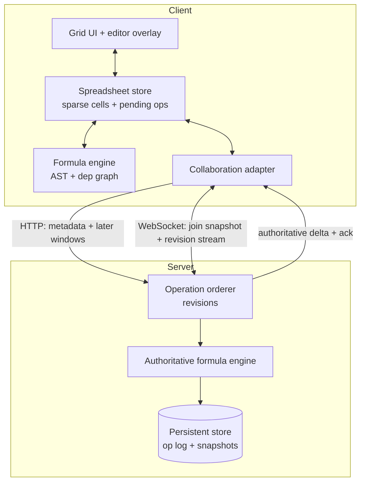
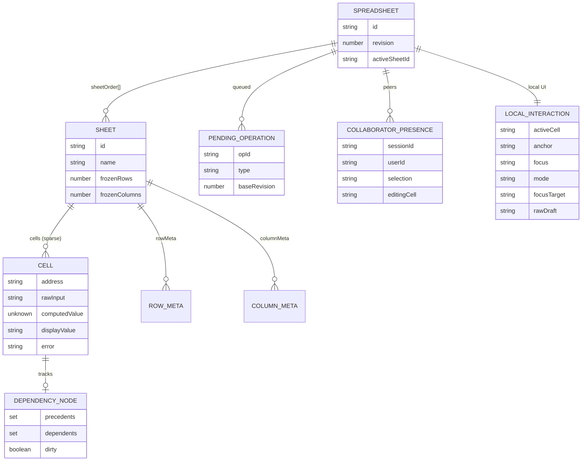
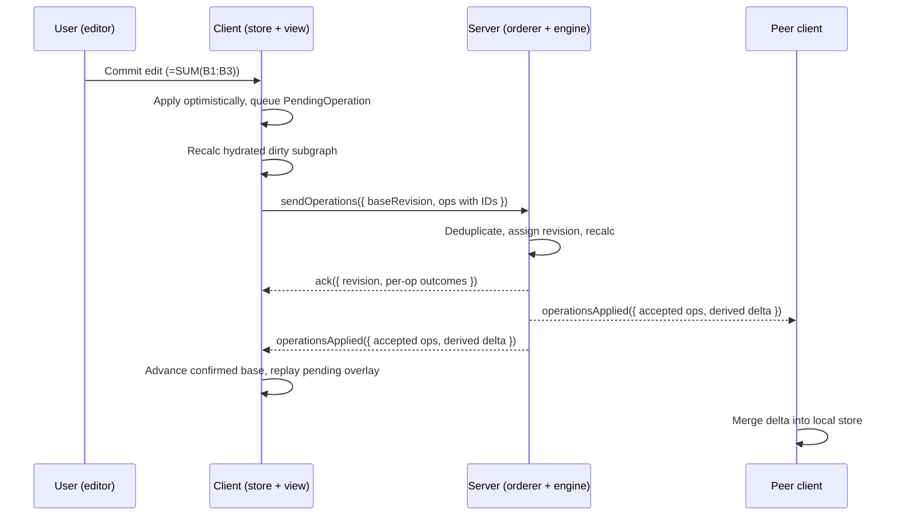
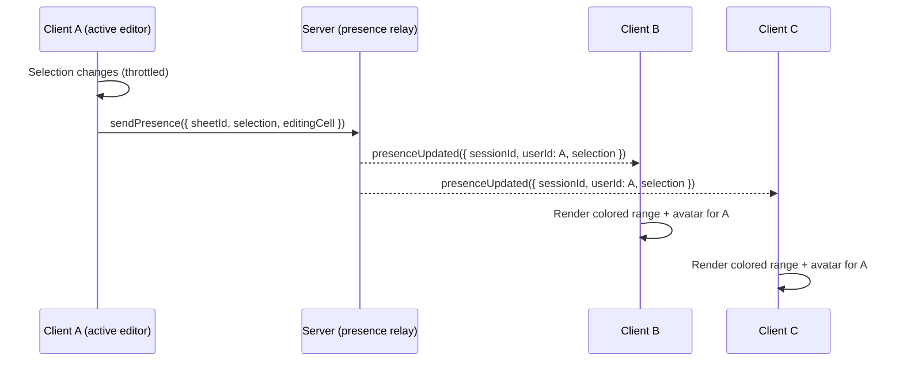
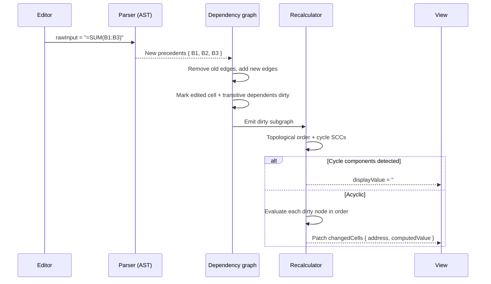
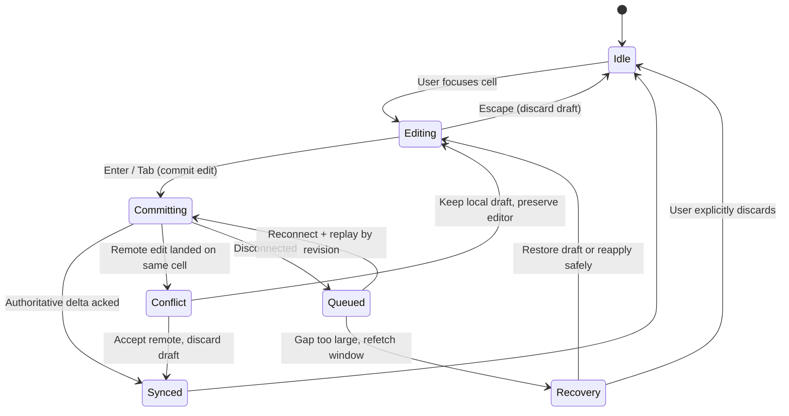

# Google Sheets

**Difficulty:** Hard · **Duration:** ~45 min · **Topics:** Networking, Performance, UI component

> Source: [collaborative-spreadsheet-google-sheets](https://www.greatfrontend.com/questions/system-design/collaborative-spreadsheet-google-sheets)

## Question

Design a collaborative spreadsheet application that allows multiple users to view and edit the same spreadsheet simultaneously in real time.

Focus on the browser experience for an active sheet: editing literal values and formulas, selecting ranges, formatting cells, rows, and columns, resizing rows and columns, and reflecting collaborators' updates with low latency. You can assume the spreadsheet is persisted by a server and omit charts, pivot tables, comments, macros, and full offline editing unless the interviewer asks about them.

> **This article is spreadsheet-specific, not a repeat of Google Docs**
>
> This article builds on the collaboration ideas from the [Google Docs system design article](https://www.greatfrontend.com/questions/system-design/collaborative-editor-google-docs), but the main discussion here is spreadsheet-specific: grid rendering, formula recalculation, selections, and structured cell/range operations.

### Real-life examples

These products illustrate the collaborative grid, formula, and formatting behaviors in scope.

- [Google Sheets](https://workspace.google.com/products/sheets/)
- [Microsoft Excel](https://www.microsoft.com/en-us/microsoft-365/excel)
- [Airtable](https://www.airtable.com/)
- [Zoho Sheet](https://www.zoho.com/sheet/)

## Solution

### Requirements exploration

Collaborative spreadsheets combine several hard front-end problems in one product: rendering a large 2D grid efficiently, evaluating formulas with dependency tracking, layering formatting rules, and reflecting multi-user edits in real time.

#### What are the core features to be supported?

The first-pass design should cover the editing loop users exercise continuously.

- Users can work on one active sheet at a time within a collaborative spreadsheet.
- Cells support literal values and formulas, editable either directly in the grid or through a formula bar.
- Users can select single cells and rectangular ranges using mouse and keyboard.
- Formatting can be applied at the cell, row, and column levels.
- Rows and columns can be resized.

#### Should the spreadsheet support real-time collaboration?

Yes. Multiple users can view and edit the same spreadsheet simultaneously. Collaborators should see each other's presence, current selection, and active editing cell, and updates from peers should appear automatically in near real time.

#### What is the expected grid size?

The spreadsheet should support large sheets with thousands of rows and columns. Most cells will be empty, so both the rendering layer and the data model should assume sparse data instead of a fully populated grid.

#### What features are out of scope?

Charts, pivot tables, macros, comments, scripting, and full offline-first conflict resolution are out of scope. Full multi-sheet coordination is also not part of the first-pass design and can be discussed later as an extension.

#### What devices should be supported?

Desktop browsers are the priority. The design should not prioritize a polished mobile spreadsheet experience.

#### What are the non-functional requirements?

The design should prioritize responsiveness, convergence, and recovery over production-scale feature breadth.

- Local edits should feel instant; users should not wait for a server round-trip before seeing their own changes.
- Peer updates should typically appear within about 500ms.
- Scrolling, navigation, and selection should remain smooth on large sheets.
- Formula recalculation should touch only affected cells instead of recomputing the entire sheet.
- The application should recover cleanly from reconnects and stale client state.

#### Check your understanding 1

Before choosing a renderer and collaboration model for a Google Sheets-like application, which unanswered requirements could materially change those choices? Select all that apply.

- [x] How large can a sheet become, how many cells are typically populated, and how much of the grid is visible at once?
  > Grid density and viewport scale determine whether sparse storage and two-dimensional virtualization are necessary.
- [ ] Must formulas be edited only in cells, or also through a persistent formula bar?
  > This changes the editing UI, but both interfaces can target the same cell model, renderer, and collaboration operations.
- [x] Which formulas, formatting layers, and structural edits are supported, and what ordering, convergence, and recalculation guarantees do concurrent edits require?
  > These requirements shape the operation model, dependency graph, recomputation strategy, and conflict handling.
- [x] Which devices, keyboard and clipboard workflows, accessibility behavior, history depth, and offline recovery guarantees are required?
  > These constraints affect input handling, accessible grid behavior, persistence, and the boundary between baseline and follow-up work.

---

### Background

Spreadsheets share real-time synchronization requirements with document editors but differ in data model, rendering, and computation.

#### What makes collaborative spreadsheets different from collaborative documents?

A collaborative spreadsheet shares some of the same real-time synchronization problems as a collaborative document editor, but the surface area is quite different. Instead of a linear document, the user interacts with a large 2D grid where each cell can contain either a literal value or a formula that depends on other cells.

That heavily influences decisions for both rendering and state management. The browser has to navigate a potentially massive table efficiently, while the data layer tracks dependencies, recalculates affected cells, and keeps values, formatting, and dimensions consistent across collaborators.

In other words, the unit of interaction is not just text. It can be a cell, a rectangular range, or row and column metadata such as dimensions.

#### Spreadsheet concepts relevant to this design

These concepts determine the data, rendering, and synchronization boundaries used later.

- **Raw input vs displayed value**: A cell might store `=A1+B1` as its raw input while displaying `42` as its computed value.
- **Formulas and references**: Formulas can depend on individual cells or ranges, so edits can trigger dependent-cell recalculation.
- **Ranges**: Many spreadsheet interactions operate on rectangular ranges rather than single cells, including selection, formatting, and formulas such as `SUM(A1:A10)`.
- **Row and column metadata**: Resizing changes layout metadata without changing cell addresses. Inserting, deleting, or moving rows and columns also changes references and is treated as a follow-up.
- **Formatting layers**: Formatting is not just at the cell level; it can be applied at the cell, row, column, or sheet-default level, so the rendered result often comes from merging multiple layers of formatting.

---

### Approach

The main design decisions are how to render the grid, how to model the cell graph and its formulas, and how to synchronize edits across clients.

#### Rendering the grid

The core rendering tradeoff is whether to represent visible cells as DOM nodes or to draw the grid into a canvas. This is similar to the tradeoff discussed in the [Rich Text Editor system design article](https://www.greatfrontend.com/questions/system-design/rich-text-editor), but spreadsheets put much more pressure on layout density and scrolling performance.

| Approach                  | Strengths                                                                                              | Weaknesses                                                                                                                |
| ------------------------- | ------------------------------------------------------------------------------------------------------ | ------------------------------------------------------------------------------------------------------------------------- |
| DOM grid + editor overlay | Native keyboard input, IME support, accessibility, copy/paste behavior, and easier styling/debugging   | Too many mounted cells will hurt layout, paint, and memory without aggressive virtualization                              |
| Canvas grid               | Lower per-cell DOM cost, fine-grained drawing control, and better scaling for extremely dense surfaces | Must reimplement hit testing, text measurement, editor overlays, selection visuals, clipboard behavior, and accessibility |

The recommended starting choice in the context of interviews is **DOM grid**:

- Spreadsheet cells are mostly lightweight display surfaces.
- Only one active cell needs a real editor at a time.
- Browser primitives already handle a lot of hard UX details around focus, input, and accessibility.

Canvas is a valid production optimization if the interviewer pushes on very large sheets. For reference, Google Sheets itself uses a canvas-based renderer for its grid. However, canvas is better framed as an upgrade path than as the starting point in an interview because it requires reimplementing many browser primitives from scratch. A hybrid model is also practical: canvas for the display layer plus a DOM overlay for the active editor, selection UI, and accessible interactions.

> **Default to a DOM grid with virtualization, not canvas**
>
> Even though production Google Sheets uses canvas, DOM is the stronger interview default because it gets native focus, IME, clipboard, and accessibility for free. Only bring up canvas or a hybrid renderer as a scaling upgrade path if the interviewer explicitly pushes on extreme sheet density.

#### Request payload contents

The client should send **structured operations**, not full-sheet snapshots. Each update should include a stable client-generated operation ID, the `sheetId`, a `baseRevision`, the operation type, and only the range or metadata needed for that change.

That shape keeps the protocol small and makes spreadsheet-specific behaviors explicit. For example, `SetCellInput`, `SetRangeFormat`, and `ResizeColumn` are fundamentally different operations and should not be flattened into one generic patch format.

#### Collaboration model for spreadsheets

A spreadsheet can reuse the same broad client-server sync model as a collaborative document editor, but the conflict surface is usually smaller. Independent cell or range edits can merge naturally, while same-cell conflicts can use server ordering with last-write-wins at the cell-input level. There's usually no need for operational transforms to handle same-sentence or same-word conflicts.

Resizing a row or column is a metadata update: the client can preview it optimistically, while the server orders and broadcasts the final size. It does not shift cell addresses or rewrite formulas.

> **Concurrent structural edits are a potential follow-up**
>
> Inserting, deleting, or moving rows and columns requires a production design to choose stable row/column identities or revisioned positional transforms. The server should serialize those operations and broadcast a canonical mapping, but the transform and tombstone protocol is outside this first-pass interview design.

#### Formula recalculation strategy

The client should parse formulas into an [Abstract Syntax Tree (AST)](https://en.wikipedia.org/wiki/Abstract_syntax_tree), maintain dependency edges for hydrated cells, and recalculate only the dirty subgraph it has loaded after an edit. For optimistic feedback, the browser should eagerly hydrate any offscreen precedents or dependents touched by visible formulas or the actively edited range. If part of the affected subgraph is still missing, the client can keep the local edit responsive but treat the recomputation as tentative until the server returns the authoritative result for that revision.

The server should repeat the same logic against the full sheet for the authoritative revision that is broadcast back to collaborators. Range-heavy formulas need special care because naively expanding every range into individual edges can blow up the dependency graph. Structural operations also feed into this subsystem because inserting or deleting rows and columns may require formula references to be rewritten before recalculation.

#### Overall approach summary

The overall design is a DOM grid with optimistic local edits, structured spreadsheet operations, server-ordered synchronization, and selective recalculation based on a dependency graph. Structured operations and selective recalculation avoid replacing and recomputing the entire spreadsheet after each edit.

#### Check your understanding 2

A spreadsheet exposes thousands of rows and columns, but only a few hundred cells are visible. It must support keyboard navigation, IME input, clipboard operations, and screen readers. Which rendering approach best fits?

- [ ] Render a DOM node and input for every logical cell so native browser behavior is available across the full sheet.
  > Native behavior does not offset the layout, memory, and input cost of materializing millions of mostly empty coordinates.
- [x] Render a two-dimensional window of lightweight DOM cells and position one real editor over the active cell.
  > DOM preserves browser input and accessibility behavior, while two-axis virtualization and a single editor keep mounted work proportional to the viewport.
- [ ] Draw the entire grid into Canvas and implement text entry, focus, clipboard, and accessibility on top of the bitmap.
  > Canvas can become a measured scaling path, but choosing it first requires rebuilding several required browser behaviors without evidence that virtualized DOM is insufficient.
- [ ] Request an image for each visible range and send pointer coordinates to the server for cell editing.
  > Raster snapshots do not provide local cell semantics or responsive editing and make every interaction depend on network latency.

---

### Architecture / high-level design

Collaborative spreadsheets should use a client-server model with **HTTP for metadata and later window fetches** and a **revision-bound WebSocket join for initial state and live collaboration**.

The client keeps a local replica of the active sheet so that edits can apply optimistically and the UI can remain responsive even before the server responds. The server orders operations, persists revisions, recalculates affected formulas, and broadcasts the authoritative result back to connected clients. This is the same broad collaboration model used in the [Google Docs system design article](https://www.greatfrontend.com/questions/system-design/collaborative-editor-google-docs), but the unit of change here is a cell, range, row, or column operation rather than a text operation.

#### Component responsibilities

Each component owns one part of the local-feedback and authoritative-sync loop.

- **Server**: Stores spreadsheet and sheet data, assigns monotonically increasing revisions, recalculates affected formulas after committed operations, and broadcasts authoritative updates and presence to connected clients.
- **Collaboration adapter**: Maintains the WebSocket connection, sends local operations and presence updates, and receives remote operations, acknowledgements, and recalculation results.
- **Spreadsheet store**: Holds the confirmed active-sheet snapshot, visible window, row and column metadata, pending overlay, local interaction state, and collaborator presence. Serves as the source of truth for the UI.
- **Formula engine**: Parses formulas, tracks dependency edges, marks dirty cells, and recalculates affected values. Runs on the client for fast optimistic feedback and on the server for authoritative results.
- **Grid UI**: Renders the visible cell window, sticky headers, selection borders, fill handles, and collaborator highlights. Uses lightweight display cells instead of mounting a full editor in every cell.
- **Cell editor overlay**: A single positioned editor mounted over the active cell. The editor overlay and formula bar share the same draft value so users can edit from either surface.
- **Toolbar and formula bar**: Dispatch structured formatting, sizing, and editing commands rather than mutating DOM state directly.

#### Update flow

The client must join the live revision stream without leaving a gap between its initial snapshot and subscription.

1. The client authenticates the WebSocket and joins the active sheet. The server registers the subscription and returns the initial visible window at revision `R` as one logical handshake.
2. The client applies every contiguous revision after `R` before enabling edits, then renders the visible rows and columns with sticky headers and selection overlays.
3. When the user commits an edit, the client overlays it on the confirmed replica, recalculates the hydrated portion of the affected dependency subgraph, and sends a typed operation with a stable ID and base revision.
4. The server deduplicates and orders the operation, persists it as a new revision, recalculates authoritative values, and broadcasts the normalized accepted operations plus their derived results.
5. Every client advances its confirmed base with the same authoritative revision. The originating client removes operations with terminal outcomes, rebases its remaining optimistic overlay, and publishes the resulting view atomically.

If HTTP provides the initial window instead, establish or buffer the subscription first and replay from the snapshot revision before the sheet becomes editable. Either approach prevents an update committed during bootstrap from being lost.

**Client-server architecture for one active sheet**



#### Check your understanding 3

A large collaborative sheet needs instant local edits and authoritative formula results for all users. Which architecture best fits?

- [x] Run a sparse optimistic client replica and a server that orders structured operations, recalculates formulas, and broadcasts authoritative revisions.
  > The client stays responsive while the server establishes shared ordering and final calculations.
- [ ] Run the browser as the formula authority and let the server relay each client's computed cell deltas unchanged.
  > Hydrated dependency slices and operation arrival order can differ between clients, so their computed values are not a shared authority.
- [ ] Render only server-confirmed cells and wait for each revision response before reflecting an edit in the active grid.
  > The server remains authoritative, but round-trip-gated rendering makes ordinary typing and navigation feel remote.
- [ ] Synchronize each browser's rendered cell markup and resolve conflicts by replacing the older visible grid fragment.
  > Rendered fragments omit raw formulas, sparse model state, and the operation intent needed for deterministic reconciliation.

#### Check your understanding 4

A collaborator changes cell B4 while another client is opening the sheet. Which bootstrap sequence prevents that revision from falling between the initial window and live updates?

- [ ] Fetch the latest window over HTTP, render it, and open the WebSocket after the page becomes editable.
  > An operation can commit after the snapshot is read but before the subscription exists, leaving the client stale with no event that closes the gap.
- [ ] Open the WebSocket first and accept whatever updates arrive while separately fetching an unversioned initial window.
  > Without a shared revision boundary, the client cannot tell whether a buffered update is already included in the later snapshot or still needs to be applied.
- [x] Join the live subscription with an initial window at revision `R`, then replay contiguous revisions after `R` before enabling edits.
  > Binding the snapshot to the stream creates an explicit continuation point, so changes committed during startup are either in revision `R` or replayed after it.
- [ ] Fetch a snapshot, subscribe, then periodically compare visible cell values to detect anything missed during startup.
  > Value comparison cannot reconstruct ordering, operation outcomes, or identical-value edits. The protocol needs a revisioned handoff rather than heuristic repair.

---

### Data model

Use a **sparse sheet store keyed by cell address**, not a dense 2D array. A large sheet may expose millions of possible coordinates, but only a small fraction will be non-empty, formatted, or currently visible.

#### Core entities

The core model separates durable sheet data, derived calculation state, local interaction state, pending intent, and ephemeral presence.

| Entity                 | Purpose                                               | Important fields                                                                                                                                                                                              |
| ---------------------- | ----------------------------------------------------- | ------------------------------------------------------------------------------------------------------------------------------------------------------------------------------------------------------------- |
| `Spreadsheet`          | Top-level state for the current spreadsheet           | `id: string`, `revision: number`, `activeSheetId: string`, `sheetOrder: string[]`                                                                                                                             |
| `Sheet`                | State for one tab in the spreadsheet                  | `id: string`, `name: string`, `cells: Map<string, Cell>`, `rowMeta: Map<number, RowMeta>`, `columnMeta: Map<number, ColumnMeta>`, `defaultFormat: FormatPatch`, `frozenRows: number`, `frozenColumns: number` |
| `Cell`                 | Raw input plus derived output                         | `address: string`, `rawInput: string`, `computedValue: unknown`, `displayValue: string`, `formulaAst: ASTNode \| null`, `error: string \| null`, `formatOverride: FormatPatch \| null`                        |
| `RowMeta`              | Row-level presentation state                          | `height: number`, `hidden: boolean`, `formatPatch: SequencedFormatPatch \| null`                                                                                                                              |
| `ColumnMeta`           | Column-level presentation state                       | `width: number`, `hidden: boolean`, `formatPatch: SequencedFormatPatch \| null`                                                                                                                               |
| `DependencyNode`       | Recalculation metadata                                | `precedents: Set<string>`, `dependents: Set<string>`, `dirty: boolean`                                                                                                                                        |
| `LocalInteraction`     | Local selection and uncommitted editing state         | `activeCell: string`, `anchor: string`, `focus: string`, `mode: 'navigation' \| 'editing' \| 'composing'`, `focusTarget: 'grid' \| 'editor'`, `rawDraft: string \| null`, `commitBaseRevision: number`        |
| `CollaboratorPresence` | Ephemeral peer state                                  | `sessionId: string`, `userId: string`, `color: string`, `sheetId: string`, `selection: Range \| null`, `editingCell: string \| null`, `lastSeenRevision: number`                                              |
| `PendingOperation`     | Optimistic local mutation waiting for acknowledgement | `opId: string`, `type: OperationType`, `target: string \| Range`, `payload: object`, `baseRevision: number`                                                                                                   |

#### Sparse cell storage

`Sheet.cells` should be a map keyed by cell address such as `A1` or a numeric row/column tuple. Only cells that contain raw input, computed errors, or explicit formatting overrides need entries. An absent entry means "empty cell with inherited defaults".

This matters for both memory and update cost. Formatting an entire column should update one `ColumnMeta` record rather than materializing thousands of blank `Cell` objects. It also keeps viewport fetching simple because the client can request only the visible rectangular window plus a small buffer.

> **Do not model the sheet as a dense 2D array of cells**
>
> A sheet can expose millions of coordinates, but only a small fraction hold raw input, computed errors, or explicit formatting. Store cells in a map keyed by address and let absent entries mean "empty with inherited defaults" so that row-wide, column-wide, and sheet-wide operations stay O(1) instead of O(cells).

#### Formatting precedence

When rendering a cell, resolve each formatting property from three tiers: sheet defaults; row and column metadata at the same tier; then the cell override. If both row and column metadata define a property, compare its server-assigned `(revision, operationIndex)` sequence and let the later operation win. The cell override still takes final precedence.

#### Derived state and recalculation metadata

A cell's `rawInput` is the source of truth. `computedValue` is the evaluated result of a formula before display formatting, while `displayValue` is the final rendered value shown in the grid, including formatting or error presentation. `formulaAst` and dependency edges are also derived state that can be cached and invalidated when precedents change. In practice, keep a dependency graph keyed by cell address so that an edit can mark only the affected subgraph as dirty.

The client store should keep a confirmed sheet snapshot at the current authoritative `revision` and an ordered overlay of `PendingOperation`s. The rendered view is derived by replaying that overlay over the confirmed base. `LocalInteraction` remains separate so virtualization or a remote revision cannot destroy an active selection, IME composition, or uncommitted draft.

**Spreadsheet client store entity relationships**



#### Check your understanding 5

A sheet allows one million rows, but fewer than 0.01% of its cells contain values or explicit formatting. Which modeling choices avoid scaling memory with the full coordinate space while preserving editable formulas? Select all that apply.

- [x] Store only non-empty, explicitly formatted, or errored cells in a map keyed by sheet and address.
  > Absent cells can inherit defaults without materializing millions of possible coordinates.
- [x] Keep raw input separate from computed and display values.
  > Formulas remain editable while derived results and formatting can be invalidated independently.
- [ ] Allocate fixed-size row chunks for every address up to the furthest edited row, even when most chunks contain no cells.
  > Chunking changes allocation granularity, but memory still grows with the furthest coordinate rather than the populated cells.
- [x] Track precedents, dependents, and dirty formulas separately from the sparse cell records.
  > Formula relationships can be indexed without materializing every possible grid coordinate as a cell object.

#### Check your understanding 6

A user is composing a formula in C7 when a remote revision updates C7 and scrolling temporarily unmounts its display cell. How should the client store and update the remote value, pending edits, and local draft without losing the user’s input? Select all that apply.

- [x] Apply authoritative revisions to a confirmed sheet base and replay unresolved local operations as a separate ordered overlay.
  > Separating confirmed state from pending intent lets the client advance revisions without duplicating or silently accepting unacknowledged edits.
- [ ] Overwrite the editor with the remote raw input as soon as the new revision arrives.
  > Applying shared state directly to the editing buffer can erase uncommitted text and disrupt an active composition sequence.
- [x] Store the raw draft, selection, edit mode, and IME composition state outside the durable cell record.
  > An uncommitted editing session belongs to the local user and must survive cell virtualization without becoming shared document content.
- [ ] Keep the draft only inside the mounted C7 editor and discard it when virtualization recycles that node.
  > Viewport membership is a rendering concern. Tying draft lifetime to a DOM node makes scrolling destructive to local work.
- [x] Preserve the draft, show that the confirmed value changed, and let the user recommit, copy, or discard their edit.
  > A visible recovery choice protects user input without pretending the local draft has already won the server's ordering policy.

---

### Interface definition (API)

The most important interface is not a large REST surface area. It is a **structured operation layer** shared by the grid, formula bar, toolbar, and collaboration adapter. UI components should dispatch operations against the spreadsheet store, then let the collaboration layer send them to the server, rather than mutating DOM state directly.

#### Initialization API

Use HTTP for page metadata and later window fetches, but bind the initial sheet state to the live revision stream:

- `GET /spreadsheets/:spreadsheetId`: Returns spreadsheet metadata, the active sheet ID, and high-level sheet summaries such as row counts, column counts, and frozen pane settings.
- `joinSheet({ spreadsheetId, sheetId, window })`: Registers the WebSocket subscription and returns the initial cells, layout metadata, and authoritative revision `R`. The server then streams every revision after `R` in order.
- `GET /spreadsheets/:spreadsheetId/sheets/:sheetId/window?...&revision=R`: Fetches later cell and layout windows against a stated revision, including sparse row and column size overrides.
- `POST /spreadsheets/:spreadsheetId/sheets/:sheetId/dependency-slices`: Fetches missing offscreen precedents or dependents for tentative client recalculation.

The client should not fetch an entire large sheet up front. As the user scrolls, it requests additional windows and merges them into the sparse store. Most rows and columns inherit default dimensions, so only resized or hidden items need explicit layout metadata.

> **Versioned dependency hydration is a potential follow-up**
>
> The interview design can keep an incomplete local calculation tentative until the server result arrives. A production dependency-slice cache should return its revision and completeness, then invalidate affected slices when formula or structural revisions advance.

#### Update API

Send edits as batches of typed operations over WebSocket:

```ts
sendOperations({
  batchId: "batch-42",
  clientSessionId,
  spreadsheetId,
  sheetId,
  baseRevision,
  operations: [
    {
      opId: "op-91",
      type: "SetCellInput",
      address: "B4",
      rawInput: "=SUM(B1:B3)",
    },
    {
      opId: "op-92",
      type: "SetRangeFormat",
      range: "B1:B10",
      formatPatch: { fontWeight: "bold" },
    },
    { opId: "op-93", type: "ResizeColumn", column: 2, width: 160 },
  ],
});
```

The server responds asynchronously over the same WebSocket. A simple model is to send a lightweight acknowledgement to the originating client and broadcast the same authoritative delta to every connected client, including the sender:

```ts
// Sent to the originating client with an outcome for every operation
ack({
  batchId: "batch-42",
  revision: 1842,
  outcomes: [
    { opId: "op-91", status: "accepted" },
    { opId: "op-92", status: "accepted" },
    { opId: "op-93", status: "accepted" },
  ],
});

// Broadcast to every connected client, including the sender
operationsApplied({
  spreadsheetId,
  sheetId,
  revision: 1842,
  acceptedOperations: [
    {
      opId: "op-91",
      operationIndex: 0,
      type: "SetCellInput",
      address: "B4",
      rawInput: "=SUM(B1:B3)",
    },
    {
      opId: "op-92",
      operationIndex: 1,
      type: "SetRangeFormat",
      range: "B1:B10",
      formatPatch: { fontWeight: "bold" },
    },
    {
      opId: "op-93",
      operationIndex: 2,
      type: "ResizeColumn",
      column: 2,
      width: 160,
    },
  ],
  changedCells: [
    {
      address: "B4",
      rawInput: "=SUM(B1:B3)",
      computedValue: 42,
      displayValue: "42",
    },
  ],
  changedRows: [],
  changedColumns: [{ column: 2, width: 160 }],
});
```

The broadcast contains both durable accepted intent and derived recalculation results, so a peer can reconstruct the editable formula, range formatting, and column size rather than receiving only display output. Operation IDs are generated once by the client and reused on retry; the server remembers the outcome so a repeated ID returns the original result instead of applying the operation twice.

> **Production security is a potential follow-up**
>
> Use HTTPS/WSS, authenticate both sessions, derive actor identity on the server, and authorize every sheet or protected-range operation. A production boundary also validates origins, message schemas, range bounds, payload sizes, and rates; permission or validation failures return per-operation rejection outcomes to the recoverable queue.

**Collaborative cell edit with optimistic apply and rebroadcast**



Useful operation types for this article are:

- `SetCellInput`
- `ClearRange`
- `SetRangeFormat`
- `ResizeRow`
- `ResizeColumn`

Production structural-edit follow-ups add operations such as:

- `InsertRow`
- `DeleteRow`
- `InsertColumn`
- `DeleteColumn`

This keeps the scoped protocol aligned with the required editing behavior without pretending a row insertion is merely a batch of cell edits. Structural operations need the stable-identity or positional-transform contract described earlier.

#### Presence updates

Presence should use a separate, lightweight event stream because it is ephemeral and should not be persisted like sheet edits.

- `sendPresence({ sheetId, selection, editingCell })`: Sent by the active client when selection or editing focus changes.
- `presenceUpdated`: Broadcast by the server to other collaborators so they can render colored ranges and active-cell indicators.

Presence updates can be throttled because they do not need the same durability guarantees as cell edits. WebSockets are a good choice for the transport mechanism. If small delays can be tolerated, both HTTP short and long polling can be used as well, which could be cheaper in terms of infrastructure costs.

> **Presence lifecycle is a potential follow-up**
>
> Production presence is keyed by an ephemeral connection or tab session, with the user identity derived by the server. Heartbeats or short leases expire crashed sessions, and the UI can aggregate multiple sessions belonging to the same user.

**Presence and cursor broadcast flow**



#### Acknowledgements and reconciliation

Keep a confirmed base at revision `R` and an ordered optimistic overlay. For each contiguous authoritative revision, apply its accepted operations and derived values to the confirmed base, remove pending operations with terminal outcomes, transform or fail any dependent pending operations, replay the remaining overlay, recalculate affected formulas, and publish the new view atomically. This prevents a relative edit from being applied once optimistically and then a second time when its acknowledgement arrives.

If two users edit the same cell at nearly the same time, a practical first-pass policy is **server ordering / last-write-wins at the cell-input level**. Structural operations such as row and column insertion need server-side coordinate rebasing before the final update is broadcast.

An operation that cannot be reconciled moves to a recoverable failed state containing its ID, target, draft, rejection reason, and server revision. The user can retry after a refresh, copy or export the draft, reapply it manually, or explicitly discard it; a refetch must not silently erase pending intent.

#### Check your understanding 7

A client scrolls into an unloaded region of a sparse sheet while collaboration continues. Which window-fetch rules keep the local replica consistent and bounded? Select all that apply.

- [x] Include the sheet revision used for the window request and reconcile any later revisions through the live stream.
  > A versioned response gives the client a known base instead of mixing cells from an unknown point in the operation history.
- [ ] Delay the new viewport until every cell and row or column record has been downloaded.
  > Full-sheet hydration makes load cost scale with logical sheet size even though the user needs only one visible rectangle.
- [x] Return populated cells plus non-default row and column metadata for the requested rectangle.
  > Empty cells and default dimensions can be derived, so the response need not materialize the full coordinate space.
- [x] Route the response by sheet ID and merge records into the sparse store without replacing unrelated loaded windows.
  > Stable sheet and coordinate identity lets independently fetched windows coexist in one local replica.
- [ ] Let the window response overwrite newer streamed values because it was requested before those live updates arrived.
  > Request order is not revision order. An older response must not roll the sparse replica back over later authoritative changes.

#### Check your understanding 8

A user pastes a range and resizes a column while based on revision 1841. Which update contract supports reconciliation?

- [x] Send stable operation IDs, sheet ID, base revision, and typed range or resize intent; return per-operation outcomes and an authoritative delta.
  > The server can deduplicate and order explicit intent before every client applies the accepted inputs, formats, metadata, and recalculated results.
- [ ] Send the client's sparse sheet snapshot with its base revision and replace every changed cell on the server.
  > A snapshot carries cell state but obscures paste and resize intent, so it cannot safely rebase either action against concurrent operations.
- [ ] Send changed coordinates and rendered display strings, using the device timestamp to order conflicts at each cell.
  > Display strings omit raw formulas and resize metadata, while device clocks cannot establish the shared revision order.
- [ ] Send the paste and resize as unrelated commands without stable IDs, then infer success from the next streamed sheet window.
  > Without stable IDs and explicit outcomes, a retry can duplicate work and the client cannot match each optimistic action to its result.

#### Check your understanding 9

The server rejects one optimistic range edit because its target is no longer valid. The client also has a saved draft and later pending edits. What should reconciliation do?

- [x] Record the rejected edit with its draft, reason, and server revision; rebuild from the confirmed base and replay only valid pending edits.
  > A recoverable failed state preserves the user's intent while rebuilding the overlay prevents the rejected edit from remaining in the visible sheet.
- [ ] Refetch the latest sheet window and clear the rejected edit, its draft, and every later pending edit.
  > The view becomes authoritative, but unrelated pending work and the rejected draft disappear without a recovery choice.
- [ ] Leave the rejected edit in the optimistic overlay and continue applying later server revisions beneath it.
  > A terminally rejected operation cannot remain part of the apparent sheet state because it will never be confirmed or shared.
- [ ] Remove the rejected edit from the send queue but keep its value as a local-only committed cell.
  > Treating an unaccepted value as committed creates a private workbook state that diverges from every collaborator and the server.

#### Check your understanding 10

Collaborator selections change many times per second, while cell edits must be durable and replayable. Which presence policies match those different guarantees? Select all that apply.

- [x] Send selection and active-editing-cell updates outside the durable spreadsheet operation log.
  > Presence describes a current session rather than document history, so missing an intermediate cursor position does not change sheet correctness.
- [ ] Assign each cursor movement a workbook revision and retry it until every peer acknowledges it.
  > Durable delivery would create operation-log noise and replay obsolete positions even though only the latest presence state is useful.
- [x] Limit how frequently continuous selection changes are broadcast while still sending recent state.
  > Throttling bounds network and render work because peers need a timely location, not every raw pointer sample.
- [x] Identify the sheet plus the selected range or editing cell so recipients can route the indicator correctly.
  > The same coordinates exist on different sheets, and presence must not appear on an unrelated active tab.

---

### Optimizations and deep dive

This section expands the spreadsheet-specific tradeoffs behind the recommended design and covers deeper concerns that interviewers commonly ask about after the first architecture sketch:

- [Grid virtualization](#grid-virtualization): This section explains how the client renders large row and column ranges without mounting the entire spreadsheet DOM.
- [Formula engine](#formula-engine): This section covers parsing, dependency tracking, recalculation, error handling, and the split between raw input and derived output.
- [Formatting](#formatting): This section discusses cell presentation, styles, number formats, and how formatting stays separate from cell values.
- [Accessibility](#accessibility): This section explains ARIA grid semantics, keyboard navigation, focus management, and screen-reader output for cells.
- [Clipboard and copy-paste](#clipboard-and-copy-paste): This section covers browser clipboard integration, range serialization, paste parsing, and spreadsheet-specific edge cases.
- [History and versioning](#history-and-versioning): This section explains audit history, accidental overwrite recovery, and how spreadsheet changes can be replayed or inspected.
- [Reliability and reconnection](#reliability-and-reconnection): This section covers reconnect behavior, late acknowledgements, conflicting edits, and resilient collaborative sync.
- [Multi-sheet support](#multi-sheet-support): This section discusses how the model extends from one active sheet to multiple sheets in the same workbook.
- [Offline editing](#offline-editing): This section explains the follow-up design for local spreadsheet edits while the client is disconnected.

#### Grid virtualization

Large spreadsheets need virtualization to bound the number of mounted DOM cells. Virtualizing a spreadsheet is harder than virtualizing a unidirectional feed because we need to window on **two axes** instead of one.

The basic approach is:

1. Keep a scroll container sized to the total logical dimensions of the sheet.
2. Render only the rows and columns that intersect the viewport, plus a small overscan buffer.
3. Position visible cells absolutely within that window.
4. Keep row headers, column headers, selections, and collaborator highlights in separate overlay layers.
5. Mount a single editor overlay instead of an `<input>` inside every visible cell.

This keeps scrolling smooth and prevents the DOM tree from exploding as the sheet grows. It also makes frozen rows and columns easier to implement because they can live in fixed layers while the main grid scrolls underneath.

> **Spreadsheet virtualization must window on both axes**
>
> Unlike a feed that only virtualizes vertically, a spreadsheet has potentially large row and column counts, so the visible window is a rectangle and both axes need independent cumulative-size indexes. Variable row heights and column widths make naive index math wrong, so maintain sparse size overrides plus a cumulative offset structure that supports binary search.

To make this work with variable row heights and column widths, bootstrap the total logical row and column counts plus sparse layout overrides for non-default sizes and hidden items. The client can then size the full scroll surface without materializing every row and column, and patch those layout indexes incrementally as resize or hide operations arrive.

There are a few spreadsheet-specific optimizations worth noting:

- Maintain cumulative row-height and column-width offsets so the viewport can binary-search to the first visible row and column.
- Prerender boundary row and column windows so fast scrolling does not immediately hit empty states.
- Render selection borders and autofill handles as overlays instead of styling every selected cell individually.
- Preserve scroll position when remote updates arrive by patching only affected cells rather than remounting the whole window.

#### Check your understanding 11

A spreadsheet supports one million variably sized rows and ten thousand columns. Which techniques keep scrolling and cell editing bounded by the viewport rather than the logical sheet size? Select all that apply.

- [x] Render a rectangular row and column window with overscan instead of only virtualizing vertically.
  > Both dimensions can be very large.
- [x] Maintain cumulative size indexes with sparse row and column overrides for viewport lookup.
  > Variable sizes require fast mapping between scroll offsets and logical coordinates.
- [ ] Virtualize rows but keep all ten thousand column nodes mounted because users scroll horizontally less often.
  > Horizontal frequency does not change the DOM cost. Both axes must be windowed and represented through logical dimensions.
- [x] Mount one positioned editor for the active cell and render other cells as lightweight display nodes.
  > Thousands of mounted inputs are unnecessary and expensive.

#### Check your understanding 12

A virtualized sheet receives remote edits while the user scrolls quickly with a large range selected and frozen headers visible. Which rendering choices keep the viewport stable? Select all that apply.

- [x] Draw selection borders and collaborator highlights in dedicated overlay layers instead of restyling every selected cell.
  > Range visuals can update without touching all cells inside a potentially large selection or changing their layout.
- [ ] Replace the scrolling grid and recalculate its position from the active cell after each remote update.
  > Remounting discards scroll continuity and can make collaboration changes visibly jump the user's viewport.
- [x] Render frozen rows and columns in fixed layers coordinated with the scrolling grid window.
  > Separate layers keep headers stationary while the main two-dimensional window changes underneath them.
- [x] Update changed cells or dimensions in place and preserve the current logical viewport anchor when a remote revision arrives.
  > Targeted patches avoid rebuilding the visible window. When an earlier row or column changes size, offset compensation keeps the same content anchored.
- [ ] Apply selection and presence styles to every logical cell, including cells outside the mounted window.
  > Work would scale with selection area rather than visible content, defeating the purpose of virtualization for large ranges.
- [x] Render a small row and column buffer beyond the visible rectangle.
  > Bounded overscan gives fast scrolling nearby content to reveal without mounting the full logical grid.

#### Formula engine

The formula engine is in charge of parsing and recalculation. It should store **raw input** and **derived output** separately:

- `rawInput`: exactly what the user typed, such as `=SUM(B1:B3)`
- `computedValue`: the evaluated result before display formatting is applied.
- `displayValue`: the final rendered value shown in the grid, including formatting or an error such as `#CYCLE!`

When a cell changes:

1. Remove the old dependency edges for that cell.
2. Parse the new input into an AST if it starts with `=`.
3. Resolve referenced cells or ranges.
4. Update the dependency graph.
5. Mark the edited cell and its transitive dependents as dirty.
6. Identify exact cycle members, then recalculate the remaining affected graph in dependency order.

For large dependency graphs, the engine should avoid recomputing the entire sheet after every edit. If a cell has no dependents, the recalculation cost may be effectively zero beyond the edited cell itself. A full pass can still be simpler for a small graph, so switch strategies using measured thresholds. In the browser, the optimistic path only covers the dependency slice hydrated locally; if a formula reaches beyond it, fetch the missing dependencies or mark the result tentative until the server pushes the authoritative recomputation.

> **Prefer recalculating the dirty subgraph**
>
> Recomputing every cell on every edit does not scale to large sheets. Maintain a dependency graph, mark the edited cell and its transitive dependents dirty, and recalculate that subgraph in dependency order when it is cheaper than a full pass.

**Range formulas need an extra layer of care.** A baseline can expand ranges while the hydrated graph remains small. If profiling shows repeated large ranges dominate memory or update time, a production engine can introduce a range-aware index or reusable range nodes. That extension must define overlap lookup, incremental add/remove behavior, structural-edit maintenance, and invalidation for partially overlapping ranges.

**Structural row and column edits also feed back into recalculation.** If a user inserts a row above `A10`, formulas that reference `A10` or `A1:A20` may need their references rewritten before the dirty subgraph is recalculated. That is one reason these operations are safer when the server applies and rebases them authoritatively.

**Cycle handling is important.** A failed topological sort identifies an unscheduled remainder, but that remainder can include acyclic formulas downstream from a cycle. Run strongly connected-component detection on that remainder, mark only multi-node components and self-loops as `#CYCLE!`, then propagate a separate precedent-error state through downstream formulas.

> **Always detect cycles before evaluating a formula subgraph**
>
> A user can easily author `A1 = B1 + 1` and `B1 = A1 + 1` by accident. Detect strongly connected components in the unscheduled dirty graph so only actual cycle members receive `#CYCLE!`; downstream formulas should receive a propagated dependency error instead.

The client and server can share the same mental model here:

- The **client** recalculates immediately for optimistic feedback.
- The **server** recalculates again for the authoritative revision that is broadcast to all collaborators.

Both sides must use the same supported formula subset and engine version for deterministic results.

> **Production formula semantics are a potential follow-up**
>
> Locale, time zone, date serial rules, numeric and error behavior, and volatile or network-backed functions need an explicit shared evaluation context. Define those only if the interviewer expands the formula-engine scope.

For sheets with large formula graphs, move recalculation onto a Web Worker so long calculations do not block scrolling, selection, and typing. This protects main-thread responsiveness but does not reduce total calculation cost, so latency still needs measurement against representative workloads.

> **Offload heavy recalculation to a Web Worker**
>
> Large dependency graphs and range-heavy formulas can spend long tasks inside a recalculation pass. A worker isolates that CPU work from interaction handling; post back only changed-cell deltas and measure whether the remaining calculation latency meets the product budget.

For a smaller version of the same problem (in object-oriented design / coding format), look at the [Spreadsheet](https://www.greatfrontend.com/questions/javascript/spreadsheet), [Spreadsheet II](https://www.greatfrontend.com/questions/javascript/spreadsheet-ii), and [Spreadsheet III](https://www.greatfrontend.com/questions/javascript/spreadsheet-iii) questions.

**Formula dependency cascade and recompute pipeline**



#### Check your understanding 13

In a collaborative workbook, C1 depends on B1, which depends on A1. A1 changes locally while the server remains authoritative for shared results. How should the formula engine propagate the change and reconcile the results? Select all that apply.

- [x] Mark A1 and its transitive dependents B1 and C1 dirty.
  > Only formulas reachable from the edit need recomputation.
- [ ] After marking the affected formulas dirty, recalculate them in visible sheet order because B1 and C1 appear below A1.
  > Visual position is not dependency order. A formula can reference cells in any direction or another sheet.
- [x] Use dependency order for acyclic work and strongly connected components to identify exact cycle members.
  > A failed topological sort alone can also leave acyclic formulas downstream from a cycle unscheduled.
- [x] Apply a fast local result, then reconcile with the server's authoritative changed-cell delta.
  > Optimistic feedback and collaborative convergence are both preserved.

#### Check your understanding 14

A visible formula depends on cells outside the client's hydrated window. After an edit, the client cannot evaluate the complete affected dependency subgraph. What should it do?

- [x] Fetch the missing dependency slice when useful, or mark the optimistic result tentative until the authoritative revision arrives.
  > Missing precedents prevent a complete local calculation, so the client must either hydrate them or avoid presenting its partial result as final.
- [ ] Evaluate every missing dependency as an empty cell and publish that result as the confirmed value.
  > An unloaded cell is not necessarily empty, so substituting blanks can produce a confidently incorrect result.
- [ ] Pause all editing until every sheet and every formula dependency in the workbook has been downloaded.
  > Full-workbook hydration restores completeness but defeats sparse window loading and makes interaction cost scale with unrelated data.
- [ ] Broadcast the locally computed value immediately and let peers replace their formula output with that value.
  > A client with incomplete dependencies cannot be the calculation authority, and peers may have different hydrated slices.

#### Check your understanding 15

Recalculating a hydrated formula subgraph causes long main-thread tasks that interrupt scrolling and typing. Which changes improve interaction responsiveness without changing calculation authority? Select all that apply.

- [x] Run parsing and dirty-subgraph evaluation in a Web Worker when measured workloads exceed the main-thread budget.
  > Moving CPU-heavy evaluation off the UI thread lets input and rendering continue while the same calculation work runs elsewhere.
- [ ] Keep recomputing the full sheet because background execution makes the amount of work irrelevant.
  > Thread placement changes contention, not computational complexity. Unnecessary full passes still waste CPU and delay authoritative results.
- [x] Post only the resulting changed cells and errors back to the main-thread store.
  > Compact deltas avoid replacing the whole sheet and limit the render work triggered by one recalculation pass.
- [ ] Have the worker update visible cell nodes directly as each formula finishes.
  > Workers cannot own the page DOM, and incremental view mutation would bypass the spreadsheet store's atomic result boundary.
- [x] Track total recalculation and message-transfer time against representative formula graphs.
  > A worker protects responsiveness but does not reduce the algorithm's total cost, so calculation latency still needs an explicit budget.

#### Formatting

In a spreadsheet, formatting is the presentation layer that sits on top of the underlying cell contents. It controls how values look and how they are displayed, including styles such as font weight, text color, borders, and alignment, as well as display-oriented rules such as currency, percentage, and date/time formats.

Because formatting is separate from the underlying `rawInput` and `computedValue`, it should stay layered instead of being copied into every affected cell.

Use separate style layers:

- **Sheet-level** (`sheet.defaultFormat`): Holds the base formatting for the sheet.
- **Row/column-level** (`rowMeta[rowIndex].formatPatch` and `columnMeta[columnIndex].formatPatch`): Share one priority tier, with the later server sequence winning independently for each property.
- **Cell-level** (`cell.formatOverride`): Stores the highest-priority cell-specific overrides.

At render time, resolve each property from the sheet default, the sequenced row/column tier, and finally the cell override. This keeps whole-row and whole-column formatting compact without making list order an accidental precedence rule.

> **Arbitrary range formatting is a potential follow-up**
>
> A large rectangular `SetRangeFormat` may still materialize many cell overrides. A production system can use sequenced rectangle or interval runs with overlap resolution and compaction, or impose a bounded range size; that representation is selected after measuring real formatting workloads.

> **Google Sheets actually lets row and column styles clear cell overrides**
>
> In reality, Google Sheets works a bit differently: a cell-specific override can be removed if a sheet/row/column-level style operation affects the same cell-level property. E.g. if a cell has a red background color and the entire row is changed to green, that cell is changed to green as well. If the entire column is set to blue, that cell will turn blue. There are pros and cons to both approaches, and they are similar in terms of technical complexity, so which approach to take hinges more on the desired product UX than on technical reasons.

Value formatting works in the same way too. The formula engine computes the underlying `computedValue`, while the formatting layer turns that into the final `displayValue` shown as plain text, currency, percentage, or date/time.

#### Check your understanding 16

A row and a column both set the same text-color property, with the row operation ordered later by the server. One intersecting cell also has its own text-color override. How should the final color be resolved?

- [x] Resolve row and column at one sequence-ordered tier, then apply the explicit cell override over that result.
  > Row and column share one sequenced tier, while a cell-specific value has final precedence.
- [ ] Always apply the column value over the row value, then apply the cell override regardless of server order.
  > Cell specificity is correct, but row and column belong to the same tier and need their authoritative sequence to resolve overlap.
- [ ] Apply whichever row, column, or cell patch has the latest server sequence, ignoring the source's specificity.
  > Sequence resolves conflicts within a tier, but a direct cell value remains more specific than inherited row or column formatting.
- [ ] Copy the winning row or column value into every intersecting cell, then treat that copied value as a cell override.
  > Materializing inheritance makes sparse cells dense and prevents later row or column patches from flowing through the intended layers.

#### Accessibility

A spreadsheet grid maps naturally to the ARIA `grid` pattern, which gives screen readers a structured way to navigate rows, columns, and cells.

Key concerns for a DOM-based grid:

- Use `role="grid"` with the total `aria-rowcount` and `aria-colcount`. Give each rendered row its logical `aria-rowindex` and each cell or column header its logical `aria-colindex`, plus `row`, `gridcell`, `rowheader`, and `columnheader` roles as appropriate.
- Manage focus with `aria-activedescendant` on the grid container rather than moving DOM focus to every cell. Before updating the attribute, scroll and render the active cell so its stable ID is visible and owned by the grid.
- Announce the active cell's address, display value, and formula (if any) via a live region so screen reader users get the same information sighted users see in the formula bar.
- Support full keyboard navigation: arrow keys move the active cell; Shift + Arrow extends the rectangular selection; row, column, and select-all commands have keyboard equivalents; Tab advances; Enter commits; and Escape cancels. Ctrl/Cmd + Arrow can jump to a contiguous data boundary.
- When the user enters edit mode on a cell, shift focus to the editor overlay and announce the raw input. When they exit, return focus semantics to the grid.
- Collaborator presence indicators (colored borders, avatar labels) should include `aria-label` annotations so screen reader users know which cells other collaborators are selecting.

If the design switches to a canvas renderer later, all of these behaviors need to be reimplemented through a hidden accessible DOM overlay, which is one of the main costs of the canvas approach.

#### Check your understanding 17

A virtualized grid mounts only the visible cells, supports rectangular selection, and shows collaborators' selections. Which behaviors preserve its logical structure and core interactions for keyboard and screen-reader users? Select all that apply.

- [x] Expose grid semantics, total row and column counts, and logical row and column indices for the rendered window.
  > Counts and indices let assistive technology understand the full logical grid even though most cells are not mounted.
- [ ] Support keyboard movement between cells, but require pointer dragging to extend a rectangular range because the active cell remains keyboard reachable.
  > Reachable cells do not make range selection operable. Extending and selecting rows or columns also need keyboard commands.
- [x] Keep focus on the grid, mount the active cell before referencing it with `aria-activedescendant`, and move focus into the editor only in edit mode.
  > The active descendant remains a visible, grid-owned element across virtualization boundaries.
- [ ] List collaborator names in a separate roster, but identify their selections inside the grid only through colored borders.
  > The roster identifies participants but does not connect a person to a selected range for users who cannot perceive the border color.
- [x] Provide keyboard commands to extend rectangular selections and select rows, columns, or the whole sheet.
  > Pointer-independent selection is required for the grid's core range interactions.
- [ ] Render a second off-screen DOM grid containing every logical cell so assistive technology never encounters virtualization gaps.
  > Duplicating the full sheet defeats virtualization and creates two interaction trees. Expose logical counts and indices through the mounted window instead.

#### Clipboard and copy-paste

Copy-paste must preserve spreadsheet ranges and formulas while supporting clipboard exchange with other applications.

When the user copies a range:

- Write the selection to the clipboard in at least two formats: plain text as **tab-separated values (TSV)** for interoperability with other spreadsheets and external applications, and a richer internal format (JSON or a custom MIME type via the Clipboard API) that preserves formulas, formatting, and range structure.
- Store the copied range reference in client state so that an internal paste can use the richer format while an external paste falls back to TSV.

When the user pastes:

- If the clipboard contains the internal format, paste the full cell data including raw formulas, formatting overrides, and relative reference adjustments based on the paste target offset.
- If the clipboard contains only plain text or TSV, parse it into a grid of literal values and write them as `SetCellInput` operations.
- Support paste-special operations such as "paste values only" (discard formulas, keep computed values) and "paste formatting only" (apply format patches without changing cell input).

Use the browser [Clipboard API](https://developer.mozilla.org/en-US/docs/Web/API/Clipboard_API) (`navigator.clipboard.read/write`) for async clipboard access. For broader browser support, also handle trusted `copy`, `cut`, and `paste` events on the grid or editor surface and read or write `event.clipboardData` there.

> **Clipboard hardening is a potential follow-up**
>
> Async clipboard access can require permission and user activation, while custom web formats may not survive into native applications. Keep TSV and safe HTML fallbacks, and version, validate, and size-limit any internal payload before turning it into operations.

Paste operations should go through the same structured operation path as manual edits. This means they are batched, revisioned, and broadcast to collaborators, rather than applied as a silent local-only DOM mutation.

#### Check your understanding 18

A user copies formulas and formatting from a spreadsheet into another application, then pastes external TSV back into the sheet. Which clipboard design works? Select all that apply.

- [x] Write a plain-text TSV representation for interoperability.
  > External applications commonly understand tabular plain text.
- [x] Also write a richer internal format containing formulas, formats, and range shape when browser support allows it.
  > Internal paste can preserve spreadsheet-specific semantics.
- [ ] Use the TSV payload as the source for both external and same-workbook paste, even when a richer internal payload is available.
  > TSV provides interoperability, but choosing it over the internal payload discards formulas, formatting, and range metadata during an internal paste.
- [x] Parse external TSV into a grid of typed SetCellInput operations and batch them through the normal update path.
  > Pastes then receive revisioning and collaboration behavior like manual edits.

#### Check your understanding 19

Cell B2 contains the formula `=A2`. A user copies B2 through the spreadsheet's rich internal clipboard format and pastes it into E5. Assuming the reference is relative, what should the pasted operation store?

- [ ] Store `=A2` unchanged because formulas should preserve their source text during copy and paste.
  > Keeping the original coordinate would make a relative reference behave like an absolute reference and change normal spreadsheet copy semantics.
- [ ] Discard the formula and store B2's current displayed value as a literal in E5.
  > A rich internal paste preserves editable formulas. Copying only the computed value is a separate paste-values operation.
- [ ] Store `=E5` because the new formula should be relative to its destination cell.
  > Relative translation preserves the source formula's offset, which is one column to the left, rather than replacing it with a self-reference.
- [x] Store `=D5` as E5's raw input and let the normal formula and collaboration pipeline evaluate it.
  > The paste moved three columns and three rows, so its relative precedent moves by the same offset before the typed cell operation is committed.

#### History and versioning

Spreadsheets benefit from stronger history features than many ordinary CRUD interfaces because users often need to audit who changed a formula, recover accidental overwrites, or compare the current state against an earlier version of the sheet.

At the storage layer, the simplest model is:

- Assign a monotonically increasing revision number to every accepted operation batch.
- Persist an append-only operation log for accepted edits and formatting changes. Each entry includes the revision, operation and batch IDs, server-derived actor ID, server timestamp, and affected sheet or range.
- Periodically write sheet snapshots so recovery does not require replaying the entire history from the beginning.

This gives us two useful product-level capabilities. First, connected clients can synchronize against revision numbers and ask for updates since their last known state. Second, the product can expose version history later without redesigning the collaboration model from scratch.

> **Audit and restoration products are a potential follow-up**
>
> Full revision history can restore a prior snapshot, while a cell-level audit view indexes log entries by affected range. Production history must also define privacy-safe actor display and restoration lineage, but those product semantics are outside the first-pass collaboration design.

#### Check your understanding 20

A collaborative sheet uses accepted operations for synchronization. Which storage policies preserve revision replay while bounding recovery work? Select all that apply.

- [x] Persist accepted operation batches with monotonic server revisions and the affected sheet or range.
  > The ordered log lets clients request changes after a known revision and retains the structured inputs needed for replay.
- [ ] Keep only the latest materialized sheet and delete each operation batch immediately after applying it.
  > Current reads stay cheap, but a reconnecting client cannot request the ordered gap between its revision and the latest state.
- [x] Write periodic sheet snapshots and replay only the later accepted batches during reconstruction.
  > Checkpoints cap recovery work without removing the granular changes committed after each snapshot.
- [ ] Sort persisted batches by the originating device timestamp instead of assigning a server revision.
  > Device clocks can skew or move backward, so they cannot define one authoritative order for collaboration or replay.

#### Reliability and reconnection

Real-time collaboration only feels good if the client handles imperfect networks gracefully. A spreadsheet should remain responsive during brief disconnects, late acknowledgements, and overlapping local and remote edits.

A few behaviors matter most in practice:

- **Batching operations**: Batch rapid operations such as drag-fill, paste, or repeated formatting into small operation groups before sending them to the server.
- **Reconnect by revision**: After reconnecting, the client sends its last seen revision and either receives the missing operations or refetches visible windows if the gap is too large.
- **Maintain a local operations queue**: Keep a queue of unacknowledged local operations so the client can drop acknowledged ones and rebase the rest on top of the newest revision.
- **Inform about potential conflicts/overwriting**: If a remote update lands on the cell the user is actively editing, preserve the local draft in the editor but surface that the visible sheet state has advanced.

If the client falls too far behind or cannot safely replay a pending operation, it should pause new edits and refetch the visible sheet window from the server. Preserve pending operations and drafts separately, then replay safe intent or move unresolved items to the recoverable failed state.

> **Reconnect policy is a potential follow-up**
>
> A production client adds randomized exponential backoff, visible online/offline state, reauthentication, and explicit resubscription before revision catch-up so reconnecting clients do not create a retry storm or assume the new socket filled an earlier gap.

**Cell edit lifecycle with sync and conflict states**



These behaviors let the interface feel local-first without pretending the transport is perfectly reliable.

#### Check your understanding 21

A spreadsheet reconnects with unacknowledged edits while newer revisions exist on the server. Which recovery behaviors are sound? Select all that apply.

- [ ] Treat a pending edit as acknowledged when the refreshed cell happens to contain the same visible value, even if no matching operation outcome is present.
  > Another collaborator can produce the same value. Only the stable operation ID and authoritative outcome identify whether this intent committed.
- [x] Send the last authoritative revision and fetch missing operations or a fresh visible window.
  > The client explicitly closes its synchronization gap.
- [ ] Apply missing server revisions underneath the existing optimistic view, then resubmit every pending operation without rebuilding the overlay or checking prior outcomes.
  > The confirmed base and optimistic overlay must be reconciled together. Otherwise an already accepted or invalidated intent can appear twice or target stale structure.
- [x] Keep stable IDs for unacknowledged local operations and remove them only after applying an authoritative revision with their terminal outcomes.
  > The optimistic overlay remains visible until the confirmed base contains the accepted result or rejection.

#### Multi-sheet support

The main design focused on one active sheet because that is where most of the front-end complexity lives. Extending the system to support multiple sheets does not require a new collaboration model, but it does add another layer of state and coordination at the spreadsheet level.

The main extensions are:

- Keep sheet metadata, ordering, and the active sheet id at the spreadsheet level.
- Track one sparse cell store, one formatting layer stack, and one dependency graph per sheet.
- Load inactive sheets lazily instead of fetching every sheet up front.
- Include `sheetId` in operations, presence updates, and revisioned updates so clients can route changes to the right sheet.

Cross-sheet formulas are the biggest extra complexity. Once formulas can reference `Sheet2!A1`, recalculation and structural operations can no longer stay isolated to a single sheet. That is why multi-sheet support is a good late deep-dive topic rather than part of the first-pass scoped design.

#### Offline editing

Full offline editing is out of scope for the main design, but it is a natural follow-up once the online collaboration model is stable.

At a high level, offline support would require the client to persist local sheet state and any pending operations so the user can continue editing while disconnected. After reconnecting, the client would replay those operations against the latest server revision and re-run reconciliation.

The hard part is conflict handling. Same-cell edits are already manageable with server ordering, but structural row and column operations become much harder to merge if remote changes happened while the client was offline. A production design would atomically persist the base revision or snapshot, pending batches, and drafts; catch up before replay; and preserve an exportable copy when intent cannot be transformed. Storage quota, schema migration, and corrupt local state are additional failure modes, which is why offline editing stays outside the first-pass architecture.

---

### Summary

The design covers one active sheet of a collaborative spreadsheet with a dependency-aware formula engine, a virtualized 2D grid, and a revisioned sync path over WebSocket. The main decisions are two-axis virtualization, dependency-based recalculation, and server-ordered optimistic updates.

**Virtualize both axes with cumulative offsets, not just rows.** A spreadsheet is a 2D grid where columns can be resized independently, so the usual list-style row virtualization is not enough. Maintain cumulative offset indexes over `RowMeta` and `ColumnMeta` heights and widths, then binary-search those indexes on every scroll to resolve the visible row and column windows. Render only that window plus a small overscan, mount a single cell editor overlay over the active cell, and leave everything outside the viewport out of the DOM. Measure overscan and rendering against the target interaction-latency budget before considering canvas.

**Recalculate the dirty subgraph for large sheets.** Formulas parse into an AST, and the engine wires precedents and dependents into a graph of `DependencyNode`s keyed by cell address. When a `SetCellInput` edit lands, walk dependents transitively, identify exact cycle components, evaluate the remaining graph in dependency order, and surface `#CYCLE!` only on actual cycle members. A Web Worker can protect the main thread from heavy evaluation, while measured thresholds decide when a dirty pass is preferable to a simpler full pass.

**Use server-authoritative ordering with selective optimistic updates.** The client sends stable, revisioned operation IDs over WebSocket; the server deduplicates them, runs authoritative recalculation, and broadcasts accepted intent plus derived values. Cell, formatting, and resize edits render through a pending overlay over confirmed state, then that overlay is replayed after each authoritative revision. Concurrent insert, delete, and move transforms are a production follow-up rather than an implied part of the baseline protocol.

These decisions bound grid rendering, limit recalculation to affected dependencies, and allow edits to converge without clients rewriting their peers' formulas.

---

### References

The references below group Google Sheets product and API docs, browser rendering and storage APIs, and related system design write-ups on this site.

#### Spreadsheet product docs and APIs

These docs and APIs describe the product-level collaboration, structural, calculation, and rendering behaviors referenced throughout the article.

- [Google Workspace: Share & collaborate on a spreadsheet](https://support.google.com/a/users/answer/13309904?hl=en) for product-level collaboration constraints.
- [Google for Developers: Row & column operations](https://developers.google.com/workspace/sheets/api/samples/rowcolumn) and [Named & protected ranges](https://developers.google.com/workspace/sheets/api/samples/ranges) for concrete spreadsheet-specific structural and range operations.
- [Google Docs Editors Help: Set a spreadsheet's location & calculation settings](https://support.google.com/docs/answer/58515?co=GENIE.Platform%3DDesktop&hl=en) and [Find what's changed in a file](https://support.google.com/docs/answer/190843?co=GENIE.Platform%3DDesktop&hl=en) for calculation policy and history behavior.
- [Microsoft Learn: Excel recalculation](https://learn.microsoft.com/en-us/office/client-developer/excel/excel-recalculation) for dependency trees, dirty propagation, and calculation ordering.
- [HyperFormula: Dependency graph](https://hyperformula.handsontable.com/guide/dependency-graph.html) and [Performance](https://hyperformula.handsontable.com/guide/performance.html) for practical spreadsheet-engine modeling and recalculation tradeoffs.
- [Handsontable: Row virtualization](https://handsontable.com/docs/11.1/row-virtualization/) and [Column virtualization](https://handsontable.com/docs/10.0/column-virtualization/) for concrete two-axis viewport-rendering patterns.

#### Related system design articles

These articles on this site cover adjacent problems and share parts of the collaboration and editor-surface backbone.

- [Collaborative Editor (Google Docs)](https://www.greatfrontend.com/questions/system-design/collaborative-editor-google-docs) for the shared collaboration backbone: optimistic local state, revisioned synchronization, and real-time client-server updates.
- [Rich Text Editor](https://www.greatfrontend.com/questions/system-design/rich-text-editor) for adjacent rendering and editor-surface tradeoffs, especially around DOM-based editing surfaces.

#### Related practice questions

These practice questions drill down into focused implementation problems that underlie the larger spreadsheet design.

- [Spreadsheet](https://www.greatfrontend.com/questions/javascript/spreadsheet), [Spreadsheet II](https://www.greatfrontend.com/questions/javascript/spreadsheet-ii), and [Spreadsheet III](https://www.greatfrontend.com/questions/javascript/spreadsheet-iii) for smaller-scale formula parsing, dependency tracking, and cycle-detection problems.

## Asked at these companies

- Figma
- Google
- Snowflake
