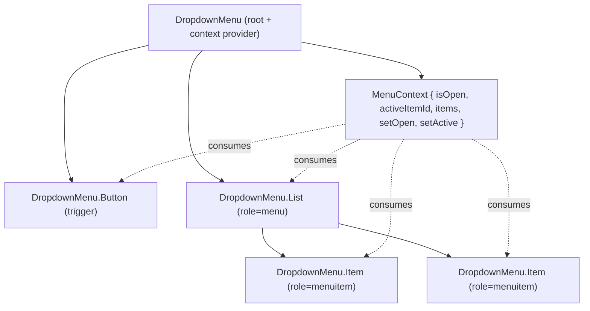
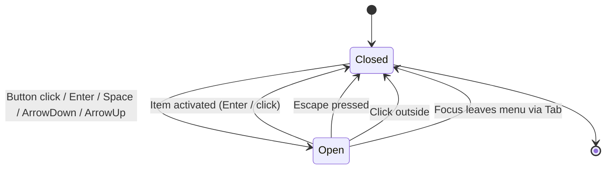
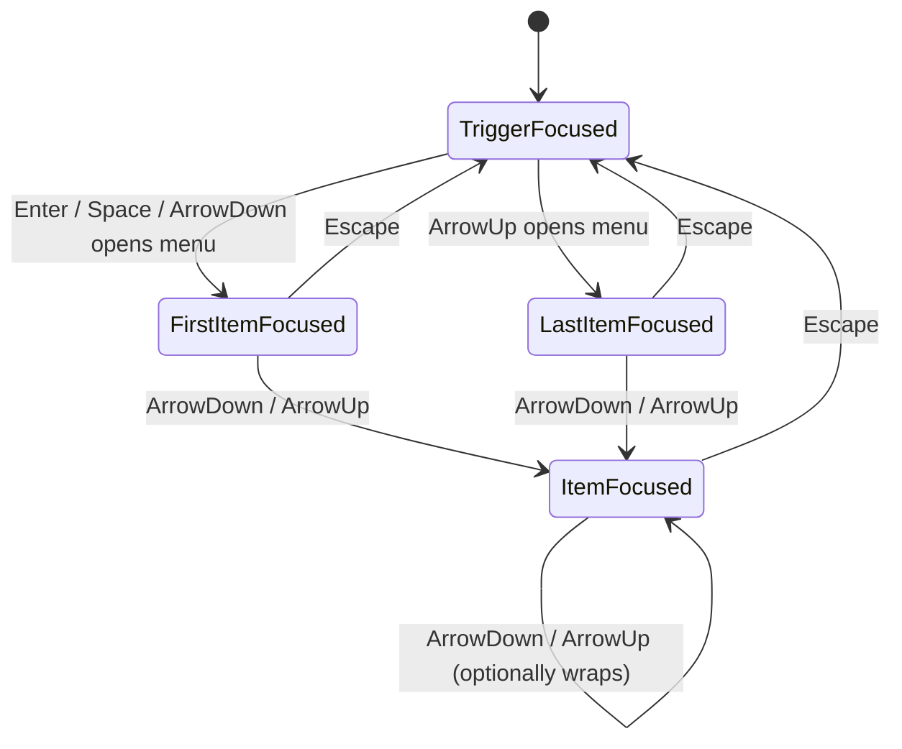
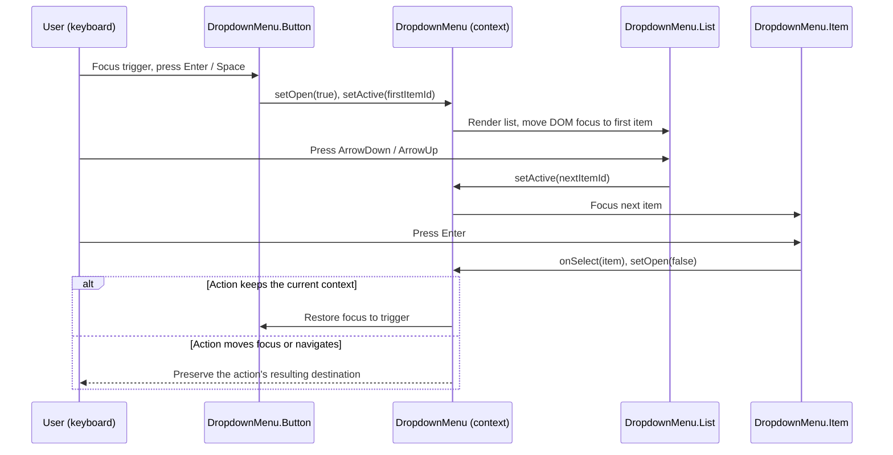

# Dropdown Menu

**Difficulty:** Medium · **Duration:** ~30 min · **Topics:** Accessibility, UI component

> Source: [dropdown-menu](https://www.greatfrontend.com/questions/system-design/dropdown-menu)

## Question

Design a dropdown menu component that can reveal a menu containing a list of actions.


### Real-life examples

These component libraries demonstrate common dropdown-menu APIs and interaction patterns.

- [Dropdowns · Bootstrap v5.3](https://getbootstrap.com/docs/5.3/components/dropdowns)
- [React Menu component - Material UI](https://mui.com/material-ui/react-menu/)
- [Menu — Base UI](https://base-ui.com/react/components/menu)

## Solution

### Requirements exploration

Before designing the API, scope the component by clarifying how many menus can coexist, what content they hold, which devices they support, and the expected level of customization.

#### Can there be multiple dropdown menus open at once?

Yes, there can be.

#### What content will the menu contain?

Only text and icons, with no nested interactive controls. The menu items themselves still participate in managed focus.

#### Is there a maximum number of items allowed in the menu?

There's no fixed maximum, but preferably, there should not be more than 20 items for a better user experience.

#### What amount of flexibility does the user have in customizing the design?

Users should be able to customize colors, fonts, padding, etc., to match their branding.

#### What devices will this component be used on?

All devices: mobile, tablet, desktop.

#### Check your understanding 1

A team is defining the first version of a reusable dropdown menu. Which requirements belong in it? Select all that apply.

- [x] Allow more than one dropdown menu to remain open at the same time.
  > This requirement rules out a single global open-menu value that would force one instance to close whenever another opens.
- [ ] Cap each menu at twenty items and require consumers to move remaining actions into a second menu.
  > Grouping can improve information architecture, but twenty is a usability preference rather than a component limit. The list still needs a bounded overflow policy.
- [x] Treat roughly twenty items as a usability preference rather than a hard component limit.
  > The requirement discourages unwieldy menus without rejecting a valid product action solely because it crosses an arbitrary count.
- [ ] Treat text fields, checkboxes, and other nested controls as standard menu-item children in the first version.
  > Nested controls introduce another focus and interaction model, while the scoped menu contains actions made from text and icons.
- [x] Support mobile, tablet, and desktop use.
  > The stated device range requires a contract that works for pointer, touch, and keyboard input rather than a mouse-only popup.
- [x] Support text and icons as item content, without nested interactive controls inside items.
  > Keeping each item as one menu action preserves a clear managed-focus and activation contract.

---

### Architecture / high-level design

An example usage of the dropdown menu in React, with event handlers omitted.

```jsx
<DropdownMenu>
  <DropdownMenu.Button>Actions</DropdownMenu.Button>
  <DropdownMenu.List>
    <DropdownMenu.Item>New File</DropdownMenu.Item>
    <DropdownMenu.Item>Save</DropdownMenu.Item>
    <DropdownMenu.Item>Delete</DropdownMenu.Item>
  </DropdownMenu.List>
</DropdownMenu>
```

| Component                            | Role                                                              |
| ------------------------------------ | ----------------------------------------------------------------- |
| Dropdown Menu (`DropdownMenu`)       | Root component, coordinates events between the inner components.  |
| Menu Button (`DropdownMenu.Button`)  | Button that toggles the display state of the `DropdownMenu.List`. |
| Menu List (`DropdownMenu.List`)      | Contains the list of items.                                       |
| Menu List Item (`DropdownMenu.Item`) | Individual list items.                                            |

In React, components can communicate with their parents using context or props. Context fits this composition model because it avoids threading shared menu state through every subcomponent. `<DropdownMenu>` should contain a context provider that supplies the state values from the Data model section to its descendants.

**Compound component hierarchy and context flow**



> **Expose a compound-component API rather than a single monolithic prop tree**
>
> Splitting the component into `DropdownMenu`, `DropdownMenu.Button`, `DropdownMenu.List`, and `DropdownMenu.Item` lets consumers compose arbitrary trigger and item content while the root owns shared state via context. A single `<DropdownMenu items={...} />` prop-based API quickly breaks down once items need icons, disabled states, or custom rendering.

#### Check your understanding 2

A reusable dropdown renders its trigger, floating list, and items as separate parts. How should those parts coordinate open state, item registration, and focus changes?

- [x] Let one root own open state, item registration, and focus transitions; each part only reports semantic events and renders supplied state.
  > One coordinator can apply each cross-part transition atomically while the trigger, list, and items remain focused on their local rendering and events.
- [ ] Let the trigger own open state, each item handle keyboard movement, and the list own dismissal, with every part publishing state changes independently.
  > Events such as Escape and ArrowDown cross those parts. Distributed ownership can process one gesture several times or against inconsistent state.
- [ ] Query the rendered trigger and popup for every event, then infer open state, item order, and the next focus target from those elements.
  > DOM inspection can discover the current markup, but it cannot replace an explicit owner for transitions, stable identity, and conditional item registration.

---

### Data model

A component’s interface/API can be designed before its data model or alongside it; changes to either may require revisiting the other.

| State                    | Type             | Description                                                                                           |
| ------------------------ | ---------------- | ----------------------------------------------------------------------------------------------------- |
| `isOpen`                 | `boolean`        | Whether the menu is currently open or closed.                                                         |
| `activeItemId`           | `string \| null` | Stable ID of the managed-focus item, or `null` when no item is active.                                |
| `items`                  | ordered registry | Registered item IDs, DOM refs, disabled state, and text values used for focus movement and typeahead. |
| `triggerId` / `listId`   | `string`         | Stable IDs connecting the trigger and menu.                                                           |
| `triggerRef` / `listRef` | DOM refs         | References used for focus restoration and portaled interaction boundaries.                            |

These state values are housed within `<DropdownMenu>` and provided to all components via React context.

Each item registers `{ id, ref, disabled, textValue }` on mount and unregisters on removal; the root maintains DOM order and derives navigation and typeahead from that registry. If the active item disappears, select the nearest remaining item or clear the active ID. This design uses programmatic item focus: every item renders `role="menuitem"` with `tabindex="-1"`, and the root calls `ref.current?.focus()` for the active item rather than using `aria-activedescendant`.

See below for configuration options, which are also part of the data model.

#### Check your understanding 3

A menu supports typeahead, disabled items, and a portaled list. Which values belong in its interaction model? Select all that apply.

- [x] Ordered item metadata including disabled state and text used for typeahead.
  > Ordered metadata supports navigation and typeahead even when custom item content is not plain DOM text.
- [ ] Serialize the current popup DOM whenever it opens and use that snapshot for keyboard order until dismissal.
  > Conditional or disabled items can change while open. A stale DOM snapshot is neither a durable model nor a reliable live registry.
- [x] The active item identity for keyboard movement and programmatic item focus.
  > Stable identity survives item rerenders and lets managed navigation focus disabled entries without allowing them to activate.
- [x] Whether the popup is open and which trigger owns it.
  > Open ownership connects one popup to its trigger and gives dismissal and focus restoration one consistent target.
- [ ] Use the latest pointer coordinates as active-item state and derive the item by hit testing when selection occurs.
  > Keyboard and programmatic focus have no pointer position, and layout movement can make old coordinates identify another item.

#### Check your understanding 4

A dropdown's items can be reordered, disabled, or removed while it is open. How should the root preserve a valid active item?

- [x] Maintain a live registry keyed by stable IDs, choosing a nearby fallback or clearing active state when the active item disappears.
  > Reconciliation against current registrations keeps focus state valid as conditional content changes.
- [ ] Capture item order and disabled state when the menu opens and keep using that snapshot until dismissal.
  > A snapshot becomes stale when items change, so navigation can target an element that no longer exists or use outdated disabled state.
- [ ] Keep the removed ID active until the user presses another navigation key, then restart from the first item.
  > Leaving focus state pointed at an unmounted item creates a period in which keyboard and programmatic focus disagree.
- [ ] Store only the active array index and apply it to the newly rendered item order after every update.
  > Insertions and reordering can make the same index identify a different action. Stable identity is required before choosing a fallback.

---

### Interface definition (API)

The API surface is split into props shared across subcomponents and props specific to each composition piece (root, trigger, menu, item).

#### General props

These props apply to most of the components.

| Prop        | Type                  | Description                                                                                                                             |
| ----------- | --------------------- | --------------------------------------------------------------------------------------------------------------------------------------- |
| `children`  | `React.Node`          | Children of the component. If using TypeScript/Flow, you can enforce specific components to be used as `children`.                      |
| `as`        | `string \| Component` | In case there is a need to customize the underlying DOM element/component.                                                              |
| `className` | `string`              | Classnames to add to components in case further visual customization is needed. May or may not be needed depending on theming approach. |

#### `DropdownMenu`

The root supports both controlled and uncontrolled open state.

| Prop                   | Type       | Description                                                      |
| ---------------------- | ---------- | ---------------------------------------------------------------- |
| `open` / `defaultOpen` | `boolean`  | Controlled or initial uncontrolled open state.                   |
| `onOpenChange`         | `function` | Called whenever the root requests an open-state change.          |
| `size`                 | `string`   | Prop to customize size. Needed only if customization is desired. |

#### `DropdownMenu.Button`

The trigger forwards its DOM ref and ID so the root can connect ARIA state and restore focus when appropriate.

| Prop                 | Type       | Description                                                                                                                                                                   |
| -------------------- | ---------- | ----------------------------------------------------------------------------------------------------------------------------------------------------------------------------- |
| `onClick`            | `function` | Although the opening/closing will be handled within `DropdownMenu`, exposing an `onClick` prop is useful if additional logic needs to be performed (e.g., analytics logging). |
| Other `button` props | *          | Since this component is usually a `<button>`, it should also allow other props that `<button>`s expect, such as `disabled`.                                                   |

#### `DropdownMenu.List`

The list exposes placement and size options while the root owns its generated ID and portaled ref.

| Prop        | Type                  | Description                                                                          |
| ----------- | --------------------- | ------------------------------------------------------------------------------------ |
| `maxHeight` | `number \| undefined` | Max height of the menu list. There should be a sensible default of around 200-300px. |
| `position`  | `string`              | Position of the list relative to the button.                                         |

#### `DropdownMenu.Item`

Each item registers its focus and typeahead metadata and exposes one activation callback for pointer and keyboard selection.

| Prop        | Type       | Description                                                                                                                               |
| ----------- | ---------- | ----------------------------------------------------------------------------------------------------------------------------------------- |
| `onSelect`  | `function` | Triggered for pointer or keyboard activation. The action determines whether focus returns to the trigger or moves to a resulting context. |
| `disabled`  | `boolean`  | Whether the item is disabled. Disabled items remain reachable by arrow-key navigation but cannot be activated.                            |
| `textValue` | `string`   | Text used by the root's typeahead behavior when rendered content is not plain text.                                                       |

#### Customizing appearance

Guidance on designing good APIs for customizing UI components can be found in the [Front End Interview Guidebook's UI Components API Design Principles Section](https://www.greatfrontend.com/front-end-interview-guidebook/user-interface-components-api-design-principles).

#### Check your understanding 5

A reusable dropdown lets consumers customize the trigger, list, and item presentation. What should its public API expose so custom presentation still uses the same open, selection, and focus behavior?

- [x] Expose explicit root, trigger, list, and item contracts, controlled open and selection callbacks, and styling hooks for each visual part.
  > Consumers can compose content and branding while the root still owns registration, focus, dismissal, and controlled-state invariants.
- [ ] Accept arbitrary visual content but discover actions and disabled state only by parsing its rendered HTML.
  > Visual composition remains flexible, but behavior becomes dependent on markup inspection rather than explicit item contracts.
- [ ] Expose global open and close functions that locate a menu by DOM ID while items register locally.
  > Global lookup bypasses instance ownership and makes multiple or nested menus collide. Lifecycle should flow through each root.

#### Check your understanding 6

A consumer supplies a dropdown's `open` value and `onOpenChange` callback. What should happen when the trigger requests that the menu open?

- [ ] Set an internal open value immediately, then call the callback and reconcile with the consumer on the next render.
  > Optimistic internal ownership can make the menu display a state the controlling consumer has not accepted.
- [x] Call `onOpenChange(true)` and continue rendering from the supplied `open` value until the consumer updates it.
  > In controlled mode, the consumer owns the authoritative state while the component reports requested transitions.
- [ ] Use the supplied value only as the initial state, then let the dropdown own subsequent trigger and dismissal transitions.
  > Treating a controlled value as a default ignores later consumer updates and breaks the ownership contract.
- [ ] Do not open internally and omit the callback because a controlled consumer is expected to observe the trigger click itself.
  > The root owns the interaction semantics and must communicate its requested transition through the declared callback.

#### Check your understanding 7

A compound dropdown supports custom item content, typeahead, keyboard activation, and disabled actions. Which item-level contracts should it expose? Select all that apply.

- [x] Expose one `onSelect` callback for both pointer and keyboard activation.
  > A shared semantic action keeps activation behavior consistent across input methods.
- [x] Expose disabled state so the root can keep an item discoverable while preventing activation.
  > The root needs explicit metadata to apply `aria-disabled` and enforce the same inert behavior for pointer and keyboard input.
- [x] Accept a `textValue` when rendered content is not plain text.
  > Explicit matching text makes typeahead reliable for icons, rich labels, and consumer-defined markup.
- [ ] Derive the action name, disabled state, and typeahead text by inspecting each item's rendered HTML.
  > DOM inspection makes behavior depend on presentation details and cannot reliably infer semantic disabled state or labels.
- [ ] Require independent `onClick` and `onKeyDown` actions so consumers can implement selection for each input method.
  > Duplicating semantic selection in consumer handlers invites inconsistent close, focus, and disabled behavior.

---

### Optimizations and deep dive

The tricky parts of a dropdown menu are floating rendering, viewport-aware positioning, accessibility, and language flexibility:

- [Rendering](#rendering): This section explains how to render the floating menu outside normal document flow while preserving positioning and layering behavior.
- [Automatic flipping when near the edge](#automatic-flipping-when-near-the-edge): This section covers viewport collision detection and placement changes when there is not enough space.
- [Accessibility (a11y)](#accessibility-a11y): This section discusses pointer, keyboard, and assistive-technology behavior for a usable dropdown menu.
- [Internationalization (i18n)](#internationalization-i18n): This section covers long translated labels, text direction, and layout flexibility for localized menus.

The embedded sandboxes illustrate layout and dismissal only; use the surrounding prose as the accessibility contract. The frames request no device or payment permissions.

#### Rendering

Rendering the dropdown menu can be quite tricky because the menu is "floating" and does not exactly follow the normal flow of page elements.

##### Layout

There are two common ways to render the dropdown menu near the button. The samples below illustrate their layout differences.

**Relative to Button**

In this approach, a `<div>` with `position: relative` wraps the `<button>` and menu. The menu uses `position: absolute`, which positions it relative to that root `<div>`.

This method is straightforward and does not require much calculation of elements and their positions relative to the page, but parent containers with `overflow: hidden` can clip the menu and its contents, or there could be `z-index` issues.

**Relative to Page**

In this approach, the menu is rendered as a direct child of the `<body>`. `offsetTop` and `offsetLeft` are relative to an `offsetParent`, not necessarily the page, so a portaled menu should use one explicit coordinate system: viewport coordinates from `getBoundingClientRect()` with fixed positioning, or document coordinates after adding the page scroll offsets.

In React, this can be done using [React Portals](https://react.dev/reference/react-dom/createPortal), which let you render outside the DOM hierarchy of the parent component. A typical use case for portals is when a parent component has an `overflow: hidden` or `z-index` style, but you need the child to visually "break out" of its container. Common examples include dropdown menus, tooltips, and modals.

The downside is that the position must be updated while the menu is open. A maintained positioning primitive can own main-axis flipping, cross-axis shifting, available-size constraints, updates after ancestor scroll/resize, element resize, or layout shift, and cleanup on close. Exact observer wiring is a production follow-up.

> **Prefer portal-based rendering for production-grade dropdown menus**
>
> Rendering the menu as a child of `<body>` via a portal avoids clipping from ancestor `overflow: hidden` containers and avoids `z-index` stacking-context problems caused by rendering relative to the button. This requires recalculating position on resize or scroll, but avoids container-specific clipping fixes on each page.

##### Position

The component can allow customization of alignment in all directions around the `<button>`. The relative-position example above shows left- and right-aligned lists. Model those choices as a preferred side plus logical `start`/`end` alignment so the collision policy can still flip or shift the placement when it would overflow.

##### Maximum height

Since there is no maximum allowable number of items in the menu, set a default maximum height so excess items remain accessible through scrolling. This height can also be customized.

##### Rendering in HTML or JavaScript

The dropdown menu can either be:

1. Rendered into the HTML like [Bootstrap's Dropdowns](https://getbootstrap.com/docs/5.3/components/dropdowns/). The menu is initially hidden with `display: none` or the `hidden` attribute. `opacity: 0` alone is insufficient because the menu can remain interactive and exposed to assistive technology.
2. Rendered on the fly via JavaScript after the menu button is activated.

The pro of rendering in the HTML first is better runtime performance due to fewer DOM operations needed to show the menu. The downside is that the HTML can be unnecessarily bloated, especially if the user never interacts with the dropdown menu at all. Since the menu items usually don't contribute towards SEO and there likely won't be that many elements, the benefits of rendering the menu beforehand in HTML are relatively minor.

#### Check your understanding 8

A trigger sits inside an `overflow: hidden` panel that can scroll and resize. Which choices keep its popup visible and attached? Select all that apply.

- [ ] Measure when the popup opens and keep that placement until it closes, even if an ancestor scrolls.
  > Opening measurement is necessary but insufficient. Scrolling or resizing can detach the portal from its trigger.
- [ ] Keep the popup beside the trigger and create a new local stacking context with a very large z-index.
  > Stacking order cannot escape an ancestor's overflow clipping. The popup must leave that clipping context.
- [x] Measure trigger and popup geometry and update placement on relevant resize or scroll changes.
  > Trigger and popup rectangles must be mapped into one coordinate space and refreshed when that geometry changes.
- [x] Render the popup in a portal or dedicated overlay layer when ancestors can clip it.
  > Moving the popup outside the clipping subtree lets it participate in an overlay stacking and positioning context.

#### Check your understanding 9

A dropdown pre-renders its menu to reduce work when opening. Which closed-state treatment prevents hidden items from remaining interactive or exposed to assistive technology?

- [ ] Position the closed menu far outside the viewport while leaving all item semantics and tab behavior unchanged.
  > Off-screen geometry hides the pixels but leaves an unexpected interactive menu in the document's accessible focus model.
- [ ] Set `pointer-events: none` on the menu but leave its descendants in normal keyboard and accessibility navigation.
  > Blocking pointer hit testing does not stop keyboard focus or screen-reader exposure.
- [x] Apply the `hidden` attribute or `display: none` while the menu is closed.
  > Removing the closed subtree from layout and the accessibility tree also prevents its items from receiving focus or pointer input.
- [ ] Set `opacity: 0` while preserving the menu's position and focusable descendants.
  > Transparency changes only paint. Invisible items can still be focused, activated, and announced.

#### Automatic flipping when near the edge

Smart dropdown menus know their position relative to the viewport and can flip or shift when there is insufficient space. Disabling page scrolling is not a substitute for collision handling.


The basic vertical check combines the viewport height with the trigger's position and height, the menu height, and the spacing between them:

- **Viewport height**: `window.innerHeight`.
- **Position of the menu's bottom edge**:
  1. Trigger position relative to the viewport (`buttonEl.getBoundingClientRect().y`)
  2. Trigger height (`buttonEl.getBoundingClientRect().height`)
  3. Menu height (`menuEl.getBoundingClientRect().height`)
  4. Spacing between trigger and menu

That check demonstrates vertical flipping only. The complete positioner must measure the trigger and menu in the same coordinate space, shift or clamp on the cross axis, and constrain the available width or height when neither side fully fits.

Here's a simplified React example of the vertical autoflip behavior. It is a geometry demonstration, not the complete production positioning contract above.

#### Check your understanding 10

A dropdown would overflow below the viewport but has space above. What should the positioner do?

- [ ] Move the trigger upward with a transform so the preferred placement still fits.
  > Positioning the popup should not unexpectedly move the control or surrounding layout that opened it.
- [x] Flip above the trigger and clamp the popup within the available viewport padding.
  > The positioner preserves the preferred relationship when possible but selects a reachable placement from current geometry.
- [ ] Keep the preferred bottom placement and add an internal scrollbar for whatever portion remains visible.
  > Scrolling a severely clipped popup is less usable than selecting the available side before clamping its size.

#### Check your understanding 11

A dropdown cannot fit fully above or below its trigger, and its preferred alignment would also overflow horizontally. Which positioning responses keep the menu usable? Select all that apply.

- [ ] Translate the trigger until the menu fits at its preferred side and alignment.
  > Moving the anchor changes surrounding interaction geometry. The floating element should adapt to the available space instead.
- [x] Shift or clamp the menu horizontally within viewport padding.
  > Cross-axis correction preserves a reachable popup when preferred alignment would place content beyond the viewport edge.
- [x] Allow the constrained menu body to scroll so every item remains reachable.
  > Internal scrolling preserves access to overflow content after collision handling has chosen the best available size.
- [x] Limit the menu's width or height to the measured space that remains available.
  > A geometry-derived size cap keeps the overlay visible when neither preferred nor flipped placement can contain its full dimensions.
- [ ] Freeze page scrolling while the menu is open so its initial overflowing placement cannot move farther away.
  > Scroll locking does not make clipped content visible and unnecessarily changes behavior outside the menu.

#### Accessibility (a11y)

Dropdown menus must be usable with mouse, keyboard, and assistive tech. The subsections below cover each input modality and the ARIA semantics that tie them together.

##### Mouse interactions

Clicking the button toggles the menu. A completed click outside the registered dropdown group closes open menus, while clicks within any registered trigger or menu stay inside the group.

**Menu open and close lifecycle**



When multiple menus are allowed to remain open, a document-level coordinator registers every trigger and portaled menu branch, including triggers whose menus are currently closed. Therefore, clicking a sibling trigger is not an outside interaction and can open another menu without closing existing siblings. Using the completed click also avoids dismissing during a canceled drag or scroll gesture.

```js
function clickListener(event) {
  const path = event.composedPath();
  if (registeredMenuBranches.some((element) => path.includes(element))) {
    return;
  }

  closeOpenMenusForOutsideInteraction();
}

document.addEventListener("click", clickListener);
```

Attach the coordinator's listener only while at least one menu is open and remove it when the group has no open menus.

Here's a simplified React example of click-outside dismissal. The group-aware coordinator above is the implementation contract when simultaneous-open menus are supported.

##### Focus management

When the menu is open, arrow keys manage focus among menu items. <kbd>Tab</kbd> and <kbd>Shift+Tab</kbd> close the menu and continue the normal page focus order; <kbd>Escape</kbd> closes it and restores focus to the trigger. An outside click leaves focus on the clicked destination, while item activation may restore the trigger or move focus to the action's resulting context.

**Focus transitions across the trigger and menu items**



> **Restore trigger focus when dismissal calls for it**
>
> Escape should return focus to the trigger. Tab, outside clicks, and actions that establish a new destination must be allowed to keep their intended focus movement.

##### Keyboard interactions

There are two WAI-ARIA patterns to follow: the [Menu Button pattern](https://www.w3.org/WAI/ARIA/apg/patterns/menubutton/) and the [Menu pattern](https://www.w3.org/WAI/ARIA/apg/patterns/menubar/). The latter is needed after the menu is open.

**Button**

When the focus is on the button:

| Key                             | Description                                             |
| ------------------------------- | ------------------------------------------------------- |
| <kbd>Enter</kbd>                | Opens the menu and places focus on the first menu item. |
| <kbd>Space</kbd>                | Opens the menu and places focus on the first menu item. |
| <kbd>ArrowDown</kbd> (Optional) | Opens the menu and moves focus to the first menu item.  |
| <kbd>ArrowUp</kbd> (Optional)   | Opens the menu and moves focus to the last menu item.   |

**Menu**

When the focus is on the menu items:

| Key                                   | Description                                                                       |
| ------------------------------------- | --------------------------------------------------------------------------------- |
| <kbd>Enter</kbd>                      | Activates the item and closes the menu.                                           |
| <kbd>Space</kbd> (Optional)           | Activates the item and closes the menu.                                           |
| <kbd>ArrowDown</kbd>                  | Moves focus to the next item, optionally wrapping from the last to the first.     |
| <kbd>ArrowUp</kbd>                    | Moves focus to the previous item, optionally wrapping from the first to the last. |
| <kbd>Home</kbd>                       | If arrow key wrapping is not supported, moves focus to the first item.            |
| <kbd>End</kbd>                        | If arrow key wrapping is not supported, moves focus to the last item.             |
| <kbd>Esc</kbd>                        | Closes the menu that contains focus and returns focus to the button.              |
| Printable characters                  | Move focus by typeahead using the ordered items' text values.                     |
| <kbd>Tab</kbd> / <kbd>Shift+Tab</kbd> | Close the menu and continue normal page focus order.                              |

End-to-end, a keyboard-driven open, navigate, and activate interaction ties these two patterns together:

**Keyboard-driven open, navigate, and select flow**



##### WAI-ARIA roles, states, and properties

The chosen programmatic-focus strategy connects the trigger, menu, and focusable menu items through stable IDs and refs.

- Button
  - The element that opens the menu has role `button`.
  - The element with role `button` has `aria-haspopup` set to either `menu` or `true`.
  - The trigger's `aria-expanded` is `true` while the menu is displayed and `false` while it is closed.
  - The trigger's `aria-controls` refers to the stable ID of the element with role `menu` while it is rendered.
- Menu/Menuitems
  - The element serving as the menu has a role of `menu`.
  - The menu's `aria-labelledby` refers to the stable trigger ID, or the menu has its own `aria-label` when no visible trigger label names it.
  - The items contained in a `menu` have the `menuitem` role, stable IDs, DOM refs, and `tabindex="-1"` so the root can move focus programmatically.
  - When a menu item is disabled, `aria-disabled` is set to `true`.

> **A styled `<div>` dropdown without `role="menu"` and `menuitem` is not accessible**
>
> Screen readers rely on the `button` + `aria-haspopup` + `aria-expanded` trio on the trigger, and `role="menu"` with child `role="menuitem"` elements on the list, to announce the component as an actionable menu. Without these roles and states, screen-reader users may not be able to identify the menu or determine whether it is open.

#### Check your understanding 12

Two dropdowns may remain open, and each menu is portaled away from its trigger. How should a shared coordinator classify a completed click?

- [ ] Call `root.contains(event.target)` for each dropdown and close every root that does not contain the target.
  > A portaled menu is outside its trigger's DOM subtree, so containment alone misclassifies legitimate menu interactions.
- [x] Check the click's composed path for registered triggers and portaled menus; otherwise treat it as outside.
  > Registration plus the composed path spans portal boundaries and prevents a sibling trigger from being mistaken for an outside target.
- [ ] Close all menus as soon as a document-level pointer-down event begins outside the currently active menu.
  > Early dismissal can interrupt a canceled drag or scroll gesture, and treating only one menu as internal breaks simultaneous-open behavior.
- [ ] Treat every other trigger as outside so clicking it first closes existing menus and then opens the selected sibling.
  > The stated contract allows multiple menus to stay open, so all registered triggers must remain inside the coordinated group.

#### Check your understanding 13

An action menu opens from a keyboard trigger and supports typeahead. How should focus, keyboard navigation, activation, and dismissal work? Select all that apply.

- [x] Move focus to the first item for Enter, Space, or ArrowDown, and optionally to the last item for ArrowUp.
  > The opening key determines a predictable starting point inside the managed menu interaction.
- [x] Support Arrow keys, Home, End, typeahead, Enter or Space, and Escape.
  > These keys provide the composite-widget navigation and activation contract users expect from an action menu.
- [ ] Allow Tab to leave the popup without closing it so users can return to the same active item later.
  > An open menu should not remain detached from focus while page controls become active. Dismissal must be deterministic.
- [ ] Keep DOM focus on the trigger after opening and only draw a visual highlight over the active menu item.
  > The chosen menu pattern moves programmatic focus among `menuitem` elements, so a visual-only active state would not expose navigation to assistive technology.

#### Check your understanding 14

A product keeps disabled actions discoverable in a menu's managed keyboard order. A disabled action appears between two enabled items. Which behavior satisfies that requirement?

- [x] Keep the item reachable by managed arrow navigation, expose `aria-disabled="true"`, and block pointer and keyboard activation.
  > Discoverable focus communicates that the action exists, while explicit inert behavior prevents every input method from invoking it.
- [ ] Skip the disabled item during arrow navigation and omit it from typeahead so focus reaches only actionable entries.
  > Skipping is a possible product policy, but it conflicts with this menu's stated contract that disabled items remain reachable and inert.
- [ ] Expose `aria-disabled="true"` and suppress clicks, but allow Enter or Space to run the action after keyboard focus reaches it.
  > Disabled state must guard the semantic action rather than only one event path.
- [ ] Set a `disabled` attribute on the item's generic element and rely on the browser to block activation automatically.
  > Generic menu-item elements do not gain native disabled behavior from that attribute. The component must enforce it and expose ARIA state.

#### Check your understanding 15

An open dropdown can close through Escape, Tab, an outside click, or item activation. Which focus outcomes preserve the user's navigation context? Select all that apply.

- [x] Let focus remain on the element that the completed outside click targeted.
  > Moving focus back to the trigger after the click would override the destination the user deliberately chose.
- [x] Allow item activation to restore the trigger or preserve a new destination established by the action.
  > Some actions stay in context while others navigate or reveal a new control, so focus should follow the action's actual result.
- [x] Restore focus to the invoking trigger after Escape dismisses the menu.
  > Escape abandons the popup interaction, so returning to its entry point gives keyboard users a predictable location.
- [x] Close the menu on Tab or Shift+Tab and allow normal page focus movement to continue.
  > Tab signals departure from the composite widget. Forcing focus backward would interrupt the user's intended traversal.
- [ ] Restore the trigger after any close event, including Tab and outside clicks.
  > A universal rule erases the distinct intent of leaving via page order or selecting another control with the pointer.
- [ ] Focus the trigger immediately after every item activation, before the selected action updates the page.
  > A forced intermediate focus can override navigation or a newly created destination and create an unnecessary announcement.

#### Internationalization (i18n)

Since all user-facing strings are provided by the user, strings can be displayed as-is. However, do note that some strings can be long in certain languages, so overflowing text should either be truncated or wrapped. Text shouldn't overflow outside the menu/button.

For RTL languages, inherit or expose the semantic `dir` value and use logical CSS properties and start/end placement names. Text direction does not imply mirroring every icon or every keyboard command.


#### Check your understanding 16

A dropdown has translated labels that are longer than English and can run in RTL. How should its sizing, alignment, and direction handling adapt? Select all that apply.

- [x] Inherit or expose the menu's semantic `dir` value and use logical CSS properties.
  > Semantic direction lets layout and text follow the surrounding writing mode without maintaining separate physical left and right rules.
- [ ] Mirror item text in RTL but continue anchoring the popup with physical `left` coordinates.
  > Text direction alone does not mirror the popup's anchor or collision logic. Use logical start and end placement.
- [ ] Mirror every icon and reverse the meaning of all keyboard commands whenever `dir="rtl"`.
  > Writing direction affects logical layout, but directional icons and keyboard behavior must follow their own semantics rather than a blanket mirror rule.
- [x] Let the popup size or wrap safely for longer translations.
  > Content-driven sizing prevents translated labels from clipping or covering adjacent controls.
- [x] Use logical start and end alignment so placement can mirror in RTL layouts.
  > Logical alignment can mirror with writing direction without maintaining separate physical offset rules.

---

### Summary

**A dropdown needs focus restoration, popup placement, and WAI-ARIA Menu Button semantics.** Portal rendering helps avoid clipping inside a scrollable card, while focus restoration and menu semantics support keyboard and assistive-technology users, including when the dropdown appears in a modal.

**Use a compound API backed by shared menu context.** `DropdownMenu`, `DropdownMenu.Button`, `DropdownMenu.List`, and `DropdownMenu.Item` keep the trigger, floating surface, and items as distinct subcomponents, while `MenuContext` carries `isOpen`, `activeItemId`, stable trigger/list refs, and the ordered item registry.

**Render the list through a portal and make positioning viewport-aware.** The list mounts into `<body>` to escape `overflow: hidden` clipping and `z-index` stacking-context conflicts, autoflips near viewport edges, and falls back to a scrollable list via `maxHeight` when the options cannot fit.

**Own focus and ARIA behavior explicitly.** Arrow keys manage focus inside the menu, Escape restores the trigger, and Tab or an outside click keeps its normal focus destination. The trigger exposes `role="button"`, `aria-haspopup`, and `aria-expanded`, and the list carries `role="menu"` with `role="menuitem"` children so screen readers announce the menu as a menu.

Start with the compound API plus `MenuContext`, then explain the portal, focus restoration, and ARIA Menu Button roles as the decisions that make the component reliable in production.

Exact collision observers, nested-menu coordination, RTL placement edge cases, and a browser/screen-reader test matrix are potential follow-ups rather than part of the core interview implementation.

---

### References

The references below group dropdown menu sources by theme, so it is easier to map each source back to the part of the article it informed.

#### W3C ARIA authoring practices

This subsection anchors the dropdown design in the authoritative ARIA guidance for menu buttons and menus.

- [Menu button pattern | W3C ARIA](https://www.w3.org/WAI/ARIA/apg/patterns/menubutton/) for the trigger-side roles, states, and keyboard interactions for a menu button.
- [Menu pattern | W3C ARIA](https://www.w3.org/WAI/ARIA/apg/patterns/menu/) for the menu-side roles, focus order, and keyboard model.

#### Themed implementations

These libraries ship opinionated visual defaults and are useful when comparing component API ergonomics.

- [Dropdowns | Bootstrap v5.3](https://getbootstrap.com/docs/5.3/components/dropdowns) for a widely used CSS-first dropdown implementation and its markup conventions.
- [React Menu component | Material UI](https://mui.com/material-ui/react-menu/) for a themed React menu with full keyboard and accessibility behavior.

#### Headless implementations

These libraries focus on behavior and accessibility without shipping styles, which is closer to what this article designs.

- [Menu | Base UI](https://base-ui.com/react/components/menu) for a composable menu with trigger, popup, and item parts.
- [Menu | Ariakit](https://ariakit.com/components/menu) for an unstyled menu with explicit state and composition APIs.
- [Menu | React Aria](https://react-aria.adobe.com/Menu) for customizable menu components and keyboard interaction.

#### Positioning and floating elements

This subsection covers the browser APIs and libraries used to position the menu popup relative to its trigger.

- [Popover API | MDN](https://developer.mozilla.org/en-US/docs/Web/API/Popover_API) for the native browser primitive that handles top-layer rendering and light dismiss.
- [Floating UI](https://floating-ui.com/) for the flip, shift, and collision-aware positioning library commonly used for menus.
- [How to build a dropdown menu with JavaScript | freeCodeCamp](https://www.freecodecamp.org/news/how-to-build-a-dropdown-menu-with-javascript/) for a from-scratch tutorial that covers wiring up toggle, outside click, and keyboard behavior.

#### Related system design articles

The articles below overlap with dropdown menus on popup positioning, focus management, and dismissal behavior.

- [Modal dialog](https://www.greatfrontend.com/questions/system-design/modal-dialog) for overlapping concerns around focus management, portals, and dismissal semantics.
- [Autocomplete](https://www.greatfrontend.com/questions/system-design/autocomplete) for how a menu-like popup pairs with an input and the combobox pattern.

## Asked at these companies

- Google
- ByteDance
- TikTok
