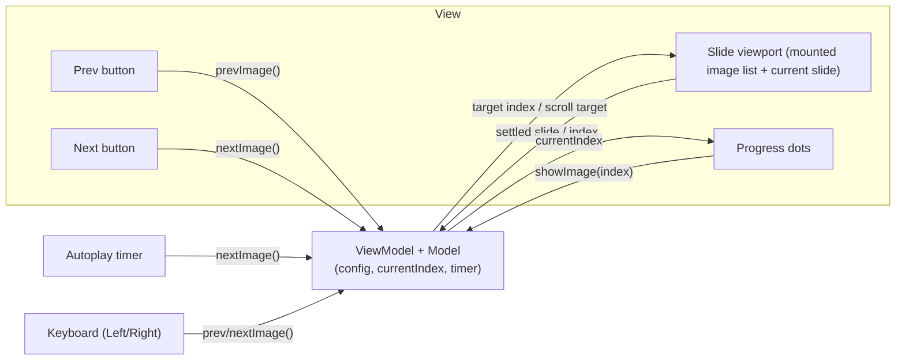
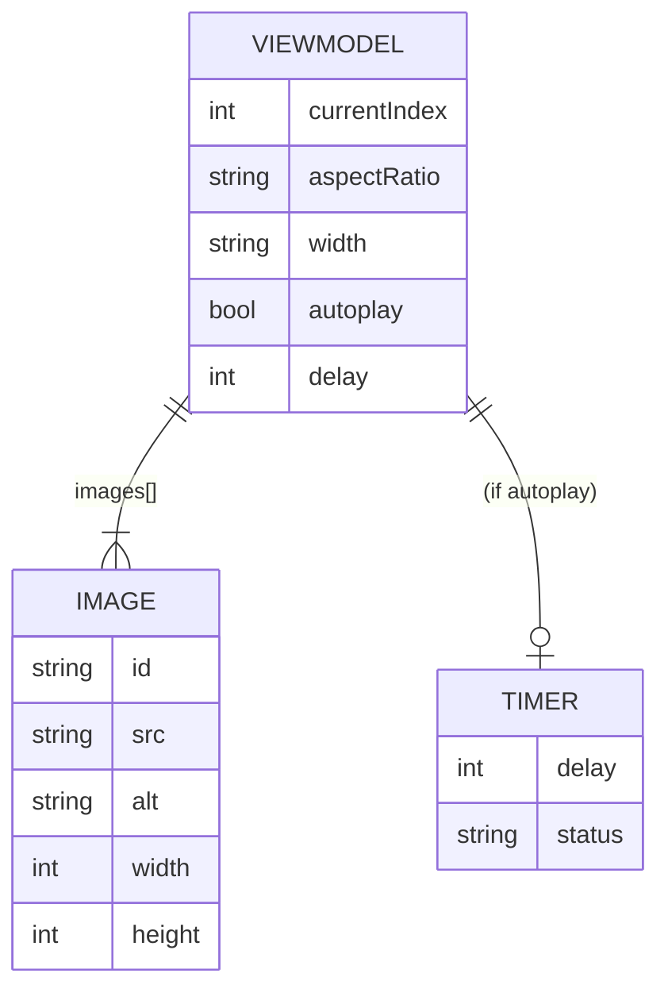
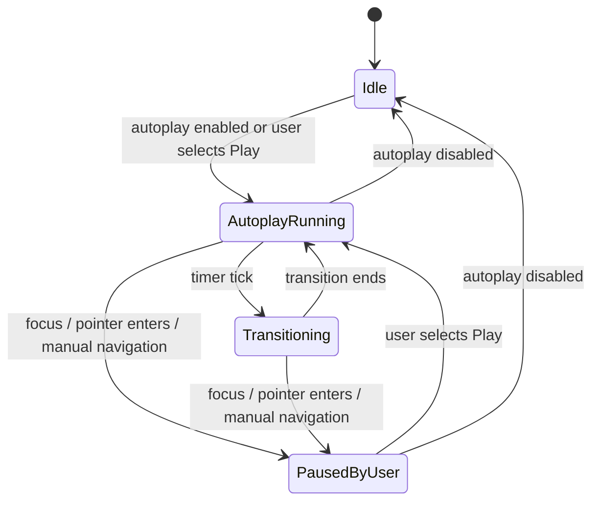
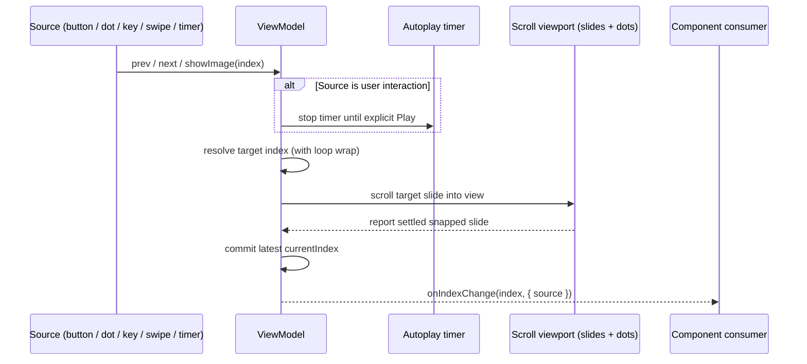
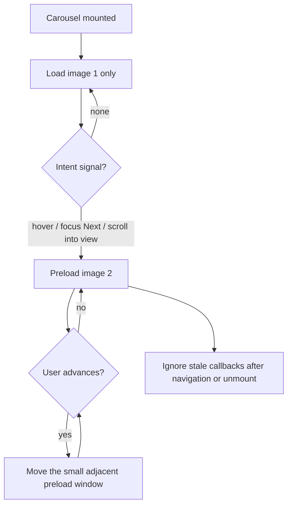

# Image Carousel

**Difficulty:** Medium · **Duration:** ~30 min · **Topics:** Accessibility, Performance, UI component

> Source: [image-carousel](https://www.greatfrontend.com/questions/system-design/image-carousel)

## Question

Design an image carousel component that displays a list of images one at a time, allowing the user to browse through them with pagination buttons.


## Solution

### Requirements exploration

Before designing the API, we clarify how images are supplied, which devices the carousel must support, and which navigation and customization controls are in scope.

#### How are the images specified?

It will be a configuration option on the component, and the list of images has to be specified before initializing the component.

#### What devices should the component support?

Desktop, tablet, and mobile.

#### How will the pagination buttons behave when the user is at the start/end of the image list?

It should cycle through infinitely.

#### Will there be animation when transitioning between images?

Yes, the images should animate with horizontal translation.

#### Check your understanding 1

Which requirements should be established before choosing the architecture of an image carousel? Select all that apply.

- [x] Support desktop, tablet, and mobile interaction.
  > The device scope requires controls and navigation that work with pointer, keyboard, and touch input.
- [x] Animate image changes with horizontal movement.
  > The selected transition affects the viewport and controller coordination used for navigation.
- [x] Cycle from the final image to the first and from the first image to the final one.
  > Infinite pagination defines what previous and next mean at both ends of the real image list.
- [ ] Require consumers to own the active index and replace every slide and control renderer.
  > Controlled state and custom renderers are reusable-component extensions, not requirements of the scoped baseline.
- [x] Receive the complete image list as component configuration before initialization.
  > A known ordered collection gives navigation and pagination a stable set of destinations.

---

### Architecture / high-level design

Since this component doesn't need any server data, our architecture will just consist of the client-side components.


#### Component responsibilities

- **ViewModel + Model**: The brain of the component; holds the configuration and state of the component, orchestrates events between the components, and tracks which image is current.
- **Slide viewport**: Contains the mounted image list in a horizontal scroll container and exposes the currently selected slide.
- **Prev/Next Buttons**: Tell the "ViewModel" to change to the prev/next image depending on which button is clicked.
- **Progress Dots**: Tell the "ViewModel" which image to show when the respective dot/page is clicked/selected.

There's no need to separate the "Model" and the "ViewModel" in this component because it's a small component.

**Component hierarchy and action flow**



#### Reducer-style controller

A small reducer-style controller is enough to separate action sources from transition logic. Buttons, swipes, a timer, and key presses can all dispatch the same previous, next, or select actions without requiring an application-wide state library.

#### Check your understanding 2

Which architecture best supports several carousel presentations using the same navigation behavior?

- [x] Keep index and transition rules in a controller while controls and slide renderers consume that state.
  > One controller can enforce boundary and transition rules while different slide and control views consume the same state.
- [ ] Let the track own a transform index, pagination own a selected index, and each slide report visibility independently.
  > Multiple indexes can disagree after touch scrolling or interrupted transitions. Navigation needs one logical active-slide state.
- [ ] Persist raw `scrollLeft` as canonical state and replay that pixel value after every resize.
  > Responsive slide widths change the meaning of a pixel offset, while logical slide identity remains stable across layout changes.

---

### Data model

Only the "ViewModel" will hold any state and data; the other components are part of the view and won't hold data. It can contain the following fields:

- Configuration
  - List of images, including a stable ID, URL, `alt` value, and intrinsic dimensions.
  - Size: Responsive width and aspect ratio of the carousel.
- State
  - Index of current image. Controls request a target index, while the settled viewport position commits the canonical value after button, keyboard, swipe, or autoplay navigation.
  - Autoplay timer and pause state, if autoplay is enabled.

**ViewModel state and configuration relationships**



#### Check your understanding 3

A responsive carousel accepts a fixed image list and commits navigation after scrolling settles. Which values belong in its logical model? Select all that apply.

- [x] The carousel's responsive width and aspect-ratio configuration.
  > Stable sizing inputs let the view reserve geometry without treating measured pixels as durable navigation state.
- [ ] Persist the current transform offset and reconstruct the active slide from pixels after reload.
  > Pixel offsets depend on viewport size and layout, so they cannot restore stable slide identity across sessions or resizes.
- [x] The active slide's stable identity or index.
  > One canonical active slide keeps controls, pagination, and the settled viewport aligned.
- [ ] Store mounted slide elements as the canonical image collection.
  > DOM elements are presentation objects whose mount lifecycle should not replace the configured image records.
- [x] An ordered list of slides with stable IDs and media metadata.
  > Stable slide identity connects media, controls, and pagination without relying on mounted nodes.

---

### Interface definition (API)

Since we're talking about designing a UI component here, the API will focus on the external API of the components: what configuration options are provided so that developers can use the component in a customized fashion.

#### Basic API

- **List of images**: An array of stable slide records with image URLs, required `alt` values, and intrinsic dimensions; responsive sources can be included when available.
- **Height / aspect ratio**: A responsive CSS size or aspect ratio rather than a required fixed pixel height.
- **Width**: A CSS size such as `100%` or a maximum width rather than a required fixed pixel width.

An example of an `ImageCarousel` component defined in React:

```jsx
<ImageCarousel
  images={[
    {
      id: "foo",
      src: "https://example.com/images/foo.jpg",
      alt: "A foo",
      width: 1600,
      height: 1000,
    },
    {
      id: "bar",
      src: "https://example.com/images/bar.jpg",
      alt: "A bar",
      width: 1600,
      height: 1000,
    },
    /* More images if desired. */
  ]}
  aspectRatio="8 / 5"
  width="100%"
/>
```

#### Advanced API

These are non-essential APIs but worth a discussion if there's time.

- **Autoplay**: Whether the carousel will automatically progress to the next image after some time.
  - A timer state value will be needed to keep incrementing the image.
  - Manual navigation or focus entering the carousel stops autoplay until the user explicitly restarts it.
- **Delay**: Delay between transitions. Only needed if the carousel is in autoplay mode.
- **Transition duration (ms)**: Only applies to a transform-driven alternative. Native smooth-scroll timing is controlled by the browser.
- **Event listeners**: It'd be useful to add event listeners to buttons of the component so that developers can implement their own extra functionality (e.g. logging user interactions).
  - `onLoad`: When the first image is done loading and shown in the carousel.
  - `onIndexChange`: When a settled active slide changes, with the target index and source (`previous`, `next`, `dot`, `swipe`, or `autoplay`).
- **Theming**: See [Front End Interview Guidebook's UI Components API Design Principles Section](https://www.greatfrontend.com/front-end-interview-guidebook/user-interface-components-api-design-principles).
- **Loop**: Defaults to `true` for the scoped requirement; a reusable component can allow consumers to disable it.

Autoplay needs a small state machine so that focus, pointer interaction, or manual navigation stops the timer until the user explicitly selects Play again.

**Autoplay lifecycle with user interruption**



#### Internal API

| API                | Source                                    | Description               |
| ------------------ | ----------------------------------------- | ------------------------- |
| `prevImage()`      | Prev Button / Keyboard / swipe            | Shows the previous image  |
| `nextImage()`      | Next Button / Keyboard / swipe / autoplay | Shows the next image      |
| `showImage(index)` | Progress Dots / controlled updates        | Skips to a specific image |

- These behaviors are encapsulated within APIs because they can be called from multiple places (UI elements, timers) and can contain a fair amount of logic depending on whether looping behavior is turned on.
- `prevImage()` and `nextImage()` can call `showImage(index)` internally.
- These internal APIs can be reducer actions. Redux is only useful when the carousel state genuinely belongs to application-wide state.

**Navigation action flow from multiple sources**



Only the latest settled navigation request commits and fires `onIndexChange`; an interrupted request or a finite-boundary no-op does not emit a change.

#### Check your understanding 4

Which external API gives the baseline carousel enough information to render stable, responsive images?

- [ ] Accept prebuilt slide DOM elements and derive image metadata from their attributes during navigation.
  > Treating rendered elements as the data contract couples the controller to mount state and makes responsive media metadata implicit.
- [ ] Accept image URLs plus one required pixel width and height for every viewport and source.
  > One fixed frame cannot represent responsive sizing or preserve varied image geometry across devices.
- [ ] Accept only image URLs and measure each rendered element after it loads to discover identity and size.
  > URLs alone omit alternative text and intrinsic geometry, so layout and accessibility depend on late presentation measurements.
- [x] Accept stable image records with sources, alternative text, intrinsic dimensions, and responsive sizing.
  > The records provide identity and media semantics, while responsive sizing reserves layout without requiring fixed pixels.

#### Check your understanding 5

A user selects Next, then selects slide 4 before the first smooth scroll settles. Later, they select Next at the end of a finite carousel. When should `currentIndex` and `onIndexChange` update?

- [x] Commit slide 4 when the latest navigation settles, and emit nothing for the interrupted request or the finite-boundary no-op.
  > Committing only the latest settled real target keeps canonical state synchronized with the viewport and prevents callbacks for changes the user never observed.
- [ ] Emit the first request if its scroll event settles after slide 4, then emit slide 4 again to preserve request order.
  > Late completion from an obsolete request must not overwrite or duplicate the newer navigation result. Request identity matters more than initiation order.
- [ ] Start a timer for each request and commit when its configured transition duration elapses.
  > Native scrolling can settle early, late, or be interrupted, so a duration timer cannot establish which slide actually became active.
- [ ] Commit and emit for the Next request, slide 4 request, and boundary request as soon as each input occurs.
  > A request can be interrupted or resolve to the current slide, so request time does not prove that the visible active slide changed.

---

### Optimizations and deep dive

The deeper discussion centers on the details that make a carousel feel right across devices, media sizes, input methods, and languages:

- [Layout implementation](#layout-implementation): This section explains how to arrange slides, animate transitions, and position navigation controls.
- [User experience](#user-experience): This section covers scroll snapping, pagination behavior, touch gestures, autoplay expectations, and interaction details.
- [Performance](#performance): This section discusses image loading, preloading, formats, sizing, and bandwidth control for media-heavy carousels.
- [Internationalization (i18n)](#internationalization-i18n): This section covers localized control labels and text-direction considerations for carousel navigation.
- [Accessibility (a11y)](#accessibility-a11y): This section explains keyboard support, screen-reader behavior, focus handling, and safer carousel patterns.

#### Layout implementation

The core layout decisions are how to arrange the image strip, how to animate transitions between slides, and how to position the navigation controls.

##### Images

A simple version to achieve the layout is to use `display: flex` to make the images render in a horizontal row and programmatically change the horizontal scroll offset to show the various images.

You can draw out such a diagram on the whiteboard to illustrate the layout:


The outlined box indicates the currently visible window.

**Sample Code**

```html
<div class="carousel-images">
  
  
  
  <!-- More images -->
</div>
```

```css
.carousel-images {
  display: flex;
  height: 100%;
  width: 100%;
  overflow-x: auto;
  scroll-snap-type: x mandatory;
}

.carousel-image {
  flex: 0 0 100%;
  height: 100%;
  width: 100%;
  scroll-snap-align: start;
}
```

To scroll to a particular image smoothly, we can do:

```js
document.querySelectorAll(".carousel-image")[selectedIndex].scrollIntoView({
  behavior: "smooth",
  block: "nearest",
  inline: "start",
});
```

Scrolling the target element into view avoids hard-coding slide width and respects the container's text direction. After scrolling settles, derive `currentIndex` from the snapped slide so touch, keyboard, and button navigation share one source of truth.

Re-align the active slide after its container resizes; exact observer wiring is a production follow-up.

##### Fitting Images

The layout above assumes that all the images are of the same size. However, it is unlikely that the user will provide images that are of that exact size.

Here are a few ways we can get around this:

**CSS `background-size`**: This requires a change in the HTML to render the image using CSS `background`/`background-image` instead of ``. The advantage of this is that we can use the `background-size` property that has these two modes:

- `contain`: Scales the image as large as possible within its container without cropping or stretching the image. If the container is larger than the image, this will result in image tiling, unless the `background-repeat` property is set to `no-repeat`.
- `cover`: Scales the image (while preserving its ratio) to the smallest possible size to fill the container (that is: both its height and width completely cover the container), leaving no empty space. If the proportions of the background differ from the element, the image is cropped either vertically or horizontally.

_Source: [background-size - CSS: Cascading Style Sheets | MDN](https://developer.mozilla.org/en-US/docs/Web/CSS/background-size)_

Both options have their merits, and which to use really depends on the provided images. One way is to allow the developer to customize whether to use `contain` or `cover` for all the images, or even allow customizing this setting for individual images.

**CSS `object-fit`**: CSS `object-fit` is a feature that is similar to how `background-size` works for `background-image`s, but for `` and `<video>` HTML tags. It has `contain` and `cover` properties as well, which work the same way as `background-size`'s version.

This way is preferred since it's more semantic to use `` tags than `<div>`s with `background-image`s.

> **Prefer `` with `object-fit` over `<div>` backgrounds for slides**
>
> `` keeps the slide semantic for assistive tech, exposes `alt` text, and benefits from native lazy loading and `srcset`. CSS `background-image` should only be reached for when you genuinely need background-specific behavior that `object-fit` cannot replicate.

##### Vertically-center buttons

To vertically center the buttons, we can use `position: absolute` on the buttons along with `transform: translateY(-50%)` to shift them up by half their height.

```html
<div class="carousel-image-container">
  <div class="carousel-images">
    
    
    <!-- More images -->
  </div>
  <button class="carousel-button carousel-button-prev">...</button>
  <button class="carousel-button carousel-button-next">...</button>
</div>
```

```css
.carousel-image-container {
  aspect-ratio: 8 / 5;
  width: 100%;
  position: relative; /* So that position: absolute will be relative to this element. */
}

.carousel-button {
  position: absolute;
  top: 50%;
  transform: translateY(-50%); /* Shifts the button up by half its height. */
}

.carousel-button-prev {
  inset-inline-start: 30px;
}

.carousel-button-next {
  inset-inline-end: 30px;
}
```

#### Check your understanding 6

A responsive native-scroll carousel shifts while images load and sometimes reports the wrong active slide after a swipe. Which choices address both problems? Select all that apply.

- [x] Derive the active index from the slide where native scrolling settles.
  > Observing the settled logical slide reconciles browser-driven scrolling with controls without treating intermediate pixels as committed state.
- [ ] Recalculate every snap point from DOM measurements during each scroll event.
  > Read/write layout work in the scroll path can cause jank. Derive positions from stable slide geometry and observe settling.
- [ ] Measure the active image after decoding and animate the container from its previous height.
  > The transition still shifts surrounding content and makes layout depend on network timing. Reserve the expected ratio before decode.
- [x] Give every slide the full responsive viewport width and a stable scroll-snap position.
  > Stable slide extents give the browser deterministic snap points as the viewport changes.
- [x] Reserve each slide's expected aspect ratio before its image loads.
  > Known geometry prevents later intrinsic image dimensions from moving the carousel and surrounding content.

#### Check your understanding 7

A responsive product carousel receives meaningful images with different aspect ratios. Which rendering contract preserves image semantics while allowing consumers to choose cropping behavior?

- [ ] Wait for the active image to decode, measure its natural size, and then resize the carousel around it.
  > Network-timed resizing causes layout shifts. The slide record should provide intrinsic geometry before the image finishes loading.
- [ ] Render every asset as a background on a labeled `<div>` and expose `background-size` as the fit option.
  > A label on a generic container does not restore the native image semantics, alternative-text contract, or responsive image features lost by using backgrounds.
- [x] Render each slide with an `` carrying `alt` text and intrinsic dimensions, and expose `contain` or `cover` through `object-fit`.
  > Semantic images retain accessible alternatives and native responsive-loading behavior, while intrinsic dimensions reserve space and `object-fit` controls cropping.
- [ ] Set one fixed width and height on every image and stretch each source to fill that rectangle.
  > Stretching unrelated aspect ratios distorts the media, and fixed dimensions do not adapt the carousel to its responsive viewport.

#### User experience

- **Scroll snapping**: Use [CSS scroll snapping](https://developer.mozilla.org/en-US/docs/Web/CSS/scroll-snap-type) and show the scrollbar so that users can still use native scrollbars to scroll through the images but the images will "snap" nicely and the scroll position will nicely align to show a full image once scrolling stops. Mobile users expect to be able to swipe through the images and CSS scroll snap helps you achieve this on mobile devices easily.
- **Interactive elements should be large enough**. The Prev/Next buttons should be at least 44px tall and wide to be easy to tap on mobile devices. One trick is to increase the hit area of the button to the entire leftmost/rightmost section. The dots are probably too small on mobile for precise interactions and can just be hidden or made non-interactive.
- **Reposition Prev/Next buttons**: It's more convenient to have the Prev/Next buttons close to each other. This goes against the example design but speeds up navigation because the distance between the buttons is minimized.

> **Default to CSS scroll snap for swipe and native scrolling on mobile**
>
> A horizontal scroller with `scroll-snap-type: x mandatory` and `scroll-snap-align` on each slide gives you touch swiping, momentum, and keyboard-accessible scrolling essentially for free. Reach for JavaScript-driven transforms only when you need behavior that scroll snap cannot express.

For looping, use an explicit jump between the first and last slides. Seamless clone-and-reset looping is a potential follow-up. When `loop={false}`, keep the current slide stable at either boundary and consistently disable or hide the unavailable action. With zero or one slide, hide navigation and autoplay.

#### Check your understanding 8

A baseline looping carousel is on its final image and receives a Next action. Which transition preserves one navigation contract for buttons, keys, and swipes?

- [ ] Ignore Next at the boundary but let Previous wrap from the first image to the final image.
  > One-sided wrapping gives the two boundaries different rules and does not satisfy the scoped infinite cycle.
- [ ] Move the first image record to the end of the canonical array whenever Next crosses the boundary.
  > Reordering the configured collection changes pagination order and identity relationships merely to implement navigation.
- [ ] Let swipes stop at the boundary while buttons and keys wrap directly between real indexes.
  > Input-specific boundary paths can disagree about the active slide after an interrupted transition. Every source should resolve through the same logical transition model.
- [x] Resolve Next directly to the first real image and commit that image's logical index when navigation settles.
  > Direct wrapping preserves one canonical identity per image and applies the same boundary rule to every input source.

#### Check your understanding 9

A finite carousel reaches its last slide. Which behavior is clearest when looping was not requested?

- [x] Disable or hide the next action consistently and keep the current slide stable.
  > The control state communicates the finite contract and leaves slide identity stable at the boundary.
- [ ] Wrap only for swipe gestures while disabling the Next button at the boundary.
  > Different inputs would implement different navigation contracts, making position and control availability unpredictable.
- [ ] Advance to a temporary end card, then snap back to the final slide on the next interaction.
  > A synthetic empty position changes the announced count and active index without representing a real slide.

#### Check your understanding 10

A carousel must work well on touch devices and may receive zero, one, or many slides. Which control adaptations should it make? Select all that apply.

- [x] Hide navigation and disable autoplay when the carousel has fewer than two slides.
  > Controls and rotation have no useful destination with zero or one slide and otherwise suggest navigation that cannot occur.
- [x] Give previous and next controls hit areas of roughly 44 by 44 CSS pixels or larger.
  > A sufficiently large target reduces precision demands even when the visible arrow icon remains compact.
- [x] Enlarge or space out pagination targets, or make tiny dots non-interactive on narrow screens.
  > Small dots are difficult to acquire accurately with a finger, so their interaction role must change when adequate target geometry is unavailable.
- [x] Use a horizontal scrolling viewport with scroll snapping so touch users retain native swipe and momentum behavior.
  > Native scrolling supplies familiar gesture physics while snap points settle the viewport on a complete logical slide.
- [ ] Prevent every native touch-move event and calculate all dragging and momentum in the carousel controller.
  > Replacing native scrolling adds gesture and performance complexity and can interfere with page movement without improving the baseline scroll-snap design.

#### Performance

Carousels can be bandwidth-heavy, so the main levers are deferring off-screen image loads and choosing sensible image formats and sizes.

##### Defer loading of images that aren't on-screen

Most images in the carousel are never shown to the user, especially those at the back. It'd be a waste of bandwidth to load all the images if they are not being shown.

Load the first slide eagerly and give the likely LCP image appropriate fetch priority. Later slides can use [`loading="lazy"`](https://developer.mozilla.org/en-US/docs/Web/HTML/Element/img#attr-loading), but that attribute is a browser hint rather than an exact guarantee about when a request starts.

##### Preloading of images

JavaScript can be used if fine-grained control over image loading is desired. To help minimize the scenario where an image needs to be shown but hasn't finished loading, the component can pre-emptively load the next image with the following code:

```js
const preloadImage = new Image();
preloadImage.src = url;
```

[Airbnb optimized its listing carousels with delayed, staggered, and cancelable image preloading](https://medium.com/airbnb-engineering/building-a-faster-web-experience-with-the-posttask-scheduler-276b83454e91):

1. Initially, later carousel images remain deferred.
2. When a listing stays about 50% visible for one second, preload the second image.
3. Cancel pending preload tasks if the carousel leaves the viewport or the user navigates away.
4. After a swipe, preload the next three images, starting each request 100ms after the previous one.

For a simpler interview baseline, preload only a small adjacent window when intent is clear, such as focus on the next button or the carousel entering the viewport. Continued navigation can advance that window without fetching the whole gallery.

**Preload scheduling escalating with browse intent**



> **Preload adjacent slides on intent, not the entire image list upfront**
>
> Eagerly fetching every carousel image wastes bandwidth because most images are never viewed. Load the first slide immediately, then preload the next one or two when the user hovers, focuses the Next button, or the carousel scrolls into view, escalating only when continued navigation signals real intent.


Airbnb image carousel lazy loading example on mobile

##### Device-specific images

Avoid loading desktop-sized assets into a narrow carousel. Let consumers provide `srcset` and `sizes` (or `<picture>` sources for art direction) so the browser chooses among stable responsive candidates. Include matching `sizes` and intrinsic `width`/`height`; load the first slide eagerly while distant slides can use `loading="lazy"`.

##### Virtualized lists

Large-gallery virtualization is a potential follow-up rather than part of the baseline design.

#### Check your understanding 11

A gallery contains dozens of responsive high-resolution images, but most sessions view only the first few. Which policies balance startup and next-slide latency? Select all that apply.

- [x] Provide `srcset` and `sizes` so the browser selects an appropriate asset.
  > The browser can choose bytes appropriate to the rendered slot instead of transferring a desktop asset to every device.
- [x] Prefetch or preload a small number of likely next slides rather than the entire gallery.
  > Bounded lookahead reduces likely navigation delay without paying for the whole gallery.
- [ ] Use one high-resolution source and rely on CSS to scale it to each slide size.
  > CSS changes display size but not transferred or decoded pixels. Responsive sources are needed to reduce media cost.
- [x] Load the active image eagerly when it is important to the current view.
  > The content already in view should not wait behind speculative slides.
- [ ] Download every source at a moderate resolution first, then upgrade the active slide after rendering.
  > Lower resolution reduces bytes per image but still delays useful content behind assets the user may never view.

#### Check your understanding 12

A feed contains many carousels, and users often scroll past them or navigate rapidly between slides. Which preload policies avoid wasted work and stale updates? Select all that apply.

- [ ] Start every image request as soon as the carousel appears so all future navigation is instant.
  > Most sessions view only a few slides, so eager full-gallery loading competes with visible media and wastes bandwidth.
- [x] Associate completion handlers with the slide list and preload request that created them, and ignore results that are no longer current.
  > Cancellation can race with completion, so an identity check prevents an old callback from mutating replacement slides or an unmounted carousel.
- [x] Cancel queued work when a carousel leaves the viewport, unmounts, or its navigation direction changes.
  > Once the original intent is gone, queued requests consume bandwidth that is more useful for visible content or the new navigation target.
- [ ] Let every finished preload update carousel loading state because the browser has already paid the network cost.
  > Network cost being complete does not make the callback current. Applying a stale result can attach status to the wrong slide list or dead component.
- [x] Preload only the next one or two likely slides after an intent signal such as visibility, focus, or navigation.
  > A small intent-driven window improves likely next-slide latency without transferring every image in galleries the user may never browse.

#### Internationalization (i18n)

i18n is not extremely relevant to this question, but control labels and slide-position status should be customizable. In RTL, inherit `dir`, use logical control placement, and target slide elements instead of assuming how physical `scrollLeft` behaves. The exact mirroring and caption policy can be a follow-up.

#### Check your understanding 13

A carousel runs in RTL with translated controls and slide-status labels. Which behaviors should adapt? Select all that apply.

- [ ] Localize button labels but keep the live slide-position announcement in English for consistency with analytics.
  > Analytics representation is unrelated to the slide-position announcement, which must be localized independently.
- [x] Translate previous, next, pagination, and slide-status labels.
  > Controls and status text must communicate the same actions and slide position in the user's language.
- [x] Place controls with logical inline positioning so the layout follows document direction.
  > Logical placement adapts the control layout without hard-coding separate left and right offsets for each direction.
- [ ] Assume every RTL browser maps a slide by negating the LTR `scrollLeft` value.
  > Physical scroll-offset conventions vary, so a hard-coded sign change can target the wrong slide.
- [x] Navigate to slide elements rather than calculating targets from an assumed physical `scrollLeft` direction.
  > Browsers can expose RTL scrolling differently, while targeting the intended logical slide avoids depending on one pixel convention.

#### Accessibility (a11y)

Custom image carousels require time to implement and validate keyboard, focus, screen-reader, and motion behavior. Check the following accessibility requirements:

> **Custom carousels need accessibility validation**
>
> Custom carousels routinely miss keyboard traversal, focus management, screen reader labeling, and reduced-motion handling. Prefer a well-tested library unless you are committing real time to validating the component against assistive tech.

##### Mobile-friendliness

- Interactive elements should be large enough for mobile (at least 44px x 44px).
- Enable swiping to scroll through images (this is already the case with an `overflow-x: scroll` + [CSS scroll snap](https://developer.mozilla.org/en-US/docs/Web/CSS/scroll-snap-type) implementation).
- Progress dots should be spaced further apart or made non-interactive.

##### Screen readers

- `` tags should have a meaningful `alt` description specified or use an empty string.
- Add `aria-label`s to the Prev/Next buttons since there's no visible label within them.
- Give the carousel a labeled region with `aria-roledescription="carousel"`. Each slide can use `role="group"`, `aria-roledescription="slide"`, and a localized position label such as “2 of 5”.
- Render pagination controls as labeled buttons and mark the active one with `aria-current="true"`.
- Hide inactive image-only slides from the accessibility tree. Announce a settled user-initiated change politely, but keep automatic rotation quiet.

##### Keyboard support

- Use the `<button>` HTML tag for the Prev/Next buttons where possible so that the buttons are focusable.
- Add `<div role="region" aria-label="Image Carousel" tabindex="0">` to make the carousel focusable and attach Left/Right keydown handlers to allow scrolling through the images with the keyboard.

When autoplay is enabled, place a Play/Pause rotation control before the rotating content in the tab order. Autoplay must stop when focus or the pointer enters the carousel or the user navigates manually, and it must restart only through that control. Disable autoplay and non-essential transitions when `prefers-reduced-motion` requests less motion, and clear timers when the component unmounts or autoplay is disabled.

#### Check your understanding 14

An image carousel must expose its controls, media, and navigation changes accessibly. Which practices keep it operable without disrupting the page? Select all that apply.

- [x] Expose slide position and announce user-initiated changes without flooding a live region.
  > User-triggered changes merit concise feedback, while autoplay and initialization should not continuously interrupt a screen reader.
- [x] Use labeled buttons for previous, next, and pagination controls.
  > Native button behavior provides focus, activation, disabled state, and accessible naming across input methods.
- [ ] Make arrow and pagination controls pointer-clickable but remove them from the tab order to reduce stops.
  > Removing interactive controls from keyboard navigation prevents non-pointer users from reaching the same actions.
- [ ] Put the slide container in an assertive live region and announce initialization, autoplay, and every intermediate transition.
  > Constant assertive announcements interrupt unrelated work. Announce concise, settled, user-initiated changes through a separate status instead.
- [x] Give informative images contextual alternative text and decorative images empty alt text.
  > Alternative text should convey the image's purpose in context without announcing decorative media.

#### Check your understanding 15

A five-slide carousel uses image-only inactive slides and pagination buttons. Which semantics and keyboard behaviors should it expose? Select all that apply.

- [x] Expose each slide as a named group with a localized position such as “2 of 5”.
  > Logical position and set size communicate where the current slide sits without exposing clone or virtualization details.
- [ ] Move focus from the active control to the newly displayed slide after every button, swipe, or autoplay transition.
  > Unexpected focus movement breaks the user's control sequence, and autoplay must not repeatedly relocate focus while someone reads the page.
- [x] Remove inactive image-only slides from the accessibility tree until they become active.
  > Hiding duplicate off-screen image content keeps virtual or visually concealed slides from bloating the reading order.
- [x] Handle Left and Right Arrow navigation only while focus is within the carousel's keyboard interaction region.
  > Scoping the shortcuts prevents a page-level handler from taking over arrow keys when the user is navigating unrelated content.
- [x] Give the carousel a labeled region and identify it as a carousel.
  > A named region gives assistive-technology users a clear boundary and purpose for the composite widget.
- [x] Use labeled pagination buttons and mark the active slide's button with `aria-current`.
  > The current-state marker distinguishes the selected destination while preserving native button activation behavior.

#### Check your understanding 16

A carousel supports optional autoplay. Which lifecycle rules keep automatic rotation controllable and compatible with reduced-motion preferences? Select all that apply.

- [x] Disable automatic rotation for reduced motion and clear timers when autoplay is disabled or the component unmounts.
  > Reduced-motion preferences should prevent unsolicited movement, and cleanup stops detached timers from driving stale transitions.
- [x] Restart rotation only when the user activates Play again.
  > An explicit restart makes the paused state predictable instead of resuming motion when focus or hover happens to leave.
- [ ] Automatically resume as soon as focus and the pointer leave the carousel.
  > Leaving the widget does not mean the user consented to renewed motion, especially after they paused it by navigating manually.
- [x] Stop autoplay when the user navigates with a button, keyboard, dot, or swipe.
  > Manual navigation expresses a new pace and destination that an immediate timer tick should not override.
- [x] Stop the timer when focus or the pointer enters the carousel.
  > Interaction signals that the user is inspecting the carousel, so an automatic transition could move the content out from under them.
- [x] Put a labeled Play/Pause control before the rotating content in the tab order.
  > Users need to encounter a direct way to stop changing content before navigating through that content.

---

### Summary

**Keep the carousel simple by concentrating coordination in one controller.** The `ImageCarousel` exposes stable image records, responsive sizing, optional autoplay, and one settled `onIndexChange` contract. Previous/Next Buttons, Progress Dots, keyboard arrows, touch swipes, and the autoplay tick converge on the same three actions, `prevImage()`, `nextImage()`, and `showImage(index)`.

**Use native scrolling and CSS layout.** A `display: flex` strip inside an `overflow-x: auto` viewport and `` tags sized via `object-fit` support arbitrary aspect ratios. Navigation controls use the same scrollable layout: absolutely positioned Prev/Next Buttons and Progress Dots drive the controller, CSS scroll snap works with native swipe and keyboard scrolling, and a `role="region"` wrapper with Left/Right key handlers makes the whole component operable without a mouse.

**Treat accessibility and autoplay as interaction rules, not visual extras.** Meaningful `alt` text, labeled buttons, current-slide semantics, and 44x44px hit targets make each control usable, while autoplay stops for focus, pointer interaction, manual navigation, or reduced-motion preferences and restarts only when requested.

**Tier image loading by user intent.** The first slide ships eagerly, later slides can use native lazy loading, a small adjacent preload window advances as the user navigates, and `srcset` plus `sizes` right-size each request.

Start with the external API and the controller that funnels every input source through one action set; the rest of the design builds on that decision.

Controlled APIs, custom renderers, failed-media recovery, seamless loop clones, virtualization, exact observers and preload scheduling, detailed RTL/caption policy, and a full assistive-technology test matrix are potential follow-ups rather than requirements for the core interview answer.

---

### References

The references below group image carousel sources by theme, so it is easier to map each source back to the part of the article it informed.

#### Accessibility and UX patterns

This subsection covers the accessibility and user experience foundations for designing a usable carousel.

- [Creating an Accessible Image Carousel](https://www.aleksandrhovhannisyan.com/blog/image-carousel-tutorial/) for a hands-on tutorial that ties markup, keyboard support, and ARIA together.
- [A Content Slider](https://inclusive-components.design/a-content-slider/) for an inclusive design walkthrough of slider semantics and interaction design.
- [Designing A Perfect Carousel UX](https://www.smashingmagazine.com/2022/04/designing-better-carousel-ux/) for UX research and patterns that actually keep carousels useful.
- [Carousel pattern | W3C ARIA APG](https://www.w3.org/WAI/ARIA/apg/patterns/carousel/) for the canonical ARIA authoring practices governing carousel semantics.

#### Production case studies

These case studies show how product teams ship carousels and image-heavy surfaces at scale.

- [Building a Faster Web Experience with the postTask Scheduler | Airbnb](https://medium.com/airbnb-engineering/building-a-faster-web-experience-with-the-posttask-scheduler-276b83454e91) for visibility-delayed, cancellable, and staggered image preloading.

#### Performance and lazy loading

This subsection collects the browser APIs and techniques that keep carousels cheap to render and navigate.

- [Intersection Observer API | MDN](https://developer.mozilla.org/en-US/docs/Web/API/Intersection_Observer_API) for detecting when slides enter or leave the viewport to drive prefetching and autoplay pausing.
- [Lazy loading images and iframe elements | web.dev](https://web.dev/articles/browser-level-image-lazy-loading) for native `loading="lazy"` guidance that avoids downloading off-screen slides.

#### Related system design articles

The articles below overlap with the image carousel on media-heavy product pages and media galleries.

- [Photo sharing (Instagram)](https://www.greatfrontend.com/questions/system-design/photo-sharing-instagram) for how a feed of media items uses carousels within a larger image-centric product.
- [E-commerce website (Amazon)](https://www.greatfrontend.com/questions/system-design/e-commerce-amazon) for how product page image galleries and carousels integrate into a commerce surface.

## Asked at these companies

- Airbnb
- Amazon
- Doordash
- Dropbox
- Google
- Microsoft
