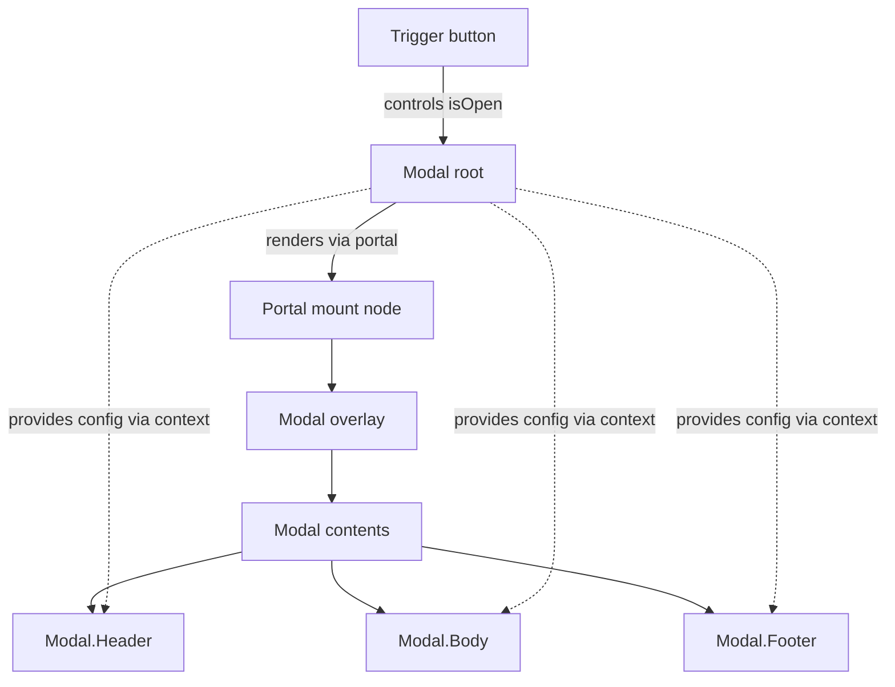
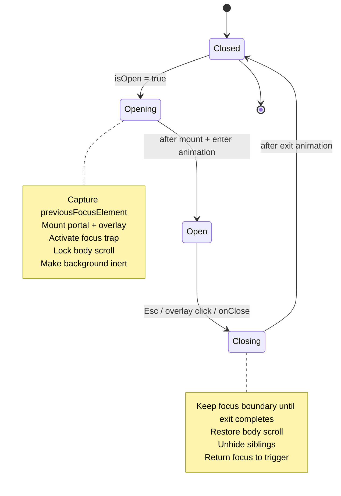
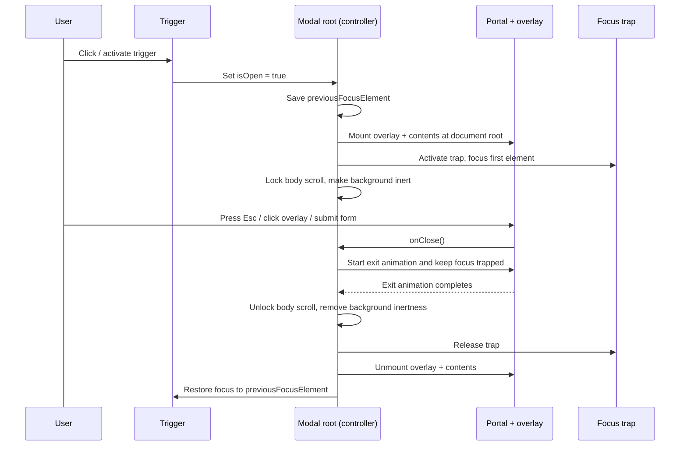
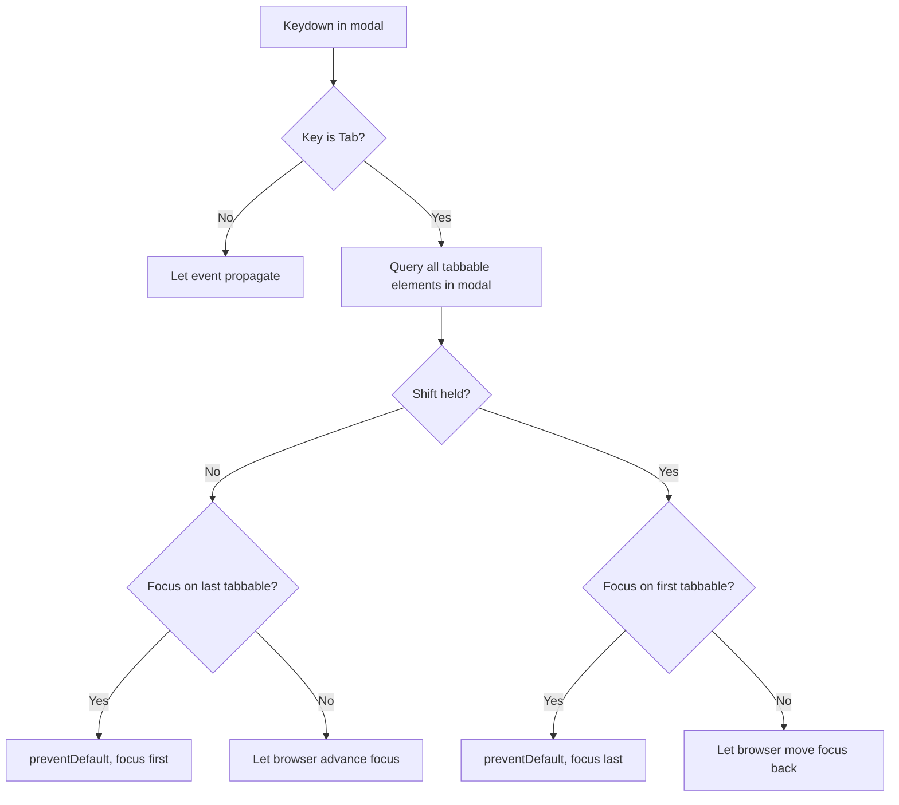
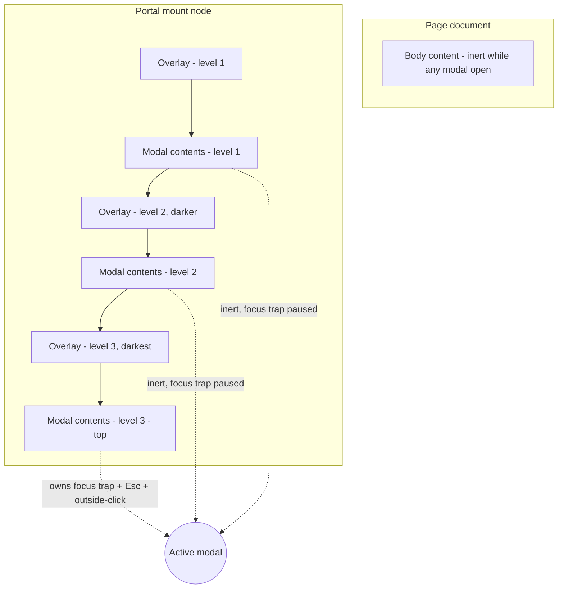

# Modal Dialog

**Difficulty:** Medium · **Duration:** ~30 min · **Topics:** Accessibility, UI component

> Source: [modal-dialog](https://www.greatfrontend.com/questions/system-design/modal-dialog)

## Question

Design a modal/dialog component that shows content in a window overlaying the page.


### Real-life examples

- [Modal · Bootstrap v5.3](https://getbootstrap.com/docs/5.3/components/modal)
- [React Modal component - Material UI](https://mui.com/material-ui/react-modal/)
- [Dialog — Base UI](https://base-ui.com/react/components/dialog)

## Solution

### Requirements exploration

Before designing the API, we scope the component by clarifying which parts it owns, how much the user can customize it, and which devices and content patterns it must support.

#### What are the components of the modal?

It's up to you to decide. At the basic level, it should allow customization of the contents. Whether to add built-in support for close buttons, titles, and footer actions will be up to you.

#### What amount of flexibility does the user have in customizing the design?

Users should be able to customize colors, fonts, padding, etc., of the modal elements to match their branding.

#### What devices will this component be used on?

All devices: mobile, tablet, desktop.

#### Check your understanding 1

Which requirements define the reusable modal component before its architecture is chosen? Select all that apply.

- [ ] Require every modal to use one fixed title, body, and footer template with no consumer-provided content.
  > The baseline explicitly requires customizable contents, so a fixed template would defeat the component's primary flexibility goal.
- [x] Support modal content on mobile, tablet, and desktop viewports.
  > The device scope requires sizing and content regions that remain usable across narrow and wide viewports.
- [x] Allow consumers to adapt colors, fonts, spacing, and other presentation to their product.
  > A reusable component needs a deliberate styling boundary without forcing each consumer to rebuild behavior.
- [x] Decide whether consumers provide arbitrary content or use built-in title, body, close, and footer regions.
  > The content contract determines which parts the component coordinates and which semantics it can wire explicitly.

---

### Architecture / high-level design

Modals, like many components that reveal content, have a trigger element and content elements. Modals can be opened through user actions or background actions, so we should decouple the trigger source from the modal contents.

Basic modals that only include the contents don't have a complicated architecture. However, many modals from UI libraries have three distinct sections: header, body, and footer.

An example usage of modal components in React, with event handlers omitted:

```jsx
<Modal>
  <Modal.Header>
    <Modal.Title>My Modal Title</Modal.Title>
    <Modal.Close aria-label="Close" />
  </Modal.Header>
  <Modal.Body>
    <p>Modal body text goes here.</p>
  </Modal.Body>
  <Modal.Footer>
    <button>Close</button>
    <button>Confirm</button>
  </Modal.Footer>
</Modal>
```

| Component                     | Role                                                                                  |
| ----------------------------- | ------------------------------------------------------------------------------------- |
| Modal Root (`Modal`)          | Root component, coordinates events between the inner components.                      |
| Modal Overlay                 | Component that renders the background overlay, usually dimming out the page contents. |
| Modal Header (`Modal.Header`) | The top section of the modal; contains the title and a close button.                  |
| Modal Body (`Modal.Body`)     | The main contents of the modal.                                                       |
| Modal Footer (`Modal.Footer`) | Optional bottom section of the modal; usually contains close/submit buttons.          |

In React, components can communicate with their parents using context or props. We choose to use context here since we are using a composition model and passing props is inconvenient. `<Modal>` should contain a context provider that provides the config options (`<Modal>`'s `props`) to all its child components in case they need them.

**Modal component hierarchy and context flow**



#### Check your understanding 2

Which architecture keeps modal triggers decoupled from content while coordinating the component's regions?

- [ ] Keep content open state explicitly but infer whether the overlay and controls are active from their current CSS visibility.
  > Presentation can lag or be interrupted, so CSS visibility is not a reliable coordination contract for component behavior.
- [ ] Require every trigger to own and render a private copy of the complete modal content tree.
  > Modals may open from background actions or several triggers, so coupling content to one trigger duplicates state and prevents shared coordination.
- [ ] Let the overlay, header, body, footer, and close control each maintain their own open state.
  > Independent part state can disagree about whether the same modal is open and which close request should win.
- [x] Let a modal root coordinate open state and configuration for composed overlay, header, body, footer, and close parts.
  > A coordinating root gives every part one lifecycle and configuration boundary while callers retain flexible content composition.

---

### Data model

A component’s interface/API can be designed before its data model or alongside it; changes to either may require revisiting the other.

Modal components do not need much state. We'll build the modal as a controlled component, which is the usual approach taken by libraries. Hence, the open/closed state is managed outside the component.

| State                  | Type                                           | Description                                                                                                                                |
| ---------------------- | ---------------------------------------------- | ------------------------------------------------------------------------------------------------------------------------------------------ |
| `previousFocusElement` | `HTMLElement`                                  | The DOM element in focus before the modal was shown. Read more on why this is needed in the [Focus Management](#focus-management) section. |
| `phase`                | `'closed' \| 'opening' \| 'open' \| 'closing'` | Keeps the dialog mounted and inertness/focus effects active through an exit transition.                                                    |
| `layerId`              | `string`                                       | Stable manager entry used to determine which stacked modal owns dismissal and focus.                                                       |

See below for configuration options which are also part of the data model.

Even though the persisted state is tiny, the modal moves through several observable phases during its lifecycle. Tracking them explicitly clarifies when side effects like the portal mount, focus trap, scroll lock, and background inertness should be set up and torn down.

**Modal lifecycle from closed to open and back**



#### Check your understanding 3

A modal can animate closed and can open another dialog above it. Which values belong in its coordinated lifecycle state? Select all that apply.

- [ ] Store the previous active element's serialized markup and recreate it after close if the original was removed.
  > Recreated markup is not the original control or application state. Restoration needs a valid live target or a logical fallback.
- [ ] Use the body's overflow value as the shared signal for whether any modal is open.
  > Scroll styling cannot identify stack order, ownership, closing phases, or focus targets and may be changed for unrelated reasons.
- [x] Open state and, when animations require it, a distinct closing phase.
  > A closing phase keeps the overlay mounted for animation without treating it as fully interactive or already closed.
- [x] The element or strategy used to restore focus after closing.
  > Restoration needs a live or logical target chosen before focus enters the dialog, plus a fallback if that target disappears.
- [x] Stack position and topmost status when multiple dialogs are supported.
  > Topmost status decides which dialog receives Escape, focus containment, and backdrop interaction.

---

### Interface definition (API)

The API is split into props shared across subcomponents and props specific to each composition piece (root, overlay, header, body, footer).

#### General props

These props apply to most of the components.

| Prop        | Type                  | Description                                                                                                                             |
| ----------- | --------------------- | --------------------------------------------------------------------------------------------------------------------------------------- |
| `children`  | `React.Node`          | Children of the component. If using TypeScript/Flow, you can enforce specific components to be used as `children`.                      |
| `as`        | `string \| Component` | In case there is a need to customize the underlying DOM element/component.                                                              |
| `className` | `string`              | Classnames to add to components in case further visual customization is needed. May or may not be needed depending on theming approach. |

#### `Modal`

| Prop        | Type                  | Description                                                                                                                |
| ----------- | --------------------- | -------------------------------------------------------------------------------------------------------------------------- |
| `isOpen`    | `boolean`             | Whether the modal is open or closed.                                                                                       |
| `onClose`   | `Function`            | Callback that requests the parent to close the modal, such as after pressing the close button or hitting the "Escape" key. |
| `maxHeight` | `number \| undefined` | Max height of the modal. There should be a sensible default of around 80% of the viewport height.                          |
| `width`     | `number \| undefined` | Width of the modal. There should be a sensible default of 500-600px.                                                       |

#### `Modal.Header`

Basic version doesn't need props other than `children`.

`Modal.Title` and optional `Modal.Description` provide visible text whose stable IDs are wired to `aria-labelledby` and `aria-describedby`. `Modal.Close` routes activation through the same close transition as Escape and overlay dismissal.

#### `Modal.Body`

Basic version doesn't need props other than `children`.

#### `Modal.Footer`

Basic version doesn't need props other than `children`.

#### Customizing appearance

Guidance on designing good APIs for customizing UI components can be found in the [Front End Interview Guidebook's UI Components API Design Principles Section](https://www.greatfrontend.com/front-end-interview-guidebook/user-interface-components-api-design-principles).

Most of the modal's contents in the header/body/footer will be provided by the user; hence, there isn't that much default styling a modal component needs to provide.

#### Check your understanding 4

A modal lets consumers compose its title, content, and actions. Which API supports that customization while coordinating open state, labeling, focus, and dismissal?

- [ ] Accept one rendered content callback and infer title, description, and close controls from the resulting DOM.
  > Inference makes semantics and control registration dependent on markup. Explicit composable parts preserve flexibility without hiding the contract.
- [ ] Expose an overlay root element and require callers to append content and register their own Escape and focus handlers.
  > Sharing a mount point does not provide a shared behavior contract, so instances can disagree about dismissal and stack ownership.
- [x] Expose a root with open/change callbacks plus header, body, footer, title, and close primitives.
  > Explicit parts allow flexible content while the root owns labeling, dismissal, open state, and focus lifecycle.

---

### Optimizations and deep dive

The tricky parts of a modal are rendering outside the DOM hierarchy, focus management, accessibility, animations, localization, and stacked modal behavior:

- [Rendering](#rendering): This section explains portals, stacking contexts, overlays, scroll locking, and the rendering constraints of floating UI.
- [Accessibility (a11y)](#accessibility-a11y): This section covers focus trapping, keyboard behavior, screen-reader semantics, and ARIA modal guidance.
- [Animations and transitions](#animations-and-transitions): This section discusses entry and exit animations, independent overlay/content transitions, and reduced-motion concerns.
- [Internationalization (i18n)](#internationalization-i18n): This section covers translated strings, text overflow, and direction-aware modal layouts.
- [Stacked modals](#stacked-modals): This section explains how multiple modal layers affect focus, dismissal, z-index, and background inertness.
- [Advanced topics](#advanced-topics): This section collects deeper modal concerns that may come up after the core design is covered.

The embedded sandboxes are simplified visual demonstrations of clipping, placement, dismissal, and animation. The surrounding prose defines the required naming, focus, topmost-click, and reduced-motion behavior.

#### Rendering

Modals float above the page, which creates two rendering challenges: escaping the parent's clipping and stacking contexts, and animating the modal's entry and exit smoothly.

##### Breaking out of DOM hierarchy

Rendering the modal is trickier than it seems due to the fact that modals are displayed over the page and do not follow the normal flow of page elements. It's important to render the modal outside of the DOM hierarchy of the parents, because if the parents contain styling that clips their contents, the modal contents might not be fully visible. Here's an example from the [React docs](https://react.dev/reference/react-dom/createPortal#rendering-a-modal-dialog-with-a-portal) demonstrating the issue.

In React, rendering outside the DOM hierarchy of the parent component can be achieved using [React Portals](https://react.dev/reference/react-dom/createPortal). Common use cases of portals include tooltips, dropdown menus, and popovers.

> **Use a portal for the interview implementation**
>
> Portal the custom dialog into `document.body` or a documented overlay root so it escapes ancestor clipping and stacking contexts. The native top layer is a production alternative, discussed later, rather than the baseline implementation for this interview question.

##### Overlay

To help users focus on the content within the modal, there is usually an overlay/backdrop to dim out the page's contents. To render an element that covers the whole page, we can use the following CSS:

```css
.modal-overlay {
  /* Black color with some opacity. */
  background-color: rgba(0, 0, 0, 0.7);
  position: fixed;
  top: 0;
  left: 0;
  right: 0;
  bottom: 0;
}
```

##### Centered modal

To center the modal contents within the modal overlay, we can add the following styles to the `.modal-overlay`:

```css
.modal-overlay {
  /* Original styles are omitted. */
  display: flex;
  justify-content: center;
  padding: 20px;
}
```

which will work with the following HTML structure.

```html
<div class="modal-overlay">
  <div class="modal-contents">...</div>
</div>
```

If vertical centering of the contents is desired, `align-items: center` can be added to `.modal-overlay`.

Here's a basic example of a modal with an overlay and optional vertical center mode:

##### Maximum height

Use a shrinkable inline size such as `min(600px, calc(100vw - 2rem))` and a viewport-aware block-size cap. Keep the header and footer visible while `Modal.Body` owns vertical scrolling.

##### Scroll lock

When the modal is shown, the modal contents are in focus. To prevent the user from scrolling the background contents, the page should lock page-level scrolling. One way is to add `overflow: hidden` to the `<body>`.

> **Lock body scroll whenever the modal is open**
>
> Without a scroll lock, scroll events bubble to the underlying page and the background quietly shifts behind the dialog, especially disorienting on touch devices where overlay taps and scroll gestures overlap. Toggle `overflow: hidden` on `<body>` (or equivalent) on open and restore the previous value on close so nested or reopened modals do not leak their lock.

##### Rendering in HTML or JavaScript

The modal can either be:

1. Rendered into the HTML like [Bootstrap's Modals](https://getbootstrap.com/docs/5.3/components/modal/). The modal is initially hidden with `display: none` or the `hidden` attribute. `opacity: 0` alone does not remove it from focus, pointer interaction, or the accessibility tree.
2. Rendered on the fly via JavaScript after the modal trigger button is activated.

The pro of rendering in the HTML first is better runtime performance due to fewer DOM operations needed to show the modal. The downside is that the HTML can be unnecessarily bloated, especially if the modal is never shown at all. Since modal contents usually contain secondary information, they shouldn't contribute towards SEO and don't need to be server-side rendered. The benefits of rendering the modal beforehand in HTML are relatively minor.

#### Check your understanding 5

A modal opens from inside a clipped scrolling panel. Which rendering decisions keep the dialog visible and the background stable? Select all that apply.

- [x] Use a fixed overlay that covers the viewport independently of the trigger panel's scroll position.
  > A viewport-level backdrop consistently dims and blocks the page instead of moving with the clipped ancestor.
- [ ] Keep each modal near its trigger and choose a z-index larger than its closest positioned ancestor.
  > A local z-index cannot escape overflow clipping or coordinate a stack across unrelated ancestors.
- [x] Render the dialog and backdrop through a portal into the document body or a documented overlay root.
  > A root-level portal escapes the trigger ancestor's clipping and local stacking contexts.
- [ ] Unmount the page beneath the first modal so background controls cannot receive focus.
  > Unmounting destroys page state and the focus-return target. Inertness can block interaction while preserving context.
- [x] Lock background scrolling while preserving the page's previous scroll position.
  > Restoring the prior position prevents the underlying page from jumping when the final dialog closes.

#### Check your understanding 6

A mobile modal contains a long policy form with persistent title and action regions. Which layout rules keep it usable without scrolling the page underneath? Select all that apply.

- [x] Use a shrinkable inline size and a viewport-aware maximum block size for the dialog panel.
  > Constraining both axes keeps the panel inside narrow and short viewports instead of letting a desktop width or long document overflow the screen.
- [x] Keep page-level scrolling locked for the entire open lifecycle and restore its previous state after close.
  > Modality requires background content to stay fixed while the active dialog provides its own bounded scrolling area.
- [x] Keep the header and footer outside the modal's scrolling content region.
  > Stable title and action regions preserve context and access to controls while the long form moves independently.
- [x] Let `Modal.Body` own vertical overflow once the panel reaches its viewport cap.
  > A dedicated inner scroller contains long content without moving the dialog frame or underlying document.
- [ ] Leave the modal body unconstrained and let touch gestures scroll the overlay and underlying page together.
  > Coupled scrolling can move background content and push the dialog's title or actions out of reach, weakening the modal boundary.

#### Accessibility (a11y)

Modals must be usable with mouse, keyboard, and assistive tech. The subsections below cover each input modality and the ARIA semantics that tie them together.

##### Mouse interactions

Typically, a completed click on the active modal's overlay requests close. Handle this on the backdrop itself and only for the topmost modal; pointer-down dismissal can fire before a user cancels a drag or scroll gesture.

```js
function onOverlayClick(event) {
  if (event.target === event.currentTarget && modalManager.isTopmost(id)) {
    onClose();
  }
}
```

Taken together with the keyboard and programmatic paths, the open and close flow touches the trigger, the portal, the focus trap, and the scroll lock in a specific order. The sequence below captures how these pieces fit together across a typical open-then-dismiss interaction.

**Open and close flow across trigger, portal, and focus trap**



Here's an example in React:

##### Focus management

The most complicated aspect of implementing a modal is probably focus management. Contents within modals are meant to be treated like a separate document; using the <kbd>Tab</kbd> key cycles through focusable elements within the dialog only, and focus can never be on elements outside of the component for as long as the modal is shown. This behavior/phenomenon is known as "focus trapping".

When a modal opens, focus moves to an element inside the modal. Generally, focus is set on the first focusable element, but there are some exceptions as mentioned in [Dialog (Modal) pattern](https://www.w3.org/WAI/ARIA/apg/patterns/dialog-modal/).

When a modal closes, focus returns to the element that opened the modal (unless the element no longer exists, in which case focus moves to another reasonable element).

**How to implement focus management for modals**:

1. When the modal is first opened, keep a reference to the element that opened the modal in the modal's state.
2. Focus on an element inside the modal.
3. Add `keydown` listeners for the <kbd>Tab</kbd> key that contain the following logic:
4. When the <kbd>Tab</kbd> key is pressed, determine if the focus should be shifted to the next or previous tabbable element by checking if the <kbd>Shift</kbd> key is also pressed (via the `shiftKey` value on the `KeyboardEvent`).
5. Find all tabbable elements within the modal.
6. From the currently focused element, find the next/previous tabbable element.
7. Focus on that new element.
8. When the modal is closed, hide the modal and move focus to the element that opened the modal.

The tricky part is the wraparound: the <kbd>Tab</kbd> handler has to detect the edges of the tabbable set and cycle focus back to the opposite end so it never escapes into background content. The flowchart below captures that decision for both <kbd>Tab</kbd> and <kbd>Shift</kbd> + <kbd>Tab</kbd>.

**Focus trap wraparound for Tab and Shift+Tab**



In practice, focus trapping can be done with libraries such as [focus-trap](https://focus-trap.github.io/focus-trap/) or [`react-focus-lock`](https://github.com/theKashey/react-focus-lock).

> **Always trap focus inside the modal and return it to the trigger on close**
>
> Skipping the focus trap lets <kbd>Tab</kbd> escape into the dimmed background, where keyboard and screen-reader users end up interacting with controls they cannot see. Failing to restore focus to the opening element on close can leave focus at `<body>`, requiring keyboard and assistive-technology users to navigate back to their previous position.

##### Keyboard interactions

The following is extracted from the [Dialog (Modal) pattern](https://www.w3.org/WAI/ARIA/apg/patterns/dialog-modal/):

| Key                               | Description                                                                                                                                                                           |
| --------------------------------- | ------------------------------------------------------------------------------------------------------------------------------------------------------------------------------------- |
| <kbd>Tab</kbd>                    | Moves focus to the next tabbable element inside the modal. If focus is on the last tabbable element inside the modal, moves focus to the first tabbable element inside the modal.     |
| <kbd>Shift</kbd> + <kbd>Tab</kbd> | Moves focus to the previous tabbable element inside the modal. If focus is on the first tabbable element inside the modal, moves focus to the last tabbable element inside the modal. |
| <kbd>Esc</kbd>                    | Closes the modal.                                                                                                                                                                     |

Focus trapping is essential for the required <kbd>Tab</kbd>-ing behavior; otherwise, the focus will "leak" out of the modal:

##### WAI-ARIA roles, states, and properties

The following is extracted from the [Dialog (Modal) pattern](https://www.w3.org/WAI/ARIA/apg/patterns/dialog-modal/).

- The element that serves as the modal container has a role of `dialog`.
- All elements required to operate the modal are descendants of the element that has role `dialog`.
- The modal container element has `aria-modal` set to `true`.
- The modal has either:
  - A value set for the `aria-labelledby` property that refers to a visible modal title.
  - A label specified by `aria-label`.
- Optional `aria-describedby` property is set on the element with the `dialog` role to indicate which element or elements in the dialog contain content that describes the primary purpose or message of the dialog. Read the full guidance at [Dialog (Modal) pattern](https://www.w3.org/WAI/ARIA/apg/patterns/dialog-modal/).

> **`role="dialog"` alone is not enough; always pair it with `aria-modal` and a label**
>
> `aria-modal="true"` communicates modality but does not make background controls inert. A custom dialog must separately apply real background inertness and a focus boundary, then expose a name through `aria-labelledby` or `aria-label`.

##### `<dialog>` element

The native `<dialog>` element is now widely supported. When opened with `showModal()`, the browser places it in the top layer, makes the rest of the document inert, moves focus inside, constrains sequential focus, supports platform dismissal, and normally restores focus to the invoker. Product code still supplies the accessible name, initial-focus policy, close controls, and application-specific stacking behavior.

> **Treat `<dialog>` as a production alternative**
>
> In this interview, implement the portaled dialog, focus management, background inertness, and ARIA behavior explicitly to demonstrate the underlying design. If a production component uses `<dialog>`, wrap its native lifecycle behind the same component API instead of independently toggling CSS visibility.

#### Check your understanding 7

A modal opens above a page. How should it identify the dialog to assistive technology and manage focus while open and after closing? Select all that apply.

- [x] Keep keyboard focus within the open dialog and make background content inert.
  > Containment and inertness keep keyboard and pointer interaction inside the modal rather than the background page.
- [x] Return focus to the trigger or another logical target after close.
  > Restoration returns the user to the action that opened the dialog, or a logical fallback if it disappeared.
- [x] Use dialog semantics and connect an accessible title and optional description.
  > Dialog semantics and a connected title let assistive technology identify the new interaction context.
- [ ] Focus the dialog container by default even when it has a title and a safe first field.
  > A focusable container can be a fallback for complex content, but a universal rule may hide the title context or add an unnecessary extra navigation step.
- [ ] Keep DOM focus on the page and intercept Tab globally to simulate containment inside the modal.
  > Assistive technology still perceives focus outside the dialog, and global interception is not equivalent to moving focus into the active context.
- [x] Move focus to an appropriate element after the dialog opens.
  > Intentional initial focus avoids landing on a destructive action or leaving focus behind the overlay.

#### Check your understanding 8

A modal can close from its close button, Escape, successful form submission, or a backdrop interaction. Which rules keep dismissal consistent and prevent accidental closes? Select all that apply.

- [ ] Dismiss immediately on any pointer-down event captured by the backdrop container.
  > Pointer down can start a scroll or drag that never completes as a click, and capture also sees events originating inside the dialog.
- [x] Let only the topmost modal process Escape and backdrop dismissal.
  > A single gesture should affect one active interaction boundary instead of closing covered dialogs and triggering multiple focus restorations.
- [x] Dismiss on a completed click only when the event target is the backdrop itself.
  > Direct-target checking prevents clicks inside dialog content from bubbling into dismissal, while waiting for click avoids closing during a canceled drag or scroll.
- [x] Route every dismissal source through the modal root's close request and lifecycle transition.
  > One path coordinates animation, interaction shutdown, scroll restoration, unmounting, and focus restoration regardless of what requested the close.
- [ ] Allow close buttons and forms to remove the portal immediately while Escape uses the animated root transition.
  > Independent teardown paths can skip focus and document-effect cleanup, producing different behavior for the same logical close operation.

#### Check your understanding 9

A modal has four tabbable controls. How should its keydown handler contain focus while preserving normal browser traversal within the dialog?

- [x] Intercept Tab only at the tabbable-set edges, wrapping last to first and Shift+Tab first to last.
  > Only the two boundary transitions can escape the dialog, so intercepting them provides wraparound without reimplementing ordinary focus order.
- [ ] Prevent every Tab key and manually focus the next array entry, even between controls in normal DOM order.
  > Taking over all traversal duplicates browser behavior and can become stale when controls mount, disable, or change their native tab order.
- [ ] Wrap when focus reaches the panel's first or last DOM child, regardless of whether those nodes are tabbable.
  > DOM edge nodes may be headings or wrappers. Containment must use the current tabbable set rather than structural child positions.
- [ ] Allow every Tab key to proceed normally because an inert background guarantees focus will remain on a dialog control.
  > Inertness blocks background interaction but does not define the required wrap from the final dialog control back to the first.

#### Check your understanding 10

A reusable modal wraps the native `<dialog>` element. How should its component API coordinate the native lifecycle with labeling, focus, and dismissal policy?

- [ ] Delegate focus and dismissal completely to the element and test only browsers that lack `<dialog>` support.
  > Native support does not decide initial focus, product dismissal rules, nesting policy, or responsive content layout.
- [ ] Use `showModal()` for keyboard users but a separate CSS-visible state for pointer-triggered openings.
  > Input method must not create two modal lifecycles. The native open state and component state need one synchronized boundary.
- [x] Wrap the native lifecycle behind the component API and still define naming, initial focus, and dismissal policy.
  > The platform supplies useful top-layer and modality behavior, but the component still owns product-specific lifecycle and verified accessibility behavior.

#### Animations and transitions

If animation of the modal elements is desired and the transitions of the overlay and the contents need to be independent (e.g., the overlay fades in while the contents translate up vertically), the DOM structure will have to be changed and the contents cannot be rendered within the overlay's DOM. A structure similar to this will be required:

```html
<div>
  <!-- The overlay, rendered as a fixed sibling to the contents. -->
  <div class="modal-overlay" aria-hidden="true"></div>
  <!-- Full screen container to center the panel. -->
  <div class="modal-contents-container">
    <div class="modal-contents">...</div>
  </div>
</div>
```

Here's an example of the entrance animation in React:

Exit transitions are non-trivial to implement properly in React because conditional rendering causes the DOM elements to be removed from the document when they are no longer needed on the page. Here's an example of a modal where the entrance and exit are both animated.

Honor `prefers-reduced-motion` by shortening or removing the transition. When duration is zero, complete the closing phase synchronously instead of waiting for a transition event that will never fire.

#### Check your understanding 11

How should a modal close animation interact with focus and DOM removal?

- [ ] Restore focus as soon as close is requested but keep the fading dialog mounted until its transition ends.
  > Focus would move behind an overlay that still blocks or visually covers the page. Restoration belongs at the completed close boundary.
- [x] Enter a closing phase, prevent new interaction, remove the dialog after the transition, and then restore focus; skip or shorten motion when requested.
  > An explicit phase ties interaction, removal, and focus restoration to one lifecycle and can bypass motion without changing the final state.
- [ ] Set the closing state and restore focus after a timeout equal to the current CSS duration token.
  > Motion can be canceled, reduced, or changed by the platform. Lifecycle should observe actual completion with a safe fallback.

#### Internationalization (i18n)

Since all user-facing strings are provided by the user, strings can be displayed as-is. Allow titles, content, and actions to grow or wrap for longer translations, with `Modal.Body` scrolling when the dialog reaches its viewport cap.

For RTL languages, inherit `dir` by default and use logical CSS properties. Action order follows locale and design-system policy rather than automatically flipping every element.


#### Check your understanding 12

A modal's translated actions are longer than English and the page can run in RTL. Which changes preserve its content and interaction? Select all that apply.

- [ ] Keep fixed action widths and abbreviate translations that do not fit.
  > Abbreviation can change meaning and accessible-name consistency. Layout should accommodate translated labels.
- [x] Use logical spacing and alignment so layouts can mirror in RTL.
  > Logical properties mirror without maintaining separate physical spacing rules.
- [x] Translate titles, action labels, validation messages, and accessible names.
  > Programmatic names and visible text must communicate the same localized actions and validation outcomes.
- [x] Allow dialog content and buttons to wrap or scroll for longer translations.
  > Wrapping and bounded scrolling prevent text expansion from hiding actions or exceeding the viewport.
- [ ] Mirror the page in RTL but leave dialog content and action order forced to LTR for consistency.
  > The dialog is part of the same reading and interaction context and should follow the locale unless specific content has its own direction.

#### Stacked modals

It is possible for modal contents to contain triggers that present even more modals, so the following needs to be considered:

- Decide whether there should be an overlay per modal level, which will visually make the backdrop darker the higher the level of stacking.
- Dismissing a modal via the <kbd>Esc</kbd> key or clicking outside the topmost modal's contents should only dismiss the topmost modal and not all the modals.
- Dismissing a lower-layer modal should also dismiss all the modals on top of it (or make this behavior customizable).

Implementation-wise, a shared modal manager holds a stack of open modals, and only the topmost entry owns the active focus trap, the <kbd>Esc</kbd> handler, and the outside-click target. The layering below shows how overlays, contents, and focus responsibility fan out as deeper modals open.

**Stacking order and active focus trap across nested modals**



#### Check your understanding 13

A settings dialog opens a confirmation dialog above it. Which rules keep the stack's focus, dismissal, and document effects predictable? Select all that apply.

- [x] Only the topmost modal receives focus, Escape, and backdrop interactions.
  > One active boundary prevents keyboard and pointer input from reaching a covered dialog.
- [ ] Give every dialog the same base z-index and rely on DOM insertion order to place the latest one above it.
  > DOM order alone does not encode interleaved backdrops or portals reliably. The manager should assign stack positions deliberately.
- [ ] Broadcast Escape to every open dialog and let each decide whether to close.
  > A single gesture can close multiple layers and restore focus several times. Only the topmost dialog should handle it.
- [x] Keep background scroll locked until the final modal closes.
  > Releasing a global effect per instance can unlock the page while a lower dialog still requires modality.
- [x] When the top dialog closes, restore focus within the dialog beneath it.
  > Closing the child should resume the parent workflow rather than jump to the underlying page.

#### Advanced topics

The following variations are useful follow-ups after the core modal lifecycle is correct.

- Tooltips and dropdown menus within a modal.
- Alert dialog role and [ARIA pattern](https://www.w3.org/WAI/ARIA/apg/patterns/alertdialog/).

---

### Summary

**A modal combines portal rendering, focus management, and ARIA semantics.** Its compound API includes `Modal`, `Modal.Header`, `Modal.Body`, and `Modal.Footer` coordinated through a root context, driven by `isOpen` and `onClose`, with `maxHeight`, `width`, `as`, and `className` for customization.

**Implement the modal behavior explicitly for the interview.** Render the custom dialog through a portal, make the background inert, contain focus, and route dismissal through the modal controller. Native `<dialog>.showModal()` provides many of these behaviors in production, but it is a comparison point rather than a substitute for explaining the design.

**Trap focus inside the active modal.** Opening the modal captures `previousFocusElement`, moves focus inside, and keeps <kbd>Tab</kbd> and <kbd>Shift</kbd> + <kbd>Tab</kbd> cycling within the tabbable set with edge wraparound so focus never escapes into hidden background content. <kbd>Esc</kbd> and overlay clicks both route through the same `onClose` path, and closing restores focus to the original trigger so keyboard users resume exactly where they left off. When modals stack, only the topmost owns the trap and the dismissal handlers.

**Expose dialog semantics together with behavior.** A custom contents container carries `role="dialog"`, `aria-modal="true"`, and an accessible name, while the manager separately applies real background inertness, pointer blocking, and focus containment. RTL layout uses logical properties, and long translations wrap or use the bounded body scroll area.

Start with portal rendering, focus containment and restoration, and ARIA semantics, then explain layout, animation, and theming.

Nested floating layers, exact scroll-lock restoration, transition race handling, and the full browser/assistive-technology matrix are potential follow-ups rather than requirements for the core interview answer.

### References

The references below group modal and dialog sources by theme, so it is easier to map each source back to the part of the article it informed.

#### W3C ARIA authoring practices

This subsection anchors the dialog design in the authoritative ARIA guidance for modal and alert dialogs.

- [Dialog (modal) pattern | W3C ARIA](https://www.w3.org/WAI/ARIA/apg/patterns/dialog-modal/) for the canonical roles, states, and keyboard behavior for modal dialogs.
- [Alert and message dialogs pattern | W3C ARIA](https://www.w3.org/WAI/ARIA/apg/patterns/alertdialog/) for the stricter alertdialog variant used for urgent messages.

#### Focus management and the inert attribute

This subsection collects the platform primitives that enforce focus trapping and background inertness while a dialog is open.

- [<dialog>: The Dialog element | MDN](https://developer.mozilla.org/en-US/docs/Web/HTML/Element/dialog) for the native HTML element that handles top-layer rendering and modal semantics.
- [Inert attribute | MDN](https://developer.mozilla.org/en-US/docs/Web/HTML/Global_attributes/inert) for removing background content from the tab order and accessibility tree while the dialog is open.
- [A CSS approach to trap focus inside of an element](https://css-tricks.com/a-css-approach-to-trap-focus-inside-of-an-element/) for a lightweight CSS-based technique for focus trapping.
- [createPortal | React](https://react.dev/reference/react-dom/createPortal) for rendering the dialog outside its parent DOM hierarchy so it can escape stacking contexts.

#### Themed implementations

These libraries ship opinionated visual defaults and are useful when comparing component API ergonomics.

- [Modal | Bootstrap v5.3](https://getbootstrap.com/docs/5.3/components/modal) for a widely used CSS-first modal implementation.
- [React Modal component | Material UI](https://mui.com/material-ui/react-modal/) for a themed React modal with full keyboard and accessibility behavior.

#### Headless implementations

These libraries focus on behavior and accessibility without shipping styles, which is closer to what this article designs.

- [Dialog | Base UI](https://base-ui.com/react/components/dialog) for a composable dialog with trigger, portal, backdrop, and popup parts.
- [Dialog | Ariakit](https://ariakit.com/components/dialog) for an unstyled dialog with focus management and composable controls.
- [Modal | React Aria](https://react-aria.adobe.com/Modal) for customizable modal and dialog components with accessibility behavior.

#### Case studies

These writeups describe how product teams ship modals and dialogs in real applications.

- [Building a Dialog for Reddit Web](https://www.reddit.com/r/RedditEng/comments/1hfp4mj/building_a_dialog_for_reddit_web/) for a production account of designing a reusable dialog system across a large web app.

#### Related system design articles

The articles below overlap with modal dialogs on portals, focus management, and dismissal behavior.

- [Dropdown menu](https://www.greatfrontend.com/questions/system-design/dropdown-menu) for overlapping concerns around focus management, portals, and dismissal semantics in overlay components.

## Asked at these companies

- TikTok
- Lyft
