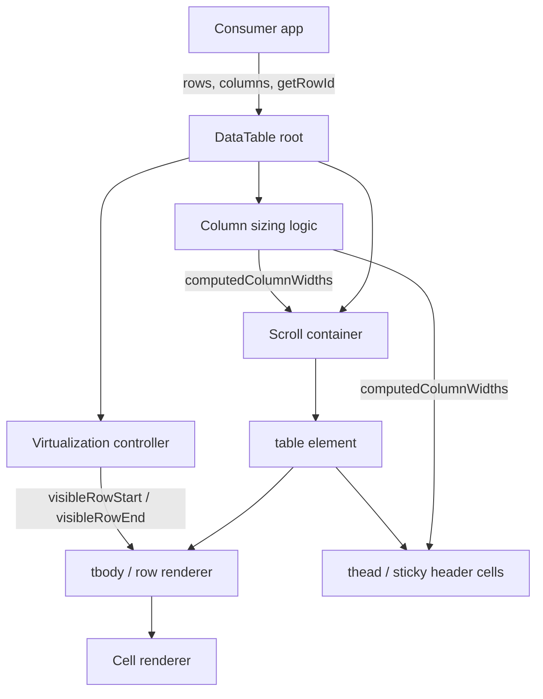
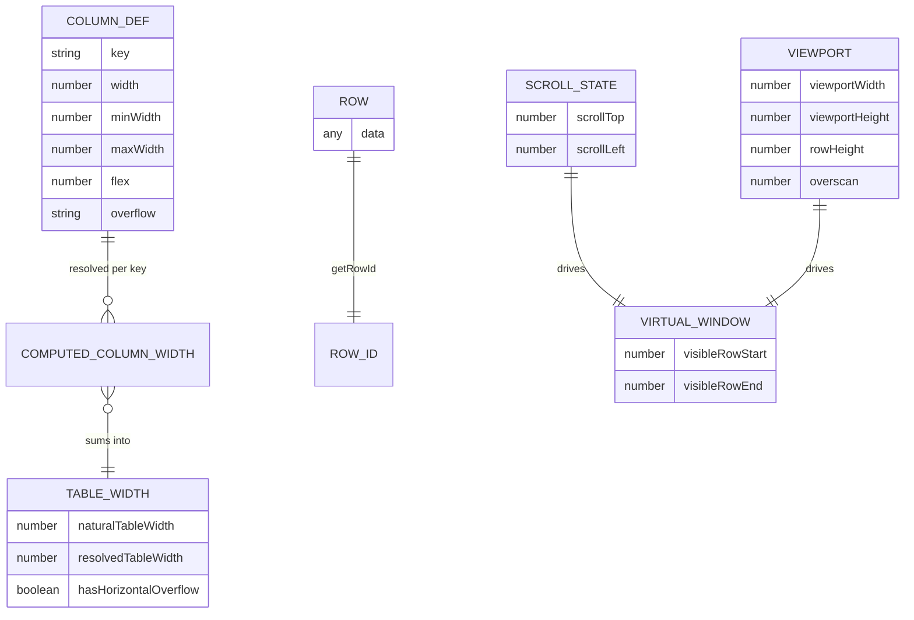
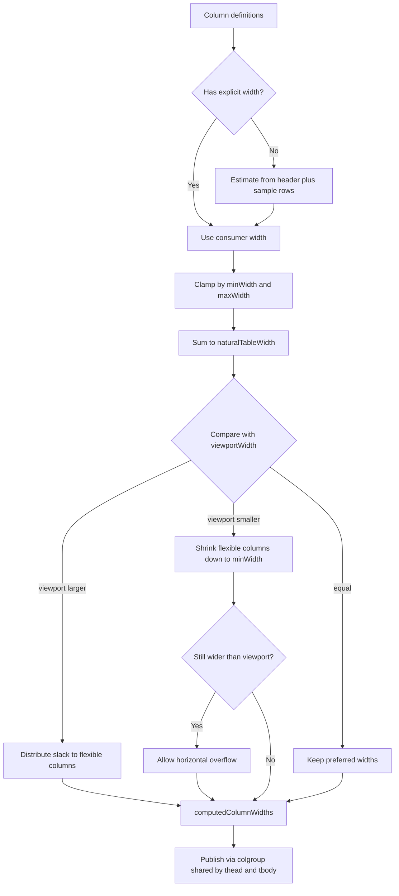
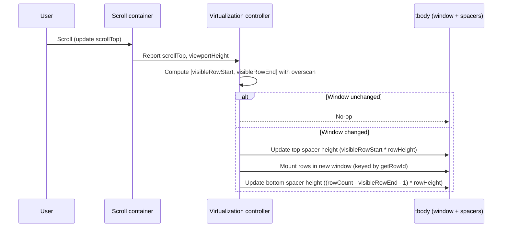
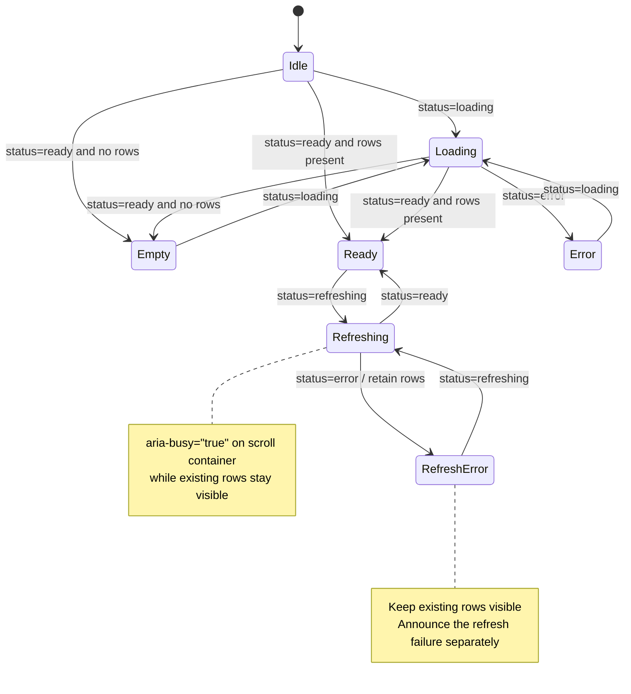

# Data Table

**Difficulty:** Medium · **Duration:** ~30 min · **Topics:** Accessibility, UI component

> Source: [data-table](https://www.greatfrontend.com/questions/system-design/data-table)

## Question

Design a reusable, client-rendered data table component for a large web application. The table should support a fixed header, scrollable rows and columns, declarative column definitions, and cells that can render different kinds of data such as strings, numbers, dates, and images.

Assume the table is used primarily for reading and scanning tabular data rather than spreadsheet-style editing. Unlike the [Google Sheets system design article](https://www.greatfrontend.com/questions/system-design/collaborative-spreadsheet-google-sheets), this question is about designing a reusable table component for a shared component library, not formulas, collaboration, or spreadsheet-style cell editing semantics.

### Real-life examples

These libraries demonstrate common API, layout, and scaling approaches for production data tables.

- [TanStack Table](https://tanstack.com/table)
- [MUI Data Grid](https://mui.com/x/react-data-grid/)
- [AG Grid](https://www.ag-grid.com/)
- [Ant Design Table](https://ant.design/components/table/)

### Requirements

The base design should satisfy the following functional and performance requirements.

- The component should be generic enough to reuse across multiple product surfaces.
- The header should remain visible while rows scroll vertically.
- The table should support horizontal scrolling when there are many columns or when columns cannot shrink further.
- Columns should be configurable declaratively and cells should support custom rendering.
- The table should accept an optional outer viewport/container width while still producing sensible default column widths.
- The component should perform well with large datasets such as thousands of rows.
- Focus on the base table design first. Features such as sorting, filtering, column resizing, and fixed columns can be discussed as extensions if time permits.

## Solution

### Requirements exploration

Data tables display records in admin dashboards, analytics views, internal tools, moderation queues, billing pages, and CRMs. The component needs an API that supports layout, semantics, sizing, and rendering performance.

#### What is the primary usage model?

This table is meant for scanning tabular data across internal tools, admin dashboards, moderation queues, billing pages, and CRM-style surfaces. The basic design should optimize for display, readability, and reuse across product surfaces rather than spreadsheet-style editing or highly interactive cell-by-cell workflows.

#### What kinds of data and customization should the table support?

The column contract should cover common values while leaving rich presentation under consumer control.

- Columns should be defined declaratively by the consumer.
- Each column should be able to render a consistent cell type across the whole column.
- The base component should handle common data such as strings, numbers, dates, and images.
- Consumers should also be able to supply custom renderers for richer content such as links, badges, avatars, and status pills.
- Column-level configuration should include at least the header label, accessor logic, alignment, and sizing constraints.

This is an important clarification because a reusable table component is more naturally configured per column than per individual cell. That keeps the API predictable and makes the component easier to reuse across a shared component library.

#### What scrolling and sizing behavior is expected?

The layout needs one predictable contract for sticky headers, overflow, and constrained widths.

- The header should remain visible while rows scroll vertically.
- The table should support horizontal scrolling when the total column width exceeds the available viewport.
- By default, columns should use sensible best-fit widths instead of requiring every width to be hard-coded up front.
- The component should also accept an optional overall width, which means the design needs a deterministic strategy for shrinking, expanding, and truncating columns when space is constrained.
- For large-data mode, assume the table renders inside a bounded-height viewport rather than growing to fit every row.

The width behavior is one of the main design challenges in this problem. Cover both the unconstrained case and the constrained-width case, rather than just leaving sizing to “whatever the browser does”.

#### What scale should the basic design support?

The basic design should comfortably handle thousands of rows and dozens of columns. It is reasonable to start the architecture by assuming the caller already has the row data in memory, then discuss how the rendering model should change once the dataset becomes too large to mount all rows at once, or when rows are incrementally loaded.

That means smooth scrolling and predictable layout are non-functional requirements, not nice-to-haves. The component should be designed so that large datasets do not explode the DOM tree or make scrolling janky.

#### What devices and accessibility expectations should guide the first version?

Desktop browsers should be the priority because dense tabular data is most commonly consumed there. The design should still be responsive enough to avoid breaking on smaller screens, but a mobile-first dense table experience is not the main target.

Accessibility should be treated as a base requirement, not an extension. Because this is a read-heavy tabular surface, the proposed design should preserve semantic table behavior and clear header-to-cell relationships.

#### What is explicitly out of scope for the basic design?

The core interview answer excludes features that turn the read-heavy table into a spreadsheet or application grid.

- Inline editing and spreadsheet-like keyboard navigation.
- Formulas, computed cell dependencies, and collaboration semantics.
- Frozen columns, tree rows, grouped rows, and merged-cell layouts.
- Server-driven sorting, filtering, and pagination protocols.
- Canvas rendering as the default implementation.

Common table features such as sorting, filtering, column resizing, row selection, and summary footers are worth acknowledging, but they should be treated as follow-up extensions unless the interviewer asks to prioritize them.

#### Check your understanding 1

A team is defining the first version of a reusable table for scanning consumer-provided records. Which requirements belong in that version? Select all that apply.

- [x] Accept declarative columns for common values and consumer-provided renderers for richer cells.
  > Per-column configuration keeps access, sizing, alignment, and rich presentation consistent across every row.
- [x] Optimize for scanning read-heavy tabular data rather than spreadsheet-style editing and cell-by-cell navigation.
  > This interaction boundary keeps editing state and composite-widget keyboard behavior out of the base component.
- [ ] Require inline editing, cell-by-cell keyboard navigation, formulas, and row selection in the base component.
  > These interactions turn the read-heavy table into an application grid and are excluded from the initial architecture.
- [ ] Require the table primitive itself to own server-driven sorting, filtering, and pagination.
  > The scoped table receives rows from its consumer. Owning remote data operations would couple the reusable rendering primitive to one server workflow.
- [x] Support thousands of rows and dozens of columns, with a bounded-height mode that can virtualize rows.
  > The stated scale makes DOM size and smooth scrolling core constraints while keeping row virtualization as the primary optimization.

---

### Architecture / high-level design

For the scoped version of this problem, the architecture should stay mostly on the client. The consumer passes row data and declarative column definitions into a reusable `DataTable` component, and the table is responsible for sizing columns, rendering cells, managing scroll state, and switching between full rendering and a virtualized body when the dataset is large enough to justify it.

The most important architectural decision is the rendering model. For a read-heavy table, the best default is a **semantic table-based design** rather than a spreadsheet-style grid. Native table semantics already match how assistive technologies expect tabular data to be exposed, and they align with the problem statement better than a fully custom `div`-based layout.

> **Default to semantic `<table>` markup over a `<div>`-based grid**
>
> For a read-heavy tabular surface, native `<table>`, `<thead>`, `<tbody>`, `<tr>`, and `<td>` elements give correct accessibility semantics and header-to-cell relationships for free. A `<div>`-based grid has to recreate all of that behavior manually with ARIA, and is only worth the cost once the component becomes interactive enough to need managed focus or spreadsheet-style keyboard navigation.

An example usage of the component in React could look like this:

```tsx
const column = createColumnHelper<User>();

const userColumns = [
  column({ key: "name", header: "Name", accessor: (row) => row.name }),
  column({
    key: "joinedAt",
    header: "Joined",
    accessor: (row) => row.joinedAt,
    renderCell: (value) => formatDate(value),
  }),
  column({
    key: "avatar",
    header: "Avatar",
    accessor: (row) => row.avatarUrl,
    renderCell: (value) => ,
  }),
];

<DataTable
  rows={users}
  columns={userColumns}
  getRowId={(row) => row.id}
  aria-label="Users"
  height={600}
  width={960}
/>;
```

This shape keeps the component reusable across product surfaces. Rows are plain data, columns define how that data should be interpreted, and custom rendering remains a per-column concern rather than an ad hoc per-cell escape hatch.

There are many other ways to define the API for a data table, and each comes with tradeoffs.

#### Markup approach and tradeoffs

There are two realistic markup directions:

1. **Native `<table>`**: Better default semantics, simpler header-to-cell relationships, and a more natural fit for read-heavy tabular content.
2. **Custom `div`-based layout with ARIA roles**: More control over custom layout and virtualization, but significantly more accessibility and focus behavior has to be recreated manually.

The recommended starting point is native table semantics. In the scoped version of this problem, that recommendation should stay true even when row virtualization is enabled: render the visible rows plus top and bottom spacer rows inside the same `<tbody>` so the component keeps one real table, one sticky header, and one scroll container.

A `div` or `grid`-style implementation becomes more appropriate only once the component needs absolutely positioned rows, spreadsheet-like keyboard navigation, cell editing, or aggressive two-axis virtualization. In an interview setting, those tradeoffs are follow-up material rather than the default architecture.

A simplified native structure for the basic design might look like this:

```html
<div class="table-scroll-container" style="overflow: auto;">
  <table>
    <caption>
      Users
    </caption>
    <thead>
      <tr>
        <th scope="col">Name</th>
        <th scope="col">Joined</th>
        <th scope="col">Status</th>
      </tr>
    </thead>
    <tbody>
      <tr>
        <td>Ada Lovelace</td>
        <td>Jan 3, 2024</td>
        <td>Active</td>
      </tr>
    </tbody>
  </table>
</div>
```

This example is intentionally simple, but it makes the structure explicit: the scrollbars belong to the outer scroll container, while the inner table preserves the semantic relationship between headers, rows, and cells.

The scroll wrapper must also be keyboard-reachable and show a visible focus indicator. Add `tabindex="0"` when the supported browsers do not otherwise include the scroller in sequential focus navigation, but omit it when it would create a redundant tab stop. Add `role="region"` and an accessible name only when the scroll area benefits from being announced as a landmark, without duplicating the table caption.

The `div` route is still worth acknowledging as a fallback path. `role="table"` fits a mostly read-only surface that needs more layout control than native tables provide, while `role="grid"` becomes appropriate only once the component is interactive enough to require managed focus and directional keyboard navigation. If the internals ever move away from native table flow, metadata such as `aria-rowcount`, `aria-colcount`, `aria-rowindex`, and `aria-colindex` may be needed to preserve accessibility. That is a later escalation point, not the recommended starting architecture.

#### Scroll and sticky-header strategy

The table should render inside **one bounded scroll container** that owns both vertical and horizontal overflow. The header row stays visible by using sticky positioning relative to that container, while the body rows scroll underneath it.

Architecturally, the important choice is to keep one shared scroll surface rather than splitting the header and body into separate scroll surfaces. That avoids scroll-sync bugs, duplicated width calculations, and alignment drift.

> **Do not split the header and body into separate scroll surfaces**
>
> A shared scroll container with a sticky `<thead>` is the simpler and more robust default. Two separate scroll surfaces require manual scroll synchronization on every scroll event, and any hiccup shows up as visibly drifting column alignment, exactly the kind of bug that is hard to debug in production and that you can avoid by letting one container own both axes.

That bounded-height detail should be explicit in the API contract. Sticky headers and row virtualization only make sense when the component has a real vertical viewport, so `height` should be treated as required for scrollable mode. If `height` is omitted, the table can still render as a plain non-virtualized table that grows naturally, but fixed-header behavior is inactive because there is no containing scroll surface for `position: sticky` to latch onto.

It is also important to distinguish the **scroll viewport width** from the **resolved table content width**. The optional `width` prop should size the outer scroll container, while the inner table may still resolve to a wider width and overflow horizontally if its columns cannot shrink any further.

#### Component responsibilities

Each part of the component owns one part of rendering, sizing, scrolling, or virtualization.

| Component                 | Role                                                                                                                                                              |
| ------------------------- | ----------------------------------------------------------------------------------------------------------------------------------------------------------------- |
| `DataTable` root          | Accepts external props, resolves static versus virtualized-body layout mode, owns derived scroll and sizing state, and coordinates the subcomponents.             |
| Scroll container          | Defines the bounded viewport and handles both horizontal and vertical scrolling.                                                                                  |
| Header row / header cells | Render column labels, expose header semantics, and remain visible with sticky positioning.                                                                        |
| Row renderer              | Renders the visible rows using stable row identity.                                                                                                               |
| Cell renderer             | Applies the default or custom renderer for each column while preserving alignment and overflow rules.                                                             |
| Virtualization controller | Determines which rows should be mounted based on the viewport and overscan window, and inserts spacer rows when native-table virtualization is active.            |
| Column sizing logic       | Computes default widths, applies explicit min/max constraints, handles constrained-width redistribution, and exposes one shared width map to the header and body. |

The result is a relatively simple architecture: a semantic table surface, a shared column sizing model, one scroll container, and a virtualization layer that can reduce DOM cost without changing the table's external API.

**DataTable component hierarchy and shared state**



#### Check your understanding 2

Which responsibility split best fits the scoped table's sizing, scrolling, and rendering work?

- [x] Let the `DataTable` root derive column widths and the visible row window, then pass them to semantic renderers.
  > Centralized layout decisions keep header and body aligned while focused renderers remain responsible only for their part of the semantic table.
- [ ] Use currently mounted header and row elements as the authoritative column and row model.
  > A virtualized DOM contains only a window of the data, so columns, row identity, and layout inputs must exist independently of mounted elements.
- [ ] Let each header and body cell measure its own width, while the scroll wrapper independently decides which rows to mount.
  > Independent measurement and windowing create competing layout sources, so alignment and row visibility can disagree during scroll or resize.

---

### Data model

For a reusable data table component, the data model is a mix of **consumer-provided inputs** and **internally derived layout state**. The table should not mutate the caller's row data. Instead, it should treat the input rows and column definitions as the source of truth, then derive sizing, scrolling, and virtualization state from them.

#### Core external data structures / config / props

The two most important external structures are the row collection and the column definition model.

```ts
type ColumnDef<Row, Value> = {
  key: string;
  header: ReactNode | ((column: ColumnDef<Row, Value>) => ReactNode);
  accessor: (row: Row) => Value;
  renderCell?: (value: Value, row: Row) => ReactNode;
  width?: number;
  minWidth?: number;
  maxWidth?: number;
  flex?: number;
  align?: "start" | "center" | "end";
  overflow?: "truncate" | "clip" | "wrap";
};

// Heterogeneous storage type used only after each definition is checked.
type AnyColumnDef<Row> = ColumnDef<Row, any>;

declare function createColumnHelper<Row>(): <Value>(
  definition: ColumnDef<Row, Value>,
) => ColumnDef<Row, Value>;
```

A column helper infers `Value` independently for each definition, so a date formatter receives a date and an image renderer receives a URL without casting from `unknown`. The heterogeneous collection erases that value type only after each accessor and renderer pair has been checked; consumers do not write `any` or add casts.

This shape reflects an important design decision: columns are first-class configuration objects, not something inferred ad hoc from the first row of data. That makes the component much easier to reason about across a large codebase.

#### Core internal state

Store measured viewport and scroll inputs; derive identities, widths, and the visible window from those inputs and the external props.

| State            | Type     | Description                                       |
| ---------------- | -------- | ------------------------------------------------- |
| `scrollLeft`     | `number` | Horizontal scroll offset of the scroll container. |
| `scrollTop`      | `number` | Vertical scroll offset of the scroll container.   |
| `viewportWidth`  | `number` | Visible width of the scroll container.            |
| `viewportHeight` | `number` | Visible height of the scroll container.           |

Presentation state comes from the external `status` prop rather than being inferred from renderer slots. The component's internal mutable state remains layout-oriented rather than data-mutating.

#### Derived state and layout metadata

Not every value needs to be stored explicitly. Several important values can be derived from the external inputs and the core state above:

- Stable `rowIds` derived from `rows` and `getRowId`
- `computedColumnWidths` derived from column constraints, sampled content, and viewport width
- `visibleRowStart` and inclusive `visibleRowEnd` derived from scroll position, viewport height, row height, and overscan
- Total logical row count
- Total scrollable body height
- Natural table width before any constrained-width redistribution
- Total resolved table width after grow/shrink logic
- Whether horizontal overflow is active
- Whether virtualization should be enabled for the current dataset size
- Resolved overflow behavior for each column after applying defaults and virtualization constraints

Treating these as derived values keeps the component easier to reason about and reduces the risk of duplicated state getting out of sync.

**Relationship between consumer inputs, core state, and derived layout**



#### Row height model

The basic design should assume a **fixed row height**. That keeps the viewport math straightforward because the visible window can be calculated from `scrollTop`, `rowHeight`, `viewportHeight`, and `overscan` without measuring every mounted row.

Variable-height rows are possible, but they push the design into a different complexity tier. Once row heights depend on rendered content, the table needs measurement logic, cached row metrics, and more complicated virtualization behavior.

For these reasons, variable row heights are better treated as an extension rather than part of the base architecture.

That assumption also affects content overflow behavior. In the fixed-row-height base design, virtualized rows should default to single-line truncation or clipping. Multi-line wrapping fits better in non-virtualized mode or in a variable-row-height extension. The base design should not claim to support `wrap` together with fixed-height virtualization unless it is also willing to measure row heights dynamically.

#### Check your understanding 3

A reusable table receives product data from its consumer and may mount only a subset of rows. Which source contracts belong in its renderer-independent model? Select all that apply.

- [ ] Use mounted cell elements as the authoritative source for row values and column definitions.
  > A virtualized DOM is only a partial view and cannot describe off-screen records or the complete column contract.
- [x] The current `rows` collection supplied by the consumer as the authoritative records.
  > Treating input rows as the source of truth prevents a component-owned copy from drifting when the consumer replaces or removes records.
- [ ] Copy incoming rows into mutable internal state and patch that copy separately when new props arrive.
  > The internal copy can diverge from the caller's authoritative collection. Layout should derive from the current `rows` input.
- [x] Column definitions containing accessors, sizing constraints, and optional renderers.
  > Definitions describe how data becomes columns without depending on whichever cells are currently mounted.
- [x] A consumer-provided `getRowId` function for deriving each record's stable identity.
  > Explicit identity lets the same logical row be recognized regardless of its array position or current viewport slot.

#### Check your understanding 4

A reusable table receives new rows and column definitions while the user scrolls and resizes its viewport. Which layout values should be stored, and which should be derived from the current inputs? Select all that apply.

- [ ] Store the visible start and end indexes independently and update them through a second set of event handlers.
  > The window is determined by scroll position, viewport height, row height, and overscan. Storing it separately creates another value that can fall out of sync with those inputs.
- [ ] Copy incoming rows into internal state and patch that copy separately whenever the consumer supplies an update.
  > A second mutable collection can miss replacements or removals from later props. The current input rows should remain authoritative.
- [x] Store the current scroll offsets and measured viewport dimensions as the mutable layout inputs.
  > Scroll and resize events change these values directly, so they form the small mutable boundary from which the current layout can be calculated.
- [x] Derive column widths, the virtual window, total dimensions, overflow state, and virtualization mode from props and measured inputs.
  > These outputs are consequences of the column model and viewport state, so recomputing them from one source of truth prevents contradictory layout metadata.
- [x] Derive stable row IDs from the current rows and the consumer's `getRowId` function.
  > Identities already follow from authoritative inputs, so deriving them avoids maintaining a second mutable mapping when rows change order.

#### Check your understanding 5

A table's base virtualization algorithm assumes every row has the same height. Which content policies are consistent with that contract? Select all that apply.

- [ ] Measure the first mounted window, use its average as one row height, and keep the fixed-height formula as other wrapped rows appear.
  > An average cannot provide the exact offset of each variable-height row, so spacer and visible-window calculations will drift as content changes.
- [x] Switch to a non-virtualized mode when the product requires multi-line wrapping but does not need variable-height measurement.
  > Letting natural row heights participate in normal layout supports wrapping without pretending that every row still has a fixed offset.
- [ ] Allow cells to wrap to any number of lines while continuing to position rows with the original fixed-height formula.
  > Wrapped rows can become taller than the assumed height, causing overlaps and incorrect visible-window and spacer calculations.
- [x] Use single-line truncation or clipping for text in fixed-height virtualized rows.
  > Bounding text to the declared row height preserves the arithmetic that maps scroll offsets to logical row indexes.

---

### Interface definition (API)

The API should make the happy path obvious: pass in rows, declare columns, provide a stable row identity, and optionally configure the viewport and sizing behavior. A good table API should feel reusable across many product surfaces without requiring every consumer to understand the component's internal virtualization or layout machinery.

#### Core API

The core props describe source rows, normalized columns, viewport behavior, presentation state, and accessible naming.

| Prop              | Type                                                        | Description                                                                                                                                                                             |
| ----------------- | ----------------------------------------------------------- | --------------------------------------------------------------------------------------------------------------------------------------------------------------------------------------- |
| `rows`            | `Row[]`                                                     | Source data for the table.                                                                                                                                                              |
| `columns`         | `AnyColumnDef<Row>[]`                                       | Columns created through the typed column helper, with each accessor and renderer pair checked before heterogeneous storage.                                                             |
| `getRowId`        | `(row: Row) => string`                                      | Returns a stable identity for each row. Important for rendering, virtualization, and any row-level interactions. It serves a similar purpose to `key`s in React.                        |
| `height`          | `number \| string`                                          | Bounded viewport height. Required when the caller wants vertical scrolling, a sticky header, or row virtualization. If omitted, the table grows naturally and those behaviors stay off. |
| `width`           | `number \| string`                                          | Optional width of the outer scroll viewport. The resolved inner table can still be wider than this value, in which case horizontal scrolling remains enabled.                           |
| `rowHeight`       | `number`                                                    | Fixed row height used by the basic design.                                                                                                                                              |
| `overscan`        | `number`                                                    | Number of extra rows to render above and below the viewport when virtualization is enabled.                                                                                             |
| `caption`         | `ReactNode`                                                 | Optional visible table caption. Preferred when the design supports a visible accessible name.                                                                                           |
| `aria-label`      | `string`                                                    | Direct accessible name when a visible caption is not appropriate.                                                                                                                       |
| `aria-labelledby` | `string`                                                    | ID reference to an accessible name supplied by surrounding UI.                                                                                                                          |
| `status`          | `'idle' \| 'loading' \| 'ready' \| 'refreshing' \| 'error'` | Source state that selects loading, retained-data, empty, and error presentation. Defaults to `ready`.                                                                                   |
| `emptyState`      | `ReactNode`                                                 | Content shown when there are no rows to display.                                                                                                                                        |
| `errorState`      | `ReactNode`                                                 | Content shown when the table cannot render normally because of an error or failed load.                                                                                                 |

Use one intended accessible-name mechanism: prefer a visible `caption`, otherwise use `aria-labelledby` when surrounding UI supplies the name, and fall back to `aria-label`. Do not pass competing naming props.

The `status` value selects presentation; `emptyState` and `errorState` only provide content. `loading` with no rows shows the initial loading state, `refreshing` retains existing rows with `aria-busy="true"`, `ready` with no rows shows `emptyState`, and `error` shows `errorState` only when no rows remain. A refresh error with retained rows keeps them visible and announces the failure separately.

The base table should accept a plain list of row records. That mirrors how product code usually models server data already, so the component can drop into many surfaces without forcing consumers to reshape everything first.

The key sizing distinction is that `width` controls the viewport, not the sum of the column widths. The component still computes a separate resolved table width from the column model, then compares that content width against the viewport to decide whether to grow columns, shrink flexible ones, or keep horizontal overflow.

An example consumer-facing API could look like this:

```tsx
const column = createColumnHelper<User>();

const sizedUserColumns = [
  column({
    key: "name",
    header: "Name",
    accessor: (row) => row.name,
    minWidth: 180,
  }),
  column({
    key: "joinedAt",
    header: "Joined",
    accessor: (row) => row.joinedAt,
    renderCell: (value) => formatDate(value),
    width: 140,
    align: "end",
  }),
];

<DataTable
  rows={users}
  columns={sizedUserColumns}
  getRowId={(row) => row.id}
  aria-label="Users"
  height={600}
  width={960}
  rowHeight={44}
  overscan={8}
/>;
```

> **Columns as a single array make reordering trivial**
>
> To add or remove columns, modify the contents of the array passed into the `columns` prop and ensure that the row contains data accessed by that column. Separating header and body cell definitions requires coordinating changes in both places.

#### Column API details

Each column definition should expose a small but expressive set of fields:

- `key`: Stable identifier for the column.
- `header`: Header label or custom header renderer.
- `accessor`: Function that extracts the value for that column from a row.
- `renderCell`: Optional custom renderer for richer presentation.
- `width`: Preferred width when the consumer wants to opt into explicit sizing. This is especially useful for non-text columns such as avatars, thumbnails, or action cells whose ideal width is hard to infer from raw data alone.
- `minWidth` / `maxWidth`: Constraints for the sizing algorithm.
- `flex`: Relative grow/shrink weight. It defaults to `0` for an explicit-width column and `1` otherwise.
- `align`: Horizontal alignment for the cell content.
- `overflow`: Overflow policy for the column. In the fixed-row-height virtualized base design, `truncate` or `clip` should be the default. `wrap` is a better fit for non-virtualized or variable-height mode, and the simplest base policy is to disable virtualization when wrapping is required.

This keeps the API aligned with how engineers actually think about tables. Most customization happens per column, not at the level of individual cell instances.

#### Optional extension points

It is reasonable to leave room for common extensions without making them mandatory in the base API:

- `onRowClick`
- `sortField`
- `onSortChange`
- `renderFooter`
- `className` or slot-level styling hooks for the root, header, rows, and cells

These are intentionally optional. The base component should not force every consumer to think about sorting, row actions, or footers if all they need is a performant read-heavy table.

#### API design notes

Prefer a small, composable API over a huge prop surface. In particular:

- Keep the data contract centered on `rows`, `columns`, and `getRowId`.
- Keep sizing explicit enough to be predictable, but not so verbose that every column requires manual tuning.
- Make the accessibility contract explicit by supporting a visible `caption` and pass-through naming props such as `aria-label` and `aria-labelledby`.
- Keep advanced behavior as additive extension points so consumers do not have to configure them for basic table rendering.

A component library could expose a more markup-like composition API such as `Table`, `Table.Head`, `Table.Body`, `Table.Row`, and `Table.Cell`. That gives consumers direct markup control, but it is usually more verbose and often requires every consumer to implement row mapping. For a reusable product table, a `rows` plus `columns` contract is usually a useful default because it centralizes row mapping.

Designing good customization surfaces for reusable UI primitives follows the same general principles discussed in the [Front End Interview Guidebook's UI Components API Design Principles Section](https://www.greatfrontend.com/front-end-interview-guidebook/user-interface-components-api-design-principles).

[TanStack Table](https://tanstack.com/table/latest) is a useful example of a headless table library API.

#### Check your understanding 6

A reusable data table must support different row types, custom cells, and optional viewport sizing. What should its public API accept without requiring consumers to manipulate internal DOM nodes?

- [ ] Expose element refs for every header and cell and require consumers to implement layout by mutating those nodes.
  > DOM mutation bypasses the shared width and virtualization model and cannot describe rows that are currently unmounted.
- [x] Accept rows, declarative column definitions, `getRowId`, optional viewport sizing, presentation status, and one accessible naming mechanism.
  > These inputs define source data, identity, layout mode, lifecycle presentation, and semantics without exposing derived widths or mounted cells.
- [ ] Register column definitions globally by table name so multiple instances can share configuration without receiving it as input.
  > Global identity creates collisions and hidden coupling. Independent instances need explicit configuration and state boundaries.

#### Check your understanding 7

A product team is configuring the viewport of a reusable data table. How should its `height` and `width` inputs affect content sizing, overflow, and row virtualization? Select all that apply.

- [ ] A supplied `width` requires the resolved columns to shrink until their total exactly matches that value.
  > The width bounds the viewport, but columns that reach their minimum widths may remain wider and require horizontal scrolling.
- [x] A supplied `height` establishes the bounded vertical scroll container needed for a sticky header and row virtualization.
  > Those behaviors need a known viewport whose scroll offset and visible height can drive positioning and window calculations.
- [x] Without `height`, let the table grow with its rows and leave vertical scrolling, sticky headers, and row virtualization disabled.
  > An unbounded table has no component-owned vertical viewport for those features, so normal document layout is the coherent default.
- [x] Use `width` for the outer viewport while computing the inner table's resolved content width separately.
  > Separating viewport and content widths lets the table preserve legible column minimums and expose horizontal overflow when necessary.
- [ ] Treat `height` as a visual maximum only and compute the virtual row window from the document's page scroll position.
  > Windowing must read the offset of the container that clips the rows. Page scroll does not describe the table's internal viewport.

#### Check your understanding 8

A table receives an explicit `status` plus the latest rows from its consumer. Which presentations correctly distinguish initial loading, refresh, empty, and error states? Select all that apply.

- [ ] Infer loading and failure state by checking whether the consumer's `emptyState` or `errorState` renderer returns content.
  > Render slots provide presentation, not source lifecycle. An explicit status is needed to distinguish identical row counts reached through different transitions.
- [x] When status is `loading` and no rows exist, show the initial loading presentation and mark the table area busy.
  > There is no useful prior content to retain, and the busy state tells assistive technology that the first dataset is still arriving.
- [x] When status is `ready` and the row list is empty, render the configured empty state.
  > A completed request with zero records is a successful empty result, unlike a pending request or a failed load.
- [ ] When status is `refreshing`, replace existing rows with the loading presentation until the request settles.
  > Clearing valid rows causes avoidable layout and context loss. A refresh should retain them while exposing that newer data is pending.
- [x] Show `errorState` when an error leaves no rows, but retain existing rows and announce a refresh failure separately when data remains.
  > Replacing retained data after a refresh failure discards still-usable content, whereas an initial failure has no table body to preserve.
- [x] When status is `refreshing` and rows exist, keep them visible and expose `aria-busy="true"` on the table region or scroller.
  > Retained content remains useful during a background request, while the busy signal communicates that it is being updated.

#### Check your understanding 9

A component library wants product teams to render different row types without rebuilding the row-mapping layer for every table. Which configuration API best fits that goal?

- [ ] Inspect the first row's object keys and mounted values to infer column order, labels, renderers, and widths.
  > One record cannot express stable labels, typed formatting, rich renderers, or sizing constraints, and its property order is not a durable column contract.
- [ ] Expose only `Table.Head`, `Table.Body`, `Table.Row`, and `Table.Cell`, requiring each consumer to map the same dataset into both header and body markup.
  > Markup composition is flexible, but it makes every product rebuild the coordination layer that this reusable product table is meant to provide.
- [x] Accept the row collection plus one array of column definitions containing stable keys, typed accessors, renderers, and sizing rules.
  > A first-class column model keeps extraction and presentation consistent across rows while letting consumers add, remove, or reorder columns in one place.

---

### Optimizations and deep dive

This section discusses production extensions that commonly follow the base table design, especially when datasets become large and cells become more customized:

- [Width allocation and layout](#width-allocation-and-layout): This section explains column sizing modes, overflow behavior, and layout constraints for predictable table rendering.
- [Sticky header implementation details](#sticky-header-implementation-details): This section covers sticky positioning, scroll containers, z-index layering, and header behavior during scroll.
- [Row virtualization](#row-virtualization): This section discusses rendering only the visible row window to keep large datasets responsive.
- [Column virtualization](#column-virtualization): This section explains when horizontal virtualization is useful and why it is usually a follow-up optimization.
- [Accessibility](#accessibility): This section covers semantic table structure, keyboard support, screen-reader behavior, and accessibility implications of virtualization.
- [Rich cell content](#rich-cell-content): This section discusses renderer APIs, mixed content types, truncation, alignment, and default layout rules for complex cells.
- [Further extensions](#further-extensions): This section lists practical table features that teams often add but are usually beyond the core interview scope.

#### Width allocation and layout

Column sizing is one of the hardest parts of this problem because the component has to support two different modes:

- **Natural width mode** when the table width is unconstrained.
- **Constrained width mode** when the scroll viewport is bounded and the column model may need to redistribute space.

To keep the behavior predictable, the component should track two separate values:

- `viewportWidth`: the visible width of the scroll container, derived from layout or the optional `width` prop.
- `naturalTableWidth` / `resolvedTableWidth`: the width implied by the column model before and after redistribution.

A practical sizing algorithm is:

1. Start with any explicit `width` values supplied by the consumer.
2. For columns without explicit widths, estimate a preferred width from the header text and a representative sample of cell contents.
3. Clamp every preferred width by `minWidth` and `maxWidth`.
4. Sum the preferred widths to get the natural table width.

In practice, step 2 should avoid scanning the full dataset. A better policy is to combine header width with a small sample of representative rows, or to measure cell width in a hidden sizing layer (e.g., an offscreen DOM element). Measuring every rendered value would be too costly, and constantly recalculating and adjusting widths during scroll is definitely undesirable.

Custom renderers need an extra rule. For text-like content, sampling the accessor output is often good enough. For richer cells such as avatars, badges, links with icons, or action menus, the raw value is not a reliable proxy for rendered width. In those cases, the component should either calculate an estimated width during the initial sizing pass or expect the consumer to provide `width` or `minWidth`. That keeps rich cells predictable without requiring the table to inspect every mounted instance.

> **Consider Pretext for cheap multiline text measurement**
>
> [Pretext](https://github.com/chenglou/pretext) is a modern library for multiline text measurement and layout. It sidesteps the need for DOM measurements by implementing its own text measurement logic, using the browser's own font engine as ground truth. It can be used to cheaply calculate width for contents.

Once the natural width is known, compare it against the viewport width. Treat `width` as the preferred basis; only columns with `flex > 0` participate in redistribution:

- If the viewport is larger, distribute the extra space across flexible columns.
- If the viewport is smaller, shrink flexible columns proportionally until they hit `minWidth`.
- If the table is still wider than the viewport after all shrinkable columns reach `minWidth`, keep horizontal scrolling instead of over-compressing the content.

During either redistribution pass, freeze a column when it reaches `minWidth` or `maxWidth`, then redistribute the remaining difference among columns that are still flexible. Exact subpixel rounding and remainder assignment are implementation follow-ups.

That last point is important. A table should not pretend it can always fit by making every column unreadably narrow. It is usually better to preserve legibility and allow horizontal overflow than to crush the layout.

**Column width resolution pipeline**



Late-arriving rows introduce another subtle tradeoff. If the table keeps recomputing widths whenever new data appears, the columns will visibly jump around. A steadier default is to size from headers plus an initial sample, then let unusual outliers follow the column's overflow policy instead of immediately forcing a remeasure. In the base design, remeasurement can stay an internal policy that runs only when the column model changes, the viewport changes materially, or the implementation deliberately performs a new sizing pass.

Once the component supports explicit constraints and virtualization, application-managed sizing is easier to reason about than relying entirely on the browser's auto table layout. The browser is still useful for basic table behavior, but the sizing policy should live in the component's column model.

After the widths are resolved, they should be applied through one shared mechanism rather than allowing the header and body to size themselves independently. In native table mode, a `<colgroup>` is a clean way to publish the `computedColumnWidths` map so that both `<thead>` and `<tbody>` follow the same column model. Apply the resolved content width to the `<table>` itself before using `table-layout: fixed`; leaving the table width as `auto` can fall back to content-dependent layout. Browser auto layout is still reasonable for a simpler non-virtualized table that mostly defers sizing to content, but it should not be the primary strategy once the component is doing explicit width allocation. If the implementation later switches to a `div` + ARIA table, that same width map can drive a shared `grid-template-columns` or explicit inline widths. The key idea is that header and body alignment come from one authoritative width source.

> **Pair the column width map with `table-layout: fixed`**
>
> Once the component computes explicit column widths, `table-layout: fixed` prevents later cell content from participating in horizontal width resolution. That keeps sticky-header alignment, virtualized row insertion, and truncation behavior consistent as new rows mount.

#### Check your understanding 10

A table mixes fixed and weighted columns inside a resizable container. Which rules produce deterministic widths? Select all that apply.

- [x] Clamp each column to its declared minimum and maximum width.
  > Clamping prevents content or weights from violating the contract each column exposes to the shared layout.
- [ ] Let each cell apply its own preferred width and rely on the browser to reconcile disagreements between header and body content.
  > Independent intrinsic sizing can misalign separate or virtualized regions. The table needs one container-aware allocation.
- [ ] Recompute preferred widths from every newly mounted virtualized row while the user scrolls.
  > Widths would shift with viewport contents and force expensive layout work in the scroll path. Measurement should feed a bounded sizing pass.
- [x] Allocate remaining container width among flexible columns using an explicit weighting rule.
  > An explicit allocation pass gives the header and body one repeatable width model after fixed columns are reserved.

#### Check your understanding 11

A virtualized table must estimate column widths without making columns jump as different rows enter the viewport. Which measurement policies help? Select all that apply.

- [x] Estimate text-like columns from their headers and a bounded sample of representative row values.
  > A bounded sample captures typical content without making initial sizing or later scroll work proportional to the full dataset.
- [ ] Recompute preferred widths from every newly mounted virtual window as the user scrolls.
  > The sample would change with scroll position, producing visible width shifts and forcing layout work into the hottest interaction path.
- [x] Use an estimated rendered width or require `width` or `minWidth` for rich cells whose raw accessor value does not represent their layout.
  > An avatar, badge, or action menu can occupy very different space from its stored value, so raw-data measurement alone is unreliable.
- [x] Keep resolved widths stable as virtualized or late-arriving rows appear, unless the column model or viewport materially changes.
  > Letting outliers follow the column overflow policy avoids relayout whenever newly visible content differs from the initial sample.
- [ ] Use only the first row as the authoritative preferred width for every unsized column.
  > One arbitrary record can be an unusually short or long sample, making the resulting width unstable across datasets and row orders.

#### Check your understanding 12

A constrained table shrinks its flexible columns proportionally, but one column reaches `minWidth` before the requested reduction is complete. What should the sizing algorithm do next?

- [ ] Clamp the column and keep the other widths from the original proportional pass even if the table remains unnecessarily wider than the viewport.
  > Clamping changes how much reduction was actually achieved, so the unallocated difference still needs another pass over eligible columns.
- [ ] Apply the leftover reduction to explicit-width columns even when their `flex` value is zero.
  > The flex contract excludes those columns from redistribution. Silently shrinking them makes consumer-provided sizing unpredictable.
- [x] Freeze that column at `minWidth`, redistribute the remaining reduction among still-flexible columns, and preserve horizontal overflow if no shrink capacity remains.
  > Iterative redistribution honors every constraint while using the capacity that remains. Overflow is the correct fallback once all eligible columns are clamped.
- [ ] Continue shrinking the clamped column below `minWidth` until the resolved table exactly matches the viewport.
  > Breaking minimum widths can make content unreadable. Preserving the constraint and allowing horizontal scrolling is safer.

#### Check your understanding 13

The table has finished computing one width for every column. Which publication strategy best keeps a sticky header and virtualized body aligned as different rows mount?

- [ ] Enable `table-layout: fixed` but leave the table width and column tracks as `auto`.
  > Fixed layout needs an explicit resolved table width and published tracks here. Otherwise content can still produce an unintended sizing basis.
- [ ] Write widths directly to the currently mounted cells and repeat the operation whenever a new virtual row enters the viewport.
  > Cell-by-cell updates move layout work into scrolling and leave unmounted rows outside the shared column contract.
- [x] Apply the resolved content width to the table and publish the column widths through one `<colgroup>` used by both `<thead>` and `<tbody>`.
  > One authoritative width mechanism keeps every semantic row on the same column tracks, while an explicit table width makes fixed layout deterministic.
- [ ] Let header cells size from their labels and let each mounted body window size from its current content.
  > The two regions can resolve different tracks, and virtualized content changes would make body widths jump independently of the sticky header.

#### Sticky header implementation details

The architecture already chose one bounded scroll container. At implementation time, the main concerns are sticky positioning and visual layering. Header cells can use `position: sticky` with `top: 0`, plus an explicit background color and `z-index` so scrolling rows do not bleed through visually. If the design uses borders or shadows to separate the header from the body, those should stay attached to the sticky header cells so the boundary remains visible during scroll.

Resize handling matters here as well. When the viewport changes, the component should run one sizing pass and publish the updated widths through the shared column model so the sticky header and scrolling body remain aligned. This is another reason to avoid separate header and body scrollers unless the design has already outgrown the native-table architecture.

#### Check your understanding 14

Which layout most reliably keeps a table header aligned while the rows scroll?

- [ ] Keep the header outside the scroll container and update its transform from a throttled scroll listener.
  > Throttling still introduces lag and a second positioning path when CSS sticky layout can share the container's geometry directly.
- [ ] Render the header in a separate table and synchronize only its horizontal scroll position with the body.
  > Matching scroll offsets does not guarantee matching intrinsic widths. Both tables still need the same explicit column sizing model.
- [x] Place header and rows in the same horizontal sizing system and make the header sticky within the intended scroll container.
  > The same computed widths and horizontal scroll offset apply to both regions, so sticky positioning does not create a second layout system.

#### Row virtualization

For datasets with thousands of rows, row virtualization is the main optimization. The core idea is the same as in [Autocomplete](https://www.greatfrontend.com/questions/system-design/autocomplete): render only the visible window plus a small overscan buffer instead of mounting the whole dataset.

With fixed row height, the visible window can be computed cheaply:

- `visibleRowStart = max(0, floor(scrollTop / rowHeight) - overscan)`
- `visibleRowEnd = min(rowCount - 1, ceil((scrollTop + viewportHeight) / rowHeight) - 1 + overscan)`

In other words, `visibleRowEnd` should be treated as an inclusive bound. The mounted window is the clamped range `[visibleRowStart, visibleRowEnd]`, not a half-open interval.

In the scoped design, the DOM only contains that row window plus top and bottom spacer rows inside `<tbody>`, so the scrollbar still reflects the full logical height while the table keeps native header and cell relationships. Those spacer rows should be treated as implementation detail rather than real data rows: render them with one empty cell spanning all columns, keep them free of focusable content, and ensure actual data rows still carry the correct logical ordering. If a later version needs translated layers or absolutely positioned rows for more aggressive windowing, that is the point where switching the internals to a `div` + ARIA table becomes more reasonable.

Because most logical rows are absent, expose the full count with `aria-rowcount` on the table and the 1-based logical position with `aria-rowindex` on every mounted header and data row. The total count includes header rows; with one header row, that row has index `1` and the first logical data row has index `2`. Keep spacer rows out of the accessibility tree. If a rich cell contains focus, keep its row mounted until focus leaves it or move focus deliberately before eviction.

**Row virtualization on scroll with spacer rows**



> **Spacer rows must never carry focusable content or readable text**
>
> If spacer rows contain interactive elements or readable text, assistive technologies treat them as real rows and keyboard users can tab into empty space. Keep them as a single empty cell with `colSpan={columns.length}`, no focusable descendants, and `aria-hidden="true"`, so they stay a pure layout artifact of the virtualization window.

This keeps the number of mounted row nodes proportional to viewport size instead of dataset size. It also makes the performance discussion concrete:

- Stable row identities prevent unnecessary remounts.
- Fixed row height keeps the math cheap.
- Overscan prevents flashes of empty content during fast scrolling.
- Lightweight cell renderers keep scrolling smooth.

Virtualization reduces DOM size, but it does not automatically prevent expensive rerenders. In a React implementation, scroll state and viewport calculations should stay localized to the table controller, while visible rows and cells receive stable inputs whenever possible. Stable column definitions, lightweight formatter functions, and memoized row or cell subtrees can all help keep scroll work proportional to the visible window rather than redoing unnecessary work across every mounted cell.

> **Do not key rows by array index in a virtualized table**
>
> Use the stable identity returned by `getRowId` as the React `key`. Index-based keys cause rows to get reconciled to a different underlying record as the window shifts during scroll, which breaks row-local state, defeats memoization, and can produce subtle visual glitches where cell content lags behind the intended row.

In interviews, it is usually fine to assume the data has already been fetched and is handed directly to the component. If a real product later needs side-loading, server pagination, or infinite loading, the same `rows` and `columns` contract can remain intact while fetching stays outside the table itself. That keeps the primitive reusable instead of binding it to one transport pattern.

#### Check your understanding 15

Rows enter and leave a recycled viewport as the user scrolls through thousands of records. Which practices preserve logical row identity and scroll geometry? Select all that apply.

- [x] Render a small overscan region around the viewport to reduce blank flashes.
  > A small buffer absorbs ordinary scroll movement without expanding mounted work to the full dataset.
- [x] Key mounted rows by stable row ID rather than the visible index.
  > Record identity prevents a recycled viewport position from reconciling one row's rendered subtree to a different record.
- [ ] Treat each recycled viewport slot as row identity and reuse that key for whichever record enters it.
  > A slot is presentation state, so slot keys make one record inherit the rendered identity of whichever record previously occupied that position.
- [x] Represent the full list height with spacers or transforms while mounting only the active window.
  > Logical spacers or transforms preserve scrollbar geometry while DOM work remains proportional to the viewport.
- [ ] Keep measured off-screen rows mounted but hidden so variable heights never need to be estimated again.
  > Measurement becomes exact, but DOM and memory still grow with the entire dataset and defeat the purpose of virtualization.

#### Check your understanding 16

A fixed-height table has 1,000 data rows, `rowHeight = 50`, `scrollTop = 225`, `viewportHeight = 150`, and `overscan = 2`. Using an inclusive end index, which virtual window and spacer heights are correct?

- [ ] Render rows `[2, 9]`, with a 100 px top spacer and a 49,550 px bottom spacer.
  > The inclusive end row is already mounted, so the remaining count is `rowCount - end - 1`. Omitting the final subtraction counts row 9 twice.
- [ ] Render rows `[2, 10]`, with a 100 px top spacer and a 49,450 px bottom spacer.
  > This adds overscan to an end value that has not first been converted to an inclusive index, mounting one extra row and shortening the bottom spacer.
- [x] Render rows `[2, 9]`, with a 100 px top spacer and a 49,500 px bottom spacer.
  > The start is `floor(225 / 50) - 2 = 2`. The end is `ceil(375 / 50) - 1 + 2 = 9`, leaving `1,000 - 9 - 1 = 990` rows below.
- [ ] Render rows `[4, 7]`, with a 200 px top spacer and a 49,600 px bottom spacer.
  > This finds the visible rows but omits the two-row overscan buffer on both sides, so ordinary scrolling can expose gaps before the next update.

#### Check your understanding 17

A native table mounts only a virtual window of its data rows plus top and bottom spacer rows. Which accessibility metadata preserves the logical table structure? Select all that apply.

- [x] With one header row, give it `aria-rowindex="1"` and give the first logical data row `aria-rowindex="2"` whenever that data row is mounted.
  > One-based logical positions let a mounted record retain its place in the complete table rather than its temporary DOM slot.
- [ ] Give each spacer row an index covering the logical rows whose height it represents.
  > Spacers are layout artifacts rather than records, so exposing them creates empty rows that distort navigation and row counts.
- [x] Keep spacer rows non-focusable, free of readable content, and hidden from the accessibility tree.
  > Hiding the layout-only cells prevents keyboard and screen-reader users from landing in empty virtual space.
- [x] Set `aria-rowcount` to the full logical row count, including header rows that participate in the table.
  > Assistive technology needs the complete size rather than the number of records currently mounted in the viewport.
- [ ] Assign `aria-rowindex` values from 1 through the number of mounted data rows each time the window changes.
  > Viewport-relative indexes make the same logical record appear at a different table position as the user scrolls.

#### Check your understanding 18

A table renders only 30 rows, yet scrolling still causes expensive work across every mounted cell. Which change best keeps render work proportional to the visible window?

- [x] Keep scroll and window state local, pass stable column and formatter inputs, and memoize row or cell subtrees where useful.
  > Virtualization limits node count, while localized state and stable identities prevent each scroll update from needlessly recomputing unchanged visible content.
- [ ] Publish every `scrollTop` change to shared application state so all table consumers can derive the current window.
  > Broadly subscribed high-frequency state causes more of the page to rerender and does not make the table's local window calculation cheaper.
- [ ] Key mounted rows by slot number so the same 30 DOM positions are reused for every virtual window.
  > Slot identity reconciles a component to different records as the window shifts, breaking row-local state and defeating record-based memoization.
- [ ] Recalculate column widths and run each cell formatter on every scroll event before rendering the next window.
  > Moving sizing and formatting into the scroll path adds repeated layout and computation even when neither the column model nor cell values changed.

#### Column virtualization

Column virtualization is a valid follow-up optimization, but it should not be the base recommendation. In most product tables, row count becomes a problem much earlier than column count.

Column virtualization also adds cost:

- Header and body alignment get trickier.
- Keyboard navigation and accessibility metadata become harder to maintain.
- Sticky regions and future fixed-column support become more complex.

If the interviewer pushes on extremely wide surfaces with hundreds of columns, column virtualization becomes more compelling. That is closer to the tradeoff space in the [Google Sheets system design article](https://www.greatfrontend.com/questions/system-design/collaborative-spreadsheet-google-sheets), where both axes are large enough to justify heavier viewport-related computation logic.

#### Accessibility

The basic design should keep semantic table behavior:

- Header cells should use proper table header semantics such as `<th scope="col">`.
- The table should expose one clear accessible name through a visible `caption`, `aria-labelledby`, or `aria-label`.
- When `status` is `loading` or `refreshing`, the table region or scroll container should expose `aria-busy="true"` so assistive technologies know the content is updating.
- Empty and error states should be announced in a way that makes sense for assistive technology users. If they replace the body, rendering them as a full-width row with `colSpan={columns.length}` preserves table context; if they are transient status messages, an adjacent live region may be more appropriate.

**Table presentation lifecycle**



Virtualization adds one important nuance: the full dataset may no longer be present in the DOM. Native table markup still needs `aria-rowcount` and logical `aria-rowindex` values when rows are omitted; spacer rows remain hidden layout artifacts. If browser and screen-reader testing shows that this implementation creates confusing row navigation, offer a non-virtualized or paginated fallback rather than assuming that `div` markup alone fixes it.

`role="grid"` is not the default. It becomes appropriate only when the table is meaningfully interactive and needs composite-widget keyboard behavior.

#### Check your understanding 19

The component displays read-heavy records without cell editing or directional cell navigation. Which semantic model best fits it?

- [ ] Render rows as a list of generic elements and rely on spacing and an `aria-label` to communicate columns.
  > A name identifies the component but does not recreate programmatic header-to-cell relationships for tabular data.
- [x] Use a native `<table>` with semantic header and data cells plus one clear accessible name.
  > Native table structure already expresses the row, column, and header relationships required by this table.
- [ ] Use `role="grid"`, roving cell focus, and arrow-key navigation even though cells are not interactive.
  > A grid introduces a composite-widget keyboard contract that the stated read-heavy interaction does not need.

#### Check your understanding 20

A read-oriented table is wider than its bounded scroll container. Which choices make the overflow viewport usable without adding redundant accessibility semantics? Select all that apply.

- [x] Provide a visible focus style whenever the scroll container can receive keyboard focus.
  > Users need to know which viewport will respond to keyboard scrolling. Focusability without a visible indicator hides that context.
- [x] Use one intended table naming mechanism, and add a named region only when the scroll area independently benefits from landmark navigation.
  > A caption, `aria-labelledby`, or `aria-label` should identify the table without competing names on both the table and its wrapper.
- [ ] Give the wrapper `role="region"` and repeat the table caption as its accessible name whenever the table overflows.
  > A landmark can help in some layouts, but duplicating the table's name creates two announced structures for one piece of content.
- [x] Add `tabindex="0"` when supported browsers would not otherwise include the overflowing scroller in sequential focus navigation.
  > Conditional focusability gives keyboard users access to the overflow while avoiding an unnecessary extra Tab stop where the platform already provides one.

#### Rich cell content

Column renderers add support for mixed content types, but a few default layout rules should be established:

- Text-heavy columns should use an explicit overflow policy instead of overflowing unpredictably. In the fixed-row-height virtualized base design, truncation or clipping is the safer default, while multi-line wrapping fits better in non-virtualized or variable-height mode.
- Numeric and date columns often read better when aligned consistently.
- Image cells should use constrained thumbnails or avatars so they do not blow up row height.
- Image alternative text depends on context: use `alt=""` when adjacent text already conveys the same information, and require purpose-specific text when the image adds information or performs an action.
- Rich non-text cells usually need either offscreen DOM measurements or explicit width constraints so the sizing algorithm does not guess from raw values.
- Custom renderers should be lightweight and predictable because they sit in the hot rendering path during scrolling.

#### Check your understanding 21

How should a reusable table support interactive or rich cell content?

- [x] Allow typed render functions or components that receive the cell value and row without owning canonical row state.
  > The table retains row identity and its column contract while consumers customize only the view for a typed value and row.
- [ ] Accept HTML strings from column definitions so consumers can render any cell without a component API.
  > Strings discard typed interaction contracts and create a sanitization boundary. Renderers can provide flexibility without raw HTML injection.
- [ ] Let each cell renderer mutate its source row while formatting the displayed value.
  > Renderers should derive presentation from the caller-owned row. Mutation during rendering can leak formatted values back into application data and make repeated renders inconsistent.

#### Check your understanding 22

A fixed-height virtualized table adds dates, avatars, badges, and action menus through custom cell renderers. Which policies keep its layout predictable and efficient? Select all that apply.

- [x] Use consistent alignment for numeric and date values within their columns.
  > Stable alignment makes comparable values easier to scan and remains part of the column's predictable presentation contract.
- [x] Keep custom renderers predictable and inexpensive because they run in the virtualized scroll path.
  > A small mounted window still stutters if every window update repeats costly renderer work across all visible cells.
- [x] Constrain image dimensions and use empty alternative text for redundant decoration or purpose-specific text when the image conveys information or acts as a control.
  > Fixed media bounds protect row height, and context-sensitive alternative text avoids both missing meaning and duplicated announcements.
- [x] Use an offscreen rendered estimate or explicit `width` or `minWidth` constraints for non-text cells.
  > Giving the sizing model layout-aware information prevents it from guessing rich content dimensions from unrelated raw data.
- [ ] Let every image render at its intrinsic dimensions and allow the source asset to determine the cell's geometry.
  > Unbounded media can expand both its row and column unexpectedly, so thumbnails and avatars need explicit layout constraints.
- [ ] Treat the accessor's raw string length as the authoritative width for every avatar, badge, and action renderer.
  > Rich rendered output can bear little relation to its stored value, so raw-value sizing can under- or overestimate the space it needs.

#### Further extensions

Here are other practical follow-up features that teams usually want but are typically out of scope for interviews:

- Sorting
- Filtering
- Paginated data
- Column resizing
- Sticky/frozen columns
- Sticky footers
- Row actions or row selection

Those features are compatible with the overall architecture, but they should layer on top of the same core design: declarative columns, one shared sizing model, one scroll container, and virtualization that is primarily row-oriented.

Variable-height measurement, two-axis virtualization, and the supported browser/screen-reader test matrix are useful potential follow-ups, not requirements for the core interview design.

---

### Summary

**Scope `DataTable` as a reusable, read-heavy component.** It turns `rows`, declarative `columns`, and a stable `getRowId` into a semantic, accessible table capable of handling thousands of rows and dozens of columns. Sorting, filtering, pagination, selection, and inline editing stay outside the core contract and attach as additive extensions, keeping the default API small and its rendering cost predictable.

**Keep semantics and column configuration in the core contract.** Native `<table>`, `<thead>`, and `<tbody>` markup lives inside a single bounded scroll container so the browser handles semantics and alignment for free, while the typed column helper keeps each `accessor` and `renderCell` pair aligned with its value type.

**Share one width contract between header and body.** The column model feeds a `computedColumnWidths` pipeline that resolves explicit widths, estimates the rest from headers plus a small sample, clamps against min and max bounds, and distributes remaining space. Publishing the result through a `<colgroup>` paired with `table-layout: fixed` keeps header and body widths from drifting.

**Use row virtualization to bound mounted DOM.** A fixed `rowHeight` and `overscan` derive an inclusive `[visibleRowStart, visibleRowEnd]` window, with spacer rows preserving scroll height and `getRowId` keying real rows so React reconciliation stays correct.

**Let native table semantics carry accessibility until the component becomes interactive.** `<th scope="col">` on headers, `aria-busy` during loading, full-width `colSpan` rows for empty and error states, and `role="grid"` held in reserve for the interactive escalation path keep the baseline accessible without overcomplicating the default component.

Start with the semantic table structure plus a shared width contract, then explain how row virtualization bounds rendering cost to support the scale target.

### References

The references below group data-table sources by the topic they inform, so it is easier to map each source back to the part of the article it relates to: accessibility patterns, layout and CSS primitives, virtualization, production data-grid libraries, and related articles and coding questions.

#### Accessibility patterns

This subsection links the canonical ARIA authoring guidance for read-heavy tables versus interactive grids, which underpins the semantics choices in the article.

- [WAI-ARIA APG: table pattern](https://www.w3.org/WAI/ARIA/apg/patterns/table/) for the accessibility model of read-heavy tabular content.
- [WAI-ARIA APG: grid pattern](https://www.w3.org/WAI/ARIA/apg/patterns/grid/) for the tradeoffs when a table evolves into a more interactive composite widget.
- [React Aria: `useTable`](https://react-aria.adobe.com/Table/useTable) for accessible table structure and reusable component patterns.

#### Layout and CSS primitives

This subsection covers the CSS features that sizing, sticky headers, and column widths rely on.

- [MDN: `position`](https://developer.mozilla.org/en-US/docs/Web/CSS/position) for sticky positioning behavior within a scroll container.
- [MDN: `table-layout`](https://developer.mozilla.org/en-US/docs/Web/CSS/table-layout) for the tradeoffs between automatic and fixed table layout.

#### Virtualization and production data grids

This subsection links the windowing model used by row virtualization along with practical guidance from mature production data-grid libraries.

- [web.dev: virtualize large lists with react-window](https://web.dev/articles/virtualize-long-lists-react-window) for the core windowing model behind row virtualization.
- [MUI X: data grid - layout](https://mui.com/x/react-data-grid/layout/) for the relationship between bounded container sizing and virtualization.
- [AG Grid: DOM virtualisation](https://www.ag-grid.com/angular-data-grid/dom-virtualisation/) for practical production tradeoffs around viewport rendering.
- [AG Grid: row height](https://www.ag-grid.com/react-data-grid/row-height/) for the implications of fixed versus variable row heights on virtualization.

#### Related system design articles

The articles below overlap with the data table on virtualization and interactive grid surfaces.

- [Collaborative spreadsheet (Google Sheets)](https://www.greatfrontend.com/questions/system-design/collaborative-spreadsheet-google-sheets) for the point where a read-heavy table evolves into a more interactive grid with two-axis virtualization, cell-level semantics, and spreadsheet-style behavior.
- [Autocomplete](https://www.greatfrontend.com/questions/system-design/autocomplete) for another example where viewport rendering and virtualization become important once the result set grows beyond what should be mounted all at once.

#### Related coding questions

The coding questions below build up the same column-definition and table-rendering ideas from this system design article in a hands-on format.

- [Data table](https://www.greatfrontend.com/questions/user-interface/data-table) for the basic rendering and pagination mechanics of a tabular UI.
- [Data table II](https://www.greatfrontend.com/questions/user-interface/data-table-ii) for adding column sorting behavior on top of the base table.
- [Data table III](https://www.greatfrontend.com/questions/user-interface/data-table-iii) for practicing the same column-definition and reusable API ideas discussed in this system design article.
- [Data table IV](https://www.greatfrontend.com/questions/user-interface/data-table-iv) for extending the generalized table with per-column filtering.

## Asked at these companies

- Meta
- Palantir
- Dropbox
- Stripe
- Ethos
- Databricks
- Lyft
- Ramp
- Robinhood
- Snowflake
- Uber
