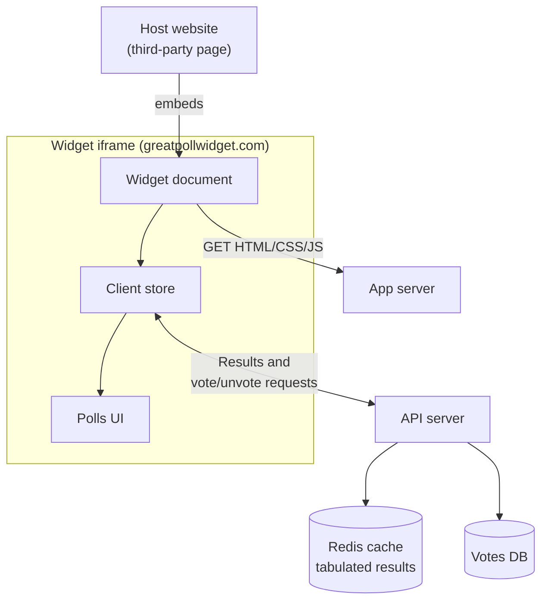
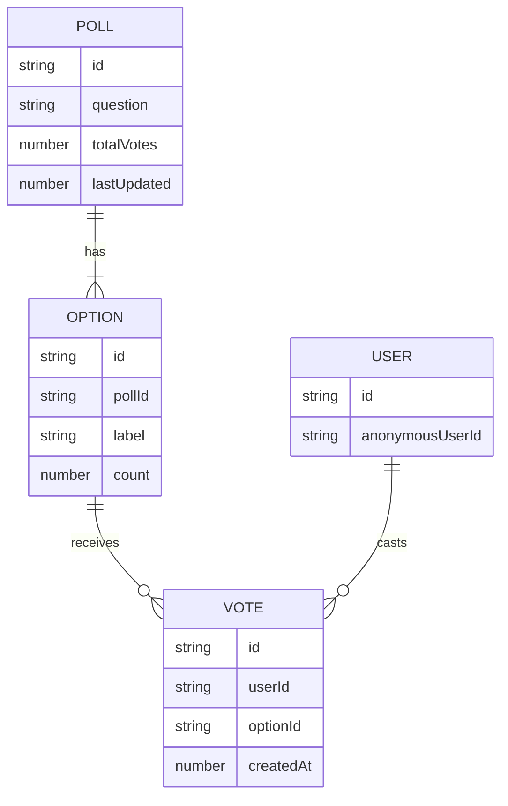
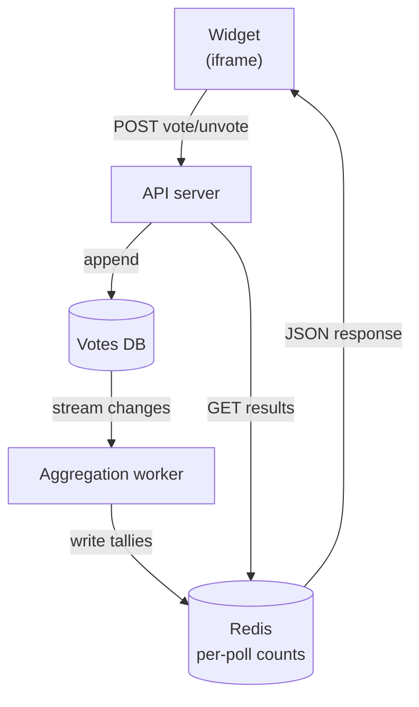
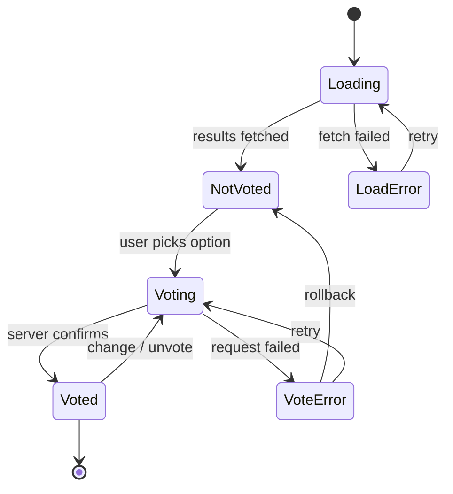
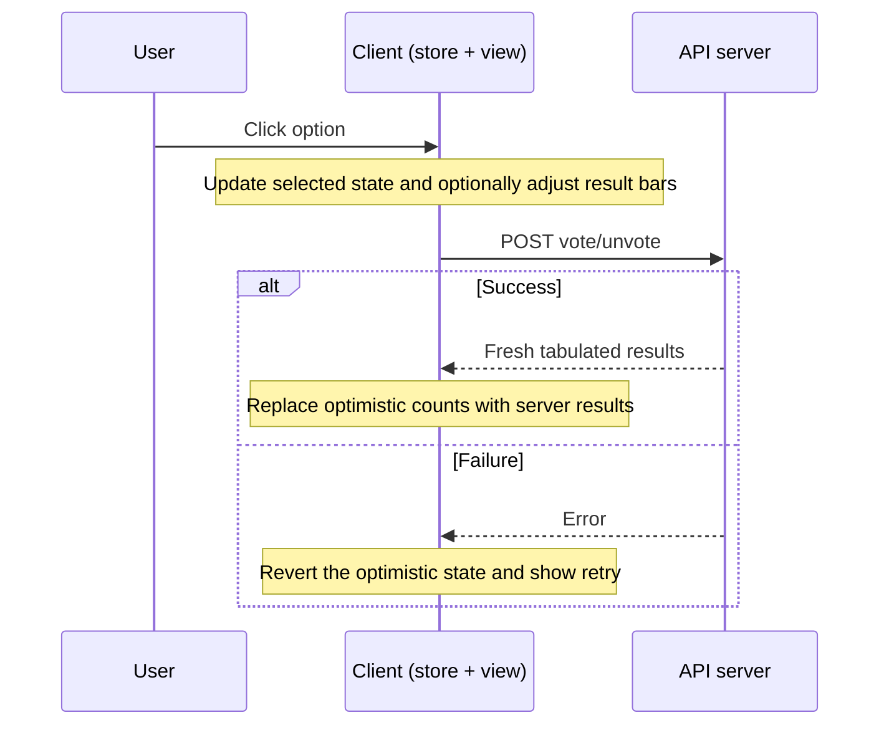
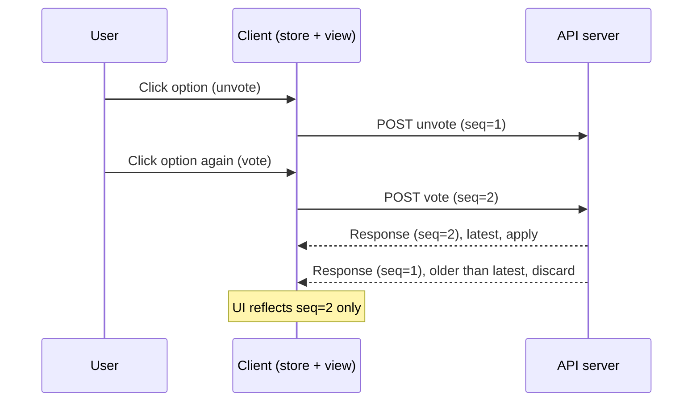

# Poll Widget

**Difficulty:** Medium · **Duration:** ~30 min · **Topics:** UI component

> Source: [poll-widget](https://www.greatfrontend.com/questions/system-design/poll-widget)

## Question

Design a poll widget that can be easily embedded on websites, such as articles and blogs, to allow website viewers to vote on options.


### Requirements

- The widget displays the following information:
  - A list of options for users to vote on.
  - The latest number of votes for each option. This is only shown after the user has submitted a vote.
- The following backend APIs are provided:
  - Fetching of the poll results.
  - Record a new vote on an existing poll option.
  - Remove a vote from an existing poll option.
- It should not require much effort for a website owner to embed a poll widget within their website.

## Solution

### Requirements exploration

These are questions you should be asking your interviewer to dive deeper into the problem and refine the requirements.

#### What are the most critical aspects of the component?

- Ease of embedding the polling widget within websites.
- User experience as a voter.

#### Does the widget show details of people (e.g. thumbnail) who voted for an option?

Whether we show that level of detail will affect the data model and APIs. We assume a basic version where we only have to show the count.

#### Can a user vote on multiple options?

Yes. Each option can be selected or unselected independently, and each change immediately submits a vote or unvote. After the first successful vote, the widget shows results while keeping the options interactive so the user can select additional choices. This interaction does not require a separate Submit button.

#### How do we determine the length/proportion of each option bar to render?

You are free to decide that.

#### In what order should the options be shown? By popularity/user has voted/random?

Popularity.

#### How are the options determined? Can users add more options?

The poll is created by the website owner in a separate admin portal, and the options are determined during poll creation and cannot be modified afterward.

#### Is there a maximum number of options shown in the widget?

The maximum number of options is 6.

#### Must users be logged in on the page in order to vote?

Anyone can vote regardless of whether they are logged in or out. Votes should be persisted for the same user.

#### Check your understanding 1

Before designing a poll widget, which requirements can change its voting, persistence, or embedding architecture? Select all that apply.

- [x] Define single- versus multi-choice voting, authentication, repeat-vote policy, option ordering, and when results become visible.
  > These rules determine the mutation contract, server enforcement, and viewer-specific state.
- [ ] Choose the result-bar palette before deciding whether votes are authenticated or anonymous.
  > Bar presentation does not determine identity, persistence, embedding, or reconciliation semantics.
- [x] Clarify first-party versus third-party embedding, isolation and host communication, traffic spikes, and update frequency.
  > Trust boundaries and load shape affect the embed shell, API access, caching, and live-result transport.
- [x] Specify optimistic feedback, offline or retry behavior, duplicate prevention, keyboard controls, and result announcements.
  > Recovery and interaction guarantees belong in the state machine and cannot be added only through visual styling.

### Architecture

The architecture depends on how the widget is delivered to third-party pages and how its components communicate with the host page and the backend.

#### Rendering approach

We should first evaluate the possible rendering approaches because they will affect the architecture and subsequent discussions.

Generally speaking, there are two approaches for rendering external widgets/components on a page:

- Render in an `<iframe>` (different browser context)
- Render directly within the page (same browser context)

Note that we're talking about how to render the widget, which is different from the distribution approach, meaning how to run the code that renders the widget.

##### Render in an `<iframe>` (different browser context)

`<iframe>` (inline frame) is an HTML tag on a page that accepts a `src` attribute, which is a URL for a website you want to embed within the host website.

Popular embeddable widgets such as Facebook's Like button, X's embedded posts, YouTube's embedded videos, and Disqus' embedded comments are `iframe`s. They are essentially websites that only render the content to be embedded.

Check out these examples to see for yourself:

**Facebook Like Button**

Facebook's [Like Button documentation](https://developers.facebook.com/docs/plugins/like-button/) demonstrates both JavaScript SDK and direct `<iframe>` embed options. The live widget is not embedded here because third-party embed behavior can change independently of this article.

**Embedded posts ([X Publish](https://publish.x.com/))**

X's supported contract uses generated markup plus the vendor script. Use the official publisher instead of depending on private iframe URLs or feature flags.

Using `iframe`s is a very common technique for embedding your content within third-party websites. In the case of a poll widget, the widget will be the only UI being rendered on the website that's defined as the `iframe`'s `src`.

**Pros**

- An `iframe` is a separate website and hence a separate [browsing context](https://developer.mozilla.org/en-US/docs/Glossary/Browsing_context). The contents of the `iframe` are isolated from the hosting site and vice versa.
  - The styling of the widget will not be affected by any CSS of the host website.
  - The widget's JavaScript environment is not affected by scripts running on the host website, which can contain polyfills or monkeypatching, affecting runtime behavior in an unpredictable manner.
- Simple to set up because adding an `<iframe>` to the page only involves changing HTML. Users do not need much technical knowledge to achieve that.

**Cons**

- Needs a web server to host a website that renders the widget. This is not a huge deal because a web server is needed to serve the poll results anyway. Depending on the type of website you build, this setup can range from simple to complex.
- It is slower to load a separate website than to render it directly into the page.
- Because of the isolation, the host website cannot use CSS to customize the component internals.

There are two common ways to get the `<iframe>` on the page, using [Facebook's Like Button developer documentation](https://developers.facebook.com/docs/plugins/like-button/) as an example:

**1. Run JavaScript code that dynamically adds an `<iframe>` into the DOM.**


**2. Directly embed the `<iframe>` code into the HTML.**


The benefit of the JavaScript approach is that the script can customize the iframe rendering (e.g. theme, size) based on the environment if necessary. The direct `<iframe>` approach is simpler but less flexible.

##### Render within the page (same browser context)

Just like how a script can dynamically inject an `<iframe>` into the DOM, it can also directly add the DOM elements needed to render the poll and the poll results.

**Pros**

- It is fast to render the poll widget within the same page.

**Cons**

- The poll widget can be affected by the host website's JavaScript environment and global styling. There's no telling what kind of global styling is present, and it is very likely for the widget's appearance to be affected by the website's CSS.

The question is how to run the third-party JavaScript on the page to achieve the above.

**1. Download the script via a CDN.**

This approach is similar to Facebook's Like Button JavaScript SDK approach: add a `<script>` tag to the page that downloads and executes some external JavaScript.

**2. Distribute the code via `npm`**

`npm` is a package manager for JavaScript projects, and the widget code can be packaged into an npm project so that projects can add it as a dependency. Website owners will need to possess the technical knowledge of how to add a new `npm` package to their `package.json`.

Distributing only via `npm` is not a great idea because not all websites are built using a JavaScript-based build system. Low-code websites like WordPress, Webflow, and Blogger do not allow for including third-party JavaScript code on the page via npm.

##### Which rendering approach is better?

For embedding widgets, the `<iframe>` approach is clearly superior due to the encapsulation of styles and environment that an `iframe` provides.

> **Default to iframe embedding for third-party widget distribution**
>
> Same-context rendering exposes the widget to unpredictable host CSS and JavaScript (polyfills, monkeypatching, global styles), and there is no practical way to guard against every host environment. Iframe isolation is what makes the widget behave the same across every site that embeds it, which is the whole point of the product.

##### Which distribution approach is better for rendering `<iframe>`s?

Embedding `<iframe>`s directly in the HTML is the easiest, and the upsides of using a `<script>`-based approach are not that significant. That said, it'd be nice to give developers the option to choose between the two approaches. Facebook and YouTube provide both JavaScript SDKs and direct `<iframe>` embed options.

The discussion below will assume an `<iframe>` embed approach.

#### Diagram

The host website embeds the widget's document in an iframe. The client store, poll UI, and API requests all run inside that iframe's browsing context.

**Iframe embed topology across host site, app server, and API server**



#### Component responsibilities

- **Host Website**: Host website that embeds the widget as an `<iframe>`.
- **App Server**: Renders the widget UI as a website by serving the HTML, CSS, and JavaScript needed.
- **API Server**: Server that returns poll result data and accepts votes/unvotes. Poll creation remains in the separate admin product.
- **Client Store**: The module that interacts with the API server and stores data for the UI.
- **Polls UI**: UI for the poll options.

_Note: The **App Server** and **API Server** have been split into separate components for clarity, but they can share one deployment. Browser behavior still depends on their exact origins._

#### Check your understanding 2

A poll widget must behave consistently on third-party pages whose global CSS and JavaScript may be unknown or modified. Which rendering boundary best isolates both the widget's styles and runtime environment?

- [ ] Render into the host DOM with prefixed class names and a widget-wide CSS reset.
  > Namespacing reduces ordinary selector collisions, but host styles and patched browser globals still share the widget's execution context.
- [ ] Render into a shadow root while running the widget code in the host page's JavaScript context.
  > A shadow root can isolate much of the CSS, but the code still shares host-modified globals and does not provide a separate browsing context.
- [x] Serve the poll inside an iframe with its own document and JavaScript environment.
  > The iframe boundary isolates the widget from host CSS and JavaScript, making its behavior predictable across unrelated sites.
- [ ] Require every publisher to remove global styles and polyfills around the widget container.
  > A publisher contract cannot reliably control arbitrary existing pages and shifts the core isolation responsibility onto every integrator.

#### Check your understanding 3

A poll service should be easy to embed on hand-written sites, low-code publishers, and applications with build systems. Some developers may also want runtime theme or sizing customization. Which distribution plan fits that audience?

- [ ] Publish only an npm package that creates the iframe.
  > An npm package serves build-based applications but excludes publishers that cannot add package dependencies.
- [ ] Require a JavaScript loader for every publisher, even when no runtime customization is needed.
  > A loader enables customization but adds code and integration work to the simplest static embed case.
- [ ] Distribute a script that renders the poll directly into each publisher's DOM.
  > Same-context rendering gives up the CSS and JavaScript isolation chosen for predictable third-party behavior.
- [x] Make a copy-paste iframe the default and offer an optional script wrapper for runtime customization.
  > Direct markup reaches the broadest set of sites with little setup, while the optional loader supports publishers that need dynamic configuration.

#### Check your understanding 4

An iframe poll is embedded on arbitrary third-party pages. Which architecture keeps host communication separate from poll data, selection state, and vote transitions?

- [ ] Let the host page own selected state and pass updated counts back to the widget through DOM attributes.
  > An untrusted or independently rendered host cannot be the authoritative poll store. The widget needs a stable data and message contract.
- [x] Keep poll data and vote transitions in a client store, with the embed shell handling isolation and validated host communication.
  > Separating domain state from the iframe boundary keeps poll behavior coherent while the shell owns concerns such as sizing and host messages.
- [ ] Share one page-level poll controller and switch its active poll ID whenever an embed receives focus.
  > Multiple widgets can be visible and submit independently, so focus cannot determine which poll owns viewer and request state.

---

### Data model

The data model for a polling widget is quite simple. Something like this will be sufficient:

```js
const state = {
  lastUpdated: 1628634891,
  // Number of respondents. In a multi-select poll, option counts can add up
  // to more than this value.
  totalVotes: 421,
  question: "Which is your favorite JavaScript library/framework?",
  options: [
    {
      id: 123,
      label: "React",
      count: 234,
      userVotedForOption: false,
    },
    {
      id: 124,
      label: "Vue",
      count: 183,
      userVotedForOption: true,
    },
    {
      id: 125,
      label: "Svelte",
      count: 51,
      userVotedForOption: true,
    },
    // ...
  ],
  // Client-only state initialized from userVotedForOption.
  selectedOptions: [124, 125],
};
```

The option flags are the last server-confirmed selection. `selectedOptions` is client-only state initialized from those flags and updated as the user interacts.

On the server side, the same data is backed by a few related entities: the poll itself, its options, the votes cast by users, and the relationship between a viewer and the options they have selected.

**Server-side poll entities and viewer-vote relationship**



#### Check your understanding 5

A poll receives concurrent result updates and may be embedded more than once on a page. Which values belong in its logical data model? Select all that apply.

- [ ] Persist the displayed rounded percentages and derive counts from them when a live update arrives.
  > Rounding loses information and percentages depend on a shared total. Store counts and derive presentation.
- [x] A stable poll ID and ordered options with stable IDs.
  > Stable identities preserve option meaning across reorder, rerender, and retries instead of relying on display position.
- [ ] Namespace poll state by the host element's CSS selector so each embed can restore its selection.
  > Selectors can change or match several instances. Poll and viewer identities must be explicit and stable.
- [x] Server-originated counts or totals plus a version or timestamp used for reconciliation.
  > Canonical counts and a version let clients replace optimistic state and reject stale live events.
- [x] The current viewer's selected option IDs.
  > Viewer state controls selected inputs and repeat-vote behavior without changing shared option entities.

---

### Interface definition (API)

There are three kinds of APIs to discuss:

- **Embed API**: How websites should embed the `<iframe>`.
- **Components API**: How to build the poll widget and the props the components accept.
- **Server APIs**: The HTTP APIs to fetch results, record new votes, and remove votes.

#### Embed API

Websites should be provided with some code to be copied and pasted to render the poll widget. The `iframe`'s `src` attribute should be a unique URL specific to a poll instance.

```html
<iframe
  src="https://greatpollwidget.com/embed/{poll_id}"
  title="Poll widget for your favorite JavaScript framework"
  style="border: 0; height: 200px; width: 100%; max-width: 450px"
></iframe>
```

Use CSS on the `iframe` element to remove its border and size it to the widget. The embedded document should use its own CSS, such as `html, body { margin: 0; }`. The `frameborder` and `scrolling` attributes are obsolete and should not be included in new embed code.

For widgets below the initial viewport, add `loading="lazy"` to the `<iframe>` so the browser can defer loading until the widget is near the viewport. Keep the default eager loading for a poll that should be available immediately when the page opens.

This fixed height can clip longer polls or translations. If dynamic sizing is needed, the iframe can be resized using `ResizeObserver` and validated `postMessage` messages; otherwise, retain scrolling as a fallback.

#### Components API

- `Poll`
  - Server URL
- `PollOptionList`
  - Question
  - Maximum number of options displayed
- `PollOptionItem`
  - ID
  - Label
  - Number of votes for an option
  - Selected state
  - Event handler: `onSelectionChange`

```jsx
// Example code in React
<Poll serverUrl="https://greatpollwidget.com/api/{poll_id}">
  <PollOptionList question={question}>
    {options.map((option) => (
      <PollOptionItem
        key={option.id}
        id={option.id}
        label={option.label}
        count={option.count}
        isSelected={selectedOptions.includes(option.id)}
        onSelectionChange={(isSelected) => {
          updateSelectedOption(option.id, isSelected);
        }}
      />
    ))}
  </PollOptionList>
</Poll>
```

`PollOptionItem` reports the checkbox's next selected state. The parent updates `selectedOptions` and calls the vote or unvote API accordingly.

#### Server APIs

The server APIs are ideally served from the same origin as the iframe so that no CORS configuration is needed, e.g. `https://greatpollwidget.com/api/{poll_id}/results` and `https://greatpollwidget.com/api/{poll_id}/submit`. If the scheme, host, or port differs, configure CORS and credentials explicitly.

##### Fetching results

What format should the API return the results in?

**1. Return the options and the counts for each**: The server returns something like:

```json
{
  "totalVotes": 421,
  "question": "Which is your favorite JavaScript library/framework?",
  "options": [
    {
      "id": 123,
      "label": "React",
      "count": 234,
      "userVotedForOption": false
    },
    {
      "id": 124,
      "label": "Vue",
      "count": 183,
      "userVotedForOption": true
    },
    {
      "id": 125,
      "label": "Svelte",
      "count": 51,
      "userVotedForOption": true
    }
  ]
}
```

- Pros
  - Client does not need to do tabulation of results, simply render the results.
  - Payload is small, contains exactly the data that needs to be displayed.
- Cons
  - Server has to do the processing, but this is likely better because the server can cache/memoize the results, especially for popular polls, and return the cached results for different users.
  - The server will need to update the tabulation every now and then. This is a good use case for in-memory key/value stores like Redis/Memcached.

The tabulation pipeline that backs this API shape typically separates the write path (incoming votes) from the read path (cached tallies) so that hot-poll reads stay fast regardless of write volume.

**Vote tally aggregation pipeline**



**2. Raw list of poll responses**: The server returns something like:

```json
{
  "question": "Which is your favorite JavaScript library/framework?",
  "options": [
    {
      "id": 123,
      "label": "React"
    },
    {
      "id": 124,
      "label": "Vue"
    },
    {
      "id": 125,
      "label": "Svelte"
    }
  ],
  "votes": [
    {
      "optionId": 123,
      "createdAt": 1628634891
    },
    {
      "optionId": 123,
      "createdAt": 1628634892
    },
    {
      "optionId": 124,
      "createdAt": 1628634893
    }
  ]
}
```

- Pros
  - Can do all the tabulation entirely on the client side, and hence sorting/filtering does not incur any network latency.
- Cons
  - Doesn't scale well when there are lots of responses; the network payload will be huge.
  - The client needs to do the tabulation of votes, which can be expensive on low-end devices and when there are many votes.
  - Individual timestamps expose behavioral data the widget does not need.
  - Different clients can derive inconsistent tallies from the same event stream.

**Which to choose?**

Directly returning the counts is usually the superior option, as there is typically no need to do tabulation or manipulation of the data on the client, which does not scale for popular polls with tens of thousands of votes. It also avoids exposing individual response timestamps.

##### Submitting votes and unvoting

The vote submission/unvoting APIs can accept a list of option IDs and an idempotency key that is reused for retries, then return the updated poll results in a similar format to the poll results fetching API.

For the immediate-selection interaction, each request contains the single option being changed. Accepting a list also allows a future interaction that collects several choices before submission, but the current UI sends each change immediately. A user can therefore make another selection while an earlier request is still pending, which is why response ordering matters.

#### Check your understanding 6

An embedded poll can grow when labels wrap or translations are longer than expected. Which parts belong in a safe dynamic-height design? Select all that apply.

- [x] Observe the embedded document's content size and send height changes to the host page.
  > The child knows when its rendered content changes, while the parent is the context that can resize the iframe element.
- [ ] Set the parent iframe's height directly from CSS inside the embedded document.
  > Child-document CSS cannot resize the iframe element owned by a separate parent browsing context.
- [x] Have the host verify the message origin, source window, and expected payload before applying a height.
  > Validation prevents unrelated frames or scripts from driving layout through forged resize messages.
- [x] Keep scrolling available when dynamic measurement or cross-window messaging does not run.
  > A fallback keeps long content reachable instead of clipping it when the enhancement is unavailable.

#### Check your understanding 7

A multi-select poll renders one reusable component per option. Where should the selected option set and vote or unvote requests be coordinated?

- [x] Each option reports its proposed selected state, while the parent updates the selected set and calls the appropriate mutation API.
  > Central ownership keeps sibling choices, optimistic state, and server mutations consistent while option components remain reusable.
- [ ] Each option directly changes the shared result counts and sends its own request without notifying the parent.
  > Independent mutations make it difficult to reconcile a multi-option selection or replace optimistic counts with one canonical response.
- [ ] Store the selected option IDs in the publisher page and pass them into the iframe through DOM attributes.
  > The host is outside the widget's isolated state boundary and should not coordinate its internal vote lifecycle.
- [ ] Treat checked CSS classes in the rendered option elements as the source of selected state.
  > DOM presentation does not provide a reliable state owner for API calls, rollback, or reconciliation after responses arrive.

#### Check your understanding 8

A poll iframe loads from `https://poll.example/embed/42` and needs to fetch results and submit votes. Which deployment most directly avoids cross-origin request configuration?

- [ ] Call an API on the publisher page's origin because that page contains the iframe.
  > Requests made by the iframe use the iframe document's origin, not the origin of the page that embeds it.
- [x] Expose the poll API from the same scheme, host, and port as the iframe document.
  > Same-origin requests avoid CORS configuration and keep the widget's document and API within one browser security boundary.
- [ ] Use any API origin and omit credentials so the browser treats the request as same-origin.
  > Removing credentials does not change origins. Cross-origin requests still require an appropriate CORS policy.
- [ ] Send every vote to the publisher page first and let its JavaScript forward the request.
  > Host forwarding adds an untrusted integration dependency when the iframe can communicate with its own API directly.

#### Check your understanding 9

A popular poll has millions of responses, but the widget only displays its question, option labels, counts, and the current viewer's selections. What should the results API return?

- [ ] Return every vote with its option ID and timestamp so each widget can calculate the totals.
  > The payload and client-side tabulation grow with response volume and expose per-response data the widget does not need.
- [ ] Return recent vote records and require each browser to merge them into its previously cached counts.
  > Different cache histories can produce inconsistent results, and a new browser still needs a complete authoritative tally.
- [x] Return compact server-tabulated counts and viewer-selection flags for the requested poll.
  > Server-side aggregation keeps response size bounded, enables shared tally caching, and gives clients one canonical result to render.
- [ ] Return only rounded percentages and ask the client to infer counts when it submits a vote.
  > Rounded percentages lose the integer state needed to merge mutations and cannot reliably reconstruct totals.

#### Check your understanding 10

Which vote API best supports retries without double-counting?

- [x] Send poll ID, selected option IDs, viewer context, and an idempotency key; return canonical updated results.
  > Stable identities let retries return the original outcome, while canonical results reconcile optimistic feedback.
- [ ] Send the option's display index and increment its count, relying on the client to suppress duplicate submissions.
  > Option order can change and a lost response can trigger a duplicate retry. The server needs stable option and request identity.
- [ ] Send the client's optimistic percentage totals and let the server normalize them to 100%.
  > Percentages do not identify one viewer's mutation and lose the integer counts needed to merge concurrent votes.

---

### Optimizations and deep dive

This section covers the details that make an embeddable poll reliable, understandable, fast, and accessible on third-party pages:

- [Persisting votes across sessions](#persisting-votes-across-sessions): This section explains how anonymous voters can be recognized across reloads and repeat visits.
- [Rendering the poll options](#rendering-the-poll-options): This section discusses ways to render result bars and option states without losing clarity or accessibility.
- [User experience](#user-experience): This section covers hidden results, vote changes, loading states, confirmation, and other poll lifecycle details.
- [Performance](#performance): This section explains how to keep an embedded widget lightweight, fast to initialize, and cheap to render.
- [Accessibility](#accessibility): This section covers text equivalents for visual results, keyboard interaction, and assistive-technology behavior.
- [Network](#network): This section discusses out-of-order vote responses, retries, and request handling for quick vote or unvote actions.
- [Internationalization (i18n)](#internationalization-i18n): This section covers localized widget strings, creator-provided content, and iframe language configuration.

#### Persisting votes across sessions

Because anyone can vote without having to log in first, we will need a way to identify users across sessions; otherwise, the user will not see that they have already voted after the browser tab is closed.

We can use a cookie containing a randomly generated anonymous user ID during the initial load if there is no existing ID cookie.

This helps the poll widget identify returning users and show the options they have already voted for. Because the widget runs in a third-party iframe, some browsers may block or partition this cookie, so anonymous continuity is best-effort. Stronger continuity requires partitioned storage or authenticated identity, and the same identifier should not be reused across publisher sites.

Note that users can work around this by using different browsers or different devices. The only way to prevent this sort of abuse is to have user authentication.

> **An anonymous cookie is not a vote-stuffing defense**
>
> An anonymous ID cookie only keeps the same browser from accidentally voting twice. It is trivial to bypass by clearing cookies or switching browsers. Treat this as UX state for returning voters, not as an integrity control; authentication, rate limiting, and server-side checks can be discussed if abuse prevention is in scope.

#### Check your understanding 11

An embedded poll allows anonymous voting and should restore server-confirmed choices for the same browser when possible, without claiming to identify a person. Which persistence design best fits?

- [x] Store a random anonymous ID in a cookie and associate that ID's confirmed option selections with the poll on the server.
  > The server can restore selections for the same available browser storage context while the random token remains only a best-effort continuity key.
- [ ] Store the selected option IDs only in local storage and treat them as the authoritative vote record after reload.
  > Local state can disappear or diverge from the server and therefore cannot establish which selections were actually counted.
- [ ] Ask the publisher page to retain the selected option IDs in a hidden field and return them whenever the iframe reloads.
  > Publisher-controlled DOM is neither durable identity nor a trustworthy source for the poll service's confirmed selection state.
- [ ] Derive a stable identity from fonts, screen properties, and network attributes, then restore votes by that fingerprint.
  > Fingerprinting is privacy-invasive and unstable, yet still does not prove that two browser contexts belong to one person.

#### Check your understanding 12

An anonymous poll runs inside third-party iframes and should remember a returning viewer’s choices when possible. How should it scope browser identifiers and handle the limits of anonymous identity? Select all that apply.

- [x] Avoid reusing the same anonymous identifier across unrelated publisher sites.
  > Publisher-scoped identity supports local continuity without creating an unnecessary cross-site tracking identifier.
- [ ] Reject all later votes as abuse whenever an anonymous ID cookie already has a selection.
  > A cookie identifies one browser storage context, not a person, and can be cleared, copied, blocked, or replaced.
- [x] Treat missing or partitioned third-party storage as an expected loss of anonymous continuity.
  > Browser privacy controls can give each embed a different storage partition or block access, so restoration is best-effort.
- [ ] Use one poll-service identifier across every publisher so returning voters are recognized everywhere.
  > Cross-publisher reuse expands tracking scope without making anonymous voting resistant to clearing storage or changing devices.
- [x] Use authenticated identity when the product must enforce a voter policy across browsers or devices.
  > Server-linked account identity provides a stronger cross-device boundary than any anonymous browser token.

#### Rendering the poll options

Poll results use bars of varying widths. The rendering options differ in styling flexibility and implementation cost.

##### What a full bar represents

A full bar can have two common representations:

1. Full width represents 100% of all responses. If an option is X% of the total, it will take up X% of the container width.

- Accurate representation of the proportion of options.
- Bad if the ratio is very even and there are many options with low %. Hard to discern because many bars will be very short.

2. The top-voted option is rendered with the full width, and other options are a proportion of it. E.g. the top-voted option is 40% of the total votes but will take up the entire container width. If another option is 20%, it will take up half the width.

- Useful for highlighting the relative difference between the options.
- Might give viewers a false impression that the top-voted option has a higher ratio than it actually does.

The first option is the more common one and is used by Reddit and X.

##### Rendering bars of dynamic widths

The number of votes for an option over the total number of votes will be the proportion of the full width to render the bar. E.g. 400 votes for an option out of a total of 1000 votes will mean that the bar should be rendered at 40% of the full width. Here, `totalVotes` means the number of respondents, so percentages in a multi-select poll can add up to more than 100%. A poll with no respondents renders empty bars without dividing by zero. Since there are infinitely many possible values for the width, it is not practical to use static CSS classes to render a bar for a specific width. A better way would be to use inline styles that are dynamically generated during rendering.

**1. Using CSS `width` inline style**: This is the most common approach, and the only small downside is that if there's a need for animating the bars expanding/contracting, animating the `width` property is slower than `transform`. However, the widget is mostly static, so the animation issue is largely not present.

```html
<div style="width: 40%">React</div>
<div style="width: 30%">Vue</div>
```

**2. Using `transform: scaleX()` style**: This method involves scaling the element horizontally.

```html
<div style="transform: scaleX(0.4); transform-origin: left">React</div>
<div style="transform: scaleX(0.3); transform-origin: left">Vue</div>
```

Note that `scaleX()` will also transform the contents within it and make them appear horizontally squished.

We should size each bar relative to the full width of the widget instead of using a hardcoded pixel value calculated when the page loads. This allows the bars to adapt when the widget is resized. With `width`, use a percentage; with `transform: scaleX()`, use a unitless scale factor between `0` and `1`.

If we are fine with some precision loss, then we could have 101 class names for percentages from 0 to 100. But in general, this is not a great approach, and inline styles are the preferred approach.

#### Check your understanding 13

A poll result says the leading option was selected by 40% of respondents. The chart should communicate absolute respondent share rather than only the gap between choices. What should a full-width bar represent?

- [ ] Treat the highest option count as full width and scale every other option relative to it.
  > Winner-relative scaling emphasizes comparison but can make a 40% choice appear to represent all respondents.
- [ ] Treat the sum of all option selections as full width, even when respondents may choose several options.
  > In a multi-select poll, option counts can exceed the respondent count and would change the meaning from share of respondents to share of selections.
- [ ] Use the widest label as the full-width reference so text and bars remain aligned.
  > Label length is a layout concern and has no relationship to the proportion represented by a result bar.
- [x] Treat 100% of respondents as full width and size each option by its count divided by respondent count.
  > This scale makes the visual length match the stated respondent percentage, including when multi-select percentages sum above 100%.

#### Check your understanding 14

A multi-select poll defines each bar as its option count divided by the respondent count. The API returns those integer values, while the UI displays rounded percentages. Which calculation and presentation rules keep results accurate? Select all that apply.

- [ ] Use independently rounded percentages as the next live update's calculation base.
  > Independent rounding may not sum to 100% and compounds error. Always derive from canonical integer counts.
- [x] Recompute each ratio from the latest integer option count and respondent total whenever canonical results change.
  > Returning to canonical integers avoids accumulating rounding error across optimistic and authoritative result updates.
- [ ] Renormalize the displayed option percentages so their rounded values always add up to exactly 100%.
  > For multi-select voting, forcing one shared 100% total changes respondent shares into shares of all selections and misstates the defined scale.
- [x] Allow independently calculated option percentages to sum above 100% when respondents may select several options.
  > Each percentage is a respondent share, and one respondent can legitimately contribute to more than one option count.
- [x] Define a zero-vote state instead of dividing by zero.
  > An explicit empty state avoids invalid percentages and explains why no bar has length.

#### Check your understanding 15

A poll iframe can be resized by its publisher, and result labels must remain readable inside options of different widths. Which rendering choices preserve responsive proportions and text? Select all that apply.

- [x] Size each bar fill with a percentage of the widget's current available width.
  > Percentage sizing preserves the result ratio as the iframe grows or shrinks without recomputing fixed pixels.
- [ ] Calculate each bar's pixel width at startup and keep it when the iframe resizes.
  > A pixel value tied to the initial viewport stops representing the same proportion after the container changes size.
- [x] If using a transform for the visual fill, keep the label outside the transformed element.
  > Scaling only the fill avoids horizontally squashing the text while retaining a unitless proportional effect.
- [ ] Apply `scaleX()` to the option container that also holds its label and percentage.
  > Transforming the whole row compresses its contents along with the bar and makes the result harder to read.

#### User experience

The widget moves through a small set of visible states over its lifetime, and the UX guidelines below are best understood against that lifecycle: when results are shown, when they are hidden, and how the user can unvote, change their vote, or recover from errors.

**Poll widget lifecycle and vote states**



- When the poll is still loading, use a stable-size skeleton in the shape of bars to hint that this is a poll and reduce layout shift. Keep it static when the user prefers reduced motion.
- Poll results should be hidden before the user has voted, to reduce bias.
- Consider having a "See responses" function for people who just want to see the results without voting.

#### Check your understanding 16

An embedded poll loads its initial data, lets an unvoted viewer respond, and may encounter either a fetch failure or a vote failure. Which UX decisions make those states clear without biasing the vote? Select all that apply.

- [x] Reserve the widget's shape with a poll-like skeleton and keep it static when reduced motion is preferred.
  > Stable geometry reduces layout shift, while respecting motion preferences avoids making loading feedback disruptive.
- [ ] Reveal cached result bars beneath the skeleton before the viewer chooses an option.
  > Early tallies can bias the response and mix unconfirmed data with a loading state.
- [x] Keep counts and result bars hidden until the viewer votes or explicitly asks to see responses.
  > Deferring results reduces popularity bias while preserving a deliberate path for viewers who do not want to vote.
- [ ] Return to the initial unselected view after any failure without explaining what happened.
  > A silent reset hides whether loading or submission failed and leaves the viewer unsure whether a vote was recorded.
- [x] Provide an explicit way to view results without casting a vote.
  > A separate action preserves the unbiased default while serving viewers who only want the current outcome.

#### Check your understanding 17

An optimistic vote request fails before the widget receives canonical results. What should the widget do?

- [x] Reconcile to the last canonical result, explain the failure, and offer a retry for the same logical vote.
  > Reverting removes unconfirmed aggregate state, while reusing the logical mutation's identity makes a retry safe if an earlier attempt was ambiguous.
- [ ] Keep the optimistic selection and count as confirmed, then retry silently with a new mutation identity on the next visit.
  > The UI would present an unconfirmed vote as counted, and a new identity could apply the same logical vote twice after an ambiguous response.
- [ ] Refetch the poll and clear the viewer's selection without explaining why it changed.
  > Canonical data may recover, but silent reset loses failure context and gives no safe path to retry the intended vote.
- [ ] Leave the control disabled in its pending state until the original request eventually returns a response.
  > A failed request may never complete, so an unbounded pending state strands the interaction without truthful recovery.

#### Performance

The widget loads alongside third-party page resources, so keep its bundle small and minimize initialization time.

##### Fast rendering

As mentioned earlier, to achieve fast rendering of the results, the server API should return the tabulated results, not raw results, so that the client does not need to do any tabulation of results.

Prefer server rendering for the initial iframe document, but preserve the product rule: an unvoted viewer receives the question, options, and stable pending shell without visible tallies.

> **Server-render the unvoted shell, not private results**
>
> Canonical tallies can be cached independently, then overlaid with the private viewer selection and visibility decision before rendering.

##### Fast interactions via optimistic updates

Optimistic updating is a technique where the browser shows the new UI state after a server request is fired, even before a response is received from the server. The selection can update immediately, but result visibility must still follow the requirement that a user votes before seeing the tallies.

For a first vote, show the selected option and a pending indicator while keeping results hidden until the server confirms success. If the request fails, undo that pending selection and show an error with a retry action. This avoids briefly revealing results and then removing them when the first vote fails.

Once the user has successfully voted and results are visible, later selections can optionally update the displayed counts and bar ratios optimistically. Reconcile those estimates with the server response, or roll back a failed change, while preserving any newer selections.

However, there are a few caveats:

- The selected state should update immediately for every poll. Optimistically changing already-visible aggregate bars is a separate optional enhancement and is most useful when one response creates a visible difference.
- Client-side counts can be stale on a popular poll because other people may vote before the server responds.

In most cases, the client can render the optimistic state first and then render again with the latest results from the server.

**Cast-vote flow with optimistic update and reconciliation**



> **Separate interaction feedback from aggregate-bar updates**
>
> Immediate selected-state feedback matters even when one vote cannot visibly move a result bar. Speculative bar changes are optional, and the server response remains authoritative.

##### Scalability issues

Given that there are only a maximum of 6 options, we will not run into the issue of rendering too many options or creating a large DOM. A future product with many choices would need a different interaction, such as search, grouping, or pagination.

#### Check your understanding 18

A popular poll's aggregate tallies are identical for many viewers, but whether results are visible and which options the viewer selected are private to that request. Which caching boundary preserves both fast reads and correct viewer state?

- [x] Cache the public per-poll tallies, then combine them with the viewer's confirmed selections and visibility decision before producing the response.
  > Shared aggregate work stays reusable while viewer-specific state is applied at the request boundary and never enters the public cache key by accident.
- [ ] Cache the first fully rendered response for the poll, including that viewer's selected options, and serve it to later viewers.
  > A whole-response cache mixes one viewer's selection and visibility state into responses for unrelated viewers.
- [ ] Cache result-bearing markup for all viewers and use client-side CSS to hide its tallies when the viewer has not voted.
  > The private result remains present in the response, so a styling rule does not enforce the pre-vote visibility boundary.
- [ ] Disable caching for every poll response because the selected-option state makes all aggregate data viewer-specific.
  > Viewer state requires private composition, but the underlying public tallies can still be cached independently and reused.

#### Accessibility

A poll is highly visual, so accessibility work centers on providing text equivalents for assistive technology and making the interactive elements keyboard operable.

##### Screen readers

Polling widgets are inherently very visual UI elements, and we need to take special care to ensure users relying on screen readers can still understand what is being shown on the screen.

- Put the question in a `<legend>` and render each multi-select option as a labeled native checkbox. Keep counts and percentages as visible text, using `aria-describedby` only for additional explanation.
- Use a separate polite status region for pending, submitted, and failed states rather than announcing every tally change.

> **Match ARIA roles to the poll's selection model**
>
> Use `radiogroup`/`radio` only for single-select polls. Multi-select polls (like the one assumed in this design) should use checkbox semantics instead, because radio groups imply mutually exclusive selection and will confuse screen reader users when more than one option can be chosen.

##### Keyboard interaction

- Native checkboxes provide Space-key behavior, focus, state, and disabled semantics without recreating them on a `div`.

#### Check your understanding 19

A poll supports single- and multi-choice modes and updates result bars after submission. Which behaviors make the complete flow operable and understandable? Select all that apply.

- [x] Group related radio buttons or checkboxes with a clear poll question.
  > The group name gives each choice context and distinguishes separate polls on the same page.
- [ ] Use clickable divs with `tabindex="0"` and handle Enter, but keep selected state only in CSS.
  > Focus and one key handler do not provide radio or checkbox role, state, grouping, or expected Space behavior.
- [x] Use native inputs with programmatic labels and visible focus.
  > Radio and checkbox semantics provide the correct selection model, keyboard behavior, focus, and programmatic state.
- [ ] Add accessible option labels but expose each result percentage only through its visual bar width.
  > Labels identify choices, not their results. Counts or percentages also need textual or programmatic values.
- [x] Announce the submitted or failed state without repeatedly interrupting for every count change.
  > A concise submission outcome is useful, while announcing every concurrent count would repeatedly interrupt the user.

#### Network

- Request responses could be out of order if someone votes/unvotes in quick succession.
  - Keep track of the latest response and ignore older responses when rendering.
- Show errors in the UI if the API submission fails.

> **Out-of-order vote and unvote responses can corrupt the displayed tally**
>
> If a user toggles the same option quickly, an older response can arrive after the newer response and revert the UI. Tag each in-flight request with a monotonically increasing sequence number (or track the latest request ID per option) and ignore any response that is not the newest.

The sequence below illustrates how a monotonically increasing request ID lets the client ignore a stale unvote response that arrives after a newer vote response.

**Ignoring stale UI responses during rapid vote and unvote toggling**



The idempotency key from the vote API lets the server deduplicate transport retries of one logical mutation. If the interviewer asks about ordering distinct vote and unvote mutations on the server, discuss versioning or mutation sequencing as a separate follow-up.

#### Check your understanding 20

A viewer quickly unvotes and then votes for the same option. The first response arrives last, and one request is retried after a timeout. Which client behaviors prevent double counting and stop the older response from replacing the newer UI state? Select all that apply.

- [x] Reuse the same idempotency key when retrying one logical vote.
  > The server can return the original outcome instead of applying the same logical vote again.
- [ ] Apply each response as it arrives because the requests were sent in user-action order.
  > Independent requests can complete out of order, so arrival order can restore the older unvoted state over the newer vote.
- [x] Tag requests per option and apply a response only if it belongs to the latest request for that option.
  > A monotonically increasing request sequence lets the client discard the stale unvote response without guessing from timing.
- [ ] Keep one pending vote record but increment the visible result again whenever its request is retried.
  > Transport attempts are not new user intent. Optimistic state must be keyed to the logical mutation, not retry count.
- [x] For the latest successful request, replace optimistic counts and selections with the server's canonical results.
  > Once request sequencing establishes that the response is current, canonical results reconcile the client's speculative state.

#### Internationalization (i18n)

If there's a need for i18n of strings in the poll, especially the strings not from the poll creator (e.g. `aria-label`s), the `iframe` embed URL can accept a query parameter for the language, and it'll be up to the website owner to provide the right language.

#### Check your understanding 21

An iframe poll is embedded by publishers serving different languages. The poll question and option labels come from the poll creator, while the widget owns controls and accessible labels. Which localization responsibilities belong to the embed contract? Select all that apply.

- [x] Let the publisher specify the widget language through the iframe URL.
  > The host knows the page language, and an explicit parameter gives the isolated iframe the locale it should load.
- [ ] Read the publisher page's `lang` attribute directly from inside the iframe and use it as the only locale signal.
  > Cross-origin isolation prevents direct DOM access, and automatic inference would make the embed contract unreliable.
- [x] Translate widget-owned text such as buttons, status messages, and `aria-label`s for the requested locale.
  > The widget controls these strings, so it must provide the localized interaction and accessibility language.
- [ ] Automatically translate the creator's poll question and option labels inside the widget.
  > Creator-provided content is separate from widget-owned strings. Translating it requires an explicit product workflow rather than being implied by the embed locale.

---

### Summary

**The defining constraint is that the widget runs inside arbitrary third-party pages.** The publisher's CSS, JavaScript, and analytics are outside the widget's control, so the first design decision is isolation. That is why the default distribution format is an `<iframe>` served from a poll-specific URL rather than a script that injects markup into the host DOM.

**The `<iframe>` embed separates delivery from data.** The **App Server** owns the iframe document and can server-render the unvoted question and options, while the **API Server** handles tabulated counts and vote/unvote mutations behind a Redis cache of per-poll totals. The two read and write paths can then scale independently, and the component surface (a `Poll` containing a `PollOptionList` of `PollOptionItem` children with an `onSelectionChange` callback) remains coherent whether a publisher chooses the iframe or scripted distribution path.

**Isolation keeps the client model and vote API flat.** Since the iframe owns its own runtime, the client can keep `question`, `totalVotes`, options carrying `count` and `userVotedForOption`, and a client-only `selectedOptions` array derived from those flags. Server-side, that maps to `POLL`, `OPTION`, and `VOTE` entities keyed by a `USER` identified through a random anonymous user ID cookie. Returning pre-tabulated counts rather than raw vote lists keeps popular polls cheap to read, and returning updated results from vote/unvote requests gives the client authoritative values to reconcile against.

**Keep vote reconciliation and accessibility inside the frame.** Optimistic selected-state feedback makes a vote feel instantaneous, while the result bars reconcile to the server response. A monotonically increasing request ID prevents stale responses from clobbering newer UI. Because nothing outside the iframe can be relied on, the widget implements accessibility with a fieldset, legend, native checkboxes, visible result text, and a polite status region. Start with iframe isolation, then explain state reconciliation and accessibility within that boundary.

---

### References

References cover production embed examples, iframe and cross-origin messaging, security, and related system design articles.

#### Production embed examples

This subsection collects real third-party embed products whose iframe and script patterns inform the poll widget's embedding model.

- [Facebook like button](https://developers.facebook.com/docs/plugins/like-button/) for a mature script-plus-iframe embed that hosts interactive state across origins.
- [X Publish](https://publish.x.com/) for the supported generator for embedded posts.
- [Disqus universal embed code](https://help.disqus.com/en/articles/1717112-universal-embed-code) for a widely deployed comments embed, useful as a model for configuration and theming of the poll widget.

#### Iframe embedding and cross-origin messaging

This subsection covers the browser mechanics behind embedding the widget into third-party sites and communicating with the host page.

- [iframe | MDN](https://developer.mozilla.org/en-US/docs/Web/HTML/Element/iframe) for the element that isolates the widget from the host page's DOM and scripts.
- [Window.postMessage() | MDN](https://developer.mozilla.org/en-US/docs/Web/API/Window/postMessage) for the cross-origin messaging primitive used to coordinate height, theme, and events between the widget and its host.

#### Security considerations for embeds

This subsection covers the web platform features that keep third-party embeds safe for both the host page and the widget origin.

- [Content security policy (CSP) | MDN](https://developer.mozilla.org/en-US/docs/Web/HTTP/CSP) for controlling which origins can embed the widget and which resources it may load.
- [Cross-origin resource sharing (CORS) | MDN](https://developer.mozilla.org/en-US/docs/Web/HTTP/CORS) for the rules that govern API calls made from the embedded widget back to its backend.
- [SameSite cookies | MDN](https://developer.mozilla.org/en-US/docs/Web/HTTP/Headers/Set-Cookie/SameSite) for how cookie scoping affects user identification and vote-dedup for an embedded widget.

#### Related system design articles

The articles below overlap with the poll widget on social interactions and third-party embedding.

- [News feed (Facebook)](https://www.greatfrontend.com/questions/system-design/news-feed-facebook) for the surrounding social surface where embeddable widgets like polls are often consumed and rendered at scale.

## Asked at these companies

- Figma
- Reddit
