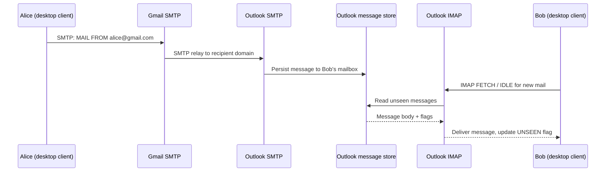
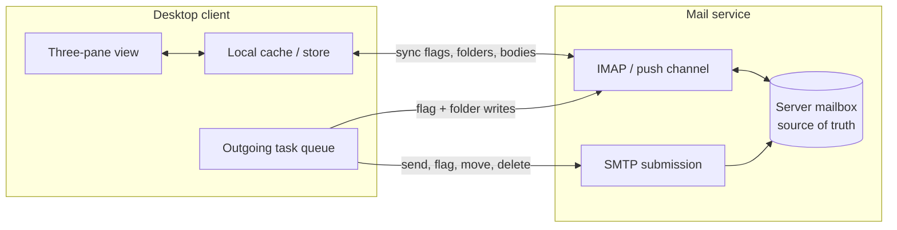
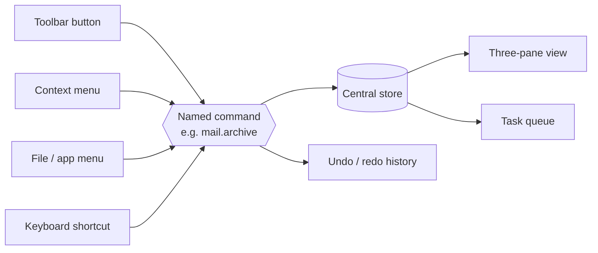
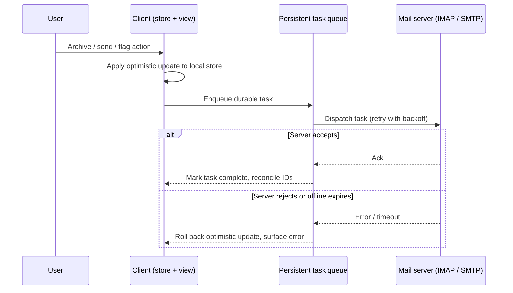
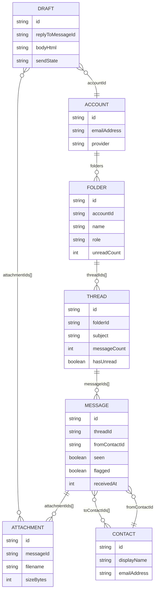
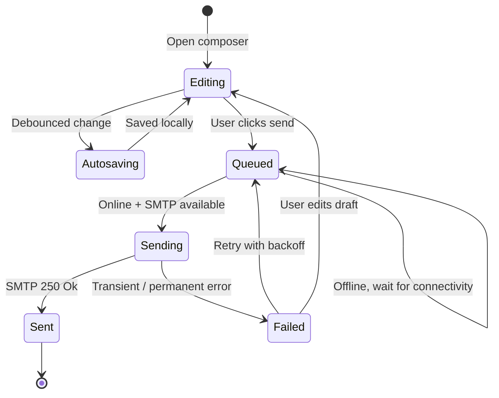

# Email Client (e.g. Microsoft Outlook)

**Difficulty:** Medium · **Duration:** ~30 min · **Topics:** Networking

> Source: [email-client-outlook](https://www.greatfrontend.com/questions/system-design/email-client-outlook)

## Question

Design a **desktop** email client that can send and receive email messages given an email provider service.


It's important to distinguish between **webmail** and email client apps. Websites like gmail.com, outlook.com, and Yahoo Mail, which allow you to use the browser to access email, are called webmail. Email clients are desktop apps that have to be installed on your computer and can usually be used even when offline. They usually allow access to multiple email services like Gmail, Outlook, iCloud, etc., and let you view messages from different services within the app.

### Real-life examples

- Outlook for [Windows](https://apps.microsoft.com/store/detail/outlook-for-windows/9NRX63209R7B)/[macOS](https://apps.apple.com/sg/app/microsoft-outlook/id985367838)
- [Apple Mail](https://support.apple.com/en-sg/guide/mail/welcome/mac)
- [Airmail](https://airmailapp.com/)
- [Mailspring](https://getmailspring.com/)

## Solution

### Note: Work in Progress!

The solution is still being worked on, but we'd like to share the drafts so that interested users can still benefit from them in the meanwhile and provide feedback.

### Requirements exploration

Scope the email client by clarifying what the client must do, which platforms it targets, which accounts it connects to, and how it behaves offline.

#### What are the core functionalities needed?

- Sending email messages to an SMTP server.
- Retrieving email messages from an IMAP server.
- Accessing email messages already on the device.

#### What operating systems does the app need to support?

The popular ones: Windows, macOS, and Linux/Ubuntu.

#### What email services/accounts need to be supported?

We don't have to focus on that aspect for this question. Assume that the user can make authenticated requests to preconfigured SMTP/IMAP servers to send/retrieve emails successfully.

Many native desktop email clients like Apple Mail, Outlook, and Mailspring allow users to connect to multiple email services like iCloud Mail, Gmail, and Exchange to show emails from multiple services within the app. However, that is beyond the scope of this question.

#### Does the application need to work offline?

Yes, where possible. Outgoing email messages should be saved and sent out when the application comes back online. Users should still be allowed to browse and search for emails on the device even when they are offline.

#### Should emails between the same sender and topic be threaded?

Threading of message conversations would be good but is not required.

#### Check your understanding 1

A team is defining the first version of a desktop email client. Which requirements belong in it? Select all that apply.

- [x] Let users browse and search synchronized mail offline, and preserve outgoing messages until connectivity returns.
  > Cached reads and durable outgoing work are explicit baseline requirements rather than optional enhancements.
- [x] Support the major desktop operating systems through a shared product design.
  > The runtime choice affects platform integration and storage adapters without changing the core mail behavior.
- [ ] Require several providers to merge into one isolated multi-account inbox.
  > Multiple-account integration can change authentication and isolation, but it is outside the stated first version.
- [ ] Require every message to be grouped into a conversation before it can be read.
  > Threading would be useful, but it is optional and should not define the baseline architecture.
- [x] Send mail through a configured provider, retrieve new mail, and read messages already stored on the device.
  > These are the central read and write journeys that the client architecture must connect.

#### Check your understanding 2

A desktop email client loses connectivity after the user has downloaded some mail and composed a new outgoing message. Which offline behaviors preserve the product's read and write workflows? Select all that apply.

- [x] Save the outgoing message and its pending send task durably until connectivity returns.
  > Durable pending work preserves the user's send intent across an offline period or application restart.
- [ ] Block both reading and composing until the client can contact the mail server again.
  > The stated offline contract supports cached reads and durable outgoing work, so loss of connectivity should not disable the entire client.
- [x] Allow browsing and searching messages already stored on the device.
  > A local cache keeps previously synchronized mail useful even though the server cannot currently be reached.
- [ ] Treat the device cache as the new canonical mailbox and overwrite server state from it after reconnecting.
  > The server must remain authoritative across devices. Cached state is an offline mirror that needs reconciliation rather than unconditional promotion.

---

### Background knowledge

Email client applications are quite different from traditional web applications due to the fact that server requests are made using non-HTTP protocols like SMTP and IMAP. It is unlikely that interviewers will require candidates to be familiar with how the common email protocols work, so you can assume you are working with HTTP-based APIs for sending and retrieving emails.

Nevertheless, we'll cover some fundamental email system concepts for the sake of learning.

#### Parts of email systems

- **Mail User Agent (MUA)**: An application where users can compose, send, receive, and read email messages. Other non-core functionalities include searching, flagging, address books, etc. These can be desktop applications with graphical user interfaces (Outlook, Apple Mail), or command line programs.
- **Mail Transfer Agent (MTA)**: Software that transfers email messages from one host to another using the SMTP protocol. MTAs can exist on both users' devices and mail servers.
- **Mail Servers**: Computers that host the MTAs and store the email messages in a mailbox.
- **Mailbox**: A mailbox is a conceptual entity that does not necessarily pertain to storage and is identified by an email address. It contains email messages and typically exists on mail servers.

#### Mail transport protocols

If you have set up email clients before, you might have come across the terms SMTP, POP, and IMAP. SMTP is an outgoing email protocol used to send messages, while POP and IMAP are incoming email protocols that email servers support to allow clients to retrieve messages.

The benefit of having standardized protocols for sending and retrieving messages is that email services can send messages to each other and email clients can connect to any email service.

##### Simple Mail Transport Protocol (SMTP)

[Simple Mail Transport Protocol](https://en.wikipedia.org/wiki/Simple_Mail_Transfer_Protocol) is a protocol for sending email messages over the internet used by mail servers, MTAs, and MUAs (non-webmail).

SMTP uses a simple set of commands to transfer messages, including commands to authenticate the sender, specify the recipient(s), and send the message.

Nylas discussed SMTP relays in detail in their blog post ["SMTP vs. Web API: The Best Methods for Sending Email"](https://www.nylas.com/blog/smtp-vs.-web-api-the-best-methods-for-sending-email/). Here's an [example SMTP conversation](https://en.wikipedia.org/wiki/Simple_Mail_Transfer_Protocol#SMTP_transport_example) with an SMTP server over the command line. Lines starting with `S:` are sent from the server, and lines starting with `C:` are written by the user.

```sh
$ openssl s_client -connect smtp.example.com:465 -crlf

S: 220 smtp.example.com ESMTP Postfix
C: HELO relay.example.org
S: 250 Hello relay.example.org, I am glad to meet you
C: AUTH LOGIN
S: 334 VXNlcm5hbWU6
C: dXNlcm5hbWUuY29t # Username encoded in Base64
S: 334 UGFzc3dvcmQ6
C: bXlwYXNzd29yZA== # Password encoded in Base64
S: 235 Authentication succeeded
C: MAIL FROM:<bob@example.org>
S: 250 Ok
C: RCPT TO:<alice@example.com>
S: 250 Ok
C: RCPT TO:<theboss@example.com>
S: 250 Ok
C: DATA
S: 354 End data with <CR><LF>.<CR><LF>
C: From: "Bob Example" <bob@example.org>
C: To: "Alice Example" <alice@example.com>
C: Cc: theboss@example.com
C: Date: Tue, 15 Jan 2008 16:02:43 -0500
C: Subject: Test message
C:
C: Hello Alice.
C: This is a test message with 5 header fields and 4 lines in the message body.
C: Your friend,
C: Bob
C: .
S: 250 Ok: queued as 12345
C: QUIT
S: 221 Bye
{The server closes the connection}
```

The specification for SMTP can be found in [RFC5321](https://www.rfc-editor.org/rfc/rfc5321).

##### Post Office Protocol (POP)

[Post Office Protocol](https://en.wikipedia.org/wiki/Post_Office_Protocol) is a traditional standard protocol for accessing email messages on a mail server. Messages are kept on the server only until the first device accesses and downloads them. As the name suggests, once an email is downloaded, it is usually deleted from the server, just like how post offices act as temporary storage for physical mail before they get delivered to recipients.

POP3 is the most recent widely-used version of POP, but it is older than newer protocols like IMAP and has fewer features. POP is generally considered less desirable than IMAP as it is less flexible and does not allow for server-side searching or message flagging.

The specification for POP3 can be found in [RFC1939](https://www.rfc-editor.org/rfc/rfc1939).

##### Internet Message Access Protocol (IMAP)

[Internet Message Access Protocol](https://en.wikipedia.org/wiki/Internet_Message_Access_Protocol) is a standard protocol for accessing email messages on a mail server, with the latest version being IMAP4. IMAP allows users to retrieve and manage their email messages within webmail and email clients without having to download them to the local computer. IMAP also allows users to access their email from multiple devices and locations, and provides features such as server-side searching and message flagging.

IMAP addresses many of the shortcomings of POP, at the cost of server storage. Nylas published a [deep dive into IMAP](https://www.nylas.com/blog/nylas-imap-therefore-i-am/) on their engineering blog which we highly recommend checking out.

The specification for IMAP4 can be found in [RFC3501](https://www.rfc-editor.org/rfc/rfc3501).

##### POP vs IMAP

Here's a table comparing the POP (POP3) and IMAP (IMAP4) protocols.

| Feature                                                                                            | POP3           | IMAP             |
| -------------------------------------------------------------------------------------------------- | -------------- | ---------------- |
| Source of truth                                                                                    | Client(s)      | Server           |
| No. of simultaneous clients                                                                        | One            | Multiple         |
| No. of mailboxes                                                                                   | One            | Multiple         |
| Message downloading                                                                                | Entire message | Individual parts |
| Message [flagging](https://www.rfc-editor.org/rfc/rfc3501#section-2.3.2) (seen, answered, deleted) | No             | Yes              |
| Deleted from server after downloading                                                              | Yes by default | No               |
| Server-side search                                                                                 | No             | Yes              |
| Server storage usage                                                                               | Low            | High             |

_Reference: [IMAP vs. POP3: What's the Difference? Which One Should You Use?](https://www.makeuseof.com/tag/pop-vs-imap/)_

Today, users expect to access emails on multiple devices and view a consistent mailbox state across different client devices, so POP's model is outdated. The main advantage of POP is that less server storage space is needed, but that is usually not a concern these days since storage is relatively cheap.

IMAP is the prevalent email protocol in the current age, but many email clients still support retrieving emails from both IMAP and POP servers.

> **Default to IMAP as the canonical retrieval protocol in your design**
>
> Modern users expect a consistent mailbox across phone, desktop, and webmail, which requires server-side state, flags, and multi-client access that POP3 does not offer. Treat POP3 support as an optional fallback for legacy accounts, not as the shape that drives the client architecture.

#### Email server configurations

Popular email services have the following configurations.

| Service                                                                                                                               | SMTP                    | IMAP                               | POP                                |
| ------------------------------------------------------------------------------------------------------------------------------------- | ----------------------- | ---------------------------------- | ---------------------------------- |
| [Gmail](https://support.google.com/mail/answer/7126229)                                                                               | `smtp.gmail.com`        | `imap.gmail.com`                   | `pop.gmail.com`                    |
| [Outlook](https://support.microsoft.com/en-us/office/pop-imap-and-smtp-settings-for-outlook-com-d088b986-291d-42b8-9564-9c414e2aa040) | `smtp-mail.outlook.com` | `outlook.office365.com` (port 993) | `outlook.office365.com` (port 995) |
| [iCloud](https://support.apple.com/en-us/HT202304)                                                                                    | `smtp.mail.me.com`      | `imap.mail.me.com`                 | Unsupported                        |

#### Email flow

Let's assume the following users with the respective roles, services, and types of clients:

| User  | Role     | Service | Client type |
| ----- | -------- | ------- | ----------- |
| Alice | Sender   | Gmail   | Desktop app |
| Bob   | Receiver | Outlook | Desktop app |
| Carol | Sender   | Gmail   | Webmail     |
| David | Receiver | Outlook | Webmail     |

We'll go through the flows detailing how messages are sent between the various types of clients.


How email messages travel from senders to recipients

**Important notes**:

- Mail services can be running SMTP servers and IMAP/POP servers on the same machine or on different machines. The decision is not important for our discussion as long as the servers for a mail service have access to the same email message database.
- The arrow directions indicate the flow of the email message, not the origin of the request. IMAP/POP requests are initiated by clients, not pushed from the mail servers.
- Gmail's IMAP servers are not shown because in the above scenario, Gmail is only used for sending and not receiving.
- The DNS lookup stage for the MX (Mail Exchange) record is omitted for simplicity. SMTP servers use the domain name of the recipient's email address to look up DNS records for that domain (MX records in particular) to determine the address of the mail server.
- MTA is a fairly general term, but they all use SMTP to send messages. SMTP servers are MTAs.

##### Email client -> Email client

1. Alice ([alice@gmail.com](mailto:alice@gmail.com)) wants to send an email to Bob ([bob@outlook.com](mailto:bob@outlook.com)).
2. Alice's email client desktop app sends the message to the MTA, software running on her computer.
3. Alice's computer's MTA sends the message to Gmail's SMTP server (`smtp.gmail.com`) over SMTP.
4. Gmail's SMTP servers send the message to Outlook's SMTP servers (`smtp-mail.outlook.com`) over SMTP, and the message is saved into Outlook's database.
5. Bob's email desktop client makes IMAP requests to Outlook's IMAP servers (`outlook.office365.com:993`).
6. Outlook's IMAP servers retrieve the message from the database and send it back to Bob's desktop client over IMAP.
7. Bob's email desktop client displays the new email message from Alice.

**Email delivery from sender client to receiver client**



##### Email client -> Webmail

1. Alice ([alice@gmail.com](mailto:alice@gmail.com)) wants to send an email to David ([david@outlook.com](mailto:david@outlook.com)).
2. Alice's email client desktop app sends the message to the MTA, software running on her computer.
3. Alice's computer's MTA sends the message to Gmail's SMTP server (`smtp.gmail.com`) over SMTP.
4. Gmail's SMTP servers send the message to Outlook's SMTP servers (`smtp-mail.outlook.com`) over SMTP, and the message is saved into Outlook's database.
5. David accesses Outlook webmail by visiting `https://outlook.live.com` in his browser.
6. The servers hosting `outlook.live.com` make IMAP requests to Outlook's IMAP servers (`outlook.office365.com:993`).
7. Outlook's IMAP servers retrieve the message from the database and send it back to `outlook.live.com`.
8. The servers hosting `outlook.live.com` send the response to David's browser over HTTP.
9. David's browser displays the new email message from Alice.

##### Webmail -> Email client

1. Carol ([carol@gmail.com](mailto:carol@gmail.com)) wants to send an email to Bob ([bob@outlook.com](mailto:bob@outlook.com)).
2. Carol accesses Gmail webmail by visiting `https://www.gmail.com` in her browser.
3. Carol sends out an email message from Gmail webmail, which makes an HTTP request to `gmail.com` servers.
4. `gmail.com` servers use their MTA software to send the message to Gmail's SMTP server (`smtp.gmail.com`) over SMTP.
5. Gmail's SMTP servers send the message to Outlook's SMTP servers (`smtp-mail.outlook.com`) over SMTP, and the message is saved into Outlook's database.
6. Bob's email desktop client makes IMAP requests to Outlook's IMAP servers (`outlook.office365.com:993`).
7. Outlook's IMAP servers retrieve the message from the database and send it back to Bob's desktop client over IMAP.
8. Bob's email desktop client displays the new email message from Carol.

##### Webmail -> Webmail

1. Carol ([carol@gmail.com](mailto:carol@gmail.com)) wants to send an email to David ([david@outlook.com](mailto:david@outlook.com)).
2. Carol accesses Gmail webmail by visiting `https://www.gmail.com` in her browser.
3. Carol sends out an email message from Gmail webmail, which makes an HTTP request to `gmail.com` servers.
4. `gmail.com` servers use their MTA software to send the message to Gmail's SMTP server (`smtp.gmail.com`) over SMTP.
5. Gmail's SMTP servers send the message to Outlook's SMTP servers (`smtp-mail.outlook.com`) over SMTP, and the message is saved into Outlook's database.
6. David accesses Outlook webmail by visiting `https://outlook.live.com` in his browser.
7. The servers hosting `outlook.live.com` make IMAP requests to Outlook's IMAP servers (`outlook.office365.com:993`).
8. Outlook's IMAP servers retrieve the message from the database and send it back to `outlook.live.com` over IMAP.
9. The servers hosting `outlook.live.com` send the response to David's browser over HTTP.
10. David's browser displays the new email message from Carol.

#### Types of email systems

Email systems can be broadly categorized into the following types:

##### Store and forward servers

Store and forward email servers usually run on POP, where messages are kept on the server only until a user first accesses and downloads them. It is a simple and straightforward design.

**Advantages**

- Messages do not remain on the server for long (until a client accesses them), and the server doesn't need to do much processing on them.
- Client devices usually store the downloaded messages, so users can still access old messages even when there is no internet connection or when the mail server is unavailable due to outages.
- The server does not require much storage space as messages are deleted after downloading.

**Disadvantages**

- Since messages are stored locally, if the server is accessed from multiple client devices, there's no consistent view of all the messages.
- Users are responsible for backing up and restoring their messages. Without any backup, messages will be lost forever if devices are damaged or stolen.
- Functionality such as searching/sorting of messages has to be done locally on the device, which can be computationally intensive for mailboxes containing a large number of messages. In the case of messages being stored across multiple devices, searching is limited to the messages on the current device, which can be inconvenient.

##### Server-only mailboxes

In such a system, servers act as the source of truth for the messages, and even after clients download the messages, the server retains them. Clients do not cache or persist the messages after downloading them. Such servers can run on IMAP, and webmail is a common example of this model.

**Advantages**

- All devices have a consistent view of the mailboxes.
- Backups can be done by the email service providers without users going through any hassle.
- Functionality that can be computationally intensive or difficult for clients to perform can be done on the server. Less powerful devices like mobile phones will benefit from this.

**Disadvantages**

- Requires an internet connection to view the messages.
- Sufficient server storage space is required as it is the source of truth for messages.

##### Server mailbox with client-side cache

A hybrid model combines the best characteristics of both the store and forward servers and the server-only mailbox by having a permanent server mailbox while clients cache/persist the downloaded messages. Most desktop email clients operate using this model, which is the most complex of the three.

> **Desktop clients should use the server-with-client-cache hybrid by default**
>
> This is the model Outlook, Apple Mail, and Mailspring actually ship. The server stays the source of truth for cross-device consistency and backups, while the local cache unlocks offline browsing, search, and snappy UI at the cost of real synchronization logic the client must own end-to-end.

**Server mailbox with client-side cache hybrid model**



**Advantages**

- Most advantages of the store and forward model:
  - Can access messages even when offline or when the email server is unavailable.
- Advantages of server-only mailboxes:
  - All devices have a consistent view of the mailboxes.
  - Backup done by email service providers.
  - Leverage server-side features like searching.

**Disadvantages**

- Complex synchronization logic between client and server.
- Sufficient server storage space is required, as the server is still the source of truth for messages.

_Reference: [NinjaMail: the Design of a High-Performance Clustered, Distributed E-mail System](https://people.eecs.berkeley.edu/~kubitron/papers/ninja/pdf/ninjamail-workshop.pdf)_

#### Check your understanding 3

Users expect read flags, folders, and searches to stay consistent across desktop, phone, and webmail. Which retrieval model should drive the client architecture?

- [ ] Use POP as the canonical model because downloading and deleting messages from the server minimizes storage.
  > POP's client-owned copies reduce server storage but cannot provide one consistent mailbox state across several devices.
- [x] Use IMAP with the server mailbox as the source of truth and treat POP support as an optional legacy path.
  > IMAP retains server-side messages and state for multiple clients, including flags, folders, and server-side search.
- [ ] Use SMTP for both sending and retrieving so every client participates in the same transport protocol.
  > SMTP submits and relays outgoing mail. It does not provide the mailbox retrieval and management semantics required here.

#### Check your understanding 4

A desktop sender emails a recipient who reads through both a desktop client and webmail. Which statements correctly place the protocol boundaries? Select all that apply.

- [x] The desktop client submits the message through SMTP, and mail servers use SMTP to relay it to the recipient's provider.
  > SMTP carries outgoing mail from the sender side and between provider mail servers until the recipient mailbox accepts it.
- [ ] The sender's desktop client uses IMAP to place the outgoing message directly into the recipient's mailbox.
  > IMAP manages messages in an authenticated mailbox. SMTP is the protocol used to submit and relay a message to another mailbox.
- [x] The recipient's desktop client initiates an IMAP request to retrieve or manage server-side mail.
  > IMAP retrieval is client-initiated even when the client keeps a long-lived connection for timely updates.
- [ ] The recipient's IMAP server opens a new connection to each desktop client and pushes the complete message without a client request.
  > The client initiates the IMAP connection and retrieval flow. The arrow showing message movement does not reverse request ownership.
- [x] The browser talks HTTP to the webmail application, whose servers bridge to the provider's mail systems.
  > A webmail browser uses the web application's HTTP boundary rather than opening SMTP or IMAP sessions itself.

#### Check your understanding 5

A desktop email client must support offline browsing while keeping mailbox state consistent with phones and webmail. Which storage model best satisfies both goals?

- [ ] Keep all messages exclusively on the server and discard client data after each view is rendered.
  > A server-only model provides one source of truth but cannot satisfy offline browsing when the server is unreachable.
- [ ] Download messages to each device and delete the server copies after the first client receives them.
  > Client-owned mail works offline but leaves different devices with incomplete and inconsistent mailbox histories.
- [ ] Let the server mailbox and each client cache accept authoritative changes, resolving differences by whichever state syncs last.
  > Multiple independent sources of truth can overwrite valid changes. The cache needs explicit synchronization against one canonical mailbox.
- [x] Keep the server mailbox authoritative and persist a synchronized client-side cache for offline access.
  > The server preserves cross-device consistency and backups, while the local cache supports fast reads and offline browsing.

#### Native HTML apps

- How to build native apps
- Talk about examples (Electron/Nativefier/Tauri) and their differences:

### Architecture / high-level design

The first architectural fork is where the client runs, either as a native desktop app or in the browser, since that choice cascades into rendering, storage, and how mutations reach the mail server.

#### Desktop client vs Webmail

- Separate into Client app vs Isomorphic core.
- Abstract out database layer so can select db depending on runtime environment.
- Values of a native desktop app:
  - Menubar
  - Notifications
  - Keyboard shortcuts that don't conflict with the browser's
  - Badge

#### Flux/Redux architecture

Use a Flux/reducer architecture or Command query request separation. There are many different actions in the application that can be abstracted out as application-wide commands and have multiple trigger sources (e.g. UI element interaction, File menu interaction, keyboard shortcut).

- Central store. Many parts of the UI rely on the same data store.
- Namespaced commands for better organization and lower chance of collision.
- Easily implement undo/redo.
- [Mailspring's list of actions](https://github.com/Foundry376/Mailspring/blob/master/app/src/flux/actions.ts)

> **Route every trigger source through the same named commands**
>
> The same action, such as archive, mark read, send, or delete, can be fired from a toolbar button, a context menu, a File-menu item, or a keyboard shortcut. Dispatching through a single named command per action keeps behavior consistent across entry points, centralizes undo/redo behavior, and provides a shared boundary for logging, analytics, and extensions.

**Unified command dispatch across trigger sources**



#### Server-side rendering vs Client-side rendering

- CSR because it's an app.

#### Task queue

- Mutable operations will update the local data store immediately and queue changes to sync back to your mail provider.

> **Optimistically mutate the local store, then queue work for the server**
>
> Reading, archiving, deleting, and sending should feel instant: update the local cache first and enqueue a durable task for the mail server. The queue must survive restarts, retry with backoff when offline, and know how to reconcile or roll back when the server rejects a change; without that, "sent" messages silently vanish and flag state drifts between devices.

**Optimistic mutation with durable task queue**



#### Check your understanding 6

The same email product will ship as a desktop client and as webmail, but their storage and platform capabilities differ. Which boundary avoids duplicating core behavior?

- [x] Share commands, state transitions, and synchronization logic in an isomorphic core while adapting the shell and database layer to each runtime.
  > The durable mail behavior remains consistent while desktop and browser implementations select storage and platform integrations they can support.
- [ ] Use the browser's storage implementation unchanged in the desktop app so both clients share an identical persistence layer.
  > Sharing an interface is useful, but forcing one implementation ignores the different storage and background capabilities of each runtime.
- [ ] Implement separate command, synchronization, and storage logic for desktop and webmail so each can optimize independently.
  > Separate copies let core mail invariants and recovery behavior drift even when only the runtime integration needs to differ.
- [ ] Treat the rendered mailbox DOM as the cross-runtime core and attach platform-specific event handlers around it.
  > Rendered elements are presentation state, not a durable boundary for commands, mailbox data, or synchronization.

#### Check your understanding 7

Archive can be invoked from a keyboard shortcut, toolbar, context menu, or application menu. How should the keyboard path integrate with the other triggers?

- [ ] Dispatch the local archive update from the shortcut but enqueue its provider task through a keyboard-specific path.
  > Splitting only the remote half still creates separate retry and history semantics for the same user intent.
- [ ] Have the shortcut update the local store directly, then let another subsystem infer which provider mutation should be queued.
  > Bypassing the named command separates the local state transition from the durable task and other side effects owned by that command.
- [x] Dispatch the same named archive command used by the toolbar, context menu, and application menu.
  > A shared command keeps the local update, history, logging, and queued provider work consistent regardless of the trigger.
- [ ] Route the shortcut through the currently visible toolbar button and ignore it when that toolbar is not mounted.
  > The command should exist independently of one component so menus, shortcuts, and contextual views share behavior.

#### Check your understanding 8

Archive, delete, and flag actions can originate from several controls and all need Undo. Which design fits a centralized command architecture?

- [ ] Restore a serialized mailbox-view snapshot and infer the reversed action from whichever rows reappear.
  > View presence does not identify the exact operation or recover entity state outside that mailbox. History must record semantic inverse data.
- [x] Record each reversible named command with the entity identity and inverse data needed to dispatch its semantic opposite.
  > Shared semantic history lets every trigger reverse the same operation without depending on the view that initiated it.
- [ ] Publish one Undo toast, but let each triggering component own its inverse callback and expiry.
  > A shared toast does not create shared command identity or task coordination. Callbacks can disappear with their originating component.
- [ ] Refetch the mailbox and treat any difference from the current view as the requested reversal.
  > A refetch reveals current server state but does not identify which earlier user command should be reversed.

#### Check your understanding 9

A user archives a message while offline and closes the app before reconnecting. Which mutation contract best preserves the action?

- [ ] Persist the optimistic message state but keep its provider task only in the current process.
  > The UI may restore as archived, but no durable task remains to make the provider match that state.
- [ ] Remove the persistent task when dispatch begins and retain the optimistic state if the request later fails.
  > Dispatch is not completion. Dropping the task before an acknowledgement loses the recovery path and can leave local and server state inconsistent.
- [ ] Remember the selected row, but create both the local update and provider task only after reconnecting.
  > The user's completed intent is neither reflected nor durably represented while offline.
- [x] Update the cached message immediately and persist the archive task until the provider acknowledges or rejects it.
  > The user sees immediate feedback, and the pending operation survives restart until an acknowledgement or rejection settles the local state.

#### Check your understanding 10

The authenticated mailbox depends on a local cache, a persistent task queue, and frequent three-pane interactions. SEO is not a goal. Which rendering model should be the default?

- [ ] Request new server-rendered HTML whenever the user selects a folder, thread, or message.
  > Replacing the page for local navigation works against the client-owned cache, selection state, and offline interaction model.
- [ ] Render mailbox state on the server and keep the client store as a temporary copy that is discarded after each action.
  > A disposable client copy cannot provide the persistent local state needed for offline reads and queued mutations.
- [ ] Generate static pages for mailbox folders and refresh the build whenever synchronized mail changes.
  > User-specific mail changes continuously, so build-time pages cannot represent current or offline-synchronized mailbox state.
- [x] Render the application on the client and let the local store drive mailbox, selection, and pending-operation state.
  > Client rendering fits an authenticated application whose useful state and offline behavior already live in the browser or desktop runtime.

---

### Data model

Work-in-progress

**Normalized client store for folders, threads, and messages**



---

### Interface definition (API)

Work-in-progress

---

### Optimizations and deep dive

With the core mail surfaces in place, this section focuses on the product details that make an email client usable for daily work:

- [Composing](#composing): This section covers rich text drafting, address autocompletion, attachments, drafts, undo send, and other write-side email flows.
- [Keyboard shortcuts](#keyboard-shortcuts): This section discusses shortcut behavior for power users and how clients such as Gmail, Apple Mail, and Outlook influence expectations.
- [Undo/redo](#undoredo): This section explains how centralized actions and history make reversible editing operations easier to support.
- [Performance](#performance): This section covers where performance still matters in mail clients, including long message lists, lazy-loaded tools, and expensive rendering work.

> **Treat every incoming email body as untrusted HTML from the public internet**
>
> Messages routinely contain XSS payloads, phishing styling that impersonates trusted senders, and tracking pixels that leak read events and IP addresses. Render email bodies inside a sandboxed iframe with a restrictive CSP, strip or rewrite scripts and event handlers, and proxy remote images through your own server so that senders cannot correlate opens with IPs. Never inject raw message HTML into the main document.

#### Check your understanding 11

An email client renders HTML messages from unknown senders. Which controls reduce script execution, access to the trusted app, and remote-image tracking? Select all that apply.

- [x] Strip or rewrite scripts, event handlers, and other active message content before display.
  > Removing executable hooks closes paths that could otherwise run when the untrusted HTML is parsed or interacted with.
- [x] Render each message body inside a sandboxed iframe isolated from the main application document.
  > A separate restricted document limits how hostile message markup can reach application state and trusted interface elements.
- [ ] Insert the raw message HTML into the application's main document and rely on the application's login boundary for protection.
  > Authentication does not make sender-controlled markup trustworthy. Main-document injection exposes application context to XSS and phishing content.
- [x] Fetch remote images through an application proxy instead of directly from the message document.
  > The sender sees the proxy rather than the recipient's network address, but a separate blocking or cache policy is still needed if request timing must not reveal an open.
- [ ] Allow direct remote-image requests as long as scripts are disabled in the message body.
  > Tracking pixels do not require JavaScript. The image request itself can reveal an open event and the user's network address.
- [x] Apply a restrictive Content Security Policy to the message document.
  > CSP constrains which scripts, styles, frames, and network resources the isolated content may load or execute.

#### Composing

Work-in-progress

**Draft lifecycle from compose to delivery**



##### Message format

Work-in-progress

##### Attachments

- Resume attachment.
- Async attachment flow.

#### Keyboard shortcuts

- Implement different shortcuts in popular clients like Gmail, Apple Mail, Outlook, etc.

#### Undo/redo

- Made easy with action history and centralized store.
- Toasts

#### Performance

- Not that much need for performance.
- Lazy loading is optional and not a priority since the assets are bundled as part of the app. Network request latency is short and only affects JavaScript boot-up and execution time.

---

### Summary

An email client must synchronize local browsing, drafts, and queued mutations with server mailboxes.

**Put the sync boundary at the server mailbox.** The server mailbox stays the source of truth, which is what gives users a consistent view across phone, desktop, and webmail and lets the provider own backups. The UX layer is a central store plus a persistent task queue on top of a local cache: the store feeds the three-pane view, the cache makes browsing and search work offline, and the queue is the durable channel through which every mutation eventually reaches the server. Explain how server authority, the local cache, and the persistent queue coordinate mutations and offline use.

**Derive the hard product behaviors from that boundary.** Threading by `References` and `In-Reply-To` exists because messages are stored per-message on the server but users reason in conversations on the client. Rendering HTML bodies inside a sandboxed iframe with a restrictive CSP, scripts and event handlers stripped, and remote images proxied is what keeps untrusted server content from escaping into the host document and leaking open events.

**Make optimistic mail mutations durable before they leave the client.** Archive, flag, move, and send feel instant while the server remains authoritative, which forces the queue to survive restarts, retry with backoff, and reconcile or roll back on rejection. The undo-send window uses a deliberate client-side delay before SMTP dispatch, not a cancel request to the server.

**Choose transport and storage to support mailbox synchronization.** IMAP is the canonical retrieval protocol and SMTP the submission protocol, with POP3 kept only as a legacy fallback. The client logic lives in an isomorphic core with a pluggable DB layer so the same reducers, commands, and sync code can back a native desktop shell or webmail, swapping storage per runtime. The normalized store is shaped around `Account`, `Folder`, `Thread`, `Message`, `Attachment`, `Contact`, and `Draft`, so the message list, reading pane, unread counts, and composer all read from one graph instead of re-deriving state for each view.

If one decision has to lead the answer, it is treating the server mailbox as the sole source of truth and making the local cache plus task queue strictly its optimistic mirror.

---

### References

The references below group email-client sources by the topic they inform, so it is easier to map each source back to the part of the article it relates to: protocols and specs, architecture background, open-source clients, performance case studies, and related system design articles.

#### Email protocols and specs

This subsection covers the underlying protocols that define how email clients talk to mail servers, which shape the client-side data model and sync behavior.

- [Internet Message Access Protocol (IMAP) | Wikipedia](https://en.wikipedia.org/wiki/Internet_Message_Access_Protocol) for a high-level overview of the protocol most mail clients use to read and manage server-side mailboxes.
- [RFC 3501: IMAP4rev1 specification](https://www.rfc-editor.org/rfc/rfc3501) for the normative spec behind IMAP mailbox, folder, and flag semantics.

#### Email architecture and background

This subsection provides general-purpose reference material on how end-to-end email works, including the roles of SMTP, POP3, and IMAP.

- [Email architecture, Gmail two-step verification, SMTP POP3 IMAP](https://www.electroniclinic.com/email-architecture-gmail-two-step-verification-smtp-pop3-imap) for an end-to-end tour of how mail servers, clients, and authentication fit together.
- [Email program classifications](https://web.mit.edu/rhel-doc/5/RHEL-5-manual/Deployment_Guide-en-US/s1-email-types.html) for the MUA, MTA, and MDA roles that frame where a client sits in the overall system.
- [How does email work? | Namecheap](https://www.namecheap.com/guru-guides/how-does-email-work) for an accessible walkthrough of the end-to-end mail delivery path.
- [Ninjamail: scalable internet mail service](https://people.eecs.berkeley.edu/~kubitron/papers/ninja/pdf/ninjamail-workshop.pdf) for a research-style look at building a scalable mail service, useful background when reasoning about server-side constraints.

#### Open-source email clients and case studies

This subsection points at real client implementations and narrative case studies that inform UX, feature set, and engineering tradeoffs for a web-based email client.

- [Nylas Mail (open-source email client)](https://github.com/nylas/nylas-mail) for a reference implementation of a cross-platform email client built on web technologies.
- [Mailspring (open-source email client)](https://github.com/Foundry376/Mailspring) for another actively maintained open-source client showing how features like threading and search are structured.
- [Building my own email app to reach inbox zero | Slate](https://slate.com/technology/2015/02/email-overload-building-my-own-email-app-to-reach-inbox-zero.html) for a narrative on the UX constraints that drive mail app feature choices.
- [Best email clients for Mac | Zapier](https://zapier.com/blog/best-email-client-for-mac/) for a broad feature comparison that helps ground the interview-level feature set.

#### Performance case studies

This subsection links production performance work on large mail products, relevant to the rendering and data-fetching strategy discussed in the article.

- [Mail.ru optimizes Core Web Vitals | web.dev](https://web.dev/mailru-cwv/) for how a high-traffic webmail product approached Core Web Vitals and perceived performance.

#### Related system design articles

The articles below overlap with email on long-lived stateful clients and collaborative or realtime sync, and are useful cross-references when deepening the email design.

- [Chat application (Messenger)](https://www.greatfrontend.com/questions/system-design/chat-application-messenger) for another long-lived, list-plus-detail messaging UI with realtime and offline concerns that mirror many mail-client problems.
- [Collaborative editor (Google Docs)](https://www.greatfrontend.com/questions/system-design/collaborative-editor-google-docs) for the sync and local-state patterns that inform how a mail client reconciles server-side mailbox state with local edits.

## Asked at these companies

- Microsoft
